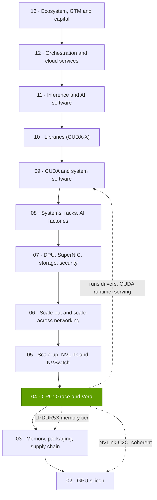
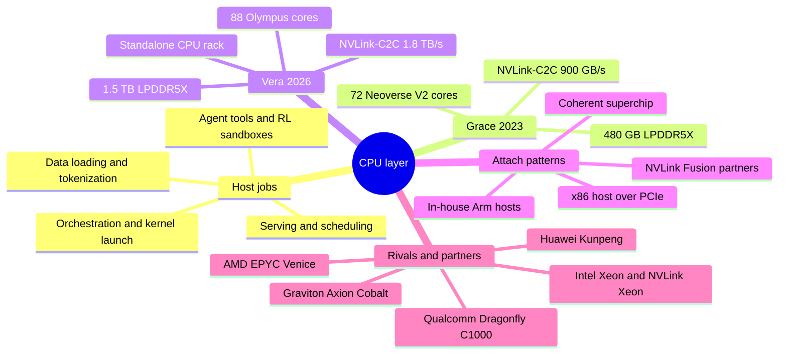

# Layer 04 — CPU (Grace, Vera)

Layer 04 of 12 · host CPUs, CPU–GPU links and CPU memory in AI systems · ~7 min read · Last verified: 2026-11-05

## ⚡ The Executive Take

- **Every GPU needs a [host CPU](../../glossary.md#host-cpu)** to launch its work, feed it data, run serving logic and, increasingly, execute agents' tools. A weak host starves GPUs: a 16-GPU DGX-2 delivered only 56% of its ResNet-50 throughput when its CPUs prepared the data [[S4017]](../../sources/bibliography.md#s4017).
- **NVIDIA's answer was to own the host.** Grace (72 Arm cores, up to 480 GB of LPDDR5X) attaches to its GPUs over 900 GB/s [NVLink-C2C](../../glossary.md#nvlink-c2c), ~7× a PCIe Gen5 x16 link, with [cache coherence](../../glossary.md#cache-coherence) that turns CPU memory into a second GPU memory tier [[S129]](../../sources/bibliography.md#s129)[[S222]](../../sources/bibliography.md#s222).
- **Host bandwidth per GPU** rose from 128 GB/s (DGX H100) to 900 GB/s (GH200), fell to ~450 GB/s when GB200 put two GPUs on each Grace, and returns to ~900 GB/s on Vera Rubin, which also gives each GPU ~750 GB of CPU memory [[S128]](../../sources/bibliography.md#s128)[[S4019]](../../sources/bibliography.md#s4019)[[S100]](../../sources/bibliography.md#s100)[[S102]](../../sources/bibliography.md#s102).
- **Vera (2026) is NVIDIA's first custom-core CPU:** 88 cores, 176 threads, up to 1.5 TB of LPDDR5X at ~1.2 TB/s, also sold standalone in a 256-CPU rack for agent sandboxes [[S4000]](../../sources/bibliography.md#s4000)[[S4002]](../../sources/bibliography.md#s4002); Meta is the first large standalone Grace customer [[S4006]](../../sources/bibliography.md#s4006).
- **Agentic AI is lifting CPU demand:** Intel and TrendForce see AI-server CPU:GPU ratios moving toward 1:2–1:1 [[S4012]](../../sources/bibliography.md#s4012)[[S4013]](../../sources/bibliography.md#s4013), amid a 2026 server-CPU shortage [[S4015]](../../sources/bibliography.md#s4015).
- **Weakness and strongest challenger:** the host is ~2% of rack cost (~$180k of an estimated $7.8M Vera Rubin rack) [[S331]](../../sources/bibliography.md#s331), general CPU work is commoditized and Vera's benchmark lead is modest [[S4003]](../../sources/bibliography.md#s4003). AMD's 256-core EPYC Venice anchors the Helios rack [[S4028]](../../sources/bibliography.md#s4028)[[S538]](../../sources/bibliography.md#s538); AWS, Google and Microsoft run their own Arm CPUs.
- **NVIDIA hedges both ways:** a $5B Intel stake for custom x86 CPUs with NVLink [[S4009]](../../sources/bibliography.md#s4009) and [NVLink Fusion](../../glossary.md#nvlink-fusion) for Qualcomm and Fujitsu CPUs [[S90031]](../../sources/bibliography.md#s90031).

> [!TIP]
> **Worked example — what the host costs and what it controls.** Morgan Stanley estimates a Vera Rubin NVL72 at ~$7.8M with its 36 Vera CPUs at ~$180k [[S331]](../../sources/bibliography.md#s331): **~2.3%** of the rack, ~$2,500 of CPU per GPU. Those CPUs carry 54 TB of LPDDR5X, ~2.6× the rack's 20.7 TB of HBM4 [[S102]](../../sources/bibliography.md#s102)[[S362]](../../sources/bibliography.md#s362), and the scheduler path for all 72 GPUs. **Conclusion:** a small slice of the bill decides how much context each GPU keeps warm.

## Where this layer sits in the stack

## Layer map

## The eight questions at a glance

| # | Question | Short answer | Where answered |
|---|---|---|---|
| Q1 | Job, and what breaks if weak? | Feeds GPUs and runs non-matrix work; a weak host starves GPUs (44% idle on DGX-2) [[S4017]](../../sources/bibliography.md#s4017) | [Why AI needs a CPU](why-ai-needs-a-cpu.md) |
| Q2 | Metrics that matter? | Host bandwidth per GPU, CPU memory per GPU, bandwidth per core, host threads per GPU, perf/W | [Grace and the superchip](grace-and-the-superchip.md) |
| Q3 | Generational progress? | Host link per GPU 128 → 900 GB/s; CPU memory per GPU ~240 → ~750 GB; threads per GPU 28 → 88 | [Vera and custom cores](vera-and-custom-cores.md) |
| Q4 | Source of advantage? | Integration (coherent link, rack co-design), not better cores | [History and how built](history-and-how-built.md) |
| Q5 | Strongest challenger? | AMD (Venice in Helios) in the rack; hyperscaler Arm CPUs for agent fleets | [Competition](competition.md) |
| Q6 | Replication cost? | An Arm CPU is easy; a coherent rack-scale CPU–GPU platform is hard | [History and how built](history-and-how-built.md) |
| Q7 | Roadmap? | Vera H2 2026; Rosa with Feynman 2028 🟡; Intel NVLink Xeon undated; AMD Verano 2027; Qualcomm C1000 H2 2028 🟡 | [Roadmap](roadmap.md) |
| Q8 | Value pools and M&A? | CPUs ~2% of rack cost (Est.) [[S331]](../../sources/bibliography.md#s331); value lies in the memory tier, Fusion licensing and standalone agentic CPUs | [Value chain and corp dev](value-chain-and-corp-dev.md) |

## Pages in this layer

| Page | What you will learn |
|---|---|
| [Why an AI system needs a CPU](why-ai-needs-a-cpu.md) | Host jobs, GPU starvation, CPU:GPU ratios, agentic CPU demand |
| [Grace and the superchip](grace-and-the-superchip.md) | Coherent NVLink-C2C vs PCIe, the superchip family, KV-cache offload, metrics |
| [Vera and custom cores](vera-and-custom-cores.md) | Vera's design, why custom cores, benchmark claims, the Intel deal |
| [CPU attach strategies](cpu-attach-strategies.md) | How each vendor pairs CPUs with accelerators |
| [Competition](competition.md) | Head-to-head comparison and capability heatmap |
| [History and how NVIDIA built it](history-and-how-built.md) | Timeline, key decisions, replication cost, counterfactuals |
| [Roadmap](roadmap.md) | Vera, Rosa and rival CPU roadmaps with confidence tags |
| [Value chain and corp dev angles](value-chain-and-corp-dev.md) | Who captures CPU-layer dollars, private companies, M&A |

🔧 Under the hood: how to read a host CPU spec sheet

- **Bandwidth figures** are usually both directions combined; one direction is half (PCIe Gen5 x16 = 128 GB/s total, ~64 each way).
- **Shared links:** divide a C2C figure by the GPUs on it (GB200: 900 ÷ 2).
- **Memory bandwidth** is a peak; sustained STREAM results run 80–95% of it on Grace [[S4020]](../../sources/bibliography.md#s4020).
- **Threads vs cores:** cloud vCPUs are hardware threads; Grace has one per core, Vera and most x86 parts two.

## 🎯 Corp Dev Lens

1. **Control point, not profit pool.** At ~$5,000 per Vera inside a rack (Est.) [[S331]](../../sources/bibliography.md#s331), CPU revenue is small; owning the host secures the memory tier, scheduler path and rack design.
2. **Agentic CPUs are a new socket market.** If sandbox fleets approach 1:1 with GPUs [[S4012]](../../sources/bibliography.md#s4012)[[S4013]](../../sources/bibliography.md#s4013), the winner of standalone agent CPUs (Vera, AMD, Intel or hyperscaler Arm) gains a large business; Meta's 2027 Vera CPU-only plan is a test [[S4006]](../../sources/bibliography.md#s4006).
3. **Qualcomm question (public information only):** with a Fusion CPU partnership [[S131]](../../sources/bibliography.md#s131), AI200/AI250 racks [[S173]](../../sources/bibliography.md#s173) and a ~250-core Dragonfly C1000 targeted for H2 2028 🟡 [[S4030]](../../sources/bibliography.md#s4030), which host role (NVIDIA-attached, own-rack or standalone agent fleet) offers the clearest path to scale?

## 📚 Sources

<!-- Auto-generated from the [S…] citations on this page by `make build`. Edit sources/registry/*.csv, not this list. -->

- [**S100**](../../sources/bibliography.md#s100) NVIDIA Technical Blog, *Inside the NVIDIA Vera Rubin Platform: Six New Chips, One AI Supercomputer*, 2026-01-05. [Link](https://developer.nvidia.com/blog/inside-the-nvidia-rubin-platform-six-new-chips-one-ai-supercomputer/)
- [**S102**](../../sources/bibliography.md#s102) NVIDIA, *NVIDIA DGX Vera Rubin NVL72*, 2026. [Link](https://www.nvidia.com/en-us/data-center/dgx-vera-rubin-nvl72/)
- [**S128**](../../sources/bibliography.md#s128) NVIDIA, *NVIDIA GH200 Grace Hopper Superchip*, 2023-08. [Link](https://www.nvidia.com/en-us/data-center/grace-hopper-superchip/)
- [**S129**](../../sources/bibliography.md#s129) NVIDIA, *NVIDIA Grace CPU*, 2023. [Link](https://www.nvidia.com/en-us/data-center/grace-cpu/)
- [**S131**](../../sources/bibliography.md#s131) NVIDIA Newsroom, *NVIDIA NVLink Fusion: semi-custom AI infrastructure partner ecosystem (Computex 2025)*, 2025-05-19. [Link](https://nvidianews.nvidia.com/news/nvidia-nvlink-fusion-semi-custom-ai-infrastructure-partner-ecosystem)
- [**S173**](../../sources/bibliography.md#s173) Qualcomm, *Qualcomm Unveils AI200 and AI250 - Redefining Rack-Scale Data Center Inference*, 2025-10-27. [Link](https://www.qualcomm.com/news/releases/2025/10/qualcomm-unveils-ai200-and-ai250-redefining-rack-scale-data-cent)
- [**S222**](../../sources/bibliography.md#s222) Tom's Hardware, *PCI Express roadmap: the path to 1TB/s with PCIe 8.0, the challenges of integration, and beyond*, 2025. [Link](https://www.tomshardware.com/pc-components/motherboards/pci-express-roadmap-the-path-to-1tb-s-with-pci-8-0-the-challenges-of-integration-and-beyond)
- [**S331**](../../sources/bibliography.md#s331) Wccftech, *NVIDIA's Vera Rubin rack hit with 435% memory price surge, pushing HBM4 & LPDDR5X bill to $2M of $7.8M total*, 2026-05. [Link](https://wccftech.com/nvidia-vera-rubin-rack-hit-with-memory-price-surge-pushing-hbm4-lpddr5x-bill-to-2m-of-7-8m-total/)
- [**S362**](../../sources/bibliography.md#s362) Digital Citizen, *NVIDIA Vera Rubin pushes memory costs higher as NVL72 rack reaches 74.7 TB of DRAM*, 2026-05. [Link](https://www.digitalcitizen.life/nvidia-vera-rubin-pushes-memory-costs-higher-as-nvl72-rack-reaches-74-7-tb-of-dram/)
- [**S538**](../../sources/bibliography.md#s538) AMD Investor Relations, *AAI 2026: AMD Delivers Full-Stack Compute for the Agentic AI Era*, 2026-07-23. [Link](https://ir.amd.com/news-events/press-releases/detail/1294/aai-2026-amd-delivers-full-stack-compute-for-the-agentic-ai-era)
- [**S4000**](../../sources/bibliography.md#s4000) NVIDIA Newsroom, *NVIDIA Launches Vera CPU, Purpose-Built for Agentic AI*, 2026-03-16. [Link](https://nvidianews.nvidia.com/news/nvidia-launches-vera-cpu-purpose-built-for-agentic-ai)
- [**S4002**](../../sources/bibliography.md#s4002) Tom's Hardware, *Nvidia spills the beans on Vera CPU: spec benchmarks revealed, Olympus architecture detailed and more*, 2026-07. [Link](https://www.tomshardware.com/pc-components/cpus/nvidia-spills-the-beans-on-vera-cpu-spec-benchmarks-revealed-olympus-architecture-detailed-and-more)
- [**S4003**](../../sources/bibliography.md#s4003) PC Games Hardware, *Nvidia Vera: Whitepaper legt Olympus-Architektur und erste SPEC-Werte offen*, 2026-08. [Link](https://www.pcgameshardware.de/CPU-CPU-154106/News/Nvidia-Vera-Whitepaper-Olympus-Architektur-SPEC-Benchmarks-1549020/)
- [**S4006**](../../sources/bibliography.md#s4006) SiliconANGLE, *Meta agrees to buy millions of AI chips from Nvidia, raising doubts about its in-house hardware*, 2026-02-17. [Link](https://siliconangle.com/2026/02/17/meta-agrees-buy-millions-ai-chips-nvidia-raising-doubts-house-hardware/)
- [**S4009**](../../sources/bibliography.md#s4009) SDxCentral, *Intel gets hands on Nvidia's $5B investment*, 2025-12. [Link](https://www.sdxcentral.com/news/intel-gets-hands-on-nvidias-5b-investment/)
- [**S4012**](../../sources/bibliography.md#s4012) Tom's Hardware, *CPUs are cool again: Intel and AMD reporting spikes in CPU demand due to agentic AI*, 2026-05. [Link](https://www.tomshardware.com/pc-components/cpus/cpus-are-cool-again-intel-and-amd-reporting-spikes-in-cpu-demand-due-to-agentic-ai-shortages-lisa-su-says-business-exceeded-expectations-while-intel-is-looking-at-long-term-agreements-with-potential-customers)
- [**S4013**](../../sources/bibliography.md#s4013) TrendForce, *How agentic AI is reshaping the CPU-to-GPU ratio*, 2026-09-29. [Link](https://www.trendforce.com/insights/agentic-ai-cpu-gpu)
- [**S4015**](../../sources/bibliography.md#s4015) Tom's Hardware, *Shifting need for CPUs in AI workloads drives intensifying shortages and price hikes*, 2026. [Link](https://www.tomshardware.com/pc-components/cpus/shifting-need-for-cpus-in-ai-workloads-drives-intensifying-shortages-price-hikes)
- [**S4017**](../../sources/bibliography.md#s4017) NVIDIA Technical Blog, *Case Study: ResNet50 with DALI*, 2019. [Link](https://developer.nvidia.com/blog/case-study-resnet50-dali/)
- [**S4019**](../../sources/bibliography.md#s4019) heise online, *Blackwell: Nvidia unveils its next generation of AI accelerators*, 2024-03-19. [Link](https://heise.de/en/news/Blackwell-Nvidia-unveils-its-next-generation-of-AI-accelerators-9782399.html)
- [**S4020**](../../sources/bibliography.md#s4020) NVIDIA (GitHub), *NVIDIA Grace CPU Benchmarking Guide: STREAM*, 2024. [Link](https://github.com/NVIDIA/grace-cpu-benchmarking-guide/blob/main/src/foundations/STREAM/index.md)
- [**S4028**](../../sources/bibliography.md#s4028) Digital Citizen, *AMD EPYC Venice launches with up to 256 Zen 6 cores and strong agentic AI performance claims*, 2026-07-22. [Link](https://www.digitalcitizen.life/amd-epyc-venice-launches-with-up-to-256-zen-6-cores-and-strong-agentic-ai-performance-claims/)
- [**S4030**](../../sources/bibliography.md#s4030) Counterpoint Research, *Qualcomm unveils data center roadmap at Investor Day 2026*, 2026-06. [Link](https://counterpointresearch.com/cn/reports/qualcomm-unveils-data-center-roadmap-at-investor-day-2026)
- [**S90031**](../../sources/bibliography.md#s90031) ServeTheHome, *NVIDIA announces NVLink Fusion bringing NVLink to third-party CPUs and accelerators*, 2025-05-19. [Link](https://www.servethehome.com/nvidia-announces-nvlink-fusion-bringing-nvlink-to-third-party-cpus-and-accelerators/nvlink-fusion-partners/)
