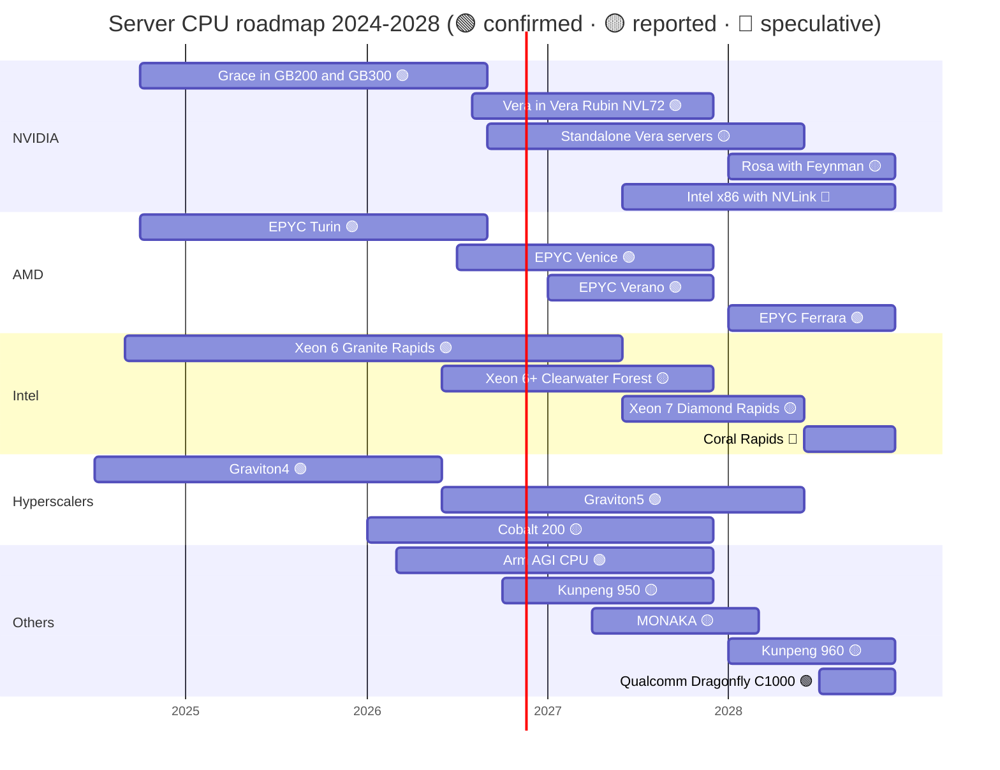

# CPU (Grace, Vera): Roadmap

Layer 04 · CPU (Grace, Vera) · ~9 min read · Last verified: 2026-11-05

## ⚡ The Executive Take

- **Vera is shipping:** with its 1.8 TB/s [NVLink-C2C](../../glossary.md#nvlink-c2c) GPU link, production shipments of Vera Rubin began in early August 2026, with the volume ramp in Q4 2026 and growth through H1 2027 🟢 [[S500]](../../sources/bibliography.md#s500)[[S90009]](../../sources/bibliography.md#s90009).
- **Standalone Vera is the new line:** NVIDIA called it a "multi-billion-dollar business" at GTC 2026, and Meta plans Vera-only servers after its Grace deployment 🟢 [[S90003]](../../sources/bibliography.md#s90003)[[S4519]](../../sources/bibliography.md#s4519).
- **Next NVIDIA CPU:** Rosa, paired with Feynman in 2028, has no published specifications 🟡 [[S90004]](../../sources/bibliography.md#s90004)[[S109]](../../sources/bibliography.md#s109).
- **[x86](../../glossary.md#x86) closes the bandwidth gap quickly:** EPYC Venice claims 1.6 TB/s in 2026 and Diamond Rapids is reported at ~2× Granite Rapids for mid-2027 🟡 [[S144]](../../sources/bibliography.md#s144)[[S4524]](../../sources/bibliography.md#s4524).
- **One undated entrant:** Intel's [NVLink](../../glossary.md#nvlink) x86 for NVIDIA has no public date 🔴 [[S468]](../../sources/bibliography.md#s468). Qualcomm's Oryon-based Dragonfly C1000 (> 250 cores) is now dated: first deployments H2 2028, Meta the first named customer 🟢 [[S90056]](../../sources/bibliography.md#s90056)[[S90058]](../../sources/bibliography.md#s90058).
- **[Q7 · Roadmap & what changes the picture]** Watch NVLink Fusion CPUs shipping, CPU-per-GPU ratios in [agentic](../../glossary.md#agentic-ai) racks, Arm's own silicon, and whether x86 gets a coherent link above [PCIe](../../glossary.md#pcie) speeds.

## The 2024–2028 roadmap

Bars show availability windows. The Intel x86-with-NVLink bar is a placeholder: Intel has not given a date [[S468]](../../sources/bibliography.md#s468). Qualcomm's C1000 window is from its June 2026 Investor Day [[S90056]](../../sources/bibliography.md#s90056). Sources per row in the table below; EPYC Turin [[S176]](../../sources/bibliography.md#s176) and Graviton4 [[S181]](../../sources/bibliography.md#s181), which are not in the table.

| Item | Window | Status | Confidence | Source |
|---|---|---|---|---|
| NVIDIA Vera (88 Olympus cores, 1.8 TB/s C2C) | 2026-Q3 → | shipping | 🟢 | [[S100]](../../sources/bibliography.md#s100)[[S500]](../../sources/bibliography.md#s500) |
| NVIDIA standalone Vera | 2026–2027 | announced; Meta runs standalone Grace now, Vera next | 🟢 product / 🟡 timing | [[S90003]](../../sources/bibliography.md#s90003)[[S4519]](../../sources/bibliography.md#s4519) |
| NVIDIA Rosa (Feynman era) | 2028 | roadmap, no specs | 🟡 | [[S90004]](../../sources/bibliography.md#s90004)[[S109]](../../sources/bibliography.md#s109) |
| Intel custom x86 with NVLink | not disclosed (deal announced 2025-09-18) | announced | 🔴 timing | [[S468]](../../sources/bibliography.md#s468) |
| AMD EPYC Venice (256 cores, 1.6 TB/s) | 2026-Q3 → | shipping, volume Q4 2026 | 🟢 | [[S538]](../../sources/bibliography.md#s538)[[S542]](../../sources/bibliography.md#s542) |
| AMD EPYC Verano / Ferrara | 2027 / 2028 | roadmap | 🟢 | [[S538]](../../sources/bibliography.md#s538)[[S540]](../../sources/bibliography.md#s540) |
| Intel Xeon 6+ Clearwater Forest (288 E-cores) | 2026 | launched at Computex | 🟡 | [[S4525]](../../sources/bibliography.md#s4525) |
| Intel Xeon 7 Diamond Rapids | mid-2027 (slipped) | roadmap | 🟡 | [[S4524]](../../sources/bibliography.md#s4524)[[S4525]](../../sources/bibliography.md#s4525) |
| Intel Coral Rapids | 2028 | leak | 🔴 | [[S4524]](../../sources/bibliography.md#s4524) |
| AWS Graviton5 (192 cores) | GA 2026-06-10 | shipping | 🟢 | [[S4526]](../../sources/bibliography.md#s4526) |
| Microsoft Cobalt 200 (132 cores) | 2026 | preview mid-2026 | 🟡 | [[S184]](../../sources/bibliography.md#s184)[[S4526]](../../sources/bibliography.md#s4526) |
| Arm AGI CPU (136 cores) | 2026 | announced, Meta first customer | 🟢 | [[S4510]](../../sources/bibliography.md#s4510) |
| Huawei Kunpeng 950 / 960 | Q4 2026 / Q1 2028 | roadmap | 🟡 | [[S4528]](../../sources/bibliography.md#s4528) |
| Fujitsu MONAKA (144 cores) | FY2027 | roadmap | 🟡 | [[S187]](../../sources/bibliography.md#s187) |
| Qualcomm Dragonfly C1000 (Oryon, > 250 cores; public information) | H2 2028 (first deployments, Meta) | announced 2026-06-24 | 🟢 announced / 🟡 timing | [[S90056]](../../sources/bibliography.md#s90056)[[S90058]](../../sources/bibliography.md#s90058)[[S4516]](../../sources/bibliography.md#s4516) |

NVIDIA and AMD rows match `data/roadmap.csv` (Rosa tagged 🟡 per the repo fact sheet); other rows were verified for this page in `data/l04_cpu_roadmap_specs.csv`.

> [!TIP]
> **Worked example — how long Vera's memory-bandwidth lead lasts.** Vera's 1,200 GB/s is 1.42× Granite Rapids' 845 GB/s [[S100]](../../sources/bibliography.md#s100)[[S179]](../../sources/bibliography.md#s179). Venice's claimed 1,600 GB/s, in volume from Q4 2026, is 1.33× Vera [[S144]](../../sources/bibliography.md#s144)[[S542]](../../sources/bibliography.md#s542). Diamond Rapids at a reported ~2× Granite Rapids (~1,690 GB/s) would arrive in mid-2027 [[S4524]](../../sources/bibliography.md#s4524). Against AMD the lead is zero; against Intel, about a year.

## Spec progression

Rivals add cores to raise throughput per socket and per dollar; NVIDIA adds memory and link bandwidth per core, because its CPU's job is keeping GPUs and latency-sensitive agent code fed.

> [!TIP]
> **Worked example — bandwidth per core.** Vera: 1,200 ÷ 88 = 13.6 GB/s per core [[S100]](../../sources/bibliography.md#s100). Venice: 1,600 ÷ 256 = 6.3 GB/s [[S144]](../../sources/bibliography.md#s144). Diamond Rapids (reported): ~1,690 ÷ 192 = 8.8 GB/s [[S4524]](../../sources/bibliography.md#s4524). A memory-hungry single thread, such as an agent's tool call or a data-loader, gets roughly twice as much bandwidth on Vera, while a fleet of small web services gets more parallel work done on Venice.

🔧 Under the hood: reading CPU roadmap claims

Peak memory bandwidth = channels × transfer rate × 8 bytes. Twelve channels of DDR5-6400 give 614 GB/s; [MRDIMM](../../glossary.md#mrdimm)-8800 (memory modules that multiplex two ranks) gives 845 GB/s on the same 12 channels [[S179]](../../sources/bibliography.md#s179). Vendor peaks assume the fastest qualified memory; real platforms often ship slower DIMMs. Vera uses [LPDDR5X](../../glossary.md#lpddr5x) on [SOCAMM](../../glossary.md#socamm) modules soldered close to the CPU, trading upgradeability for bandwidth per watt [[S100]](../../sources/bibliography.md#s100). Treat derived figures (such as Diamond Rapids' ~1.7 TB/s) as ranges until datasheets appear.

## [Q7 · Roadmap & what changes the picture]

- **[NVLink Fusion](../../glossary.md#nvlink-fusion) CPUs ship.** Qualcomm and Fujitsu CPUs or Intel's NVLink x86 inside NVIDIA racks would turn a captive socket into a contested one 🔴 [[S90031]](../../sources/bibliography.md#s90031)[[S468]](../../sources/bibliography.md#s468). Arm added NVLink Fusion support to Neoverse in November 2025 [[S90036]](../../sources/bibliography.md#s90036).
- **The CPU-per-GPU ratio rises.** TrendForce expects server CPU shipments to grow over 40% in 2027 as agentic AI adds CPU work 🟡 [[S4500]](../../sources/bibliography.md#s4500); Futurum reports Intel and AMD effectively sold out of high-core-count parts 🟡 [[S4546]](../../sources/bibliography.md#s4546).
- **x86 gets a coherent fast link.** A CXL or [UALink](../../glossary.md#ualink) path well above PCIe Gen6's ~256 GB/s would erase Vera's main structural lead; AMD, Broadcom and Intel back UALink [[S90031]](../../sources/bibliography.md#s90031).
- **Arm becomes a chip vendor.** Arm, which targeted half of [hyperscaler](../../glossary.md#hyperscaler) CPU shipments by 2025 [[S4547]](../../sources/bibliography.md#s4547), now sells an AGI CPU reported to target ~$15B over five years 🟡, competing with its licensees [[S4510]](../../sources/bibliography.md#s4510)[[S4511]](../../sources/bibliography.md#s4511).
- **Spec revisions.** NVIDIA cut Rubin's published [HBM4](../../glossary.md#hbm4) and NVLink 6 figures in late 2026 [[S90006]](../../sources/bibliography.md#s90006); Vera's published CPU specs have not changed, but buyers should model sustained, not launch, numbers.

> [!TIP]
> **Worked example — what a gigawatt means for CPU volume.** At ~230 kW per Vera Rubin [NVL72](../../glossary.md#nvl72) rack (Max-P) [[S302]](../../sources/bibliography.md#s302), 1 GW of IT power is ~4,350 racks and ~157,000 Vera CPUs (36 per rack). At ~$5,000 each (Morgan Stanley) [[S331]](../../sources/bibliography.md#s331) that is ~$0.8B of CPU silicon per GW. If agentic workloads added one standalone CPU per GPU, CPU units per GW would roughly triple (from 0.5 to 1.5 per GPU) 🔴.

## 🎯 Corp Dev Lens

1. Which roadmap event would most change the value of an NVLink-Fusion-attached CPU: a dated Intel NVLink x86 part, or a shipping Qualcomm or Fujitsu part?
2. If x86 matches Vera's memory bandwidth within a year, how durable is a CPU strategy built on bandwidth rather than on the link?
3. Is the reported 2027 CPU shipment surge structural or a one-cycle restock?
4. Does Arm's move into silicon change the economics of licensing Arm versus RISC-V for a new datacenter CPU program?

## 📚 Sources

<!-- Auto-generated from the [S…] citations on this page by `make build`. Edit sources/registry/*.csv, not this list. -->

- [**S100**](../../sources/bibliography.md#s100) NVIDIA Technical Blog, *Inside the NVIDIA Vera Rubin Platform: Six New Chips, One AI Supercomputer*, 2026-01-05. [Link](https://developer.nvidia.com/blog/inside-the-nvidia-rubin-platform-six-new-chips-one-ai-supercomputer/)
- [**S109**](../../sources/bibliography.md#s109) NVIDIA Blog, *NVIDIA GTC 2026: Live Updates on What's Next in AI*, 2026-03-16. [Link](https://blogs.nvidia.com/blog/gtc-2026-news/)
- [**S144**](../../sources/bibliography.md#s144) AMD Newsroom, *AMD Unveils Vision for an Open AI Ecosystem, Detailing New Silicon, Software and Systems at Advancing AI 2025*, 2025-06-12. [Link](https://www.amd.com/en/newsroom/press-releases/2025-6-12-amd-unveils-vision-for-an-open-ai-ecosystem-detai.html)
- [**S176**](../../sources/bibliography.md#s176) AMD, *AMD EPYC 9005 Series (Turin)*, 2024-10-10. [Link](https://www.amd.com/en/products/processors/server/epyc/9005-series.html)
- [**S179**](../../sources/bibliography.md#s179) Intel, *Intel Xeon 6 processors with P-cores (Granite Rapids, 6900P/6700P)*, 2024-09-24. [Link](https://www.intel.com/content/www/us/en/products/details/processors/xeon/xeon6-p-cores.html)
- [**S181**](../../sources/bibliography.md#s181) Amazon Web Services, *AWS Graviton Processor*, 2024. [Link](https://aws.amazon.com/ec2/graviton/)
- [**S184**](../../sources/bibliography.md#s184) Microsoft Tech Community, *Announcing Cobalt 200: Azure's next cloud-native CPU*, 2025-11-18. [Link](https://techcommunity.microsoft.com/blog/azurecompute/announcing-cobalt-200-azures-next-cloud-native-cpu/4469807)
- [**S187**](../../sources/bibliography.md#s187) Fujitsu, *FUJITSU-MONAKA: next-generation Arm-based processor*, 2025. [Link](https://www.fujitsu.com/global/about/research/technology/monaka/)
- [**S302**](../../sources/bibliography.md#s302) Hashrate Index, *NVIDIA Vera Rubin NVL72 specs breakdown*, 2026. [Link](https://hashrateindex.com/blog/nvidia-vera-rubin-nvl72-specs-breakdown/)
- [**S331**](../../sources/bibliography.md#s331) Wccftech, *NVIDIA's Vera Rubin rack hit with 435% memory price surge, pushing HBM4 & LPDDR5X bill to $2M of $7.8M total*, 2026-05. [Link](https://wccftech.com/nvidia-vera-rubin-rack-hit-with-memory-price-surge-pushing-hbm4-lpddr5x-bill-to-2m-of-7-8m-total/)
- [**S468**](../../sources/bibliography.md#s468) NVIDIA Newsroom, *NVIDIA and Intel to Develop AI Infrastructure and Personal Computing Products*, 2025-09-18. [Link](https://nvidianews.nvidia.com/news/nvidia-and-intel-to-develop-ai-infrastructure-and-personal-computing-products)
- [**S500**](../../sources/bibliography.md#s500) NVIDIA Corporation, *NVIDIA Q2 Fiscal 2027 Quarterly Presentation (CFO commentary deck)*, 2026-08-26. [Link](https://s201.q4cdn.com/141608511/files/doc_financials/2027/Q227/NVDA-F2Q27-Quarterly-Presentation-final-1.pdf)
- [**S538**](../../sources/bibliography.md#s538) AMD Investor Relations, *AAI 2026: AMD Delivers Full-Stack Compute for the Agentic AI Era*, 2026-07-23. [Link](https://ir.amd.com/news-events/press-releases/detail/1294/aai-2026-amd-delivers-full-stack-compute-for-the-agentic-ai-era)
- [**S540**](../../sources/bibliography.md#s540) Tom's Hardware, *AMD unwraps 2027 AI plans: Verano CPU, Instinct MI500X GPU, next-gen AI rack*, 2026-07. [Link](https://www.tomshardware.com/pc-components/cpus/amd-unwraps-2027-ai-plans-verano-cpu-instinct-mi500x-gpu-next-gen-ai-rack)
- [**S542**](../../sources/bibliography.md#s542) AMD via SEC EDGAR, *AMD Reports Third Quarter 2026 Financial Results (Form 8-K Exhibit 99.1)*, 2026-11-03. [Link](https://www.sec.gov/Archives/edgar/data/0000002488/000000248826000188/q32026991.htm)
- [**S4500**](../../sources/bibliography.md#s4500) TrendForce, *Server CPU shipments to grow over 40% in 2027 as Arm gains share (press release)*, 2026-10-22. [Link](https://www.trendforce.com/presscenter/news/20261022-13279.html)
- [**S4510**](../../sources/bibliography.md#s4510) TechCrunch, *Arm is releasing its first in-house chip in its 35-year history*, 2026-03-24. [Link](https://techcrunch.com/2026/03/24/arm-is-releasing-its-first-in-house-chip-in-its-35-year-history/)
- [**S4511**](../../sources/bibliography.md#s4511) MarketScreener, *Arm launches its first chip and shifts strategy with Meta as key client*, 2026-03. [Link](https://www.marketscreener.com/news/arm-launches-its-first-chip-and-shifts-strategy-with-meta-as-key-client-ce7e5ed2da80ff2c)
- [**S4516**](../../sources/bibliography.md#s4516) DatacenterDynamics, *Qualcomm to return to data center market with AI CPUs*, 2025-05. [Link](https://www.datacenterdynamics.com/en/news/qualcomm-to-return-to-data-center-market-with-ai-cpus/)
- [**S4519**](../../sources/bibliography.md#s4519) The Register, *GPU who? Meta to deploy Nvidia CPUs at large scale*, 2026-02-17. [Link](https://www.theregister.com/2026/02/17/meta_nvidia_cpu/)
- [**S4524**](../../sources/bibliography.md#s4524) TweakTown, *Intel Xeon 7 Diamond Rapids reportedly delayed to mid-2027, followed by Coral Rapids in 2028*, 2026-08. [Link](https://www.tweaktown.com/news/111284/intel-xeon-7-diamond-rapids-reportedly-delayed-to-mid-2027-followed-by-coral-in-2028/index.html)
- [**S4525**](../../sources/bibliography.md#s4525) TechSpot, *Intel launches Xeon 6+ Clearwater Forest with 288 E-cores on 18A, teases Diamond Rapids for 2027*, 2026-06. [Link](https://www.techspot.com/community/topics/intel-launches-xeon-6-clearwater-forest-with-288-e-cores-on-18a-node-teases-diamond-rapids-for-2027.297679/)
- [**S4526**](../../sources/bibliography.md#s4526) Amazon Web Services, *Amazon EC2 M9g and M9gd instances powered by AWS Graviton5 are now available*, 2026-06-10. [Link](https://aws.amazon.com/about-aws/whats-new/2026/06/ec2-m9g-m9gd-instances-graviton5-processors-available)
- [**S4528**](../../sources/bibliography.md#s4528) Wccftech, *Huawei next-gen Kunpeng chips: 950 series up to 192 cores in Q4 2026, 960 series over 256 cores in Q1 2028*, 2025-09. [Link](https://wccftech.com/huawei-next-gen-kungpeng-chips-950-series-up-to-192-cores-q4-2026-960-series-over-256-cores-q1-2028/)
- [**S4546**](../../sources/bibliography.md#s4546) Futurum Group, *Will NVIDIA's Meta deal ignite a CPU supercycle?*, 2026-02. [Link](https://futurumgroup.com/insights/will-nvidias-meta-deal-ignite-a-cpu-supercycle/)
- [**S4547**](../../sources/bibliography.md#s4547) Tom's Hardware, *Arm aims to capture 50% of data center CPU market in 2025*, 2025-03. [Link](https://www.tomshardware.com/pc-components/cpus/arm-aims-to-capture-50-percent-of-data-center-cpu-market-in-2025)
- [**S90003**](../../sources/bibliography.md#s90003) eWeek, *Everything Nvidia Just Announced at GTC 2026: 7 Chips, 5 Racks, 1 Giant Bet on Agentic AI*, 2026-03-17. [Link](https://www.eweek.com/news/nvidia-gtc-2026-ai-inference-vera-rubin-neuron/)
- [**S90004**](../../sources/bibliography.md#s90004) TrendForce, *Key GTC takeaways: how Samsung, Micron, Intel and more power NVIDIA's Vera Rubin and Feynman*, 2026-03-17. [Link](https://www.trendforce.com/news/2026/03/17/news-key-gtc-takeaways-how-samsung-micron-intel-more-power-nvidias-vera-rubin-and-feynman/)
- [**S90006**](../../sources/bibliography.md#s90006) TweakTown, *Nvidia cuts Vera Rubin's memory bandwidth by up to 26% and AMD's Helios now leads in memory bandwidth*, 2026-10. [Link](https://www.tweaktown.com/news/114304/nvidia-cuts-vera-rubins-memory-bandwidth-by-up-to-26-percent-and-amds-helios-now-leads-in-memory-bandwidth/index.html)
- [**S90009**](../../sources/bibliography.md#s90009) GamesBeat, *Nvidia Vera Rubin ramps into full production for fall launch*, 2026. [Link](https://gamesbeat.com/nvidia-vera-rubin-ramps-into-full-production-for-fall-launch-again/)
- [**S90031**](../../sources/bibliography.md#s90031) ServeTheHome, *NVIDIA announces NVLink Fusion bringing NVLink to third-party CPUs and accelerators*, 2025-05-19. [Link](https://www.servethehome.com/nvidia-announces-nvlink-fusion-bringing-nvlink-to-third-party-cpus-and-accelerators/nvlink-fusion-partners/)
- [**S90036**](../../sources/bibliography.md#s90036) Converge Digest, *Arm extends Neoverse with NVIDIA NVLink Fusion*, 2025-11. [Link](https://convergedigest.com/arm-extends-neoverse-with-nvidia-nvlink-fusion/)
- [**S90056**](../../sources/bibliography.md#s90056) HPCwire (Qualcomm press release), *Qualcomm unveils data center roadmap for the agentic AI era with new Dragonfly portfolio*, 2026-06-24. [Link](https://www.hpcwire.com/off-the-wire/qualcomm-unveils-data-center-roadmap-for-the-agentic-ai-era-with-new-dragonfly-portfolio/)
- [**S90058**](../../sources/bibliography.md#s90058) Constellation Research, *Qualcomm outlines new CPU, AI accelerator roadmap, inks deal with Meta*, 2026-06-24. [Link](https://www.constellationr.com/insights/news/qualcomm-outlines-new-cpu-ai-accelerator-roadmap-inks-deal-meta)
