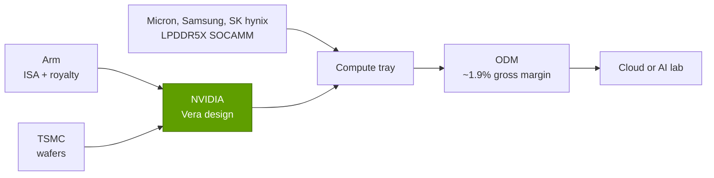

# CPU (Grace, Vera): Value chain and corp dev angles

Layer 04 · CPU (Grace, Vera) · ~10 min read · Last verified: 2026-11-05

## ⚡ The Executive Take

- **Inside an AI rack the CPU is a small line item:** 36 Vera CPUs cost an estimated ~$0.18M of a ~$7.8M Vera Rubin NVL72 rack (~2%), about 4.5 cents per GPU dollar (Est., Morgan Stanley) [[S331]](../../sources/bibliography.md#s331)[[S330]](../../sources/bibliography.md#s330).
- **Its memory is not small:** the rack holds 54 TB of [LPDDR5X](../../glossary.md#lpddr5x), and Morgan Stanley's figures imply ~$1.1M (~14%) for the CPU-attached [SOCAMM](../../glossary.md#socamm) modules 🔴 [[S362]](../../sources/bibliography.md#s362)[[S332]](../../sources/bibliography.md#s332).
- **Outside the rack the CPU is a large, contested pool:** AMD holds ~46% of x86 server CPU value, and NVIDIA reportedly sees ~$20B of standalone CPU revenue this fiscal year within a "$200B" opportunity 🟡 [[S4503]](../../sources/bibliography.md#s4503)[[S4522]](../../sources/bibliography.md#s4522).
- **Arm's toll is rising:** analysts put royalties at ~1–3% of chip price for Armv8, ~2–5% for Armv9 and ~8–10% for [Compute Subsystems](../../glossary.md#compute-subsystem) (Est.) [[S4508]](../../sources/bibliography.md#s4508)[[S4509]](../../sources/bibliography.md#s4509); Arm's royalty revenue was $670M in the September 2026 quarter [[S4506]](../../sources/bibliography.md#s4506).
- **Arm now also sells chips:** its 136-core AGI CPU (March 2026, Meta) competes with its own licensees [[S4510]](../../sources/bibliography.md#s4510).
- **CPU teams change hands at $0.4B–$6.5B:** Annapurna, NUVIA, Ampere; Ventana and Rivos went undisclosed in 2025 [[S4540]](../../sources/bibliography.md#s4540)[[S4539]](../../sources/bibliography.md#s4539)[[S4530]](../../sources/bibliography.md#s4530)[[S4512]](../../sources/bibliography.md#s4512)[[S4518]](../../sources/bibliography.md#s4518).
- **[Q8 · Value pools & M&A angles]** Three pools: rack attach (small dollars, high control), the general-purpose and agentic fleet (large dollars, contested), and the IP layer (Arm royalties, RISC-V cores, interconnect IP).

## Who captures the CPU dollar

In an [x86](../../glossary.md#x86) server, Intel or AMD capture nearly all of the CPU dollar: ISA, core and chip. In an Arm server the dollar splits: Arm takes a [royalty](../../glossary.md#ip-royalty) and licence fee, the designer (NVIDIA, AWS, Ampere) the rest; a [hyperscaler](../../glossary.md#hyperscaler) takes its "margin" as lower cloud cost. NVIDIA bundles the CPU into a superchip or tray, so its value sits inside NVIDIA's ~75% gross margin [[S3]](../../sources/bibliography.md#s3)[[S90011]](../../sources/bibliography.md#s90011).

| Player | Role | How it captures value | Evidence |
|---|---|---|---|
| Arm | ISA, cores, CSS | Royalty per chip plus licence fees | $670M royalty revenue in one quarter [[S4506]](../../sources/bibliography.md#s4506) |
| NVIDIA | CPU designer and platform owner | Bundled in superchip and tray prices | ~$5k per Vera inside a ~$7.8M rack (Est.) [[S331]](../../sources/bibliography.md#s331) |
| AMD, Intel | x86 duopoly | Merchant CPU margins | AMD ~46% of x86 server value [[S4503]](../../sources/bibliography.md#s4503) |
| TSMC | Foundry | Wafer price | ~$19.5k per N3 wafer, ~$30k per N2 (Est.) [[S35006]](../../sources/bibliography.md#s35006)[[S35003]](../../sources/bibliography.md#s35003) |
| Memory makers | LPDDR5X, HBM | Module and stack sales | ~$1.1M LPDDR5X implied per VR rack 🔴 [[S332]](../../sources/bibliography.md#s332) |
| ODMs | Assembly | Thin margin | ~1.9% gross margin on a VR rack (Est.) [[S332]](../../sources/bibliography.md#s332) |

> [!TIP]
> **Worked example — CPU cents per accelerator dollar.** Vera Rubin NVL72 (Morgan Stanley, Est.): $0.18M of Vera ÷ $3.96M of Rubin GPUs = **4.5 cents** of CPU per GPU dollar [[S331]](../../sources/bibliography.md#s331)[[S332]](../../sources/bibliography.md#s332). Add the implied $1.1M of LPDDR5X and the CPU complex becomes ~32 cents per GPU dollar 🔴 [[S332]](../../sources/bibliography.md#s332). The chip is cheap; the memory, and the right to choose it, are not.

## Arm royalties and x86 versus Arm value capture

Arm raises its take by moving licensees from Armv8 to Armv9 to Compute Subsystems (pre-verified blocks of cores, mesh and I/O). Court testimony showed a plan, dating to at least 2019, to lift annual smartphone royalties by ~$1B over a decade [[S4507]](../../sources/bibliography.md#s4507). Data-center royalties more than doubled year on year in Q1 FY2027 [[S4506]](../../sources/bibliography.md#s4506). Pushback exists: Qualcomm won a 2024 jury verdict and a 2025 final judgment over its NUVIA-derived cores; Arm said it would appeal [[S4545]](../../sources/bibliography.md#s4545).

> [!TIP]
> **Worked example — what Arm earns from one AI rack.** 36 Vera × ~$5,000 × 2–5% (Armv9 range) = **$3,600–9,000 per rack**, or 0.05–0.12% of a ~$7.8M rack [[S331]](../../sources/bibliography.md#s331)[[S4508]](../../sources/bibliography.md#s4508)[[S4509]](../../sources/bibliography.md#s4509). CSS-based hyperscaler CPUs pay ~8–10%; NVIDIA's own Olympus cores likely sit nearer the low end 🔴. Arm's prize is the general-purpose fleet, not the GPU rack.

🔧 Under the hood: the three ways to license Arm

An **[architecture licence](../../glossary.md#architecture-licence)** lets a company design its own cores that implement the Arm ISA (Apple, Qualcomm's Oryon, NVIDIA's Olympus). A **core licence** buys Arm-designed cores such as [Neoverse](../../glossary.md#neoverse) V2 (Grace, Graviton4). A **Compute Subsystem** licence buys a larger pre-integrated block (Microsoft's Cobalt 100 uses Neoverse N2 CSS) [[S183]](../../sources/bibliography.md#s183). Royalties are usually a percentage of chip selling price or a per-unit fee, rising with the value Arm supplies; exact rates are confidential, so the figures here are analyst estimates [[S4508]](../../sources/bibliography.md#s4508)[[S4509]](../../sources/bibliography.md#s4509).

## Private companies and M&A history

### Private companies worth knowing

| Company | What it does | Stage / last public funding | Why it matters |
|---|---|---|---|
| Ampere (SoftBank) | [Merchant](../../glossary.md#merchant-silicon) Arm server CPUs (AmpereOne, 192 cores) | Acquired for $6.5B; closed 2025-11-25 [[S4530]](../../sources/bibliography.md#s4530) | Main US merchant Arm server CPU; owner SoftBank also owns Arm [[S465]](../../sources/bibliography.md#s465) |
| SiPearl | European sovereign Arm HPC CPU (Rhea1, 80 Neoverse V1 cores) | €130M Series A (2025); Rhea1 powered on 2026-05-13 [[S4531]](../../sources/bibliography.md#s4531)[[S4532]](../../sources/bibliography.md#s4532) | Signal of state-backed CPU demand |
| Tenstorrent | [RISC-V](../../glossary.md#risc-v) CPU and AI IP, plus chips | $693M Series D at ~$2.6B (Dec 2024) [[S4534]](../../sources/bibliography.md#s4534); $1.5B at $6.2B reported 🟡 [[S4535]](../../sources/bibliography.md#s4535) | Licenses high-performance RISC-V cores to Samsung, LG and others |
| Akeana | RISC-V core IP up to datacenter class | $100M+ at launch (2024) [[S4533]](../../sources/bibliography.md#s4533) | A licensable non-Arm core option |
| Ventana (now Qualcomm) | RISC-V server CPU chiplets | Acquired Dec 2025, terms undisclosed [[S4512]](../../sources/bibliography.md#s4512) | RISC-V server teams are being absorbed |
| Rivos (now Meta) | RISC-V CPU and accelerator team | Acquired 2025, undisclosed; had sought $500M at ~$2B [[S4518]](../../sources/bibliography.md#s4518) | Hyperscalers buy CPU talent directly |

> [!TIP]
> **Worked example — what a CPU program costs versus what start-ups raise.** Tenstorrent's $693M Series D plus a reported $1.5B round total ~$2.2B [[S4534]](../../sources/bibliography.md#s4534)[[S4535]](../../sources/bibliography.md#s4535), inside the ~$1.5–3B this repo estimates for a competitive custom core ([history page](history-and-how-built.md)). SiPearl's €130M Series A is an order of magnitude smaller, which is consistent with its use of licensed Neoverse V1 cores and a 2026 power-on [[S4531]](../../sources/bibliography.md#s4531)[[S4532]](../../sources/bibliography.md#s4532).

### M&A history in the layer

| Date | Deal | Value | Outcome | Source |
|---|---|---|---|---|
| 2015-01 | Amazon buys Annapurna Labs | ~$350–370M reported | Became Nitro and Graviton | [[S4540]](../../sources/bibliography.md#s4540)[[S4541]](../../sources/bibliography.md#s4541) |
| 2018 | Qualcomm exits Centriq | — | Unit cut to ~50; IP to HXT joint venture in China | [[S4544]](../../sources/bibliography.md#s4544) |
| 2020-09 | NVIDIA bids for Arm | $40B | Terminated 2022-02; ~$1.36B charge | [[S465]](../../sources/bibliography.md#s465)[[S466]](../../sources/bibliography.md#s466) |
| 2021-01 | Qualcomm buys NUVIA | $1.4B | Closed 2021-03; became Oryon | [[S4539]](../../sources/bibliography.md#s4539)[[S4538]](../../sources/bibliography.md#s4538) |
| 2025-03 | SoftBank buys Ampere | $6.5B | Closed 2025-11 | [[S186]](../../sources/bibliography.md#s186)[[S4530]](../../sources/bibliography.md#s4530) |
| 2025-06 | Qualcomm buys Alphawave | ~$2.4B | Closed 2025-12-18 | [[S4514]](../../sources/bibliography.md#s4514)[[S4513]](../../sources/bibliography.md#s4513) |
| 2025-09 | NVIDIA invests in Intel | $5B equity | NVLink x86 CPUs for NVIDIA | [[S468]](../../sources/bibliography.md#s468) |
| 2025 | Meta buys Rivos; Qualcomm buys Ventana | undisclosed | RISC-V teams absorbed | [[S4518]](../../sources/bibliography.md#s4518)[[S4512]](../../sources/bibliography.md#s4512) |

> [!TIP]
> **Worked example — sizing the standalone CPU pool.** NVIDIA's reported visibility to ~$20B of standalone CPU revenue this fiscal year 🟡 [[S4522]](../../sources/bibliography.md#s4522) is more than AMD's *entire* Q3 2026 revenue of $13.4B [[S542]](../../sources/bibliography.md#s542). At ~$5,000 per Vera [[S331]](../../sources/bibliography.md#s331) that would be ~4 million CPUs, so it probably counts servers, not just chips 🔴; treat it as order-of-magnitude until NVIDIA reports CPU revenue separately [[S4523]](../../sources/bibliography.md#s4523).

See also [systems and racks](../08-systems-racks-ai-factories/index.md), [scale-up](../05-scale-up-nvlink-nvswitch/index.md), [ecosystem and capital](../13-ecosystem-gtm-and-capital/index.md) and [chapter 19](../../cross-cutting/19-implications-for-qualcomm.md).

## 🎯 Corp Dev Lens

1. In NVIDIA-attached racks the CPU silicon is ~2% of value but its memory ~14%: is the more attractive pool the CPU, the memory module, or the coherent interconnect IP that links them?
2. Hyperscalers and Meta are buying CPU teams (Annapurna, Rivos) rather than CPUs; what does that imply for the exit options of independent Arm and RISC-V CPU start-ups?
3. With Arm both raising royalties and selling its own AGI CPU, how should a licensee value an architecture licence versus a RISC-V hedge such as Ventana?
4. NVLink Fusion lets partners sell CPUs into NVIDIA racks; on what economic terms (licence fees, chiplet purchases, certification) does NVIDIA capture value from that socket?
5. If the agentic CPU pool is as large as NVIDIA claims, which assets (core teams, SerDes and chiplet IP, memory-module design) would be scarce first?

## 📚 Sources

<!-- Auto-generated from the [S…] citations on this page by `make build`. Edit sources/registry/*.csv, not this list. -->

- [**S3**](../../sources/bibliography.md#s3) StorageNewsletter, *NVIDIA Q2 Fiscal 2027 results coverage: revenue $96.2B*, 2026-08-27. [Link](https://www.storagenewsletter.com/2026/08/27/nvidia-fiscal-2q27-financial-results/)
- [**S183**](../../sources/bibliography.md#s183) Microsoft Azure Blog, *Azure Cobalt 100-based virtual machines are now generally available*, 2024-10. [Link](https://azure.microsoft.com/en-us/blog/azure-cobalt-100-based-virtual-machines-are-now-generally-available/)
- [**S186**](../../sources/bibliography.md#s186) SoftBank Group, *SoftBank Group to acquire Ampere Computing for US$6.5 billion*, 2025-03-19. [Link](https://group.softbank/en/news/press/20250320)
- [**S330**](../../sources/bibliography.md#s330) PC Gamer, *A single Nvidia Vera Rubin rack is estimated to cost $7,803,148 with over $2 million of that figure spent on memory alone*, 2026-05. [Link](https://pcgamer.com/hardware/a-single-nvidia-vera-rubin-rack-is-estimated-to-cost-usd7-803-148-with-over-usd2-million-of-that-figure-spent-on-memory-alone)
- [**S331**](../../sources/bibliography.md#s331) Wccftech, *NVIDIA's Vera Rubin rack hit with 435% memory price surge, pushing HBM4 & LPDDR5X bill to $2M of $7.8M total*, 2026-05. [Link](https://wccftech.com/nvidia-vera-rubin-rack-hit-with-memory-price-surge-pushing-hbm4-lpddr5x-bill-to-2m-of-7-8m-total/)
- [**S332**](../../sources/bibliography.md#s332) Tiger Brokers (iTiger), *Morgan Stanley's BOM analysis of NVIDIA's Rubin: GPU share declines; PCB, MLCC and ABF substrate values soar*, 2026-05-20. [Link](https://www.itiger.com/news/1188068712)
- [**S362**](../../sources/bibliography.md#s362) Digital Citizen, *NVIDIA Vera Rubin pushes memory costs higher as NVL72 rack reaches 74.7 TB of DRAM*, 2026-05. [Link](https://www.digitalcitizen.life/nvidia-vera-rubin-pushes-memory-costs-higher-as-nvl72-rack-reaches-74-7-tb-of-dram/)
- [**S465**](../../sources/bibliography.md#s465) NVIDIA Newsroom, *NVIDIA to Acquire Arm for $40 Billion, Creating World's Premier Computing Company for the Age of AI*, 2020-09-13. [Link](https://nvidianews.nvidia.com/news/nvidia-to-acquire-arm-for-40-billion-creating-worlds-premier-computing-company-for-the-age-of-ai)
- [**S466**](../../sources/bibliography.md#s466) NVIDIA Newsroom, *NVIDIA and SoftBank Group Announce Termination of NVIDIA's Acquisition of Arm Limited*, 2022-02-08. [Link](https://nvidianews.nvidia.com/news/nvidia-and-softbank-group-announce-termination-of-nvidias-acquisition-of-arm-limited)
- [**S468**](../../sources/bibliography.md#s468) NVIDIA Newsroom, *NVIDIA and Intel to Develop AI Infrastructure and Personal Computing Products*, 2025-09-18. [Link](https://nvidianews.nvidia.com/news/nvidia-and-intel-to-develop-ai-infrastructure-and-personal-computing-products)
- [**S542**](../../sources/bibliography.md#s542) AMD via SEC EDGAR, *AMD Reports Third Quarter 2026 Financial Results (Form 8-K Exhibit 99.1)*, 2026-11-03. [Link](https://www.sec.gov/Archives/edgar/data/0000002488/000000248826000188/q32026991.htm)
- [**S4503**](../../sources/bibliography.md#s4503) Analytics Insight, *AMD server CPU revenue share hits record 46.2% as Intel faces pressure*, 2026-05. [Link](https://www.analyticsinsight.net/news/amd-server-cpu-revenue-share-hits-record-462-as-intel-faces-pressure)
- [**S4506**](../../sources/bibliography.md#s4506) Arm Holdings plc via SEC EDGAR, *Arm Holdings plc Form 6-K, Exhibit 99.2: results for the quarter ended September 30, 2026 (Q2 FYE27)*, 2026-11. [Link](https://www.sec.gov/Archives/edgar/data/0001973239/000197323926000141/exhibit992fye27q230-sepx26.htm)
- [**S4507**](../../sources/bibliography.md#s4507) The Star (Reuters), *Exclusive: Tech supplier Arm plans to hike prices, has considered developing its own chips (Reuters)*, 2025-01-13. [Link](https://thestar.com.my/tech/tech-news/2025/01/13/exclusive-tech-supplier-arm-plans-to-hike-prices-has-considered-developing-its-own-chips)
- [**S4508**](../../sources/bibliography.md#s4508) TIKR, *How to value Arm: a royalty business trading like a growth stock*, 2025. [Link](https://www.tikr.com/blog/how-to-value-arm-a-royalty-business-trading-like-a-growth-stock)
- [**S4509**](../../sources/bibliography.md#s4509) Kavout Market Lens, *Arm's royalty uplift is priced: a 49x sales multiple meets normalizing growth*, 2026. [Link](https://www.kavout.com/market-lens/arm-s-royalty-uplift-is-priced-a-49x-sales-multiple-meets-normalizing-growth)
- [**S4510**](../../sources/bibliography.md#s4510) TechCrunch, *Arm is releasing its first in-house chip in its 35-year history*, 2026-03-24. [Link](https://techcrunch.com/2026/03/24/arm-is-releasing-its-first-in-house-chip-in-its-35-year-history/)
- [**S4512**](../../sources/bibliography.md#s4512) DatacenterDynamics, *Qualcomm buys RISC-V server chip maker Ventana Micro Systems*, 2025-12-10. [Link](https://www.datacenterdynamics.com/en/news/qualcomm-buys-risc-v-server-chip-maker-ventana-microsystems/)
- [**S4513**](../../sources/bibliography.md#s4513) I-Connect007, *Qualcomm completes acquisition of Alphawave Semi*, 2025-12-18. [Link](https://iconnect007.com/article/148161/qualcomm-completes-acquisition-of-alphawave-semi/148158/ein)
- [**S4514**](../../sources/bibliography.md#s4514) CRN Asia, *Qualcomm: US$2.4 billion Alphawave Semi buy to boost data center push*, 2025-06. [Link](https://www.crnasia.com/news-network/2025/qualcomm-us-2)
- [**S4518**](../../sources/bibliography.md#s4518) DatacenterDynamics, *Meta acquires RISC-V chip startup Rivos (report)*, 2025-10. [Link](https://www.datacenterdynamics.com/en/news/meta-acquires-risc-v-chip-startup-rivos-report/)
- [**S4522**](../../sources/bibliography.md#s4522) The Stack, *Nvidia: Vera CPU opportunity sits on top of $1 trillion GPU forecast*, 2026-05. [Link](https://www.thestack.technology/nvidia-vera-cpu-gpu-1-trillion/)
- [**S4523**](../../sources/bibliography.md#s4523) TIKR, *Nvidia says its CPU revenue sits outside the $1 trillion forecast*, 2026-05. [Link](https://www.tikr.com/es/blog/nvidia-says-its-cpu-revenue-sits-outside-the-1-trillion-forecast-heres-where-the-stock-could-go)
- [**S4530**](../../sources/bibliography.md#s4530) SoftBank Group, *Completion of acquisition of Ampere Computing Holdings LLC*, 2025-11-26. [Link](https://group.softbank/en/news/press/20251126)
- [**S4531**](../../sources/bibliography.md#s4531) HPCwire, *SiPearl closes €130M Series A to advance sovereign European supercomputing processors*, 2025-07. [Link](https://www.hpcwire.com/off-the-wire/sipearl-closes-e130m-series-a-to-advance-sovereign-european-supercomputing-processors/)
- [**S4532**](../../sources/bibliography.md#s4532) SiPearl, *SiPearl press corner (Rhea1 power-on, 2026-05-13)*, 2026-05-13. [Link](https://sipearl.com/relations-presse-sipearl)
- [**S4533**](../../sources/bibliography.md#s4533) SiliconANGLE, *RISC-V chip startup Akeana launches with $100M+ in funding*, 2024-08. [Link](https://siliconangle.com/?p=666984)
- [**S4534**](../../sources/bibliography.md#s4534) The Register, *Tenstorrent raises $693M Series D (Samsung, Jeff Bezos among backers)*, 2024-12-04. [Link](https://www.theregister.com/2024/12/04/riscv_ai_champion_investment/)
- [**S4535**](../../sources/bibliography.md#s4535) GCN, *Tenstorrent raises $1.5 billion to challenge Nvidia on AI chips*, 2026. [Link](https://gcn.com/?p=22745)
- [**S4538**](../../sources/bibliography.md#s4538) Qualcomm Investor Relations, *Qualcomm completes acquisition of NUVIA*, 2021-03-16. [Link](https://investor.qualcomm.com/news-events/press-releases/news-details/2021/Qualcomm-Completes-Acquisition-of-NUVIA-03-16-2021/default.aspx)
- [**S4539**](../../sources/bibliography.md#s4539) PYMNTS, *Qualcomm inks $1.4 billion acquisition deal with chip startup NUVIA*, 2021-01-13. [Link](https://www.pymnts.com/partnerships/2021/qualcomm-inks-1-4-billion-acquisition-deal-with-chip-startup-nuvia/)
- [**S4540**](../../sources/bibliography.md#s4540) Global Venturing, *Arm exits Annapurna Labs in $370m acquisition*, 2015-01-23. [Link](https://globalventuring.com/blog/2015/01/23/arm-exits-annapurna-labs-in-370m-acquisition/)
- [**S4541**](../../sources/bibliography.md#s4541) The Register, *Amazon AWS puts custom Arm server chip (Graviton) into the cloud: A1 instances*, 2018-11-27. [Link](https://www.theregister.com/2018/11/27/amazon_aws_a1/)
- [**S4544**](../../sources/bibliography.md#s4544) Network World, *Qualcomm makes it official: no more data center chip*, 2018-12. [Link](https://www.networkworld.com/article/3327214/qualcomm-makes-it-official-no-more-data-center-chip.html)
- [**S4545**](../../sources/bibliography.md#s4545) DatacenterDynamics, *Delaware judge rules in favor of Qualcomm and Nuvia in licensing dispute with Arm*, 2025-10. [Link](https://www.datacenterdynamics.com/en/news/delaware-judge-rules-in-favor-of-qualcomm-and-nuvia-in-licensing-dispute-with-arm/)
- [**S35003**](../../sources/bibliography.md#s35003) TechNode, *TSMC sets 2nm wafer price at $30,000, far below earlier 50% increase speculation*, 2025-10-09. [Link](https://technode.com/2025/10/09/tsmc-sets-2nm-wafer-price-at-30000-far-below-earlier-50-increase-speculation/)
- [**S35006**](../../sources/bibliography.md#s35006) Silicon Analysts, *Semiconductor Wafer Pricing by Process Node (2026)*, 2026. [Link](https://siliconanalysts.com/data/wafer-pricing)
- [**S90011**](../../sources/bibliography.md#s90011) Nasdaq (Zacks), *NVIDIA Q2 earnings beat on Blackwell Ultra and Data Center strength*, 2026-08-27. [Link](https://www.nasdaq.com/articles/nvidia-q2-earnings-beat-blackwell-ultra-data-center-strength)
