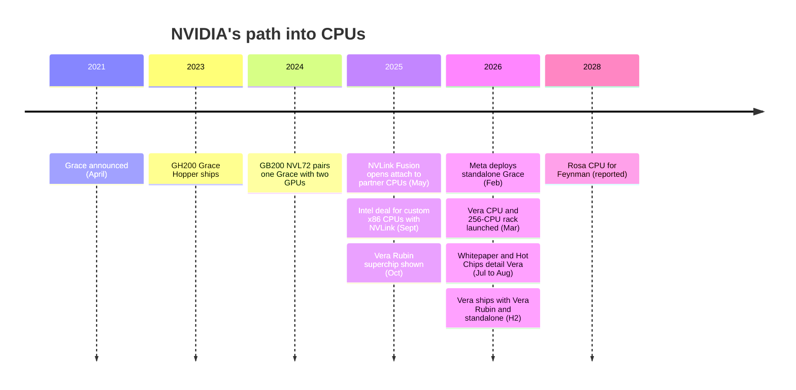

# Vera and custom cores

Layer 04 · CPU (Grace, Vera) · ~10 min read · Last verified: 2026-11-05

## ⚡ The Executive Take

- **Vera is NVIDIA's first CPU with its own cores:** 88 custom "Olympus" cores implementing [Armv9.2](../../glossary.md#arm-isa), two threads each via [Spatial Multithreading](../../glossary.md#spatial-multithreading) (176 threads), up to 1.5 TB of LPDDR5X on [SOCAMM](../../glossary.md#socamm) modules at ~1.2 TB/s, and 1.8 TB/s of NVLink-C2C to two Rubin GPUs [[S4000]](../../sources/bibliography.md#s4000)[[S4002]](../../sources/bibliography.md#s4002)[[S100]](../../sources/bibliography.md#s100).
- **NVIDIA spent its transistors on feeding data:** versus Grace, memory capacity is 3.2×, bandwidth 2.3× and the GPU link 2×, but cores only 1.22× [[S129]](../../sources/bibliography.md#s129)[[S4000]](../../sources/bibliography.md#s4000)[[S209]](../../sources/bibliography.md#s209).
- **Early tests are good, not dominant.** NVIDIA's summary of Phoronix testing puts Vera ~1.63× Grace and ~10% ahead of a 5 GHz AMD EPYC 9575F [[S4004]](../../sources/bibliography.md#s4004); NVIDIA's own SPECrate estimate (925) trails an audited two-socket EPYC 9755 result (1,070) [[S4003]](../../sources/bibliography.md#s4003).
- **Vera is also a standalone product,** launched at GTC 2026 with a 256-CPU rack and partner availability in H2 2026 [[S4000]](../../sources/bibliography.md#s4000); coverage says NVIDIA called it a multi-billion-dollar business 🟡 [[S90003]](../../sources/bibliography.md#s90003). Meta may deploy Vera CPU-only servers at scale from 2027 🟡 [[S4006]](../../sources/bibliography.md#s4006).
- **x86 is covered by partnership:** NVIDIA's $5B Intel stake closed on 2025-12-26 [[S4009]](../../sources/bibliography.md#s4009); Intel is building a custom [x86](../../glossary.md#x86) Xeon with [NVLink](../../glossary.md#nvlink) for AI host nodes, with no product name or date disclosed by May 2026 🟡 [[S4011]](../../sources/bibliography.md#s4011)[[S4010]](../../sources/bibliography.md#s4010).
- **Next:** the Feynman generation (2028) is reported to pair with a CPU named Rosa 🟡 [[S90004]](../../sources/bibliography.md#s90004)[[S109]](../../sources/bibliography.md#s109).

## 1. Vera's design in plain English

AMD's EPYC Venice reaches 256 cores [[S4028]](../../sources/bibliography.md#s4028). Vera stops at 88 and spends its budget elsewhere:

- **Bandwidth per core.** Eight 128-bit LPDDR5X controllers [[S4001]](../../sources/bibliography.md#s4001) feed ~1.2 TB/s, ~13.6 GB/s per core, roughly double Grace [[S4000]](../../sources/bibliography.md#s4000)[[S129]](../../sources/bibliography.md#s129).
- **Two threads per core, arranged differently.** Conventional [simultaneous multithreading](../../glossary.md#smt) lets two threads compete for all of a core's units, so each thread's speed depends on its neighbor. NVIDIA describes Spatial Multithreading as dividing the core's resources between the threads for more predictable performance 🟡 [[S4002]](../../sources/bibliography.md#s4002)[[S100]](../../sources/bibliography.md#s100); reviewers question how different it is [[S4005]](../../sources/bibliography.md#s4005).
- **Serviceable memory.** SOCAMM modules lift capacity to 1.5 TB per CPU and end Grace's soldered-memory limit [[S4002]](../../sources/bibliography.md#s4002).

The silicon split is disputed: one Hot Chips 2026 report describes six dies on an interposer, others a single compute die 🟡 [[S4001]](../../sources/bibliography.md#s4001).

| | Grace (2023) | Vera (2026) | Change |
|---|---|---|---|
| Cores / threads | 72 Neoverse V2 / 72 | 88 Olympus / 176 | 1.22× / 2.4× [[S129]](../../sources/bibliography.md#s129)[[S4000]](../../sources/bibliography.md#s4000) |
| Memory | ≤480 GB LPDDR5X, soldered | ≤1.5 TB LPDDR5X, SOCAMM | 3.2× [[S129]](../../sources/bibliography.md#s129)[[S4002]](../../sources/bibliography.md#s4002) |
| Memory bandwidth | ≤~512 GB/s | ~1.2 TB/s | 2.3× [[S129]](../../sources/bibliography.md#s129)[[S4000]](../../sources/bibliography.md#s4000) |
| Shared L3 cache | — | 164 MB (reported) | 🟡 [[S4002]](../../sources/bibliography.md#s4002) |
| Link to GPUs | NVLink-C2C 900 GB/s | NVLink-C2C 1.8 TB/s | 2× [[S129]](../../sources/bibliography.md#s129)[[S209]](../../sources/bibliography.md#s209) |

> [!TIP]
> **Worked example — does 1.2 TB/s add up, and how big is the lead?** A 1,024-bit bus moves 128 bytes per transfer; 1.2 TB/s ÷ 128 B ≈ **9.4 billion transfers per second**, consistent with top-speed LPDDR5X (repo arithmetic on [[S4001]](../../sources/bibliography.md#s4001)[[S4000]](../../sources/bibliography.md#s4000)). Per core: **13.6 GB/s** versus 3.0 for AMD's 192-core EPYC Turin at its 576 GB/s peak [[S176]](../../sources/bibliography.md#s176). NVIDIA's whitepaper showed Turin sustaining ~400 GB/s; Chips and Cheese reportedly measured ~570 GB/s, shrinking Vera's sustained lead from ~3× to ~1.9× 🟡 [[S4005]](../../sources/bibliography.md#s4005). **Conclusion:** the bandwidth lead is real but smaller than NVIDIA implied, and it is per socket, not per rack.

**[Q3 · Generational progress]** NVIDIA's host improved on every axis that feeds GPUs: host link per GPU from 128 GB/s ([PCIe](../../glossary.md#pcie) Gen5, DGX H100) to 900 GB/s (GH200), ~450 GB/s on GB200 and ~900 GB/s again on Vera Rubin; CPU memory per GPU from ~240 GB (GB200) to ~750 GB; host threads per GPU from 28 to 88 (charts in [Why AI needs a CPU](why-ai-needs-a-cpu.md) and [Grace and the superchip](grace-and-the-superchip.md)). Per socket:

## 2. Why NVIDIA moved from licensed Neoverse cores to its own

Grace's Neoverse V2 core [[S129]](../../sources/bibliography.md#s129) is the same core in AWS Graviton4 and Google Axion [[S181]](../../sources/bibliography.md#s181)[[S182]](../../sources/bibliography.md#s182): fast to market, but no better than customers' own chips. Custom Olympus cores buy (1) co-design of core, cache and memory around 1.8 TB/s of GPU traffic; (2) roadmap control, so features ship on NVIDIA's one-year cadence rather than Arm's; and (3) a CPU that can stand alone against EPYC and Xeon. The costs: a large core team, longer bring-up and first-generation risk; software portability is unchanged. Qualcomm (Oryon), Ampere and Fujitsu took the same custom-core route [[S4029]](../../sources/bibliography.md#s4029)[[S185]](../../sources/bibliography.md#s185)[[S187]](../../sources/bibliography.md#s187).

> [!TIP]
> **Worked example — reading NVIDIA's benchmark claim.** NVIDIA estimated two-socket Vera at **925** on SPECrate 2026 integer versus **898** for AMD's EPYC 9755, +3% [[S4003]](../../sources/bibliography.md#s4003). But an audited Dell two-socket EPYC 9755 system is listed at **1,070** [[S4003]](../../sources/bibliography.md#s4003), so NVIDIA's estimate is ~**86%** of the best published EPYC result. **Conclusion:** Vera is competitive on general CPU work, not a step change; its case rests on bandwidth per core, the C2C link and rack integration.

🔧 Under the hood: what "custom Arm core" means

- **Two kinds of Arm licence.** A core licence drops in Arm's finished design (Grace). An [architecture licence](../../glossary.md#architecture-licence) lets a company design its own core for the Arm instruction set (Vera; also Apple, Qualcomm, Ampere).
- **What stays compatible:** compilers, operating systems and applications target the instruction set, so Arm server software runs on Vera.
- **What changes:** pipeline width, branch prediction, caches, multithreading and power management, which decide per-thread speed and watts.
- **Arm's counter-move:** Arm added [NVLink Fusion](../../glossary.md#nvlink-fusion) support to Neoverse [[S90036]](../../sources/bibliography.md#s90036), so Arm-core licensees can also attach to NVIDIA GPUs.

## 3. Vera as a standalone CPU, and the x86 hedge

Timeline sources: [[S537]](../../sources/bibliography.md#s537)[[S128]](../../sources/bibliography.md#s128)[[S396]](../../sources/bibliography.md#s396)[[S131]](../../sources/bibliography.md#s131)[[S130]](../../sources/bibliography.md#s130)[[S209]](../../sources/bibliography.md#s209)[[S4006]](../../sources/bibliography.md#s4006)[[S4000]](../../sources/bibliography.md#s4000)[[S4002]](../../sources/bibliography.md#s4002)[[S4001]](../../sources/bibliography.md#s4001)[[S90004]](../../sources/bibliography.md#s90004).

NVIDIA positions standalone Vera for [agentic](../../glossary.md#agentic-ai) AI and reinforcement learning, claiming twice the efficiency of traditional rack-scale CPUs (vendor claim) [[S4000]](../../sources/bibliography.md#s4000); Dell, HPE, Lenovo and Supermicro offer Vera servers [[S4032]](../../sources/bibliography.md#s4032)[[S4033]](../../sources/bibliography.md#s4033). Meta is the anchor reference [[S4006]](../../sources/bibliography.md#s4006)[[S4008]](../../sources/bibliography.md#s4008).

> [!TIP]
> **Worked example — what "multi-billion-dollar" implies in units.** Morgan Stanley's estimate puts 36 Vera CPUs at ~$180k, **~$5,000 per CPU** inside a rack (Est.) [[S331]](../../sources/bibliography.md#s331). At that price a $2B standalone business needs **~400,000 CPUs a year**, ~1,560 of the 256-CPU racks [[S4000]](../../sources/bibliography.md#s4000); standalone prices are probably higher, so fewer units (🔴 repo analysis). **Conclusion:** the claim rests on a handful of hyperscale buyers like Meta, so customer concentration is high.

**The x86 hedge.** On 2025-09-18 NVIDIA and Intel agreed that Intel would build NVIDIA-custom x86 CPUs connected to NVIDIA platforms over NVLink [[S130]](../../sources/bibliography.md#s130); NVIDIA's $5.0B purchase of 214,776,632 shares at $23.28 closed on 2025-12-26 (a ~4–5% stake; sources differ) [[S4009]](../../sources/bibliography.md#s4009). Intel described a custom Xeon integrated with NVLink for AI host nodes in January 2026 [[S4011]](../../sources/bibliography.md#s4011) and in May 2026 confirmed the work continues, still without a name or date 🟡 [[S4010]](../../sources/bibliography.md#s4010). It keeps x86-heavy enterprises inside NVLink racks and gives Intel a route back into the AI host socket.

> [!WARNING]
> **🐻 Bear view:** a custom core is a multi-generation commitment in a market where AMD shipped 256-core Venice in July 2026 [[S4028]](../../sources/bibliography.md#s4028) and [hyperscalers](../../glossary.md#hyperscaler) build their own Arm CPUs. Intel's NVLink Xeon could also cannibalize it.

## 🎯 Corp Dev Lens

1. **Core-design talent is scarce.** NVIDIA, Qualcomm (via Nuvia), Ampere and Fujitsu built custom Arm cores; which independent CPU teams or IP houses remain partnerable?
2. **CPU business or GPU attach strategy?** Watch whether NVIDIA discloses standalone CPU revenue after Vera ships; Meta's 2027 plan is the first test [[S4006]](../../sources/bibliography.md#s4006).
3. **Qualcomm question (public information only):** Qualcomm's announced ~250-core Dragonfly C1000 targets AI head nodes for H2 2028 🟡 [[S4030]](../../sources/bibliography.md#s4030), alongside Rosa. What would have to be true for a third-party Arm CPU to win Fusion host sockets that NVIDIA can fill itself?

## 📚 Sources

<!-- Auto-generated from the [S…] citations on this page by `make build`. Edit sources/registry/*.csv, not this list. -->

- [**S100**](../../sources/bibliography.md#s100) NVIDIA Technical Blog, *Inside the NVIDIA Vera Rubin Platform: Six New Chips, One AI Supercomputer*, 2026-01-05. [Link](https://developer.nvidia.com/blog/inside-the-nvidia-rubin-platform-six-new-chips-one-ai-supercomputer/)
- [**S109**](../../sources/bibliography.md#s109) NVIDIA Blog, *NVIDIA GTC 2026: Live Updates on What's Next in AI*, 2026-03-16. [Link](https://blogs.nvidia.com/blog/gtc-2026-news/)
- [**S128**](../../sources/bibliography.md#s128) NVIDIA, *NVIDIA GH200 Grace Hopper Superchip*, 2023-08. [Link](https://www.nvidia.com/en-us/data-center/grace-hopper-superchip/)
- [**S129**](../../sources/bibliography.md#s129) NVIDIA, *NVIDIA Grace CPU*, 2023. [Link](https://www.nvidia.com/en-us/data-center/grace-cpu/)
- [**S130**](../../sources/bibliography.md#s130) NVIDIA Newsroom, *NVIDIA and Intel to Develop AI Infrastructure and Personal Computing Products*, 2025-09-18. [Link](https://nvidianews.nvidia.com/news/nvidia-and-intel-to-develop-ai-infrastructure-and-personal-computing-products)
- [**S131**](../../sources/bibliography.md#s131) NVIDIA Newsroom, *NVIDIA NVLink Fusion: semi-custom AI infrastructure partner ecosystem (Computex 2025)*, 2025-05-19. [Link](https://nvidianews.nvidia.com/news/nvidia-nvlink-fusion-semi-custom-ai-infrastructure-partner-ecosystem)
- [**S176**](../../sources/bibliography.md#s176) AMD, *AMD EPYC 9005 Series (Turin)*, 2024-10-10. [Link](https://www.amd.com/en/products/processors/server/epyc/9005-series.html)
- [**S181**](../../sources/bibliography.md#s181) Amazon Web Services, *AWS Graviton Processor*, 2024. [Link](https://aws.amazon.com/ec2/graviton/)
- [**S182**](../../sources/bibliography.md#s182) Google Cloud Blog, *Introducing Google Axion Processors, our new Arm-based CPUs*, 2024-04-09. [Link](https://cloud.google.com/blog/products/compute/introducing-googles-new-arm-based-cpu)
- [**S185**](../../sources/bibliography.md#s185) Ampere Computing, *AmpereOne processors*, 2023-05. [Link](https://amperecomputing.com/products/processors/ampereone)
- [**S187**](../../sources/bibliography.md#s187) Fujitsu, *FUJITSU-MONAKA: next-generation Arm-based processor*, 2025. [Link](https://www.fujitsu.com/global/about/research/technology/monaka/)
- [**S209**](../../sources/bibliography.md#s209) DatacenterDynamics, *Nvidia announces Vera Rubin superchip for late 2026*, 2025-10-28. [Link](https://datacenterdynamics.com/en/news/nvidia-announces-vera-rubin-superchip-for-late-2026)
- [**S331**](../../sources/bibliography.md#s331) Wccftech, *NVIDIA's Vera Rubin rack hit with 435% memory price surge, pushing HBM4 & LPDDR5X bill to $2M of $7.8M total*, 2026-05. [Link](https://wccftech.com/nvidia-vera-rubin-rack-hit-with-memory-price-surge-pushing-hbm4-lpddr5x-bill-to-2m-of-7-8m-total/)
- [**S396**](../../sources/bibliography.md#s396) NVIDIA Newsroom, *NVIDIA Blackwell platform arrives to power a new era of computing*, 2024-03-18. [Link](https://nvidianews.nvidia.com/news/nvidia-blackwell-platform-arrives-to-power-a-new-era-of-computing)
- [**S537**](../../sources/bibliography.md#s537) NVIDIA press release via Yahoo Finance, *NVIDIA Announces CPU for Giant AI and High Performance Computing Workloads*, 2021-04-12. [Link](https://sg.finance.yahoo.com/news/nvidia-announces-cpu-giant-ai-161900753.html)
- [**S4000**](../../sources/bibliography.md#s4000) NVIDIA Newsroom, *NVIDIA Launches Vera CPU, Purpose-Built for Agentic AI*, 2026-03-16. [Link](https://nvidianews.nvidia.com/news/nvidia-launches-vera-cpu-purpose-built-for-agentic-ai)
- [**S4001**](../../sources/bibliography.md#s4001) AI Weekly, *Nvidia details 88-core Vera CPU with six-chiplet Olympus design*, 2026-08. [Link](https://aiweekly.co/alerts/nvidia-details-88-core-vera-cpu-with-six-chiplet-olympus-design)
- [**S4002**](../../sources/bibliography.md#s4002) Tom's Hardware, *Nvidia spills the beans on Vera CPU: spec benchmarks revealed, Olympus architecture detailed and more*, 2026-07. [Link](https://www.tomshardware.com/pc-components/cpus/nvidia-spills-the-beans-on-vera-cpu-spec-benchmarks-revealed-olympus-architecture-detailed-and-more)
- [**S4003**](../../sources/bibliography.md#s4003) PC Games Hardware, *Nvidia Vera: Whitepaper legt Olympus-Architektur und erste SPEC-Werte offen*, 2026-08. [Link](https://www.pcgameshardware.de/CPU-CPU-154106/News/Nvidia-Vera-Whitepaper-Olympus-Architektur-SPEC-Benchmarks-1549020/)
- [**S4004**](../../sources/bibliography.md#s4004) NVIDIA Blog, *NVIDIA Vera CPU Is 'Packing a Heavy-Hitting Punch' Against Competition*, 2026-08. [Link](https://blogs.nvidia.com/blog/vera-cpu-phoronix/)
- [**S4005**](../../sources/bibliography.md#s4005) Ecosistema Startup, *NVIDIA Vera CPU: análisis crítico del whitepaper y qué significa para founders*, 2026-08. [Link](https://ecosistemastartup.com/nvidia-vera-cpu-analisis-critico-del-whitepaper-y-que-significa-para-founders/)
- [**S4006**](../../sources/bibliography.md#s4006) SiliconANGLE, *Meta agrees to buy millions of AI chips from Nvidia, raising doubts about its in-house hardware*, 2026-02-17. [Link](https://siliconangle.com/2026/02/17/meta-agrees-buy-millions-ai-chips-nvidia-raising-doubts-house-hardware/)
- [**S4008**](../../sources/bibliography.md#s4008) Futurum Group, *Will NVIDIA's Meta Deal Ignite a CPU Supercycle?*, 2026-02. [Link](https://futurumgroup.com/insights/will-nvidias-meta-deal-ignite-a-cpu-supercycle/)
- [**S4009**](../../sources/bibliography.md#s4009) SDxCentral, *Intel gets hands on Nvidia's $5B investment*, 2025-12. [Link](https://www.sdxcentral.com/news/intel-gets-hands-on-nvidias-5b-investment/)
- [**S4010**](../../sources/bibliography.md#s4010) TechSpot, *Intel CEO promises partnership with Nvidia will produce exciting new products*, 2026-05. [Link](https://www.techspot.com/news/112381-intel-ceo-promises-partnership-nvidia-produce-exciting-new.html)
- [**S4011**](../../sources/bibliography.md#s4011) Wccftech, *Intel, NVIDIA are building a custom Xeon CPU with NVLink tech; reaffirms Diamond Rapids 16-channel, Coral Rapids with SMT*, 2026-01. [Link](https://wccftech.com/intel-nvidia-are-building-a-custom-xeon-cpu-with-nvlink-tech-reaffirms-diamond-rapids-16-channel-coral-rapids-with-smt-nova-lake-in-q4/)
- [**S4028**](../../sources/bibliography.md#s4028) Digital Citizen, *AMD EPYC Venice launches with up to 256 Zen 6 cores and strong agentic AI performance claims*, 2026-07-22. [Link](https://www.digitalcitizen.life/amd-epyc-venice-launches-with-up-to-256-zen-6-cores-and-strong-agentic-ai-performance-claims/)
- [**S4029**](../../sources/bibliography.md#s4029) StorageReview, *Qualcomm unveils Dragonfly data center roadmap: C1000 CPU, AI300 accelerator*, 2026-06-24. [Link](https://www.storagereview.com/news/qualcomm-unveils-dragonfly-data-center-roadmap-c1000-cpu-ai300-accelerator-and-modular-acquisition)
- [**S4030**](../../sources/bibliography.md#s4030) Counterpoint Research, *Qualcomm unveils data center roadmap at Investor Day 2026*, 2026-06. [Link](https://counterpointresearch.com/cn/reports/qualcomm-unveils-data-center-roadmap-at-investor-day-2026)
- [**S4032**](../../sources/bibliography.md#s4032) GamesBeat, *Nvidia touts adoption for Vera CPU from world's tech leaders*, 2026-03. [Link](https://gamesbeat.com/nvidia-touts-adoption-for-vera-cpu-from-worlds-tech-leaders/)
- [**S4033**](../../sources/bibliography.md#s4033) TechSpot, *Nvidia Jensen Huang: standalone Vera CPU to challenge AMD*, 2026-01. [Link](https://www.techspot.com/news/111113-nvidia-jensen-huang-standalone-vera-cpu-challenge-amd.html)
- [**S90003**](../../sources/bibliography.md#s90003) eWeek, *Everything Nvidia Just Announced at GTC 2026: 7 Chips, 5 Racks, 1 Giant Bet on Agentic AI*, 2026-03-17. [Link](https://www.eweek.com/news/nvidia-gtc-2026-ai-inference-vera-rubin-neuron/)
- [**S90004**](../../sources/bibliography.md#s90004) TrendForce, *Key GTC takeaways: how Samsung, Micron, Intel and more power NVIDIA's Vera Rubin and Feynman*, 2026-03-17. [Link](https://www.trendforce.com/news/2026/03/17/news-key-gtc-takeaways-how-samsung-micron-intel-more-power-nvidias-vera-rubin-and-feynman/)
- [**S90036**](../../sources/bibliography.md#s90036) Converge Digest, *Arm extends Neoverse with NVIDIA NVLink Fusion*, 2025-11. [Link](https://convergedigest.com/arm-extends-neoverse-with-nvidia-nvlink-fusion/)
