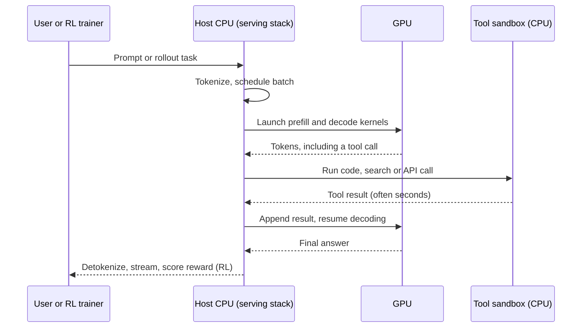

# Why an AI system needs a CPU

Layer 04 · CPU (Grace, Vera) · ~9 min read · Last verified: 2026-11-05

## ⚡ The Executive Take

- **The GPU does the math; the [host CPU](../../glossary.md#host-cpu) does everything else:** scheduling and launching GPU work, loading and decoding data, tokenizing, network and storage I/O, overflow memory and, increasingly, the tools AI agents call. A slow host leaves expensive GPUs waiting.
- **Starvation is measurable.** On a 16-GPU DGX-2, ResNet-50 training ran at 12,586 images/s with CPU preprocessing versus 22,656 images/s on synthetic data, so the GPUs sat idle ~44% of the time; moving decoding onto the GPUs recovered 21,034 images/s [[S4017]](../../sources/bibliography.md#s4017).
- **NVIDIA keeps adding host compute per GPU:** ~28 host threads per GPU on DGX H100 [[S33022]](../../sources/bibliography.md#s33022), 36 on GB200 [NVL72](../../glossary.md#nvl72) (36 Grace for 72 GPUs) [[S396]](../../sources/bibliography.md#s396) and ~88 on Vera Rubin NVL72 (repo arithmetic on [[S4000]](../../sources/bibliography.md#s4000)[[S102]](../../sources/bibliography.md#s102)).
- **Agentic AI and reinforcement learning push CPU demand up.** Intel said in 2026 that CPU:GPU ratios could tighten toward 1:1 in agentic scenarios [[S4012]](../../sources/bibliography.md#s4012); TrendForce projects 1:2 to 1:1 [[S4013]](../../sources/bibliography.md#s4013); server-CPU lead times reached ~6 months in early 2026 [[S4015]](../../sources/bibliography.md#s4015).
- **NVIDIA now sells CPUs for that demand:** a 256-CPU Vera rack sustaining >22,500 concurrent CPU environments [[S4000]](../../sources/bibliography.md#s4000), about one per core (256 × 88 = 22,528).
- **Bear point:** the host is the cheap part of the rack (~$180k of an estimated $7.8M Vera Rubin NVL72) [[S331]](../../sources/bibliography.md#s331), and [hyperscalers](../../glossary.md#hyperscaler) can run agent tools on their own Arm fleets; AWS gives each Trainium3 only 16 host vCPUs [[S354]](../../sources/bibliography.md#s354).

## 1. What the host actually does

Think of a restaurant: the GPUs are very fast cooks who can only cook; the host CPU is the expediter and prep kitchen. If the expediter is slow, the cooks stand idle. The host's six jobs:

1. **Orchestration:** drivers, the [CUDA](../../glossary.md#cuda) runtime and the thousands of kernel launches per step ([Layer 09](../09-cuda-and-system-software/index.md)).
2. **Data loading:** reading, decoding, augmenting and tokenizing training data. A slow [data loader](../../glossary.md#data-loader) causes [GPU starvation](../../glossary.md#gpu-starvation).
3. **I/O:** checkpoints, storage and network setup, partly offloaded to DPUs ([Layer 07](../07-dpu-supernic-storage-security/index.md)).
4. **Serving:** request handling, tokenization, batching and streaming.
5. **Overflow memory:** weights, [KV cache](../../glossary.md#kv-cache) and embeddings that do not fit in [HBM](../../glossary.md#hbm) ([Grace and the superchip](grace-and-the-superchip.md)).
6. **Agent tools and RL environments:** code execution, browsing and API calls for [agentic AI](../../glossary.md#agentic-ai), and scoring for [reinforcement learning](../../glossary.md#reinforcement-learning).

In one agent turn, only the GPU steps below are matrix math:

> [!TIP]
> **Worked example — what a slow host cost a DGX-2.** NVIDIA measured ResNet-50 training on one DGX-2 (16 V100 GPUs, 48 host cores) [[S4017]](../../sources/bibliography.md#s4017)[[S313]](../../sources/bibliography.md#s313):
> - GPU ceiling with synthetic data: **22,656 images/s**; with the CPU data loader: **12,586 images/s** (56%).
> - The CPUs decoded ~262 images/s per core (12,586 ÷ 48), so feeding the ceiling would have needed ~86 cores, 1.8× what the box had.
> - At the $399,000 list price [[S313]](../../sources/bibliography.md#s313)[[S314]](../../sources/bibliography.md#s314), 44% idle time strands ~$176,000 of hardware per system.
> - The fix moved work onto the GPU: [DALI](../../glossary.md#dali) reached **21,034 images/s** (93%) [[S4017]](../../sources/bibliography.md#s4017), and A100 added a hardware JPEG decoder [[S4018]](../../sources/bibliography.md#s4018).
>
> **Conclusion:** host bottlenecks are fixed by buying more CPU or moving work to the GPU. Agent tool calls cannot move to the GPU, which is why CPU demand is rising again.

**[Q1 · Job & failure mode]** The host keeps the GPUs busy and runs everything that is not dense matrix math. When it is weak, nothing crashes; GPUs simply starve (44% idle in the DGX-2 test), time-to-first-token rises when context must be recomputed instead of reloaded, and agent or RL loops stall waiting for tools. A weak host quietly lowers the return on the most expensive part of the system.

🔧 Under the hood: where host time goes

- **Kernel launches** cost microseconds of CPU time each; CUDA Graphs record a step and replay it with one call.
- **Pinned memory:** data must sit in page-locked host memory before the GPU's copy engines can move it.
- **NUMA:** in a two-socket [x86](../../glossary.md#x86) server each CPU owns half the GPUs; a loader thread on the wrong socket crosses the inter-socket link. A single-CPU superchip avoids this.

## 2. CPU:GPU ratios by system generation

NVIDIA's x86 DGX servers kept two CPU sockets per eight GPUs for eight years (DGX-1 through DGX B200) [[S189]](../../sources/bibliography.md#s189)[[S188]](../../sources/bibliography.md#s188)[[S33022]](../../sources/bibliography.md#s33022)[[S319]](../../sources/bibliography.md#s319); the 16-GPU DGX-2 ran 1:8 [[S313]](../../sources/bibliography.md#s313). GH200 put a 72-core Grace beside every GPU [[S128]](../../sources/bibliography.md#s128); GB200, GB300 and Vera Rubin NVL72 settled on 36 CPUs for 72 GPUs [[S396]](../../sources/bibliography.md#s396)[[S32004]](../../sources/bibliography.md#s32004)[[S102]](../../sources/bibliography.md#s102). Rivals chose differently: AMD's Helios pairs 18 EPYC Venice CPUs with 72 GPUs (1:4) [[S538]](../../sources/bibliography.md#s538), and AWS publishes vCPUs instead: 12 per Trainium2, 16 per Trainium3 [[S4021]](../../sources/bibliography.md#s4021)[[S354]](../../sources/bibliography.md#s354).

> [!TIP]
> **Worked example — host threads per GPU.** DGX H100: 2 × 56 cores × 2 threads ÷ 8 GPUs = **28** [[S33022]](../../sources/bibliography.md#s33022). GB200 NVL72: 36 × 72 cores ÷ 72 = **36** [[S396]](../../sources/bibliography.md#s396)[[S129]](../../sources/bibliography.md#s129). Vera Rubin NVL72: 36 × 88 cores × 2 threads ÷ 72 = **88** [[S4000]](../../sources/bibliography.md#s4000)[[S102]](../../sources/bibliography.md#s102). AWS Trn3 Gen2: 2,304 vCPUs ÷ 144 chips = **16** [[S354]](../../sources/bibliography.md#s354). **Reading:** NVIDIA bundles 3–5× more host compute per accelerator than AWS; foresight about agents, or CPU cost some buyers would rather provision separately.

## 3. Agentic AI and RL: why CPU demand is rising again

Agents alternate GPU "thinking" with CPU "acting" (running code, querying databases, browsing); a two-second tool call holds that request's GPU slot unless the scheduler refills it. RL post-training generates thousands of attempts per step, each executed and scored in an isolated [sandbox](../../glossary.md#agent-sandbox), typically one core each.

The industry noticed in 2026: Intel said ratios could move toward 1:1 from today's 1:4–1:8 [[S4012]](../../sources/bibliography.md#s4012); AMD said CPU demand exceeded expectations [[S4012]](../../sources/bibliography.md#s4012); Counterpoint credits agentic demand for AMD's Q1 2026 share gains while Intel was supply-constrained [[S4014]](../../sources/bibliography.md#s4014). NVIDIA answered with standalone Vera and the Vera CPU rack [[S4000]](../../sources/bibliography.md#s4000), which coverage says NVIDIA framed as a multi-billion-dollar business 🟡 [[S90003]](../../sources/bibliography.md#s90003).

> [!TIP]
> **Worked example — sizing CPUs for an RL run.** Keep 22,500 sandboxes busy at one core each, NVIDIA's figure for one Vera rack (256 × 88 = 22,528 cores) [[S4000]](../../sources/bibliography.md#s4000). A GB200 NVL72 rack carries 36 × 72 = 2,592 Grace cores [[S396]](../../sources/bibliography.md#s396)[[S129]](../../sources/bibliography.md#s129), already busy serving their own GPUs, so the same load would need the host cores of **~8.7 GB200 racks**. **Conclusion:** at agentic scale a dedicated CPU pool beats borrowing GPU-rack hosts, and whoever supplies that pool captures a new CPU socket market.

> [!WARNING]
> **🐻 Bear view:** agent tools run on any CPU. Graviton5 (192 cores), Cobalt 200 (132) and AMD's 256-core Venice are already in market [[S4022]](../../sources/bibliography.md#s4022)[[S4024]](../../sources/bibliography.md#s4024)[[S4028]](../../sources/bibliography.md#s4028); the sandbox fleet is the most commoditized part of the AI stack.

## 🎯 Corp Dev Lens

1. **Where does agentic CPU demand land?** Inside GPU racks (NVIDIA captures it) or on general-purpose fleets (AMD, Intel, hyperscaler Arm)? Watch the largest labs' capex disclosures.
2. **Profit pool or control point?** At ~$5,000 per Vera inside a rack (Est., $180k ÷ 36) [[S331]](../../sources/bibliography.md#s331), CPU revenue is small; its value is control of the memory tier and scheduler path.
3. **Qualcomm question (public information only):** Qualcomm positions its announced Dragonfly C1000 for agentic orchestration and AI head nodes 🟡 [[S4029]](../../sources/bibliography.md#s4029). Does the agentic shift make an efficient, high-core-count Arm CPU a standalone entry point regardless of GPU attach?

## 📚 Sources

<!-- Auto-generated from the [S…] citations on this page by `make build`. Edit sources/registry/*.csv, not this list. -->

- [**S102**](../../sources/bibliography.md#s102) NVIDIA, *NVIDIA DGX Vera Rubin NVL72*, 2026. [Link](https://www.nvidia.com/en-us/data-center/dgx-vera-rubin-nvl72/)
- [**S128**](../../sources/bibliography.md#s128) NVIDIA, *NVIDIA GH200 Grace Hopper Superchip*, 2023-08. [Link](https://www.nvidia.com/en-us/data-center/grace-hopper-superchip/)
- [**S129**](../../sources/bibliography.md#s129) NVIDIA, *NVIDIA Grace CPU*, 2023. [Link](https://www.nvidia.com/en-us/data-center/grace-cpu/)
- [**S188**](../../sources/bibliography.md#s188) NVIDIA Docs, *NVIDIA DGX A100 User Guide - Introduction (system specifications)*, 2020. [Link](https://docs.nvidia.com/dgx/dgxa100-user-guide/introduction-to-dgxa100.html)
- [**S189**](../../sources/bibliography.md#s189) NVIDIA Docs, *NVIDIA DGX-1 User Guide - Introduction (system specifications)*, 2017. [Link](https://docs.nvidia.com/dgx/dgx1-user-guide/introduction-to-dgx1.html)
- [**S313**](../../sources/bibliography.md#s313) NVIDIA (mirror hosted by M Computers), *NVIDIA DGX-2 datasheet*, 2018. [Link](https://mcomputers.cz/wp-content/uploads/2018/12/nvidia-dgx-2-datasheet-uk.pdf)
- [**S314**](../../sources/bibliography.md#s314) TweakTown, *NVIDIA's DGX-2: 16 x Tesla V100s, total of 512GB HBM2, $399K*, 2018-03-27. [Link](https://www.tweaktown.com/news/61345/nvidias-dgx-2-16-tesla-v100s-total-512gb-hbm2-399k/index.html)
- [**S319**](../../sources/bibliography.md#s319) NVIDIA (mirror hosted by OpenZeka), *NVIDIA DGX B200 datasheet*, 2024. [Link](https://openzeka.com/wp-content/uploads/2024/11/dgx-scale-ai-infrastructure-dgx-b200-datasheet-nvidia-web-1-1.pdf)
- [**S331**](../../sources/bibliography.md#s331) Wccftech, *NVIDIA's Vera Rubin rack hit with 435% memory price surge, pushing HBM4 & LPDDR5X bill to $2M of $7.8M total*, 2026-05. [Link](https://wccftech.com/nvidia-vera-rubin-rack-hit-with-memory-price-surge-pushing-hbm4-lpddr5x-bill-to-2m-of-7-8m-total/)
- [**S354**](../../sources/bibliography.md#s354) AWS, *Trn3 architecture (AWS Neuron documentation)*, 2026. [Link](https://awsdocs-neuron.readthedocs-hosted.com/en/v2.28.0/_sources/about-neuron/arch/neuron-hardware/trn3-arch.rst)
- [**S396**](../../sources/bibliography.md#s396) NVIDIA Newsroom, *NVIDIA Blackwell platform arrives to power a new era of computing*, 2024-03-18. [Link](https://nvidianews.nvidia.com/news/nvidia-blackwell-platform-arrives-to-power-a-new-era-of-computing)
- [**S538**](../../sources/bibliography.md#s538) AMD Investor Relations, *AAI 2026: AMD Delivers Full-Stack Compute for the Agentic AI Era*, 2026-07-23. [Link](https://ir.amd.com/news-events/press-releases/detail/1294/aai-2026-amd-delivers-full-stack-compute-for-the-agentic-ai-era)
- [**S4000**](../../sources/bibliography.md#s4000) NVIDIA Newsroom, *NVIDIA Launches Vera CPU, Purpose-Built for Agentic AI*, 2026-03-16. [Link](https://nvidianews.nvidia.com/news/nvidia-launches-vera-cpu-purpose-built-for-agentic-ai)
- [**S4012**](../../sources/bibliography.md#s4012) Tom's Hardware, *CPUs are cool again: Intel and AMD reporting spikes in CPU demand due to agentic AI*, 2026-05. [Link](https://www.tomshardware.com/pc-components/cpus/cpus-are-cool-again-intel-and-amd-reporting-spikes-in-cpu-demand-due-to-agentic-ai-shortages-lisa-su-says-business-exceeded-expectations-while-intel-is-looking-at-long-term-agreements-with-potential-customers)
- [**S4013**](../../sources/bibliography.md#s4013) TrendForce, *How agentic AI is reshaping the CPU-to-GPU ratio*, 2026-09-29. [Link](https://www.trendforce.com/insights/agentic-ai-cpu-gpu)
- [**S4014**](../../sources/bibliography.md#s4014) Counterpoint Research, *Agentic AI-driven CPU renaissance helps AMD outpace Intel in Q1 2026*, 2026-05. [Link](https://counterpointresearch.com/en/insights/agentic-ai-driven-cpu-renaissance-helps-amd-outpace-intel-in-q1-2026-cements-two-horse-race-with-nvidia)
- [**S4015**](../../sources/bibliography.md#s4015) Tom's Hardware, *Shifting need for CPUs in AI workloads drives intensifying shortages and price hikes*, 2026. [Link](https://www.tomshardware.com/pc-components/cpus/shifting-need-for-cpus-in-ai-workloads-drives-intensifying-shortages-price-hikes)
- [**S4017**](../../sources/bibliography.md#s4017) NVIDIA Technical Blog, *Case Study: ResNet50 with DALI*, 2019. [Link](https://developer.nvidia.com/blog/case-study-resnet50-dali/)
- [**S4018**](../../sources/bibliography.md#s4018) NVIDIA Technical Blog, *Loading Data Fast with DALI and the New Hardware JPEG Decoder in NVIDIA A100 GPUs*, 2020. [Link](https://developer.nvidia.com/blog/loading-data-fast-with-dali-and-new-jpeg-decoder-in-a100/)
- [**S4021**](../../sources/bibliography.md#s4021) Amazon Web Services (GitHub), *Trn2 architecture (AWS Neuron SDK documentation source)*, 2026. [Link](https://github.com/aws-neuron/aws-neuron-sdk/blob/master/about-neuron/arch/neuron-hardware/trn2-arch.rst)
- [**S4022**](../../sources/bibliography.md#s4022) Amazon Science, *Graviton5's improved design increases speed and energy efficiency beyond Moore's law*, 2025-12. [Link](https://www.amazon.science/blog/graviton5s-improved-design-increases-speed-and-energy-efficiency-beyond-moores-law)
- [**S4024**](../../sources/bibliography.md#s4024) DatacenterDynamics, *Microsoft reveals next-generation Cobalt CPU and Azure Boost*, 2025-11-18. [Link](https://www.datacenterdynamics.com/en/news/microsoft-reveals-next-generation-cobalt-cpu-and-azure-boost/)
- [**S4028**](../../sources/bibliography.md#s4028) Digital Citizen, *AMD EPYC Venice launches with up to 256 Zen 6 cores and strong agentic AI performance claims*, 2026-07-22. [Link](https://www.digitalcitizen.life/amd-epyc-venice-launches-with-up-to-256-zen-6-cores-and-strong-agentic-ai-performance-claims/)
- [**S4029**](../../sources/bibliography.md#s4029) StorageReview, *Qualcomm unveils Dragonfly data center roadmap: C1000 CPU, AI300 accelerator*, 2026-06-24. [Link](https://www.storagereview.com/news/qualcomm-unveils-dragonfly-data-center-roadmap-c1000-cpu-ai300-accelerator-and-modular-acquisition)
- [**S32004**](../../sources/bibliography.md#s32004) NVIDIA, *NVIDIA GB300 NVL72 / Blackwell Ultra (product page)*, 2025-03. [Link](https://www.nvidia.com/en-us/data-center/gb300-nvl72/)
- [**S33022**](../../sources/bibliography.md#s33022) NVIDIA Docs, *NVIDIA DGX H100 User Guide — Introduction (system specifications)*, 2023. [Link](https://docs.nvidia.com/dgx/dgxh100-user-guide/introduction-to-dgxh100.html)
- [**S90003**](../../sources/bibliography.md#s90003) eWeek, *Everything Nvidia Just Announced at GTC 2026: 7 Chips, 5 Racks, 1 Giant Bet on Agentic AI*, 2026-03-17. [Link](https://www.eweek.com/news/nvidia-gtc-2026-ai-inference-vera-rubin-neuron/)
