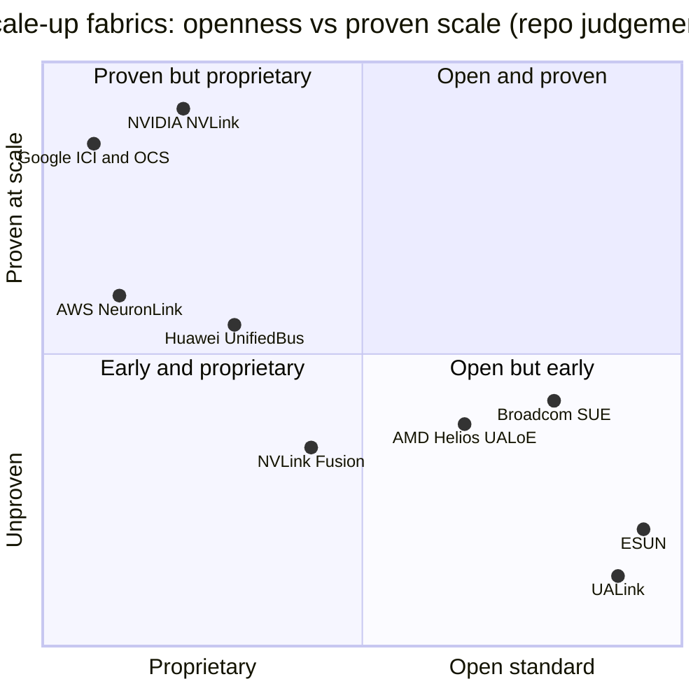

# Scale-up (NVLink, NVSwitch): Competition

Layer 05 · Scale-up (NVLink, NVSwitch) · ~13 min read · Last verified: 2026-11-05

## ⚡ The Executive Take

- **Three things decide a [scale-up](../../glossary.md#scale-up) contest:** bandwidth per accelerator, domain size, and memory-style loads and stores. NVIDIA's Vera Rubin [NVL72](../../glossary.md#nvl72) offers 72 GPUs at 3.0 TB/s each, cut from the 3.6 TB/s announced at launch [[S200]](../../sources/bibliography.md#s200)[[S201]](../../sources/bibliography.md#s201).
- **[Q5 · Strongest challenger]** AMD's Helios joins 72 MI455X at 260 TB/s (3.6 TB/s per GPU) using UALink carried over Broadcom Tomahawk 6 Ethernet switches [[S226]](../../sources/bibliography.md#s226)[[S5523]](../../sources/bibliography.md#s5523); first racks shipped around end-Q3 2026, versus late 2024 for NVL72 [[S90020]](../../sources/bibliography.md#s90020)[[S121]](../../sources/bibliography.md#s121).
- **On domain size NVIDIA trails:** a Google Ironwood pod holds 9,216 TPUs (128× an NVL72) and Huawei targets 8,192 NPUs, via multi-hop torus or optical fabrics at 1.2–2.4 TB/s per chip 🟡 [[S232]](../../sources/bibliography.md#s232)[[S249]](../../sources/bibliography.md#s249).
- **The open standards are late:** [UALink](../../glossary.md#ualink) 1.0 (April 2025) and 2.0 (April 2026) exist on paper; products follow in 2027 🟡 [[S573]](../../sources/bibliography.md#s573)[[S574]](../../sources/bibliography.md#s574)[[S90051]](../../sources/bibliography.md#s90051). Ethernet scale-up silicon already ships: Tomahawk Ultra since July 2025 [[S275]](../../sources/bibliography.md#s275).
- **Customers split their bets.** AWS Trainium4 will use [NVLink Fusion](../../glossary.md#nvlink-fusion), while Qualcomm's Dragonfly AI300 (2028) picks UALink and [ESUN](../../glossary.md#esun) even though its server CPUs use [NVLink](../../glossary.md#nvlink) Fusion 🟢 [[S518]](../../sources/bibliography.md#s518)[[S90060]](../../sources/bibliography.md#s90060)[[S90031]](../../sources/bibliography.md#s90031).
- **NVIDIA's weakness:** a copper domain is limited to one rack. The 144-GPU Kyber rack is due in H2 2027, but reports say it may slip to 2028, which NVIDIA denies 🟡 [[S5517]](../../sources/bibliography.md#s5517)[[S507]](../../sources/bibliography.md#s507)[[S508]](../../sources/bibliography.md#s508).

## How the scale-up contest is scored

A scale-up domain is one open-plan office where anyone can read any desk's papers; [scale-out](../../glossary.md#scale-out) is offices exchanging couriered letters. In NVLink a GPU loads or stores another GPU's memory through one [NVSwitch](../../glossary.md#nvswitch) hop. This **[load/store semantics](../../glossary.md#load-store-semantics)** matters most for [mixture-of-experts](../../glossary.md#mixture-of-experts) models, whose [all-to-all](../../glossary.md#all-to-all) traffic hits every GPU at once (see [P4](../../primers/P4-parallelism-explained.md)).

| Rival (basis) | Bandwidth / accelerator | Domain size | Latency & semantics | Openness | Shipping status |
|---|---|---|---|---|---|
| AMD Helios (UALink over Ethernet) | 🟩 3.6 vs 3.0 TB/s | 🟨 72 vs 72 | 🟨 one switch hop | 🟩 open protocol, merchant switch | 🟥 first racks end-Q3 2026 |
| Google TPU (ICI + optical switches) | 🟥 1.2 (Ironwood) / 2.4 (8t) | 🟩 9,216–9,600 | 🟦 3D torus, multi-hop | 🟦 captive | 🟩 OCS pods since 2021 |
| AWS Trainium (NeuronLink-v4) | 🟥 2.0 TB/s | 🟩 144 | 🟨 switched all-to-all | 🟦 captive; Trn4 on Fusion | 🟨 GA Dec 2025 |
| Huawei (UnifiedBus) | 🟥 0.78 / 2.0 TB/s | 🟩 384 / 8,192 | 🟦 optical, ~4× power | 🟦 China ecosystem | 🟥 950 ramping |
| UALink (consortium) | 🟨 200G lanes | 🟩 1,024 (spec) | 🟨 load/store, no snooping | 🟩 >65 members | 🟥 no product |
| Ethernet scale-up (SUE / ESUN) | 🟨 200G lanes | 🟩 512 one hop | 🟦 Ethernet frames, ~250 ns switch | 🟩 OCP standard | 🟨 switches ship |

Verdict = rival vs NVIDIA Vera Rubin NVL72. Sources and reasoning per cell are in `data/l05_scale_up_verdicts.csv` [[S226]](../../sources/bibliography.md#s226)[[S232]](../../sources/bibliography.md#s232)[[S238]](../../sources/bibliography.md#s238)[[S242]](../../sources/bibliography.md#s242)[[S248]](../../sources/bibliography.md#s248)[[S249]](../../sources/bibliography.md#s249)[[S573]](../../sources/bibliography.md#s573)[[S224]](../../sources/bibliography.md#s224)[[S274]](../../sources/bibliography.md#s274)[[S275]](../../sources/bibliography.md#s275)[[S5521]](../../sources/bibliography.md#s5521).

![Heatmap of six scale-up rivals against NVIDIA's Vera Rubin NVL72 on five dimensions. On domain size 5 of 6 lead (Google TPU pods 9,216-9,600 chips, Huawei 384 to 8,192, AWS 144, UALink spec 1,024, Ethernet 512) while AMD Helios ties at 72. On bandwidth per accelerator only AMD Helios leads (3.6 vs 3.0 TB/s); Google, AWS and Huawei trail. UALink, Ethernet scale-up and AMD lead on openness. On maturity UALink, Huawei's Atlas 950 and Helios trail, while Google's optical-switched pods have run since 2021.](../../assets/charts/05-scale-up-competitor-heatmap.svg)

> [!TIP]
> **Worked example — why the switched domain matters for a mixture-of-experts layer.** Say each GPU holds 4,096 tokens and sends each token's 7,168-value [FP8](../../glossary.md#fp8) vector (~7.2 KB) to 8 experts on other GPUs. That is ~235 MB out and ~235 MB back per layer. NVLink 6 moves 1.5 TB/s each way, so the round trip takes ~0.31 ms [[S200]](../../sources/bibliography.md#s200). Vera Rubin's 1.6 Tb/s scale-out [NIC](../../glossary.md#nic) moves 200 GB/s each way, so the same exchange takes ~2.35 ms, 7.5× longer [[S33004]](../../sources/bibliography.md#s33004). Over 60 layers NVLink saves more than 100 ms per pass, which is why domain size and per-GPU bandwidth are priced together.

🔧 Under the hood: why a torus is cheap but slower for all-to-all traffic

In a switched domain every GPU injects its full bandwidth into a switch that reaches every other GPU in one hop. In a [torus](../../glossary.md#torus-topology), each chip links only to its neighbours, so a packet bound for a distant chip uses bandwidth on every link it crosses. In a 4×4×4 cube the average path is ~3 hops. An Ironwood chip has 6 links × 100 GB/s each way [[S232]](../../sources/bibliography.md#s232), so for uniform all-to-all traffic its usable injection is ~600 ÷ 3 ≈ 200 GB/s each way: scale-out speed, not NVLink speed (repo arithmetic, ideal routing). Torus pods win when traffic stays between neighbours (tensor and pipeline parallelism) and lose when it is uniform (expert routing).

## Challenger by challenger

### AMD: Helios and UALink over Ethernet (strongest)

AMD replaced the switchless 8-GPU [Infinity Fabric](../../glossary.md#infinity-fabric) mesh of the MI355X (~1.1 TB/s per GPU) with a 72-GPU switched rack [[S229]](../../sources/bibliography.md#s229)[[S226]](../../sources/bibliography.md#s226)[[S5524]](../../sources/bibliography.md#s5524). Helios carries [UALink over Ethernet](../../glossary.md#ualoe) through Tomahawk 6 switch trays: six trays of two chips each are reported, while AMD's own page describes four "scale-up cartridges" 🟡 [[S5522]](../../sources/bibliography.md#s5522)[[S226]](../../sources/bibliography.md#s226). **Best argument:** NVL72's shape, more bandwidth per GPU on paper and no NVIDIA switch tax, with OpenAI, Oracle and Azure lined up [[S546]](../../sources/bibliography.md#s546)[[S90022]](../../sources/bibliography.md#s90022)[[S90024]](../../sources/bibliography.md#s90024). **Gap closed:** on paper, yes; in deployed racks and software, not yet.

### Google: ICI with optical circuit switches

Google's TPUs use [ICI](../../glossary.md#ici) links in a 3D torus whose cube faces connect through [optical circuit switches](../../glossary.md#optical-circuit-switch) [[S237]](../../sources/bibliography.md#s237). The 4,096-chip TPU v4 pod used 48 of them [[S237]](../../sources/bibliography.md#s237). Ironwood reaches 9,216 chips at 1.2 TB/s, and TPU 8t reaches 9,600 at 2.4 TB/s [[S232]](../../sources/bibliography.md#s232)[[S238]](../../sources/bibliography.md#s238)[[S240]](../../sources/bibliography.md#s240). **Best argument:** the largest proven domains at low cost per chip, now sold outside Google Cloud [[S90027]](../../sources/bibliography.md#s90027). **Gap:** per-chip bandwidth and all-to-all efficiency (see above). Deep dive: [CS3](../../case-studies/CS3-google-tpu-the-credible-alternative.md).

### AWS: NeuronLink, then NVLink Fusion

The Trn3 UltraServer joins 144 Trainium3 chips through NeuronSwitch-v1 at 2 TB/s per chip, up from 64 Trainium2 chips on a torus [[S242]](../../sources/bibliography.md#s242)[[S244]](../../sources/bibliography.md#s244). **Best argument:** a 144-chip switched domain built in-house. **Twist:** Trainium4 adopts NVLink Fusion and NVIDIA MGX racks, buying NVIDIA's fabric instead of scaling its own [[S518]](../../sources/bibliography.md#s518)[[S519]](../../sources/bibliography.md#s519).

### Huawei: UnifiedBus

CloudMatrix 384 joins 384 Ascend 910C NPUs through optical [UnifiedBus](../../glossary.md#unifiedbus) switches. It delivers ~300 [PFLOPS](../../glossary.md#flops) dense [BF16](../../glossary.md#bf16) vs 180 for a GB200 NVL72 but draws ~559 kW vs ~145 kW (Est., SemiAnalysis) [[S248]](../../sources/bibliography.md#s248)[[S340]](../../sources/bibliography.md#s340). The Atlas 950 SuperPoD targets 8,192 NPUs at 2 TB/s each in Q4 2026. A 1,024-NPU system was shown at WAIC 2026 🟡 [[S249]](../../sources/bibliography.md#s249)[[S250]](../../sources/bibliography.md#s250). **Best argument:** under export controls, brute-force scale works. **Gap:** power, per-chip speed and supply.

### Open standards: UALink and Ethernet scale-up

UALink 1.0 defines 200G lanes, memory-semantic transfers and pods of up to 1,024 accelerators, with no snoop coherence [[S573]](../../sources/bibliography.md#s573)[[S224]](../../sources/bibliography.md#s224). One of the first UALink switches, Upscale AI's, is targeted for Q4 2026 🟡 [[S5506]](../../sources/bibliography.md#s5506)[[S5507]](../../sources/bibliography.md#s5507). The Ethernet camp is Broadcom's [Scale-Up Ethernet](../../glossary.md#scale-up-ethernet) (SUE), the OCP ESUN 1.0 spec and UE 1.1. It adds [link-layer retry](../../glossary.md#link-layer-retry) and credit-based flow control to Ethernet. Tomahawk Ultra switches in ~250 ns, and Tomahawk 6 reaches 512 accelerators in one hop [[S275]](../../sources/bibliography.md#s275)[[S274]](../../sources/bibliography.md#s274)[[S576]](../../sources/bibliography.md#s576)[[S575]](../../sources/bibliography.md#s575). **Best argument:** multi-vendor supply and Ethernet tooling. **Gap:** no shipping UALink system yet, and Ethernet framing still costs bytes and nanoseconds.

The open-and-proven quadrant is empty: every proven fabric is proprietary and every open one is early (repo judgement). Who captures the dollars: [value chain](value-chain-and-corp-dev.md).

> [!NOTE]
> **🐂 Bull view.** Rivals now copy NVL72's shape, a 72-GPU switched rack, which validates NVIDIA's design. NVIDIA had already shipped two generations of it before Helios arrived [[S121]](../../sources/bibliography.md#s121)[[S90020]](../../sources/bibliography.md#s90020). NVLink Fusion is pulling customer silicon (Trainium4) and optics start-ups (Ayar Labs) into NVIDIA's fabric instead of UALink 🟡 [[S518]](../../sources/bibliography.md#s518)[[S5513]](../../sources/bibliography.md#s5513).

> [!WARNING]
> **🐻 Bear view.** NVIDIA's Rubin spec cut gave AMD the per-GPU bandwidth lead [[S201]](../../sources/bibliography.md#s201)[[S226]](../../sources/bibliography.md#s226). UALink and Ethernet scale-up could commoditise the switch once silicon ships in 2027 🔴 [[S90051]](../../sources/bibliography.md#s90051). Google and Huawei show that domains 100× larger are possible 🟡 [[S232]](../../sources/bibliography.md#s232)[[S249]](../../sources/bibliography.md#s249).

## 🎯 Corp Dev Lens

1. If UALink products arrive in 2027 as reported, how fast can merchant switch vendors (Broadcom, Marvell, Upscale AI) undercut NVIDIA's switch-tray pricing, and who supplies the [SerDes](../../glossary.md#serdes)?
2. Helios shows UALink can run over Ethernet switches today. Does that make native UALink switch silicon a stranded investment, or a later cost-down step?
3. Qualcomm (public information only) uses NVLink Fusion for CPUs and UALink/ESUN for its 2028 accelerator [[S90031]](../../sources/bibliography.md#s90031)[[S90060]](../../sources/bibliography.md#s90060). What does keeping a foot in both fabrics cost in engineering, and what optionality does it buy?
4. Torus and optical pods win on domain size: is there a partnership angle with optics suppliers that serve both camps?

## 📚 Sources

<!-- Auto-generated from the [S…] citations on this page by `make build`. Edit sources/registry/*.csv, not this list. -->

- [**S121**](../../sources/bibliography.md#s121) NVIDIA, *NVIDIA GB200 NVL72*, 2024-03. [Link](https://www.nvidia.com/en-us/data-center/gb200-nvl72/)
- [**S200**](../../sources/bibliography.md#s200) NVIDIA, *NVIDIA NVLink and NVLink Switch (product page with NVLink and NVLink Switch specification tables)*, 2026-09. [Link](https://www.nvidia.com/en-us/data-center/nvlink/)
- [**S201**](../../sources/bibliography.md#s201) VideoCardz, *NVIDIA quietly cuts Vera Rubin specs, HBM4 bandwidth and NVLink 6 speeds now lower*, 2026-10. [Link](https://videocardz.com/newz/nvidia-quietly-cuts-vera-rubin-specs-hbm4-bandwidth-and-nvlink-6-speeds-now-lower)
- [**S224**](../../sources/bibliography.md#s224) UALink Consortium, *UALink 200G 1.0 Specification Overview*, 2025-04-10. [Link](https://ualinkconsortium.org/wp-content/uploads/2025/04/UALink-1.0-Specification-Overview_FINAL-1.pdf)
- [**S226**](../../sources/bibliography.md#s226) AMD, *AMD Helios Rackscale Solution (product page)*, 2026. [Link](https://www.amd.com/en/products/rackscale-solutions/helios.html)
- [**S229**](../../sources/bibliography.md#s229) AMD, *AMD Instinct MI355X (product page)*, 2025-06-12. [Link](https://www.amd.com/en/products/accelerators/instinct/mi350/mi355x.html)
- [**S232**](../../sources/bibliography.md#s232) Google Cloud, *TPU7x (Ironwood) - Cloud TPU documentation*, 2025-11. [Link](https://docs.cloud.google.com/tpu/docs/tpu7x)
- [**S237**](../../sources/bibliography.md#s237) arXiv (Norman P. Jouppi et al.), *TPU v4: An Optically Reconfigurable Supercomputer for Machine Learning with Hardware Support for Embeddings (ISCA 2023)*, 2023-04. [Link](https://arxiv.org/abs/2304.01433)
- [**S238**](../../sources/bibliography.md#s238) Google, *Our eighth generation TPUs: two chips for the agentic era*, 2026-04-22. [Link](https://blog.google/innovation-and-ai/infrastructure-and-cloud/google-cloud/eighth-generation-tpu-agentic-era/)
- [**S240**](../../sources/bibliography.md#s240) StorageReview, *Google Announces TPU 8t Sunfish and TPU 8i Zebrafish*, 2026-04. [Link](https://www.storagereview.com/news/google-announces-tpu-8t-sunfish-and-tpu-8i-zebrafish)
- [**S242**](../../sources/bibliography.md#s242) Amazon Web Services, *Amazon EC2 Trn3 instances (product page)*, 2025-12-02. [Link](https://aws.amazon.com/ec2/instance-types/trn3/)
- [**S244**](../../sources/bibliography.md#s244) Amazon Web Services, *Trainium2 architecture (AWS Neuron documentation)*, 2024-12. [Link](https://awsdocs-neuron.readthedocs-hosted.com/en/latest/general/arch/neuron-hardware/trn2-arch.html)
- [**S248**](../../sources/bibliography.md#s248) arXiv (Huawei) (Huawei Cloud et al.), *Serving Large Language Models on Huawei CloudMatrix384*, 2025-06. [Link](https://arxiv.org/abs/2506.12708)
- [**S249**](../../sources/bibliography.md#s249) Huawei (Eric Xu), *Groundbreaking SuperPoD Interconnect: Leading a New Paradigm for AI Infrastructure (Eric Xu keynote, Huawei Connect 2025)*, 2025-09-18. [Link](https://www.huawei.com/en/news/2025/9/hc-xu-keynote-speech)
- [**S250**](../../sources/bibliography.md#s250) LightCounting, *July 2026 Atlas 950 SuperPoD: achieves all-optical interconnection with superior cost and power efficiency*, 2026-07. [Link](https://www.lightcounting.com/research-note/july-2026-atlas-950-superpod-achieves-all-optical-interconnection-with-superior-cost-and-power-efficiency-450)
- [**S274**](../../sources/bibliography.md#s274) Broadcom, *Broadcom ships Tomahawk 6: world's first 102.4 Tbps switch*, 2025-06-03. [Link](https://investors.broadcom.com/news-releases/news-release-details/broadcom-ships-tomahawk-6-worlds-first-1024-tbps-switch)
- [**S275**](../../sources/bibliography.md#s275) Broadcom, *Broadcom ships Tomahawk Ultra: reimagining the Ethernet switch for HPC and AI scale-up*, 2025-07-15. [Link](https://investors.broadcom.com/news-releases/news-release-details/broadcom-ships-tomahawk-ultra-reimagining-ethernet-switch-hpc-and-ai)
- [**S340**](../../sources/bibliography.md#s340) SemiAnalysis (Dylan Patel et al.), *Huawei AI CloudMatrix 384 - China's answer to Nvidia GB200 NVL72*, 2025-04-16. [Link](https://newsletter.semianalysis.com/p/huawei-ai-cloudmatrix-384-chinas-answer-to-nvidia-gb200-nvl72)
- [**S507**](../../sources/bibliography.md#s507) Tom's Hardware, *Nvidia's Kyber rack for Rubin Ultra slips to 2028*, 2026-07-06. [Link](https://www.tomshardware.com/pc-components/gpus/nvidias-kyber-rack-for-rubin-ultra-slips-to-2028)
- [**S508**](../../sources/bibliography.md#s508) Wccftech, *NVIDIA Quashes Rubin & Kyber Rack Delay Rumors, Says 'Chip Roadmap Is Intact'*, 2026-07. [Link](https://wccftech.com/nvidia-quashes-rubin-kyber-rack-delay-rumors-says-chip-roadmap-is-intact/)
- [**S518**](../../sources/bibliography.md#s518) ServeTheHome, *NVIDIA NVLink Fusion tapped for future AWS Trainium4 deployments*, 2025-12-02. [Link](https://www.servethehome.com/nvidia-nvlink-fusion-tapped-for-future-aws-trainium4-deployments/)
- [**S519**](../../sources/bibliography.md#s519) South China Morning Post (Reuters) (Stephen Nellis; Greg Bensinger), *Amazon to use Nvidia tech in AI chips, roll out new servers (Reuters)*, 2025-12-02. [Link](https://www.scmp.com/tech/big-tech/article/3334985/amazon-use-nvidia-tech-ai-chips-roll-out-new-servers)
- [**S546**](../../sources/bibliography.md#s546) TechWire Asia, *AMD Advancing AI 2026: Helios, OpenAI, Meta, Anthropic*, 2026-07. [Link](https://techwireasia.com/2026/07/amd-advancing-ai-2026-helios-openai-meta-anthropic/)
- [**S573**](../../sources/bibliography.md#s573) Business Wire, *UALink Consortium Releases the Ultra Accelerator Link 200G 1.0 Specification*, 2025-04-08. [Link](https://www.businesswire.com/news/home/20250408050548/en/UALink-Consortium-Releases-the-Ultra-Accelerator-Link-200G-1.0-Specification)
- [**S574**](../../sources/bibliography.md#s574) HPCwire, *UALink Consortium Publishes 4 Specifications Defining In-Network Compute, Chiplets, Manageability and 200G Performance*, 2026-04-07. [Link](https://www.hpcwire.com/off-the-wire/ualink-consortium-publishes-4-specifications-defining-in-network-compute-chiplets-manageability-and-200g-performance/)
- [**S575**](../../sources/bibliography.md#s575) Network World, *Ultra Ethernet 1.1 extends the specification to scale-up networks and adds programmable congestion control*, 2026-10. [Link](https://www.networkworld.com/article/4235340/ultra-ethernet-1-1-extends-the-specification-to-scale-up-networks-and-adds-programmable-congestion-control.html)
- [**S576**](../../sources/bibliography.md#s576) Converge Digest, *OCP releases ESUN 1.0 spec for Ethernet-based scale-up AI fabrics*, 2026-03. [Link](https://convergedigest.com/ocp-releases-esun-1-0-spec-for-ethernet-based-scale-up-ai-fabrics/)
- [**S5506**](../../sources/bibliography.md#s5506) The Register, *AI networking startup Upscale AI scores $200M to challenge Nvidia's NVSwitch*, 2026-01-22. [Link](https://www.theregister.com/2026/01/22/upscale_skyhammer_nvidia/)
- [**S5507**](../../sources/bibliography.md#s5507) HPCwire, *Upscale AI eyes late 2026 for scale-up UALink switch*, 2025-12-02. [Link](https://www.hpcwire.com/2025/12/02/upscale-ai-eyes-late-2026-for-scale-up-ualink-switch/)
- [**S5513**](../../sources/bibliography.md#s5513) StockAnalysis, *Ayar Labs (private company profile and news)*, 2026-09. [Link](https://stockanalysis.com/private/ayar-labs/)
- [**S5517**](../../sources/bibliography.md#s5517) The Next Platform, *Copper wires have already failed clustered AI systems*, 2024-09-13. [Link](https://www.nextplatform.com/2024/09/13/copper-wires-have-already-failed-clustered-ai-systems/)
- [**S5521**](../../sources/bibliography.md#s5521) Converge Digest, *UALink Consortium expands board with Alibaba, Apple and Synopsys*, 2025-01-14. [Link](https://convergedigest.com/ualink-consortium-expands-board-with-alibaba-apple-and-synopsys/)
- [**S5522**](../../sources/bibliography.md#s5522) Remio, *AMD Helios unites 72 GPUs but NVIDIA sets the test*, 2026. [Link](https://www.remio.ai/post/amd-helios-unites-72-gpus-but-nvidia-sets-the-test)
- [**S5523**](../../sources/bibliography.md#s5523) The Register, *HPE backs AMD's Helios AI rack with Juniper's scale-up switch*, 2025-12-02. [Link](https://www.theregister.com/2025/12/02/hpe_amd_helios_racks/)
- [**S5524**](../../sources/bibliography.md#s5524) Fierce Network, *AMD's Helios bets AI networking on open Ethernet*, 2026. [Link](https://www.fierce-network.com/cloud/amds-helios-bets-ai-networking-open-ethernet)
- [**S33004**](../../sources/bibliography.md#s33004) NVIDIA Newsroom, *NVIDIA Kicks Off the Next Generation of AI With Rubin — Six New Chips; One Incredible AI Supercomputer*, 2026-01-05. [Link](https://nvidianews.nvidia.com/news/rubin-platform-ai-supercomputer)
- [**S90020**](../../sources/bibliography.md#s90020) Shacknews, *AMD Helios AI rack system on track for initial shipments in Q3 2026*, 2026. [Link](https://www.shacknews.com/article/150249/amd-helios-ai-system-shipping-q3-2026)
- [**S90022**](../../sources/bibliography.md#s90022) Tom's Hardware, *AMD and Oracle partner to deploy 50,000 MI450 Instinct GPUs*, 2025-10. [Link](https://www.tomshardware.com/tech-industry/artificial-intelligence/amd-and-oracle-partner-to-deploy-50-000-mi450-instinct-gpus-in-new-ai-superclusters-deployment-of-expansion-set-for-2026-powered-by-amds-helios-rack)
- [**S90024**](../../sources/bibliography.md#s90024) Crypto Briefing, *AMD's Helios platform ships H2 2026 with Microsoft Azure as first major deployment*, 2026. [Link](https://cryptobriefing.com/amd-helios-platform-ships-h2-2026/)
- [**S90027**](../../sources/bibliography.md#s90027) The Next Web, *Google is building a four-partner chip supply chain to challenge Nvidia in AI inference*, 2026. [Link](https://thenextweb.com/news/google-inference-chips-nvidia-challenge-supply-chain)
- [**S90031**](../../sources/bibliography.md#s90031) ServeTheHome, *NVIDIA announces NVLink Fusion bringing NVLink to third-party CPUs and accelerators*, 2025-05-19. [Link](https://www.servethehome.com/nvidia-announces-nvlink-fusion-bringing-nvlink-to-third-party-cpus-and-accelerators/nvlink-fusion-partners/)
- [**S90051**](../../sources/bibliography.md#s90051) SDxCentral, *UALink Consortium takes another swing at Nvidia's NVLink supremacy with specification 2.0*, 2026-04. [Link](https://www.sdxcentral.com/news/ualink-consortium-takes-another-swing-at-nvidias-nvlink-supremacy-with-specification-20/)
- [**S90060**](../../sources/bibliography.md#s90060) Qualcomm, *Qualcomm Dragonfly AI300 (product page)*, 2026-06. [Link](https://www.qualcomm.com/data-center/products/qualcomm-dragonfly-ai300)
