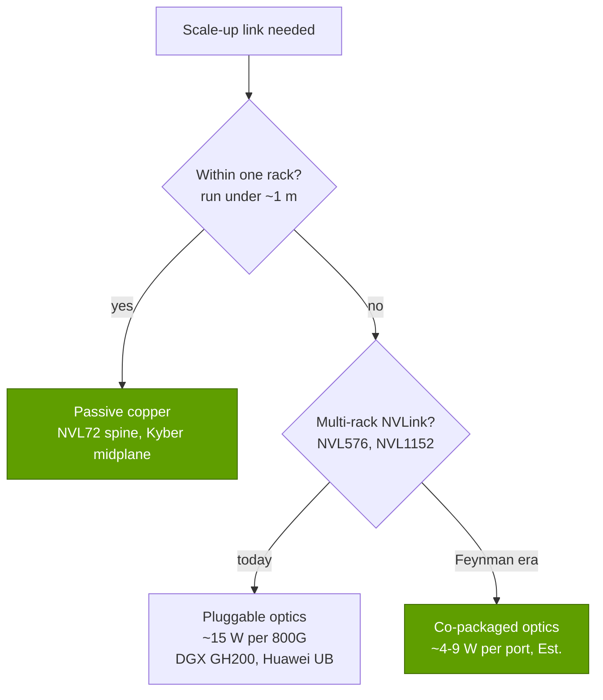

# Copper spines: why copper wins inside the rack (for now)

Layer 05 · Scale-up (NVLink, NVSwitch) · ~9 min read · Last verified: 2026-11-05

## ⚡ The Executive Take

- **The [NVL72](../../glossary.md#nvl72)'s backbone is copper:** ~5,000 [NVLink](../../glossary.md#nvlink) cables, ~2 miles in total, join 72 GPUs to 18 switch chips [[S5000]](../../sources/bibliography.md#s5000)[[S5001]](../../sources/bibliography.md#s5001); link arithmetic gives 5,184 pairs (repo calc).
- **Copper saves ~19 kW and ~$0.5M per rack (Est.).** 130 TB/s on 800G optics needs ~1,300 modules: ~19 kW, matching NVIDIA's ~20 kW claim and ~16% of a ~120 kW rack [[S5000]](../../sources/bibliography.md#s5000)[[S295]](../../sources/bibliography.md#s295)[[S336]](../../sources/bibliography.md#s336), and ~$0.65–0.78M versus ~$0.13–0.19M for DAC-priced copper [[S5016]](../../sources/bibliography.md#s5016)[[S5015]](../../sources/bibliography.md#s5015).
- **Reliability:** passive copper has no lasers or DSPs; NVIDIA itself sells co-packaged optics as 10× more resilient than pluggables [[S265]](../../sources/bibliography.md#s265).
- **The catch is reach.** At 200 Gb/s per lane, passive copper reaches ~1 m [[S5010]](../../sources/bibliography.md#s5010), so a copper [scale-up](../../glossary.md#scale-up) domain stops at the rack; Kyber moves to a printed-circuit [midplane](../../glossary.md#midplane) for 144 GPUs [[S510]](../../sources/bibliography.md#s510).
- **Optics come inside next:** NVIDIA's Feynman-era Kyber NVL1152 pairs copper with [co-packaged optics](../../glossary.md#co-packaged-optics) 🟢 [[S109]](../../sources/bibliography.md#s109)[[S108]](../../sources/bibliography.md#s108); Huawei already runs an all-optical 384-NPU domain, at ~3.9× an NVL72's power [[S340]](../../sources/bibliography.md#s340).

## 1. What the copper spine is

The [NVLink spine](../../glossary.md#nvlink-spine) is a wall of twin-axial cables in cartridges at the back of the rack. Compute and [switch trays](../../glossary.md#nvlink-switch-tray) plug into it through [blind-mate connectors](../../glossary.md#blind-mate-connector), so nobody hand-plugs 5,000 cables [[S5007]](../../sources/bibliography.md#s5007); NVIDIA contributed the rack design to the Open Compute Project [[S5001]](../../sources/bibliography.md#s5001). The Vera Rubin NVL72 keeps this [Oberon](../../glossary.md#oberon) rack and doubles bandwidth on the same copper by running each pair both ways [[S203]](../../sources/bibliography.md#s203).

![Two-panel bar chart. Left: NVSwitch chips per domain were 12 in DGX-2 (16 GPUs), 6 in HGX A100, 4 in HGX H100 and 2 in HGX B200 (8 GPUs each), then 18 in GB200 NVL72, 36 in Vera Rubin NVL72 and a reported 72 in Kyber NVL144 (Lockwood estimates 36). Right: GB200 and GB300 NVL72 carry about 5,184 copper pairs (NVIDIA quoted about 5,000 cables, 2 miles) for 130 TB/s; Vera Rubin NVL72 reuses the same count for 216 TB/s (260 at launch); Kyber NVL144 doubles to 10,368 pairs on a printed-circuit midplane for about 518 TB/s.](../../assets/charts/05-switch-chips-and-copper-pairs.svg)

> [!TIP]
> **Worked example — checking "5,000 cables, 2 miles".** 18 NVLink 5 links × 2 lanes × 2 directions = 72 pairs per GPU; × 72 GPUs = **5,184 pairs** [[S263]](../../sources/bibliography.md#s263)[[S262]](../../sources/bibliography.md#s262), close to the ~5,000 cables quoted [[S5000]](../../sources/bibliography.md#s5000). Two miles ≈ 3,219 m ÷ 5,184 ≈ **0.62 m per pair**. **Conclusion:** the spine works because almost every run is shorter than the ~1 m that 200 Gb/s copper carries [[S5010]](../../sources/bibliography.md#s5010), a property of one rack, not a row.

## 2. Why copper wins: power, cost, reliability

Optics convert signals to light and back at both ends of every link; a DSP-based 800G module burns ~15 W doing so, while passive copper is driven directly by the chips' [SerDes](../../glossary.md#serdes) [[S295]](../../sources/bibliography.md#s295)[[S262]](../../sources/bibliography.md#s262).

| Medium | Energy ([pJ/bit](../../glossary.md#picojoules-per-bit)) | Reach | Price per 800G link (Est.) | Failure points | Inside-rack verdict |
|---|---|---|---|---|---|
| Passive copper ([DAC](../../glossary.md#direct-attach-copper)) | ~0 added [[S262]](../../sources/bibliography.md#s262) | ~1 m [[S5010]](../../sources/bibliography.md#s5010) | ~$200–300 [[S5015]](../../sources/bibliography.md#s5015) | connectors | 🟩 cheapest |
| [Linear pluggable](../../glossary.md#linear-pluggable-optics) | ~10.6 [[S295]](../../sources/bibliography.md#s295) | tens of m | n/a | laser | 🟨 halfway |
| DSP pluggable | ~18.8 [[S295]](../../sources/bibliography.md#s295)[[S282]](../../sources/bibliography.md#s282) | km | ~$1,000–1,200 [[S5016]](../../sources/bibliography.md#s5016) | laser, DSP | 🟥 power, cost |
| Co-packaged optics | ~5.4 [[S265]](../../sources/bibliography.md#s265) | km | not public | laser | 🟦 beyond the rack |

> [!TIP]
> **Worked example — pricing an optical NVL72 spine.** 72 GPUs × 900 GB/s each way = 518 Tb/s = **648 links of 800G**, needing **1,296 modules** [[S200]](../../sources/bibliography.md#s200)[[S262]](../../sources/bibliography.md#s262). Power: 1,296 × 15 W = **19.4 kW**, ~16% of a ~120 kW rack [[S295]](../../sources/bibliography.md#s295)[[S336]](../../sources/bibliography.md#s336). Cost: 1,296 × $500–600 = **$0.65–0.78M**, ~22–26% of an estimated ~$3.0M GB200 NVL72, versus ~$0.13–0.19M for DAC-priced copper [[S5016]](../../sources/bibliography.md#s5016)[[S5015]](../../sources/bibliography.md#s5015)[[S326]](../../sources/bibliography.md#s326). **Conclusion:** copper saves about a sixth of the rack's power and perhaps a fifth of its price (Est.; the real spine is bespoke).

🔧 Under the hood: what limits copper

- **Loss grows with frequency:** faster lanes are attenuated more by the same cable, and [PAM4](../../glossary.md#pam4)'s four levels leave less margin for noise.
- **Fixes cost power:** retimers and active electrical cables stretch reach to several metres at extra watts and latency.
- **Bidirectional signalling** doubles throughput per pair without raising the symbol rate [[S203]](../../sources/bibliography.md#s203).

## 3. Reach: the wall at about one metre

Each doubling of lane speed cost passive copper reach: ~5 m at 25 Gb/s, ~3 m at 50, ~2 m at 100, ~1 m at 200 [[S5013]](../../sources/bibliography.md#s5013)[[S5014]](../../sources/bibliography.md#s5014)[[S5012]](../../sources/bibliography.md#s5012)[[S5010]](../../sources/bibliography.md#s5010). A rack is about two metres tall, so 200G copper just fits.

> [!TIP]
> **Worked example — why Rubin did not move to 400G lanes.** If reach halved again at 400 Gb/s per lane it would be ~0.5 m (🔴 extrapolation), below the spine's ~0.62 m average run (repo calc from [[S5000]](../../sources/bibliography.md#s5000)). Rubin kept ~200 Gb/s signalling and sent it both ways on each pair: 3.6 TB/s per GPU at launch on the same 5,184 pairs [[S203]](../../sources/bibliography.md#s203)[[S33004]](../../sources/bibliography.md#s33004). Kyber swaps cables for short midplane traces [[S510]](../../sources/bibliography.md#s510)[[S211]](../../sources/bibliography.md#s211). **Conclusion:** NVIDIA has engineered around copper's reach twice; the third step needs optics.

## 4. When optics come inside the rack

NVIDIA's 256-GPU DGX GH200 used optical NVLink and saw limited deployment [[S205]](../../sources/bibliography.md#s205)[[S200]](../../sources/bibliography.md#s200); its roadmap brings optics back for Feynman's multi-rack Kyber NVL1152 🟢 [[S109]](../../sources/bibliography.md#s109)[[S108]](../../sources/bibliography.md#s108). Huawei's CloudMatrix 384 links 384 NPUs all-optically at ~559 kW, ~3.9× an NVL72's ~145 kW, for ~1.7× its dense [BF16](../../glossary.md#bf16) compute [[S340]](../../sources/bibliography.md#s340)[[S121]](../../sources/bibliography.md#s121).

> [!TIP]
> **Worked example — optics for a 576-GPU NVLink domain.** A Rubin Ultra-class GPU moves 14.4 Tb/s each way [[S210]](../../sources/bibliography.md#s210) = 18 × 800G ports at each end. DSP pluggables: 36 × 15 W = **540 W per GPU** (~311 kW for 576); CPO at ~4.3 W per 800G-equivalent: **~155 W** (~89 kW) [[S295]](../../sources/bibliography.md#s295)[[S265]](../../sources/bibliography.md#s265) (Est.). Against ~4.2 kW per package (600 kW ÷ 144) [[S305]](../../sources/bibliography.md#s305), that is ~13% versus ~4% overhead. **Conclusion:** co-packaged optics make multi-rack NVLink affordable; until they ship in volume, copper sets the domain size.

## 🎯 Corp Dev Lens

1. **Copper is a supply chain too.** Cable cartridges, connectors and rack mechanics grow with every NVL72 shipped ([Value chain and corp dev](value-chain-and-corp-dev.md)).
2. **The CPO transition is the swing factor.** NVIDIA's CPO partners include TSMC, Coherent, Corning, Foxconn, Lumentum and SENKO [[S90049]](../../sources/bibliography.md#s90049); optical-I/O start-ups Ayar Labs and Lightmatter were reported joining [NVLink Fusion](../../glossary.md#nvlink-fusion) 🟡 [[S5022]](../../sources/bibliography.md#s5022). When scale-up turns optical, which of these captures the value NVIDIA does not keep in its switch?
3. **Reach decides domain size.** A rival promising 1,024-device pods ([UALink](../../glossary.md#ualink) 1.0 [[S573]](../../sources/bibliography.md#s573)) must pay the optics premium beyond one rack ([Competition](competition.md)).
4. **Qualcomm question (public information only):** for inference racks with 768 GB of [LPDDR](../../glossary.md#lpddr) per card [[S90028]](../../sources/bibliography.md#s90028), is a copper-only, single-rack domain enough for now?

## 📚 Sources

<!-- Auto-generated from the [S…] citations on this page by `make build`. Edit sources/registry/*.csv, not this list. -->

- [**S108**](../../sources/bibliography.md#s108) HPCwire / AIwire, *Huang Shares Nvidia Roadmap Showing More Chips, NVL1152, Scale-Up CPO*, 2026-03-18. [Link](https://www.hpcwire.com/aiwire/2026/03/18/huang-shares-nvidia-roadmap-showing-more-chips-nvl1152-scale-up-cpo/)
- [**S109**](../../sources/bibliography.md#s109) NVIDIA Blog, *NVIDIA GTC 2026: Live Updates on What's Next in AI*, 2026-03-16. [Link](https://blogs.nvidia.com/blog/gtc-2026-news/)
- [**S121**](../../sources/bibliography.md#s121) NVIDIA, *NVIDIA GB200 NVL72*, 2024-03. [Link](https://www.nvidia.com/en-us/data-center/gb200-nvl72/)
- [**S200**](../../sources/bibliography.md#s200) NVIDIA, *NVIDIA NVLink and NVLink Switch (product page with NVLink and NVLink Switch specification tables)*, 2026-09. [Link](https://www.nvidia.com/en-us/data-center/nvlink/)
- [**S203**](../../sources/bibliography.md#s203) SemiAnalysis, *Vera Rubin - Extreme Co-Design: An Evolution*, 2026-01. [Link](https://newsletter.semianalysis.com/p/vera-rubin-extreme-co-design-an-evolution)
- [**S205**](../../sources/bibliography.md#s205) NVIDIA Technical Blog, *Upgrading Multi-GPU Interconnectivity with the Third-Generation NVIDIA NVSwitch*, 2022-08. [Link](https://developer.nvidia.com/blog/upgrading-multi-gpu-interconnectivity-with-the-third-generation-nvidia-nvswitch/)
- [**S210**](../../sources/bibliography.md#s210) SemiAnalysis, *Nvidia - GTC 2026: The Inference Kingdom Expands*, 2026-03. [Link](https://newsletter.semianalysis.com/p/nvidia-the-inference-kingdom-expands)
- [**S211**](../../sources/bibliography.md#s211) glennklockwood.com (Glenn K. Lockwood), *GTC 2026 recap*, 2026-03. [Link](https://blog.glennklockwood.com/2026/03/gtc-2026-recap.html)
- [**S262**](../../sources/bibliography.md#s262) NVIDIA, *NVIDIA GB200 NVL72 (product page)*, 2024. [Link](https://www.nvidia.com/en-us/data-center/gb200-nvl72/)
- [**S263**](../../sources/bibliography.md#s263) NVIDIA, *NVIDIA Blackwell Architecture Technical Brief*, 2024-03. [Link](https://resources.nvidia.com/en-us-blackwell-architecture)
- [**S265**](../../sources/bibliography.md#s265) NVIDIA Newsroom, *NVIDIA Announces Spectrum-X Photonics, Co-Packaged Optics Networking Switches to Scale AI Factories to Millions of GPUs*, 2025-03-18. [Link](https://nvidianews.nvidia.com/news/nvidia-spectrum-x-co-packaged-optics-networking-switches-ai-factories)
- [**S282**](../../sources/bibliography.md#s282) Broadcom, *Broadcom delivers industry's first 51.2-Tbps co-packaged optics Ethernet switch platform (Bailly)*, 2024-03. [Link](https://investors.broadcom.com/news-releases)
- [**S295**](../../sources/bibliography.md#s295) LPO MSA, *Linear Pluggable Optics Multi-Source Agreement (LPO MSA)*, 2024. [Link](https://www.lpo-msa.org/)
- [**S305**](../../sources/bibliography.md#s305) DatacenterDynamics, *Nvidia's Rubin Ultra NVL576 rack expected to be 600kW, coming second half of 2027*, 2025-03-19. [Link](https://datacenterdynamics.com/en/news/nvidias-rubin-ultra-nvl576-rack-expected-to-be-600kw-coming-second-half-of-2027)
- [**S326**](../../sources/bibliography.md#s326) TweakTown, *NVIDIA's new GB200 Superchip costs up to $70,000: full B200 NVL72 AI server costs $3 million*, 2024-05. [Link](https://www.tweaktown.com/news/98292/nvidias-new-gb200-superchip-costs-up-to-70-000-full-b200-nvl72-ai-server-3-million/index.html)
- [**S336**](../../sources/bibliography.md#s336) eeNews Europe, *Nvidia offers 120kW liquid-cooled Blackwell rack as industry standard*, 2024-10. [Link](https://www.eenewseurope.com/en/nvidia-offers-120kw-liquid-cooled-blackwell-rack-as-industry-standard)
- [**S340**](../../sources/bibliography.md#s340) SemiAnalysis (Dylan Patel et al.), *Huawei AI CloudMatrix 384 - China's answer to Nvidia GB200 NVL72*, 2025-04-16. [Link](https://newsletter.semianalysis.com/p/huawei-ai-cloudmatrix-384-chinas-answer-to-nvidia-gb200-nvl72)
- [**S510**](../../sources/bibliography.md#s510) KGI Securities, *NVIDIA GTC 2026 (research note)*, 2026-03-19. [Link](https://www.kgi.com.hk/zh-hk/-/media/files/kgishk/research-reports/tw-reports/nvidia-gtc-2026_19032026e.pdf)
- [**S573**](../../sources/bibliography.md#s573) Business Wire, *UALink Consortium Releases the Ultra Accelerator Link 200G 1.0 Specification*, 2025-04-08. [Link](https://www.businesswire.com/news/home/20250408050548/en/UALink-Consortium-Releases-the-Ultra-Accelerator-Link-200G-1.0-Specification)
- [**S5000**](../../sources/bibliography.md#s5000) SemiAnalysis, *Nvidia's Optical Boogeyman - NVL72, InfiniBand Scale Out, 800G & 1.6T Ramp*, 2024-03. [Link](https://newsletter.semianalysis.com/p/nvidias-optical-boogeyman-nvl72-infiniband)
- [**S5001**](../../sources/bibliography.md#s5001) SiliconANGLE, *Nvidia aims to boost Blackwell by donating platform design to the Open Compute Project*, 2024-10-15. [Link](https://siliconangle.com/2024/10/15/nvidia-aims-boost-blackwell-donating-platform-design-open-compute-project)
- [**S5007**](../../sources/bibliography.md#s5007) NVIDIA Docs, *DGX SuperPOD reference architecture (GB200): key components of the DGX SuperPOD*, 2025. [Link](https://docs.nvidia.com/dgx-superpod/reference-architecture-scalable-infrastructure-gb200/latest/dgx-superpod-components.html)
- [**S5010**](../../sources/bibliography.md#s5010) IEEE 802.3, *IEEE P802.3dj adopted objectives (200 Gb/s per lane electrical and optical signaling)*, 2024-03-14. [Link](https://grouper.ieee.org/groups/802/3/dj/projdoc/objectives_P802d3dj_240314.pdf)
- [**S5012**](../../sources/bibliography.md#s5012) SNIA, *Cabling, Connectors and Transceivers Questions Answered*, 2021. [Link](https://www.snia.org/blog/2021/cabling-connectors-and-transceivers-questions-answered)
- [**S5013**](../../sources/bibliography.md#s5013) Edgeoptic, *DAC cables (product page: passive 100G QSFP28 0.5-5 m)*, 2026. [Link](https://edgeoptic.com/product/dac/)
- [**S5014**](../../sources/bibliography.md#s5014) XSNet, *Cisco QSFP-200-CU3M 200G QSFP56 DAC (200GBASE-CR4 passive copper 3 m) listing*, 2026. [Link](https://www.xsnet.com.au/products/cisco-qsfp-200-cu3m-200g-qsfp56-dac-200gbase-cr4-passive-copper-3-m-qsfp56-to-qsfp56)
- [**S5015**](../../sources/bibliography.md#s5015) FiberMall, *QSFP-DD price guide 2026*, 2026. [Link](https://www.fibermall.com/blog/qsfp-dd-price-guide-2026.htm)
- [**S5016**](../../sources/bibliography.md#s5016) Fundamental Bottom (Substack), *Optical module industry (long AAOI note)*, 2025. [Link](https://fundamentalbottom.substack.com/p/longaaoi-optical-module-industry)
- [**S5022**](../../sources/bibliography.md#s5022) Independent tracker (vercel.app), *Co-packaged optics joins NVLink Fusion: Ayar Labs and Lightmatter (June 2026)*, 2026-06-08. [Link](https://site-one-liart-13.vercel.app/en/infra-ip/co-packaged-optics-nvlink-fusion-ayar-labs-lightmatter-june-2026)
- [**S33004**](../../sources/bibliography.md#s33004) NVIDIA Newsroom, *NVIDIA Kicks Off the Next Generation of AI With Rubin — Six New Chips; One Incredible AI Supercomputer*, 2026-01-05. [Link](https://nvidianews.nvidia.com/news/rubin-platform-ai-supercomputer)
- [**S90028**](../../sources/bibliography.md#s90028) TechRepublic, *Qualcomm unveils AI chips to rival Nvidia, AMD*, 2025-10-27. [Link](https://techrepublic.com/article/news-qualcomm-unveils-ai-chips-to-rival-nvidia-amd)
- [**S90049**](../../sources/bibliography.md#s90049) Tom's Hardware, *Nvidia outlines plans for using light for communication between AI GPUs by 2026*, 2025-03. [Link](https://www.tomshardware.com/networking/nvidia-outlines-plans-for-using-light-for-communication-between-ai-gpus-by-2026-silicon-photonics-and-co-packaged-optics-may-become-mandatory-for-next-gen-ai-data-centers)
