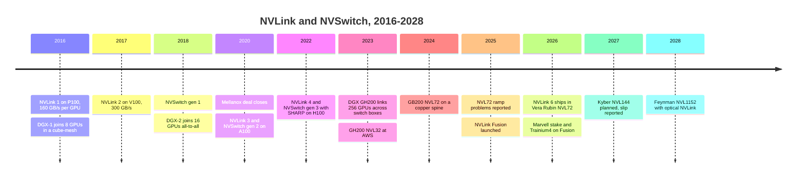
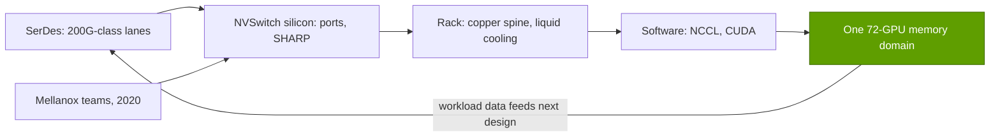

# Scale-up (NVLink, NVSwitch): History and how NVIDIA built it

Layer 05 · Scale-up (NVLink, NVSwitch) · ~11 min read · Last verified: 2026-11-05

## ⚡ The Executive Take

- **A decade of compounding:** [NVLink](../../glossary.md#nvlink) 1 gave each P100 160 GB/s in 2016; NVLink 6 gives each Rubin 3.0 TB/s in 2026, about 19× more [[S259]](../../sources/bibliography.md#s259)[[S200]](../../sources/bibliography.md#s200).
- **Two inflection points:** the NVSwitch chip (DGX-2, 2018) created a switched 16-GPU domain [[S206]](../../sources/bibliography.md#s206). The copper-spine GB200 NVL72 (2024) stretched it to a 72-GPU rack without optics [[S396]](../../sources/bibliography.md#s396)[[S5517]](../../sources/bibliography.md#s5517).
- **Mellanox ($6.9B, closed April 2020) supplied networking DNA.** Networking passed $31B in FY2026, with NVLink switches the main Q4 growth driver [[S464]](../../sources/bibliography.md#s464)[[S5514]](../../sources/bibliography.md#s5514)[[S402]](../../sources/bibliography.md#s402).
- **The rack bet hurt before it paid:** early NVL72 racks reportedly overheated and had link glitches, and hyperscalers trimmed orders (January 2025) 🟡 [[S5500]](../../sources/bibliography.md#s5500)[[S5501]](../../sources/bibliography.md#s5501).
- **[Q4 · Source of advantage]** The advantage comes from co-design, not any single part: [SerDes](../../glossary.md#serdes), switch silicon, rack mechanics and collective software change together every year [[S203]](../../sources/bibliography.md#s203)[[S332]](../../sources/bibliography.md#s332).
- **[Q6 · Replication cost]** Even a 65-member consortium needs ~3 years from founding (May 2024) to products (2027). The repo estimates 4–5 years, $3–6B and ~1,000 specialist engineers to match NVLink 🔴 [[S5519]](../../sources/bibliography.md#s5519)[[S90051]](../../sources/bibliography.md#s90051)[[S5521]](../../sources/bibliography.md#s5521).

![Timeline chart. NVIDIA's GB200 NVL72 went from announcement (March 2024) to first volume shipments in about 8 months and NVLink 6 Vera Rubin from roadmap (March 2025) to production shipments (August 2026) in about 16 months. UALink's promoter group formed in May 2024, published spec 1.0 in April 2025 and 2.0 in April 2026, with silicon expected in labs in H2 2026 and products in 2027, about 3 years after founding. Broadcom shipped Tomahawk Ultra in July 2025 before the SUE and ESUN specs (2025-26); NVLink Fusion's first third-party accelerator (Trainium4) is estimated for 2027; PCIe 6.0 took about three years from spec to GPU platforms.](../../assets/charts/05-open-standards-time-to-silicon.svg)

## From a faster wire to a rack-sized GPU

NVLink began as a faster wire: in 2016 PCIe 3.0 gave a GPU ~32 GB/s, so NVIDIA built a 160 GB/s link and wired eight GPUs in a cube-mesh [[S259]](../../sources/bibliography.md#s259)[[S222]](../../sources/bibliography.md#s222). Then came the switch: the first [NVSwitch](../../glossary.md#nvswitch) had 18 ports, and twelve let 16 V100s in a DGX-2 reach one another in one hop [[S206]](../../sources/bibliography.md#s206). Lane rates rose from 20 Gb/s to 200 Gb/s over the next five generations [[S259]](../../sources/bibliography.md#s259)[[S200]](../../sources/bibliography.md#s200). The 2022 switch added [SHARP](../../glossary.md#sharp), which sums gradients inside the switch instead of on the GPUs [[S205]](../../sources/bibliography.md#s205). The 2023 DGX GH200 stretched NVLink to 256 GPUs across switch boxes [[S205]](../../sources/bibliography.md#s205); the next generation replaced that approach with a single copper rack. AWS was the first cloud to offer the 32-GPU GH200 NVL32 [[S5525]](../../sources/bibliography.md#s5525)[[S5526]](../../sources/bibliography.md#s5526).

The decisive step was GB200 NVL72 (2024): 72 GPUs in one rack joined by ~5,184 copper cables, more than two miles of copper [[S5517]](../../sources/bibliography.md#s5517)[[S5516]](../../sources/bibliography.md#s5516); NVIDIA said avoiding optics saved ~20 kW per rack [[S5515]](../../sources/bibliography.md#s5515). The price was mechanical and thermal risk: in January 2025 Microsoft, AWS, Google and Meta reportedly cut some orders while NVIDIA revised the design 🟡 [[S5500]](../../sources/bibliography.md#s5500)[[S5501]](../../sources/bibliography.md#s5501). Huang denied the overheating reports [[S5501]](../../sources/bibliography.md#s5501).

> [!TIP]
> **Worked example — what the first switched domain cost.** DGX-1 (8 × P100, cube-mesh) listed at $129,000, or ~$16,100 per GPU [[S310]](../../sources/bibliography.md#s310). DGX-2 (16 × V100 through 12 NVSwitches) listed at $399,000, or ~$24,900 per GPU [[S314]](../../sources/bibliography.md#s314)[[S206]](../../sources/bibliography.md#s206). Customers paid ~55% more per GPU for a newer GPU, twice the domain and one-hop all-to-all: early evidence that scale-up carries a price premium.

| Date | Decision | Why it mattered | Source |
|---|---|---|---|
| 2016 | Own GPU link instead of waiting for PCIe 4.0 | 160 GB/s vs ~32 GB/s per GPU | [[S259]](../../sources/bibliography.md#s259)[[S222]](../../sources/bibliography.md#s222) |
| 2018 | Build a switch chip | First all-to-all domain (16 GPUs) | [[S206]](../../sources/bibliography.md#s206) |
| 2019–20 | Buy Mellanox for $6.9B | Switch, SerDes and in-network computing teams | [[S464]](../../sources/bibliography.md#s464) |
| 2024 | Copper spine inside one rack | 72-GPU domain without ~20 kW of optics | [[S5515]](../../sources/bibliography.md#s5515)[[S5517]](../../sources/bibliography.md#s5517) |
| 2025 | Open NVLink via Fusion | Keeps custom silicon inside NVIDIA's fabric | [[S217]](../../sources/bibliography.md#s217)[[S518]](../../sources/bibliography.md#s518) |
| 2026 | Double switch chips per rack (18 → 36) | NVLink 6 bandwidth; published spec later cut to 3.0 TB/s | [[S332]](../../sources/bibliography.md#s332)[[S201]](../../sources/bibliography.md#s201) |

## Source of advantage: co-design

**[Q4 · Source of advantage]** No single component explains the lead; four layers owned by one company change together every year:

A rival must match all four at once: a merchant switch does not help if the SerDes, cable reach and collective library ([NCCL](../../glossary.md#nccl)) are tuned for something else. NVIDIA even contributed the GB200 NVL72 rack design to the Open Compute Project, so ODMs build to its blueprint [[S336]](../../sources/bibliography.md#s336).

> [!TIP]
> **Worked example — reading the Rubin switch math.** Each NVLink 6 switch chip moves 28.8 Tb/s per direction [[S203]](../../sources/bibliography.md#s203). A Vera Rubin rack has 36 of them, up from 18 in GB300 [[S332]](../../sources/bibliography.md#s332): 36 × 28.8 = 1,037 Tb/s ≈ 130 TB/s per direction ≈ 259 TB/s both ways. That equals 72 × 3.6 TB/s, the launch spec. The production spec is 216 TB/s (3.0 TB/s per GPU), ~83% of what the switch silicon can carry [[S200]](../../sources/bibliography.md#s200)[[S201]](../../sources/bibliography.md#s201). NVIDIA has not explained the gap 🔴.

🔧 Under the hood: how NVLink 6 doubled bandwidth without faster lanes

NVLink 5 switches had 72 ports [[S207]](../../sources/bibliography.md#s207). The NVLink 6 switch keeps the same 28.8 Tb/s per direction but uses half the ports, each running SerDes that send ~200 Gb/s in both directions at once on a single pair [[S203]](../../sources/bibliography.md#s203). GPUs got twice as many links (36 vs 18) to twice as many switch chips. Bidirectional signalling on one pair needs echo cancellation, which is hard analog design. That is one reason the SerDes team, not the switch logic, is the scarcest asset.

## Replication cost

**[Q6 · Replication cost]** UALink is the best natural experiment: AMD, Broadcom, Cisco, Google, HPE, Intel, Meta and Microsoft formed it in May 2024 [[S5519]](../../sources/bibliography.md#s5519), published specs in April 2025 and April 2026 and expects products in 2027 🟡 [[S573]](../../sources/bibliography.md#s573)[[S574]](../../sources/bibliography.md#s574)[[S90051]](../../sources/bibliography.md#s90051), with more than 65 members [[S5521]](../../sources/bibliography.md#s5521). Deals price the parts: Upscale AI raised $200M for one UALink switch [[S5506]](../../sources/bibliography.md#s5506), Qualcomm paid ~$2.4B for Alphawave's SerDes IP [[S4514]](../../sources/bibliography.md#s4514) and AMD paid $4.9B for ZT Systems (August 2024), keeping its rack design team and reselling manufacturing to Sanmina for up to ~$3B [[S5527]](../../sources/bibliography.md#s5527); Helios shipped about two years later [[S90020]](../../sources/bibliography.md#s90020).

| Building block | Fastest path for a rival | Time | Dollars (evidence) | Talent |
|---|---|---|---|---|
| 200G-class SerDes | License (Synopsys, Cadence) or buy | 1–2 yrs | up to ~$2.4B (Alphawave) [[S4514]](../../sources/bibliography.md#s4514) | Analog / mixed-signal, scarcest |
| Switch ASIC | Merchant Ethernet now; UALink 2027 | 2–3 yrs | ~$0.2–0.6B per generation [[S5506]](../../sources/bibliography.md#s5506)[[S2501]](../../sources/bibliography.md#s2501) | Digital design, verification |
| Rack integration | Buy a team, partner with ODMs | ~2 yrs + ramp | ZT Systems $4.9B gross, ~$2–2.7B net of the Sanmina sale [[S5527]](../../sources/bibliography.md#s5527) | Mechanical, signal integrity, thermal |
| Collective software | Open libraries plus own stack | 3+ yrs to production parity | Ongoing opex | Systems software |

**Estimate 🔴 (repo):** a well-funded newcomer needs **4–5 years, $3–6B and roughly 1,000 specialist engineers** to field a competitive 72-plus-accelerator switched domain with mature software: the sum of the table's ranges, with UALink's ~3 years as the floor and teams in the low hundreds per block. Buying merchant switches (AMD's route) cuts this to ~2 years but cedes the switch margin.

> [!TIP]
> **Worked example — calendar gap.** NVIDIA took ~8 months from announcing GB200 NVL72 (March 2024) to first volume shipments (late 2024) [[S396]](../../sources/bibliography.md#s396)[[S121]](../../sources/bibliography.md#s121). UALink needs ~37 months from founding to expected products [[S5519]](../../sources/bibliography.md#s5519)[[S90051]](../../sources/bibliography.md#s90051). Even if UALink ships on time, NVIDIA will by then have shipped NVLink 5 and 6 and be launching NVLink 7.

## Counterfactuals — what if NVIDIA hadn't…

- **🔴 …built NVLink and standardised on PCIe/CXL?** PCIe 6.0 x16 gives ~256 GB/s per GPU against NVLink 6's 3,000 GB/s, a gap of ~12× [[S222]](../../sources/bibliography.md#s222)[[S200]](../../sources/bibliography.md#s200). Mixture-of-experts serving would be NIC-bound, the GPU a commodity card, and NVIDIA's networking line (~$11B in Q4 FY2026) far smaller [[S402]](../../sources/bibliography.md#s402).
- **🔴 …kept NVLink closed (no Fusion)?** AWS would likely have scaled NeuronLink or chosen UALink for Trainium4, and hyperscalers would have rallied to UALink sooner. Fusion keeps NVIDIA's switch trays in racks built around others' silicon [[S518]](../../sources/bibliography.md#s518)[[S217]](../../sources/bibliography.md#s217).
- **🔴 …gone optical inside the rack in 2024?** Spine transceivers would have drawn ~20 kW per rack, NVIDIA says, plus cost and failure points [[S5515]](../../sources/bibliography.md#s5515). Copper made NVL72 affordable but capped the domain at one rack, which is why Feynman's NVL1152 adds optics [[S108]](../../sources/bibliography.md#s108).

## 🎯 Corp Dev Lens

1. The scarcest asset is high-speed SerDes talent. After Qualcomm–Alphawave, which independent SerDes teams remain, and who else is bidding [[S4513]](../../sources/bibliography.md#s4513)?
2. AMD bought a rack design team (ZT Systems) rather than build one [[S5527]](../../sources/bibliography.md#s5527). Is rack-scale integration now a buyable capability, or does it need NVIDIA-style annual cadence to stay current?
3. What does a Fusion partner give up in roadmap control and pricing when its accelerator depends on NVIDIA's switch trays [[S518]](../../sources/bibliography.md#s518)?
4. How much of today's scale-up lead traces to the $6.9B Mellanox deal ([CS1](../../case-studies/CS1-mellanox-the-best-deal.md)) [[S464]](../../sources/bibliography.md#s464)?

## 📚 Sources

<!-- Auto-generated from the [S…] citations on this page by `make build`. Edit sources/registry/*.csv, not this list. -->

- [**S108**](../../sources/bibliography.md#s108) HPCwire / AIwire, *Huang Shares Nvidia Roadmap Showing More Chips, NVL1152, Scale-Up CPO*, 2026-03-18. [Link](https://www.hpcwire.com/aiwire/2026/03/18/huang-shares-nvidia-roadmap-showing-more-chips-nvl1152-scale-up-cpo/)
- [**S121**](../../sources/bibliography.md#s121) NVIDIA, *NVIDIA GB200 NVL72*, 2024-03. [Link](https://www.nvidia.com/en-us/data-center/gb200-nvl72/)
- [**S200**](../../sources/bibliography.md#s200) NVIDIA, *NVIDIA NVLink and NVLink Switch (product page with NVLink and NVLink Switch specification tables)*, 2026-09. [Link](https://www.nvidia.com/en-us/data-center/nvlink/)
- [**S201**](../../sources/bibliography.md#s201) VideoCardz, *NVIDIA quietly cuts Vera Rubin specs, HBM4 bandwidth and NVLink 6 speeds now lower*, 2026-10. [Link](https://videocardz.com/newz/nvidia-quietly-cuts-vera-rubin-specs-hbm4-bandwidth-and-nvlink-6-speeds-now-lower)
- [**S203**](../../sources/bibliography.md#s203) SemiAnalysis, *Vera Rubin - Extreme Co-Design: An Evolution*, 2026-01. [Link](https://newsletter.semianalysis.com/p/vera-rubin-extreme-co-design-an-evolution)
- [**S205**](../../sources/bibliography.md#s205) NVIDIA Technical Blog, *Upgrading Multi-GPU Interconnectivity with the Third-Generation NVIDIA NVSwitch*, 2022-08. [Link](https://developer.nvidia.com/blog/upgrading-multi-gpu-interconnectivity-with-the-third-generation-nvidia-nvswitch/)
- [**S206**](../../sources/bibliography.md#s206) Hot Chips / NVIDIA (Alex Ishii; Denis Foley; Eric Anderson; Bill Dally; Glenn Dearth), *NVSwitch and DGX-2 (Hot Chips 30 presentation)*, 2018-08. [Link](https://old.hotchips.org/hc30/2conf/2.01_Nvidia_NVswitch_HotChips2018_DGX2NVS_Final.pdf)
- [**S207**](../../sources/bibliography.md#s207) glennklockwood.com (Glenn K. Lockwood), *NVLink (digital garden notes)*, 2025. [Link](https://glennklockwood.com/garden/nvlink)
- [**S217**](../../sources/bibliography.md#s217) NVIDIA via Barchart, *NVIDIA Unveils NVLink Fusion for Industry to Build Semi-Custom AI Infrastructure With NVIDIA Partner Ecosystem (press release, syndicated)*, 2025-05-19. [Link](https://www.barchart.com/story/news/32460751/nvidia-unveils-nvlink-fusion-for-industry-to-build-semi-custom-ai-infrastructure-with-nvidia-partner-ecosystem)
- [**S222**](../../sources/bibliography.md#s222) Tom's Hardware, *PCI Express roadmap: the path to 1TB/s with PCIe 8.0, the challenges of integration, and beyond*, 2025. [Link](https://www.tomshardware.com/pc-components/motherboards/pci-express-roadmap-the-path-to-1tb-s-with-pci-8-0-the-challenges-of-integration-and-beyond)
- [**S259**](../../sources/bibliography.md#s259) NVIDIA, *NVIDIA Tesla P100 (Pascal architecture) whitepaper*, 2016. [Link](https://images.nvidia.com/content/pdf/tesla/whitepaper/pascal-architecture-whitepaper.pdf)
- [**S310**](../../sources/bibliography.md#s310) AnandTech (Ryan Smith), *NVIDIA unveils the DGX-1 HPC server: 8 Teslas, 3U, Q2 2016*, 2016-04-05. [Link](https://www.anandtech.com/show/10229)
- [**S314**](../../sources/bibliography.md#s314) TweakTown, *NVIDIA's DGX-2: 16 x Tesla V100s, total of 512GB HBM2, $399K*, 2018-03-27. [Link](https://www.tweaktown.com/news/61345/nvidias-dgx-2-16-tesla-v100s-total-512gb-hbm2-399k/index.html)
- [**S332**](../../sources/bibliography.md#s332) Tiger Brokers (iTiger), *Morgan Stanley's BOM analysis of NVIDIA's Rubin: GPU share declines; PCB, MLCC and ABF substrate values soar*, 2026-05-20. [Link](https://www.itiger.com/news/1188068712)
- [**S336**](../../sources/bibliography.md#s336) eeNews Europe, *Nvidia offers 120kW liquid-cooled Blackwell rack as industry standard*, 2024-10. [Link](https://www.eenewseurope.com/en/nvidia-offers-120kw-liquid-cooled-blackwell-rack-as-industry-standard)
- [**S396**](../../sources/bibliography.md#s396) NVIDIA Newsroom, *NVIDIA Blackwell platform arrives to power a new era of computing*, 2024-03-18. [Link](https://nvidianews.nvidia.com/news/nvidia-blackwell-platform-arrives-to-power-a-new-era-of-computing)
- [**S402**](../../sources/bibliography.md#s402) NVIDIA Corporation via SEC EDGAR (Colette Kress), *CFO Commentary on Fourth Quarter and Fiscal 2026 Results (Form 8-K exhibit 99.2)*, 2026-02-25. [Link](https://www.sec.gov/Archives/edgar/data/1045810/000104581026000019/q4fy26cfocommentary.htm)
- [**S464**](../../sources/bibliography.md#s464) NVIDIA Newsroom, *NVIDIA to Acquire Mellanox for $6.9 Billion*, 2019-03-11. [Link](https://nvidianews.nvidia.com/news/nvidia-to-acquire-mellanox-for-6-9-billion)
- [**S518**](../../sources/bibliography.md#s518) ServeTheHome, *NVIDIA NVLink Fusion tapped for future AWS Trainium4 deployments*, 2025-12-02. [Link](https://www.servethehome.com/nvidia-nvlink-fusion-tapped-for-future-aws-trainium4-deployments/)
- [**S573**](../../sources/bibliography.md#s573) Business Wire, *UALink Consortium Releases the Ultra Accelerator Link 200G 1.0 Specification*, 2025-04-08. [Link](https://www.businesswire.com/news/home/20250408050548/en/UALink-Consortium-Releases-the-Ultra-Accelerator-Link-200G-1.0-Specification)
- [**S574**](../../sources/bibliography.md#s574) HPCwire, *UALink Consortium Publishes 4 Specifications Defining In-Network Compute, Chiplets, Manageability and 200G Performance*, 2026-04-07. [Link](https://www.hpcwire.com/off-the-wire/ualink-consortium-publishes-4-specifications-defining-in-network-compute-chiplets-manageability-and-200g-performance/)
- [**S2501**](../../sources/bibliography.md#s2501) Silicon Analysts, *Chip Design & NRE Cost by Node — Historical Time Series Data*, 2026. [Link](https://siliconanalysts.com/market-data/nre-design-cost)
- [**S4513**](../../sources/bibliography.md#s4513) I-Connect007, *Qualcomm completes acquisition of Alphawave Semi*, 2025-12-18. [Link](https://iconnect007.com/article/148161/qualcomm-completes-acquisition-of-alphawave-semi/148158/ein)
- [**S4514**](../../sources/bibliography.md#s4514) CRN Asia, *Qualcomm: US$2.4 billion Alphawave Semi buy to boost data center push*, 2025-06. [Link](https://www.crnasia.com/news-network/2025/qualcomm-us-2)
- [**S5500**](../../sources/bibliography.md#s5500) TrendForce, *NVIDIA GB200 racks reportedly overheat, major clients cut orders*, 2025-01-14. [Link](https://www.trendforce.com/news/2025/01/14/news-nvidia-gb200-racks-reportedly-overheat-major-clients-cut-orders/)
- [**S5501**](../../sources/bibliography.md#s5501) TechPowerUp, *NVIDIA's GB200 'Blackwell' racks face overheating issues*, 2025-01-14. [Link](https://techpowerup.com/331105/nvidias-gb200-blackwell-racks-face-overheating-issues)
- [**S5506**](../../sources/bibliography.md#s5506) The Register, *AI networking startup Upscale AI scores $200M to challenge Nvidia's NVSwitch*, 2026-01-22. [Link](https://www.theregister.com/2026/01/22/upscale_skyhammer_nvidia/)
- [**S5514**](../../sources/bibliography.md#s5514) SDxCentral, *Nvidia's networking arm hits $31B as new cornerstone of AI dominance*, 2026-02. [Link](https://www.sdxcentral.com/news/nvidias-networking-arm-hits-31b-as-new-cornerstone-of-ai-dominance/)
- [**S5515**](../../sources/bibliography.md#s5515) ServeTheHome, *This is the NVIDIA DGX GB200 NVL72*, 2024-03-19. [Link](https://www.servethehome.com/this-is-the-nvidia-dgx-gb200-nvl72/)
- [**S5516**](../../sources/bibliography.md#s5516) The Register, *Nvidia's DGX GB200 NVL72 rack (GTC 2024 coverage)*, 2024-03-21. [Link](https://www.theregister.com/2024/03/21/nvidia_dgx_gb200_nvk72)
- [**S5517**](../../sources/bibliography.md#s5517) The Next Platform, *Copper wires have already failed clustered AI systems*, 2024-09-13. [Link](https://www.nextplatform.com/2024/09/13/copper-wires-have-already-failed-clustered-ai-systems/)
- [**S5519**](../../sources/bibliography.md#s5519) Business Wire, *AMD, Broadcom, Cisco, Google, HPE, Intel, Meta and Microsoft form Ultra Accelerator Link (UALink) Promoter Group*, 2024-05-30. [Link](https://businesswire.com/news/home/20240530653602/en)
- [**S5521**](../../sources/bibliography.md#s5521) Converge Digest, *UALink Consortium expands board with Alibaba, Apple and Synopsys*, 2025-01-14. [Link](https://convergedigest.com/ualink-consortium-expands-board-with-alibaba-apple-and-synopsys/)
- [**S5525**](../../sources/bibliography.md#s5525) NVIDIA Blog, *Embracing transformation: AWS and NVIDIA forge ahead in generative AI and cloud innovation*, 2023-11-28. [Link](https://blogs.nvidia.com/blog/aws-nvidia)
- [**S5526**](../../sources/bibliography.md#s5526) Business Wire, *AWS and NVIDIA announce strategic collaboration to offer new supercomputing infrastructure for generative AI*, 2023-11-28. [Link](https://www.businesswire.com/news/home/20231127986225/en)
- [**S5527**](../../sources/bibliography.md#s5527) Evertiq, *AMD completes sale of ZT Systems manufacturing unit to Sanmina*, 2025-10-27. [Link](https://evertiq.com/design/2025-10-27-amd-completes-sale-of-zt-systems-manufacturing-unit-to-sanmina)
- [**S90020**](../../sources/bibliography.md#s90020) Shacknews, *AMD Helios AI rack system on track for initial shipments in Q3 2026*, 2026. [Link](https://www.shacknews.com/article/150249/amd-helios-ai-system-shipping-q3-2026)
- [**S90051**](../../sources/bibliography.md#s90051) SDxCentral, *UALink Consortium takes another swing at Nvidia's NVLink supremacy with specification 2.0*, 2026-04. [Link](https://www.sdxcentral.com/news/ualink-consortium-takes-another-swing-at-nvidias-nvlink-supremacy-with-specification-20/)
