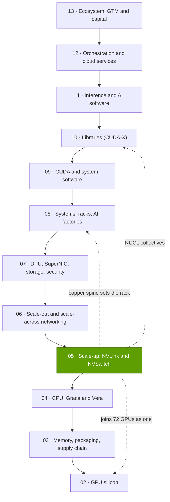
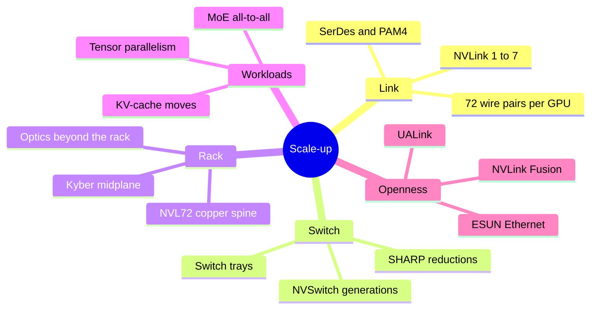

# Layer 05 — Scale-up (NVLink, NVSwitch)

Layer 05 of 12 · NVLink links, NVSwitch chips and the rack-scale domains they build · ~6 min read · Last verified: 2026-11-05

## ⚡ The Executive Take

- **[Scale-up](../../glossary.md#scale-up) makes many GPUs act as one.** NVLink 5 gives each Blackwell GPU 900 GB/s each way, ~9× its 800G network card, with direct memory access between GPUs [[S200]](../../sources/bibliography.md#s200)[[S264]](../../sources/bibliography.md#s264).
- **The NVL72 is the signature product:** 72 GPUs, 18 NVLink switch chips and ~5,000 copper cables deliver 130 TB/s in one rack [[S262]](../../sources/bibliography.md#s262)[[S5000]](../../sources/bibliography.md#s5000); [Vera Rubin NVL72](../../glossary.md#nvl72) reaches 216 TB/s after a 2026 cut from 260 TB/s [[S200]](../../sources/bibliography.md#s200)[[S201]](../../sources/bibliography.md#s201).
- **Why it matters now:** [mixture-of-experts](../../glossary.md#mixture-of-experts) and reasoning models make every layer an [all-to-all](../../glossary.md#all-to-all). NVIDIA claims ~10× on MoE inference versus HGX H200 [[S5002]](../../sources/bibliography.md#s5002); same-silicon data show ~3× at throughput-heavy points [[S630]](../../sources/bibliography.md#s630).
- **Copper is the quiet moat:** it avoids ~19 kW and ~$0.7M of optics per rack (Est.) [[S5000]](../../sources/bibliography.md#s5000)[[S5016]](../../sources/bibliography.md#s5016), but 200G copper reaches only ~1 m [[S5010]](../../sources/bibliography.md#s5010), so the domain ends at the rack until co-packaged optics arrive with Feynman 🟢 [[S109]](../../sources/bibliography.md#s109).
- **Weakness and strongest challengers:** 72 GPUs trails Google's 9,216-chip TPU pod [[S232]](../../sources/bibliography.md#s232); AMD's Helios claims 260 TB/s, above Rubin's revised 216 [[S226]](../../sources/bibliography.md#s226); [UALink](../../glossary.md#ualink) and [ESUN](../../glossary.md#esun) aim to make the layer open [[S574]](../../sources/bibliography.md#s574)[[S576]](../../sources/bibliography.md#s576).
- **[NVLink Fusion](../../glossary.md#nvlink-fusion) opens the link but not the switch:** 13 partners including Qualcomm, Fujitsu, Intel and AWS Trainium4, with NVIDIA silicon required in every system 🟡 [[S131]](../../sources/bibliography.md#s131)[[S518]](../../sources/bibliography.md#s518)[[S5018]](../../sources/bibliography.md#s5018).

> [!TIP]
> **Worked example — what 216 TB/s per rack means.** 72 GPUs × 3.0 TB/s = **216 TB/s** [[S200]](../../sources/bibliography.md#s200). A Vera Rubin rack's 72 ConnectX-9 NICs add 72 × 200 GB/s = 14.4 TB/s each way, or 28.8 TB/s both ways [[S33004]](../../sources/bibliography.md#s33004): the NVLink fabric carries **7.5×** the rack's entire scale-out capacity. **Conclusion:** most bytes an AI rack moves never leave it, which is why NVIDIA treats the rack, not the GPU, as the unit it sells.

## Where this layer sits in the stack

## Layer map

## The eight questions at a glance

| # | Question | Short answer | Where answered |
|---|---|---|---|
| Q1 | Job, and what breaks if weak? | Make tensor and expert parallelism cheap; if weak, GPUs wait on the network | [Scale-up vs scale-out](scale-up-vs-scale-out.md) |
| Q2 | Metrics that matter? | Bandwidth per GPU, domain size, domain bandwidth, hops and latency, pJ/bit and cost per link | [Scale-up vs scale-out](scale-up-vs-scale-out.md) |
| Q3 | Generational progress? | 160 GB/s → 3.0 TB/s per GPU (~19×); 16 → 72 GPUs per domain; ~170× domain bandwidth | [Generations](nvlink-and-nvswitch-generations.md) |
| Q4 | Source of advantage? | Co-design of SerDes, switch silicon, rack and collective software, changed together every year | [History and how built](history-and-how-built.md) |
| Q5 | Strongest challenger? | AMD Helios (72 GPUs, 260 TB/s over UALink on Ethernet); Google TPU pods on domain size | [Competition](competition.md) |
| Q6 | Replication cost? | Repo estimate: 4–5 years, $3–6B and ~1,000 specialists 🔴 | [History and how built](history-and-how-built.md) |
| Q7 | Roadmap? | Kyber NVL144 (2027, slip reported), multi-rack NVL576/NVL1152 with optics; UALink products 2027 | [Roadmap](roadmap.md) |
| Q8 | Value pools and M&A? | Switch silicon, SerDes IP, copper interconnect and optical I/O | [Value chain and corp dev](value-chain-and-corp-dev.md) |

## Pages in this layer

| Page | What you will learn |
|---|---|
| [Scale-up vs scale-out](scale-up-vs-scale-out.md) | Load/store vs RDMA, the ~9× gap, metrics |
| [NVLink and NVSwitch generations](nvlink-and-nvswitch-generations.md) | NVLink 1–7, switch trays, NVL8 → Kyber |
| [Copper spines and why copper wins](copper-spines-and-why-copper-wins.md) | The NVL72 spine, copper vs optics, reach |
| [Why domain size matters](why-domain-size-matters.md) | MoE all-to-all, NVIDIA's claims, the TPU torus |
| [NVLink Fusion](nvlink-fusion.md) | Partners, what is open, Fusion vs UALink |
| [Competition](competition.md) | AMD, Google, AWS, Huawei, open standards |
| [History and how NVIDIA built it](history-and-how-built.md) | Timeline, decisions, replication cost |
| [Roadmap](roadmap.md) | NVLink 6–8, Kyber, rival roadmaps |
| [Value chain and corp dev angles](value-chain-and-corp-dev.md) | Value pools, private companies, M&A |

🔧 Under the hood: reading NVLink numbers

NVIDIA quotes NVLink both ways combined (1.8 TB/s = 900 GB/s each way) while NIC speeds are per direction (800 Gb/s = 100 GB/s) [[S200]](../../sources/bibliography.md#s200)[[S264]](../../sources/bibliography.md#s264); rack figures are GPUs × per-GPU bandwidth [[S262]](../../sources/bibliography.md#s262).

## 🎯 Corp Dev Lens

1. **The rack is the product.** If most traffic stays inside the NVLink domain, value accrues to whoever owns the switch, spine and software; does NVIDIA's lead here outlast its GPU lead?
2. **Open fabrics are two years behind.** UALink products are expected in 2027 [[S90051]](../../sources/bibliography.md#s90051), so the window for NVLink Fusion licences is now.
3. **Qualcomm question (public information only):** Qualcomm is a Fusion CPU partner [[S131]](../../sources/bibliography.md#s131) while its Dragonfly AI300 accelerator plans UALink and ESUN [[S90060]](../../sources/bibliography.md#s90060). Which scale-up path best fits its inference racks, and what would each cost in time-to-market?

## 📚 Sources

<!-- Auto-generated from the [S…] citations on this page by `make build`. Edit sources/registry/*.csv, not this list. -->

- [**S109**](../../sources/bibliography.md#s109) NVIDIA Blog, *NVIDIA GTC 2026: Live Updates on What's Next in AI*, 2026-03-16. [Link](https://blogs.nvidia.com/blog/gtc-2026-news/)
- [**S131**](../../sources/bibliography.md#s131) NVIDIA Newsroom, *NVIDIA NVLink Fusion: semi-custom AI infrastructure partner ecosystem (Computex 2025)*, 2025-05-19. [Link](https://nvidianews.nvidia.com/news/nvidia-nvlink-fusion-semi-custom-ai-infrastructure-partner-ecosystem)
- [**S200**](../../sources/bibliography.md#s200) NVIDIA, *NVIDIA NVLink and NVLink Switch (product page with NVLink and NVLink Switch specification tables)*, 2026-09. [Link](https://www.nvidia.com/en-us/data-center/nvlink/)
- [**S201**](../../sources/bibliography.md#s201) VideoCardz, *NVIDIA quietly cuts Vera Rubin specs, HBM4 bandwidth and NVLink 6 speeds now lower*, 2026-10. [Link](https://videocardz.com/newz/nvidia-quietly-cuts-vera-rubin-specs-hbm4-bandwidth-and-nvlink-6-speeds-now-lower)
- [**S226**](../../sources/bibliography.md#s226) AMD, *AMD Helios Rackscale Solution (product page)*, 2026. [Link](https://www.amd.com/en/products/rackscale-solutions/helios.html)
- [**S232**](../../sources/bibliography.md#s232) Google Cloud, *TPU7x (Ironwood) - Cloud TPU documentation*, 2025-11. [Link](https://docs.cloud.google.com/tpu/docs/tpu7x)
- [**S262**](../../sources/bibliography.md#s262) NVIDIA, *NVIDIA GB200 NVL72 (product page)*, 2024. [Link](https://www.nvidia.com/en-us/data-center/gb200-nvl72/)
- [**S264**](../../sources/bibliography.md#s264) NVIDIA Newsroom, *NVIDIA Announces New Switches Optimized for Trillion-Parameter GPU Computing and AI Infrastructure (Quantum-X800, Spectrum-X800, ConnectX-8)*, 2024-03-18. [Link](https://nvidianews.nvidia.com/news/networking-switches-gpu-computing-ai)
- [**S518**](../../sources/bibliography.md#s518) ServeTheHome, *NVIDIA NVLink Fusion tapped for future AWS Trainium4 deployments*, 2025-12-02. [Link](https://www.servethehome.com/nvidia-nvlink-fusion-tapped-for-future-aws-trainium4-deployments/)
- [**S574**](../../sources/bibliography.md#s574) HPCwire, *UALink Consortium Publishes 4 Specifications Defining In-Network Compute, Chiplets, Manageability and 200G Performance*, 2026-04-07. [Link](https://www.hpcwire.com/off-the-wire/ualink-consortium-publishes-4-specifications-defining-in-network-compute-chiplets-manageability-and-200g-performance/)
- [**S576**](../../sources/bibliography.md#s576) Converge Digest, *OCP releases ESUN 1.0 spec for Ethernet-based scale-up AI fabrics*, 2026-03. [Link](https://convergedigest.com/ocp-releases-esun-1-0-spec-for-ethernet-based-scale-up-ai-fabrics/)
- [**S630**](../../sources/bibliography.md#s630) SemiAnalysis, *GB200 NVL72 vs B200 on Kimi K2.5: 3.1x from Wide EP vLLM*, 2026-04-23. [Link](https://github.com/SemiAnalysisAI/InferenceX-app/blob/main/packages/app/content/blog/gb200-nvl72-kimi-k2-5-vllm-wide-ep-3x-vs-b200.mdx)
- [**S5000**](../../sources/bibliography.md#s5000) SemiAnalysis, *Nvidia's Optical Boogeyman - NVL72, InfiniBand Scale Out, 800G & 1.6T Ramp*, 2024-03. [Link](https://newsletter.semianalysis.com/p/nvidias-optical-boogeyman-nvl72-infiniband)
- [**S5002**](../../sources/bibliography.md#s5002) NVIDIA Blog, *Mixture of Experts Powers the Most Intelligent Frontier AI Models, Runs 10x Faster on NVIDIA Blackwell NVL72*, 2025-12-03. [Link](https://blogs.nvidia.com/blog/mixture-of-experts-frontier-models/)
- [**S5010**](../../sources/bibliography.md#s5010) IEEE 802.3, *IEEE P802.3dj adopted objectives (200 Gb/s per lane electrical and optical signaling)*, 2024-03-14. [Link](https://grouper.ieee.org/groups/802/3/dj/projdoc/objectives_P802d3dj_240314.pdf)
- [**S5016**](../../sources/bibliography.md#s5016) Fundamental Bottom (Substack), *Optical module industry (long AAOI note)*, 2025. [Link](https://fundamentalbottom.substack.com/p/longaaoi-optical-module-industry)
- [**S5018**](../../sources/bibliography.md#s5018) Tom's Hardware, *Alchip responds to report that Nvidia is reportedly keeping prized NVLink tech closely guarded (updated)*, 2025. [Link](https://www.tomshardware.com/tech-industry/nvidia-keeping-prized-nvlink-tech-closely-guarded-companies-warn-restrictions-could-hamper-deployment-of-some-solutions)
- [**S33004**](../../sources/bibliography.md#s33004) NVIDIA Newsroom, *NVIDIA Kicks Off the Next Generation of AI With Rubin — Six New Chips; One Incredible AI Supercomputer*, 2026-01-05. [Link](https://nvidianews.nvidia.com/news/rubin-platform-ai-supercomputer)
- [**S90051**](../../sources/bibliography.md#s90051) SDxCentral, *UALink Consortium takes another swing at Nvidia's NVLink supremacy with specification 2.0*, 2026-04. [Link](https://www.sdxcentral.com/news/ualink-consortium-takes-another-swing-at-nvidias-nvlink-supremacy-with-specification-20/)
- [**S90060**](../../sources/bibliography.md#s90060) Qualcomm, *Qualcomm Dragonfly AI300 (product page)*, 2026-06. [Link](https://www.qualcomm.com/data-center/products/qualcomm-dragonfly-ai300)
