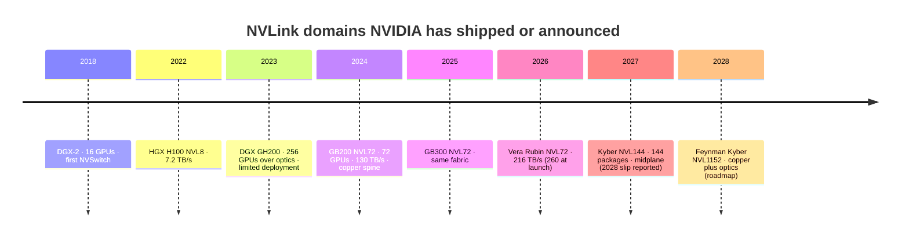

# NVLink and NVSwitch generations: from an 8-GPU mesh to a 144-GPU rack

Layer 05 · Scale-up (NVLink, NVSwitch) · ~10 min read · Last verified: 2026-11-05

## ⚡ The Executive Take

- **~19× in ten years.** [NVLink](../../glossary.md#nvlink) bandwidth per GPU rose from 160 GB/s (P100, 2016) to 3.0 TB/s (Rubin, 2026) [[S259]](../../sources/bibliography.md#s259)[[S200]](../../sources/bibliography.md#s200), while the [PCIe](../../glossary.md#pcie) x16 link GPUs use rose 8× [[S222]](../../sources/bibliography.md#s222).
- **Faster wires, not more wires.** Since Hopper every GPU has used 72 wire pairs; each pair went from 100 to 200 Gb/s and, on Rubin, ~200 Gb/s both ways at once (repo calc from [[S205]](../../sources/bibliography.md#s205)[[S263]](../../sources/bibliography.md#s263)[[S203]](../../sources/bibliography.md#s203)).
- **[NVSwitch](../../glossary.md#nvswitch) turned a board-level mesh into a rack fabric:** 12 chips joined 16 V100s in DGX-2 (2018) [[S206]](../../sources/bibliography.md#s206); 18 NVLink 5 Switch chips join 72 GPUs in GB200 [NVL72](../../glossary.md#nvl72) (130 TB/s) [[S262]](../../sources/bibliography.md#s262)[[S207]](../../sources/bibliography.md#s207); Vera Rubin NVL72 uses 36 [[S203]](../../sources/bibliography.md#s203).
- **The 2026 revision:** NVLink 6 was cut from 3.6 to 3.0 TB/s per GPU (260 → 216 TB/s per rack); NVIDIA calls the launch figures preliminary targets [[S200]](../../sources/bibliography.md#s200)[[S201]](../../sources/bibliography.md#s201)[[S202]](../../sources/bibliography.md#s202). On paper AMD's Helios (260 TB/s) now leads [[S226]](../../sources/bibliography.md#s226).
- **Naming moved twice:** Vera Rubin NVL72 was first announced as "NVL144" (counting dies) [[S90009]](../../sources/bibliography.md#s90009); Kyber NVL144 means 144 Rubin Ultra *packages* 🟢 H2 2027, with a disputed slip to 2028 🟡 [[S510]](../../sources/bibliography.md#s510)[[S507]](../../sources/bibliography.md#s507)[[S508]](../../sources/bibliography.md#s508); "NVL576" now often means eight 72-GPU racks 🟡 [[S214]](../../sources/bibliography.md#s214)[[S120]](../../sources/bibliography.md#s120).

## 1. NVLink 1 → 7: the link

An NVLink "link" is a bundle of serial lanes ([SerDes](../../glossary.md#serdes)) in each direction. Each generation added links or sped up lanes; Hopper moved to [PAM4](../../glossary.md#pam4) signalling, two bits per symbol.

| Gen | First product (year) | Lane rate | Links / GPU | Per GPU, both directions | Domain shipped | Switch |
|---|---|---|---|---|---|---|
| NVLink 1 | P100, DGX-1 (2016) | 20 Gb/s NRZ | 4 | 160 GB/s | 8, cube-mesh | none [[S259]](../../sources/bibliography.md#s259) |
| NVLink 2 | V100 (2017), DGX-2 (2018) | 25 Gb/s NRZ | 6 | 300 GB/s | 16 | NVSwitch 1 [[S260]](../../sources/bibliography.md#s260)[[S206]](../../sources/bibliography.md#s206) |
| NVLink 3 | A100 (2020) | 50 Gb/s NRZ | 12 | 600 GB/s | 8 | NVSwitch 2 [[S261]](../../sources/bibliography.md#s261) |
| NVLink 4 | H100 (2022) | 100 Gb/s PAM4 | 18 | 900 GB/s | 8 (256 in DGX GH200) | NVSwitch 3 [[S205]](../../sources/bibliography.md#s205) |
| NVLink 5 | B200, GB200 (2024) | 200 Gb/s PAM4 | 18 | 1.8 TB/s | 72 | NVLink 5 Switch [[S263]](../../sources/bibliography.md#s263)[[S262]](../../sources/bibliography.md#s262) |
| NVLink 6 | Rubin (2026) | ~200 Gb/s each way per pair | 36 | 3.6 → 3.0 TB/s | 72 | NVLink 6 Switch [[S200]](../../sources/bibliography.md#s200)[[S203]](../../sources/bibliography.md#s203) |
| NVLink 7 🟡 | Rubin Ultra (2027) | ~200 Gb/s each way per pair | n/a | 3.6 TB/s (reported) | 144 | NVLink 7 Switch [[S210]](../../sources/bibliography.md#s210) |

> [!TIP]
> **Worked example — how 1.8 TB/s and 3.6 TB/s are built.** Blackwell: 18 links × 2 lanes × 200 Gb/s = 7.2 Tb/s = **900 GB/s each way** [[S263]](../../sources/bibliography.md#s263)[[S200]](../../sources/bibliography.md#s200), on 18 × 2 × 2 = **72 wire pairs**. Rubin doubles to 36 links but, per SemiAnalysis, its "400G" bidirectional SerDes carry ~200 Gb/s each way on one pair [[S203]](../../sources/bibliography.md#s203): 36 × 2 = the same **72 pairs**, now 14.4 Tb/s each way = 3.6 TB/s [[S33004]](../../sources/bibliography.md#s33004); the revised 3.0 TB/s implies ~333 Gb/s per pair (repo calc) [[S200]](../../sources/bibliography.md#s200). **Conclusion:** NVIDIA doubled bandwidth without adding copper, so Vera Rubin keeps the NVL72 spine ([copper page](copper-spines-and-why-copper-wins.md)).

**[Q3 · Generational progress]** Per-GPU NVLink bandwidth grew ~19× (160 GB/s → 3.0 TB/s) [[S259]](../../sources/bibliography.md#s259)[[S200]](../../sources/bibliography.md#s200); the switched domain grew from 16 GPUs (DGX-2) to 72 (NVL72), with 144 planned [[S206]](../../sources/bibliography.md#s206)[[S262]](../../sources/bibliography.md#s262)[[S510]](../../sources/bibliography.md#s510); aggregate domain bandwidth grew ~170× (1.3 → 216 TB/s, see [index](index.md)). The one step backwards is Rubin's revision from 3.6 to 3.0 TB/s 🟢 (spec page), cause unexplained 🔴 [[S200]](../../sources/bibliography.md#s200)[[S202]](../../sources/bibliography.md#s202).

> [!WARNING]
> **Myth vs. reality:** "Each NVLink generation doubles bandwidth." NVLink 6 was marketed at 2× NVLink 5 but ships at 1.67× [[S200]](../../sources/bibliography.md#s200)[[S201]](../../sources/bibliography.md#s201).

🔧 Under the hood: SerDes, PAM4 and bidirectional signalling

- **SerDes** turn wide on-chip data into a fast serial stream on a differential pair; their speed and power set the link budget.
- **PAM4** doubles bits per symbol, but smaller gaps between levels make signals fragile and shorten copper reach [[S5010]](../../sources/bibliography.md#s5010).
- **Simultaneous bidirectional signalling** sends and receives on one pair, the receiver subtracting its own transmission (as gigabit Ethernet does). SemiAnalysis describes NVLink 6 this way [[S203]](../../sources/bibliography.md#s203); NVIDIA has not published lane detail.

## 2. NVSwitch: from a board chip to a rack fabric

Without a switch each GPU reaches only its wired neighbours (DGX-1's cube-mesh); a switch lets every GPU reach every other at full speed. NVSwitch generations raised ports and speed until one chip served one port to each of 72 GPUs.

In GB200 NVL72 the chips sit two to a 1U [NVLink switch tray](../../glossary.md#nvlink-switch-tray), nine trays per rack, each tray managed by its own [BMC](../../glossary.md#bmc) and joined to the [NVLink spine](../../glossary.md#nvlink-spine) through rear [blind-mate connectors](../../glossary.md#blind-mate-connector) [[S5007]](../../sources/bibliography.md#s5007)[[S5008]](../../sources/bibliography.md#s5008).

![Labeled schematic of a GB200-generation NVLink switch tray, front on the left and rear on the right: a front-panel BMC module for out-of-band management and a management port; two NVLink 5 Switch ASICs, each with 72 NVLink ports, 7.2 TB/s (28.8 Tb/s each way) and SHARP in-network reductions, under liquid cold plates; and rear blind-mate NVLink connectors carrying 144 ports (576 copper pairs) into the cable cartridges of the copper spine, plus DC power input and coolant quick-disconnects. A side note explains nine trays give 18 ASICs and 1,296 GPU-facing ports, 5,184 copper pairs per rack, and that Vera Rubin NVL72 uses 36 NVLink 6 Switch chips.](../../assets/diagrams/05-nvlink-switch-tray-anatomy.svg)

> [!TIP]
> **Worked example — why NVL72 is exactly one hop.** 72 GPUs × 18 links = **1,296** links = 18 chips × 72 ports [[S262]](../../sources/bibliography.md#s262)[[S5008]](../../sources/bibliography.md#s5008): each GPU puts one link on every chip, so any GPU reaches any other through any of 18 chips in one hop. 18 × 7.2 TB/s = **130 TB/s**, NVIDIA's rack figure [[S207]](../../sources/bibliography.md#s207)[[S262]](../../sources/bibliography.md#s262). **Conclusion:** NVL72 is one non-blocking switch built from 18 chips, so every GPU sees 1.8 TB/s to every other.

## 3. NVL8 → NVL72 → Vera Rubin NVL72 → Kyber

The DGX GH200 tried 256 GPUs over optical NVLink in 2023 but saw limited deployment; the copper NVL72 replaced it [[S205]](../../sources/bibliography.md#s205)[[S200]](../../sources/bibliography.md#s200). [Kyber](../../glossary.md#kyber) turns the rack into vertical blades on a [midplane](../../glossary.md#midplane): 36 compute blades of four Rubin Ultra packages and 12 switch blades [[S510]](../../sources/bibliography.md#s510), at ~600 kW [[S305]](../../sources/bibliography.md#s305). Beyond one rack, GTC 2026 showed NVL576 and, for Feynman, NVL1152 over copper and co-packaged optics 🟢 [[S109]](../../sources/bibliography.md#s109)[[S108]](../../sources/bibliography.md#s108).

> [!TIP]
> **Worked example — Kyber's numbers.** 144 packages × 3.6 TB/s (reported) = **~518 TB/s** per rack, 4× GB200 NVL72 [[S210]](../../sources/bibliography.md#s210). SemiAnalysis counts 72 NVLink 7 Switch chips × 7.2 TB/s = 518 TB/s, consistent; Glenn Lockwood estimates 36, which would need twice the per-chip bandwidth [[S210]](../../sources/bibliography.md#s210)[[S211]](../../sources/bibliography.md#s211). At ~600 kW, that is ~4.2 kW per package [[S305]](../../sources/bibliography.md#s305). **Conclusion:** treat Kyber's switch count and date as 🟡 until NVIDIA publishes a spec.

## 🎯 Corp Dev Lens

1. **Spec credibility.** The 3.6 → 3.0 TB/s revision [[S201]](../../sources/bibliography.md#s201)[[S202]](../../sources/bibliography.md#s202) is NVLink's first step-down; do SerDes or signal-integrity limits also cap rivals on 200G-class lanes?
2. **The switch is the toll gate.** NVIDIA builds every NVLink switch chip (36 per Vera Rubin rack [[S203]](../../sources/bibliography.md#s203)); Fusion opens the link, not the switch ([NVLink Fusion](nvlink-fusion.md)).
3. **Watch Kyber's midplane.** A reported PCB-midplane manufacturability slip [[S507]](../../sources/bibliography.md#s507) would hand AMD's 72-GPU Helios and Google's TPU 8t time to close the gap ([Roadmap](roadmap.md)).

## 📚 Sources

<!-- Auto-generated from the [S…] citations on this page by `make build`. Edit sources/registry/*.csv, not this list. -->

- [**S108**](../../sources/bibliography.md#s108) HPCwire / AIwire, *Huang Shares Nvidia Roadmap Showing More Chips, NVL1152, Scale-Up CPO*, 2026-03-18. [Link](https://www.hpcwire.com/aiwire/2026/03/18/huang-shares-nvidia-roadmap-showing-more-chips-nvl1152-scale-up-cpo/)
- [**S109**](../../sources/bibliography.md#s109) NVIDIA Blog, *NVIDIA GTC 2026: Live Updates on What's Next in AI*, 2026-03-16. [Link](https://blogs.nvidia.com/blog/gtc-2026-news/)
- [**S120**](../../sources/bibliography.md#s120) SemiAnalysis, *Nvidia - The Inference Kingdom Expands (GTC 2026)*, 2026-03. [Link](https://newsletter.semianalysis.com/p/nvidia-the-inference-kingdom-expands)
- [**S200**](../../sources/bibliography.md#s200) NVIDIA, *NVIDIA NVLink and NVLink Switch (product page with NVLink and NVLink Switch specification tables)*, 2026-09. [Link](https://www.nvidia.com/en-us/data-center/nvlink/)
- [**S201**](../../sources/bibliography.md#s201) VideoCardz, *NVIDIA quietly cuts Vera Rubin specs, HBM4 bandwidth and NVLink 6 speeds now lower*, 2026-10. [Link](https://videocardz.com/newz/nvidia-quietly-cuts-vera-rubin-specs-hbm4-bandwidth-and-nvlink-6-speeds-now-lower)
- [**S202**](../../sources/bibliography.md#s202) Wccftech, *NVIDIA's official statement on Vera Rubin spec change*, 2026-11. [Link](https://wccftech.com/nvidia-official-statement-on-vera-rubin-spec-change/)
- [**S203**](../../sources/bibliography.md#s203) SemiAnalysis, *Vera Rubin - Extreme Co-Design: An Evolution*, 2026-01. [Link](https://newsletter.semianalysis.com/p/vera-rubin-extreme-co-design-an-evolution)
- [**S205**](../../sources/bibliography.md#s205) NVIDIA Technical Blog, *Upgrading Multi-GPU Interconnectivity with the Third-Generation NVIDIA NVSwitch*, 2022-08. [Link](https://developer.nvidia.com/blog/upgrading-multi-gpu-interconnectivity-with-the-third-generation-nvidia-nvswitch/)
- [**S206**](../../sources/bibliography.md#s206) Hot Chips / NVIDIA (Alex Ishii; Denis Foley; Eric Anderson; Bill Dally; Glenn Dearth), *NVSwitch and DGX-2 (Hot Chips 30 presentation)*, 2018-08. [Link](https://old.hotchips.org/hc30/2conf/2.01_Nvidia_NVswitch_HotChips2018_DGX2NVS_Final.pdf)
- [**S207**](../../sources/bibliography.md#s207) glennklockwood.com (Glenn K. Lockwood), *NVLink (digital garden notes)*, 2025. [Link](https://glennklockwood.com/garden/nvlink)
- [**S210**](../../sources/bibliography.md#s210) SemiAnalysis, *Nvidia - GTC 2026: The Inference Kingdom Expands*, 2026-03. [Link](https://newsletter.semianalysis.com/p/nvidia-the-inference-kingdom-expands)
- [**S211**](../../sources/bibliography.md#s211) glennklockwood.com (Glenn K. Lockwood), *GTC 2026 recap*, 2026-03. [Link](https://blog.glennklockwood.com/2026/03/gtc-2026-recap.html)
- [**S214**](../../sources/bibliography.md#s214) Inside Deep Tech, *NVIDIA Rubin Ultra and Kyber: Full Guide to NVL144 and NVL576*, 2026. [Link](https://www.insidedeeptech.com/nvidia-rubin-ultra-kyber-nvl576-full-guide/)
- [**S222**](../../sources/bibliography.md#s222) Tom's Hardware, *PCI Express roadmap: the path to 1TB/s with PCIe 8.0, the challenges of integration, and beyond*, 2025. [Link](https://www.tomshardware.com/pc-components/motherboards/pci-express-roadmap-the-path-to-1tb-s-with-pci-8-0-the-challenges-of-integration-and-beyond)
- [**S226**](../../sources/bibliography.md#s226) AMD, *AMD Helios Rackscale Solution (product page)*, 2026. [Link](https://www.amd.com/en/products/rackscale-solutions/helios.html)
- [**S259**](../../sources/bibliography.md#s259) NVIDIA, *NVIDIA Tesla P100 (Pascal architecture) whitepaper*, 2016. [Link](https://images.nvidia.com/content/pdf/tesla/whitepaper/pascal-architecture-whitepaper.pdf)
- [**S260**](../../sources/bibliography.md#s260) NVIDIA, *NVIDIA Tesla V100 (Volta architecture) whitepaper*, 2017. [Link](https://images.nvidia.com/content/volta-architecture/pdf/volta-architecture-whitepaper.pdf)
- [**S261**](../../sources/bibliography.md#s261) NVIDIA, *NVIDIA A100 Tensor Core GPU Architecture (whitepaper)*, 2020. [Link](https://images.nvidia.com/aem-dam/en-zz/Solutions/data-center/nvidia-ampere-architecture-whitepaper.pdf)
- [**S262**](../../sources/bibliography.md#s262) NVIDIA, *NVIDIA GB200 NVL72 (product page)*, 2024. [Link](https://www.nvidia.com/en-us/data-center/gb200-nvl72/)
- [**S263**](../../sources/bibliography.md#s263) NVIDIA, *NVIDIA Blackwell Architecture Technical Brief*, 2024-03. [Link](https://resources.nvidia.com/en-us-blackwell-architecture)
- [**S305**](../../sources/bibliography.md#s305) DatacenterDynamics, *Nvidia's Rubin Ultra NVL576 rack expected to be 600kW, coming second half of 2027*, 2025-03-19. [Link](https://datacenterdynamics.com/en/news/nvidias-rubin-ultra-nvl576-rack-expected-to-be-600kw-coming-second-half-of-2027)
- [**S507**](../../sources/bibliography.md#s507) Tom's Hardware, *Nvidia's Kyber rack for Rubin Ultra slips to 2028*, 2026-07-06. [Link](https://www.tomshardware.com/pc-components/gpus/nvidias-kyber-rack-for-rubin-ultra-slips-to-2028)
- [**S508**](../../sources/bibliography.md#s508) Wccftech, *NVIDIA Quashes Rubin & Kyber Rack Delay Rumors, Says 'Chip Roadmap Is Intact'*, 2026-07. [Link](https://wccftech.com/nvidia-quashes-rubin-kyber-rack-delay-rumors-says-chip-roadmap-is-intact/)
- [**S510**](../../sources/bibliography.md#s510) KGI Securities, *NVIDIA GTC 2026 (research note)*, 2026-03-19. [Link](https://www.kgi.com.hk/zh-hk/-/media/files/kgishk/research-reports/tw-reports/nvidia-gtc-2026_19032026e.pdf)
- [**S5007**](../../sources/bibliography.md#s5007) NVIDIA Docs, *DGX SuperPOD reference architecture (GB200): key components of the DGX SuperPOD*, 2025. [Link](https://docs.nvidia.com/dgx-superpod/reference-architecture-scalable-infrastructure-gb200/latest/dgx-superpod-components.html)
- [**S5008**](../../sources/bibliography.md#s5008) NVIDIA Docs, *NVIDIA Mission Control: NVLink information (nvlinkinfo)*, 2025. [Link](https://docs.nvidia.com/base-command-manager/product-manuals/nvidia-mission-control/nvlinkinfo)
- [**S5010**](../../sources/bibliography.md#s5010) IEEE 802.3, *IEEE P802.3dj adopted objectives (200 Gb/s per lane electrical and optical signaling)*, 2024-03-14. [Link](https://grouper.ieee.org/groups/802/3/dj/projdoc/objectives_P802d3dj_240314.pdf)
- [**S33004**](../../sources/bibliography.md#s33004) NVIDIA Newsroom, *NVIDIA Kicks Off the Next Generation of AI With Rubin — Six New Chips; One Incredible AI Supercomputer*, 2026-01-05. [Link](https://nvidianews.nvidia.com/news/rubin-platform-ai-supercomputer)
- [**S90009**](../../sources/bibliography.md#s90009) GamesBeat, *Nvidia Vera Rubin ramps into full production for fall launch*, 2026. [Link](https://gamesbeat.com/nvidia-vera-rubin-ramps-into-full-production-for-fall-launch-again/)
