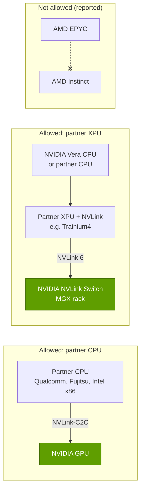

# NVLink Fusion: opening NVLink, on NVIDIA's terms

Layer 05 · Scale-up (NVLink, NVSwitch) · ~9 min read · Last verified: 2026-11-05

## ⚡ The Executive Take

- **What it is:** announced on 2025-05-19, [NVLink Fusion](../../glossary.md#nvlink-fusion) licenses [NVLink](../../glossary.md#nvlink) (as IP or a [chiplet](../../glossary.md#chiplet)) to third-party CPUs and custom accelerators for NVIDIA's rack-scale fabric [[S131]](../../sources/bibliography.md#s131)[[S215]](../../sources/bibliography.md#s215).
- **Who signed:** MediaTek, Marvell, Alchip, Astera Labs, Synopsys, Cadence, Qualcomm and Fujitsu at launch [[S131]](../../sources/bibliography.md#s131)[[S90031]](../../sources/bibliography.md#s90031); then Intel [x86](../../glossary.md#x86) [[S130]](../../sources/bibliography.md#s130), Arm Neoverse [[S90036]](../../sources/bibliography.md#s90036) and AWS Trainium4 [[S518]](../../sources/bibliography.md#s518)[[S519]](../../sources/bibliography.md#s519).
- **Capital behind it:** NVIDIA reportedly invested $2B in Marvell (Mar 2026) to deepen the tie 🟡 [[S90037]](../../sources/bibliography.md#s90037); optical-I/O start-ups Ayar Labs and Lightmatter were reported joining in June 2026 🟡 [[S5022]](../../sources/bibliography.md#s5022).
- **Open, but on NVIDIA's terms:** NVIDIA keeps the NVLink switch silicon, and a Fusion platform must include at least one NVIDIA chip, so it cannot join an AMD CPU to an AMD GPU 🟡 [[S5018]](../../sources/bibliography.md#s5018)[[S5020]](../../sources/bibliography.md#s5020).
- **The prize:** custom silicon stays in NVIDIA racks. Trainium4 will use NVLink 6 and [MGX](../../glossary.md#mgx) racks [[S518]](../../sources/bibliography.md#s518), so NVIDIA sells switches even when it loses the accelerator.
- **The rival path:** [UALink](../../glossary.md#ualink) (2.0 ratified April 2026, products 2027) [[S574]](../../sources/bibliography.md#s574)[[S90051]](../../sources/bibliography.md#s90051) and [ESUN](../../glossary.md#esun) (1.0 in March 2026) [[S576]](../../sources/bibliography.md#s576); Intel and Qualcomm sit on both sides [[S130]](../../sources/bibliography.md#s130)[[S90060]](../../sources/bibliography.md#s90060).

## 1. Two ways in: a partner CPU or a partner accelerator

A **partner CPU** (Qualcomm, Fujitsu, Intel x86) links coherently to NVIDIA GPUs the way Grace and Vera do over [NVLink-C2C](../../glossary.md#nvlink-c2c) [[S131]](../../sources/bibliography.md#s131)[[S130]](../../sources/bibliography.md#s130). A **partner accelerator** (an [XPU](../../glossary.md#xpu) such as Trainium4) carries NVLink and plugs into NVIDIA's switches and rack [[S131]](../../sources/bibliography.md#s131)[[S518]](../../sources/bibliography.md#s518). Design houses (MediaTek, Marvell, Alchip) and IP vendors (Synopsys, Cadence) build the silicon [[S216]](../../sources/bibliography.md#s216).

> [!TIP]
> **Worked example — what a Fusion CPU partner buys.** A CPU on [PCIe](../../glossary.md#pcie) Gen6 x16 reaches its GPU at 256 GB/s [[S222]](../../sources/bibliography.md#s222); Vera reaches Rubin over NVLink-C2C at 1.8 TB/s, **~7×** more and cache-coherent [[S209]](../../sources/bibliography.md#s209). A partner CPU with Vera-class C2C (an assumption; partner configurations are unpublished) could turn CPU memory into a second GPU memory tier ([Layer 04](../04-cpu-grace-vera/index.md)). **Conclusion:** Fusion is Qualcomm's and Fujitsu's ticket into NVIDIA's highest-value racks, a socket otherwise reserved for Grace and Vera.

🔧 Under the hood: IP, chiplet or UCIe?

- **IP route:** NVLink controller and [SerDes](../../glossary.md#serdes) IP integrated in the partner's die, using Synopsys or Cadence tools [[S216]](../../sources/bibliography.md#s216).
- **Chiplet route:** an NVLink chiplet beside the partner's die; one report says XPUs could attach it over [UCIe](../../glossary.md#ucie), even with custom chips on both ends 🔴 [[S5021]](../../sources/bibliography.md#s5021), unconfirmed by NVIDIA.
- **Rack route:** Trainium4 inherits NVIDIA's switch trays, spine and management in MGX racks [[S518]](../../sources/bibliography.md#s518).

## 2. What is open and what is not

| Element | Open to partners? | Evidence |
|---|---|---|
| NVLink link protocol in partner silicon | 🟢 yes, via IP or chiplet | [[S131]](../../sources/bibliography.md#s131)[[S216]](../../sources/bibliography.md#s216) |
| Coherent CPU-to-GPU attach (C2C) | 🟢 yes, for partner CPUs | [[S131]](../../sources/bibliography.md#s131)[[S130]](../../sources/bibliography.md#s130) |
| NVLink switch chips | 🔴 no, NVIDIA only | [[S5018]](../../sources/bibliography.md#s5018) |
| Partner CPU + partner XPU, no NVIDIA chip | 🔴 no (reported) | [[S5018]](../../sources/bibliography.md#s5018)[[S5020]](../../sources/bibliography.md#s5020); contrary report [[S5021]](../../sources/bibliography.md#s5021) |
| Reference rack (MGX), spine, management | 🟡 NVIDIA designs, partners build | [[S518]](../../sources/bibliography.md#s518)[[S5001]](../../sources/bibliography.md#s5001) |

> [!TIP]
> **Worked example — how much NVIDIA silicon stays in a Fusion rack.** A Vera Rubin [NVL72](../../glossary.md#nvl72) holds 72 Rubin packages, 36 Vera CPUs, 36 NVLink 6 switch chips and a ConnectX-9 [NIC](../../glossary.md#nic) per GPU: ~216 NVIDIA chips [[S102]](../../sources/bibliography.md#s102)[[S203]](../../sources/bibliography.md#s203)[[S33004]](../../sources/bibliography.md#s33004). A hypothetical 72-XPU Fusion rack keeps the **36 switch chips** and NVLink IP in every XPU, optionally Vera CPUs and NICs (repo calc). **Conclusion:** NVIDIA's chip count falls to about a sixth, but it keeps the hardest part to replace and its software: the "open, on NVIDIA's terms" bargain.

> [!WARNING]
> **Myth vs. reality:** "NVLink Fusion makes NVLink an open standard." It is a licence: NVIDIA sets the terms, makes the switches and requires its own silicon [[S5018]](../../sources/bibliography.md#s5018)[[S5020]](../../sources/bibliography.md#s5020).

## 3. The strategic logic: Fusion vs UALink vs ESUN

[Hyperscalers](../../glossary.md#hyperscaler) want custom accelerators without giving up rack-scale [scale-up](../../glossary.md#scale-up). NVIDIA lets them keep the accelerator but rent the fabric; the rest of the industry wants an open fabric. Counterpoint framed Fusion as NVIDIA's response to UALink [[S5019]](../../sources/bibliography.md#s5019).

| | NVLink Fusion | UALink | ESUN (Ethernet scale-up) |
|---|---|---|---|
| Governance | NVIDIA licence | consortium spec [[S573]](../../sources/bibliography.md#s573) | OCP workstream [[S576]](../../sources/bibliography.md#s576) |
| Status (Nov 2026) | IP shipping; Trainium4 committed [[S518]](../../sources/bibliography.md#s518) | 2.0 ratified; products 2027 🟡 [[S574]](../../sources/bibliography.md#s574)[[S90051]](../../sources/bibliography.md#s90051) | 1.0 spec, Mar 2026 [[S576]](../../sources/bibliography.md#s576) |
| Max domain | 72 shipped, 144 planned [[S262]](../../sources/bibliography.md#s262)[[S510]](../../sources/bibliography.md#s510) | 1,024 accelerators [[S573]](../../sources/bibliography.md#s573) | not fixed |
| Switch silicon | NVIDIA only [[S5018]](../../sources/bibliography.md#s5018) | any UALink switch vendor | merchant Ethernet (e.g. Broadcom) [[S90052]](../../sources/bibliography.md#s90052) |
| Notable backers | AWS, Intel, Qualcomm, Marvell [[S519]](../../sources/bibliography.md#s519)[[S90037]](../../sources/bibliography.md#s90037) | AMD and others; Qualcomm AI300 [[S90060]](../../sources/bibliography.md#s90060) | 12 founders incl. NVIDIA, AMD, Broadcom, Meta [[S576]](../../sources/bibliography.md#s576) |

> [!TIP]
> **Worked example — the time-to-market gap.** Fusion IP was offered from May 2025; AWS committed Trainium4 that December [[S131]](../../sources/bibliography.md#s131)[[S518]](../../sources/bibliography.md#s518). UALink 1.0 was ratified in April 2025, but silicon reaches labs in H2 2026 and products in 2027 🟡 [[S573]](../../sources/bibliography.md#s573)[[S90051]](../../sources/bibliography.md#s90051). A team taping out in 2026 chooses between a fabric shipping today and one ~18–24 months from volume. **Conclusion:** Fusion's weapon is time; its risk is UALink and ESUN closing the gap by 2027–28.

> [!NOTE]
> **🐂 Bull view:** Fusion turns the custom-ASIC threat into switch, rack and software revenue: AWS chose NVLink for Trainium4 [[S518]](../../sources/bibliography.md#s518), and the $2B Marvell stake ties an [ASIC](../../glossary.md#asic) design house to NVIDIA's fabric 🟡 [[S90037]](../../sources/bibliography.md#s90037).

> [!WARNING]
> **🐻 Bear view:** the terms that protect NVIDIA (its silicon required, switches closed) [[S5018]](../../sources/bibliography.md#s5018) push AMD and Broadcom to open fabrics, and dual-track partners such as Qualcomm [[S131]](../../sources/bibliography.md#s131)[[S90060]](../../sources/bibliography.md#s90060) can walk away once open switches ship.

## 🎯 Corp Dev Lens

1. **Who captures the Fusion dollars?** Licence fees, switch chips and rack design accrue to NVIDIA; design partners (Marvell, MediaTek, Alchip) earn NRE and ASIC margins [[S216]](../../sources/bibliography.md#s216). Which gains most if Trainium4-style designs multiply?
2. **Optionality for CPU vendors.** Qualcomm and Fujitsu bought a path into NVIDIA racks [[S131]](../../sources/bibliography.md#s131)[[S4529]](../../sources/bibliography.md#s4529); how durable is access to sockets NVIDIA could reserve for Vera?
3. **Qualcomm question (public information only):** with a Fusion CPU partnership [[S131]](../../sources/bibliography.md#s131) and an accelerator roadmap on UALink and ESUN [[S90060]](../../sources/bibliography.md#s90060), does a dual-track interconnect strategy maximize options, or does it dilute engineering focus against NVIDIA's single fabric?
4. **Regulatory angle.** A licence requiring NVIDIA silicon in every system may draw scrutiny; looser terms would change Fusion's economics ([Value chain and corp dev](value-chain-and-corp-dev.md)).

## 📚 Sources

<!-- Auto-generated from the [S…] citations on this page by `make build`. Edit sources/registry/*.csv, not this list. -->

- [**S102**](../../sources/bibliography.md#s102) NVIDIA, *NVIDIA DGX Vera Rubin NVL72*, 2026. [Link](https://www.nvidia.com/en-us/data-center/dgx-vera-rubin-nvl72/)
- [**S130**](../../sources/bibliography.md#s130) NVIDIA Newsroom, *NVIDIA and Intel to Develop AI Infrastructure and Personal Computing Products*, 2025-09-18. [Link](https://nvidianews.nvidia.com/news/nvidia-and-intel-to-develop-ai-infrastructure-and-personal-computing-products)
- [**S131**](../../sources/bibliography.md#s131) NVIDIA Newsroom, *NVIDIA NVLink Fusion: semi-custom AI infrastructure partner ecosystem (Computex 2025)*, 2025-05-19. [Link](https://nvidianews.nvidia.com/news/nvidia-nvlink-fusion-semi-custom-ai-infrastructure-partner-ecosystem)
- [**S203**](../../sources/bibliography.md#s203) SemiAnalysis, *Vera Rubin - Extreme Co-Design: An Evolution*, 2026-01. [Link](https://newsletter.semianalysis.com/p/vera-rubin-extreme-co-design-an-evolution)
- [**S209**](../../sources/bibliography.md#s209) DatacenterDynamics, *Nvidia announces Vera Rubin superchip for late 2026*, 2025-10-28. [Link](https://datacenterdynamics.com/en/news/nvidia-announces-vera-rubin-superchip-for-late-2026)
- [**S215**](../../sources/bibliography.md#s215) Tom's Hardware, *Nvidia announces NVLink Fusion to allow custom CPUs and AI accelerators to work with its products*, 2025-05-19. [Link](https://www.tomshardware.com/pc-components/cpus/nvidia-announces-nvlink-fusion-to-allow-custom-cpus-and-ai-accelerators-to-work-with-its-products)
- [**S216**](../../sources/bibliography.md#s216) ServeTheHome, *NVIDIA announces NVLink Fusion bringing NVLink to third-party CPUs and accelerators (partner slide)*, 2025-05-19. [Link](https://www.servethehome.com/nvidia-announces-nvlink-fusion-bringing-nvlink-to-third-party-cpus-and-accelerators/nvlink-fusion-partners/)
- [**S222**](../../sources/bibliography.md#s222) Tom's Hardware, *PCI Express roadmap: the path to 1TB/s with PCIe 8.0, the challenges of integration, and beyond*, 2025. [Link](https://www.tomshardware.com/pc-components/motherboards/pci-express-roadmap-the-path-to-1tb-s-with-pci-8-0-the-challenges-of-integration-and-beyond)
- [**S262**](../../sources/bibliography.md#s262) NVIDIA, *NVIDIA GB200 NVL72 (product page)*, 2024. [Link](https://www.nvidia.com/en-us/data-center/gb200-nvl72/)
- [**S510**](../../sources/bibliography.md#s510) KGI Securities, *NVIDIA GTC 2026 (research note)*, 2026-03-19. [Link](https://www.kgi.com.hk/zh-hk/-/media/files/kgishk/research-reports/tw-reports/nvidia-gtc-2026_19032026e.pdf)
- [**S518**](../../sources/bibliography.md#s518) ServeTheHome, *NVIDIA NVLink Fusion tapped for future AWS Trainium4 deployments*, 2025-12-02. [Link](https://www.servethehome.com/nvidia-nvlink-fusion-tapped-for-future-aws-trainium4-deployments/)
- [**S519**](../../sources/bibliography.md#s519) South China Morning Post (Reuters) (Stephen Nellis; Greg Bensinger), *Amazon to use Nvidia tech in AI chips, roll out new servers (Reuters)*, 2025-12-02. [Link](https://www.scmp.com/tech/big-tech/article/3334985/amazon-use-nvidia-tech-ai-chips-roll-out-new-servers)
- [**S573**](../../sources/bibliography.md#s573) Business Wire, *UALink Consortium Releases the Ultra Accelerator Link 200G 1.0 Specification*, 2025-04-08. [Link](https://www.businesswire.com/news/home/20250408050548/en/UALink-Consortium-Releases-the-Ultra-Accelerator-Link-200G-1.0-Specification)
- [**S574**](../../sources/bibliography.md#s574) HPCwire, *UALink Consortium Publishes 4 Specifications Defining In-Network Compute, Chiplets, Manageability and 200G Performance*, 2026-04-07. [Link](https://www.hpcwire.com/off-the-wire/ualink-consortium-publishes-4-specifications-defining-in-network-compute-chiplets-manageability-and-200g-performance/)
- [**S576**](../../sources/bibliography.md#s576) Converge Digest, *OCP releases ESUN 1.0 spec for Ethernet-based scale-up AI fabrics*, 2026-03. [Link](https://convergedigest.com/ocp-releases-esun-1-0-spec-for-ethernet-based-scale-up-ai-fabrics/)
- [**S4529**](../../sources/bibliography.md#s4529) Converge Digest, *Fujitsu taps NVLink Fusion for MONAKA CPUs + NVIDIA GPUs for industrial AI*, 2025-10. [Link](https://convergedigest.com/fujitsu-taps-nvlink-fusion-for-monaka-cpus-nvidia-gpus-for-industrial-ai/)
- [**S5001**](../../sources/bibliography.md#s5001) SiliconANGLE, *Nvidia aims to boost Blackwell by donating platform design to the Open Compute Project*, 2024-10-15. [Link](https://siliconangle.com/2024/10/15/nvidia-aims-boost-blackwell-donating-platform-design-open-compute-project)
- [**S5018**](../../sources/bibliography.md#s5018) Tom's Hardware, *Alchip responds to report that Nvidia is reportedly keeping prized NVLink tech closely guarded (updated)*, 2025. [Link](https://www.tomshardware.com/tech-industry/nvidia-keeping-prized-nvlink-tech-closely-guarded-companies-warn-restrictions-could-hamper-deployment-of-some-solutions)
- [**S5019**](../../sources/bibliography.md#s5019) Counterpoint Research, *NVLink Fusion - Nvidia's Response to UALink?*, 2025. [Link](https://www.counterpointresearch.com/insight/post-insight-research-notes-blogs-nvlink-fusion-nvidias-response-to-ualink)
- [**S5020**](../../sources/bibliography.md#s5020) PC Watch (Impress), *Computex 2025: NVIDIA NVLink Fusion report*, 2025-05. [Link](https://pc.watch.impress.co.jp/docs/news/event/2015077.html)
- [**S5021**](../../sources/bibliography.md#s5021) IT Home, *Report on NVIDIA NVLink Fusion guidance (third-party CPU and XPU on both ends via an NVLink chiplet over UCIe)*, 2025-08. [Link](https://www.ithome.com/0/877/853.htm)
- [**S5022**](../../sources/bibliography.md#s5022) Independent tracker (vercel.app), *Co-packaged optics joins NVLink Fusion: Ayar Labs and Lightmatter (June 2026)*, 2026-06-08. [Link](https://site-one-liart-13.vercel.app/en/infra-ip/co-packaged-optics-nvlink-fusion-ayar-labs-lightmatter-june-2026)
- [**S33004**](../../sources/bibliography.md#s33004) NVIDIA Newsroom, *NVIDIA Kicks Off the Next Generation of AI With Rubin — Six New Chips; One Incredible AI Supercomputer*, 2026-01-05. [Link](https://nvidianews.nvidia.com/news/rubin-platform-ai-supercomputer)
- [**S90031**](../../sources/bibliography.md#s90031) ServeTheHome, *NVIDIA announces NVLink Fusion bringing NVLink to third-party CPUs and accelerators*, 2025-05-19. [Link](https://www.servethehome.com/nvidia-announces-nvlink-fusion-bringing-nvlink-to-third-party-cpus-and-accelerators/nvlink-fusion-partners/)
- [**S90036**](../../sources/bibliography.md#s90036) Converge Digest, *Arm extends Neoverse with NVIDIA NVLink Fusion*, 2025-11. [Link](https://convergedigest.com/arm-extends-neoverse-with-nvidia-nvlink-fusion/)
- [**S90037**](../../sources/bibliography.md#s90037) Converge Digest, *NVIDIA invests $2B in Marvell to extend NVLink Fusion AI ecosystem*, 2026-03. [Link](https://convergedigest.com/nvidia-invests-2b-in-marvell-to-extend-nvlink-fusion-ai-ecosystem/)
- [**S90051**](../../sources/bibliography.md#s90051) SDxCentral, *UALink Consortium takes another swing at Nvidia's NVLink supremacy with specification 2.0*, 2026-04. [Link](https://www.sdxcentral.com/news/ualink-consortium-takes-another-swing-at-nvidias-nvlink-supremacy-with-specification-20/)
- [**S90052**](../../sources/bibliography.md#s90052) Synopsys, *Ethernet standards for scale-up AI: an overview of ESUN, SUE, and UALink*, 2025-11. [Link](https://www.synopsys.com/articles/ethernet-standards-scale-up-ai.html)
- [**S90060**](../../sources/bibliography.md#s90060) Qualcomm, *Qualcomm Dragonfly AI300 (product page)*, 2026-06. [Link](https://www.qualcomm.com/data-center/products/qualcomm-dragonfly-ai300)
