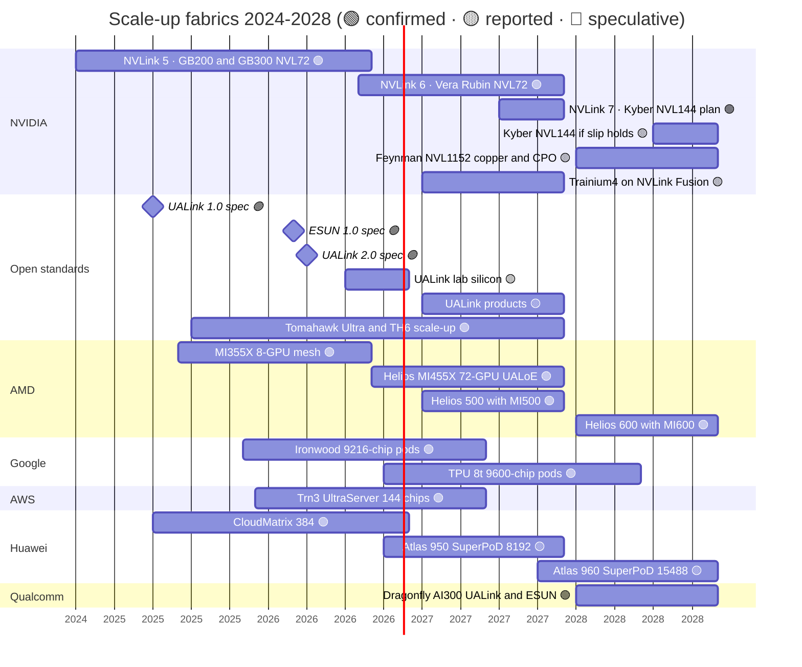

# Scale-up (NVLink, NVSwitch): Roadmap

Layer 05 · Scale-up (NVLink, NVSwitch) · ~10 min read · Last verified: 2026-11-05

## ⚡ The Executive Take

- **Now:** NVLink 6 has shipped in Vera Rubin NVL72 since August 2026: 72 GPUs, 36 switch chips and 3.0 TB/s per GPU, after a quiet cut from the 3.6 TB/s launch figure 🟢 [[S500]](../../sources/bibliography.md#s500)[[S332]](../../sources/bibliography.md#s332)[[S200]](../../sources/bibliography.md#s200)[[S201]](../../sources/bibliography.md#s201).
- **2027:** Rubin Ultra moves to NVLink 7 and the 144-GPU Kyber rack, reported at ~3.6 TB/s per GPU. SemiAnalysis reports a slip of more than 12 months to 2028, which NVIDIA denies 🟡 [[S108]](../../sources/bibliography.md#s108)[[S210]](../../sources/bibliography.md#s210)[[S507]](../../sources/bibliography.md#s507)[[S508]](../../sources/bibliography.md#s508).
- **2028:** Feynman's Kyber NVL1152 joins eight racks into one NVLink domain using copper plus [co-packaged optics](../../glossary.md#co-packaged-optics); no bandwidth is published 🟡 [[S108]](../../sources/bibliography.md#s108)[[S109]](../../sources/bibliography.md#s109).
- **Open standards:** UALink 2.0 was ratified on 2026-04-07. Silicon is reaching labs in H2 2026 and products follow in 2027 🟡 [[S574]](../../sources/bibliography.md#s574)[[S90051]](../../sources/bibliography.md#s90051). ESUN 1.0 (March 2026) and UE 1.1 (October 2026) put Ethernet on a scale-up track 🟢 [[S576]](../../sources/bibliography.md#s576)[[S575]](../../sources/bibliography.md#s575).
- **Rivals' calendars:** AMD plans Helios (2026), Helios 500 (2027) and Helios 600 (2028) 🟢 [[S538]](../../sources/bibliography.md#s538). Google's TPU 8t brings 9,600-chip pods in late 2026 🟢 [[S238]](../../sources/bibliography.md#s238). Huawei's Atlas 960 targets 15,488 NPUs in Q4 2027 🟡 [[S249]](../../sources/bibliography.md#s249). Qualcomm's AI300 (2028) adopts UALink and ESUN 🟢 [[S90060]](../../sources/bibliography.md#s90060).
- **[Q7 · Roadmap & what changes the picture]** Watch UALink silicon timing, co-packaged optics inside the rack and Kyber's date (last section).

![Two-panel line chart by vendor and year. Bandwidth per accelerator: NVIDIA NVLink 0.16 TB/s (2016), 0.6 (2020), 0.9 (2022), 1.8 (2024), 3.0 (Vera Rubin, 2026, cut from 3.6) and a reported 3.6 for Rubin Ultra (2027); AMD 0.9 (MI300X, 2023), 1.1 (MI355X, 2025) then 3.6 with Helios (2026); Google 0.6 (TPU v4), 1.2 (v5p, Ironwood) and 2.4 (TPU 8t, 2026); AWS 1.0 (Trn2) and 2.0 (Trn3); Huawei 0.78 (CloudMatrix 384) and 2.0 (Atlas 950). Domain size: NVIDIA 8 to 16 GPUs until 2022, 256 in the limited DGX GH200, 72 with NVL72 (2024), 144 with Kyber (2027) and a speculative 1,152 (2028); Google 4,096 to 9,600; Huawei 384 to 8,192 and 15,488 (2027); AWS 64 to 144; AMD 8 to 72.](../../assets/charts/05-scale-up-roadmap-progression.svg)

## The 2024–2028 roadmap

Bars are availability windows; milestones are spec releases. The Kyber slip bar shows the SemiAnalysis-reported window against NVIDIA's official H2 2027. Trainium4 and UALink product windows are analyst or trade-press estimates. Sources per row are in the table below.

| Item | Window | Status | Confidence | Source |
|---|---|---|---|---|
| NVLink 5 / NVLink Switch (1.8 TB/s, 72 GPUs) | 2024-Q4 → | shipping | 🟢 | [[S121]](../../sources/bibliography.md#s121)[[S34014]](../../sources/bibliography.md#s34014) |
| NVLink 6 / NVLink 6 Switch (3.0 TB/s after cut) | 2026-Q3 → | shipping | 🟢 | [[S100]](../../sources/bibliography.md#s100)[[S33004]](../../sources/bibliography.md#s33004)[[S103]](../../sources/bibliography.md#s103)[[S104]](../../sources/bibliography.md#s104) |
| NVLink 7, Kyber NVL144 (144 packages) | 2027-Q3/Q4 official | roadmap | 🟢 plan | [[S502]](../../sources/bibliography.md#s502)[[S108]](../../sources/bibliography.md#s108)[[S510]](../../sources/bibliography.md#s510) |
| Kyber NVL144 reported slip | 2028-Q3/Q4 | delayed (reported) | 🟡 | [[S507]](../../sources/bibliography.md#s507)[[S508]](../../sources/bibliography.md#s508)[[S309]](../../sources/bibliography.md#s309) |
| Feynman-era NVLink, NVL1152 (copper + CPO) | 2028 | roadmap | 🟡 | [[S109]](../../sources/bibliography.md#s109)[[S108]](../../sources/bibliography.md#s108) |
| NVLink Fusion; Intel x86 on NVLink | 2025 →; undated | shipping / announced | 🟢 | [[S131]](../../sources/bibliography.md#s131)[[S517]](../../sources/bibliography.md#s517)[[S130]](../../sources/bibliography.md#s130) |
| Trainium4 on NVLink Fusion | 2027 (est.) | roadmap | 🟡 | [[S518]](../../sources/bibliography.md#s518)[[S519]](../../sources/bibliography.md#s519)[[S156]](../../sources/bibliography.md#s156) |
| UALink 1.0 / 2.0 specs | 2025-04 / 2026-04 | published | 🟢 | [[S573]](../../sources/bibliography.md#s573)[[S574]](../../sources/bibliography.md#s574) |
| ESUN 1.0; Ultra Ethernet 1.1 scale-up | 2026-03; 2026-10 | published | 🟢 | [[S576]](../../sources/bibliography.md#s576)[[S575]](../../sources/bibliography.md#s575) |
| Broadcom Tomahawk Ultra | 2025-Q3 → | shipping | 🟡 | [[S572]](../../sources/bibliography.md#s572) |
| AWS NeuronSwitch-v1 (144 chips) | 2025-12 → | shipping | 🟢 | [[S556]](../../sources/bibliography.md#s556) |
| AMD Helios / Helios 500 / Helios 600 | 2026 / 2027 / 2028 | shipping / roadmap | 🟢 | [[S538]](../../sources/bibliography.md#s538)[[S539]](../../sources/bibliography.md#s539)[[S542]](../../sources/bibliography.md#s542) |
| Google TPU 8t pod (9,600 chips) | 2026-Q4 | announced | 🟢 | [[S550]](../../sources/bibliography.md#s550)[[S551]](../../sources/bibliography.md#s551) |
| Huawei UB: Atlas 950 / Atlas 960 SuperPoD | 2026-Q4 / 2027-Q4 | shipping (reported) / roadmap | 🟡 | [[S163]](../../sources/bibliography.md#s163)[[S567]](../../sources/bibliography.md#s567)[[S568]](../../sources/bibliography.md#s568) |

Rows mirror `data/roadmap.csv` (layers 05 and 08); this page does not modify that file.

> [!TIP]
> **Worked example — where NVIDIA's growth is moving.** Per-GPU NVLink bandwidth rose 1.67× from NVLink 5 to NVLink 6 (1.8 → 3.0 TB/s) and is reported to rise only 1.2× to NVLink 7 (3.6 TB/s) [[S200]](../../sources/bibliography.md#s200)[[S210]](../../sources/bibliography.md#s210). Domain size is planned to double (72 → 144) and then grow 8× (144 → 1,152) [[S108]](../../sources/bibliography.md#s108). Total bandwidth inside one domain goes from 216 TB/s (Vera Rubin NVL72) to ~518 TB/s (Kyber NVL144 at 3.6 TB/s). Most of the gain comes from more GPUs per domain, not faster links. That shifts the risk from SerDes design to rack mechanics and optics.

🔧 Under the hood: why lane speed has stalled at ~200 Gb/s

NVLink 5, NVLink 6, UALink 1.0/2.0 and Tomahawk 6 all use 200G-class lanes [[S200]](../../sources/bibliography.md#s200)[[S223]](../../sources/bibliography.md#s223)[[S225]](../../sources/bibliography.md#s225)[[S274]](../../sources/bibliography.md#s274). IEEE 802.3dj standardises 200G lanes in 2026; 400G lanes have no confirmed timing [[S254]](../../sources/bibliography.md#s254)[[S256]](../../sources/bibliography.md#s256). At 200G, passive copper reaches only ~1–2 m, so NVIDIA packs 72–144 GPUs into one rack and needs optics beyond it [[S262]](../../sources/bibliography.md#s262). Until 400G lanes arrive, vendors add bandwidth by adding lanes (NVLink 6 doubled links per GPU to 36) or by sending both directions on the same pair [[S203]](../../sources/bibliography.md#s203).

## What would change the picture

**[Q7 · Roadmap & what changes the picture]**

- **UALink silicon on time.** If Upscale AI's switch ships in Q4 2026 and UALink products land in 2027, custom accelerators get a merchant alternative to NVLink Fusion 🟡 [[S5506]](../../sources/bibliography.md#s5506)[[S90051]](../../sources/bibliography.md#s90051). A slip into 2028 would leave UALink-over-Ethernet (Helios-style) as the only open path [[S5523]](../../sources/bibliography.md#s5523).
- **Co-packaged optics inside the rack.** Feynman's optical NVLink is the first NVIDIA step past one rack [[S108]](../../sources/bibliography.md#s108). Optical I/O start-ups (Ayar Labs, Lightmatter) and Broadcom's CPO switches give rivals the same tools [[S5511]](../../sources/bibliography.md#s5511)[[S2510]](../../sources/bibliography.md#s2510)[[S571]](../../sources/bibliography.md#s571).
- **Kyber timing.** If the 2028 slip is real, NVIDIA's domain stays at 72 GPUs through 2027 while AWS ships 144 and Google 9,600 🟡 [[S507]](../../sources/bibliography.md#s507)[[S508]](../../sources/bibliography.md#s508)[[S242]](../../sources/bibliography.md#s242)[[S238]](../../sources/bibliography.md#s238).
- **Spec revisions.** Rubin's bandwidth cut (3.6 → 3.0 TB/s) shows launch numbers can move. Treat 2027–28 bandwidth figures as targets 🔴 [[S201]](../../sources/bibliography.md#s201)[[S202]](../../sources/bibliography.md#s202).
- **Hyperscaler adoption.** Watch for Trainium4 shipping on NVLink Fusion versus Meta or Microsoft committing accelerators to ESUN/UE 1.1 [[S518]](../../sources/bibliography.md#s518)[[S576]](../../sources/bibliography.md#s576)[[S575]](../../sources/bibliography.md#s575).

> [!TIP]
> **Worked example — what optics would cost an eight-rack NVLink domain.** Suppose all of each GPU's NVLink 7 bandwidth (~14.4 Tb/s per direction) left the rack on 1.6 Tb/s pluggables: that is 9 ports per GPU, 18 module ends, at ~30 W each, or ~540 W per GPU [[S210]](../../sources/bibliography.md#s210)[[S33020]](../../sources/bibliography.md#s33020). Across 576 GPUs that is ~311 kW of optics, about half a Kyber rack's ~600 kW. A >70% cut from co-packaged optics, as Broadcom claims for its CPO switch, would bring it to ~93 kW [[S305]](../../sources/bibliography.md#s305)[[S571]](../../sources/bibliography.md#s571). Real designs send only cross-rack traffic over optics (🔴 repo arithmetic), but the order of magnitude shows why CPO gates domains beyond one rack.

## 🎯 Corp Dev Lens

1. Who supplies optics for Feynman's NVL1152, and is there room for a third party (Ayar Labs is in NVLink Fusion) or does NVIDIA's own CPO with TSMC take it all 🟡 [[S5513]](../../sources/bibliography.md#s5513)[[S90048]](../../sources/bibliography.md#s90048)?
2. If Kyber slips to 2028, does the 2027 window open for 144-plus-accelerator designs (AWS, Huawei, UALink pods) to win share in mixture-of-experts serving?
3. Qualcomm's AI300 (2028; public information only) would arrive about a year after the first UALink products are expected [[S90060]](../../sources/bibliography.md#s90060). What has to be true about UALink switch supply by then?
4. Since lane rates are flat at 200G, which IP or analog teams are positioned for 400G-per-lane SerDes, and who owns them now?

## 📚 Sources

<!-- Auto-generated from the [S…] citations on this page by `make build`. Edit sources/registry/*.csv, not this list. -->

- [**S100**](../../sources/bibliography.md#s100) NVIDIA Technical Blog, *Inside the NVIDIA Vera Rubin Platform: Six New Chips, One AI Supercomputer*, 2026-01-05. [Link](https://developer.nvidia.com/blog/inside-the-nvidia-rubin-platform-six-new-chips-one-ai-supercomputer/)
- [**S103**](../../sources/bibliography.md#s103) VideoCardz, *NVIDIA quietly cuts Vera Rubin specs, HBM4 bandwidth and NVLink 6 speeds now lower*, 2026-10. [Link](https://videocardz.com/newz/nvidia-quietly-cuts-vera-rubin-specs-hbm4-bandwidth-and-nvlink-6-speeds-now-lower)
- [**S104**](../../sources/bibliography.md#s104) Wccftech, *NVIDIA's Official Statement on Vera Rubin Spec Change*, 2026-10-29. [Link](https://wccftech.com/nvidia-official-statement-on-vera-rubin-spec-change/)
- [**S108**](../../sources/bibliography.md#s108) HPCwire / AIwire, *Huang Shares Nvidia Roadmap Showing More Chips, NVL1152, Scale-Up CPO*, 2026-03-18. [Link](https://www.hpcwire.com/aiwire/2026/03/18/huang-shares-nvidia-roadmap-showing-more-chips-nvl1152-scale-up-cpo/)
- [**S109**](../../sources/bibliography.md#s109) NVIDIA Blog, *NVIDIA GTC 2026: Live Updates on What's Next in AI*, 2026-03-16. [Link](https://blogs.nvidia.com/blog/gtc-2026-news/)
- [**S121**](../../sources/bibliography.md#s121) NVIDIA, *NVIDIA GB200 NVL72*, 2024-03. [Link](https://www.nvidia.com/en-us/data-center/gb200-nvl72/)
- [**S130**](../../sources/bibliography.md#s130) NVIDIA Newsroom, *NVIDIA and Intel to Develop AI Infrastructure and Personal Computing Products*, 2025-09-18. [Link](https://nvidianews.nvidia.com/news/nvidia-and-intel-to-develop-ai-infrastructure-and-personal-computing-products)
- [**S131**](../../sources/bibliography.md#s131) NVIDIA Newsroom, *NVIDIA NVLink Fusion: semi-custom AI infrastructure partner ecosystem (Computex 2025)*, 2025-05-19. [Link](https://nvidianews.nvidia.com/news/nvidia-nvlink-fusion-semi-custom-ai-infrastructure-partner-ecosystem)
- [**S156**](../../sources/bibliography.md#s156) About Amazon, *AWS re:Invent 2025: top announcements (Trainium3 GA, Trainium4 preview, Graviton5)*, 2025-12-02. [Link](https://www.aboutamazon.com/news/aws/aws-re-invent-2025-ai-news-updates)
- [**S163**](../../sources/bibliography.md#s163) Huawei (Eric Xu), *Huawei Connect 2025 keynote: Ascend roadmap and SuperPoD interconnect (Eric Xu)*, 2025-09-18. [Link](https://www.huawei.com/en/news/2025/9/hc-xu-keynote-speech)
- [**S200**](../../sources/bibliography.md#s200) NVIDIA, *NVIDIA NVLink and NVLink Switch (product page with NVLink and NVLink Switch specification tables)*, 2026-09. [Link](https://www.nvidia.com/en-us/data-center/nvlink/)
- [**S201**](../../sources/bibliography.md#s201) VideoCardz, *NVIDIA quietly cuts Vera Rubin specs, HBM4 bandwidth and NVLink 6 speeds now lower*, 2026-10. [Link](https://videocardz.com/newz/nvidia-quietly-cuts-vera-rubin-specs-hbm4-bandwidth-and-nvlink-6-speeds-now-lower)
- [**S202**](../../sources/bibliography.md#s202) Wccftech, *NVIDIA's official statement on Vera Rubin spec change*, 2026-11. [Link](https://wccftech.com/nvidia-official-statement-on-vera-rubin-spec-change/)
- [**S203**](../../sources/bibliography.md#s203) SemiAnalysis, *Vera Rubin - Extreme Co-Design: An Evolution*, 2026-01. [Link](https://newsletter.semianalysis.com/p/vera-rubin-extreme-co-design-an-evolution)
- [**S210**](../../sources/bibliography.md#s210) SemiAnalysis, *Nvidia - GTC 2026: The Inference Kingdom Expands*, 2026-03. [Link](https://newsletter.semianalysis.com/p/nvidia-the-inference-kingdom-expands)
- [**S223**](../../sources/bibliography.md#s223) UALink Consortium, *UALink Consortium Releases the Ultra Accelerator Link 200G 1.0 Specification (news release)*, 2025-04-08. [Link](https://ualinkconsortium.org/wp-content/uploads/2025/04/UALink-1.0-Specification-PR_FINAL.pdf)
- [**S225**](../../sources/bibliography.md#s225) SDxCentral, *UALink Consortium 2.0 spec takes another swing at Nvidia's NVLink supremacy*, 2026-04. [Link](https://www.sdxcentral.com/news/ualink-consortium-takes-another-swing-at-nvidias-nvlink-supremacy-with-specification-20/)
- [**S238**](../../sources/bibliography.md#s238) Google, *Our eighth generation TPUs: two chips for the agentic era*, 2026-04-22. [Link](https://blog.google/innovation-and-ai/infrastructure-and-cloud/google-cloud/eighth-generation-tpu-agentic-era/)
- [**S242**](../../sources/bibliography.md#s242) Amazon Web Services, *Amazon EC2 Trn3 instances (product page)*, 2025-12-02. [Link](https://aws.amazon.com/ec2/instance-types/trn3/)
- [**S249**](../../sources/bibliography.md#s249) Huawei (Eric Xu), *Groundbreaking SuperPoD Interconnect: Leading a New Paradigm for AI Infrastructure (Eric Xu keynote, Huawei Connect 2025)*, 2025-09-18. [Link](https://www.huawei.com/en/news/2025/9/hc-xu-keynote-speech)
- [**S254**](../../sources/bibliography.md#s254) IEEE 802.3, *IEEE P802.3dj 200 Gb/s, 400 Gb/s, 800 Gb/s and 1.6 Tb/s Ethernet Task Force*, 2026. [Link](https://www.ieee802.org/3/dj/)
- [**S256**](../../sources/bibliography.md#s256) Ethernet Alliance, *The Ethernet Roadmap*, 2025. [Link](https://ethernetalliance.org/technology/ethernet-roadmap/)
- [**S262**](../../sources/bibliography.md#s262) NVIDIA, *NVIDIA GB200 NVL72 (product page)*, 2024. [Link](https://www.nvidia.com/en-us/data-center/gb200-nvl72/)
- [**S274**](../../sources/bibliography.md#s274) Broadcom, *Broadcom ships Tomahawk 6: world's first 102.4 Tbps switch*, 2025-06-03. [Link](https://investors.broadcom.com/news-releases/news-release-details/broadcom-ships-tomahawk-6-worlds-first-1024-tbps-switch)
- [**S305**](../../sources/bibliography.md#s305) DatacenterDynamics, *Nvidia's Rubin Ultra NVL576 rack expected to be 600kW, coming second half of 2027*, 2025-03-19. [Link](https://datacenterdynamics.com/en/news/nvidias-rubin-ultra-nvl576-rack-expected-to-be-600kw-coming-second-half-of-2027)
- [**S309**](../../sources/bibliography.md#s309) Spheron, *NVIDIA Kyber rack delayed to 2028: what it means for Rubin Ultra*, 2026. [Link](https://www.spheron.network/blog/nvidia-kyber-rack-delayed-to-2028-what-it-means-for-rubin-ul/)
- [**S332**](../../sources/bibliography.md#s332) Tiger Brokers (iTiger), *Morgan Stanley's BOM analysis of NVIDIA's Rubin: GPU share declines; PCB, MLCC and ABF substrate values soar*, 2026-05-20. [Link](https://www.itiger.com/news/1188068712)
- [**S500**](../../sources/bibliography.md#s500) NVIDIA Corporation, *NVIDIA Q2 Fiscal 2027 Quarterly Presentation (CFO commentary deck)*, 2026-08-26. [Link](https://s201.q4cdn.com/141608511/files/doc_financials/2027/Q227/NVDA-F2Q27-Quarterly-Presentation-final-1.pdf)
- [**S502**](../../sources/bibliography.md#s502) Tom's Hardware, *Nvidia updates data center roadmap with Rosa CPU and stacked Feynman GPUs; optical NVLink; Groq LPUs with NVFP4 and NVLink also on deck*, 2026-03-17. [Link](https://www.tomshardware.com/pc-components/gpus/nvidia-updates-data-center-roadmap-with-rosa-cpu-and-stacked-feynman-gpus-optical-nvlink-groq-lpus-with-nvfp4-and-nvlink-also-on-deck)
- [**S507**](../../sources/bibliography.md#s507) Tom's Hardware, *Nvidia's Kyber rack for Rubin Ultra slips to 2028*, 2026-07-06. [Link](https://www.tomshardware.com/pc-components/gpus/nvidias-kyber-rack-for-rubin-ultra-slips-to-2028)
- [**S508**](../../sources/bibliography.md#s508) Wccftech, *NVIDIA Quashes Rubin & Kyber Rack Delay Rumors, Says 'Chip Roadmap Is Intact'*, 2026-07. [Link](https://wccftech.com/nvidia-quashes-rubin-kyber-rack-delay-rumors-says-chip-roadmap-is-intact/)
- [**S510**](../../sources/bibliography.md#s510) KGI Securities, *NVIDIA GTC 2026 (research note)*, 2026-03-19. [Link](https://www.kgi.com.hk/zh-hk/-/media/files/kgishk/research-reports/tw-reports/nvidia-gtc-2026_19032026e.pdf)
- [**S517**](../../sources/bibliography.md#s517) Tom's Hardware, *Nvidia announces NVLink Fusion to allow custom CPUs and AI accelerators to work with its products*, 2025-05-19. [Link](https://www.tomshardware.com/pc-components/cpus/nvidia-announces-nvlink-fusion-to-allow-custom-cpus-and-ai-accelerators-to-work-with-its-products)
- [**S518**](../../sources/bibliography.md#s518) ServeTheHome, *NVIDIA NVLink Fusion tapped for future AWS Trainium4 deployments*, 2025-12-02. [Link](https://www.servethehome.com/nvidia-nvlink-fusion-tapped-for-future-aws-trainium4-deployments/)
- [**S519**](../../sources/bibliography.md#s519) South China Morning Post (Reuters) (Stephen Nellis; Greg Bensinger), *Amazon to use Nvidia tech in AI chips, roll out new servers (Reuters)*, 2025-12-02. [Link](https://www.scmp.com/tech/big-tech/article/3334985/amazon-use-nvidia-tech-ai-chips-roll-out-new-servers)
- [**S538**](../../sources/bibliography.md#s538) AMD Investor Relations, *AAI 2026: AMD Delivers Full-Stack Compute for the Agentic AI Era*, 2026-07-23. [Link](https://ir.amd.com/news-events/press-releases/detail/1294/aai-2026-amd-delivers-full-stack-compute-for-the-agentic-ai-era)
- [**S539**](../../sources/bibliography.md#s539) Phoronix (Michael Larabel), *AMD Launches Instinct MI455X, Helios AI Rack*, 2026-07-23. [Link](https://www.phoronix.com/news/AMD-Instinct-MI455X-Helios)
- [**S542**](../../sources/bibliography.md#s542) AMD via SEC EDGAR, *AMD Reports Third Quarter 2026 Financial Results (Form 8-K Exhibit 99.1)*, 2026-11-03. [Link](https://www.sec.gov/Archives/edgar/data/0000002488/000000248826000188/q32026991.htm)
- [**S550**](../../sources/bibliography.md#s550) SiliconANGLE, *Google Cloud unveils eighth-generation TPUs (TPU 8t and TPU 8i)*, 2026-04-22. [Link](https://siliconangle.com/?p=740999)
- [**S551**](../../sources/bibliography.md#s551) Techzine, *Google presents TPU 8t and TPU 8i chips; splits training and inference*, 2026-04-22. [Link](https://www.techzine.eu/blogs/infrastructure/140680/google-presents-tpu-8t-and-tpu-8i-chips-splits-training-and-inference/)
- [**S556**](../../sources/bibliography.md#s556) HPCwire / AIwire, *AWS Trainium3 UltraServers now available*, 2025-12-02. [Link](https://www.hpcwire.com/aiwire/2025/12/02/aws-trainium3-ultraservers-now-available/)
- [**S567**](../../sources/bibliography.md#s567) Huawei, *Huawei Connect 2026: Ascend 960 SuperNode*, 2026-09. [Link](https://www.huawei.com/br/news/2026/9/hc-ascend960-supernode)
- [**S568**](../../sources/bibliography.md#s568) CRN Asia, *Huawei outlines Ascend 960 roadmap and million-processor AI systems*, 2026-09. [Link](https://www.crnasia.com/news/2026/artificial-intelligence/huawei-outlines-ascend-960-roadmap-and-million-processor-ai)
- [**S571**](../../sources/bibliography.md#s571) Converge Digest, *Broadcom unveils 102.4 Tbps Davisson CPO switch for AI clusters*, 2025-10-08. [Link](https://convergedigest.com/broadcom-unveils-102-4-tbps-davisson-cpo-switch-for-ai-clusters/)
- [**S572**](../../sources/bibliography.md#s572) Converge Digest, *Broadcom ships Jericho4, enabling distributed AI computing across data centers*, 2025-08. [Link](https://convergedigest.com/broadcom-ships-jericho4-enabling-distributed-ai-computing-across-data-centers/)
- [**S573**](../../sources/bibliography.md#s573) Business Wire, *UALink Consortium Releases the Ultra Accelerator Link 200G 1.0 Specification*, 2025-04-08. [Link](https://www.businesswire.com/news/home/20250408050548/en/UALink-Consortium-Releases-the-Ultra-Accelerator-Link-200G-1.0-Specification)
- [**S574**](../../sources/bibliography.md#s574) HPCwire, *UALink Consortium Publishes 4 Specifications Defining In-Network Compute, Chiplets, Manageability and 200G Performance*, 2026-04-07. [Link](https://www.hpcwire.com/off-the-wire/ualink-consortium-publishes-4-specifications-defining-in-network-compute-chiplets-manageability-and-200g-performance/)
- [**S575**](../../sources/bibliography.md#s575) Network World, *Ultra Ethernet 1.1 extends the specification to scale-up networks and adds programmable congestion control*, 2026-10. [Link](https://www.networkworld.com/article/4235340/ultra-ethernet-1-1-extends-the-specification-to-scale-up-networks-and-adds-programmable-congestion-control.html)
- [**S576**](../../sources/bibliography.md#s576) Converge Digest, *OCP releases ESUN 1.0 spec for Ethernet-based scale-up AI fabrics*, 2026-03. [Link](https://convergedigest.com/ocp-releases-esun-1-0-spec-for-ethernet-based-scale-up-ai-fabrics/)
- [**S2510**](../../sources/bibliography.md#s2510) Bloomberg, *Photonic Computing Startup Lightmatter Reaches $4.4 Billion Valuation*, 2024-10-16. [Link](https://www.bloomberg.com/news/articles/2024-10-16/photonic-computing-startup-lightmatter-reaches-4-4-billion-valuation)
- [**S5506**](../../sources/bibliography.md#s5506) The Register, *AI networking startup Upscale AI scores $200M to challenge Nvidia's NVSwitch*, 2026-01-22. [Link](https://www.theregister.com/2026/01/22/upscale_skyhammer_nvidia/)
- [**S5511**](../../sources/bibliography.md#s5511) Berkeley Wireless Research Center (Ayar Labs announcement), *Ayar Labs closes $500M Series E, accelerates volume production of co-packaged optics*, 2026-03. [Link](https://bwrc.berkeley.edu/node/535)
- [**S5513**](../../sources/bibliography.md#s5513) StockAnalysis, *Ayar Labs (private company profile and news)*, 2026-09. [Link](https://stockanalysis.com/private/ayar-labs/)
- [**S5523**](../../sources/bibliography.md#s5523) The Register, *HPE backs AMD's Helios AI rack with Juniper's scale-up switch*, 2025-12-02. [Link](https://www.theregister.com/2025/12/02/hpe_amd_helios_racks/)
- [**S33004**](../../sources/bibliography.md#s33004) NVIDIA Newsroom, *NVIDIA Kicks Off the Next Generation of AI With Rubin — Six New Chips; One Incredible AI Supercomputer*, 2026-01-05. [Link](https://nvidianews.nvidia.com/news/rubin-platform-ai-supercomputer)
- [**S33020**](../../sources/bibliography.md#s33020) NVIDIA (Jensen Huang), *NVIDIA GTC 2025 keynote (Jensen Huang)*, 2025-03-18. [Link](https://www.nvidia.com/gtc/keynote/)
- [**S34014**](../../sources/bibliography.md#s34014) NVIDIA, *NVIDIA NVLink and NVLink Switch*, 2025. [Link](https://www.nvidia.com/en-us/data-center/nvlink/)
- [**S90048**](../../sources/bibliography.md#s90048) Converge Digest, *NVIDIA debuts Spectrum-X and Quantum-X Photonics switches*, 2025-03-18. [Link](https://convergedigest.com/nvidia-debuts-spectrum-x-and-quantum-x-photonics-switches/)
- [**S90051**](../../sources/bibliography.md#s90051) SDxCentral, *UALink Consortium takes another swing at Nvidia's NVLink supremacy with specification 2.0*, 2026-04. [Link](https://www.sdxcentral.com/news/ualink-consortium-takes-another-swing-at-nvidias-nvlink-supremacy-with-specification-20/)
- [**S90060**](../../sources/bibliography.md#s90060) Qualcomm, *Qualcomm Dragonfly AI300 (product page)*, 2026-06. [Link](https://www.qualcomm.com/data-center/products/qualcomm-dragonfly-ai300)
