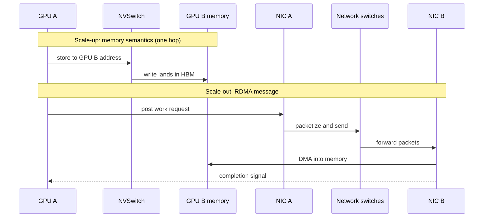

# Scale-up vs scale-out: one giant GPU or many GPUs on a network

Layer 05 · Scale-up (NVLink, NVSwitch) · ~9 min read · Last verified: 2026-11-05

## ⚡ The Executive Take

- **Two fabrics, two jobs.** [Scale-up](../../glossary.md#scale-up) joins dozens of GPUs so tightly they act as one; [scale-out](../../glossary.md#scale-out) joins thousands of those groups over a network. NVIDIA's scale-up fabric is [NVLink](../../glossary.md#nvlink) plus [NVSwitch](../../glossary.md#nvswitch).
- **The gap is ~9× per GPU.** A Blackwell GPU moves 900 GB/s each way over NVLink 5 versus 100 GB/s over its 800 Gb/s [NIC](../../glossary.md#nic) [[S200]](../../sources/bibliography.md#s200)[[S264]](../../sources/bibliography.md#s264); Vera Rubin keeps a similar ratio (1,500 vs 200 GB/s) [[S200]](../../sources/bibliography.md#s200)[[S33004]](../../sources/bibliography.md#s33004).
- **Different semantics, not just more bandwidth.** Inside the [NVLink domain](../../glossary.md#nvlink-domain) a GPU writes into another GPU's memory with ordinary loads and stores ([load/store semantics](../../glossary.md#load-store-semantics)); across the network it posts [RDMA](../../glossary.md#rdma) messages to a NIC [[S5017]](../../sources/bibliography.md#s5017).
- **Measured, not just specified:** DeepSeek's [MoE](../../glossary.md#mixture-of-experts) all-to-all ran at 153 GB/s inside an NVLink node versus 43–58 GB/s across [InfiniBand](../../glossary.md#infiniband), even on export-limited H800s [[S5005]](../../sources/bibliography.md#s5005); so [tensor](../../glossary.md#tensor-parallelism) and [expert parallelism](../../glossary.md#expert-parallelism) stay inside the NVLink domain.
- **Weakness:** the domain stops at the rack (72 GPUs) because 200 Gb/s copper reaches ~1 m [[S5010]](../../sources/bibliography.md#s5010); Google joins 9,216 TPUs [[S232]](../../sources/bibliography.md#s232), and [UALink](../../glossary.md#ualink) and [ESUN](../../glossary.md#esun) aim to commoditize the layer [[S90050]](../../sources/bibliography.md#s90050)[[S90052]](../../sources/bibliography.md#s90052).

## 1. One giant GPU vs many GPUs talking over a network

Think of an open-plan office versus a company spread across buildings. In the office (scale-up) you write directly on a colleague's whiteboard. Between buildings (scale-out) you package a note, hand it to the mailroom (the NIC) and wait for a receipt. On NVLink a GPU stores to an address that belongs to another GPU; the switch routes it and the data lands in the remote [HBM](../../glossary.md#hbm), with no network stack involved. On the network a work request goes to the NIC, which packetizes it; the remote NIC writes it into memory and signals completion [[S5017]](../../sources/bibliography.md#s5017).

| | Scale-up (NVLink domain) | Scale-out (cluster network) |
|---|---|---|
| Per-GPU bandwidth (Blackwell) | 1.8 TB/s, 900 GB/s each way [[S200]](../../sources/bibliography.md#s200) | 800 Gb/s = 100 GB/s each way [[S264]](../../sources/bibliography.md#s264) |
| Typical size | 8–72 GPUs, 144 planned [[S262]](../../sources/bibliography.md#s262)[[S510]](../../sources/bibliography.md#s510) | thousands to 100,000+ GPUs |
| Semantics | load/store into peer memory [[S5017]](../../sources/bibliography.md#s5017) | RDMA messages via NIC [[S5017]](../../sources/bibliography.md#s5017) |
| Topology | single switch hop, all-to-all [[S262]](../../sources/bibliography.md#s262) | multi-tier fat tree |
| Medium | copper inside one rack [[S5000]](../../sources/bibliography.md#s5000) | mostly optical |
| Best for | tensor and expert parallelism | data and pipeline parallelism |

> [!TIP]
> **Worked example — the same MoE exchange on two fabrics.** DeepSeek measured expert-parallel dispatch at **153 GB/s** across 8 GPUs on NVLink and **43–58 GB/s** across 16–64 GPUs on 400G InfiniBand: ~3× on H800, whose NVLink is cut to ~160 GB/s for export [[S5005]](../../sources/bibliography.md#s5005). Blackwell (900 GB/s each way) against an 800G NIC (100 GB/s) gives **~9×** [[S200]](../../sources/bibliography.md#s200)[[S264]](../../sources/bibliography.md#s264). **Conclusion:** export-limited hardware understated the scale-up advantage.

🔧 Under the hood: how a GPU writes into another GPU's memory

- **One address space.** NVSHMEM maps peers' memory into each GPU; NVLink peers take plain loads, stores and atomics, off-node peers RDMA via the NIC [[S5017]](../../sources/bibliography.md#s5017).
- **Switch as calculator.** Since the third generation NVSwitch can sum data in flight ([SHARP](../../glossary.md#sharp)), so an [all-reduce](../../glossary.md#all-reduce) crosses the switch once instead of circling a ring [[S205]](../../sources/bibliography.md#s205).
- **No mailroom.** No packet stack or completion queue sits on the NVLink path, so small, frequent exchanges suit it. DeepSeek's RDMA [decode](../../glossary.md#decode) kernels still took 77–194 µs per dispatch [[S5005]](../../sources/bibliography.md#s5005), repeated in 58 MoE layers every step [[S5006]](../../sources/bibliography.md#s5006).

## 2. The bandwidth gap in numbers

NVLink 5's "1.8 TB/s" counts both directions (900 GB/s each way); an "800 Gb/s" NIC is 100 GB/s each way.

> [!TIP]
> **Worked example — moving a 10 GB tensor shard each way.** Two GPUs swap 10 GB shards (weights or a long [KV cache](../../glossary.md#kv-cache)). NVLink 5: 10 ÷ 900 GB/s = **11 ms**; 800G NIC: 10 ÷ 100 = **100 ms** [[S200]](../../sources/bibliography.md#s200)[[S264]](../../sources/bibliography.md#s264). Vera Rubin: **6.7 ms** on NVLink 6 (revised spec) versus **50 ms** on a 1.6T ConnectX-9 [[S200]](../../sources/bibliography.md#s200)[[S33004]](../../sources/bibliography.md#s33004); [PCIe](../../glossary.md#pcie) Gen5 x16 needs **156 ms** [[S222]](../../sources/bibliography.md#s222). **Conclusion:** swapping state every few milliseconds is feasible inside the NVLink domain and hopeless outside it.

**[Q2 · Metrics that matter]** Five numbers decide how good a scale-up fabric is:

1. **Bandwidth per GPU, each way:** 450 (Hopper), 900 (Blackwell), 1,500 GB/s (Rubin, revised) [[S200]](../../sources/bibliography.md#s200).
2. **Domain size:** 8 GPUs in [HGX](../../glossary.md#hgx), 72 in [NVL72](../../glossary.md#nvl72), 144 planned for Kyber [[S262]](../../sources/bibliography.md#s262)[[S510]](../../sources/bibliography.md#s510).
3. **Domain bandwidth:** 130 TB/s (GB200 NVL72), 216 TB/s (Vera Rubin NVL72) [[S200]](../../sources/bibliography.md#s200).
4. **Latency and hops:** one switch hop in NVL72, several in a torus or multi-tier network.
5. **Energy and cost per bit:** ~0 pJ/bit added by passive copper versus ~19 pJ/bit for DSP optics [[S262]](../../sources/bibliography.md#s262)[[S295]](../../sources/bibliography.md#s295).

## 3. Why tensor and expert parallelism stay inside the NVLink domain

**[Q1 · Job & failure mode]** Scale-up makes the chattiest parallelism cheap. Tensor parallelism exchanges partial results twice per layer; expert parallelism sends every token to its experts and back ([dispatch and combine](../../glossary.md#dispatch-and-combine)). If those exchanges spill onto the network, GPUs sit idle: the failure mode is low utilization and slow tokens, not a crash. Primer [P4](../../primers/P4-parallelism-explained.md) estimates tensor parallelism moves ~17× more data per GPU than data parallelism.

> [!TIP]
> **Worked example — tensor parallelism while serving a 70B model.** 8-way tensor parallelism, a 64-token decode batch, hidden size 8,192 in [BF16](../../glossary.md#bf16): each all-reduce carries 64 × 8,192 × 2 B ≈ 1.05 MB, a ring sends ~1.8 MB per GPU, and 2 per layer × 80 layers ≈ **294 MB per step** (repo calc, method as in P4). NVLink 5: **0.33 ms**; 800G NIC: **2.9 ms**; 400G: **5.9 ms** [[S200]](../../sources/bibliography.md#s200)[[S264]](../../sources/bibliography.md#s264)[[S266]](../../sources/bibliography.md#s266). At 50 tokens/s per user a step lasts 20 ms, so the NIC path burns 15–30% of it before 160 network round trips. **Conclusion:** tensor parallelism stays inside one domain, as in Llama 3 405B (8 GPUs) [[S34006]](../../sources/bibliography.md#s34006); bigger domains are spent on expert parallelism.

> [!WARNING]
> **Myth vs. reality:** "Ethernet will make NVLink unnecessary." The contest is over *which protocol* runs scale-up (NVLink, UALink or ESUN) [[S90050]](../../sources/bibliography.md#s90050)[[S90052]](../../sources/bibliography.md#s90052), not whether scale-up is needed ([Competition](competition.md)).

## 🎯 Corp Dev Lens

1. **Value follows the fast wire.** Parallelism that cannot leave the NVLink domain ties model architecture to NVIDIA rack design. Which workloads would run as well on a smaller or open domain?
2. **The NIC is the commodity side.** Scale-up is where NVIDIA bundles switch silicon, copper spine and software; how durable is that bundle once UALink products ship in 2027 🟡 [[S90051]](../../sources/bibliography.md#s90051)?
3. **Export-limited data mislead.** DeepSeek's 3× gap on H800 understates the ~9× on current parts [[S5005]](../../sources/bibliography.md#s5005)[[S200]](../../sources/bibliography.md#s200); ask which interconnect any MoE efficiency claim was measured on.
4. **Qualcomm question (public information only):** AI200/AI250 racks use PCIe scale-up and Ethernet scale-out [[S90029]](../../sources/bibliography.md#s90029); at what model size does a memory-semantic domain become necessary, and is Fusion, UALink or ESUN the cheaper fix ([NVLink Fusion](nvlink-fusion.md))?

## 📚 Sources

<!-- Auto-generated from the [S…] citations on this page by `make build`. Edit sources/registry/*.csv, not this list. -->

- [**S200**](../../sources/bibliography.md#s200) NVIDIA, *NVIDIA NVLink and NVLink Switch (product page with NVLink and NVLink Switch specification tables)*, 2026-09. [Link](https://www.nvidia.com/en-us/data-center/nvlink/)
- [**S205**](../../sources/bibliography.md#s205) NVIDIA Technical Blog, *Upgrading Multi-GPU Interconnectivity with the Third-Generation NVIDIA NVSwitch*, 2022-08. [Link](https://developer.nvidia.com/blog/upgrading-multi-gpu-interconnectivity-with-the-third-generation-nvidia-nvswitch/)
- [**S222**](../../sources/bibliography.md#s222) Tom's Hardware, *PCI Express roadmap: the path to 1TB/s with PCIe 8.0, the challenges of integration, and beyond*, 2025. [Link](https://www.tomshardware.com/pc-components/motherboards/pci-express-roadmap-the-path-to-1tb-s-with-pci-8-0-the-challenges-of-integration-and-beyond)
- [**S232**](../../sources/bibliography.md#s232) Google Cloud, *TPU7x (Ironwood) - Cloud TPU documentation*, 2025-11. [Link](https://docs.cloud.google.com/tpu/docs/tpu7x)
- [**S262**](../../sources/bibliography.md#s262) NVIDIA, *NVIDIA GB200 NVL72 (product page)*, 2024. [Link](https://www.nvidia.com/en-us/data-center/gb200-nvl72/)
- [**S264**](../../sources/bibliography.md#s264) NVIDIA Newsroom, *NVIDIA Announces New Switches Optimized for Trillion-Parameter GPU Computing and AI Infrastructure (Quantum-X800, Spectrum-X800, ConnectX-8)*, 2024-03-18. [Link](https://nvidianews.nvidia.com/news/networking-switches-gpu-computing-ai)
- [**S266**](../../sources/bibliography.md#s266) NVIDIA Newsroom, *NVIDIA Quantum-2 Takes Supercomputing to New Heights, Into the Cloud*, 2021-11-09. [Link](https://nvidianews.nvidia.com/news/nvidia-quantum-2-takes-supercomputing-to-new-heights-into-the-cloud)
- [**S295**](../../sources/bibliography.md#s295) LPO MSA, *Linear Pluggable Optics Multi-Source Agreement (LPO MSA)*, 2024. [Link](https://www.lpo-msa.org/)
- [**S510**](../../sources/bibliography.md#s510) KGI Securities, *NVIDIA GTC 2026 (research note)*, 2026-03-19. [Link](https://www.kgi.com.hk/zh-hk/-/media/files/kgishk/research-reports/tw-reports/nvidia-gtc-2026_19032026e.pdf)
- [**S5000**](../../sources/bibliography.md#s5000) SemiAnalysis, *Nvidia's Optical Boogeyman - NVL72, InfiniBand Scale Out, 800G & 1.6T Ramp*, 2024-03. [Link](https://newsletter.semianalysis.com/p/nvidias-optical-boogeyman-nvl72-infiniband)
- [**S5005**](../../sources/bibliography.md#s5005) DeepSeek-AI (GitHub) (DeepSeek-AI), *DeepEP: an efficient expert-parallel communication library (README v1.2.1)*, 2025. [Link](https://github.com/deepseek-ai/DeepEP/blob/v1.2.1/README.md)
- [**S5006**](../../sources/bibliography.md#s5006) DeepSeek-AI (GitHub) (DeepSeek-AI), *DeepSeek-V3 inference configuration (config_671B.json)*, 2024-12-26. [Link](https://github.com/deepseek-ai/DeepSeek-V3/blob/main/inference/configs/config_671B.json)
- [**S5010**](../../sources/bibliography.md#s5010) IEEE 802.3, *IEEE P802.3dj adopted objectives (200 Gb/s per lane electrical and optical signaling)*, 2024-03-14. [Link](https://grouper.ieee.org/groups/802/3/dj/projdoc/objectives_P802d3dj_240314.pdf)
- [**S5017**](../../sources/bibliography.md#s5017) NVIDIA Docs, *NVSHMEM API documentation: introduction*, 2025. [Link](https://docs.nvidia.com/nvshmem/api/introduction.html)
- [**S33004**](../../sources/bibliography.md#s33004) NVIDIA Newsroom, *NVIDIA Kicks Off the Next Generation of AI With Rubin — Six New Chips; One Incredible AI Supercomputer*, 2026-01-05. [Link](https://nvidianews.nvidia.com/news/rubin-platform-ai-supercomputer)
- [**S34006**](../../sources/bibliography.md#s34006) arXiv:2407.21783 (Llama Team (AI @ Meta)), *The Llama 3 Herd of Models*, 2024-07-31. [Link](https://arxiv.org/abs/2407.21783)
- [**S90029**](../../sources/bibliography.md#s90029) Verdict, *Qualcomm AI200 and AI250 racks for AI inference*, 2025-10. [Link](https://www.verdict.co.uk/qualcomm-ai200-ai250-racks-ai-inference/)
- [**S90050**](../../sources/bibliography.md#s90050) HPCwire, *UALink Consortium publishes 4 specifications defining in-network compute, chiplets, manageability and 200G performance*, 2026-04-07. [Link](https://www.hpcwire.com/off-the-wire/ualink-consortium-publishes-4-specifications-defining-in-network-compute-chiplets-manageability-and-200g-performance/)
- [**S90051**](../../sources/bibliography.md#s90051) SDxCentral, *UALink Consortium takes another swing at Nvidia's NVLink supremacy with specification 2.0*, 2026-04. [Link](https://www.sdxcentral.com/news/ualink-consortium-takes-another-swing-at-nvidias-nvlink-supremacy-with-specification-20/)
- [**S90052**](../../sources/bibliography.md#s90052) Synopsys, *Ethernet standards for scale-up AI: an overview of ESUN, SUE, and UALink*, 2025-11. [Link](https://www.synopsys.com/articles/ethernet-standards-scale-up-ai.html)
