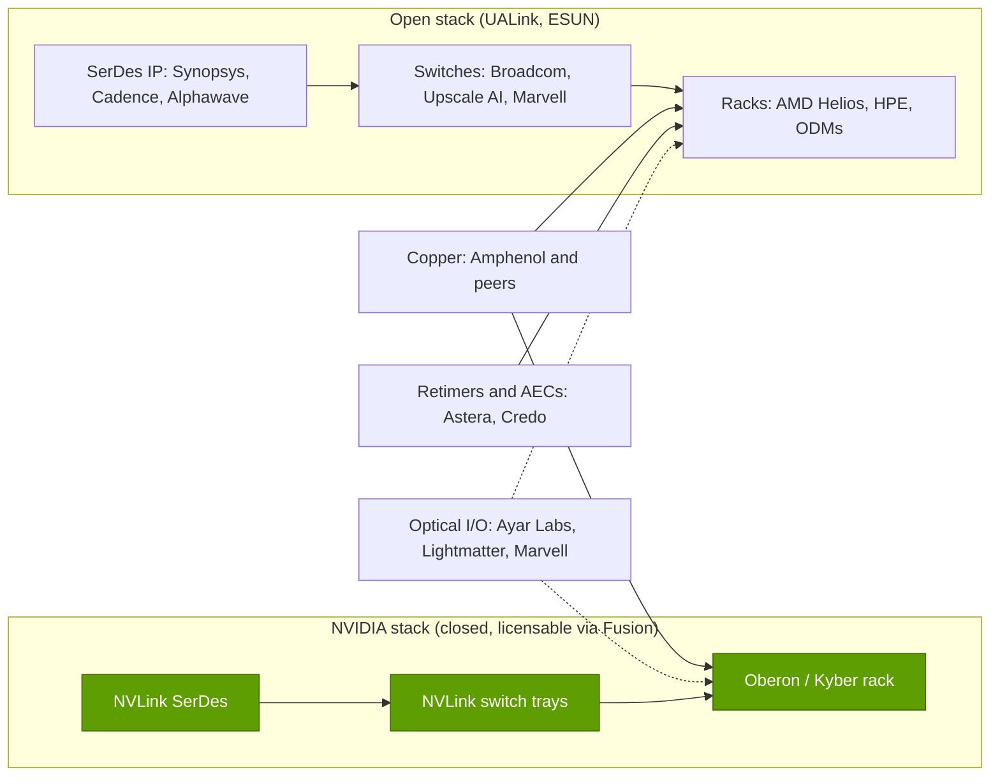

# Scale-up (NVLink, NVSwitch): Value chain and corp dev angles

Layer 05 · Scale-up (NVLink, NVSwitch) · ~12 min read · Last verified: 2026-11-05

## ⚡ The Executive Take

- **NVIDIA keeps most of the scale-up value:** networking reached ~$11B in Q4 FY2026, growth driven primarily by NVLink switches, and ~$17.5B in Q2 FY2027 (Est.), a fifth of Data Center revenue [[S402]](../../sources/bibliography.md#s402)[[S5514]](../../sources/bibliography.md#s5514)[[S408]](../../sources/bibliography.md#s408)[[S90013]](../../sources/bibliography.md#s90013).
- **Switch content per rack doubles with Rubin:** 36 NVLink switch chips per NVL72, up from 18 in GB300. They sit in the ~19% of a $7.8M Vera Rubin rack that is not GPU, memory, CPU, cooling or ODM margin (Est., Morgan Stanley; repo remainder) [[S332]](../../sources/bibliography.md#s332)[[S330]](../../sources/bibliography.md#s330).
- **The copper suppliers are growing fast too.** Amphenol's Q3 2026 sales rose 65% to $10.2B, with AI about three-quarters of IT datacom [[S5503]](../../sources/bibliography.md#s5503). Credo's revenue tripled to $1.335B in FY2026 on [active electrical cables](../../glossary.md#active-electrical-cable) [[S5504]](../../sources/bibliography.md#s5504). Astera Labs doubled to $392M a quarter [[S3524]](../../sources/bibliography.md#s3524).
- **SerDes IP is consolidating:** Qualcomm closed its ~$2.4B Alphawave Semi deal on 2025-12-18. Synopsys and Cadence license IP into NVLink Fusion [[S4514]](../../sources/bibliography.md#s4514)[[S4513]](../../sources/bibliography.md#s4513)[[S217]](../../sources/bibliography.md#s217).
- **Optics and switch start-ups are being bought:** Marvell closed Celestial AI ($3.25B upfront) and XConn in February 2026, and NVIDIA hired Enfabrica's team for >$900M [[S2513]](../../sources/bibliography.md#s2513)[[S5508]](../../sources/bibliography.md#s5508)[[S475]](../../sources/bibliography.md#s475).
- **[Q8 · Value pools & M&A angles]** There are four value pools: switch silicon, SerDes IP, copper interconnect and [optical I/O](../../glossary.md#optical-io). NVIDIA owns the first in its racks; UALink and Ethernet scale-up open it to merchants in 2027 🟡 [[S90051]](../../sources/bibliography.md#s90051)[[S275]](../../sources/bibliography.md#s275).

## Who captures the dollars in a scale-up domain

A scale-up domain has four kinds of content: **switch silicon** (NVIDIA, or Broadcom in Helios), **SerDes** on every chip (in-house or licensed), **copper** spine cartridges, cables and connectors, and **[Retimers](../../glossary.md#retimer) and AECs** where a link is too long for passive copper. NVIDIA designs the rack and sells the switch trays; ODMs assemble the rest. In a GB300 rack the switch trays sit inside an "other content" bucket of ~$0.94M out of ~$3.99M (Est., Morgan Stanley) [[S332]](../../sources/bibliography.md#s332).

| Value pool | Who captures it | Evidence of economics | Source |
|---|---|---|---|
| Switch silicon and trays | NVIDIA; Broadcom (Helios); UALink entrants from 2027 | NVIDIA GAAP gross margin 75% (company-wide, Q2 FY2027); switch chips per GPU 0.25 → 0.5 | [[S3]](../../sources/bibliography.md#s3)[[S332]](../../sources/bibliography.md#s332) |
| SerDes IP | In-house (NVIDIA, Broadcom); Synopsys, Cadence; Alphawave (Qualcomm) | Alphawave ~$2.4B | [[S217]](../../sources/bibliography.md#s217)[[S4514]](../../sources/bibliography.md#s4514) |
| Copper spine, cables, connectors | Amphenol and other connector makers | Amphenol Q3 2026 sales $10.2B, +65% y/y; ~5,184 cables per GB200 NVL72 | [[S5503]](../../sources/bibliography.md#s5503)[[S5517]](../../sources/bibliography.md#s5517) |
| Retimers, AECs, fabric switches | Astera Labs, Credo, Marvell | Astera ~72% GAAP gross margin (Q3 guide) | [[S3525]](../../sources/bibliography.md#s3525)[[S5504]](../../sources/bibliography.md#s5504) |
| Optical I/O and CPO | NVIDIA with TSMC; Ayar Labs, Lightmatter; Marvell (Celestial AI) | Ayar ~$3.75B, Lightmatter $4.4B valuations | [[S90048]](../../sources/bibliography.md#s90048)[[S5511]](../../sources/bibliography.md#s5511)[[S2510]](../../sources/bibliography.md#s2510)[[S2513]](../../sources/bibliography.md#s2513) |

> [!TIP]
> **Worked example — what the copper spine is worth to the buyer.** NVIDIA says copper instead of optics saves ~20 kW per NVL72 [[S5515]](../../sources/bibliography.md#s5515), about 15% of a GB200 rack's ~132 kW peak [[S33021]](../../sources/bibliography.md#s33021). In a power-capped hall that is ~15% more racks for the same grid connection. Electricity alone, at an assumed $0.08/kWh, is 20 kW × 8,760 h × 5 years ≈ 876 MWh ≈ $70,000 per rack. The ~5,184 copper cables per GB200 rack are worth more to the buyer than their bill-of-materials line suggests [[S5517]](../../sources/bibliography.md#s5517), which is why connector makers such as Amphenol share in NVLink's growth.

🔧 Under the hood: where retimers and AECs fit, and where they don't

Passive copper at 200G per lane reaches only ~1–2 m [[S262]](../../sources/bibliography.md#s262). Inside one NVL72 the spine stays passive, which is why NVIDIA could avoid ~20 kW of optics [[S5515]](../../sources/bibliography.md#s5515). Retimers and AECs rebuild the signal so copper runs a few metres further, mostly NIC-to-switch scale-out links today. Multi-rack scale-up (NVL576, NVL1152) is where AECs, optics and CPO will compete [[S108]](../../sources/bibliography.md#s108). Credo's FY2026 growth came from AEC volumes at hyperscalers [[S5505]](../../sources/bibliography.md#s5505).

## Suppliers, partners and private companies

**NVLink Fusion partners** at launch were MediaTek, Marvell, Alchip and Astera Labs (custom silicon and connectivity), Synopsys and Cadence (IP), and Qualcomm and Fujitsu (CPUs) [[S217]](../../sources/bibliography.md#s217)[[S90031]](../../sources/bibliography.md#s90031). Arm Neoverse support (November 2025), AWS Trainium4 (December 2025) and a $2B NVIDIA stake in Marvell (March 2026) followed [[S219]](../../sources/bibliography.md#s219)[[S518]](../../sources/bibliography.md#s518)[[S218]](../../sources/bibliography.md#s218). Several also back the open camp: Astera Labs sits on the UALink board [[S5520]](../../sources/bibliography.md#s5520), and Marvell bought XConn's PCIe/CXL switch team, positioned for UALink-era switching [[S5508]](../../sources/bibliography.md#s5508)[[S5510]](../../sources/bibliography.md#s5510).

| Private company | What it does | Last public funding | Why it matters |
|---|---|---|---|
| Ayar Labs | Optical I/O chiplets that put fibre at the package edge | $500M Series E (Mar 2026), ~$3.75B valuation; NVIDIA and AMD invested [[S5511]](../../sources/bibliography.md#s5511) | Joined NVLink Fusion (~June 2026) 🟡 [[S5513]](../../sources/bibliography.md#s5513); candidate for multi-rack NVLink |
| Lightmatter | Photonic interposer and optical interconnect | $400M Series D (Oct 2024) at $4.4B [[S2510]](../../sources/bibliography.md#s2510) | Optical scale-up for any XPU |
| Upscale AI | UALink 1.0 switch ASIC (SkyHammer), up to 1,024 devices | $200M Series A (Jan 2026), >$1B valuation [[S5506]](../../sources/bibliography.md#s5506) | Early merchant UALink switch, targeted Q4 2026 🟡 |

> [!TIP]
> **Worked example — how fast the private pool is shrinking.** Enfabrica's team went to NVIDIA (>$900M) and Celestial AI to Marvell ($3.25B upfront plus earn-outs) [[S475]](../../sources/bibliography.md#s475)[[S2513]](../../sources/bibliography.md#s2513). Alphawave, a listed SerDes house, went to Qualcomm (~$2.4B) [[S4514]](../../sources/bibliography.md#s4514). Between June 2025 and February 2026 that is ~$6.5B of announced value moving from independents to platform owners. Ayar Labs, backed by NVIDIA, AMD and Intel in December 2024, is still independent. Its valuation more than tripled in 15 months, from >$1B to ~$3.75B [[S5512]](../../sources/bibliography.md#s5512)[[S5511]](../../sources/bibliography.md#s5511). Scarcity is being priced in.

![Horizontal bar chart of interconnect-related deals: NVIDIA-Mellanox $6.9B (2019), NVIDIA's $5B Intel stake for NVLink x86 CPUs (2025), AMD-ZT Systems $4.9B (2024, rack design team), Marvell-Celestial AI $3.25B upfront (closed 2026), Qualcomm-Alphawave Semi $2.4B (2025), NVIDIA's $2B Marvell stake for NVLink Fusion (2026), NVIDIA-Enfabrica acquihire over $0.9B (2025), Ayar Labs $500M Series E (2026), Lightmatter $400M (2024), Upscale AI $200M Series A (2026), Marvell-XConn about $325M cash plus stock (2026) and Ayar Labs $155M (2024).](../../assets/charts/05-scale-up-deal-values.svg)

## M&A history and value-pool map

NVIDIA bought switching know-how (Mellanox, $6.9B, closed 2020-04-27) [[S464]](../../sources/bibliography.md#s464), hired a fabric team (Enfabrica) [[S475]](../../sources/bibliography.md#s475), and used equity to bind partners: Intel ($5B, x86 CPUs on NVLink) and Marvell ($2B, Fusion XPUs) [[S468]](../../sources/bibliography.md#s468)[[S218]](../../sources/bibliography.md#s218). Rivals bought missing pieces: a rack team (AMD–ZT Systems, $4.9B, manufacturing resold to Sanmina) [[S5527]](../../sources/bibliography.md#s5527)[[S5528]](../../sources/bibliography.md#s5528), SerDes (Qualcomm–Alphawave), optics (Marvell–Celestial AI) and switches (Marvell–XConn) [[S4514]](../../sources/bibliography.md#s4514)[[S2513]](../../sources/bibliography.md#s2513)[[S5508]](../../sources/bibliography.md#s5508).

**[Q8 · Value pools & M&A angles]** Each pool behaves differently:

- **Switch silicon:** the largest and most contested pool; it grows with switch chips per GPU (0.25 → 0.5 in Rubin), defended by Fusion and annual cadence [[S332]](../../sources/bibliography.md#s332).
- **SerDes IP:** small revenue, decisive capability; Alphawave, Celestial AI and Enfabrica have all been absorbed.
- **Copper interconnect:** rides unit volume in both camps.
- **Optics:** the option on 2028 multi-rack domains; Ayar Labs, Lightmatter and Marvell are courted by both camps 🔴.

## 🎯 Corp Dev Lens

1. For a CPU or accelerator vendor, what does NVLink Fusion participation buy (access to NVIDIA racks and customers), and what does it cost (dependence on NVIDIA switch trays, pricing and roadmap) compared with UALink or ESUN [[S217]](../../sources/bibliography.md#s217)[[S518]](../../sources/bibliography.md#s518)?
2. Qualcomm (public information only) is a Fusion CPU partner, owns Alphawave's SerDes and plans UALink/ESUN for its 2028 AI300 [[S90031]](../../sources/bibliography.md#s90031)[[S4513]](../../sources/bibliography.md#s4513)[[S90060]](../../sources/bibliography.md#s90060). Which assets serve both fabrics, and which would need to be built or bought?
3. With Celestial AI, Enfabrica and Alphawave absorbed, which independent optical-I/O or switch teams remain (Ayar Labs, Lightmatter, Upscale AI), and at what valuations [[S5511]](../../sources/bibliography.md#s5511)[[S2510]](../../sources/bibliography.md#s2510)[[S5506]](../../sources/bibliography.md#s5506)?
4. Does the copper-to-optics transition (Feynman NVL1152) move value from connector makers to photonics suppliers, or do both grow on unit volume [[S108]](../../sources/bibliography.md#s108)[[S5503]](../../sources/bibliography.md#s5503)?
5. If merchant UALink switches arrive in 2027, how much switch-tray margin is at risk, and is partnering with a merchant switch vendor cheaper than building one?

## 📚 Sources

<!-- Auto-generated from the [S…] citations on this page by `make build`. Edit sources/registry/*.csv, not this list. -->

- [**S3**](../../sources/bibliography.md#s3) StorageNewsletter, *NVIDIA Q2 Fiscal 2027 results coverage: revenue $96.2B*, 2026-08-27. [Link](https://www.storagenewsletter.com/2026/08/27/nvidia-fiscal-2q27-financial-results/)
- [**S108**](../../sources/bibliography.md#s108) HPCwire / AIwire, *Huang Shares Nvidia Roadmap Showing More Chips, NVL1152, Scale-Up CPO*, 2026-03-18. [Link](https://www.hpcwire.com/aiwire/2026/03/18/huang-shares-nvidia-roadmap-showing-more-chips-nvl1152-scale-up-cpo/)
- [**S217**](../../sources/bibliography.md#s217) NVIDIA via Barchart, *NVIDIA Unveils NVLink Fusion for Industry to Build Semi-Custom AI Infrastructure With NVIDIA Partner Ecosystem (press release, syndicated)*, 2025-05-19. [Link](https://www.barchart.com/story/news/32460751/nvidia-unveils-nvlink-fusion-for-industry-to-build-semi-custom-ai-infrastructure-with-nvidia-partner-ecosystem)
- [**S218**](../../sources/bibliography.md#s218) Converge Digest, *NVIDIA invests $2B in Marvell to extend NVLink Fusion AI ecosystem*, 2026-03-31. [Link](https://convergedigest.com/nvidia-invests-2b-in-marvell-to-extend-nvlink-fusion-ai-ecosystem/)
- [**S219**](../../sources/bibliography.md#s219) Converge Digest, *Arm extends Neoverse with NVIDIA NVLink Fusion*, 2025-11. [Link](https://convergedigest.com/arm-extends-neoverse-with-nvidia-nvlink-fusion/)
- [**S262**](../../sources/bibliography.md#s262) NVIDIA, *NVIDIA GB200 NVL72 (product page)*, 2024. [Link](https://www.nvidia.com/en-us/data-center/gb200-nvl72/)
- [**S275**](../../sources/bibliography.md#s275) Broadcom, *Broadcom ships Tomahawk Ultra: reimagining the Ethernet switch for HPC and AI scale-up*, 2025-07-15. [Link](https://investors.broadcom.com/news-releases/news-release-details/broadcom-ships-tomahawk-ultra-reimagining-ethernet-switch-hpc-and-ai)
- [**S330**](../../sources/bibliography.md#s330) PC Gamer, *A single Nvidia Vera Rubin rack is estimated to cost $7,803,148 with over $2 million of that figure spent on memory alone*, 2026-05. [Link](https://pcgamer.com/hardware/a-single-nvidia-vera-rubin-rack-is-estimated-to-cost-usd7-803-148-with-over-usd2-million-of-that-figure-spent-on-memory-alone)
- [**S332**](../../sources/bibliography.md#s332) Tiger Brokers (iTiger), *Morgan Stanley's BOM analysis of NVIDIA's Rubin: GPU share declines; PCB, MLCC and ABF substrate values soar*, 2026-05-20. [Link](https://www.itiger.com/news/1188068712)
- [**S402**](../../sources/bibliography.md#s402) NVIDIA Corporation via SEC EDGAR (Colette Kress), *CFO Commentary on Fourth Quarter and Fiscal 2026 Results (Form 8-K exhibit 99.2)*, 2026-02-25. [Link](https://www.sec.gov/Archives/edgar/data/1045810/000104581026000019/q4fy26cfocommentary.htm)
- [**S408**](../../sources/bibliography.md#s408) NVIDIA Corporation, *NVIDIA Corp. (NVDA) Q2 Fiscal 2027 earnings call transcript (26 August 2026)*, 2026-08-26. [Link](https://s201.q4cdn.com/141608511/files/content_files/TRANSCRIPT_-NVIDIA-Corp-NVDA-US-Q2-2027-Earnings-Call-26-August-2026-5_00-PM-ET.pdf)
- [**S464**](../../sources/bibliography.md#s464) NVIDIA Newsroom, *NVIDIA to Acquire Mellanox for $6.9 Billion*, 2019-03-11. [Link](https://nvidianews.nvidia.com/news/nvidia-to-acquire-mellanox-for-6-9-billion)
- [**S468**](../../sources/bibliography.md#s468) NVIDIA Newsroom, *NVIDIA and Intel to Develop AI Infrastructure and Personal Computing Products*, 2025-09-18. [Link](https://nvidianews.nvidia.com/news/nvidia-and-intel-to-develop-ai-infrastructure-and-personal-computing-products)
- [**S475**](../../sources/bibliography.md#s475) CNBC, *Nvidia spends over $900 million on Enfabrica CEO, AI startup technology*, 2025-09-18. [Link](https://www.cnbc.com/technology/)
- [**S518**](../../sources/bibliography.md#s518) ServeTheHome, *NVIDIA NVLink Fusion tapped for future AWS Trainium4 deployments*, 2025-12-02. [Link](https://www.servethehome.com/nvidia-nvlink-fusion-tapped-for-future-aws-trainium4-deployments/)
- [**S2510**](../../sources/bibliography.md#s2510) Bloomberg, *Photonic Computing Startup Lightmatter Reaches $4.4 Billion Valuation*, 2024-10-16. [Link](https://www.bloomberg.com/news/articles/2024-10-16/photonic-computing-startup-lightmatter-reaches-4-4-billion-valuation)
- [**S2513**](../../sources/bibliography.md#s2513) Business Wire (Marvell), *Marvell Completes Acquisition of Celestial AI*, 2026-02-02. [Link](https://www.businesswire.com/news/home/20260201331090/en/marvell-completes-acquisition-of-celestial-ai)
- [**S3524**](../../sources/bibliography.md#s3524) Dealroom, *Astera Labs revenue doubles to $392M as new investors pile in*, 2026-08. [Link](https://dealroom.co/news/147670-astera-labs-revenue-doubles-to-392m-as-new-investors-pile-in/)
- [**S3525**](../../sources/bibliography.md#s3525) TS2 Tech, *Astera Labs climbs after hours as Q3 revenue forecast beats consensus*, 2026-08. [Link](https://ts2.tech/en/astera-labs-nasdaqalab-climbs-in-after-hours-as-q3-revenue-forecast-beats-consensus-by-32/)
- [**S4513**](../../sources/bibliography.md#s4513) I-Connect007, *Qualcomm completes acquisition of Alphawave Semi*, 2025-12-18. [Link](https://iconnect007.com/article/148161/qualcomm-completes-acquisition-of-alphawave-semi/148158/ein)
- [**S4514**](../../sources/bibliography.md#s4514) CRN Asia, *Qualcomm: US$2.4 billion Alphawave Semi buy to boost data center push*, 2025-06. [Link](https://www.crnasia.com/news-network/2025/qualcomm-us-2)
- [**S5503**](../../sources/bibliography.md#s5503) MarketBeat, *Transcript: Amphenol Q3 2026 earnings call highlights*, 2026-10-28. [Link](https://www.marketbeat.com/instant-alerts/transcript-amphenol-q3-earnings-call-highlights-2026-10-28/)
- [**S5504**](../../sources/bibliography.md#s5504) Credo Technology Group via SEC EDGAR, *Credo Technology Group Form 10-K for fiscal year ended 2026-05-02*, 2026-06. [Link](https://www.sec.gov/Archives/edgar/data/0001807794/000162828026043303/crdo-20260502.htm)
- [**S5505**](../../sources/bibliography.md#s5505) Credo Technology Group via SEC EDGAR, *Credo Technology Group Form 10-Q for the quarter ended 2026-08-01*, 2026-09. [Link](https://www.sec.gov/Archives/edgar/data/0001807794/000162828026060111/crdo-20260801.htm)
- [**S5506**](../../sources/bibliography.md#s5506) The Register, *AI networking startup Upscale AI scores $200M to challenge Nvidia's NVSwitch*, 2026-01-22. [Link](https://www.theregister.com/2026/01/22/upscale_skyhammer_nvidia/)
- [**S5508**](../../sources/bibliography.md#s5508) Marvell Technology, *Marvell Completes Acquisition of XConn Technologies*, 2026-02-10. [Link](https://investor.marvell.com/news-events/press-releases/detail/1007/marvell-completes-acquisition-of-xconn-technologies)
- [**S5510**](../../sources/bibliography.md#s5510) Futurum Group, *Marvell's XConn buy yields a two-pronged open fabric play against NVLink*, 2026-03. [Link](https://www.futurumgroup.com/insights/marvells-xconn-buy-yields-a-two-pronged-open-fabric-play-against-nvlink/)
- [**S5511**](../../sources/bibliography.md#s5511) Berkeley Wireless Research Center (Ayar Labs announcement), *Ayar Labs closes $500M Series E, accelerates volume production of co-packaged optics*, 2026-03. [Link](https://bwrc.berkeley.edu/node/535)
- [**S5512**](../../sources/bibliography.md#s5512) Business Wire (Ayar Labs), *Ayar Labs, with investments from AMD, Intel Capital and NVIDIA, secures $155 million*, 2024-12-11. [Link](https://www.businesswire.com/news/home/20241211964729/en/Ayar-Labs-with-Investments-from-AMD-Intel-Capital-and-NVIDIA-Secures-155-Million-to-Address-Urgent-Need-for-Scalable-Cost-Effective-AI-Infrastructure)
- [**S5513**](../../sources/bibliography.md#s5513) StockAnalysis, *Ayar Labs (private company profile and news)*, 2026-09. [Link](https://stockanalysis.com/private/ayar-labs/)
- [**S5514**](../../sources/bibliography.md#s5514) SDxCentral, *Nvidia's networking arm hits $31B as new cornerstone of AI dominance*, 2026-02. [Link](https://www.sdxcentral.com/news/nvidias-networking-arm-hits-31b-as-new-cornerstone-of-ai-dominance/)
- [**S5515**](../../sources/bibliography.md#s5515) ServeTheHome, *This is the NVIDIA DGX GB200 NVL72*, 2024-03-19. [Link](https://www.servethehome.com/this-is-the-nvidia-dgx-gb200-nvl72/)
- [**S5517**](../../sources/bibliography.md#s5517) The Next Platform, *Copper wires have already failed clustered AI systems*, 2024-09-13. [Link](https://www.nextplatform.com/2024/09/13/copper-wires-have-already-failed-clustered-ai-systems/)
- [**S5520**](../../sources/bibliography.md#s5520) Business Wire, *Ultra Accelerator Link Consortium incorporates and opens membership*, 2024-10-29. [Link](https://www.businesswire.com/news/home/20241029998800/en)
- [**S5527**](../../sources/bibliography.md#s5527) Evertiq, *AMD completes sale of ZT Systems manufacturing unit to Sanmina*, 2025-10-27. [Link](https://evertiq.com/design/2025-10-27-amd-completes-sale-of-zt-systems-manufacturing-unit-to-sanmina)
- [**S5528**](../../sources/bibliography.md#s5528) Sanmina, *Sanmina completes acquisition of ZT Systems data center infrastructure manufacturing business from AMD*, 2025-10-27. [Link](https://s201.q4cdn.com/209924174/files/doc_news/SANMINA-COMPLETES-ACQUISITION-OF-ZT-SYSTEMS-DATA-CENTER-INFRASTRUCTURE-MANUFACTURING-BUSINESS-FROM-AMD-2025.pdf)
- [**S33021**](../../sources/bibliography.md#s33021) SemiAnalysis (Dylan Patel, Wega Chu, Daniel Nishball et al.), *GB200 Hardware Architecture — Component Supply Chain and BOM*, 2024-07-17. [Link](https://semianalysis.com/2024/07/17/gb200-hardware-architecture-and-component/)
- [**S90013**](../../sources/bibliography.md#s90013) Quartr, *NVIDIA (NVDA) Q2 2027 earnings summary*, 2026-08-26. [Link](https://quartr.com/events/nvidia-corporation-nvda-q2-2027_33dRoFp6)
- [**S90031**](../../sources/bibliography.md#s90031) ServeTheHome, *NVIDIA announces NVLink Fusion bringing NVLink to third-party CPUs and accelerators*, 2025-05-19. [Link](https://www.servethehome.com/nvidia-announces-nvlink-fusion-bringing-nvlink-to-third-party-cpus-and-accelerators/nvlink-fusion-partners/)
- [**S90048**](../../sources/bibliography.md#s90048) Converge Digest, *NVIDIA debuts Spectrum-X and Quantum-X Photonics switches*, 2025-03-18. [Link](https://convergedigest.com/nvidia-debuts-spectrum-x-and-quantum-x-photonics-switches/)
- [**S90051**](../../sources/bibliography.md#s90051) SDxCentral, *UALink Consortium takes another swing at Nvidia's NVLink supremacy with specification 2.0*, 2026-04. [Link](https://www.sdxcentral.com/news/ualink-consortium-takes-another-swing-at-nvidias-nvlink-supremacy-with-specification-20/)
- [**S90060**](../../sources/bibliography.md#s90060) Qualcomm, *Qualcomm Dragonfly AI300 (product page)*, 2026-06. [Link](https://www.qualcomm.com/data-center/products/qualcomm-dragonfly-ai300)
