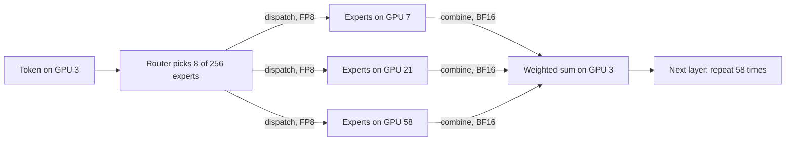

# Why NVLink domain size matters for MoE and reasoning models

Layer 05 · Scale-up (NVLink, NVSwitch) · ~11 min read · Last verified: 2026-11-05

## ⚡ The Executive Take

- **[Mixture-of-experts](../../glossary.md#mixture-of-experts) models turn every layer into an [all-to-all](../../glossary.md#all-to-all).** DeepSeek-V3 sends each token to 8 of 256 experts in each of 58 MoE layers [[S5006]](../../sources/bibliography.md#s5006): ~10 MB of traffic per token (repo calc).
- **Domain size decides where it flows.** With 64-way [expert parallelism](../../glossary.md#expert-parallelism) on 8-GPU servers, 87.5% crosses NICs: ~22 ms per [decode](../../glossary.md#decode) step on [HGX](../../glossary.md#hgx) H200 versus ~1.4 ms in a GB300 [NVL72](../../glossary.md#nvl72) (Est.), against a ~50 ms step [[S5004]](../../sources/bibliography.md#s5004)[[S5005]](../../sources/bibliography.md#s5005).
- **[Wide EP](../../glossary.md#wide-ep) saves memory:** at 72-way EP each GPU holds ~9 GB of [FP8](../../glossary.md#fp8) expert weights versus ~82 GB at 8-way (repo calc from [[S5006]](../../sources/bibliography.md#s5006)), room that reasoning models fill with [KV cache](../../glossary.md#kv-cache).
- **Claims vs data:** NVIDIA claims ~10× on MoE for GB200 NVL72 over HGX H200 [[S5002]](../../sources/bibliography.md#s5002); same-silicon data show ~3× at throughput-heavy points [[S630]](../../sources/bibliography.md#s630) and none at high per-user speed (repo calc on [[S621]](../../sources/bibliography.md#s621)).
- **Counter-argument:** Google joins 9,216 Ironwood TPUs in one domain via a 3D [torus](../../glossary.md#torus-topology) and [optical circuit switches](../../glossary.md#optical-circuit-switch) [[S232]](../../sources/bibliography.md#s232)[[S237]](../../sources/bibliography.md#s237), 128× bigger, though with ~200 GB/s of all-to-all per chip in a 64-chip cube versus 900 in NVL72 (🔴 Est.).

![Horizontal log-scale bar chart of estimated MoE dispatch-plus-combine time per decode step: HGX H200 about 22 ms (87.5% of expert traffic leaves the 8-GPU NVLink domain over a 400G NIC), HGX B300 about 11 ms, HGX Rubin NVL8 about 5.6 ms, GB300 NVL72 about 1.4 ms and Vera Rubin NVL72 about 0.8 ms, where all 64 expert GPUs sit in one NVLink domain. DeepEP's measured kernels on H800 with 400G InfiniBand take about 28 ms, close to the model. A decode step at DeepSeek's ~20 tokens/s per user lasts ~50 ms.](../../assets/charts/05-moe-all-to-all-time-by-system.svg)

## 1. MoE turns every layer into an all-to-all

An MoE layer's router picks a few specialist sub-networks (experts) per token. Experts are spread across GPUs, so every layer must [dispatch](../../glossary.md#dispatch-and-combine) each token to the GPUs holding its experts and combine the results back: every GPU talks to many others, twice per layer.

> [!TIP]
> **Worked example — bytes moved by a DeepSeek-V3-class model.** Hidden size 7,168, 8 experts per token, 58 MoE layers [[S5006]](../../sources/bibliography.md#s5006). Dispatch in FP8: 8 × 7,168 × 1 B = **57 KB**; combine in [BF16](../../glossary.md#bf16): **115 KB**; ~**10 MB per token** across the model [[S5004]](../../sources/bibliography.md#s5004). A GPU with 128 tokens per decode step sends **22 MB per layer**. With 64-way EP on 8-GPU servers, 56/64 leaves the server: 19 MB ÷ 50 GB/s (400G [NIC](../../glossary.md#nic)) = **385 µs per layer, ~22 ms per step**; in a GB300 NVL72: 22 MB ÷ 900 GB/s ≈ **1.4 ms per step** [[S266]](../../sources/bibliography.md#s266)[[S200]](../../sources/bibliography.md#s200). DeepSeek's measured kernels need ~28 ms per step [[S5005]](../../sources/bibliography.md#s5005); a step at ~20 tokens/s per user lasts ~50 ms [[S5004]](../../sources/bibliography.md#s5004). **Conclusion:** on 8-GPU nodes the all-to-all eats half of every step unless hidden behind compute; in an NVL72 it nearly disappears.

🔧 Under the hood: how DeepSeek designed its model around the network

- **Node-limited routing.** DeepSeek-V3 lets each token pick experts from at most 4 of 8 expert groups [[S5006]](../../sources/bibliography.md#s5006); in training a token visits at most 4 nodes [[S34007]](../../sources/bibliography.md#s34007).
- **Overlap.** Two micro-batches alternate so one computes while the other communicates [[S5004]](../../sources/bibliography.md#s5004). A larger [NVLink](../../glossary.md#nvlink) domain reduces the need for this engineering.

## 2. Wide expert parallelism and KV-cache sharing

Spreading experts over more GPUs leaves each GPU fewer to store and read, freeing memory for larger batches and longer contexts. DeepSeek serves [prefill](../../glossary.md#prefill) at 32-way EP (9 routed experts per GPU) and decode at 144-way (2 per GPU) [[S5004]](../../sources/bibliography.md#s5004); a 72-GPU domain runs such wide EP at NVLink speed.

> [!TIP]
> **Worked example — memory freed, and KV moved.** Each DeepSeek-V3 expert has three 7,168 × 2,048 matrices (~44 M parameters); 256 experts × 58 layers ≈ **654 GB** in FP8 (repo calc from [[S5006]](../../sources/bibliography.md#s5006)). At 8-way EP each GPU holds **~82 GB**; at 72-way **~9 GB**, freeing ~70 GB of a 288 GB GB300 for KV cache [[S32004]](../../sources/bibliography.md#s32004). [MLA](../../glossary.md#multi-head-latent-attention) stores 576 values per layer per token [[S32009]](../../sources/bibliography.md#s32009), so a 32k-token context in BF16 is ≈ **2.3 GB**: **2.6 ms** over NVLink 5 versus **23 ms** over an 800G NIC when handed from a prefill to a decode GPU [[S200]](../../sources/bibliography.md#s200)[[S264]](../../sources/bibliography.md#s264). **Conclusion:** a bigger domain buys bigger batches and cheaper KV handoffs, the levers that set cost per token for reasoning models.

## 3. NVIDIA's claims versus independent data

| Comparison | Source | Baseline | Multiple | Caveat |
|---|---|---|---|---|
| GB200 NVL72, 1.8T-parameter MoE | NVIDIA, Mar 2024 [[S396]](../../sources/bibliography.md#s396) | H100 | up to 30× | vendor; FP4 vs FP8 |
| GB200 NVL72 on Kimi K2 Thinking, DeepSeek-R1, Mistral Large 3 | NVIDIA, Dec 2025 [[S5002]](../../sources/bibliography.md#s5002) | HGX H200 | ~10× | vendor; configurations unpublished [[S5003]](../../sources/bibliography.md#s5003) |
| GB200 NVL72, Kimi K2.5, wide EP | SemiAnalysis, Apr 2026 [[S630]](../../sources/bibliography.md#s630) | B200 (8-GPU) | 3.1× peak | same GPU silicon |
| GB200 NVL72, DeepSeek-R1 FP4 | repo calc on InferenceX [[S621]](../../sources/bibliography.md#s621) | B200 | ~3.5× at 49 tok/s/user, ~0.85× at 90 | configs from different dates |

> [!TIP]
> **Worked example — where does "10×" come from?** Blackwell versus Hopper: dense FP8 4.5 vs 1.98 [PFLOPS](../../glossary.md#flops) (2.3×), [HBM](../../glossary.md#hbm) 8 vs 4.8 TB/s (1.7×) [[S33003]](../../sources/bibliography.md#s33003)[[S32002]](../../sources/bibliography.md#s32002); [FP4](../../glossary.md#fp4) can double compute again: ~2–4.5× before any NVLink effect, which same-silicon data put at ~2–3.5× [[S630]](../../sources/bibliography.md#s630)[[S621]](../../sources/bibliography.md#s621). **Conclusion:** 10× stacks generation, number format, domain size and software; ask for the same-GPU number.

## 4. The counter-argument: TPU pods and the torus

Google wires each Ironwood TPU to its neighbours with six [ICI](../../glossary.md#ici) links (1.2 TB/s) in a 3D torus; optical circuit switches stitch 4×4×4 cubes into a 9,216-chip pod with no packet switch in the path [[S232]](../../sources/bibliography.md#s232)[[S350]](../../sources/bibliography.md#s350)[[S237]](../../sources/bibliography.md#s237). TPU 8t doubles ICI to 2.4 TB/s across 9,600 chips [[S239]](../../sources/bibliography.md#s239).

![Log-log line chart of modeled all-to-all bandwidth per chip. A switched GB300-class NVL72 gives 900 GB/s per direction to every GPU up to 72 GPUs, then falls to the 800G NIC's ~100 GB/s (101 GB/s at 9,216 GPUs); an 8-GPU HGX node drops to ~100 GB/s beyond 8 GPUs; Vera Rubin NVL72 starts at 1,500 and settles near 200 with 1.6T NICs. A TPU Ironwood 3D torus (1.2 TB/s over six links) delivers about 200 GB/s in a 64-chip cube, falling with the cube root of chip count to about 38 at 9,216; TPU 8t doubles that. Torus links carry multi-hop traffic, which switched fabrics avoid.](../../assets/charts/05-torus-vs-switched-all-to-all.svg)

| Dimension | NVIDIA NVL72 (switched) | Google TPU pod (torus + OCS) | Verdict for NVIDIA |
|---|---|---|---|
| Chips in one scale-up domain | 72; 144 planned [[S262]](../../sources/bibliography.md#s262)[[S510]](../../sources/bibliography.md#s510) | 9,216 (Ironwood) [[S232]](../../sources/bibliography.md#s232) | 🟥 far smaller |
| All-to-all per chip (Est.) | 900 GB/s each way, one hop | ~200 GB/s in a 64-chip cube (repo model) | 🟩 for MoE |
| Neighbour and ring traffic | full link speed | full link speed | 🟨 parity |
| Switch silicon | 18–36 chips per rack [[S262]](../../sources/bibliography.md#s262)[[S203]](../../sources/bibliography.md#s203) | none; optical mirrors [[S237]](../../sources/bibliography.md#s237) | 🟦 cost vs flexibility |
| Failure handling | swap trays [[S5007]](../../sources/bibliography.md#s5007) | re-route around bad cubes [[S237]](../../sources/bibliography.md#s237) | 🟦 different |

> [!TIP]
> **Worked example — torus arithmetic.** In a k × k × k torus a message travels ~3k/4 hops on average, each hop using link capacity, so with six links of b GB/s each way uniform all-to-all per chip is ~6b ÷ (3k/4) = **8b/k** (🔴 repo model). Ironwood: b = 1,200 ÷ 6 ÷ 2 = 100 GB/s [[S232]](../../sources/bibliography.md#s232); a 64-chip cube gives **~200 GB/s**, 4,096 chips **~50 GB/s**, versus 900 GB/s in one NVL72 hop [[S200]](../../sources/bibliography.md#s200). **Conclusion:** tori win on scale and cost, switches on all-to-all; Google's inference TPU 8i uses a lower-hop "Boardfly" layout (≤ 7 hops across 1,152 chips) [[S239]](../../sources/bibliography.md#s239).

> [!NOTE]
> **🐂 Bull view:** a one-hop 72–144-GPU domain is the cheapest way to run MoE all-to-all, and AMD Helios and AWS Trn3 (144 chips) copy the switched design [[S226]](../../sources/bibliography.md#s226)[[S242]](../../sources/bibliography.md#s242).

> [!WARNING]
> **🐻 Bear view:** software shrinks the gap: DeepSeek served EP144 on 8-GPU H800 nodes through routing and overlap [[S5004]](../../sources/bibliography.md#s5004)[[S5005]](../../sources/bibliography.md#s5005), and B200 servers matched NVL72 at high interactivity [[S621]](../../sources/bibliography.md#s621). If models adapt to the network, buyers may not pay the NVL72 premium.

## 🎯 Corp Dev Lens

1. **Model architecture follows the fabric.** DeepSeek's node-limited routing [[S5006]](../../sources/bibliography.md#s5006) shows labs design around interconnects; MoE layers tuned for NVL72 may run poorly elsewhere, deepening lock-in.
2. **Pricing power rests on ~2–3.5×, not 10×.** Same-silicon data [[S630]](../../sources/bibliography.md#s630)[[S621]](../../sources/bibliography.md#s621) are the right base for the NVL72 premium in [TCO](../../glossary.md#tco) models ([Layer 08](../08-systems-racks-ai-factories/index.md)).
3. **Qualcomm question (public information only):** Dragonfly AI300 is slated to use [UALink](../../glossary.md#ualink) and [ESUN](../../glossary.md#esun) for [scale-up](../../glossary.md#scale-up) in 2028 [[S90060]](../../sources/bibliography.md#s90060); what domain size and per-chip all-to-all bandwidth would it need to serve 2028-era MoE models competitively?

## 📚 Sources

<!-- Auto-generated from the [S…] citations on this page by `make build`. Edit sources/registry/*.csv, not this list. -->

- [**S200**](../../sources/bibliography.md#s200) NVIDIA, *NVIDIA NVLink and NVLink Switch (product page with NVLink and NVLink Switch specification tables)*, 2026-09. [Link](https://www.nvidia.com/en-us/data-center/nvlink/)
- [**S203**](../../sources/bibliography.md#s203) SemiAnalysis, *Vera Rubin - Extreme Co-Design: An Evolution*, 2026-01. [Link](https://newsletter.semianalysis.com/p/vera-rubin-extreme-co-design-an-evolution)
- [**S226**](../../sources/bibliography.md#s226) AMD, *AMD Helios Rackscale Solution (product page)*, 2026. [Link](https://www.amd.com/en/products/rackscale-solutions/helios.html)
- [**S232**](../../sources/bibliography.md#s232) Google Cloud, *TPU7x (Ironwood) - Cloud TPU documentation*, 2025-11. [Link](https://docs.cloud.google.com/tpu/docs/tpu7x)
- [**S237**](../../sources/bibliography.md#s237) arXiv (Norman P. Jouppi et al.), *TPU v4: An Optically Reconfigurable Supercomputer for Machine Learning with Hardware Support for Embeddings (ISCA 2023)*, 2023-04. [Link](https://arxiv.org/abs/2304.01433)
- [**S239**](../../sources/bibliography.md#s239) DatacenterDynamics, *Google unveils eighth-generation TPUs, two dedicated training and inference chips*, 2026-04-22. [Link](https://www.datacenterdynamics.com/en/news/google-unveils-eighth-generation-tpus-two-dedicated-training-and-inference-chips/)
- [**S242**](../../sources/bibliography.md#s242) Amazon Web Services, *Amazon EC2 Trn3 instances (product page)*, 2025-12-02. [Link](https://aws.amazon.com/ec2/instance-types/trn3/)
- [**S262**](../../sources/bibliography.md#s262) NVIDIA, *NVIDIA GB200 NVL72 (product page)*, 2024. [Link](https://www.nvidia.com/en-us/data-center/gb200-nvl72/)
- [**S264**](../../sources/bibliography.md#s264) NVIDIA Newsroom, *NVIDIA Announces New Switches Optimized for Trillion-Parameter GPU Computing and AI Infrastructure (Quantum-X800, Spectrum-X800, ConnectX-8)*, 2024-03-18. [Link](https://nvidianews.nvidia.com/news/networking-switches-gpu-computing-ai)
- [**S266**](../../sources/bibliography.md#s266) NVIDIA Newsroom, *NVIDIA Quantum-2 Takes Supercomputing to New Heights, Into the Cloud*, 2021-11-09. [Link](https://nvidianews.nvidia.com/news/nvidia-quantum-2-takes-supercomputing-to-new-heights-into-the-cloud)
- [**S350**](../../sources/bibliography.md#s350) Google Cloud, *TPU7x (Ironwood) documentation*, 2025-11. [Link](https://docs.cloud.google.com/tpu/docs/tpu7x)
- [**S396**](../../sources/bibliography.md#s396) NVIDIA Newsroom, *NVIDIA Blackwell platform arrives to power a new era of computing*, 2024-03-18. [Link](https://nvidianews.nvidia.com/news/nvidia-blackwell-platform-arrives-to-power-a-new-era-of-computing)
- [**S510**](../../sources/bibliography.md#s510) KGI Securities, *NVIDIA GTC 2026 (research note)*, 2026-03-19. [Link](https://www.kgi.com.hk/zh-hk/-/media/files/kgishk/research-reports/tw-reports/nvidia-gtc-2026_19032026e.pdf)
- [**S621**](../../sources/bibliography.md#s621) SemiAnalysis (InferenceX-app repository), *InferenceX public API snapshot (benchmarks.json and benchmarks-history.json fixtures)*, 2026-10-17. [Link](https://github.com/SemiAnalysisAI/InferenceX-app/tree/main/packages/app/cypress/fixtures/api)
- [**S630**](../../sources/bibliography.md#s630) SemiAnalysis, *GB200 NVL72 vs B200 on Kimi K2.5: 3.1x from Wide EP vLLM*, 2026-04-23. [Link](https://github.com/SemiAnalysisAI/InferenceX-app/blob/main/packages/app/content/blog/gb200-nvl72-kimi-k2-5-vllm-wide-ep-3x-vs-b200.mdx)
- [**S5002**](../../sources/bibliography.md#s5002) NVIDIA Blog, *Mixture of Experts Powers the Most Intelligent Frontier AI Models, Runs 10x Faster on NVIDIA Blackwell NVL72*, 2025-12-03. [Link](https://blogs.nvidia.com/blog/mixture-of-experts-frontier-models/)
- [**S5003**](../../sources/bibliography.md#s5003) HotHardware, *NVIDIA Blackwell GPUs Supercharge MoE AI, Boosting Performance Up to 10X*, 2025-12. [Link](https://hothardware.com/news/nvidia-blackwell-moe-10x)
- [**S5004**](../../sources/bibliography.md#s5004) DeepSeek-AI (GitHub open-infra-index) (DeepSeek-AI), *Day 6: One More Thing, DeepSeek-V3/R1 Inference System Overview*, 2025-03-01. [Link](https://github.com/deepseek-ai/open-infra-index/blob/main/202502OpenSourceWeek/day_6_one_more_thing_deepseekV3R1_inference_system_overview.md)
- [**S5005**](../../sources/bibliography.md#s5005) DeepSeek-AI (GitHub) (DeepSeek-AI), *DeepEP: an efficient expert-parallel communication library (README v1.2.1)*, 2025. [Link](https://github.com/deepseek-ai/DeepEP/blob/v1.2.1/README.md)
- [**S5006**](../../sources/bibliography.md#s5006) DeepSeek-AI (GitHub) (DeepSeek-AI), *DeepSeek-V3 inference configuration (config_671B.json)*, 2024-12-26. [Link](https://github.com/deepseek-ai/DeepSeek-V3/blob/main/inference/configs/config_671B.json)
- [**S5007**](../../sources/bibliography.md#s5007) NVIDIA Docs, *DGX SuperPOD reference architecture (GB200): key components of the DGX SuperPOD*, 2025. [Link](https://docs.nvidia.com/dgx-superpod/reference-architecture-scalable-infrastructure-gb200/latest/dgx-superpod-components.html)
- [**S32002**](../../sources/bibliography.md#s32002) NVIDIA, *NVIDIA H200 Tensor Core GPU (product page)*, 2023-11. [Link](https://www.nvidia.com/en-us/data-center/h200/)
- [**S32004**](../../sources/bibliography.md#s32004) NVIDIA, *NVIDIA GB300 NVL72 / Blackwell Ultra (product page)*, 2025-03. [Link](https://www.nvidia.com/en-us/data-center/gb300-nvl72/)
- [**S32009**](../../sources/bibliography.md#s32009) DeepSeek-AI via Hugging Face, *DeepSeek-V3 configuration (config.json)*, 2024-12-26. [Link](https://huggingface.co/deepseek-ai/DeepSeek-V3/blob/main/config.json)
- [**S33003**](../../sources/bibliography.md#s33003) Lenovo Press, *ThinkSystem NVIDIA B200 180GB 1000W GPU product guide*, 2025. [Link](https://lenovopress.lenovo.com/lp2226-thinksystem-nvidia-b200-180gb-1000w-gpu)
- [**S34007**](../../sources/bibliography.md#s34007) arXiv:2412.19437 (DeepSeek-AI), *DeepSeek-V3 Technical Report*, 2024-12-27. [Link](https://arxiv.org/abs/2412.19437)
- [**S90060**](../../sources/bibliography.md#s90060) Qualcomm, *Qualcomm Dragonfly AI300 (product page)*, 2026-06. [Link](https://www.qualcomm.com/data-center/products/qualcomm-dragonfly-ai300)
