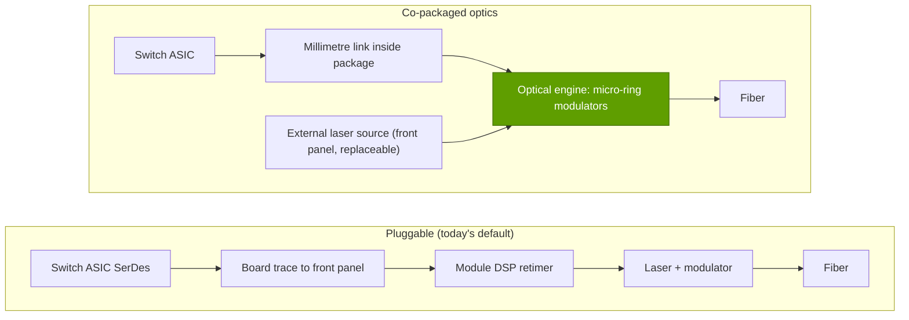

# Co-packaged optics

Layer 06 · Scale-out and scale-across networking · ~7 min read · Last verified: 2026-11-05

## ⚡ The Executive Take

- **Optics are becoming the network's power problem:** ~6 transceivers per GPU at ~30 W and ~$1,000 each, i.e. ~180 W and ~$6,000 per GPU (Huang) [[S6016]](../../sources/bibliography.md#s6016)[[S6017]](../../sources/bibliography.md#s6017).
- **[Co-packaged optics](../../glossary.md#co-packaged-optics) (CPO)** moves the optical engines from front-panel [pluggable transceivers](../../glossary.md#pluggable-transceiver) onto the switch package; by repo estimate that saves ~5–11 MW of optics power per 100,000 GPUs (Est.).
- **NVIDIA claimed 3.5× better power efficiency and 10× resiliency (March 2025),** and 5× lower power with 4× fewer lasers for Spectrum-X Photonics in 2026 [[S265]](../../sources/bibliography.md#s265)[[S6020]](../../sources/bibliography.md#s6020).
- **Products:** Quantum-X Photonics (InfiniBand, 144 × 800G) and Spectrum-X Photonics (Ethernet, up to ~400 Tb/s across 2,048 × 200G ports), built on TSMC's COUPE process with [micro-ring modulators](../../glossary.md#micro-ring-modulator) [[S90048]](../../sources/bibliography.md#s90048)[[S90049]](../../sources/bibliography.md#s90049).
- **Timing:** first InfiniBand CPO deployments were reported for early 2026 (CoreWeave, Lambda, TACC) 🟡 [[S6022]](../../sources/bibliography.md#s6022); NVIDIA began shipping Spectrum-X CPO switches to select partners in June 2026 and announced full production in August 🟡 [[S6019]](../../sources/bibliography.md#s6019)[[S6020]](../../sources/bibliography.md#s6020). Volume evidence is thin 🔴 [[S6021]](../../sources/bibliography.md#s6021).
- **The catch is serviceability:** a failed pluggable is a hot-swap; a failed co-packaged engine can mean replacing a switch; Huang said copper stays more reliable for GPU-to-GPU links [[S6018]](../../sources/bibliography.md#s6018).

## 1. What CPO changes

A switch ASIC talks through its electrical [SerDes](../../glossary.md#serdes). In a pluggable design those signals cross inches of circuit board to the front panel, where a module's DSP cleans them up and a laser and modulator turn them into light; at 200 Gb/s per lane, driving that board path costs a lot of power. CPO puts the optical engines millimetres from the ASIC on the same package, so the electrical hop is tiny and the DSP disappears. Lasers, the most failure-prone and heat-sensitive part, sit in replaceable [external laser source](../../glossary.md#external-laser-source) modules on the front panel.

A middle path, [linear pluggable optics](../../glossary.md#linear-pluggable-optics), drops the DSP but keeps the module, roughly halving power at some cost in reach [[S295]](../../sources/bibliography.md#s295).

> [!TIP]
> **Worked example — power per 1.6T port.** NVIDIA puts a 1.6T pluggable at ~30 W [[S33020]](../../sources/bibliography.md#s33020)[[S6016]](../../sources/bibliography.md#s6016). Its 3.5× claim implies ~8.6 W with CPO; its 2026 5× claim ~6 W [[S265]](../../sources/bibliography.md#s265)[[S6020]](../../sources/bibliography.md#s6020). Per bit: 30 W ÷ 1,600 Gb/s ≈ 19 pJ/bit vs ~5.4 pJ/bit. On a 512 × 800G Spectrum-X Photonics system, 256 × 1.6T-equivalents × (30 − 8.6) W ≈ **5.5 kW** saved per switch (Est.).
>
> **Conclusion:** at hyperscale the saving is measured in megawatts, which a power-capped site converts directly into more GPUs.

## 2. NVIDIA's photonics switches

| Switch | Fabric | Ports × speed | Capacity | Status (2026-11) |
|---|---|---|---|---|
| Quantum-X Photonics Q3450 | InfiniBand XDR | 144 × 800G | 115.2 Tb/s, liquid-cooled | Targeted late 2025 [[S265]](../../sources/bibliography.md#s265); moved to early 2026 [[S515]](../../sources/bibliography.md#s515); first deployments reported 🟡 [[S6022]](../../sources/bibliography.md#s6022) |
| Spectrum-X Photonics SN6810 | Ethernet (Spectrum-6) | 128 × 800G or 512 × 200G | 102.4 Tb/s | Shipping to select partners from June 2026 🟡 [[S6019]](../../sources/bibliography.md#s6019) |
| Spectrum-X Photonics SN6800 | Ethernet (4 × Spectrum-6, Est.) | 512 × 800G or 2,048 × 200G | 409.6 Tb/s | Full production announced Aug 2026; volume with Vera Rubin from fall 🟡 [[S6020]](../../sources/bibliography.md#s6020) |
| Broadcom Bailly / Davisson | Ethernet (merchant) | 128 × 400G / 128 × 800G | 51.2 / 102.4 Tb/s | Bailly shipping since 2024; Davisson announced Oct 2025 [[S282]](../../sources/bibliography.md#s282)[[S281]](../../sources/bibliography.md#s281) |

Specs: [[S265]](../../sources/bibliography.md#s265)[[S90048]](../../sources/bibliography.md#s90048). Partners include TSMC, Coherent, Corning, Foxconn, Lumentum and SENKO [[S90049]](../../sources/bibliography.md#s90049).

> [!WARNING]
> **Conflicting timelines:** Quantum-X Photonics was targeted for late 2025 [[S265]](../../sources/bibliography.md#s265)[[S90048]](../../sources/bibliography.md#s90048) and later reported for early 2026 [[S515]](../../sources/bibliography.md#s515); the repo's fact sheet found no confirmed 2026 customer shipments, while June–August 2026 reports describe shipments and "full production" [[S6019]](../../sources/bibliography.md#s6019)[[S6020]](../../sources/bibliography.md#s6020), and analysts call the volume evidence thin [[S6021]](../../sources/bibliography.md#s6021). Treat 2026 volumes as 🟡 reported.

## 3. The reliability and serviceability debate

- **For CPO:** no DSPs and 4× fewer lasers mean fewer failure points; NVIDIA claims 10× resiliency and 10× higher mean time between incidents [[S265]](../../sources/bibliography.md#s265)[[S6020]](../../sources/bibliography.md#s6020).
- **Against CPO:** a failed engine sits next to an expensive ASIC, operators lose the quick module swap, supply concentrates in the switch vendor and micro-rings need tight temperature control.
- **Where it lands first:** switches, where port counts and power are highest. Scale-up stays on copper inside the rack for now [[S6018]](../../sources/bibliography.md#s6018) (see [Layer 05](../05-scale-up-nvlink-nvswitch/index.md)).

> [!TIP]
> **Worked example — MW saved per 100,000-GPU cluster.** In a 3-tier fabric each GPU needs 1 NIC-side module (~15 W at 800G) plus 2.5 switch-side 1.6T modules (~30 W each) [[S294]](../../sources/bibliography.md#s294)[[S33020]](../../sources/bibliography.md#s33020):
> - **Pluggable:** 15 + 2.5 × 30 = 90 W per GPU → **9.0 MW**.
> - **CPO switches (3.5×):** 15 + 2.5 × 8.6 = 36.4 W → **3.6 MW**, saving **5.4 MW** (~6.4 MW at a PUE of 1.2).
> - **Huang's framing** (six 30 W transceivers per GPU [[S6016]](../../sources/bibliography.md#s6016)): 18 MW → 7.3 MW, saving **10.7 MW**.
> - At ~2 kW all-in per GB200 NVL72 GPU (145 kW per rack) [[S340]](../../sources/bibliography.md#s340), that powers **~2,700–5,300 more GPUs**.
>
> **Conclusion:** CPO is a ~3–5% capacity gain for a power-capped 100k-GPU site, worth hundreds of millions of dollars of compute (Est.).

🔧 Under the hood: why micro-rings and external lasers

Micro-ring modulators are rings a few micrometres across that switch light by shifting their resonance; far smaller and lower-power than the Mach-Zehnder modulators in most pluggables, they let many lanes fit around a switch ASIC. Resonance drifts with temperature, so each ring needs active tuning. Sharing one external laser across several engines is how NVIDIA claims 4× fewer lasers [[S6020]](../../sources/bibliography.md#s6020).

## 🎯 Corp Dev Lens

1. **Value shifts from module makers to the switch package.** If CPO wins, part of the ~$6,000 of pluggable optics per GPU [[S6016]](../../sources/bibliography.md#s6016) moves to switch vendors and their photonics suppliers [[S90049]](../../sources/bibliography.md#s90049); pluggable-module vendors face mix risk.
2. **Lasers are the new choke point:** the replaceable, failure-prone, supply-constrained part; who has the indium-phosphide laser capacity?
3. **Broadcom ships CPO too** [[S282]](../../sources/bibliography.md#s282)[[S281]](../../sources/bibliography.md#s281), so CPO alone is no NVIDIA moat; the edge is integration with its switch-plus-NIC platform and Vera Rubin timing.
4. **Qualcomm question (public information only):** with NVIDIA itself backing optical-I/O start-ups such as Ayar Labs [[S482]](../../sources/bibliography.md#s482), is photonics a field where partnerships or minority stakes are the cheaper way for a datacenter entrant to stay current?

## 📚 Sources

<!-- Auto-generated from the [S…] citations on this page by `make build`. Edit sources/registry/*.csv, not this list. -->

- [**S265**](../../sources/bibliography.md#s265) NVIDIA Newsroom, *NVIDIA Announces Spectrum-X Photonics, Co-Packaged Optics Networking Switches to Scale AI Factories to Millions of GPUs*, 2025-03-18. [Link](https://nvidianews.nvidia.com/news/nvidia-spectrum-x-co-packaged-optics-networking-switches-ai-factories)
- [**S281**](../../sources/bibliography.md#s281) Broadcom, *Broadcom Tomahawk 6-Davisson co-packaged optics Ethernet switch*, 2025-10. [Link](https://investors.broadcom.com/news-releases)
- [**S282**](../../sources/bibliography.md#s282) Broadcom, *Broadcom delivers industry's first 51.2-Tbps co-packaged optics Ethernet switch platform (Bailly)*, 2024-03. [Link](https://investors.broadcom.com/news-releases)
- [**S294**](../../sources/bibliography.md#s294) SemiAnalysis (Dylan Patel et al.), *100,000 H100 Clusters: Power, Network Topology, Ethernet vs InfiniBand, Reliability, Failures, Checkpointing*, 2024-06-17. [Link](https://semianalysis.com/2024/06/17/100000-h100-clusters-power-network/)
- [**S295**](../../sources/bibliography.md#s295) LPO MSA, *Linear Pluggable Optics Multi-Source Agreement (LPO MSA)*, 2024. [Link](https://www.lpo-msa.org/)
- [**S340**](../../sources/bibliography.md#s340) SemiAnalysis (Dylan Patel et al.), *Huawei AI CloudMatrix 384 - China's answer to Nvidia GB200 NVL72*, 2025-04-16. [Link](https://newsletter.semianalysis.com/p/huawei-ai-cloudmatrix-384-chinas-answer-to-nvidia-gb200-nvl72)
- [**S482**](../../sources/bibliography.md#s482) Various (company announcements; Reuters, Bloomberg), *Reporting on NVIDIA participation in robotics, autonomy, photonics, storage and energy rounds (Figure AI, Wayve, Scale AI, Ayar Labs, Enfabrica, VAST Data, Sakana AI, TerraPower, Commonwealth Fusion Systems, Applied Digital, Recursion)*, 2025-09. [Link](https://www.reuters.com/technology/)
- [**S515**](../../sources/bibliography.md#s515) Converge Digest, *NVIDIA debuts Spectrum-X and Quantum-X Photonics switches*, 2025-08. [Link](https://convergedigest.com/nvidia-debuts-spectrum-x-and-quantum-x-photonics-switches/)
- [**S6016**](../../sources/bibliography.md#s6016) optics.org, *NVIDIA reveals plan to scale AI factories with co-packaged optics*, 2025-03-19. [Link](https://www.optics.org/news/16/3/26)
- [**S6017**](../../sources/bibliography.md#s6017) Fierce Network, *Nvidia tries to balance data center power equation with co-packaged optics*, 2025-03. [Link](https://www.fierce-network.com/cloud/nvidia-tries-balance-data-center-power-equation-co-packaged-optics)
- [**S6018**](../../sources/bibliography.md#s6018) The Star (Reuters), *Nvidia CEO says power-saving optical chip tech will need to wait for wider use*, 2025-03-19. [Link](https://www.thestar.com.my/tech/tech-news/2025/03/19/nvidia-ceo-says-power-saving-optical-chip-tech-will-need-to-wait-for-wider-use)
- [**S6019**](../../sources/bibliography.md#s6019) Focus Taiwan (CNA), *Nvidia starts shipping TSMC-backed CPO switches (GTC Taipei / Computex 2026)*, 2026-06-03. [Link](https://focustaiwan.tw/business/202606030020)
- [**S6020**](../../sources/bibliography.md#s6020) StorageReview, *NVIDIA Spectrum-X Ethernet Photonics enters full production with 4x fewer lasers and a five-vendor CPO supply chain*, 2026-08. [Link](https://storagereview.com/news/nvidia-spectrum-x-ethernet-photonics-enters-full-production-with-4x-fewer-lasers-and-a-five-vendor-cpo-supply-chain)
- [**S6021**](../../sources/bibliography.md#s6021) remio, *NVIDIA put CPO switches into production, but the hard part starts now*, 2026-08. [Link](https://www.remio.ai/post/nvidia-put-cpo-switches-into-production-but-the-hard-part-starts-now)
- [**S6022**](../../sources/bibliography.md#s6022) Fintool, *NVIDIA CPO webinar: co-packaged silicon photonics switches for gigawatt AI factories*, 2026-02. [Link](https://fintool.com/news/nvidia-cpo-webinar-ai-factories)
- [**S33020**](../../sources/bibliography.md#s33020) NVIDIA (Jensen Huang), *NVIDIA GTC 2025 keynote (Jensen Huang)*, 2025-03-18. [Link](https://www.nvidia.com/gtc/keynote/)
- [**S90048**](../../sources/bibliography.md#s90048) Converge Digest, *NVIDIA debuts Spectrum-X and Quantum-X Photonics switches*, 2025-03-18. [Link](https://convergedigest.com/nvidia-debuts-spectrum-x-and-quantum-x-photonics-switches/)
- [**S90049**](../../sources/bibliography.md#s90049) Tom's Hardware, *Nvidia outlines plans for using light for communication between AI GPUs by 2026*, 2025-03. [Link](https://www.tomshardware.com/networking/nvidia-outlines-plans-for-using-light-for-communication-between-ai-gpus-by-2026-silicon-photonics-and-co-packaged-optics-may-become-mandatory-for-next-gen-ai-data-centers)
