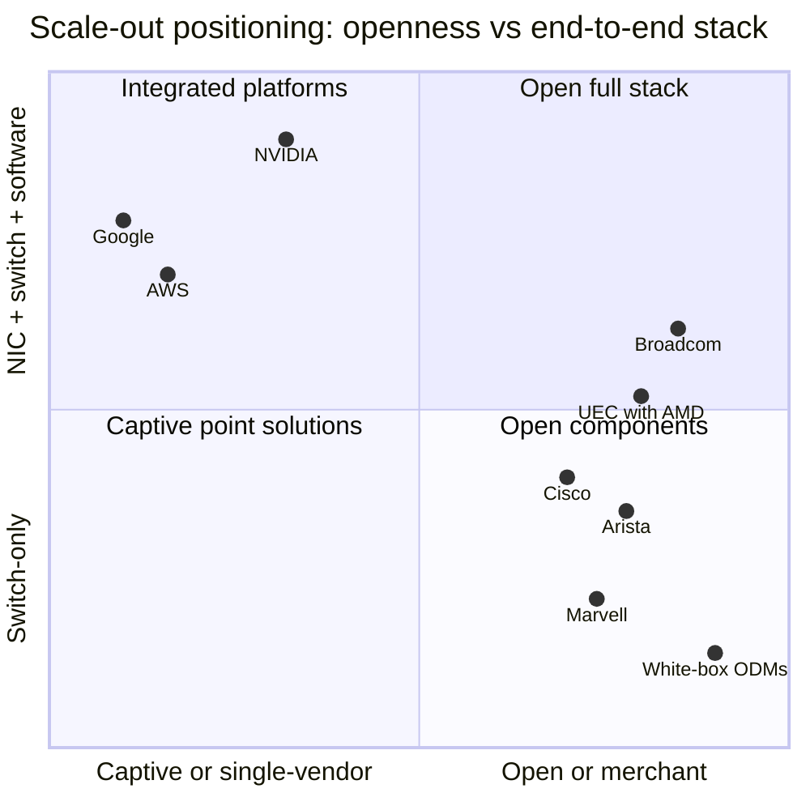

# Scale-out and scale-across networking: Competition

Layer 06 · Scale-out and scale-across networking · ~11 min read · Last verified: 2026-11-05

## ⚡ The Executive Take

- **Ethernet won the protocol war.** [InfiniBand](../../glossary.md#infiniband) held ~80% of AI back-end switch sales two years before 2025; in 2025 Ethernet sold more than twice as much, and ~two-thirds in 1Q26 [[S90053]](../../sources/bibliography.md#s90053)[[S90054]](../../sources/bibliography.md#s90054).
- **NVIDIA kept its seat anyway.** Dell'Oro ranks Celestica first, NVIDIA a close second and Arista third in Ethernet AI back-end switches (1Q26, 2Q26) [[S90054]](../../sources/bibliography.md#s90054)[[S6523]](../../sources/bibliography.md#s6523). IDC puts NVIDIA first in all data-center Ethernet switch revenue in 1Q26 (~$2.1B) [[S6028]](../../sources/bibliography.md#s6028).
- **[Q5 · Strongest challenger]** Broadcom-centred merchant Ethernet: Tomahawk 6 shipped 102.4 Tb/s about 12 months before NVIDIA's Spectrum-6 reached partners [[S274]](../../sources/bibliography.md#s274)[[S6019]](../../sources/bibliography.md#s6019). Arista, white-box ODMs and the [Ultra Ethernet Consortium](../../glossary.md#ultra-ethernet) carry it to market.
- **NVIDIA's lead has moved to the NIC.** Every Vera Rubin GPU ships with a 1.6 Tb/s ConnectX-9 [SuperNIC](../../glossary.md#supernic) [[S33004]](../../sources/bibliography.md#s33004). Broadcom's Thor Ultra is 800G [[S280]](../../sources/bibliography.md#s280); AMD gets more per GPU (2.4 Tb/s) only by fitting three 800G UEC NICs [[S228]](../../sources/bibliography.md#s228).
- **Challengers are growing faster from a smaller base.** Broadcom's AI networking revenue rose >2.5× y/y [[S6505]](../../sources/bibliography.md#s6505) and Arista targets ≥$3.6B of AI revenue in 2026 [[S6500]](../../sources/bibliography.md#s6500). NVIDIA booked ~$17.5B of networking in one quarter (+18% q/q) [[S408]](../../sources/bibliography.md#s408).
- **Hyperscaler fabrics cap the market.** Google runs up to 80,000 Vera Rubin GPUs per site on its own Virgo network [[S554]](../../sources/bibliography.md#s554); AWS uses its own EFA [[S292]](../../sources/bibliography.md#s292).

![Heatmap of 8 scale-out networking rivals against NVIDIA on six dimensions. Broadcom alone leads on switch radix and bandwidth (Tomahawk 6 at 102.4 Tb/s in 2025, about a year before Spectrum-6); 6 rivals lead on openness (merchant silicon, UEC, SONiC); none leads on NIC co-design, where Broadcom's 800G Thor Ultra trails ConnectX-9 at 1.6 Tb/s and AMD's UEC NICs reach parity only by using three per GPU; white-box ODMs led by Celestica lead on share of Ethernet AI back-end switch sales; Google and AWS run captive, different-approach fabrics.](../../assets/charts/06-scale-out-competitor-heatmap.svg)

## How the scale-out contest is scored

A training cluster is a relay team: each step ends with an [all-reduce](../../glossary.md#all-reduce), and nobody runs the next leg until the slowest baton arrives. Six things decide network bids. **[Switch radix](../../glossary.md#switch-radix)** (ports per chip) sets how many tiers a cluster needs. **[Congestion control](../../glossary.md#congestion-control)** and **[tail latency](../../glossary.md#tail-latency)** set how often GPUs wait. **NIC co-design** decides whether the endpoints help or fight the switches. **Openness** lets buyers mix vendors. **Ecosystem** means network software and collective libraries ([NCCL](../../glossary.md#nccl)). **Share** shows who wins orders today.

| Rival | Radix / bandwidth | Congestion / tail | NIC co-design | Openness | Ecosystem | Share |
|---|---|---|---|---|---|---|
| Broadcom | 🟩 102.4T first | 🟨 cognitive routing | 🟥 800G Thor | 🟩 merchant, UEC | 🟨 runs EOS/SONiC | 🟨 AI net. >2.5× y/y |
| Arista | 🟦 Broadcom inside | 🟨 EOS balancing | 🟥 no NIC | 🟩 any NIC/GPU | 🟨 EOS | 🟥 #3 Ethernet AI |
| Cisco | 🟨 G300 102.4T | 🟨 −28% JCT claim | 🟥 none | 🟩 chips + systems | 🟨 enterprise base | 🟥 not top 3 |
| Marvell | 🟥 51.2T | 🟥 fewer AI features | 🟦 optics/custom | 🟩 merchant | 🟥 thin | 🟥 small |
| White-box ODMs | 🟦 merchant inside | 🟦 buyer's software | 🟦 buyer's choice | 🟩 SONiC/FBOSS | 🟦 in-house | 🟩 #1 Ethernet AI |
| UEC (AMD, others) | 🟦 spec, not chip | 🟨 spraying (on paper) | 🟨 3×800G per GPU | 🟩 open spec | 🟥 new in 2025–26 | 🟥 early |
| Google | 🟦 OCS spine | 🟦 in-house | 🟦 in-house | 🟦 not sold | 🟦 internal | 🟦 captive |
| AWS | 🟦 in-house | 🟦 SRD multipath | 🟦 Nitro/EFA | 🟦 not sold | 🟦 AWS-only | 🟦 captive |

Verdict = rival vs NVIDIA (InfiniBand + Spectrum-X). Sources per cell in `data/l06_competitor_verdicts.csv` [[S274]](../../sources/bibliography.md#s274)[[S280]](../../sources/bibliography.md#s280)[[S6503]](../../sources/bibliography.md#s6503)[[S284]](../../sources/bibliography.md#s284)[[S90054]](../../sources/bibliography.md#s90054)[[S257]](../../sources/bibliography.md#s257)[[S293]](../../sources/bibliography.md#s293)[[S292]](../../sources/bibliography.md#s292).

> [!TIP]
> **Worked example — why radix wins bids.** A two-tier [fat tree](../../glossary.md#fat-tree) of R-port switches connects R²/2 GPUs: 8,192 with 128-port 51.2T chips but 131,072 with 512-port 102.4T chips [[S294]](../../sources/bibliography.md#s294)[[S274]](../../sources/bibliography.md#s274). For 100,000 GPUs the repo estimates ~3,500–3,900 switches and ~350k [optical transceivers](../../glossary.md#pluggable-transceiver) in three tiers. Four planes of 102.4T switches need ~2,350 switches and ~250k modules (Est.) [[S294]](../../sources/bibliography.md#s294). Shipping the higher-radix chip first removes about 29% of the optics bill, and that is why Broadcom's 2025 lead mattered.

## The protocol war, and why NVIDIA joined Ethernet

> [!WARNING]
> **Data caveat:** this chart's 2025 bar (~55% Ethernet) is an older directional estimate. Dell'Oro's published figures are steeper: Ethernet more than double InfiniBand in 2025 (≥ ~67%) and ~two-thirds in 1Q26 [[S90053]](../../sources/bibliography.md#s90053)[[S90054]](../../sources/bibliography.md#s90054).

Hyperscalers prefer Ethernet: they already run its tooling, can make suppliers bid against each other and avoid a single-vendor island. NVIDIA's [Spectrum-X](../../glossary.md#spectrum-x) (May 2023) was both **defence** and **attack** [[S271]](../../sources/bibliography.md#s271). In defence, an InfiniBand-only NVIDIA would have been locked out of ~two-thirds of back-end spending and of the network its NCCL software tunes against. In attack, Spectrum-X sells NVIDIA switches and SuperNICs into Ethernet budgets: xAI's 100,000-GPU Colossus (2024) [[S6000]](../../sources/bibliography.md#s6000), Meta's FBOSS switches and Oracle's Vera Rubin clusters (2025) [[S6009]](../../sources/bibliography.md#s6009).

> [!TIP]
> **Worked example — how big NVIDIA's Ethernet business has become.** Spectrum-X passed a $10B annualized run-rate in Q2 FY2026 [[S6027]](../../sources/bibliography.md#s6027). It then grew 2.6× y/y to Q2 FY2027 [[S408]](../../sources/bibliography.md#s408), which implies ≳$26B annualized, about $6.5B a quarter or ~37% of ~$17.5B networking (🔴 repo arithmetic). IDC counts only ~$2.1B of NVIDIA Ethernet *switch* revenue in 1Q26 [[S6028]](../../sources/bibliography.md#s6028). Most Spectrum-X dollars therefore sit in the NIC and platform, not the switch box.

🔧 Under the hood: four answers to the same congestion problem

Standard Ethernet hashes each flow onto one path (ECMP). AI traffic is a few huge flows, so two can collide on one link while others sit idle. **Spectrum-X** uses [adaptive routing](../../glossary.md#adaptive-routing) per packet, and the SuperNIC puts packets back in order [[S271]](../../sources/bibliography.md#s271). **UEC 1.0** standardises [packet spraying](../../glossary.md#packet-spraying) and packet trimming; 1.1 adds programmable congestion control [[S257]](../../sources/bibliography.md#s257)[[S575]](../../sources/bibliography.md#s575). **Broadcom Jericho3-AI** builds a scheduled fabric: it splits packets into cells and grants credit before sending [[S279]](../../sources/bibliography.md#s279). **AWS SRD** sprays packets across paths and accepts out-of-order delivery [[S292]](../../sources/bibliography.md#s292).

## Challenger by challenger

**Broadcom (with Arista and [white-box](../../glossary.md#white-box-switch) ODMs): the strongest challenger.** Tomahawk 6 (102.4 Tb/s, June 2025) is deployed at nearly all of Broadcom's AI hyperscaler customers [[S274]](../../sources/bibliography.md#s274)[[S6505]](../../sources/bibliography.md#s6505). Jericho4, a [deep-buffer switch](../../glossary.md#deep-buffer-switch), targets [scale-across](../../glossary.md#scale-across) links beyond 100 km [[S276]](../../sources/bibliography.md#s276). AI semiconductor revenue reached $16.7B in fiscal Q3 2026, including custom XPUs [[S6504]](../../sources/bibliography.md#s6504). **Best argument:** equal or better switch silicon, sold to anyone, on an open transport. **Gap closed:** fully on switch silicon; not yet on NICs.

**Arista.** It builds on Broadcom silicon and adds EOS software [[S288]](../../sources/bibliography.md#s288). Q3 2026 revenue was ~$3.66B (+58.5%) [[S6502]](../../sources/bibliography.md#s6502), and management expects ~30% of AI revenue from scale-across [[S6500]](../../sources/bibliography.md#s6500).

**Cisco and Marvell.** Cisco's G300 (102.4 Tb/s, announced February 2026) ships in the same window as Spectrum-6 and claims 28% faster [job completion](../../glossary.md#job-completion-time) [[S6503]](../../sources/bibliography.md#s6503). Marvell's switching stalls at 51.2T Teralynx 10 [[S284]](../../sources/bibliography.md#s284). It competes through optics DSPs and Celestial AI's photonic fabric (~$3.25B) [[S2513]](../../sources/bibliography.md#s2513).

**UEC and AMD.** UEC 1.0 (June 2025) gives every non-NVIDIA accelerator an open transport [[S257]](../../sources/bibliography.md#s257). AMD's Helios uses it with Pensando Vulcano NICs, first shipments around end Q3 2026 [[S290]](../../sources/bibliography.md#s290)[[S90020]](../../sources/bibliography.md#s90020).

**Google and AWS.** Google's Virgo links >134,000 TPU 8t chips at 47 Pb/s using [optical circuit switches](../../glossary.md#optical-circuit-switch) [[S241]](../../sources/bibliography.md#s241)[[S293]](../../sources/bibliography.md#s293). AWS uses its [EFA](../../glossary.md#efa) [[S292]](../../sources/bibliography.md#s292).

> [!TIP]
> **Worked example — fast growth, small base.** Arista's whole Q3 2026 revenue was ~$3.66B [[S6502]](../../sources/bibliography.md#s6502). NVIDIA booked ~$17.5B of networking in its Q2 FY2027 [[S408]](../../sources/bibliography.md#s408), about 4.8× as much in a quarter. Arista's 2026 AI target (≥$3.6B a year) [[S6500]](../../sources/bibliography.md#s6500) equals ~5% of NVIDIA's ~$70B annualized networking run-rate. Doubling yearly, Arista would need ~4 years to match today's NVIDIA networking; the real challenge is Broadcom silicon spread across many vendors.

> [!NOTE]
> **🐂 Bull view.** NVIDIA is the only vendor shipping all four of InfiniBand, Ethernet switches, 1.6 Tb/s NICs (ConnectX-9 with every Vera Rubin GPU [[S33004]](../../sources/bibliography.md#s33004)) and NVLink. Networking runs at ~$0.24 per $1 of compute ([history](history-and-how-built.md)), and Spectrum-X turned the Ethernet shift into growth (2.6× y/y) [[S408]](../../sources/bibliography.md#s408).

> [!WARNING]
> **🐻 Bear view.** Switch silicon has commoditised. Broadcom ships first, white boxes lead share, and UEC removes the need for NVIDIA's NIC [[S274]](../../sources/bibliography.md#s274)[[S90054]](../../sources/bibliography.md#s90054)[[S257]](../../sources/bibliography.md#s257). Once GPUs are bought separately from their network, attach falls toward the share NVIDIA wins in open bids. In those bids, white-box ODMs led by Celestica already out-sell NVIDIA [[S6523]](../../sources/bibliography.md#s6523).

**[Q5 · Strongest challenger]** Broadcom's merchant ecosystem (Tomahawk/Jericho silicon, Arista and white-box systems, UEC transport). Best argument: openness at parity speed. It has closed the switch-silicon gap and leads share through ODMs; NVIDIA still leads on NIC bandwidth per GPU and NCCL/NVLink integration.

## 🎯 Corp Dev Lens

1. Merchant Ethernet won the protocol, but NVIDIA still sells ~#2 in Ethernet AI switches [[S6523]](../../sources/bibliography.md#s6523). Is NVIDIA's networking moat now mostly the NIC and software rather than the switch?
2. Qualcomm's AI200/AI250 and its 2028 AI300 (UALink and ESUN scale-up) [[S90060]](../../sources/bibliography.md#s90060)[[S90028]](../../sources/bibliography.md#s90028) still need scale-out NICs. Which source gives the most leverage: Broadcom Thor, AMD Pensando, a start-up, or NVIDIA via Spectrum-X?
3. Arista's growth on Broadcom silicon [[S6502]](../../sources/bibliography.md#s6502) shows system software captures value on merchant chips. Where would a new accelerator vendor partner rather than build?
4. If UEC 1.1 and ESUN converge on one Ethernet for scale-up and scale-out [[S575]](../../sources/bibliography.md#s575)[[S90052]](../../sources/bibliography.md#s90052), who gains: merchant switch vendors or NVLink?
5. Google runs Rubin GPUs on its own fabric [[S554]](../../sources/bibliography.md#s554). How sticky is NVIDIA's attach in hyperscalers versus neoclouds?

## 📚 Sources

<!-- Auto-generated from the [S…] citations on this page by `make build`. Edit sources/registry/*.csv, not this list. -->

- [**S228**](../../sources/bibliography.md#s228) Spheron, *AMD Helios rack-scale AI on GPU cloud: deploy MI455X inference with UALink and Ultra Ethernet (2026 guide)*, 2026. [Link](https://www.spheron.network/blog/amd-helios-rack-scale-mi455x-gpu-cloud/)
- [**S241**](../../sources/bibliography.md#s241) i-SCOOP, *Inside Google's TPU 8t and TPU 8i, the silicon built for the agentic era*, 2026-04. [Link](https://www.i-scoop.eu/google-tpu-8t-8i/)
- [**S257**](../../sources/bibliography.md#s257) Ultra Ethernet Consortium, *Ultra Ethernet Consortium launches Specification 1.0*, 2025-06-11. [Link](https://ultraethernet.org/ultra-ethernet-consortium-uec-launches-specification-1-0-transforming-ethernet-for-ai-and-hpc-at-scale/)
- [**S271**](../../sources/bibliography.md#s271) NVIDIA Newsroom, *NVIDIA Launches Accelerated Ethernet Platform for Hyperscale Generative AI (Spectrum-X)*, 2023-05-29. [Link](https://nvidianews.nvidia.com/news/nvidia-launches-accelerated-ethernet-platform-for-hyperscale-generative-ai)
- [**S274**](../../sources/bibliography.md#s274) Broadcom, *Broadcom ships Tomahawk 6: world's first 102.4 Tbps switch*, 2025-06-03. [Link](https://investors.broadcom.com/news-releases/news-release-details/broadcom-ships-tomahawk-6-worlds-first-1024-tbps-switch)
- [**S276**](../../sources/bibliography.md#s276) Broadcom, *Broadcom ships Jericho4, enabling distributed AI computing across data centers*, 2025-08-04. [Link](https://investors.broadcom.com/news-releases/news-release-details/broadcom-ships-jericho4-enabling-distributed-ai-computing-across)
- [**S279**](../../sources/bibliography.md#s279) Broadcom, *Broadcom introduces Jericho3-AI for AI networking*, 2023-04-18. [Link](https://investors.broadcom.com/news-releases/news-release-details/broadcoms-new-jericho3-ai-fabric-delivers-industrys-highest)
- [**S280**](../../sources/bibliography.md#s280) Broadcom, *Broadcom introduces Thor Ultra, the industry's first 800G AI Ethernet NIC*, 2025-10-14. [Link](https://investors.broadcom.com/news-releases/news-release-details/broadcom-introduces-industrys-first-800g-ai-ethernet-nic)
- [**S284**](../../sources/bibliography.md#s284) Marvell, *Marvell Teralynx 10 51.2 Tbps data center switch*, 2023-03. [Link](https://www.marvell.com/company/newsroom.html)
- [**S288**](../../sources/bibliography.md#s288) Arista Networks, *Arista Etherlink AI networking platforms (7060X6, 7800R4)*, 2024. [Link](https://www.arista.com/en/products/etherlink)
- [**S290**](../../sources/bibliography.md#s290) AMD, *AMD Advancing AI 2025: Helios rack, MI400 preview and Pensando Vulcano 800G NIC*, 2025-06-12. [Link](https://www.amd.com/en/newsroom.html)
- [**S292**](../../sources/bibliography.md#s292) Amazon Web Services, *Elastic Fabric Adapter (EFA) and AWS Nitro System documentation*, 2025. [Link](https://aws.amazon.com/hpc/efa/)
- [**S293**](../../sources/bibliography.md#s293) ACM SIGCOMM / Google (Leon Poutievski et al.), *Jupiter Evolving: Transforming Google's Datacenter Network via Optical Circuit Switches and Software-Defined Networking (SIGCOMM 2022)*, 2022-08. [Link](https://research.google/pubs/jupiter-evolving-transforming-googles-datacenter-network-via-optical-circuit-switches-and-software-defined-networking/)
- [**S294**](../../sources/bibliography.md#s294) SemiAnalysis (Dylan Patel et al.), *100,000 H100 Clusters: Power, Network Topology, Ethernet vs InfiniBand, Reliability, Failures, Checkpointing*, 2024-06-17. [Link](https://semianalysis.com/2024/06/17/100000-h100-clusters-power-network/)
- [**S408**](../../sources/bibliography.md#s408) NVIDIA Corporation, *NVIDIA Corp. (NVDA) Q2 Fiscal 2027 earnings call transcript (26 August 2026)*, 2026-08-26. [Link](https://s201.q4cdn.com/141608511/files/content_files/TRANSCRIPT_-NVIDIA-Corp-NVDA-US-Q2-2027-Earnings-Call-26-August-2026-5_00-PM-ET.pdf)
- [**S554**](../../sources/bibliography.md#s554) Google Cloud Blog (Mark Lohmeyer), *Google Cloud and NVIDIA expand co-engineering collaboration to scale infrastructure for the agentic era (NVIDIA GTC Berlin 2026)*, 2026-10-21. [Link](https://cloud.google.com/blog/topics/ai-infrastructure/google-cloud-infrastructure-at-nvidia-gtc-berlin-2026)
- [**S575**](../../sources/bibliography.md#s575) Network World, *Ultra Ethernet 1.1 extends the specification to scale-up networks and adds programmable congestion control*, 2026-10. [Link](https://www.networkworld.com/article/4235340/ultra-ethernet-1-1-extends-the-specification-to-scale-up-networks-and-adds-programmable-congestion-control.html)
- [**S2513**](../../sources/bibliography.md#s2513) Business Wire (Marvell), *Marvell Completes Acquisition of Celestial AI*, 2026-02-02. [Link](https://www.businesswire.com/news/home/20260201331090/en/marvell-completes-acquisition-of-celestial-ai)
- [**S6000**](../../sources/bibliography.md#s6000) TechPowerUp (NVIDIA press release), *NVIDIA Ethernet Networking Accelerates World's Largest AI Supercomputer, Built by xAI*, 2024-10-29. [Link](https://techpowerup.com/328227/nvidia-ethernet-networking-accelerates-worlds-largest-ai-supercomputer-built-by-xai)
- [**S6009**](../../sources/bibliography.md#s6009) NVIDIA Investor Relations, *NVIDIA Spectrum-X Ethernet Switches Speed Up Networks for Meta and Oracle*, 2025-10-13. [Link](https://investor.nvidia.com/news/press-release-details/2025/NVIDIA-Spectrum-X-Ethernet-Switches-Speed-Up-Networks-for-Meta-and-Oracle/default.aspx)
- [**S6019**](../../sources/bibliography.md#s6019) Focus Taiwan (CNA), *Nvidia starts shipping TSMC-backed CPO switches (GTC Taipei / Computex 2026)*, 2026-06-03. [Link](https://focustaiwan.tw/business/202606030020)
- [**S6027**](../../sources/bibliography.md#s6027) DatacenterDynamics, *Nvidia Q2 2025: networking is booming, but your networks cost nothing*, 2025-08. [Link](https://www.datacenterdynamics.com/en/news/nvidia-q2-2025-networking-is-booming-but-your-networks-cost-nothing/)
- [**S6028**](../../sources/bibliography.md#s6028) Tiger Brokers (iTiger), *NVIDIA's AI expansion extends to network infrastructure, captures top spot in data center Ethernet switch revenue (IDC)*, 2026-06. [Link](https://www.itiger.com/news/1113632768)
- [**S6500**](../../sources/bibliography.md#s6500) Nasdaq, *Arista Networks Q2 earnings call highlights*, 2026-08. [Link](https://www.nasdaq.com/articles/arista-networks-q2-earnings-call-highlights)
- [**S6502**](../../sources/bibliography.md#s6502) Arista Networks via SEC EDGAR, *Arista Networks Q3 2026 earnings release (Form 8-K exhibit 99.1)*, 2026-11. [Link](https://www.sec.gov/Archives/edgar/data/0001596532/000159653226000252/ex991q326-earningsrelease.htm)
- [**S6503**](../../sources/bibliography.md#s6503) Cisco Investor Relations, *Cisco Announces New Silicon One G300, Advanced Systems and Optics to Power and Scale AI Data Centers for the Agentic Era*, 2026-02-10. [Link](https://investor.cisco.com/news/news-details/2026/Cisco-Announces-New-Silicon-One-G300-Advanced-Systems-and-Optics-to-Power-and-Scale-AI-Data-Centers-for-the-Agentic-Era/)
- [**S6504**](../../sources/bibliography.md#s6504) Broadcom Inc. via SEC EDGAR, *Broadcom Inc. Q3 fiscal 2026 financial results (Form 8-K exhibit 99)*, 2026-09. [Link](https://www.sec.gov/Archives/edgar/data/0001730168/000173016826000076/avgo-08022026x8kxex99.htm)
- [**S6505**](../../sources/bibliography.md#s6505) Nasdaq, *Broadcom Q3 earnings call highlights*, 2026-09. [Link](https://www.nasdaq.com/articles/broadcom-q3-earnings-call-highlights)
- [**S6523**](../../sources/bibliography.md#s6523) Dell'Oro Group, *AI back-end networks switch sales surpass front-end networks for the first time in 2Q2026*, 2026-08. [Link](https://www.delloro.com/news/ai-back-end-networks-switch-sales-surpass-front-end-networks-for-the-first-time-in-2q2026/)
- [**S33004**](../../sources/bibliography.md#s33004) NVIDIA Newsroom, *NVIDIA Kicks Off the Next Generation of AI With Rubin — Six New Chips; One Incredible AI Supercomputer*, 2026-01-05. [Link](https://nvidianews.nvidia.com/news/rubin-platform-ai-supercomputer)
- [**S90020**](../../sources/bibliography.md#s90020) Shacknews, *AMD Helios AI rack system on track for initial shipments in Q3 2026*, 2026. [Link](https://www.shacknews.com/article/150249/amd-helios-ai-system-shipping-q3-2026)
- [**S90028**](../../sources/bibliography.md#s90028) TechRepublic, *Qualcomm unveils AI chips to rival Nvidia, AMD*, 2025-10-27. [Link](https://techrepublic.com/article/news-qualcomm-unveils-ai-chips-to-rival-nvidia-amd)
- [**S90052**](../../sources/bibliography.md#s90052) Synopsys, *Ethernet standards for scale-up AI: an overview of ESUN, SUE, and UALink*, 2025-11. [Link](https://www.synopsys.com/articles/ethernet-standards-scale-up-ai.html)
- [**S90053**](../../sources/bibliography.md#s90053) Dell'Oro Group, *Ethernet more than doubles size of InfiniBand as the leading fabric for AI scale-out networks in 2025*, 2026. [Link](https://www.delloro.com/news/ethernet-more-than-doubles-size-of-infiniband-as-the-leading-fabric-for-ai-scale-out-networks-in-2025/)
- [**S90054**](../../sources/bibliography.md#s90054) Dell'Oro Group, *Ethernet extends lead in AI scale-out networks despite strong InfiniBand rebound*, 2026. [Link](https://www.delloro.com/news/ethernet-extends-lead-in-ai-scale-out-networks-despite-strong-infiniband-rebound/)
- [**S90060**](../../sources/bibliography.md#s90060) Qualcomm, *Qualcomm Dragonfly AI300 (product page)*, 2026-06. [Link](https://www.qualcomm.com/data-center/products/qualcomm-dragonfly-ai300)
