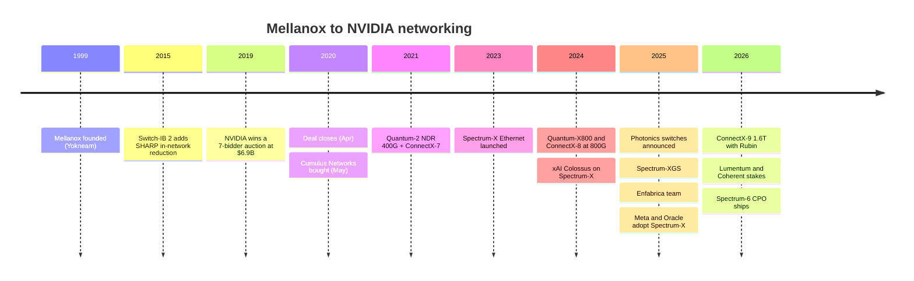

# Scale-out and scale-across networking: History and how NVIDIA built it

Layer 06 · Scale-out and scale-across networking · ~10 min read · Last verified: 2026-11-05

## ⚡ The Executive Take

- **NVIDIA bought its network.** Mellanox was founded in Yokneam, Israel, in 1999 to build [InfiniBand](../../glossary.md#infiniband) chips and had ~$1.33B of revenue in 2019 [[S6510]](../../sources/bibliography.md#s6510). NVIDIA paid $6.9B in cash (announced 2019-03-11, closed 2020-04-27) [[S464]](../../sources/bibliography.md#s464)[[S6510]](../../sources/bibliography.md#s6510).
- **It was a contested auction.** Seven bidders pushed the price up; Intel reportedly offered ~$6B [[S6508]](../../sources/bibliography.md#s6508)[[S6509]](../../sources/bibliography.md#s6509).
- **The payback is extreme.** Networking revenue went from $13.0B in FY2025 to ~$31.4B in FY2026 [[S416]](../../sources/bibliography.md#s416)[[S402]](../../sources/bibliography.md#s402), then ~$17.5B in Q2 FY2027 alone [[S408]](../../sources/bibliography.md#s408). The purchase price now equals about five weeks of networking sales.
- **The pivot that mattered was Ethernet.** Spectrum-X (May 2023) paired a switch with a [SuperNIC](../../glossary.md#supernic) for hyperscalers that would not buy InfiniBand [[S271]](../../sources/bibliography.md#s271). By Q2 FY2027 it was growing 2.6× y/y [[S408]](../../sources/bibliography.md#s408).
- **[Q4 · Source of advantage]** End-to-end co-design (GPU, NIC, switch, NCCL) plus attach to GPU sales: ~$0.24 of networking per $1 of compute in Q2 FY2027 (Est.) [[S408]](../../sources/bibliography.md#s408).
- **[Q6 · Replication cost]** Repo estimate 🔴: 5–7 years, $5–10B and ~1,500–3,000 engineers to rebuild the full stack. Broadcom needs far less because it already owns the switch.
- **2025–26 extended the stack into light and distance:** co-packaged optics [[S265]](../../sources/bibliography.md#s265), Spectrum-XGS scale-across [[S268]](../../sources/bibliography.md#s268), the ~$900M Enfabrica team [[S475]](../../sources/bibliography.md#s475) and $4B of laser stakes [[S6511]](../../sources/bibliography.md#s6511).

## From HPC niche to AI backbone

| Date | Decision | Why it mattered | Source |
|---|---|---|---|
| 2015 | Switch-IB 2 adds [SHARP](../../glossary.md#sharp) | Switches do part of the all-reduce maths; reused later in NVLink | [[S273]](../../sources/bibliography.md#s273) |
| 2019-03 | Buy Mellanox for $6.9B | Network becomes a GPU accessory NVIDIA controls | [[S464]](../../sources/bibliography.md#s464) |
| 2020-05 | Buy Cumulus | Open [network OS](../../glossary.md#network-operating-system) for Ethernet credibility | [[S478]](../../sources/bibliography.md#s478) |
| 2023-05 | Launch Spectrum-X | Sell into Ethernet budgets instead of losing them | [[S271]](../../sources/bibliography.md#s271) |
| 2024-10 | xAI Colossus, 100k GPUs | Proof that Spectrum-X scales | [[S6000]](../../sources/bibliography.md#s6000) |
| 2025-03 | Announce CPO switches | Attacks optics power and supply | [[S265]](../../sources/bibliography.md#s265) |
| 2025-09 | Enfabrica team + licence (~$900M) | SuperNIC and memory-fabric talent | [[S475]](../../sources/bibliography.md#s475) |
| 2026-03 | $2B each in Lumentum and Coherent | Secures lasers for [co-packaged optics](../../glossary.md#co-packaged-optics) | [[S6511]](../../sources/bibliography.md#s6511) |

> [!TIP]
> **Worked example — the Mellanox payback.** NVIDIA paid $6.9B for a company with ~$1.33B of revenue, about 5.2× sales [[S464]](../../sources/bibliography.md#s464)[[S6510]](../../sources/bibliography.md#s6510). In Q2 FY2027 networking brought in ~$17.5B in 13 weeks [[S408]](../../sources/bibliography.md#s408): ~$1.35B a week. So the purchase price equals ~5 weeks of today's networking revenue. (Networking includes NVLink switches, which Mellanox did not sell.)

**[Q4 · Source of advantage]** Three sources, in order of weight:

1. **Integration and attach.** Reference designs put one ConnectX NIC beside every GPU: 400G (CX-7), then 800G (CX-8) and 1.6T (CX-9) [[S266]](../../sources/bibliography.md#s266)[[S264]](../../sources/bibliography.md#s264)[[S33004]](../../sources/bibliography.md#s33004). Networking rides along with GPU orders (the [attach rate](../../glossary.md#attach-rate) below).
2. **Co-design.** Spectrum-X's [adaptive routing](../../glossary.md#adaptive-routing) works only because the SuperNIC reorders packets [[S271]](../../sources/bibliography.md#s271). NVIDIA claims ~95% effective bandwidth against ~60% for standard Ethernet; that is a vendor claim [[S6012]](../../sources/bibliography.md#s6012).
3. **Installed base and know-how.** InfiniBand held ~80% of AI back-end switch sales two years before 2025 [[S90053]](../../sources/bibliography.md#s90053). SHARP has run since 2015 [[S273]](../../sources/bibliography.md#s273).

Technology alone is not the source: Broadcom shipped 102.4 Tb/s first ([competition](competition.md)).

> [!TIP]
> **Worked example — what attach is worth on a $1B order.** At Q2 FY2027's ratio ($17.5B networking ÷ $71.5B compute ≈ 0.245) [[S408]](../../sources/bibliography.md#s408)[[S405]](../../sources/bibliography.md#s405), a customer buying $1B of compute also buys ~$245M of NVIDIA networking. At Q4 FY2025's low (0.093) the figure was ~$93M [[S443]](../../sources/bibliography.md#s443). NVLink switch trays and Spectrum-X recovered ~$150M per $1B of compute in 18 months.

## How hard is this to copy?

**[Q6 · Replication cost]**

| Path | Benchmark | Time | Dollars |
|---|---|---|---|
| Buy an incumbent | Mellanox: $6.9B for ~$1.33B revenue [[S464]](../../sources/bibliography.md#s464)[[S6510]](../../sources/bibliography.md#s6510) | 3–4 years to integrate (2020 close → Spectrum-X 2023) | $7B+ |
| Build switch silicon | Broadcom Tomahawk: 6 generations, 2014–2025 [[S283]](../../sources/bibliography.md#s283)[[S274]](../../sources/bibliography.md#s274) | ~2 years per generation | multi-$B R&D (🔴) |
| Build an open standard | UEC 1.0 (June 2025) → first NICs 2025–26 [[S257]](../../sources/bibliography.md#s257)[[S280]](../../sources/bibliography.md#s280)[[S290]](../../sources/bibliography.md#s290) | ~3 years to first products | shared by members |
| Fund a start-up | Upscale ~$500M raised, Nexthop $500M round, Eridu ~$230M [[S6518]](../../sources/bibliography.md#s6518)[[S6517]](../../sources/bibliography.md#s6517)[[S6516]](../../sources/bibliography.md#s6516) | 3–5 years to volume (🔴) | $0.2–0.6B to first product |
| Acquihire a team | Enfabrica team + licence [[S475]](../../sources/bibliography.md#s475) | immediate | ~$0.9B |

The repo's estimate (🔴 analysis) is **5–7 years, $5–10B and ~1,500–3,000 engineers** to build a full NVIDIA-equivalent stack from scratch: 102.4T switch silicon, a 1.6 Tb/s NIC, [congestion control](../../glossary.md#congestion-control) proven at 100k GPUs and collective-library integration. The reasoning: NVIDIA needed four years after buying a 20-year-old company to ship Spectrum-X, and congestion behaviour at scale is learned in production, not simulated. Broadcom is the exception: it already owns the switch and is about one NIC generation behind (800G vs 1.6T) [[S280]](../../sources/bibliography.md#s280)[[S33004]](../../sources/bibliography.md#s33004). Its gap is perhaps 2–3 years and $1–2B (🔴).

> [!TIP]
> **Worked example — why nobody can buy what NVIDIA bought.** Mellanox cost ~5.2× its sales [[S464]](../../sources/bibliography.md#s464)[[S6510]](../../sources/bibliography.md#s6510). At that multiple, a business the size of NVIDIA's FY2026 networking line (~$31.4B) [[S402]](../../sources/bibliography.md#s402) would cost ~$160B, so the buy route is closed. What remains is building (years) or buying teams. Enfabrica's ~$900M [[S475]](../../sources/bibliography.md#s475) and Celestial AI's ~$3.25B [[S2513]](../../sources/bibliography.md#s2513) are the 2025–26 reference prices.

🔧 Under the hood: why the NIC is the hard part

A switch sees only its own queues; the NIC sees the whole message. Spectrum-X and UEC both spray one message over many paths, so packets arrive out of order. The NIC must buffer and reorder them at line rate: 1.6 Tb/s on ConnectX-9 [[S33004]](../../sources/bibliography.md#s33004). It must also read switch telemetry to slow senders before queues overflow. Getting that loop stable across 100,000 endpoints is software and firmware work tuned on live clusters. This is why acquihires (Enfabrica) carry high prices [[S475]](../../sources/bibliography.md#s475).

## Counterfactuals — what if NVIDIA hadn't…

- 🔴 **…won Mellanox, and Intel had (~$6B bid) [[S6509]](../../sources/bibliography.md#s6509)?** NVIDIA's SuperPODs would depend on a CPU rival's InfiniBand. NVIDIA would likely have pushed NVLink outward and partnered with Broadcom or Arista. The ~$31B FY2026 networking line [[S402]](../../sources/bibliography.md#s402) would mostly belong to others.
- 🔴 **…stayed InfiniBand-only?** Ethernet reached ~two-thirds of AI back-end switch sales by 1Q26 [[S90054]](../../sources/bibliography.md#s90054). Without Spectrum-X, NVIDIA would compete for about one-third of the market and miss the xAI, Meta and Oracle wins [[S6000]](../../sources/bibliography.md#s6000)[[S6009]](../../sources/bibliography.md#s6009).
- 🔴 **…skipped co-packaged optics and laser stakes?** TrendForce names optical engines, silicon photonics and packaging as the ramp's limiting factors [[S6507]](../../sources/bibliography.md#s6507). Without the $4B Lumentum/Coherent commitments [[S6511]](../../sources/bibliography.md#s6511), Rubin-era cluster sizes would depend more on suppliers that also serve Broadcom.

> [!TIP]
> **Worked example — sizing the InfiniBand-only counterfactual.** Take the repo's estimate of Spectrum-X at ~$6.5B a quarter (🔴, see [competition](competition.md)) against ~$17.5B of networking in Q2 FY2027 [[S408]](../../sources/bibliography.md#s408). An InfiniBand-only NVIDIA would have forgone roughly a third of its networking revenue, ~$26B a year. It would also have lost the NIC seat in every Ethernet cluster that came with the switch.

## 🎯 Corp Dev Lens

1. Mellanox shows the value of buying the *adjacent* bottleneck before it is obvious. Which adjacent bottleneck (optics, SerDes, NIC firmware) is under-priced today?
2. Price discovery: Mellanox went for ~5× sales in 2019 [[S464]](../../sources/bibliography.md#s464)[[S6510]](../../sources/bibliography.md#s6510). Start-ups now raise at $2–4B before volume revenue [[S6518]](../../sources/bibliography.md#s6518)[[S6517]](../../sources/bibliography.md#s6517). Is the scarce asset the team, not the revenue?
3. NVIDIA needed ~3–4 years to turn Mellanox into Spectrum-X. What integration time should an acquirer of a NIC or switch team assume?
4. Qualcomm closed Alphawave (SerDes and connectivity) in December 2025 [[S4513]](../../sources/bibliography.md#s4513). What would it take to turn SerDes IP into a UEC NIC, and how does that compare with partnering?

## 📚 Sources

<!-- Auto-generated from the [S…] citations on this page by `make build`. Edit sources/registry/*.csv, not this list. -->

- [**S257**](../../sources/bibliography.md#s257) Ultra Ethernet Consortium, *Ultra Ethernet Consortium launches Specification 1.0*, 2025-06-11. [Link](https://ultraethernet.org/ultra-ethernet-consortium-uec-launches-specification-1-0-transforming-ethernet-for-ai-and-hpc-at-scale/)
- [**S264**](../../sources/bibliography.md#s264) NVIDIA Newsroom, *NVIDIA Announces New Switches Optimized for Trillion-Parameter GPU Computing and AI Infrastructure (Quantum-X800, Spectrum-X800, ConnectX-8)*, 2024-03-18. [Link](https://nvidianews.nvidia.com/news/networking-switches-gpu-computing-ai)
- [**S265**](../../sources/bibliography.md#s265) NVIDIA Newsroom, *NVIDIA Announces Spectrum-X Photonics, Co-Packaged Optics Networking Switches to Scale AI Factories to Millions of GPUs*, 2025-03-18. [Link](https://nvidianews.nvidia.com/news/nvidia-spectrum-x-co-packaged-optics-networking-switches-ai-factories)
- [**S266**](../../sources/bibliography.md#s266) NVIDIA Newsroom, *NVIDIA Quantum-2 Takes Supercomputing to New Heights, Into the Cloud*, 2021-11-09. [Link](https://nvidianews.nvidia.com/news/nvidia-quantum-2-takes-supercomputing-to-new-heights-into-the-cloud)
- [**S268**](../../sources/bibliography.md#s268) NVIDIA Newsroom, *NVIDIA Introduces Spectrum-XGS Ethernet to Connect Distributed Data Centers Into Giga-Scale AI Super-Factories*, 2025-08-22. [Link](https://nvidianews.nvidia.com/news/nvidia-introduces-spectrum-xgs-ethernet-to-connect-distributed-data-centers-into-giga-scale-ai-super-factories)
- [**S271**](../../sources/bibliography.md#s271) NVIDIA Newsroom, *NVIDIA Launches Accelerated Ethernet Platform for Hyperscale Generative AI (Spectrum-X)*, 2023-05-29. [Link](https://nvidianews.nvidia.com/news/nvidia-launches-accelerated-ethernet-platform-for-hyperscale-generative-ai)
- [**S273**](../../sources/bibliography.md#s273) NVIDIA Docs, *NVIDIA Networking documentation hub (ConnectX adapter, Quantum and Spectrum switch product briefs and user manuals)*, 2025. [Link](https://docs.nvidia.com/networking/)
- [**S274**](../../sources/bibliography.md#s274) Broadcom, *Broadcom ships Tomahawk 6: world's first 102.4 Tbps switch*, 2025-06-03. [Link](https://investors.broadcom.com/news-releases/news-release-details/broadcom-ships-tomahawk-6-worlds-first-1024-tbps-switch)
- [**S280**](../../sources/bibliography.md#s280) Broadcom, *Broadcom introduces Thor Ultra, the industry's first 800G AI Ethernet NIC*, 2025-10-14. [Link](https://investors.broadcom.com/news-releases/news-release-details/broadcom-introduces-industrys-first-800g-ai-ethernet-nic)
- [**S283**](../../sources/bibliography.md#s283) Broadcom, *Broadcom StrataXGS Tomahawk switch family (product pages)*, 2025. [Link](https://www.broadcom.com/products/ethernet-connectivity/switching/strataxgs)
- [**S290**](../../sources/bibliography.md#s290) AMD, *AMD Advancing AI 2025: Helios rack, MI400 preview and Pensando Vulcano 800G NIC*, 2025-06-12. [Link](https://www.amd.com/en/newsroom.html)
- [**S402**](../../sources/bibliography.md#s402) NVIDIA Corporation via SEC EDGAR (Colette Kress), *CFO Commentary on Fourth Quarter and Fiscal 2026 Results (Form 8-K exhibit 99.2)*, 2026-02-25. [Link](https://www.sec.gov/Archives/edgar/data/1045810/000104581026000019/q4fy26cfocommentary.htm)
- [**S405**](../../sources/bibliography.md#s405) NVIDIA Corporation via SEC EDGAR, *NVIDIA Announces Financial Results for Second Quarter Fiscal 2027 (Form 8-K exhibit 99.1)*, 2026-08-26. [Link](https://www.sec.gov/Archives/edgar/data/0001045810/000104581026000073/q2fy27pr.htm)
- [**S408**](../../sources/bibliography.md#s408) NVIDIA Corporation, *NVIDIA Corp. (NVDA) Q2 Fiscal 2027 earnings call transcript (26 August 2026)*, 2026-08-26. [Link](https://s201.q4cdn.com/141608511/files/content_files/TRANSCRIPT_-NVIDIA-Corp-NVDA-US-Q2-2027-Earnings-Call-26-August-2026-5_00-PM-ET.pdf)
- [**S416**](../../sources/bibliography.md#s416) NVIDIA Corporation via SEC EDGAR, *NVIDIA Corporation Form 10-K for fiscal year ended January 26, 2025*, 2025-02-26. [Link](https://www.sec.gov/Archives/edgar/data/1045810/000104581025000023/nvda-20250126.htm)
- [**S443**](../../sources/bibliography.md#s443) NVIDIA Corporation, *NVIDIA Announces Financial Results for Fourth Quarter and Fiscal 2025 (press release with CFO commentary)*, 2025-02-26. [Link](https://nvidianews.nvidia.com/news/nvidia-announces-financial-results-for-fourth-quarter-and-fiscal-2025)
- [**S464**](../../sources/bibliography.md#s464) NVIDIA Newsroom, *NVIDIA to Acquire Mellanox for $6.9 Billion*, 2019-03-11. [Link](https://nvidianews.nvidia.com/news/nvidia-to-acquire-mellanox-for-6-9-billion)
- [**S475**](../../sources/bibliography.md#s475) CNBC, *Nvidia spends over $900 million on Enfabrica CEO, AI startup technology*, 2025-09-18. [Link](https://www.cnbc.com/technology/)
- [**S478**](../../sources/bibliography.md#s478) NVIDIA, *NVIDIA Blog and Newsroom acquisition announcements (Cumulus, SwiftStack, DeepMap, Bright Computing, Excelero, Shoreline, Brev.dev, OctoAI, VinBrain, Gretel, Lepton AI, CentML, SchedMD)*, 2025-12. [Link](https://blogs.nvidia.com/)
- [**S2513**](../../sources/bibliography.md#s2513) Business Wire (Marvell), *Marvell Completes Acquisition of Celestial AI*, 2026-02-02. [Link](https://www.businesswire.com/news/home/20260201331090/en/marvell-completes-acquisition-of-celestial-ai)
- [**S4513**](../../sources/bibliography.md#s4513) I-Connect007, *Qualcomm completes acquisition of Alphawave Semi*, 2025-12-18. [Link](https://iconnect007.com/article/148161/qualcomm-completes-acquisition-of-alphawave-semi/148158/ein)
- [**S6000**](../../sources/bibliography.md#s6000) TechPowerUp (NVIDIA press release), *NVIDIA Ethernet Networking Accelerates World's Largest AI Supercomputer, Built by xAI*, 2024-10-29. [Link](https://techpowerup.com/328227/nvidia-ethernet-networking-accelerates-worlds-largest-ai-supercomputer-built-by-xai)
- [**S6009**](../../sources/bibliography.md#s6009) NVIDIA Investor Relations, *NVIDIA Spectrum-X Ethernet Switches Speed Up Networks for Meta and Oracle*, 2025-10-13. [Link](https://investor.nvidia.com/news/press-release-details/2025/NVIDIA-Spectrum-X-Ethernet-Switches-Speed-Up-Networks-for-Meta-and-Oracle/default.aspx)
- [**S6012**](../../sources/bibliography.md#s6012) Converge Digest, *NVIDIA cites Spectrum-X Ethernet wins with Meta and Oracle*, 2025-10-13. [Link](https://convergedigest.com/nvidia-cites-spectrum-x-ethernet-wins-with-meta-and-oracle/)
- [**S6507**](../../sources/bibliography.md#s6507) TrendForce, *NVIDIA and Broadcom begin CPO switch shipments (TrendForce press release)*, 2026-07-27. [Link](https://trendforce.com/presscenter/news/20260727-13151.html)
- [**S6508**](../../sources/bibliography.md#s6508) Globes, *Seven companies took part in bidding war for Mellanox*, 2019-03. [Link](https://en.globes.co.il/en/article-seven-companies-took-part-in-bidding-war-for-mellanox-1001283325)
- [**S6509**](../../sources/bibliography.md#s6509) Tom's Hardware, *Nvidia outbids Intel for Mellanox (Reuters via Calcalist)*, 2019-03. [Link](https://www.tomshardware.com/news/nvidia-intel-mellanox-acquisition-outbid,38778.html)
- [**S6510**](../../sources/bibliography.md#s6510) Wikipedia, *Mellanox Technologies*, 2026. [Link](https://en.wikipedia.org/wiki/Mellanox_Technologies)
- [**S6511**](../../sources/bibliography.md#s6511) SiliconANGLE, *Nvidia invests $4B in co-packaged optics suppliers Lumentum and Coherent*, 2026-03-02. [Link](https://siliconangle.com/2026/03/02/nvidia-invests-4b-co-packaged-optics-suppliers-lumentum-coherent/)
- [**S6516**](../../sources/bibliography.md#s6516) CXO Digital Pulse (company release), *Eridu emerges from stealth with over $200M in funding to break through the network wall*, 2026-03. [Link](https://www.cxodigitalpulse.com/eridu-emerges-from-stealth-with-over-200m-in-funding-to-break-through-the-network-wall-and-unlock-faster-ai/)
- [**S6517**](../../sources/bibliography.md#s6517) Built In, *Nexthop AI raises $500M Series B at $4.2B valuation*, 2026-03-10. [Link](https://builtin.com/articles/nexthop-ai-raises-500m-series-b-4b-valuation-20260310)
- [**S6518**](../../sources/bibliography.md#s6518) Converge Digest, *Upscale AI secures $190 million for data center networking for AI*, 2026. [Link](https://convergedigest.com/upscale-ai-secures-190-million-for-data-center-networking-for-ai/)
- [**S33004**](../../sources/bibliography.md#s33004) NVIDIA Newsroom, *NVIDIA Kicks Off the Next Generation of AI With Rubin — Six New Chips; One Incredible AI Supercomputer*, 2026-01-05. [Link](https://nvidianews.nvidia.com/news/rubin-platform-ai-supercomputer)
- [**S90053**](../../sources/bibliography.md#s90053) Dell'Oro Group, *Ethernet more than doubles size of InfiniBand as the leading fabric for AI scale-out networks in 2025*, 2026. [Link](https://www.delloro.com/news/ethernet-more-than-doubles-size-of-infiniband-as-the-leading-fabric-for-ai-scale-out-networks-in-2025/)
- [**S90054**](../../sources/bibliography.md#s90054) Dell'Oro Group, *Ethernet extends lead in AI scale-out networks despite strong InfiniBand rebound*, 2026. [Link](https://www.delloro.com/news/ethernet-extends-lead-in-ai-scale-out-networks-despite-strong-infiniband-rebound/)
