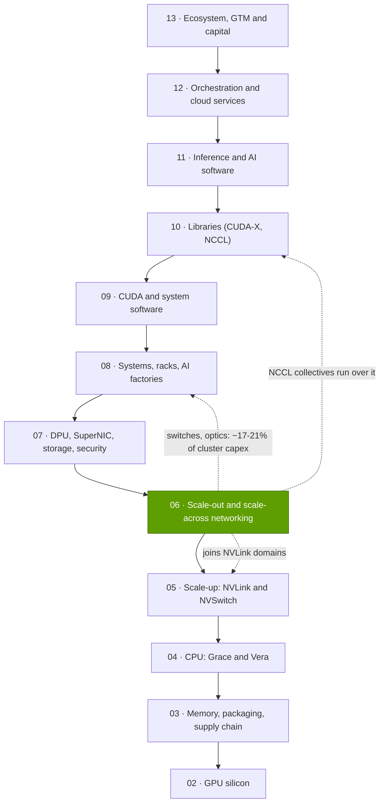
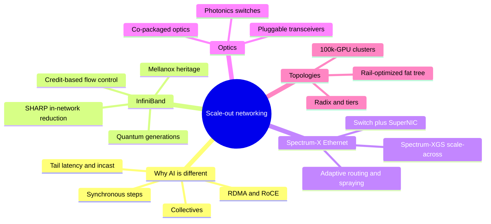

# Layer 06 — Scale-out and scale-across networking

Layer 06 of 12 · the GPU-to-GPU fabric beyond one NVLink domain, and between data centers · ~7 min read · Last verified: 2026-11-05

## ⚡ The Executive Take

- **The job ([scale-out](../../glossary.md#scale-out)):** join many [NVLink](../../glossary.md#nvlink) domains into one machine; in a repo model, 1% of flows running 10× slow makes a training step ~3.2× longer (Est.) [[S6029]](../../sources/bibliography.md#s6029).
- **NVIDIA sells [InfiniBand](../../glossary.md#infiniband), [Spectrum-X](../../glossary.md#spectrum-x) Ethernet and [ConnectX](../../glossary.md#connectx) [SuperNICs](../../glossary.md#supernic),** all from the $6.9B Mellanox deal [[S464]](../../sources/bibliography.md#s464). Networking reached a record $14.8B in Q1 FY2027 and ~$17.5B in Q2 (Est.), ~20% of Data Center revenue [[S90014]](../../sources/bibliography.md#s90014)[[S408]](../../sources/bibliography.md#s408).
- **Generational progress:** InfiniBand ports went from 10 to 800 Gb/s (2001–2024) [[S273]](../../sources/bibliography.md#s273); per-GPU [NIC](../../glossary.md#nic) bandwidth from 400 Gb/s (ConnectX-7) to 1.6 Tb/s (ConnectX-9, 2026) [[S266]](../../sources/bibliography.md#s266)[[S33004]](../../sources/bibliography.md#s33004); switch capacity 25.6 → 115.2 Tb/s from Quantum-2 to Quantum-X800 [[S266]](../../sources/bibliography.md#s266)[[S264]](../../sources/bibliography.md#s264).
- **Buyers chose Ethernet, so NVIDIA did too:** Ethernet was ~two-thirds of AI back-end switch sales in 1Q 2026 🟡 [[S90054]](../../sources/bibliography.md#s90054); Spectrum-X grew 2.6× y/y in Q2 FY2027 [[S408]](../../sources/bibliography.md#s408) and runs xAI's 100,000-GPU Colossus [[S6000]](../../sources/bibliography.md#s6000).
- **Scale is expensive:** a 100,000-GPU fabric needs ~3,500 switches and ~350,000 optical modules in three tiers (Est.) [[S294]](../../sources/bibliography.md#s294), and networking is ~17–21% of cluster hardware capex [[S6026]](../../sources/bibliography.md#s6026)[[S324]](../../sources/bibliography.md#s324).
- **Next:** [co-packaged optics](../../glossary.md#co-packaged-optics) (Quantum-X and Spectrum-X Photonics, 3.5×–5× power claims, 2026 shipments 🟡) [[S265]](../../sources/bibliography.md#s265)[[S6020]](../../sources/bibliography.md#s6020) and [Spectrum-XGS](../../glossary.md#spectrum-xgs) for linking data centers ([scale-across](../../glossary.md#scale-across)) [[S268]](../../sources/bibliography.md#s268).
- **Biggest weakness / strongest challenger:** merchant Ethernet led by Broadcom's 102.4 Tb/s Tomahawk 6 [[S274]](../../sources/bibliography.md#s274), white-box builders (Celestica led AI back-end switching in 1Q 2026 [[S90054]](../../sources/bibliography.md#s90054)) and the Ultra Ethernet standard [[S575]](../../sources/bibliography.md#s575). NVIDIA's performance edge rests mostly on its own claims.

> [!TIP]
> **Worked example — the network's share of one GPU.** Each GB300-class GPU gets one 800 Gb/s ConnectX-8 SuperNIC [[S264]](../../sources/bibliography.md#s264) and, in a three-tier fabric, about six optical port-ends; Huang priced those at ~$1,000 and ~30 W each [[S6016]](../../sources/bibliography.md#s6016). That is ~$6,000 and ~180 W of optics per GPU, against ~$55,000 of rack per GPU [[S332]](../../sources/bibliography.md#s332): ~11% for optics alone, before switches.
>
> **Conclusion:** the network is a double-digit share of every GPU sold, hence NVIDIA's fight for it.

## Where this layer sits in the stack

## Layer map

## The eight questions at a glance

| # | Question | Short answer | Where answered |
|---|---|---|---|
| Q1 | Job, and what breaks if weak? | Keeps thousands of GPUs in lockstep; a weak fabric idles them (Est. ~17% at a 1.2× step) | [Why AI networks are different](why-ai-networks-are-different.md) |
| Q2 | Metrics that matter? | Gb/s per GPU, effective bandwidth, tail latency, radix/tiers, optics W and $ per GPU | [Why AI networks are different](why-ai-networks-are-different.md) |
| Q3 | Generational progress? | IB ports 10 → 800 Gb/s; NIC 400 → 1,600 Gb/s per GPU; switch 3.6 → 115.2 Tb/s | [InfiniBand and SHARP](infiniband-and-sharp.md) |
| Q4 | Source of advantage? | Mellanox technology plus NIC–switch–NCCL co-design, sold with the platform | [History and how built](history-and-how-built.md) |
| Q5 | Strongest challenger? | Broadcom-based merchant Ethernet (Arista, Celestica) with Ultra Ethernet NICs | [Competition](competition.md) |
| Q6 | Replication cost? | Switch silicon is replicable; the tuned NIC–switch–library system is the hard part | [History and how built](history-and-how-built.md) |
| Q7 | Roadmap? | CPO switches 2026 🟡, ConnectX-9 1.6 Tb/s with Rubin, ConnectX-10 with Feynman 2028 🟡 [[S90004]](../../sources/bibliography.md#s90004); UEC 1.1 [[S575]](../../sources/bibliography.md#s575) | [Roadmap](roadmap.md) |
| Q8 | Value pools and M&A? | Optics (~$6,000 per GPU), switches, NICs, scale-across; photonics and NIC IP are deal angles | [Value chain and corp dev](value-chain-and-corp-dev.md) |

## Pages in this layer

| Page | What you will learn |
|---|---|
| [Why AI networks are different](why-ai-networks-are-different.md) | Tail latency, collectives, RDMA, incast, metrics that matter |
| [InfiniBand and SHARP](infiniband-and-sharp.md) | Mellanox heritage, Quantum generations, in-network reduction |
| [Spectrum-X Ethernet and scale-across](spectrum-x-ethernet.md) | Why Ethernet, switch–SuperNIC co-design, claims, Spectrum-XGS |
| [Co-packaged optics](co-packaged-optics.md) | Pluggable vs CPO power, photonics switches, reliability, MW saved |
| [Cluster topologies for 100,000 GPUs](cluster-topologies-100k-gpus.md) | Rail-optimized fat trees, radix math, counts, cost, real clusters |
| [Competition](competition.md) | Broadcom, Arista, Cisco, Marvell, UEC, Google, AWS compared |
| [History and how NVIDIA built it](history-and-how-built.md) | Timeline, decisions, replication cost |
| [Roadmap](roadmap.md) | Switch, NIC and optics roadmaps |
| [Value chain and corp dev angles](value-chain-and-corp-dev.md) | Who captures the dollars, private companies, M&A |

🔧 Under the hood: how to read networking spec sheets

- **One direction vs both:** this repo quotes switch capacity one direction (ports × speed); NVIDIA often doubles it (Quantum-2: 25.6 vs 51.2 Tb/s) [[S266]](../../sources/bibliography.md#s266).
- **Port splits:** a 51.2 Tb/s switch can be 64 × 800G or 128 × 400G; radix depends on the split [[S267]](../../sources/bibliography.md#s267).
- **"Effective bandwidth"** depends on traffic and scale; ask for [NCCL](../../glossary.md#nccl) bus-bandwidth curves [[S34012]](../../sources/bibliography.md#s34012).

## 🎯 Corp Dev Lens

1. **The network is a ~$1B line item per 100,000 GPUs** (Est.; see [Cluster topologies](cluster-topologies-100k-gpus.md)); every architecture change (tiers, planes, CPO) shifts those dollars among switch silicon, NICs, optics and integrators.
2. **NVIDIA's leverage is the bundle.** Spectrum-X's advantage needs NVIDIA NICs and switches together; if Ultra Ethernet NICs match it, the premium shrinks to software and support [[S575]](../../sources/bibliography.md#s575).
3. **Optics and lasers are the next bottleneck** as CPO moves value from pluggable-module makers to switch packages and laser suppliers [[S90049]](../../sources/bibliography.md#s90049).
4. **Qualcomm question (public information only):** Qualcomm's AI200/AI250 racks [[S173]](../../sources/bibliography.md#s173) and 2028 Dragonfly roadmap [[S90056]](../../sources/bibliography.md#s90056) need scale-out fabrics; build, partner (merchant Ethernet, [UEC](../../glossary.md#ultra-ethernet) NICs) or buy NIC and optical-I/O capability?

## 📚 Sources

<!-- Auto-generated from the [S…] citations on this page by `make build`. Edit sources/registry/*.csv, not this list. -->

- [**S173**](../../sources/bibliography.md#s173) Qualcomm, *Qualcomm Unveils AI200 and AI250 - Redefining Rack-Scale Data Center Inference*, 2025-10-27. [Link](https://www.qualcomm.com/news/releases/2025/10/qualcomm-unveils-ai200-and-ai250-redefining-rack-scale-data-cent)
- [**S264**](../../sources/bibliography.md#s264) NVIDIA Newsroom, *NVIDIA Announces New Switches Optimized for Trillion-Parameter GPU Computing and AI Infrastructure (Quantum-X800, Spectrum-X800, ConnectX-8)*, 2024-03-18. [Link](https://nvidianews.nvidia.com/news/networking-switches-gpu-computing-ai)
- [**S265**](../../sources/bibliography.md#s265) NVIDIA Newsroom, *NVIDIA Announces Spectrum-X Photonics, Co-Packaged Optics Networking Switches to Scale AI Factories to Millions of GPUs*, 2025-03-18. [Link](https://nvidianews.nvidia.com/news/nvidia-spectrum-x-co-packaged-optics-networking-switches-ai-factories)
- [**S266**](../../sources/bibliography.md#s266) NVIDIA Newsroom, *NVIDIA Quantum-2 Takes Supercomputing to New Heights, Into the Cloud*, 2021-11-09. [Link](https://nvidianews.nvidia.com/news/nvidia-quantum-2-takes-supercomputing-to-new-heights-into-the-cloud)
- [**S267**](../../sources/bibliography.md#s267) NVIDIA Newsroom, *NVIDIA Spectrum-4 high-performance data center networking infrastructure platform (GTC 2022)*, 2022-03-22. [Link](https://nvidianews.nvidia.com/news/nvidia-announces-spectrum-high-performance-data-center-networking-infrastructure-platform)
- [**S268**](../../sources/bibliography.md#s268) NVIDIA Newsroom, *NVIDIA Introduces Spectrum-XGS Ethernet to Connect Distributed Data Centers Into Giga-Scale AI Super-Factories*, 2025-08-22. [Link](https://nvidianews.nvidia.com/news/nvidia-introduces-spectrum-xgs-ethernet-to-connect-distributed-data-centers-into-giga-scale-ai-super-factories)
- [**S273**](../../sources/bibliography.md#s273) NVIDIA Docs, *NVIDIA Networking documentation hub (ConnectX adapter, Quantum and Spectrum switch product briefs and user manuals)*, 2025. [Link](https://docs.nvidia.com/networking/)
- [**S274**](../../sources/bibliography.md#s274) Broadcom, *Broadcom ships Tomahawk 6: world's first 102.4 Tbps switch*, 2025-06-03. [Link](https://investors.broadcom.com/news-releases/news-release-details/broadcom-ships-tomahawk-6-worlds-first-1024-tbps-switch)
- [**S294**](../../sources/bibliography.md#s294) SemiAnalysis (Dylan Patel et al.), *100,000 H100 Clusters: Power, Network Topology, Ethernet vs InfiniBand, Reliability, Failures, Checkpointing*, 2024-06-17. [Link](https://semianalysis.com/2024/06/17/100000-h100-clusters-power-network/)
- [**S324**](../../sources/bibliography.md#s324) fal.ai, *NVIDIA GB200 price in 2026: what a GPU, a tray and an NVL72 rack cost*, 2026. [Link](https://fal.ai/learn/serverless/nvidia-gb200-price)
- [**S332**](../../sources/bibliography.md#s332) Tiger Brokers (iTiger), *Morgan Stanley's BOM analysis of NVIDIA's Rubin: GPU share declines; PCB, MLCC and ABF substrate values soar*, 2026-05-20. [Link](https://www.itiger.com/news/1188068712)
- [**S408**](../../sources/bibliography.md#s408) NVIDIA Corporation, *NVIDIA Corp. (NVDA) Q2 Fiscal 2027 earnings call transcript (26 August 2026)*, 2026-08-26. [Link](https://s201.q4cdn.com/141608511/files/content_files/TRANSCRIPT_-NVIDIA-Corp-NVDA-US-Q2-2027-Earnings-Call-26-August-2026-5_00-PM-ET.pdf)
- [**S464**](../../sources/bibliography.md#s464) NVIDIA Newsroom, *NVIDIA to Acquire Mellanox for $6.9 Billion*, 2019-03-11. [Link](https://nvidianews.nvidia.com/news/nvidia-to-acquire-mellanox-for-6-9-billion)
- [**S575**](../../sources/bibliography.md#s575) Network World, *Ultra Ethernet 1.1 extends the specification to scale-up networks and adds programmable congestion control*, 2026-10. [Link](https://www.networkworld.com/article/4235340/ultra-ethernet-1-1-extends-the-specification-to-scale-up-networks-and-adds-programmable-congestion-control.html)
- [**S6000**](../../sources/bibliography.md#s6000) TechPowerUp (NVIDIA press release), *NVIDIA Ethernet Networking Accelerates World's Largest AI Supercomputer, Built by xAI*, 2024-10-29. [Link](https://techpowerup.com/328227/nvidia-ethernet-networking-accelerates-worlds-largest-ai-supercomputer-built-by-xai)
- [**S6016**](../../sources/bibliography.md#s6016) optics.org, *NVIDIA reveals plan to scale AI factories with co-packaged optics*, 2025-03-19. [Link](https://www.optics.org/news/16/3/26)
- [**S6020**](../../sources/bibliography.md#s6020) StorageReview, *NVIDIA Spectrum-X Ethernet Photonics enters full production with 4x fewer lasers and a five-vendor CPO supply chain*, 2026-08. [Link](https://storagereview.com/news/nvidia-spectrum-x-ethernet-photonics-enters-full-production-with-4x-fewer-lasers-and-a-five-vendor-cpo-supply-chain)
- [**S6026**](../../sources/bibliography.md#s6026) AMCompute (blog), *AI Cluster Cost Breakdown: CapEx (2026)*, 2026. [Link](https://www.amcompute.com/blog/ai-cluster-cost-breakdown-capex)
- [**S6029**](../../sources/bibliography.md#s6029) Cornell Systems Research Seminar (Jinkun Lin, Ziheng Jiang, et al. (NYU / ByteDance)), *Understanding Stragglers in Large Model Training Using What-if Analysis (OSDI '25 seminar listing)*, 2026-02-06. [Link](https://www.cs.cornell.edu/events/systems-research-seminar/understanding-stragglers-large-model-training-using-what-if-analysis)
- [**S33004**](../../sources/bibliography.md#s33004) NVIDIA Newsroom, *NVIDIA Kicks Off the Next Generation of AI With Rubin — Six New Chips; One Incredible AI Supercomputer*, 2026-01-05. [Link](https://nvidianews.nvidia.com/news/rubin-platform-ai-supercomputer)
- [**S34012**](../../sources/bibliography.md#s34012) NVIDIA (GitHub), *NCCL Tests — Performance reported (algbw vs busbw)*, 2024. [Link](https://github.com/NVIDIA/nccl-tests/blob/master/doc/PERFORMANCE.md)
- [**S90004**](../../sources/bibliography.md#s90004) TrendForce, *Key GTC takeaways: how Samsung, Micron, Intel and more power NVIDIA's Vera Rubin and Feynman*, 2026-03-17. [Link](https://www.trendforce.com/news/2026/03/17/news-key-gtc-takeaways-how-samsung-micron-intel-more-power-nvidias-vera-rubin-and-feynman/)
- [**S90014**](../../sources/bibliography.md#s90014) Global Data Center Hub, *NVIDIA posts $81.6 billion quarter and splits into two reporting platforms*, 2026-05. [Link](https://www.globaldatacenterhub.com/p/nvidia-posts-816-billion-quarter)
- [**S90049**](../../sources/bibliography.md#s90049) Tom's Hardware, *Nvidia outlines plans for using light for communication between AI GPUs by 2026*, 2025-03. [Link](https://www.tomshardware.com/networking/nvidia-outlines-plans-for-using-light-for-communication-between-ai-gpus-by-2026-silicon-photonics-and-co-packaged-optics-may-become-mandatory-for-next-gen-ai-data-centers)
- [**S90054**](../../sources/bibliography.md#s90054) Dell'Oro Group, *Ethernet extends lead in AI scale-out networks despite strong InfiniBand rebound*, 2026. [Link](https://www.delloro.com/news/ethernet-extends-lead-in-ai-scale-out-networks-despite-strong-infiniband-rebound/)
- [**S90056**](../../sources/bibliography.md#s90056) HPCwire (Qualcomm press release), *Qualcomm unveils data center roadmap for the agentic AI era with new Dragonfly portfolio*, 2026-06-24. [Link](https://www.hpcwire.com/off-the-wire/qualcomm-unveils-data-center-roadmap-for-the-agentic-ai-era-with-new-dragonfly-portfolio/)
