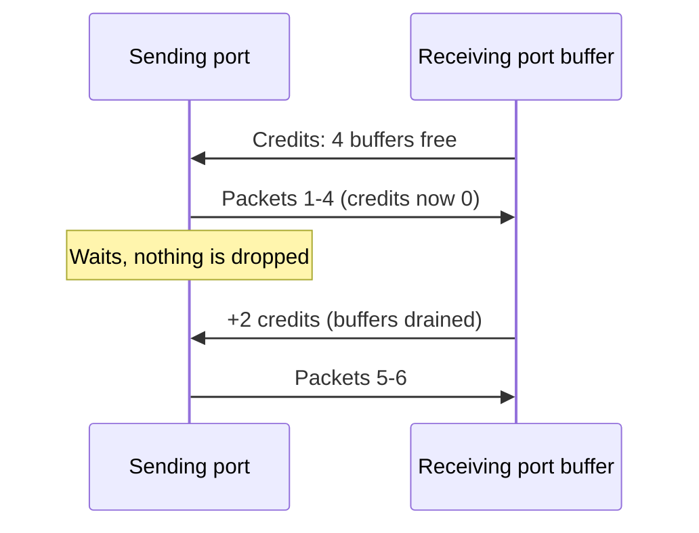

# InfiniBand and SHARP

Layer 06 · Scale-out and scale-across networking · ~7 min read · Last verified: 2026-11-05

## ⚡ The Executive Take

- **NVIDIA bought its network.** The $6.9B all-cash Mellanox deal (announced 2019-03-11, closed 2020-04-27) brought InfiniBand, Spectrum Ethernet and [ConnectX](../../glossary.md#connectx) NICs in-house [[S464]](../../sources/bibliography.md#s464); networking now sells ~$17.5B a quarter (Est., Q2 FY2027) [[S408]](../../sources/bibliography.md#s408). See [CS1 · Mellanox](../../case-studies/CS1-mellanox-the-best-deal.md).
- **[InfiniBand](../../glossary.md#infiniband) was designed for what AI needs:** lossless [credit-based flow control](../../glossary.md#credit-based-flow-control), native [RDMA](../../glossary.md#rdma), [adaptive routing](../../glossary.md#adaptive-routing) and a central [subnet manager](../../glossary.md#subnet-manager) [[S273]](../../sources/bibliography.md#s273).
- **Port speed rose 80×** from 10 Gb/s (SDR, 2001) to 800 Gb/s (XDR, 2024); switch radix grew from 36 ports (EDR) to 144 ports at 800G on Quantum-X800 [[S273]](../../sources/bibliography.md#s273)[[S264]](../../sources/bibliography.md#s264).
- **[SHARP](../../glossary.md#sharp) makes the switch do the math,** cutting the data each GPU sends per [all-reduce](../../glossary.md#all-reduce) from ~2× to 1× the message; NVIDIA reported ~2× all-reduce bandwidth on HDR, worth ~17% on BERT training [[S6013]](../../sources/bibliography.md#s6013)[[S6014]](../../sources/bibliography.md#s6014).
- **Co-packaged Quantum-X Photonics** (144 × 800G) is the next switch; first deployments were reported for early 2026 🟡 [[S265]](../../sources/bibliography.md#s265)[[S6022]](../../sources/bibliography.md#s6022).
- **The weakness is the market:** InfiniBand fell from ~80% of AI back-end switch sales to about one-third by 1Q 2026 [[S90053]](../../sources/bibliography.md#s90053)[[S90054]](../../sources/bibliography.md#s90054).

## 1. How InfiniBand keeps traffic lossless

Ethernet assumes dropping a packet is fine because TCP will resend it; InfiniBand assumes nothing may be dropped. With **credit-based flow control** the receiver advertises free buffers and the sender transmits only against those credits, like a garage that admits cars only when a space is free. Nothing overflows, so no retransmission timeouts hit the tail.

A central **subnet manager** (NVIDIA UFM or OpenSM) computes routes, while switches **adaptively route** packets away from busy ports [[S273]](../../sources/bibliography.md#s273). The trade-off: a separate skill set and NVIDIA as the only supplier at scale.

> [!TIP]
> **Worked example — what the 36 → 144 radix jump buys.** A two-tier non-blocking [fat tree](../../glossary.md#fat-tree) holds R²/2 endpoints for radix R: 648 GPUs on EDR's 36 ports, 2,048 on Quantum-2's 64 and **10,368** on Quantum-X800's 144; three tiers reach ~746,000 (Est.) [[S264]](../../sources/bibliography.md#s264)[[S294]](../../sources/bibliography.md#s294).
>
> **Conclusion:** radix decides how many switches, optics and hops a cluster needs ([Cluster topologies](cluster-topologies-100k-gpus.md)).

**[Q3 · Generational progress]** Each generation doubled the port speed and grew switch capacity 2–4.5×:

| Generation | Year | NVIDIA switch | Ports × speed | Capacity (one direction) | In-network compute |
|---|---|---|---|---|---|
| EDR | 2014–15 | Switch-IB / Switch-IB 2 | 36 × 100G | 3.6 Tb/s | SHARP v1 (Switch-IB 2) |
| HDR | 2018 | Quantum (QM8700) | 40 × 200G | 8.0 Tb/s | SHARPv2 |
| NDR | 2021 | Quantum-2 (QM9700) | 64 × 400G | 25.6 Tb/s | SHARPv3 |
| XDR | 2024 | Quantum-X800 (Q3400) | 144 × 800G | 115.2 Tb/s | SHARPv4 with FP8 |
| XDR + CPO | 2025–26 🟡 | Quantum-X Photonics (Q3450) | 144 × 800G | 115.2 Tb/s | SHARPv4 |

Sources: [[S273]](../../sources/bibliography.md#s273)[[S266]](../../sources/bibliography.md#s266)[[S264]](../../sources/bibliography.md#s264)[[S265]](../../sources/bibliography.md#s265). NVIDIA often quotes both directions (51.2 Tb/s for Quantum-2).

🔧 Under the hood: lanes and SerDes

An InfiniBand "4x" port bundles four electrical lanes, so XDR's 200 Gb/s [SerDes](../../glossary.md#serdes) lanes give 800 Gb/s [[S273]](../../sources/bibliography.md#s273). Lane rates double roughly every three years because each step needs new signaling (NRZ → PAM4) and equalization; Quantum-X800 was first on 200G lanes. The next step (GDR, 1.6 Tb/s per port) needs 400G-class lanes no vendor has scheduled.

## 2. SHARP: computing inside the network

In a ring all-reduce the GPUs do all the adding and each sends about twice its data [[S34011]](../../sources/bibliography.md#s34011). **SHARP** (Scalable Hierarchical Aggregation and Reduction Protocol) moves the adding into switch silicon: GPUs send their data up an aggregation tree once, each switch sums what arrives and forwards one result, and the root sends the total back down [[S34024]](../../sources/bibliography.md#s34024)[[S6015]](../../sources/bibliography.md#s6015). First shipped on Switch-IB 2 in 2015 [[S273]](../../sources/bibliography.md#s273), it now runs in Quantum InfiniBand and, as [NVLink](../../glossary.md#nvlink) SHARP, in [NVSwitch](../../glossary.md#nvswitch) ([Layer 05](../05-scale-up-nvlink-nvswitch/index.md)).

> [!TIP]
> **Worked example — why SHARP halves all-reduce traffic.** All-reduce 1 GB across 1,024 GPUs, each with an 800 Gb/s (100 GB/s) link:
> - **Ring:** each GPU sends 2 × (1,023 ÷ 1,024) × 1 GB ≈ **2.0 GB** (half to reduce-scatter, half to all-gather): ~20 ms.
> - **SHARP:** each GPU sends 1 GB up once and receives the result once: **1.0 GB**, ~10 ms. Ring's 2 × 1,023 sequential steps also shrink to a tree a few levels deep, cutting latency for small messages.
>
> **Conclusion:** halving the bytes roughly halves bandwidth-bound collective time. NVIDIA measured ~2× all-reduce bandwidth on HDR, which became ~17% faster BERT training because only part of each step is communication [[S6013]](../../sources/bibliography.md#s6013)[[S6014]](../../sources/bibliography.md#s6014).

> [!WARNING]
> **Myth vs. reality:** "SHARP makes training 2× faster." It doubles all-reduce bandwidth, not the step; the end-to-end gain depends on exposed communication (17% in NVIDIA's BERT example [[S6014]](../../sources/bibliography.md#s6014)), and switch aggregation resources must be shared among jobs.

🔧 Under the hood: SHARP versions

SHARPv1 (EDR) handled small messages; SHARPv2 (HDR) added streaming aggregation for large ones, behind the ~2× [NCCL](../../glossary.md#nccl) result [[S6013]](../../sources/bibliography.md#s6013)[[S6015]](../../sources/bibliography.md#s6015); SHARPv3 (Quantum-2) supports concurrent multi-tenant jobs [[S266]](../../sources/bibliography.md#s266); SHARPv4 (Quantum-X800) adds [FP8](../../glossary.md#fp8) reductions [[S264]](../../sources/bibliography.md#s264). NCCL reaches it through its CollNet path [[S34024]](../../sources/bibliography.md#s34024). Ethernet rivals are adding in-network collectives through Ultra Ethernet 1.1 (Oct 2026) [[S575]](../../sources/bibliography.md#s575).

## 🎯 Corp Dev Lens

1. **Mellanox as template.** $6.9B [[S464]](../../sources/bibliography.md#s464) bought a business now selling ~2.5× that price every quarter (Est.) [[S408]](../../sources/bibliography.md#s408): buy the system bottleneck before the market prices it. Which interconnect assets (optics, [NIC](../../glossary.md#nic) transport, switch silicon) are today's equivalents?
2. **InfiniBand's moat is narrowing to SHARP and integration** as Ethernet adds adaptive routing and in-network collectives [[S575]](../../sources/bibliography.md#s575); how long does NVIDIA's NCCL-tuned lead last?
3. **Single-vendor risk cuts both ways.** Lock-in pushed buyers to Ethernet [[S90054]](../../sources/bibliography.md#s90054); NVIDIA hedged by selling Ethernet itself (see [Spectrum-X Ethernet](spectrum-x-ethernet.md)).
4. **Qualcomm question (public information only):** could in-network reduction or collective offload differentiate a non-NVIDIA inference rack, or is inference traffic too latency-bound for it to matter?

## 📚 Sources

<!-- Auto-generated from the [S…] citations on this page by `make build`. Edit sources/registry/*.csv, not this list. -->

- [**S264**](../../sources/bibliography.md#s264) NVIDIA Newsroom, *NVIDIA Announces New Switches Optimized for Trillion-Parameter GPU Computing and AI Infrastructure (Quantum-X800, Spectrum-X800, ConnectX-8)*, 2024-03-18. [Link](https://nvidianews.nvidia.com/news/networking-switches-gpu-computing-ai)
- [**S265**](../../sources/bibliography.md#s265) NVIDIA Newsroom, *NVIDIA Announces Spectrum-X Photonics, Co-Packaged Optics Networking Switches to Scale AI Factories to Millions of GPUs*, 2025-03-18. [Link](https://nvidianews.nvidia.com/news/nvidia-spectrum-x-co-packaged-optics-networking-switches-ai-factories)
- [**S266**](../../sources/bibliography.md#s266) NVIDIA Newsroom, *NVIDIA Quantum-2 Takes Supercomputing to New Heights, Into the Cloud*, 2021-11-09. [Link](https://nvidianews.nvidia.com/news/nvidia-quantum-2-takes-supercomputing-to-new-heights-into-the-cloud)
- [**S273**](../../sources/bibliography.md#s273) NVIDIA Docs, *NVIDIA Networking documentation hub (ConnectX adapter, Quantum and Spectrum switch product briefs and user manuals)*, 2025. [Link](https://docs.nvidia.com/networking/)
- [**S294**](../../sources/bibliography.md#s294) SemiAnalysis (Dylan Patel et al.), *100,000 H100 Clusters: Power, Network Topology, Ethernet vs InfiniBand, Reliability, Failures, Checkpointing*, 2024-06-17. [Link](https://semianalysis.com/2024/06/17/100000-h100-clusters-power-network/)
- [**S408**](../../sources/bibliography.md#s408) NVIDIA Corporation, *NVIDIA Corp. (NVDA) Q2 Fiscal 2027 earnings call transcript (26 August 2026)*, 2026-08-26. [Link](https://s201.q4cdn.com/141608511/files/content_files/TRANSCRIPT_-NVIDIA-Corp-NVDA-US-Q2-2027-Earnings-Call-26-August-2026-5_00-PM-ET.pdf)
- [**S464**](../../sources/bibliography.md#s464) NVIDIA Newsroom, *NVIDIA to Acquire Mellanox for $6.9 Billion*, 2019-03-11. [Link](https://nvidianews.nvidia.com/news/nvidia-to-acquire-mellanox-for-6-9-billion)
- [**S575**](../../sources/bibliography.md#s575) Network World, *Ultra Ethernet 1.1 extends the specification to scale-up networks and adds programmable congestion control*, 2026-10. [Link](https://www.networkworld.com/article/4235340/ultra-ethernet-1-1-extends-the-specification-to-scale-up-networks-and-adds-programmable-congestion-control.html)
- [**S6013**](../../sources/bibliography.md#s6013) HPCwire, *Accelerating HPC and AI workflows with Mellanox's Scalable Hierarchical Aggregation and Reduction Protocol (SHARP)*, 2019-05-06. [Link](https://www.hpcwire.com/2019/05/06/accelerating-hpc-and-ai-workflows-with-mellanoxs-scalable-hierarchical-aggregation-and-reduction-protocol-sharp/)
- [**S6014**](../../sources/bibliography.md#s6014) NVIDIA Technical Blog, *Advancing Performance with NVIDIA SHARP In-Network Computing*, 2023. [Link](https://developer.nvidia.com/blog/advancing-performance-with-nvidia-sharp-in-network-computing)
- [**S6015**](../../sources/bibliography.md#s6015) ISC High Performance 2020 (Springer LNCS; PMC open access) (Richard L. Graham et al.), *Scalable Hierarchical Aggregation and Reduction Protocol (SHARP) Streaming-Aggregation Hardware Design and Evaluation*, 2020-06. [Link](https://pmc.ncbi.nlm.nih.gov/articles/PMC7295336/)
- [**S6022**](../../sources/bibliography.md#s6022) Fintool, *NVIDIA CPO webinar: co-packaged silicon photonics switches for gigawatt AI factories*, 2026-02. [Link](https://fintool.com/news/nvidia-cpo-webinar-ai-factories)
- [**S34011**](../../sources/bibliography.md#s34011) Journal of Parallel and Distributed Computing (Pitch Patarasuk, Xin Yuan), *Bandwidth optimal all-reduce algorithms for clusters of workstations*, 2009-02. [Link](https://doi.org/10.1016/j.jpdc.2008.09.002)
- [**S34024**](../../sources/bibliography.md#s34024) NVIDIA Docs, *NVIDIA Scalable Hierarchical Aggregation and Reduction Protocol (SHARP) documentation*, 2024. [Link](https://docs.nvidia.com/networking/display/sharpv3)
- [**S90053**](../../sources/bibliography.md#s90053) Dell'Oro Group, *Ethernet more than doubles size of InfiniBand as the leading fabric for AI scale-out networks in 2025*, 2026. [Link](https://www.delloro.com/news/ethernet-more-than-doubles-size-of-infiniband-as-the-leading-fabric-for-ai-scale-out-networks-in-2025/)
- [**S90054**](../../sources/bibliography.md#s90054) Dell'Oro Group, *Ethernet extends lead in AI scale-out networks despite strong InfiniBand rebound*, 2026. [Link](https://www.delloro.com/news/ethernet-extends-lead-in-ai-scale-out-networks-despite-strong-infiniband-rebound/)
