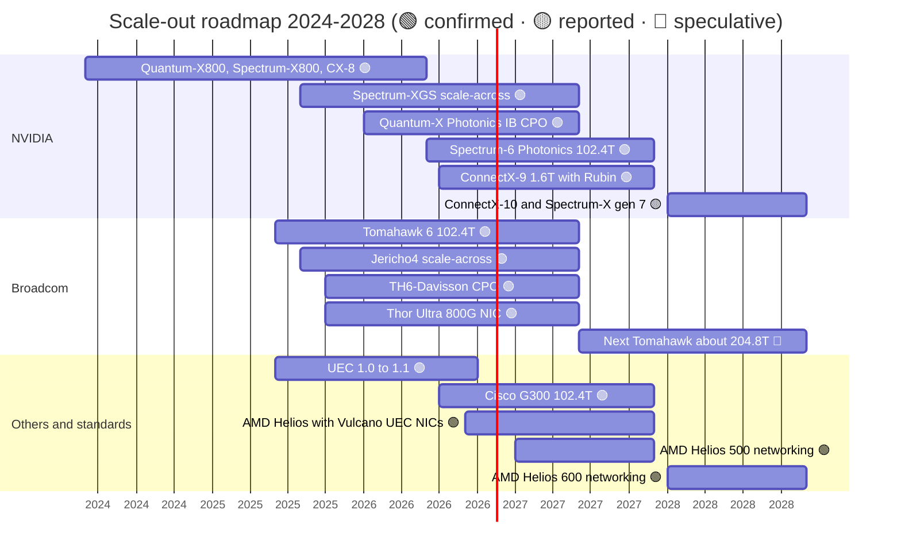

# Scale-out and scale-across networking: Roadmap

Layer 06 · Scale-out and scale-across networking · ~9 min read · Last verified: 2026-11-05

## ⚡ The Executive Take

- **2026 is the 1.6 Tb/s and light year for NVIDIA.** Every Vera Rubin GPU ships with a 1.6 Tb/s ConnectX-9 [[S33004]](../../sources/bibliography.md#s33004). Spectrum-6 [co-packaged optics](../../glossary.md#co-packaged-optics) switches reached select partners in June 2026, with full production alongside Vera Rubin from fall 2026 [[S6019]](../../sources/bibliography.md#s6019)[[S6020]](../../sources/bibliography.md#s6020).
- **InfiniBand goes optical first.** CoreWeave, Lambda and TACC began deploying Quantum-X Photonics switches in early 2026, after a slip from late 2025 [[S6022]](../../sources/bibliography.md#s6022)[[S515]](../../sources/bibliography.md#s515).
- **2027–28 (🟡 reported):** Feynman pairs with ConnectX-10 (1.6 Tb/s per port reported), BlueField-5 and a seventh-generation Spectrum-X with CPO [[S90004]](../../sources/bibliography.md#s90004)[[S6524]](../../sources/bibliography.md#s6524)[[S502]](../../sources/bibliography.md#s502). NVIDIA says copper stays alongside CPO [[S6527]](../../sources/bibliography.md#s6527).
- **Broadcom sets the switch cadence.** Tomahawk 6 (102.4 Tb/s) shipped in June 2025 [[S274]](../../sources/bibliography.md#s274). If its ~2-year doubling holds, a ~204.8 Tb/s part would land around 2027 🔴 [[S283]](../../sources/bibliography.md#s283).
- **AMD leads on per-GPU scale-out bandwidth for now.** Helios gives each MI455X 2.4 Tb/s through three [UEC](../../glossary.md#ultra-ethernet) NICs from ~end Q3 2026 [[S228]](../../sources/bibliography.md#s228)[[S90020]](../../sources/bibliography.md#s90020). AMD has named networking silicon for 2027 and 2028 racks [[S538]](../../sources/bibliography.md#s538).
- **Standards converge on Ethernet everywhere.** UEC 1.1 (October 2026) reaches into scale-up; ESUN 1.0 followed in March 2026 and UALink 2.0 in April 2026 [[S575]](../../sources/bibliography.md#s575)[[S576]](../../sources/bibliography.md#s576)[[S90050]](../../sources/bibliography.md#s90050).
- **Optics supply is the next bottleneck.** 1.6T switch ports ramp in 2H 2026 [[S6523]](../../sources/bibliography.md#s6523). CPO optical-engine capacity at SPIL is to grow ~15× by mid-2027 [[S6525]](../../sources/bibliography.md#s6525).

## The 2024–2028 roadmap

| Item | Window | Status | Confidence | Source |
|---|---|---|---|---|
| ConnectX-9 SuperNIC, 1.6 Tb/s per GPU | 2026-Q3 → | shipping with Vera Rubin | 🟢 | [[S33004]](../../sources/bibliography.md#s33004) |
| Spectrum-6 / Spectrum-X Photonics, 102.4T CPO | Jun 2026 partners; fall 2026 volume | shipping (limited) | 🟢 / 🟡 volume | [[S6019]](../../sources/bibliography.md#s6019)[[S6020]](../../sources/bibliography.md#s6020)[[S6507]](../../sources/bibliography.md#s6507) |
| Quantum-X Photonics (InfiniBand CPO) | early 2026 → | first deployments; slipped from late 2025 | 🟢 | [[S6022]](../../sources/bibliography.md#s6022)[[S515]](../../sources/bibliography.md#s515) |
| Spectrum-XGS scale-across | Aug 2025 → | shipping; CoreWeave first | 🟢 | [[S268]](../../sources/bibliography.md#s268) |
| ConnectX-10, BlueField-5, Spectrum-X gen 7 with CPO | 2028 | roadmap; 1.6 Tb/s per port reported | 🟡 | [[S90004]](../../sources/bibliography.md#s90004)[[S6524]](../../sources/bibliography.md#s6524)[[S502]](../../sources/bibliography.md#s502) |
| Broadcom Tomahawk 6 (102.4T) | Jun 2025 → | at nearly all its AI hyperscaler customers | 🟢 | [[S274]](../../sources/bibliography.md#s274)[[S6505]](../../sources/bibliography.md#s6505) |
| Broadcom next Tomahawk (~204.8T) | ~2027 | inferred from cadence | 🔴 | [[S283]](../../sources/bibliography.md#s283) |
| Cisco Silicon One G300 (102.4T) | H2 2026 | announced Feb 2026 | 🟢 / 🟡 date | [[S6503]](../../sources/bibliography.md#s6503) |
| AMD Helios: 3 × 800G Vulcano per GPU | ~end Q3 2026 → | first shipments | 🟢 | [[S228]](../../sources/bibliography.md#s228)[[S90020]](../../sources/bibliography.md#s90020) |
| Marvell–Celestial AI photonic fabric | to Q4 FY2028 | $500M annualized revenue run-rate targeted | 🟢 target | [[S2513]](../../sources/bibliography.md#s2513) |
| UEC 1.1: scale-up, programmable CC | Oct 2026 | published | 🟢 | [[S575]](../../sources/bibliography.md#s575) |

> [!TIP]
> **Worked example — how much to haircut NVIDIA's networking dates.** Quantum-X Photonics was announced in March 2025 for "later this year" and reached first customers in early 2026: a slip of about one to two quarters [[S514]](../../sources/bibliography.md#s514)[[S6022]](../../sources/bibliography.md#s6022). Spectrum-X Photonics was promised for 2026 and reached partners in June 2026, on time [[S265]](../../sources/bibliography.md#s265)[[S6019]](../../sources/bibliography.md#s6019). Two data points suggest adding ~1 quarter to first shipments. Volume, though, follows the GPU it ships with: fall 2026 for Spectrum-6 with Vera Rubin [[S6020]](../../sources/bibliography.md#s6020).

## Spec progression: who sets the pace

![Dumbbell timeline of switch ASIC generations. 51.2 Tb/s: NVIDIA announced Spectrum-4 first (March 2022) but launched it as Spectrum-X in May 2023, while Broadcom shipped Tomahawk 5 in August 2022; Marvell Teralynx 10 (March 2023) and Cisco G200 (June 2023) followed. 102.4 Tb/s: NVIDIA announced Spectrum-6 photonics in March 2025, Broadcom shipped Tomahawk 6 in June 2025, and NVIDIA began shipping Spectrum-6 CPO switches to select partners in June 2026, about 12 months later; Cisco's G300 (announced February 2026) is planned for H2 2026. NVIDIA's 115.2 Tb/s Quantum-X800 InfiniBand switch was announced in March 2024 and shipped in 2025.](../../assets/charts/06-switch-generation-race.svg)

Across two generations NVIDIA announced first, Broadcom shipped first, and NVIDIA bundled the switch with a faster NIC and optics. NVIDIA doubles NIC bandwidth per GPU each generation (400 → 800 → 1,600 Gb/s) [[S266]](../../sources/bibliography.md#s266)[[S264]](../../sources/bibliography.md#s264)[[S33004]](../../sources/bibliography.md#s33004). AMD skipped ahead by fitting three NICs per GPU [[S228]](../../sources/bibliography.md#s228).

> [!TIP]
> **Worked example — what AMD's 2.4 Tb/s costs.** A 72-GPU Helios rack injects 72 × 2.4 = 172.8 Tb/s into the scale-out fabric. A Vera Rubin NVL72 injects 72 × 1.6 = 115.2 Tb/s [[S228]](../../sources/bibliography.md#s228)[[S33004]](../../sources/bibliography.md#s33004). On 102.4 Tb/s switches, Helios fills ~1.7 switches' worth of leaf ports per rack; Vera Rubin fills ~1.1. The same applies to optics and cables. AMD buys bandwidth with more network hardware, which favours its partners (Broadcom, Arista, optics makers) and lifts cost per GPU.

🔧 Under the hood: the next lane-rate step

Today's 102.4 Tb/s chips use 512 [SerDes](../../glossary.md#serdes) lanes at 200 Gb/s [[S274]](../../sources/bibliography.md#s274)[[S6503]](../../sources/bibliography.md#s6503). The next doubling (204.8 Tb/s, 3.2 Tb/s ports) needs either ~400 Gb/s lanes or twice the lanes. Either way, copper reach shrinks and more links must become optical. NVIDIA plans both copper and CPO for its next scale-up and scale-out generations [[S6527]](../../sources/bibliography.md#s6527). Broadcom has shipped CPO since its 51.2 Tb/s Bailly [[S282]](../../sources/bibliography.md#s282)[[S6507]](../../sources/bibliography.md#s6507).

## What would change the picture

**[Q7 · Roadmap & what changes the picture]** NVIDIA's annual roadmap is credible; three things could still shift share:

- **UEC NICs at scale.** If Helios-class clusters (UEC 1.0 and 1.1 on Broadcom or AMD NICs) show NCCL-class performance at 50–100k GPUs in 2027, NVIDIA's NIC advantage narrows to speed per port [[S575]](../../sources/bibliography.md#s575)[[S228]](../../sources/bibliography.md#s228). **Watch:** published job-completion times from Helios deployments.
- **CPO reliability and supply.** CPO removes most pluggables but puts the lasers inside the switch. NVIDIA claims 10× better resiliency and 4× fewer lasers [[S6020]](../../sources/bibliography.md#s6020); a sceptical view says field data is still thin [[S6021]](../../sources/bibliography.md#s6021). **Watch:** failure rates in the first CoreWeave and Lambda fleets [[S6022]](../../sources/bibliography.md#s6022).
- **Hyperscalers' own NICs and fabrics.** Google runs Vera Rubin GPUs on its own Virgo network [[S554]](../../sources/bibliography.md#s554), and AWS on EFA [[S292]](../../sources/bibliography.md#s292). If more buyers do the same, NVIDIA's networking attach shrinks even when it sells the GPUs.

> [!TIP]
> **Worked example — why CPO changes the failure maths.** The repo estimates ~350k pluggable modules for a 100k-GPU three-tier cluster (Est.) [[S294]](../../sources/bibliography.md#s294). Assume, for illustration only 🔴, a 0.5% annual failure rate: that is ~1,750 module swaps a year, each a hot-swap at the front panel. CPO switches leave ~1 module per GPU (100k, at the NIC), so swaps fall ~70%. Each switch-side failure now involves a sealed package with an external, replaceable laser. The bet is fewer failures in exchange for harder ones.

## 🎯 Corp Dev Lens

1. Broadcom ships switches first; NVIDIA wins on NIC and system bundle. Which cadence matters more to a hyperscaler buyer in 2027–28: switch radix or NIC bandwidth per accelerator?
2. AMD's three-NICs-per-GPU design shows the scale-out seat is open in non-NVIDIA racks. For Qualcomm's rack roadmap [[S90028]](../../sources/bibliography.md#s90028)[[S90060]](../../sources/bibliography.md#s90060), is the NIC a build (SerDes from Alphawave [[S4513]](../../sources/bibliography.md#s4513)), buy or partner decision?
3. CPO concentrates laser supply in a few vendors (Lumentum, Coherent) and TSMC packaging [[S6511]](../../sources/bibliography.md#s6511)[[S6507]](../../sources/bibliography.md#s6507). Who owns the supply risk if the 2027 ramp slips?
4. UEC 1.1 and ESUN blur scale-up and scale-out [[S575]](../../sources/bibliography.md#s575)[[S576]](../../sources/bibliography.md#s576). Does one Ethernet fabric favour merchant-silicon partners over proprietary NVLink-style links?

## 📚 Sources

<!-- Auto-generated from the [S…] citations on this page by `make build`. Edit sources/registry/*.csv, not this list. -->

- [**S228**](../../sources/bibliography.md#s228) Spheron, *AMD Helios rack-scale AI on GPU cloud: deploy MI455X inference with UALink and Ultra Ethernet (2026 guide)*, 2026. [Link](https://www.spheron.network/blog/amd-helios-rack-scale-mi455x-gpu-cloud/)
- [**S264**](../../sources/bibliography.md#s264) NVIDIA Newsroom, *NVIDIA Announces New Switches Optimized for Trillion-Parameter GPU Computing and AI Infrastructure (Quantum-X800, Spectrum-X800, ConnectX-8)*, 2024-03-18. [Link](https://nvidianews.nvidia.com/news/networking-switches-gpu-computing-ai)
- [**S265**](../../sources/bibliography.md#s265) NVIDIA Newsroom, *NVIDIA Announces Spectrum-X Photonics, Co-Packaged Optics Networking Switches to Scale AI Factories to Millions of GPUs*, 2025-03-18. [Link](https://nvidianews.nvidia.com/news/nvidia-spectrum-x-co-packaged-optics-networking-switches-ai-factories)
- [**S266**](../../sources/bibliography.md#s266) NVIDIA Newsroom, *NVIDIA Quantum-2 Takes Supercomputing to New Heights, Into the Cloud*, 2021-11-09. [Link](https://nvidianews.nvidia.com/news/nvidia-quantum-2-takes-supercomputing-to-new-heights-into-the-cloud)
- [**S268**](../../sources/bibliography.md#s268) NVIDIA Newsroom, *NVIDIA Introduces Spectrum-XGS Ethernet to Connect Distributed Data Centers Into Giga-Scale AI Super-Factories*, 2025-08-22. [Link](https://nvidianews.nvidia.com/news/nvidia-introduces-spectrum-xgs-ethernet-to-connect-distributed-data-centers-into-giga-scale-ai-super-factories)
- [**S274**](../../sources/bibliography.md#s274) Broadcom, *Broadcom ships Tomahawk 6: world's first 102.4 Tbps switch*, 2025-06-03. [Link](https://investors.broadcom.com/news-releases/news-release-details/broadcom-ships-tomahawk-6-worlds-first-1024-tbps-switch)
- [**S282**](../../sources/bibliography.md#s282) Broadcom, *Broadcom delivers industry's first 51.2-Tbps co-packaged optics Ethernet switch platform (Bailly)*, 2024-03. [Link](https://investors.broadcom.com/news-releases)
- [**S283**](../../sources/bibliography.md#s283) Broadcom, *Broadcom StrataXGS Tomahawk switch family (product pages)*, 2025. [Link](https://www.broadcom.com/products/ethernet-connectivity/switching/strataxgs)
- [**S292**](../../sources/bibliography.md#s292) Amazon Web Services, *Elastic Fabric Adapter (EFA) and AWS Nitro System documentation*, 2025. [Link](https://aws.amazon.com/hpc/efa/)
- [**S294**](../../sources/bibliography.md#s294) SemiAnalysis (Dylan Patel et al.), *100,000 H100 Clusters: Power, Network Topology, Ethernet vs InfiniBand, Reliability, Failures, Checkpointing*, 2024-06-17. [Link](https://semianalysis.com/2024/06/17/100000-h100-clusters-power-network/)
- [**S502**](../../sources/bibliography.md#s502) Tom's Hardware, *Nvidia updates data center roadmap with Rosa CPU and stacked Feynman GPUs; optical NVLink; Groq LPUs with NVFP4 and NVLink also on deck*, 2026-03-17. [Link](https://www.tomshardware.com/pc-components/gpus/nvidia-updates-data-center-roadmap-with-rosa-cpu-and-stacked-feynman-gpus-optical-nvlink-groq-lpus-with-nvfp4-and-nvlink-also-on-deck)
- [**S514**](../../sources/bibliography.md#s514) NVIDIA Investor Relations, *NVIDIA Announces Spectrum-X Photonics, Co-Packaged Optics Networking Switches to Scale AI Factories to Millions of GPUs*, 2025-03-18. [Link](https://investor.nvidia.com/news/press-release-details/2025/NVIDIA-Announces-Spectrum-X-Photonics-Co-Packaged-Optics-Networking-Switches-to-Scale-AI-Factories-to-Millions-of-GPUs/default.aspx)
- [**S515**](../../sources/bibliography.md#s515) Converge Digest, *NVIDIA debuts Spectrum-X and Quantum-X Photonics switches*, 2025-08. [Link](https://convergedigest.com/nvidia-debuts-spectrum-x-and-quantum-x-photonics-switches/)
- [**S538**](../../sources/bibliography.md#s538) AMD Investor Relations, *AAI 2026: AMD Delivers Full-Stack Compute for the Agentic AI Era*, 2026-07-23. [Link](https://ir.amd.com/news-events/press-releases/detail/1294/aai-2026-amd-delivers-full-stack-compute-for-the-agentic-ai-era)
- [**S554**](../../sources/bibliography.md#s554) Google Cloud Blog (Mark Lohmeyer), *Google Cloud and NVIDIA expand co-engineering collaboration to scale infrastructure for the agentic era (NVIDIA GTC Berlin 2026)*, 2026-10-21. [Link](https://cloud.google.com/blog/topics/ai-infrastructure/google-cloud-infrastructure-at-nvidia-gtc-berlin-2026)
- [**S575**](../../sources/bibliography.md#s575) Network World, *Ultra Ethernet 1.1 extends the specification to scale-up networks and adds programmable congestion control*, 2026-10. [Link](https://www.networkworld.com/article/4235340/ultra-ethernet-1-1-extends-the-specification-to-scale-up-networks-and-adds-programmable-congestion-control.html)
- [**S576**](../../sources/bibliography.md#s576) Converge Digest, *OCP releases ESUN 1.0 spec for Ethernet-based scale-up AI fabrics*, 2026-03. [Link](https://convergedigest.com/ocp-releases-esun-1-0-spec-for-ethernet-based-scale-up-ai-fabrics/)
- [**S2513**](../../sources/bibliography.md#s2513) Business Wire (Marvell), *Marvell Completes Acquisition of Celestial AI*, 2026-02-02. [Link](https://www.businesswire.com/news/home/20260201331090/en/marvell-completes-acquisition-of-celestial-ai)
- [**S4513**](../../sources/bibliography.md#s4513) I-Connect007, *Qualcomm completes acquisition of Alphawave Semi*, 2025-12-18. [Link](https://iconnect007.com/article/148161/qualcomm-completes-acquisition-of-alphawave-semi/148158/ein)
- [**S6019**](../../sources/bibliography.md#s6019) Focus Taiwan (CNA), *Nvidia starts shipping TSMC-backed CPO switches (GTC Taipei / Computex 2026)*, 2026-06-03. [Link](https://focustaiwan.tw/business/202606030020)
- [**S6020**](../../sources/bibliography.md#s6020) StorageReview, *NVIDIA Spectrum-X Ethernet Photonics enters full production with 4x fewer lasers and a five-vendor CPO supply chain*, 2026-08. [Link](https://storagereview.com/news/nvidia-spectrum-x-ethernet-photonics-enters-full-production-with-4x-fewer-lasers-and-a-five-vendor-cpo-supply-chain)
- [**S6021**](../../sources/bibliography.md#s6021) remio, *NVIDIA put CPO switches into production, but the hard part starts now*, 2026-08. [Link](https://www.remio.ai/post/nvidia-put-cpo-switches-into-production-but-the-hard-part-starts-now)
- [**S6022**](../../sources/bibliography.md#s6022) Fintool, *NVIDIA CPO webinar: co-packaged silicon photonics switches for gigawatt AI factories*, 2026-02. [Link](https://fintool.com/news/nvidia-cpo-webinar-ai-factories)
- [**S6503**](../../sources/bibliography.md#s6503) Cisco Investor Relations, *Cisco Announces New Silicon One G300, Advanced Systems and Optics to Power and Scale AI Data Centers for the Agentic Era*, 2026-02-10. [Link](https://investor.cisco.com/news/news-details/2026/Cisco-Announces-New-Silicon-One-G300-Advanced-Systems-and-Optics-to-Power-and-Scale-AI-Data-Centers-for-the-Agentic-Era/)
- [**S6505**](../../sources/bibliography.md#s6505) Nasdaq, *Broadcom Q3 earnings call highlights*, 2026-09. [Link](https://www.nasdaq.com/articles/broadcom-q3-earnings-call-highlights)
- [**S6507**](../../sources/bibliography.md#s6507) TrendForce, *NVIDIA and Broadcom begin CPO switch shipments (TrendForce press release)*, 2026-07-27. [Link](https://trendforce.com/presscenter/news/20260727-13151.html)
- [**S6511**](../../sources/bibliography.md#s6511) SiliconANGLE, *Nvidia invests $4B in co-packaged optics suppliers Lumentum and Coherent*, 2026-03-02. [Link](https://siliconangle.com/2026/03/02/nvidia-invests-4b-co-packaged-optics-suppliers-lumentum-coherent/)
- [**S6523**](../../sources/bibliography.md#s6523) Dell'Oro Group, *AI back-end networks switch sales surpass front-end networks for the first time in 2Q2026*, 2026-08. [Link](https://www.delloro.com/news/ai-back-end-networks-switch-sales-surpass-front-end-networks-for-the-first-time-in-2q2026/)
- [**S6524**](../../sources/bibliography.md#s6524) Counterpoint Research, *From Blackwell to Feynman: analyzing NVIDIA's optics roadmap*, 2026. [Link](https://counterpointresearch.com/cn/insights/from-blackwell-to-feynman-analyzing-nvidias-optics-roadmap)
- [**S6525**](../../sources/bibliography.md#s6525) SDxCentral, *Nvidia targets 15x optics capacity expansion by 2027 to meet CPO demand*, 2026. [Link](https://www.sdxcentral.com/news/nvidia-targets-15x-optics-capacity-expansion-by-2027-to-meet-cpo-demand/)
- [**S6527**](../../sources/bibliography.md#s6527) SDxCentral, *Nvidia backs copper in next-gen interconnects amid push into co-packaged optics*, 2026-03. [Link](https://www.sdxcentral.com/news/nvidia-backs-copper-in-next-gen-interconnects-amid-push-into-co-packaged-optics/)
- [**S33004**](../../sources/bibliography.md#s33004) NVIDIA Newsroom, *NVIDIA Kicks Off the Next Generation of AI With Rubin — Six New Chips; One Incredible AI Supercomputer*, 2026-01-05. [Link](https://nvidianews.nvidia.com/news/rubin-platform-ai-supercomputer)
- [**S90004**](../../sources/bibliography.md#s90004) TrendForce, *Key GTC takeaways: how Samsung, Micron, Intel and more power NVIDIA's Vera Rubin and Feynman*, 2026-03-17. [Link](https://www.trendforce.com/news/2026/03/17/news-key-gtc-takeaways-how-samsung-micron-intel-more-power-nvidias-vera-rubin-and-feynman/)
- [**S90020**](../../sources/bibliography.md#s90020) Shacknews, *AMD Helios AI rack system on track for initial shipments in Q3 2026*, 2026. [Link](https://www.shacknews.com/article/150249/amd-helios-ai-system-shipping-q3-2026)
- [**S90028**](../../sources/bibliography.md#s90028) TechRepublic, *Qualcomm unveils AI chips to rival Nvidia, AMD*, 2025-10-27. [Link](https://techrepublic.com/article/news-qualcomm-unveils-ai-chips-to-rival-nvidia-amd)
- [**S90050**](../../sources/bibliography.md#s90050) HPCwire, *UALink Consortium publishes 4 specifications defining in-network compute, chiplets, manageability and 200G performance*, 2026-04-07. [Link](https://www.hpcwire.com/off-the-wire/ualink-consortium-publishes-4-specifications-defining-in-network-compute-chiplets-manageability-and-200g-performance/)
- [**S90060**](../../sources/bibliography.md#s90060) Qualcomm, *Qualcomm Dragonfly AI300 (product page)*, 2026-06. [Link](https://www.qualcomm.com/data-center/products/qualcomm-dragonfly-ai300)
