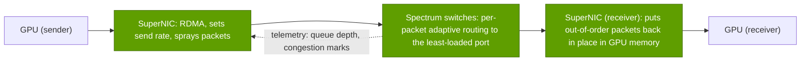
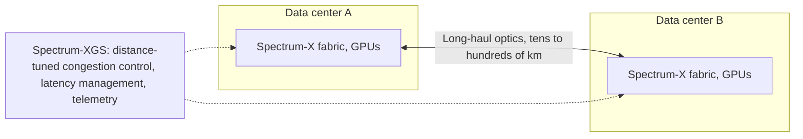

# Spectrum-X Ethernet and scale-across

Layer 06 · Scale-out and scale-across networking · ~8 min read · Last verified: 2026-11-05

## ⚡ The Executive Take

- **Customers chose Ethernet, so NVIDIA built AI Ethernet.** InfiniBand held ~80% of AI back-end switch sales two years before 2025; by 1Q 2026 Ethernet was ~two-thirds (Dell'Oro) 🟡 [[S90053]](../../sources/bibliography.md#s90053)[[S90054]](../../sources/bibliography.md#s90054).
- **[Spectrum-X](../../glossary.md#spectrum-x) is a co-designed pair,** not just a switch: a Spectrum-4 / Spectrum-X800 switch (51.2 Tb/s, 64 × 800G) plus a BlueField-3 or ConnectX [SuperNIC](../../glossary.md#supernic) per GPU, launched May 2023 [[S271]](../../sources/bibliography.md#s271)[[S267]](../../sources/bibliography.md#s267)[[S264]](../../sources/bibliography.md#s264).
- **The mechanism:** [packet spraying](../../glossary.md#packet-spraying) with per-packet [adaptive routing](../../glossary.md#adaptive-routing), reordering in the receiving NIC and telemetry-driven [congestion control](../../glossary.md#congestion-control) [[S6011]](../../sources/bibliography.md#s6011)[[S271]](../../sources/bibliography.md#s271).
- **The claim:** 95% effective bandwidth on xAI's 100,000-GPU Colossus vs ~60% for standard Ethernet, i.e. NVIDIA's "1.6×" headline; both are vendor numbers without independent tests [[S6000]](../../sources/bibliography.md#s6000)[[S6010]](../../sources/bibliography.md#s6010).
- **Adoption is real:** Meta and Oracle (Oct 2025) [[S6009]](../../sources/bibliography.md#s6009), a >$10B annualized run-rate in Q2 FY2026 [[S6027]](../../sources/bibliography.md#s6027), 2.6× y/y growth in Q2 FY2027 [[S408]](../../sources/bibliography.md#s408); IDC put NVIDIA first in data-center Ethernet switch revenue in 1Q 2026 🟡 [[S6028]](../../sources/bibliography.md#s6028).
- **[Spectrum-XGS](../../glossary.md#spectrum-xgs) (Aug 2025)** adds distance-aware congestion control to join data centers ("[scale-across](../../glossary.md#scale-across)"); NVIDIA claims ~1.9× NCCL performance across sites, CoreWeave first [[S268]](../../sources/bibliography.md#s268)[[S6024]](../../sources/bibliography.md#s6024).
- **Bear case:** merchant Ethernet is catching up through Ultra Ethernet [[S575]](../../sources/bibliography.md#s575) and Broadcom's 102.4 Tb/s Tomahawk 6 [[S274]](../../sources/bibliography.md#s274); Meta trained Llama 3 on Arista-based RoCE without Spectrum-X [[S6002]](../../sources/bibliography.md#s6002).

## 1. Why NVIDIA moved into Ethernet

Three buyer realities pushed the market away from InfiniBand: **operations** (every cloud already runs Ethernet tooling and staff), **multi-tenancy** (clouds sell cluster slices with Ethernet-native isolation) and **sourcing** (hyperscalers want several vendors and their own switch software, such as Meta's FBOSS and Microsoft's SONiC) [[S6009]](../../sources/bibliography.md#s6009)[[S6005]](../../sources/bibliography.md#s6005). NVIDIA chose to compete inside Ethernet too; InfiniBand still rebounded in early 2026 as Ethernet extended its lead [[S90054]](../../sources/bibliography.md#s90054).

> [!TIP]
> **Worked example — what the share shift means.** InfiniBand went from ~80% to ~33% of AI back-end switch sales [[S90053]](../../sources/bibliography.md#s90053)[[S90054]](../../sources/bibliography.md#s90054): an InfiniBand-only vendor would have lost over half its share. NVIDIA ranked second among AI back-end switch vendors in 1Q 2026, behind white-box builder Celestica and ahead of Arista [[S90054]](../../sources/bibliography.md#s90054), while Spectrum-X grew 2.6× y/y [[S408]](../../sources/bibliography.md#s408).
>
> **Conclusion:** the Ethernet pivot turned a share loss into a mix shift inside NVIDIA's own networking revenue.

## 2. How Spectrum-X works: switch and NIC as one system

Standard [ECMP](../../glossary.md#ecmp) hashes each flow onto one path for its life; AI's few elephant flows often collide on one link while others idle, the "flow collisions" behind NVIDIA's 60% figure [[S6000]](../../sources/bibliography.md#s6000). Spectrum-X spreads every flow across all paths and fixes the consequences at the edge:

The switch picks the least-loaded output per packet and marks congestion only once its adaptive-routing headroom is exhausted [[S6011]](../../sources/bibliography.md#s6011); the receiving SuperNIC writes each out-of-order packet into its correct place in GPU memory; switch telemetry lets NICs throttle senders within microseconds and keeps one tenant's job from slowing another's [[S271]](../../sources/bibliography.md#s271).

> [!TIP]
> **Worked example — reading the "1.6×" claim.** Each Colossus H100 has a 400 Gb/s BlueField-3 SuperNIC [[S6000]](../../sources/bibliography.md#s6000): 95% is ~380 Gb/s, 60% is ~240 Gb/s, and 95 ÷ 60 = 1.58, NVIDIA's "1.6×" [[S6010]](../../sources/bibliography.md#s6010). In NVIDIA's own blog example, background noise added 1.18 s to a standard-Ethernet training step [[S6011]](../../sources/bibliography.md#s6011).
>
> **Conclusion:** the gain is real where hash collisions dominate (large collectives at scale) and only with NVIDIA NICs on both ends; buyers should benchmark their own jobs.

| Feature | InfiniBand (Quantum) | Spectrum-X (NVIDIA Ethernet) | Merchant Ethernet + UEC NICs |
|---|---|---|---|
| Load balancing | 🟩 Native adaptive routing | 🟩 Per-packet spraying + NIC reorder | 🟨 UEC 1.0 adds spraying; varies by NIC [[S575]](../../sources/bibliography.md#s575) |
| Loss handling | 🟩 Credit-based, lossless | 🟨 RoCE with telemetry congestion control | 🟨 UEC transport tolerates loss |
| In-network reduction | 🟩 SHARP since 2015 | 🟥 None in Ethernet today | 🟨 Defined in UEC 1.1 (Oct 2026) [[S575]](../../sources/bibliography.md#s575) |
| Operations familiarity | 🟥 Separate discipline | 🟩 Standard tooling, SONiC/FBOSS | 🟩 Standard Ethernet |
| Multi-vendor sourcing | 🟥 NVIDIA only at scale | 🟨 Full benefit needs NVIDIA NICs + switches | 🟩 Broadcom, Cisco, Marvell, Arista, AMD |

🔧 Under the hood: the Spectrum family

Spectrum-4 (2022) is a 51.2 Tb/s ASIC on TSMC 4N, sold as 64 × 800G or 128 × 400G in the SN5600 [[S267]](../../sources/bibliography.md#s267). Spectrum-X800 (2024) pairs it with ConnectX-8 at 800 Gb/s [[S264]](../../sources/bibliography.md#s264). Spectrum-6 (2026) doubles to 102.4 Tb/s, is one of the six Rubin platform chips and ships in co-packaged-optics switches ([Co-packaged optics](co-packaged-optics.md)) [[S265]](../../sources/bibliography.md#s265)[[S33004]](../../sources/bibliography.md#s33004); ConnectX-9 brings 1.6 Tb/s per GPU [[S33004]](../../sources/bibliography.md#s33004).

## 3. Scale-across: Spectrum-XGS between data centers

Power-capped sites push the largest jobs across buildings and campuses; Microsoft links its Fairwater sites in Atlanta and Wisconsin over a dedicated AI WAN [[S6005]](../../sources/bibliography.md#s6005). Distance breaks normal congestion control, because many megabytes are in flight before a sender learns of congestion. **Spectrum-XGS**, announced 2025-08-22, keeps Spectrum-X hardware and adds distance-aware congestion control, latency management and end-to-end telemetry [[S268]](../../sources/bibliography.md#s268)[[S6024]](../../sources/bibliography.md#s6024).

> [!TIP]
> **Worked example — why distance needs its own algorithm.** Light in fiber covers about 1 km per 5 µs, so 100 km adds ~1 ms round trip versus a few microseconds inside a hall. At 800 Gb/s (100 GB/s), ~100 MB is in flight during that round trip; a sender reacting a full round trip late has long overrun a congested queue.
>
> **Conclusion:** cross-site training needs distance-aware congestion control, deep buffers at the edge (Broadcom's Jericho4 and Cisco's P200 take that route [[S276]](../../sources/bibliography.md#s276)[[S286]](../../sources/bibliography.md#s286)) and parallelism that keeps the heaviest collectives inside each site.

NVIDIA claims Spectrum-XGS nearly doubles cross-site NCCL performance (~1.9× in one reported benchmark) 🟡 [[S268]](../../sources/bibliography.md#s268)[[S6024]](../../sources/bibliography.md#s6024), with CoreWeave the first named adopter [[S268]](../../sources/bibliography.md#s268).

## 🎯 Corp Dev Lens

1. **Bundle economics.** Spectrum-X's advantage requires NVIDIA switches and SuperNICs together; that bundle, not the switch ASIC, keeps NVIDIA second in a market Broadcom-based white boxes lead [[S90054]](../../sources/bibliography.md#s90054).
2. **Standards are the threat to watch.** If Ultra Ethernet NICs from Broadcom, AMD and others match its effective bandwidth [[S575]](../../sources/bibliography.md#s575)[[S280]](../../sources/bibliography.md#s280), Spectrum-X's premium narrows to software and support.
3. **Scale-across is a new value pool** (deep-buffer routers, coherent optics, congestion control) that grows with power-capped sites.
4. **Qualcomm question (public information only):** for multi-site inference fleets, does an open Ethernet stack (UEC, ESUN for scale-up [[S90052]](../../sources/bibliography.md#s90052)) leave room for a NIC or DPU entrant, or will buyers consolidate on one vendor's switch-plus-NIC bundle?

## 📚 Sources

<!-- Auto-generated from the [S…] citations on this page by `make build`. Edit sources/registry/*.csv, not this list. -->

- [**S264**](../../sources/bibliography.md#s264) NVIDIA Newsroom, *NVIDIA Announces New Switches Optimized for Trillion-Parameter GPU Computing and AI Infrastructure (Quantum-X800, Spectrum-X800, ConnectX-8)*, 2024-03-18. [Link](https://nvidianews.nvidia.com/news/networking-switches-gpu-computing-ai)
- [**S265**](../../sources/bibliography.md#s265) NVIDIA Newsroom, *NVIDIA Announces Spectrum-X Photonics, Co-Packaged Optics Networking Switches to Scale AI Factories to Millions of GPUs*, 2025-03-18. [Link](https://nvidianews.nvidia.com/news/nvidia-spectrum-x-co-packaged-optics-networking-switches-ai-factories)
- [**S267**](../../sources/bibliography.md#s267) NVIDIA Newsroom, *NVIDIA Spectrum-4 high-performance data center networking infrastructure platform (GTC 2022)*, 2022-03-22. [Link](https://nvidianews.nvidia.com/news/nvidia-announces-spectrum-high-performance-data-center-networking-infrastructure-platform)
- [**S268**](../../sources/bibliography.md#s268) NVIDIA Newsroom, *NVIDIA Introduces Spectrum-XGS Ethernet to Connect Distributed Data Centers Into Giga-Scale AI Super-Factories*, 2025-08-22. [Link](https://nvidianews.nvidia.com/news/nvidia-introduces-spectrum-xgs-ethernet-to-connect-distributed-data-centers-into-giga-scale-ai-super-factories)
- [**S271**](../../sources/bibliography.md#s271) NVIDIA Newsroom, *NVIDIA Launches Accelerated Ethernet Platform for Hyperscale Generative AI (Spectrum-X)*, 2023-05-29. [Link](https://nvidianews.nvidia.com/news/nvidia-launches-accelerated-ethernet-platform-for-hyperscale-generative-ai)
- [**S274**](../../sources/bibliography.md#s274) Broadcom, *Broadcom ships Tomahawk 6: world's first 102.4 Tbps switch*, 2025-06-03. [Link](https://investors.broadcom.com/news-releases/news-release-details/broadcom-ships-tomahawk-6-worlds-first-1024-tbps-switch)
- [**S276**](../../sources/bibliography.md#s276) Broadcom, *Broadcom ships Jericho4, enabling distributed AI computing across data centers*, 2025-08-04. [Link](https://investors.broadcom.com/news-releases/news-release-details/broadcom-ships-jericho4-enabling-distributed-ai-computing-across)
- [**S280**](../../sources/bibliography.md#s280) Broadcom, *Broadcom introduces Thor Ultra, the industry's first 800G AI Ethernet NIC*, 2025-10-14. [Link](https://investors.broadcom.com/news-releases/news-release-details/broadcom-introduces-industrys-first-800g-ai-ethernet-nic)
- [**S286**](../../sources/bibliography.md#s286) Cisco, *Cisco Silicon One P200 and Cisco 8223 for scale-across AI networks*, 2025-10-08. [Link](https://newsroom.cisco.com/)
- [**S408**](../../sources/bibliography.md#s408) NVIDIA Corporation, *NVIDIA Corp. (NVDA) Q2 Fiscal 2027 earnings call transcript (26 August 2026)*, 2026-08-26. [Link](https://s201.q4cdn.com/141608511/files/content_files/TRANSCRIPT_-NVIDIA-Corp-NVDA-US-Q2-2027-Earnings-Call-26-August-2026-5_00-PM-ET.pdf)
- [**S575**](../../sources/bibliography.md#s575) Network World, *Ultra Ethernet 1.1 extends the specification to scale-up networks and adds programmable congestion control*, 2026-10. [Link](https://www.networkworld.com/article/4235340/ultra-ethernet-1-1-extends-the-specification-to-scale-up-networks-and-adds-programmable-congestion-control.html)
- [**S6000**](../../sources/bibliography.md#s6000) TechPowerUp (NVIDIA press release), *NVIDIA Ethernet Networking Accelerates World's Largest AI Supercomputer, Built by xAI*, 2024-10-29. [Link](https://techpowerup.com/328227/nvidia-ethernet-networking-accelerates-worlds-largest-ai-supercomputer-built-by-xai)
- [**S6002**](../../sources/bibliography.md#s6002) Engineering at Meta, *Building Meta's GenAI Infrastructure*, 2024-03-12. [Link](https://engineering.fb.com/2024/03/12/data-center-engineering/building-metas-genai-infrastructure/)
- [**S6005**](../../sources/bibliography.md#s6005) Microsoft Official Blog, *Infinite scale: the architecture behind the Azure AI superfactory*, 2025-11-12. [Link](https://blogs.microsoft.com/blog/2025/11/12/infinite-scale-the-architecture-behind-the-azure-ai-superfactory/)
- [**S6009**](../../sources/bibliography.md#s6009) NVIDIA Investor Relations, *NVIDIA Spectrum-X Ethernet Switches Speed Up Networks for Meta and Oracle*, 2025-10-13. [Link](https://investor.nvidia.com/news/press-release-details/2025/NVIDIA-Spectrum-X-Ethernet-Switches-Speed-Up-Networks-for-Meta-and-Oracle/default.aspx)
- [**S6010**](../../sources/bibliography.md#s6010) NVIDIA, *NVIDIA Spectrum-X Ethernet Networking Platform (product page)*, 2025. [Link](https://www.nvidia.com/en-us/networking/spectrumx/)
- [**S6011**](../../sources/bibliography.md#s6011) NVIDIA Technical Blog, *Giga-scale AI Ethernet evolution: Spectrum-X Ethernet rewrites the rules*, 2025. [Link](https://developer.nvidia.com/blog/giga-scale-ai-ethernet-evolution-spectrum-x-ethernet-rewrites-rules/)
- [**S6024**](../../sources/bibliography.md#s6024) Techzine, *Nvidia unveils Spectrum-XGS Ethernet for 'scale-across' data centers*, 2025-08-22. [Link](https://www.techzine.eu/news/infrastructure/134016/nvidia-unveils-spectrum-xgs-ethernet-for-scale-across-data-centers)
- [**S6027**](../../sources/bibliography.md#s6027) DatacenterDynamics, *Nvidia Q2 2025: networking is booming, but your networks cost nothing*, 2025-08. [Link](https://www.datacenterdynamics.com/en/news/nvidia-q2-2025-networking-is-booming-but-your-networks-cost-nothing/)
- [**S6028**](../../sources/bibliography.md#s6028) Tiger Brokers (iTiger), *NVIDIA's AI expansion extends to network infrastructure, captures top spot in data center Ethernet switch revenue (IDC)*, 2026-06. [Link](https://www.itiger.com/news/1113632768)
- [**S33004**](../../sources/bibliography.md#s33004) NVIDIA Newsroom, *NVIDIA Kicks Off the Next Generation of AI With Rubin — Six New Chips; One Incredible AI Supercomputer*, 2026-01-05. [Link](https://nvidianews.nvidia.com/news/rubin-platform-ai-supercomputer)
- [**S90052**](../../sources/bibliography.md#s90052) Synopsys, *Ethernet standards for scale-up AI: an overview of ESUN, SUE, and UALink*, 2025-11. [Link](https://www.synopsys.com/articles/ethernet-standards-scale-up-ai.html)
- [**S90053**](../../sources/bibliography.md#s90053) Dell'Oro Group, *Ethernet more than doubles size of InfiniBand as the leading fabric for AI scale-out networks in 2025*, 2026. [Link](https://www.delloro.com/news/ethernet-more-than-doubles-size-of-infiniband-as-the-leading-fabric-for-ai-scale-out-networks-in-2025/)
- [**S90054**](../../sources/bibliography.md#s90054) Dell'Oro Group, *Ethernet extends lead in AI scale-out networks despite strong InfiniBand rebound*, 2026. [Link](https://www.delloro.com/news/ethernet-extends-lead-in-ai-scale-out-networks-despite-strong-infiniband-rebound/)
