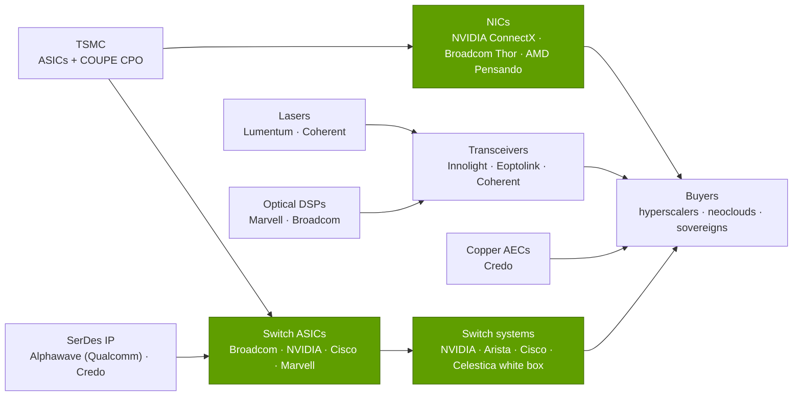

# Scale-out and scale-across networking: Value chain and corp dev angles

Layer 06 · Scale-out and scale-across networking · ~10 min read · Last verified: 2026-11-05

## ⚡ The Executive Take

- **The network is a fifth of the cluster.** Estimates put networking at ~17–21% of AI cluster hardware capex; SemiAnalysis's all-in GB200 NVL72 cost implies ~20.5% for networking plus storage [[S6026]](../../sources/bibliography.md#s6026)[[S324]](../../sources/bibliography.md#s324).
- **NVIDIA takes the biggest single pool.** Its FY2026 networking revenue (~$31.4B, including NVLink switches) is ~6× Innolight's 2025 revenue and ~9× Arista's 2026 AI target [[S402]](../../sources/bibliography.md#s402)[[S6513]](../../sources/bibliography.md#s6513)[[S6500]](../../sources/bibliography.md#s6500).
- **Optics is the fastest-growing and scarcest link.** Innolight grew 61% and Eoptolink 189% in 2025 [[S6513]](../../sources/bibliography.md#s6513); Credo grew 206% in fiscal 2026 [[S6515]](../../sources/bibliography.md#s6515). Coherent says data-center orders exceed 4× its current throughput [[S6512]](../../sources/bibliography.md#s6512).
- **NVIDIA is buying supply security.** It put $2B each into Lumentum and Coherent in March 2026, tied to purchase commitments for co-packaged-optics lasers [[S6511]](../../sources/bibliography.md#s6511).
- **The layer's M&A sets the price of entry.** Mellanox ($6.9B), AMD–Pensando ($1.9B), Marvell–Celestial AI (~$3.25B), Qualcomm–Alphawave (~$2.4B) and HPE–Juniper ($14B) [[S464]](../../sources/bibliography.md#s464)[[S6521]](../../sources/bibliography.md#s6521)[[S2513]](../../sources/bibliography.md#s2513)[[S4514]](../../sources/bibliography.md#s4514)[[S6522]](../../sources/bibliography.md#s6522).
- **Private optics and networking start-ups are richly valued:** Ayar Labs ~$3.75B, Lightmatter $4.4B, Nexthop AI $4.2B, Upscale AI ~$2B [[S6519]](../../sources/bibliography.md#s6519)[[S2510]](../../sources/bibliography.md#s2510)[[S6517]](../../sources/bibliography.md#s6517)[[S6518]](../../sources/bibliography.md#s6518).
- **[Q8 · Value pools & M&A angles]** The open seats are the scale-out NIC for non-NVIDIA accelerators and the optics supply chain. NVIDIA has already locked up the latter with stakes.

![Horizontal bar chart of AI-networking-related revenue: NVIDIA networking $31.4B in FY2026 and a ~$70B annualized run-rate in Q2 FY2027 (both include NVLink switches); Broadcom AI semiconductors $20.2B in FY2025, which mixes custom XPUs with AI Ethernet; optics makers Innolight $5.3B and Eoptolink $3.5B in 2025; Arista's 2026 AI networking target of at least $3.6B; Credo $1.34B in fiscal 2026. NVIDIA alone books more networking revenue than the merchant switch, optics and cable specialists shown combined, excluding Broadcom.](../../assets/charts/06-networking-value-pool-by-vendor.svg)

## Who captures the networking dollar

Green = stages where NVIDIA sells; it also buys lasers and optics and holds stakes in two laser makers [[S6511]](../../sources/bibliography.md#s6511).

| Segment | Main players | Size / growth signal | Pricing-power signal | NVIDIA's position |
|---|---|---|---|---|
| Switch systems | Celestica, NVIDIA, Arista, Cisco | AI back-end passed front-end switch sales in 2Q26 [[S6523]](../../sources/bibliography.md#s6523) | Arista guides 62–64% gross margin [[S6500]](../../sources/bibliography.md#s6500) | #2 in Ethernet AI back-end [[S6523]](../../sources/bibliography.md#s6523) |
| Switch silicon | Broadcom, NVIDIA, Cisco, Marvell | Broadcom AI networking >2.5× y/y [[S6505]](../../sources/bibliography.md#s6505) | Few suppliers at 102.4T [[S274]](../../sources/bibliography.md#s274)[[S6503]](../../sources/bibliography.md#s6503) | In-house Spectrum and Quantum |
| NICs | NVIDIA, Broadcom, AMD | One NIC per GPU (NVIDIA) or three (AMD) [[S33004]](../../sources/bibliography.md#s33004)[[S228]](../../sources/bibliography.md#s228) | NVIDIA's company gross margin ~75% [[S405]](../../sources/bibliography.md#s405) | Leads at 1.6 Tb/s |
| Optical transceivers | Innolight, Eoptolink, Coherent | $5.3B and $3.5B 2025 revenue [[S6513]](../../sources/bibliography.md#s6513) | Supply-constrained [[S6512]](../../sources/bibliography.md#s6512) | Buyer; CPO moves value into the switch |
| Lasers and photonics | Lumentum, Coherent, TSMC | NVIDIA $2B stakes each [[S6511]](../../sources/bibliography.md#s6511) | Scarce; gates CPO ramp [[S6507]](../../sources/bibliography.md#s6507) | Stakes + purchase commitments |
| Copper cables and DSPs | Credo, Marvell, Broadcom | Credo $1.34B (+206%) [[S6515]](../../sources/bibliography.md#s6515) | Credo non-GAAP net income >$660M 🟡 [[S6515]](../../sources/bibliography.md#s6515) | Buyer |

> [!TIP]
> **Worked example — optics in a 100,000-GPU cluster.** Jensen Huang put it at about six transceivers per GPU, ~$1,000 and ~30 W each [[S6016]](../../sources/bibliography.md#s6016). That is ~$6,000 of optics per GPU, or ~$600M and ~18 MW of optics for 100,000 GPUs. One such cluster equals ~11% of Innolight's 2025 revenue [[S6513]](../../sources/bibliography.md#s6513). Co-packaged optics would move much of that value from module makers into the switch package, where NVIDIA and Broadcom sell. Hence NVIDIA bought laser capacity, not modules.

## M&A history in the layer

| Date | Deal | Value | What it bought | Source |
|---|---|---|---|---|
| 2019-03 | NVIDIA–Mellanox | $6.9B cash | InfiniBand, Ethernet, NICs: today's networking business | [[S464]](../../sources/bibliography.md#s464) |
| 2020-05 | NVIDIA–Cumulus Networks | undisclosed | Open network OS for Spectrum switches | [[S478]](../../sources/bibliography.md#s478) |
| 2025-09 | NVIDIA–Enfabrica (team + licence) | ~$900M | SuperNIC and memory-fabric team | [[S475]](../../sources/bibliography.md#s475) |
| 2026-03 | NVIDIA stakes in Lumentum and Coherent | $2B each | Laser capacity for CPO, non-exclusive | [[S6511]](../../sources/bibliography.md#s6511) |
| 2022-04 | AMD–Pensando | ~$1.9B | DPU/AI-NIC team behind Pollara and Vulcano | [[S6521]](../../sources/bibliography.md#s6521) |
| 2026-02 | Marvell–Celestial AI (closed) | ~$3.25B upfront | Photonic fabric for memory and compute | [[S2513]](../../sources/bibliography.md#s2513) |
| 2025-12 | Qualcomm–Alphawave (closed) | ~$2.4B | SerDes and connectivity IP | [[S4513]](../../sources/bibliography.md#s4513)[[S4514]](../../sources/bibliography.md#s4514) |

> [!TIP]
> **Worked example — what supply security costs NVIDIA.** The $4B of laser stakes [[S6511]](../../sources/bibliography.md#s6511) equals ~13% of FY2026 networking revenue (~$31.4B) [[S402]](../../sources/bibliography.md#s402). It is below 1% of the $1 trillion of Blackwell and Vera Rubin demand Huang cited through 2027 [[S90001]](../../sources/bibliography.md#s90001). Non-exclusive stakes buy priority, not a lock-out. This is the same playbook as its HBM and CoWoS commitments ([layer 03](../03-memory-packaging-supply-chain/value-chain-and-corp-dev.md)).

## Private companies worth knowing

| Company | What it does | Last public funding / status | Why it matters |
|---|---|---|---|
| Ayar Labs | Optical I/O chiplets for CPO | $500M Series E at ~$3.75B (Mar 2026); NVIDIA and AMD backers [[S6519]](../../sources/bibliography.md#s6519) | Optics inside the package, for scale-up and scale-out |
| Lightmatter | Photonic interconnect (Passage) | $400M Series D at $4.4B (Oct 2024) [[S2510]](../../sources/bibliography.md#s2510) | Photonic fabric rival to Celestial AI |
| Xscape Photonics | Multi-wavelength lasers for optical links | ~$81M Series A after a $37M extension (Mar 2026); NVentures investor [[S6520]](../../sources/bibliography.md#s6520) | Laser supply for CPO |
| Nexthop AI | AI switches and software for hyperscalers | $500M Series B at $4.2B (Mar 2026) [[S6517]](../../sources/bibliography.md#s6517) | White-box-plus-software challenger |
| Upscale AI | Open-standard scale-up and scale-out switching | ~$500M raised, ~$2B valuation (2026) [[S6518]](../../sources/bibliography.md#s6518) | UALink/ESUN merchant alternative |
| Eridu | High-radix AI networking silicon | $200M Series A, ~$230M total (Mar 2026) [[S6516]](../../sources/bibliography.md#s6516) | New switch-radix entrant |
| Celestial AI | Photonic fabric | Acquired by Marvell (closed Feb 2026) [[S2513]](../../sources/bibliography.md#s2513) | Benchmark price for photonics |
| Enfabrica | SuperNIC and memory fabric | Team and licence to NVIDIA (Sep 2025) [[S475]](../../sources/bibliography.md#s475) | Benchmark price for a NIC team |

Public information only; funding figures are as reported and not independently verified.

> [!TIP]
> **Worked example — what a $4.2B valuation asks for.** Assume, for illustration only 🔴, that investors pay ~10× forward sales. Nexthop AI's $4.2B [[S6517]](../../sources/bibliography.md#s6517) then implies ~$420M of annual revenue, about 0.6% of NVIDIA's ~$70B networking run-rate [[S408]](../../sources/bibliography.md#s408). Start-ups need one hyperscaler design win, not victory over NVIDIA, which is why their rounds are large and early.

🔧 Under the hood: why CPO shifts margin from module makers to chip vendors

A pluggable [optical transceiver](../../glossary.md#pluggable-transceiver) bundles a laser, a modulator, an [optical DSP](../../glossary.md#optical-dsp) and a housing that a module maker sells at a margin. In [co-packaged optics](../../glossary.md#co-packaged-optics) the modulators sit on [silicon photonics](../../glossary.md#silicon-photonics) dies next to the switch chip, the DSP disappears, and only the laser source stays outside. The value of the electronics and photonics moves into the switch vendor's package, built by TSMC's COUPE process [[S6507]](../../sources/bibliography.md#s6507). Lasers become the one external part that is still scarce. Copper [active electrical cables](../../glossary.md#active-electrical-cable) survive at short reach because they are cheaper and cooler than optics [[S6515]](../../sources/bibliography.md#s6515).

**[Q8 · Value pools & M&A angles]** The largest pool, switch plus NIC (~$31B a year at NVIDIA alone, ~$0.24 per $1 of its compute; see [history](history-and-how-built.md)), is held by NVIDIA and Broadcom. The fastest-growing pools are optics and copper connectivity (+61% to +206% growth) [[S6513]](../../sources/bibliography.md#s6513)[[S6515]](../../sources/bibliography.md#s6515). The open angles are:

- **Scale-out NICs for non-NVIDIA accelerators.** UEC makes the NIC a standard part (AMD Vulcano, Broadcom Thor) [[S257]](../../sources/bibliography.md#s257)[[S290]](../../sources/bibliography.md#s290)[[S280]](../../sources/bibliography.md#s280).
- **Photonics and laser supply,** where NVIDIA has bought priority [[S6511]](../../sources/bibliography.md#s6511) but start-ups remain independent.
- **Scale-across routers** (Jericho4, Cisco P200, Spectrum-XGS) [[S276]](../../sources/bibliography.md#s276)[[S286]](../../sources/bibliography.md#s286)[[S268]](../../sources/bibliography.md#s268).

## 🎯 Corp Dev Lens

1. NVIDIA's stakes in Lumentum and Coherent are non-exclusive [[S6511]](../../sources/bibliography.md#s6511). How much laser capacity is left for other CPO buyers in 2027, and at what price?
2. A UEC NIC is the missing piece in most non-NVIDIA racks. Is a NIC team (Enfabrica cost ~$900M [[S475]](../../sources/bibliography.md#s475)) or a SerDes asset (Alphawave [[S4513]](../../sources/bibliography.md#s4513)) the better starting point for an accelerator vendor?
3. Start-up valuations ($2–4B before volume revenue) [[S6517]](../../sources/bibliography.md#s6517)[[S6518]](../../sources/bibliography.md#s6518)[[S6519]](../../sources/bibliography.md#s6519) exceed Mellanox's 2019 multiple of ~5× sales [[S464]](../../sources/bibliography.md#s464)[[S6510]](../../sources/bibliography.md#s6510). Is a minority stake plus commercial agreement a better way in than control?
4. CPO moves value from module makers into switch packages. Which optics suppliers (Innolight, Eoptolink, Coherent) are most exposed, and which gain as laser suppliers?
5. Arista targets ~30% of its AI revenue from scale-across [[S6500]](../../sources/bibliography.md#s6500). Is the data-center interconnect router a separate, less NVIDIA-dominated pool worth partnering into?

## 📚 Sources

<!-- Auto-generated from the [S…] citations on this page by `make build`. Edit sources/registry/*.csv, not this list. -->

- [**S228**](../../sources/bibliography.md#s228) Spheron, *AMD Helios rack-scale AI on GPU cloud: deploy MI455X inference with UALink and Ultra Ethernet (2026 guide)*, 2026. [Link](https://www.spheron.network/blog/amd-helios-rack-scale-mi455x-gpu-cloud/)
- [**S257**](../../sources/bibliography.md#s257) Ultra Ethernet Consortium, *Ultra Ethernet Consortium launches Specification 1.0*, 2025-06-11. [Link](https://ultraethernet.org/ultra-ethernet-consortium-uec-launches-specification-1-0-transforming-ethernet-for-ai-and-hpc-at-scale/)
- [**S268**](../../sources/bibliography.md#s268) NVIDIA Newsroom, *NVIDIA Introduces Spectrum-XGS Ethernet to Connect Distributed Data Centers Into Giga-Scale AI Super-Factories*, 2025-08-22. [Link](https://nvidianews.nvidia.com/news/nvidia-introduces-spectrum-xgs-ethernet-to-connect-distributed-data-centers-into-giga-scale-ai-super-factories)
- [**S274**](../../sources/bibliography.md#s274) Broadcom, *Broadcom ships Tomahawk 6: world's first 102.4 Tbps switch*, 2025-06-03. [Link](https://investors.broadcom.com/news-releases/news-release-details/broadcom-ships-tomahawk-6-worlds-first-1024-tbps-switch)
- [**S276**](../../sources/bibliography.md#s276) Broadcom, *Broadcom ships Jericho4, enabling distributed AI computing across data centers*, 2025-08-04. [Link](https://investors.broadcom.com/news-releases/news-release-details/broadcom-ships-jericho4-enabling-distributed-ai-computing-across)
- [**S280**](../../sources/bibliography.md#s280) Broadcom, *Broadcom introduces Thor Ultra, the industry's first 800G AI Ethernet NIC*, 2025-10-14. [Link](https://investors.broadcom.com/news-releases/news-release-details/broadcom-introduces-industrys-first-800g-ai-ethernet-nic)
- [**S286**](../../sources/bibliography.md#s286) Cisco, *Cisco Silicon One P200 and Cisco 8223 for scale-across AI networks*, 2025-10-08. [Link](https://newsroom.cisco.com/)
- [**S290**](../../sources/bibliography.md#s290) AMD, *AMD Advancing AI 2025: Helios rack, MI400 preview and Pensando Vulcano 800G NIC*, 2025-06-12. [Link](https://www.amd.com/en/newsroom.html)
- [**S324**](../../sources/bibliography.md#s324) fal.ai, *NVIDIA GB200 price in 2026: what a GPU, a tray and an NVL72 rack cost*, 2026. [Link](https://fal.ai/learn/serverless/nvidia-gb200-price)
- [**S402**](../../sources/bibliography.md#s402) NVIDIA Corporation via SEC EDGAR (Colette Kress), *CFO Commentary on Fourth Quarter and Fiscal 2026 Results (Form 8-K exhibit 99.2)*, 2026-02-25. [Link](https://www.sec.gov/Archives/edgar/data/1045810/000104581026000019/q4fy26cfocommentary.htm)
- [**S405**](../../sources/bibliography.md#s405) NVIDIA Corporation via SEC EDGAR, *NVIDIA Announces Financial Results for Second Quarter Fiscal 2027 (Form 8-K exhibit 99.1)*, 2026-08-26. [Link](https://www.sec.gov/Archives/edgar/data/0001045810/000104581026000073/q2fy27pr.htm)
- [**S408**](../../sources/bibliography.md#s408) NVIDIA Corporation, *NVIDIA Corp. (NVDA) Q2 Fiscal 2027 earnings call transcript (26 August 2026)*, 2026-08-26. [Link](https://s201.q4cdn.com/141608511/files/content_files/TRANSCRIPT_-NVIDIA-Corp-NVDA-US-Q2-2027-Earnings-Call-26-August-2026-5_00-PM-ET.pdf)
- [**S464**](../../sources/bibliography.md#s464) NVIDIA Newsroom, *NVIDIA to Acquire Mellanox for $6.9 Billion*, 2019-03-11. [Link](https://nvidianews.nvidia.com/news/nvidia-to-acquire-mellanox-for-6-9-billion)
- [**S475**](../../sources/bibliography.md#s475) CNBC, *Nvidia spends over $900 million on Enfabrica CEO, AI startup technology*, 2025-09-18. [Link](https://www.cnbc.com/technology/)
- [**S478**](../../sources/bibliography.md#s478) NVIDIA, *NVIDIA Blog and Newsroom acquisition announcements (Cumulus, SwiftStack, DeepMap, Bright Computing, Excelero, Shoreline, Brev.dev, OctoAI, VinBrain, Gretel, Lepton AI, CentML, SchedMD)*, 2025-12. [Link](https://blogs.nvidia.com/)
- [**S2510**](../../sources/bibliography.md#s2510) Bloomberg, *Photonic Computing Startup Lightmatter Reaches $4.4 Billion Valuation*, 2024-10-16. [Link](https://www.bloomberg.com/news/articles/2024-10-16/photonic-computing-startup-lightmatter-reaches-4-4-billion-valuation)
- [**S2513**](../../sources/bibliography.md#s2513) Business Wire (Marvell), *Marvell Completes Acquisition of Celestial AI*, 2026-02-02. [Link](https://www.businesswire.com/news/home/20260201331090/en/marvell-completes-acquisition-of-celestial-ai)
- [**S4513**](../../sources/bibliography.md#s4513) I-Connect007, *Qualcomm completes acquisition of Alphawave Semi*, 2025-12-18. [Link](https://iconnect007.com/article/148161/qualcomm-completes-acquisition-of-alphawave-semi/148158/ein)
- [**S4514**](../../sources/bibliography.md#s4514) CRN Asia, *Qualcomm: US$2.4 billion Alphawave Semi buy to boost data center push*, 2025-06. [Link](https://www.crnasia.com/news-network/2025/qualcomm-us-2)
- [**S6016**](../../sources/bibliography.md#s6016) optics.org, *NVIDIA reveals plan to scale AI factories with co-packaged optics*, 2025-03-19. [Link](https://www.optics.org/news/16/3/26)
- [**S6026**](../../sources/bibliography.md#s6026) AMCompute (blog), *AI Cluster Cost Breakdown: CapEx (2026)*, 2026. [Link](https://www.amcompute.com/blog/ai-cluster-cost-breakdown-capex)
- [**S6500**](../../sources/bibliography.md#s6500) Nasdaq, *Arista Networks Q2 earnings call highlights*, 2026-08. [Link](https://www.nasdaq.com/articles/arista-networks-q2-earnings-call-highlights)
- [**S6503**](../../sources/bibliography.md#s6503) Cisco Investor Relations, *Cisco Announces New Silicon One G300, Advanced Systems and Optics to Power and Scale AI Data Centers for the Agentic Era*, 2026-02-10. [Link](https://investor.cisco.com/news/news-details/2026/Cisco-Announces-New-Silicon-One-G300-Advanced-Systems-and-Optics-to-Power-and-Scale-AI-Data-Centers-for-the-Agentic-Era/)
- [**S6505**](../../sources/bibliography.md#s6505) Nasdaq, *Broadcom Q3 earnings call highlights*, 2026-09. [Link](https://www.nasdaq.com/articles/broadcom-q3-earnings-call-highlights)
- [**S6507**](../../sources/bibliography.md#s6507) TrendForce, *NVIDIA and Broadcom begin CPO switch shipments (TrendForce press release)*, 2026-07-27. [Link](https://trendforce.com/presscenter/news/20260727-13151.html)
- [**S6510**](../../sources/bibliography.md#s6510) Wikipedia, *Mellanox Technologies*, 2026. [Link](https://en.wikipedia.org/wiki/Mellanox_Technologies)
- [**S6511**](../../sources/bibliography.md#s6511) SiliconANGLE, *Nvidia invests $4B in co-packaged optics suppliers Lumentum and Coherent*, 2026-03-02. [Link](https://siliconangle.com/2026/03/02/nvidia-invests-4b-co-packaged-optics-suppliers-lumentum-coherent/)
- [**S6512**](../../sources/bibliography.md#s6512) The Register, *Nvidia burns $4B to light up American photonics manufacturing*, 2026-03-02. [Link](https://www.theregister.com/2026/03/02/nvidia_4b_us_photonics_manufacturing/)
- [**S6513**](../../sources/bibliography.md#s6513) LightCounting, *LightTrends newsletter: May 2026 optical vendor landscape*, 2026-05. [Link](https://lightcounting.com/newsletter/en/may-2026-optical-vendor-landscape-376)
- [**S6515**](../../sources/bibliography.md#s6515) Let's Data Science, *Credo raises guidance as optical ramp accelerates*, 2026-06. [Link](https://letsdatascience.com/news/credo-raises-guidance-as-optical-ramp-accelerates-30d77185)
- [**S6516**](../../sources/bibliography.md#s6516) CXO Digital Pulse (company release), *Eridu emerges from stealth with over $200M in funding to break through the network wall*, 2026-03. [Link](https://www.cxodigitalpulse.com/eridu-emerges-from-stealth-with-over-200m-in-funding-to-break-through-the-network-wall-and-unlock-faster-ai/)
- [**S6517**](../../sources/bibliography.md#s6517) Built In, *Nexthop AI raises $500M Series B at $4.2B valuation*, 2026-03-10. [Link](https://builtin.com/articles/nexthop-ai-raises-500m-series-b-4b-valuation-20260310)
- [**S6518**](../../sources/bibliography.md#s6518) Converge Digest, *Upscale AI secures $190 million for data center networking for AI*, 2026. [Link](https://convergedigest.com/upscale-ai-secures-190-million-for-data-center-networking-for-ai/)
- [**S6519**](../../sources/bibliography.md#s6519) SiliconANGLE, *Ayar Labs raises $500M in late-stage funding at a $3.75B valuation*, 2026-03-03. [Link](https://siliconangle.com/?p=733016)
- [**S6520**](../../sources/bibliography.md#s6520) Let's Data Science, *Xscape Photonics raises $37 million Series A extension*, 2026-03-11. [Link](https://letsdatascience.com/news/xscape-photonics-raises-37-million-series-a-63fb75ee)
- [**S6521**](../../sources/bibliography.md#s6521) Network World (Michael Cooney), *AMD grabs DPU-maker Pensando for a cool $1.9B*, 2022-04-04. [Link](https://www.networkworld.com/article/3655740/amd-grabs-dpu-maker-pensando-for-a-cool-19b.html)
- [**S6522**](../../sources/bibliography.md#s6522) Bloomberg, *HPE to buy Juniper Networks for $14 billion in expansion bet*, 2024-01-09. [Link](https://www.bloomberg.com/news/articles/2024-01-09/hpe-to-buy-juniper-networks-for-14-billion-in-networking-bet)
- [**S6523**](../../sources/bibliography.md#s6523) Dell'Oro Group, *AI back-end networks switch sales surpass front-end networks for the first time in 2Q2026*, 2026-08. [Link](https://www.delloro.com/news/ai-back-end-networks-switch-sales-surpass-front-end-networks-for-the-first-time-in-2q2026/)
- [**S33004**](../../sources/bibliography.md#s33004) NVIDIA Newsroom, *NVIDIA Kicks Off the Next Generation of AI With Rubin — Six New Chips; One Incredible AI Supercomputer*, 2026-01-05. [Link](https://nvidianews.nvidia.com/news/rubin-platform-ai-supercomputer)
- [**S90001**](../../sources/bibliography.md#s90001) The Star (Reuters), *Nvidia bets on AI inference as chip revenue opportunity hits $1 trillion (Reuters)*, 2026-03-17. [Link](https://www.thestar.com.my/tech/tech-news/2026/03/17/nvidia-bets-on-ai-inference-as-chip-revenue-opportunity-hits-1-trillion)
