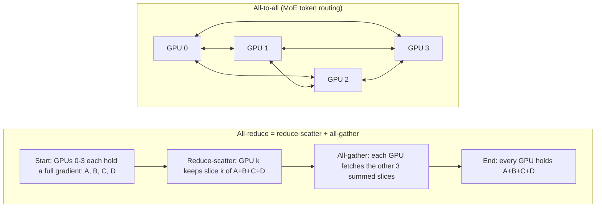
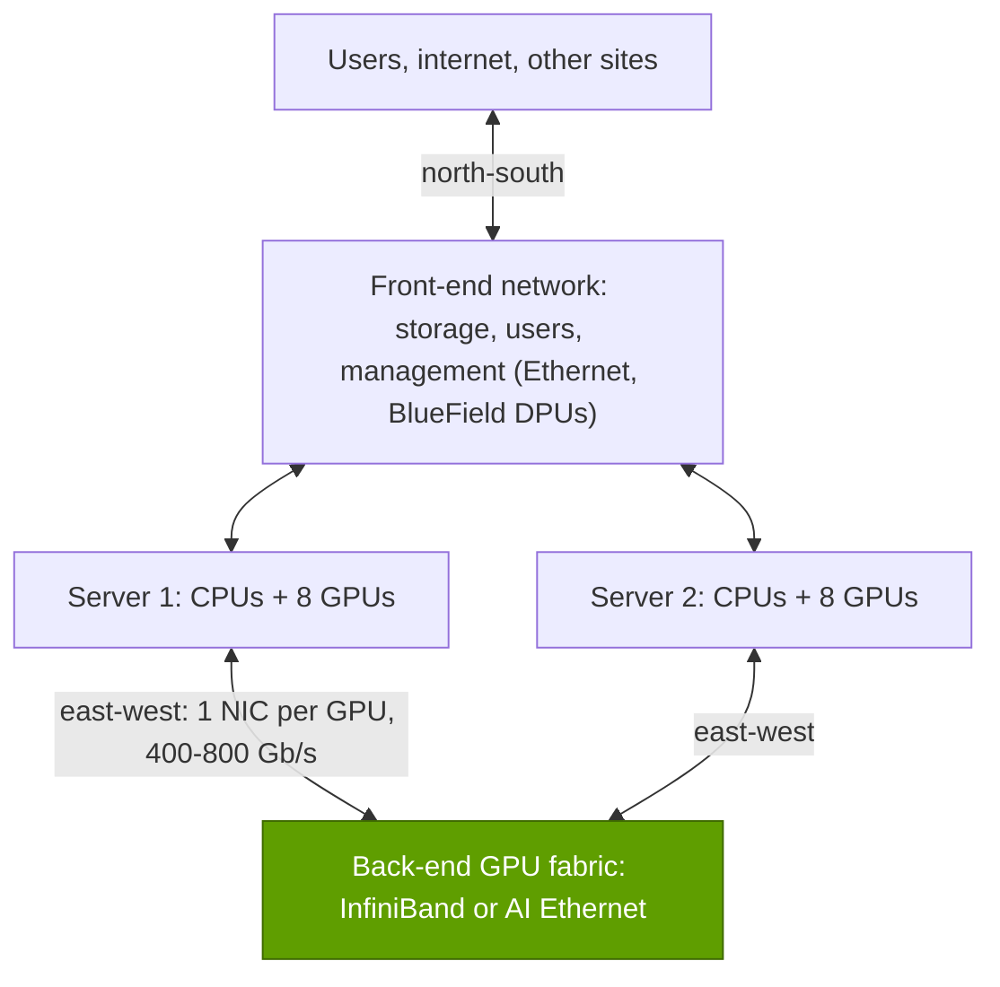

# Why AI networks are different

Layer 06 · Scale-out and scale-across networking · ~8 min read · Last verified: 2026-11-05

## ⚡ The Executive Take

- **Training is a synchronized march.** Every step ends with GPUs swapping gradients through a [collective operation](../../glossary.md#collective-operation); no GPU starts the next step until the slowest message lands. Meta trained Llama 3 405B on 16,384 H100 GPUs this way [[S34006]](../../sources/bibliography.md#s34006).
- **So the tail, not the average, sets the pace.** In a simple repo model, if 1% of network flows run 10× slow, a 1,000-flow step takes ~3.2× as long (Est.) [[S6029]](../../sources/bibliography.md#s6029).
- **The money is large:** at ~$2 per [GPU-hour](../../glossary.md#gpu-hour) [[S393]](../../sources/bibliography.md#s393), a 100,000-GPU cluster costs ~$200,000 an hour; losing 17% of it to network waits wastes ~$300M a year (Est.).
- **AI traffic is the worst case for ordinary networks:** a few huge, simultaneous, many-to-one flows ([incast](../../glossary.md#incast)). Clusters therefore run a separate [back-end network](../../glossary.md#back-end-network) with [RDMA](../../glossary.md#rdma) and one 400–800 Gb/s [NIC](../../glossary.md#nic) per GPU [[S266]](../../sources/bibliography.md#s266)[[S264]](../../sources/bibliography.md#s264).
- **NVIDIA's pitch** is low [tail latency](../../glossary.md#tail-latency) under load: it claims 95% effective bandwidth on [Spectrum-X](../../glossary.md#spectrum-x) vs ~60% for standard Ethernet at 100k-GPU scale, a vendor claim [[S6000]](../../sources/bibliography.md#s6000).

## 1. The job: keep thousands of GPUs in lockstep

In [data-parallel](../../glossary.md#data-parallelism) training all GPUs must agree on averaged gradients before updating weights. Like a rowing crew, it moves at the pace of the slowest stroke. A [straggler](../../glossary.md#straggler) need not be broken hardware: ByteDance's five-month study of its [LLM](../../glossary.md#llm) training fleet found stragglers common and often caused by interacting factors [[S6029]](../../sources/bibliography.md#s6029). Failures add to the bill: Llama 3's 54-day run saw 466 job interruptions [[S34006]](../../sources/bibliography.md#s34006).

> [!TIP]
> **Worked example — 1% of flows delayed 10×.** Assume 25% of a step is communication that cannot hide behind compute, and a collective involves ~1,000 flows (repo assumptions).
> - Chance that at least one flow is slow: 1 − 0.99¹⁰⁰⁰ ≈ **100%**, so every step waits: 0.75 + 0.25 × 10 = **3.25×** the clean step.
> - Even at 0.01% slow flows the chance is ~9.5% and the step is **~1.21×**.
> - Dollars: 100,000 GPUs × ~$2/GPU-hour [[S393]](../../sources/bibliography.md#s393) = $200,000/hour. A 1.21× step idles 1 − 1/1.21 ≈ **17%** of GPU time: ~$35,000/hour, **~$300M a year** (Est.).
>
> **Conclusion:** shaving the tail is worth far more than the network's own bill of materials: NVIDIA's core argument for premium fabrics.

**[Q1 · Job & failure mode]** The [scale-out](../../glossary.md#scale-out) network turns thousands of GPUs (beyond one [NVLink](../../glossary.md#nvlink) domain, see [Layer 05](../05-scale-up-nvlink-nvswitch/index.md)) into one training or inference machine. When it is weak nothing crashes: steps stretch, [MFU](../../glossary.md#mfu) falls, jobs restart more often and expensive GPUs idle.

🔧 Under the hood: the model behind the chart

Expected step time = (1 − m) + m × [1 + (k − 1) × (1 − (1 − p)^F)], with exposed-communication share m, delay factor k, slow-flow fraction p and F flows. As F grows, (1 − p)^F collapses toward zero, so bigger collectives become hostage to rarer events. Overlapping communication with compute softens this but cannot remove the per-step barrier.

## 2. The traffic: collective operations

AI jobs talk through four collective patterns, implemented by [NCCL](../../glossary.md#nccl) on NVIDIA systems [[S34013]](../../sources/bibliography.md#s34013): **[all-reduce](../../glossary.md#all-reduce)** (every GPU ends with the sum, for gradient averaging), **[reduce-scatter](../../glossary.md#reduce-scatter)** (each GPU ends with one summed slice, used by [FSDP](../../glossary.md#fsdp)), **[all-gather](../../glossary.md#all-gather)** (each GPU collects everyone's slice) and **[all-to-all](../../glossary.md#all-to-all)** (each GPU sends a different piece to every other, for [mixture-of-experts](../../glossary.md#mixture-of-experts) token routing).

> [!TIP]
> **Worked example — how much a ring all-reduce sends.** In a [ring all-reduce](../../glossary.md#ring-all-reduce) each GPU sends 2(N−1)/N times the message: 1.75× for 8 GPUs, ~2× for thousands [[S34011]](../../sources/bibliography.md#s34011)[[S34012]](../../sources/bibliography.md#s34012). [BF16](../../glossary.md#bf16) gradients of a 70B-parameter model are ~140 GB, so each GPU pushes ~280 GB per full exchange: ~2.8 s at 800 Gb/s (100 GB/s) unless overlapped or sharded.
>
> **Conclusion:** per-GPU bandwidth sets how long GPUs wait, which is why NICs went to 800 Gb/s (ConnectX-8) and 1.6 Tb/s (ConnectX-9) [[S264]](../../sources/bibliography.md#s264)[[S33004]](../../sources/bibliography.md#s33004).

All-to-all, where every GPU talks to every other at once, is the hardest pattern and grows with MoE models (see [P4](../../primers/P4-parallelism-explained.md)).

## 3. Transport, congestion and incast

TCP/IP copies data through the operating system and CPU. [RDMA](../../glossary.md#rdma) lets the NIC write straight into a remote GPU's memory ([GPUDirect RDMA](../../glossary.md#gpudirect-rdma)). [InfiniBand](../../glossary.md#infiniband) was built around RDMA; [RoCE](../../glossary.md#roce) carries it inside Ethernet.

| | TCP/IP | RoCEv2 (RDMA on Ethernet) | InfiniBand |
|---|---|---|---|
| Data path | Kernel, copies via CPU memory | NIC to GPU memory directly | NIC to GPU memory directly |
| Loss handling | Drop, then retransmit after timeout | Needs [PFC](../../glossary.md#priority-flow-control) / [ECN](../../glossary.md#ecn) to avoid drops | Lossless by design ([credits](../../glossary.md#credit-based-flow-control)) |
| Load balancing | Per-flow hash ([ECMP](../../glossary.md#ecmp)) | ECMP unless enhanced (Spectrum-X, UEC) | [Adaptive routing](../../glossary.md#adaptive-routing) native |
| Fit for AI back-end | 🟥 Too slow and jittery | 🟨 Good if tuned | 🟩 Purpose-built |

When many GPUs send to one receiver, its switch port overflows. RoCE cannot tolerate drops, so operators add PFC pauses and [congestion control](../../glossary.md#congestion-control); pauses can spread backwards through the fabric. Meta, which runs RoCE for most of its AI capacity [[S6003]](../../sources/bibliography.md#s6003), reports that DCQCN, the standard RoCE congestion control, fit AI collectives poorly; it relied on receiver-driven admission in its collective library instead [[S34022]](../../sources/bibliography.md#s34022)[[S6030]](../../sources/bibliography.md#s6030).

> [!TIP]
> **Worked example — incast arithmetic.** Eight senders each push 400 Gb/s to one 400 Gb/s port: 3,200 Gb/s arrives, 2,800 Gb/s must queue or drop. An illustrative 32 MB buffer fills in ~0.09 ms (32 MB ÷ 350 GB/s).
>
> **Conclusion:** buffers cannot absorb AI incast; senders must be slowed or spread within microseconds, the job of congestion control and adaptive routing.

## 4. East-west vs north-south; back-end vs front-end

Training is almost all [east-west traffic](../../glossary.md#east-west-traffic) (between servers) rather than [north-south traffic](../../glossary.md#north-south-traffic) (in and out of the site), so clusters separate the GPU fabric from the [front-end network](../../glossary.md#front-end-network):

Front-end DPUs and storage are covered in [Layer 07](../07-dpu-supernic-storage-security/index.md).

**[Q2 · Metrics that matter]** Five numbers decide whether a fabric helps or hurts:

| Metric | Why it matters | Where NVIDIA is (2026) |
|---|---|---|
| Scale-out bandwidth per GPU | Sets collective transfer time | 400 Gb/s (ConnectX-7) → 800 Gb/s (ConnectX-8) → 1.6 Tb/s (ConnectX-9) [[S266]](../../sources/bibliography.md#s266)[[S264]](../../sources/bibliography.md#s264)[[S33004]](../../sources/bibliography.md#s33004) |
| Effective bandwidth under load | Collisions waste line rate | 95% claimed on Spectrum-X vs ~60% standard Ethernet [[S6000]](../../sources/bibliography.md#s6000) |
| Tail latency (p99 flow completion) | Sets synchronous step time | Rarely published; buyers should test it |
| Switch radix → tiers and hops | Fewer switches, optics, hops | 144 × 800G Quantum-X800 [[S264]](../../sources/bibliography.md#s264); 512 × 200G Spectrum-6 [[S265]](../../sources/bibliography.md#s265) |
| Optics watts and dollars per GPU | Scale with GPU count | ~6 transceivers, ~180 W, ~$6,000 per GPU (Huang) [[S6016]](../../sources/bibliography.md#s6016) |

## 🎯 Corp Dev Lens

1. **Pricing power follows idle time.** Recovering 5% of a $5B cluster's GPU time is worth ~$250M; vendors who prove tail-latency gains on customer workloads can price on value, not box cost.
2. **Benchmarks are the battleground.** Effective-bandwidth claims are mostly vendor-published [[S6000]](../../sources/bibliography.md#s6000); independent fabric benchmarks would be valuable.
3. **Qualcomm question (public information only):** AI200/AI250 racks [[S173]](../../sources/bibliography.md#s173) need a scale-out story; is open RoCE/Ultra Ethernet sufficient for inference clusters, or does tail latency at scale require deeper NIC–switch co-design?

## 📚 Sources

<!-- Auto-generated from the [S…] citations on this page by `make build`. Edit sources/registry/*.csv, not this list. -->

- [**S173**](../../sources/bibliography.md#s173) Qualcomm, *Qualcomm Unveils AI200 and AI250 - Redefining Rack-Scale Data Center Inference*, 2025-10-27. [Link](https://www.qualcomm.com/news/releases/2025/10/qualcomm-unveils-ai200-and-ai250-redefining-rack-scale-data-cent)
- [**S264**](../../sources/bibliography.md#s264) NVIDIA Newsroom, *NVIDIA Announces New Switches Optimized for Trillion-Parameter GPU Computing and AI Infrastructure (Quantum-X800, Spectrum-X800, ConnectX-8)*, 2024-03-18. [Link](https://nvidianews.nvidia.com/news/networking-switches-gpu-computing-ai)
- [**S265**](../../sources/bibliography.md#s265) NVIDIA Newsroom, *NVIDIA Announces Spectrum-X Photonics, Co-Packaged Optics Networking Switches to Scale AI Factories to Millions of GPUs*, 2025-03-18. [Link](https://nvidianews.nvidia.com/news/nvidia-spectrum-x-co-packaged-optics-networking-switches-ai-factories)
- [**S266**](../../sources/bibliography.md#s266) NVIDIA Newsroom, *NVIDIA Quantum-2 Takes Supercomputing to New Heights, Into the Cloud*, 2021-11-09. [Link](https://nvidianews.nvidia.com/news/nvidia-quantum-2-takes-supercomputing-to-new-heights-into-the-cloud)
- [**S393**](../../sources/bibliography.md#s393) Latent Space (Eugene Cheah), *$2 H100s: how the GPU bubble burst*, 2024-10. [Link](https://www.latent.space/p/gpu-bubble)
- [**S6000**](../../sources/bibliography.md#s6000) TechPowerUp (NVIDIA press release), *NVIDIA Ethernet Networking Accelerates World's Largest AI Supercomputer, Built by xAI*, 2024-10-29. [Link](https://techpowerup.com/328227/nvidia-ethernet-networking-accelerates-worlds-largest-ai-supercomputer-built-by-xai)
- [**S6003**](../../sources/bibliography.md#s6003) Engineering at Meta, *RoCE networks for distributed AI training at scale*, 2024-08-05. [Link](https://engineering.fb.com/2024/08/05/data-center-engineering/roce-network-distributed-ai-training-at-scale/)
- [**S6016**](../../sources/bibliography.md#s6016) optics.org, *NVIDIA reveals plan to scale AI factories with co-packaged optics*, 2025-03-19. [Link](https://www.optics.org/news/16/3/26)
- [**S6029**](../../sources/bibliography.md#s6029) Cornell Systems Research Seminar (Jinkun Lin, Ziheng Jiang, et al. (NYU / ByteDance)), *Understanding Stragglers in Large Model Training Using What-if Analysis (OSDI '25 seminar listing)*, 2026-02-06. [Link](https://www.cs.cornell.edu/events/systems-research-seminar/understanding-stragglers-large-model-training-using-what-if-analysis)
- [**S6030**](../../sources/bibliography.md#s6030) bearblog (paper summary), *[Paper notes] RDMA over Ethernet for Distributed AI Training at Meta Scale*, 2024. [Link](https://wuql20.bearblog.dev/paper-notes-rdma-over-ethernet-for-distributed-ai-training-at-meta-scale/)
- [**S33004**](../../sources/bibliography.md#s33004) NVIDIA Newsroom, *NVIDIA Kicks Off the Next Generation of AI With Rubin — Six New Chips; One Incredible AI Supercomputer*, 2026-01-05. [Link](https://nvidianews.nvidia.com/news/rubin-platform-ai-supercomputer)
- [**S34006**](../../sources/bibliography.md#s34006) arXiv:2407.21783 (Llama Team (AI @ Meta)), *The Llama 3 Herd of Models*, 2024-07-31. [Link](https://arxiv.org/abs/2407.21783)
- [**S34011**](../../sources/bibliography.md#s34011) Journal of Parallel and Distributed Computing (Pitch Patarasuk, Xin Yuan), *Bandwidth optimal all-reduce algorithms for clusters of workstations*, 2009-02. [Link](https://doi.org/10.1016/j.jpdc.2008.09.002)
- [**S34012**](../../sources/bibliography.md#s34012) NVIDIA (GitHub), *NCCL Tests — Performance reported (algbw vs busbw)*, 2024. [Link](https://github.com/NVIDIA/nccl-tests/blob/master/doc/PERFORMANCE.md)
- [**S34013**](../../sources/bibliography.md#s34013) NVIDIA Docs, *NCCL User Guide — Collective Operations*, 2025. [Link](https://docs.nvidia.com/deeplearning/nccl/user-guide/docs/usage/collectives.html)
- [**S34022**](../../sources/bibliography.md#s34022) ACM SIGCOMM 2024 (Adithya Gangidi, Rui Miao, Shengbao Zheng et al. (Meta)), *RDMA over Ethernet for Distributed AI Training at Meta Scale*, 2024-08. [Link](https://doi.org/10.1145/3651890.3672233)
