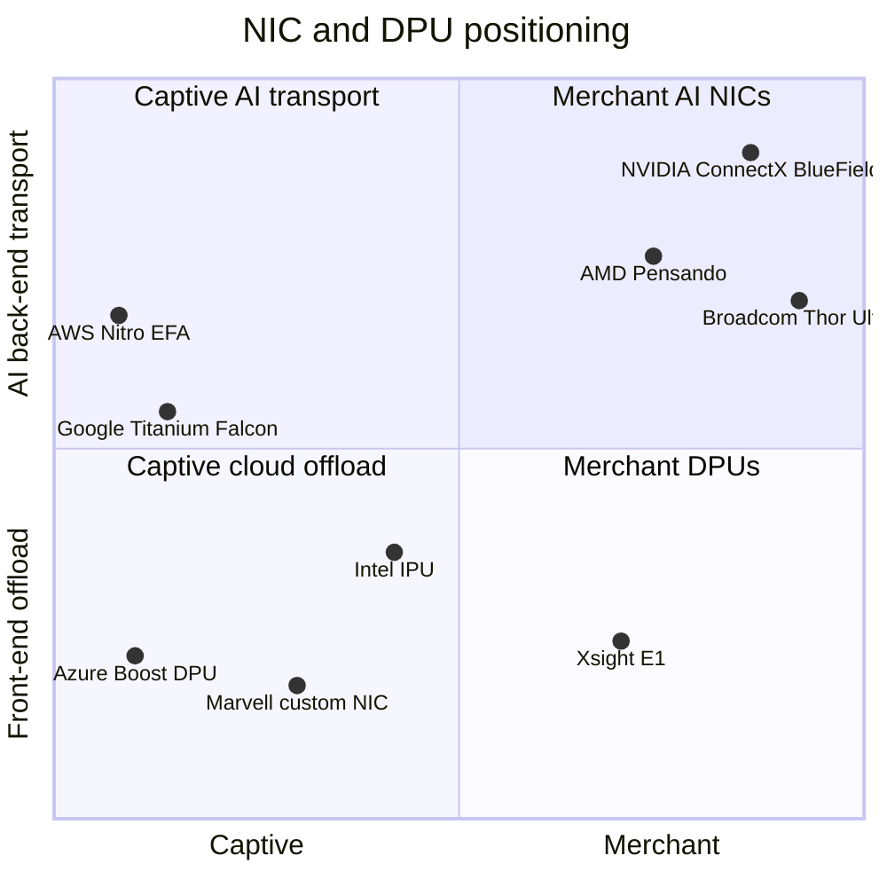

# DPU, SuperNIC, storage, security: Competition

Layer 07 · DPU, SuperNIC, storage, security · ~9 min read · Last verified: 2026-11-05

## ⚡ The Executive Take

- **Two markets share one label.** The AI [back-end network](../../glossary.md#back-end-network) NIC (one [SuperNIC](../../glossary.md#supernic) per GPU) ships by default in NVIDIA's racks; the [DPU](../../glossary.md#dpu) that offloads cloud networking, storage and security is where the largest buyers build their own [[S264]](../../sources/bibliography.md#s264)[[S7503]](../../sources/bibliography.md#s7503)[[S7504]](../../sources/bibliography.md#s7504).
- **On speed NVIDIA is one step ahead:** ConnectX-9 ships at 1.6 Tb/s per GPU with Vera Rubin; Broadcom's Thor Ultra and AMD's Vulcano are at 800 Gb/s [[S33004]](../../sources/bibliography.md#s33004)[[S7529]](../../sources/bibliography.md#s7529)[[S7500]](../../sources/bibliography.md#s7500).
- **Each step is copied faster:** rivals took ~3 years to match 400G but at most one to match 800G, helped by the open [Ultra Ethernet](../../glossary.md#ultra-ethernet) 1.0 spec (June 2025) ([roadmap](roadmap.md)) [[S266]](../../sources/bibliography.md#s266)[[S289]](../../sources/bibliography.md#s289)[[S7528]](../../sources/bibliography.md#s7528).
- **AMD buys bandwidth with NIC count:** Helios gives each MI455X three 800G Vulcano NICs, 2.4 Tb/s against Rubin's 1.6 Tb/s [[S228]](../../sources/bibliography.md#s228)[[S7500]](../../sources/bibliography.md#s7500).
- **[Q5 · Strongest challenger]** Hyperscalers' in-house offload, led by [AWS Nitro](../../glossary.md#aws-nitro): every current-generation EC2 instance runs on it, and AWS GPU instances scale out over its own [EFA](../../glossary.md#efa), not ConnectX [[S7503]](../../sources/bibliography.md#s7503)[[S292]](../../sources/bibliography.md#s292). Microsoft (Azure Boost DPU) and Google (Titanium, Falcon) follow the same playbook [[S7504]](../../sources/bibliography.md#s7504)[[S7520]](../../sources/bibliography.md#s7520)[[S7519]](../../sources/bibliography.md#s7519).
- **The pool is growing fast:** Dell'Oro saw SmartNIC and DPU revenue up 71% y/y in 1Q 2025 and doubling in 2Q 2025 [[S7522]](../../sources/bibliography.md#s7522)[[S7523]](../../sources/bibliography.md#s7523).

![Heatmap of 8 NIC and DPU challengers against NVIDIA on six dimensions. 5 rivals trail on bandwidth per device (AWS Nitro v6 400G per card, AMD Vulcano and Broadcom Thor Ultra 800G, Intel IPU 200G vs ConnectX-9 at 1.6 Tb/s); AMD Pensando and Broadcom reach parity on AI-transport features via Ultra Ethernet; Broadcom leads on openness and AWS Nitro leads on deployed scale (2 'leads' cells in total); Google, Microsoft and AWS are mostly 'different approach' because their offload silicon is captive (17 such cells).](../../assets/charts/07-nic-dpu-competitor-heatmap.svg)

## How the NIC and DPU contest is scored

In a factory, the SuperNIC is the GPU's **loading dock** and the DPU the **front desk** that checks visitors and keeps tenants apart. Docks compete on throughput; front desks on programmability and control. So rivals split into merchant NIC makers (Broadcom, AMD, Xsight Labs) and cloud operators with [captive silicon](../../glossary.md#captive-silicon) (AWS, Microsoft, Google).

| Rival (best device) | Bandwidth per device | Programmability | AI-transport features | Merchant availability | Ecosystem / software |
|---|---|---|---|---|---|
| AWS Nitro v6 + EFA | 🟥 400G per card vs 1.6T | 🟦 AWS-only firmware | 🟨 [SRD](../../glossary.md#srd) multipath | 🟦 not sold | 🟦 all of EC2 |
| AMD Pensando Vulcano / Salina | 🟥 800G (3 per GPU) | 🟨 [P4](../../glossary.md#p4-language) vs [DOCA](../../glossary.md#doca) | 🟨 UEC 1.0 ready | 🟨 sold; Helios default | 🟥 small SDK base |
| Broadcom Thor Ultra | 🟥 800G | 🟥 fixed-function | 🟨 UEC trimming, multipath | 🟩 any UEC switch | 🟥 sampling since 2025-10 |
| Intel IPU E2100 (with Google) | 🟥 200G | 🟨 P4 + 16 Arm cores | 🟦 [Falcon](../../glossary.md#falcon-transport) platform | 🟥 mostly one customer | 🟥 unit kept after sale review |
| Microsoft Azure Boost DPU | 🟦 not disclosed | 🟨 programmable SoC | 🟦 front-end focus | 🟦 not sold | 🟦 Azure only |
| Xsight Labs E1 | 🟨 800G = BlueField-4 | 🟨 Arm, SONiC-DASH | 🟥 front-end focus | 🟨 merchant | 🟥 start-up |

Verdict = rival vs NVIDIA's nearest equivalent (🟩 rival leads · 🟨 parity · 🟥 rival behind · 🟦 different approach). Specs: [[S7503]](../../sources/bibliography.md#s7503)[[S7500]](../../sources/bibliography.md#s7500)[[S228]](../../sources/bibliography.md#s228)[[S7529]](../../sources/bibliography.md#s7529)[[S291]](../../sources/bibliography.md#s291)[[S7519]](../../sources/bibliography.md#s7519)[[S7518]](../../sources/bibliography.md#s7518)[[S7504]](../../sources/bibliography.md#s7504)[[S7517]](../../sources/bibliography.md#s7517)[[S512]](../../sources/bibliography.md#s512).

> [!TIP]
> **Worked example — what 1.6 Tb/s buys in a training step.** Suppose each GPU must all-reduce 2 GB of gradients across racks. A ring all-reduce sends ~2× the message, ~32 Gb per GPU: ~40 ms at 800 Gb/s, ~20 ms at ConnectX-9's 1.6 Tb/s, ~13 ms at Helios's 2.4 Tb/s [[S33004]](../../sources/bibliography.md#s33004)[[S228]](../../sources/bibliography.md#s228). If that traffic is not hidden behind compute, saving 20 ms on a 500 ms step is 4% more useful GPU time, ~$40M a year on a $1B-a-year cluster (Est., repo 🔴).

🔧 Under the hood: what "AI-transport features" means

Classic [RoCE](../../glossary.md#roce) ([RDMA](../../glossary.md#rdma) over Ethernet) assumes a lossless network and resends everything after a lost packet, so one congested link stalls a whole collective. Spectrum-X has the switch spread packets across paths and the SuperNIC reorder them, so it needs NVIDIA at both ends [[S271]](../../sources/bibliography.md#s271). AWS's SRD sprays packets over many paths and recovers loss in Nitro hardware [[S292]](../../sources/bibliography.md#s292). Ultra Ethernet 1.0 standardises the same ideas ([packet spraying](../../glossary.md#packet-spraying), trimming, out-of-order delivery) for any vendor [[S7528]](../../sources/bibliography.md#s7528)[[S7529]](../../sources/bibliography.md#s7529). The open question is who controls both ends of the wire.

## Challenger by challenger

### AWS Nitro and EFA: the strongest challenger

Amazon bought Annapurna Labs for a reported ~$350–370M in 2015; the full Nitro System (offloaded [hypervisor](../../glossary.md#hypervisor), networking, storage, security) arrived at re:Invent 2017 [[S4540]](../../sources/bibliography.md#s4540)[[S7533]](../../sources/bibliography.md#s7533). AWS now lists a sixth Nitro generation at up to 400 Gb/s per card, with RDMA over EFA on recent GPU instances [[S7503]](../../sources/bibliography.md#s7503). EFA gives a p5 (8× H100) or p6-b200 (8× B200) instance 3.2 Tb/s, 400 Gb/s per GPU [[S292]](../../sources/bibliography.md#s292).

**Best argument:** whoever owns the hypervisor owns the NIC; AWS needs Nitro in every server anyway, so adding RDMA transport costs it little. **Gap closed:** AWS matched the H100 era's 400 Gb/s per GPU, but a Nitro v6 card carries a quarter of ConnectX-9's bandwidth and is not sold outside AWS [[S7503]](../../sources/bibliography.md#s7503)[[S33004]](../../sources/bibliography.md#s33004).

> [!TIP]
> **Worked example — NIC revenue NVIDIA forgoes at AWS.** p5 delivers 3,200 Gb/s per 8 GPUs, the same 400 Gb/s per GPU as one ConnectX-7 per H100 [[S292]](../../sources/bibliography.md#s292)[[S266]](../../sources/bibliography.md#s266). For every 100,000 NVIDIA GPUs behind EFA, NVIDIA ships no SuperNIC; at an assumed $1,000–2,000 per 400G NIC (Est., repo 🔴) that is $100–200M of NIC silicon kept by Annapurna.

### AMD Pensando

AMD paid ~$1.9B for Pensando in May 2022 [[S7527]](../../sources/bibliography.md#s7527). Its line spans the P4-programmable Pollara 400 (shipping since 2025), the Salina 400 DPU and the 800G Vulcano, Helios's default network; AMD claims up to 13% faster job completion from modelling [[S289]](../../sources/bibliography.md#s289)[[S7501]](../../sources/bibliography.md#s7501)[[S7500]](../../sources/bibliography.md#s7500). **Best argument:** an open Ultra Ethernet rack with more bandwidth per GPU and no NVIDIA networking. **Gap:** one speed step behind per device and a small installed base until Helios ramps from end-Q3 2026 [[S90020]](../../sources/bibliography.md#s90020).

### Broadcom Thor Ultra

Thor Ultra (2025-10-14) is the first UEC-compliant 800G Ethernet NIC, sampling at launch and paired with the 102.4 Tb/s Tomahawk 6 switch [[S7529]](../../sources/bibliography.md#s7529)[[S274]](../../sources/bibliography.md#s274). **Best argument:** custom-accelerator racks need a NIC that works with any switch; Spectrum-X's best features work only NVIDIA-to-NVIDIA. **Gap:** 800G vs 1.6T, no DPU, no volume yet.

### Intel, Google, Microsoft, Marvell and Xsight Labs

Intel's 200G IPU E2100, co-developed with Google, was the first platform for Google's Falcon transport; Google's Titanium offloads its own cloud [[S291]](../../sources/bibliography.md#s291)[[S7519]](../../sources/bibliography.md#s7519)[[S7520]](../../sources/bibliography.md#s7520). Microsoft's Fungible purchase became the Azure Boost DPU [[S7504]](../../sources/bibliography.md#s7504). Marvell sells OCTEON 10 DPUs and co-designed Meta's 4×100G FBNIC [[S7526]](../../sources/bibliography.md#s7526)[[S7525]](../../sources/bibliography.md#s7525). Xsight Labs sells an 800G E1 DPU and raised >$300M at $2.8B in July 2026 [[S7517]](../../sources/bibliography.md#s7517).

Switch rivals: [layer 06 competition](../06-scale-out-scale-across-networking/competition.md); all layers: [competitive landscape](../../cross-cutting/15-competitive-landscape/index.md).

> [!NOTE]
> **🐂 Bull view.** Every NVL72 rack ships 72 SuperNICs, and ConnectX-9 is the only 1.6 Tb/s NIC in production [[S33004]](../../sources/bibliography.md#s33004)[[S501]](../../sources/bibliography.md#s501). BlueField-4 adds a storage foothold: twelve storage vendors co-design on its STX reference architecture [[S7511]](../../sources/bibliography.md#s7511). Rivals copy each speed step, but NVIDIA reaches the next one first.

> [!WARNING]
> **🐻 Bear view.** The biggest buyers own their NIC: Nitro and EFA, Azure Boost, Titanium and Falcon [[S7503]](../../sources/bibliography.md#s7503)[[S7504]](../../sources/bibliography.md#s7504)[[S7520]](../../sources/bibliography.md#s7520). Ultra Ethernet turns the AI NIC into a standard part that Broadcom and AMD sell into any switch [[S7528]](../../sources/bibliography.md#s7528)[[S7529]](../../sources/bibliography.md#s7529). If the rack is no longer NVIDIA's, neither is the NIC.

## 🎯 Corp Dev Lens

1. If Ultra Ethernet standardises AI transport, does NIC value move to whoever controls the rack design (NVIDIA, AMD, hyperscalers) rather than to the best NIC silicon?
2. Nitro, Azure Boost and Titanium were built on acquired teams; which independent DPU or NIC teams remain (Xsight Labs is one), and who would need them?
3. AMD's three NICs per GPU trade NIC cost for bandwidth: does that set a per-GPU norm custom-accelerator racks must match?
4. For a new accelerator entrant (Qualcomm's AI200 and AI250 among them [[S90028]](../../sources/bibliography.md#s90028)), is a merchant UEC NIC partnership enough, or is the NIC a control point worth owning?

## 📚 Sources

<!-- Auto-generated from the [S…] citations on this page by `make build`. Edit sources/registry/*.csv, not this list. -->

- [**S228**](../../sources/bibliography.md#s228) Spheron, *AMD Helios rack-scale AI on GPU cloud: deploy MI455X inference with UALink and Ultra Ethernet (2026 guide)*, 2026. [Link](https://www.spheron.network/blog/amd-helios-rack-scale-mi455x-gpu-cloud/)
- [**S264**](../../sources/bibliography.md#s264) NVIDIA Newsroom, *NVIDIA Announces New Switches Optimized for Trillion-Parameter GPU Computing and AI Infrastructure (Quantum-X800, Spectrum-X800, ConnectX-8)*, 2024-03-18. [Link](https://nvidianews.nvidia.com/news/networking-switches-gpu-computing-ai)
- [**S266**](../../sources/bibliography.md#s266) NVIDIA Newsroom, *NVIDIA Quantum-2 Takes Supercomputing to New Heights, Into the Cloud*, 2021-11-09. [Link](https://nvidianews.nvidia.com/news/nvidia-quantum-2-takes-supercomputing-to-new-heights-into-the-cloud)
- [**S271**](../../sources/bibliography.md#s271) NVIDIA Newsroom, *NVIDIA Launches Accelerated Ethernet Platform for Hyperscale Generative AI (Spectrum-X)*, 2023-05-29. [Link](https://nvidianews.nvidia.com/news/nvidia-launches-accelerated-ethernet-platform-for-hyperscale-generative-ai)
- [**S274**](../../sources/bibliography.md#s274) Broadcom, *Broadcom ships Tomahawk 6: world's first 102.4 Tbps switch*, 2025-06-03. [Link](https://investors.broadcom.com/news-releases/news-release-details/broadcom-ships-tomahawk-6-worlds-first-1024-tbps-switch)
- [**S289**](../../sources/bibliography.md#s289) AMD, *AMD Advancing AI 2024: Pensando Pollara 400 AI NIC and Salina DPU*, 2024-10-10. [Link](https://www.amd.com/en/newsroom.html)
- [**S291**](../../sources/bibliography.md#s291) Intel, *Intel Infrastructure Processing Unit (IPU) E2100 (Mount Evans)*, 2022. [Link](https://www.intel.com/content/www/us/en/products/details/network-io/ipu.html)
- [**S292**](../../sources/bibliography.md#s292) Amazon Web Services, *Elastic Fabric Adapter (EFA) and AWS Nitro System documentation*, 2025. [Link](https://aws.amazon.com/hpc/efa/)
- [**S501**](../../sources/bibliography.md#s501) eWeek, *Everything Nvidia Just Announced at GTC 2026: 7 Chips, 5 Racks, 1 Giant Bet on Agentic AI*, 2026-03-17. [Link](https://www.eweek.com/news/nvidia-gtc-2026-ai-inference-vera-rubin-neuron/)
- [**S512**](../../sources/bibliography.md#s512) NVIDIA Blog, *NVIDIA Launches BlueField-4: The Processor Powering the Operating System of AI Factories*, 2025-10-28. [Link](https://blogs.nvidia.com/blog/bluefield-4-ai-factory/)
- [**S4540**](../../sources/bibliography.md#s4540) Global Venturing, *Arm exits Annapurna Labs in $370m acquisition*, 2015-01-23. [Link](https://globalventuring.com/blog/2015/01/23/arm-exits-annapurna-labs-in-370m-acquisition/)
- [**S7500**](../../sources/bibliography.md#s7500) AMD, *AMD Pensando Vulcano 800 AI NIC: Built to Scale-Out and Across*, 2026. [Link](https://www.amd.com/en/blogs/2026/amd-pensando-vulcano-800-ai-nic-scale-out-and-across.html)
- [**S7501**](../../sources/bibliography.md#s7501) ServeTheHome, *AMD Vulcano 800G NIC coming as AMD outlines its UALink and UEC scale plans*, 2025-06. [Link](https://www.servethehome.com/amd-vulcano-800g-nic-coming-as-amd-outlines-its-ualink-and-uec-scale-plans/)
- [**S7503**](../../sources/bibliography.md#s7503) Amazon Web Services, *Instances built on the AWS Nitro System (Amazon EC2 documentation)*, 2026. [Link](https://docs.aws.amazon.com/ec2/latest/instancetypes/ec2-nitro-instances.html)
- [**S7504**](../../sources/bibliography.md#s7504) Blocks & Files, *Microsoft boosts Azure infrastructure with Fungible-derived DPU*, 2024-11-20. [Link](https://blocksandfiles.com/2024/11/20/microsoft-boosts-azure-infrastructure-with-fungible-derived-dpu/)
- [**S7511**](../../sources/bibliography.md#s7511) NVIDIA Newsroom, *NVIDIA Launches BlueField-4 STX Storage Architecture With Broad Industry Adoption*, 2026-03-16. [Link](https://nvidianews.nvidia.com/news/nvidia-launches-bluefield-4-stx-storage-architecture-with-broad-industry-adoption)
- [**S7517**](../../sources/bibliography.md#s7517) StorageNewsletter, *Xsight Labs raises more than $300 million at $2.8 billion valuation to power next-generation AI and cloud networks*, 2026-08-06. [Link](https://www.storagenewsletter.com/2026/08/06/fms-2026-xsight-labs-raises-more-than-300-million-at-2-8-billion-valuation-to-power-next-generation-ai-and-cloud-networks/)
- [**S7518**](../../sources/bibliography.md#s7518) Bloomberg, *Intel shelves plans to sell networking division after review*, 2025-12-03. [Link](https://www.bloomberg.com/news/articles/2025-12-03/intel-performed-strategic-review-of-networking-division)
- [**S7519**](../../sources/bibliography.md#s7519) Converge Digest, *OCP Summit: Google opens Falcon for hardware transport*, 2023-10. [Link](https://convergedigest.com/ocp-summit-google-opens-falcon-for-hardware-transport/)
- [**S7520**](../../sources/bibliography.md#s7520) Google Cloud, *Titanium (Google Cloud product page)*, 2024. [Link](https://cloud.google.com/titanium)
- [**S7522**](../../sources/bibliography.md#s7522) Converge Digest, *Dell'Oro: surging demand for AI infrastructure (data center components, 1Q 2025)*, 2025-06. [Link](https://convergedigest.com/delloro-surging-demand-for-ai-infrastructure/)
- [**S7523**](../../sources/bibliography.md#s7523) DQIndia, *Data center semiconductors and components up 44% on AI hardware demand in 2Q-2025 (Dell'Oro)*, 2025-09. [Link](https://www.dqindia.com/esdm/data-center-semiconductors-and-components-up-44-on-ai-hardware-demand-in-2q-2025-10519731)
- [**S7525**](../../sources/bibliography.md#s7525) Marvell, *Marvell delivers custom Ethernet network interface controller solution at OCP*, 2024-10. [Link](https://www.marvell.com/company/newsroom/marvell-delivers-custom-ethernet-network-interface-controller-solution-at-ocp.html)
- [**S7526**](../../sources/bibliography.md#s7526) Marvell, *Marvell extends OCTEON leadership with industry's first 5nm DPUs*, 2021. [Link](https://cn.marvell.com/company/newsroom/marvell-extends-octeon-leadership-industry-first-5nm-dpu.html)
- [**S7527**](../../sources/bibliography.md#s7527) AMD Investor Relations, *AMD expands data center solutions capabilities with acquisition of Pensando*, 2022-05-26. [Link](https://ir.amd.com/news-events/press-releases/detail/1071/amd-expands-data-center-solutions-capabilities-with)
- [**S7528**](../../sources/bibliography.md#s7528) Converge Digest, *Ultra Ethernet Consortium releases Specification 1.0*, 2025-06. [Link](https://convergedigest.com/ultra-ethernet-consortium-releases-specification-1-0/)
- [**S7529**](../../sources/bibliography.md#s7529) StreetInsider (Broadcom press release), *Broadcom introduces industry's first 800G AI Ethernet NIC (Thor Ultra)*, 2025-10-14. [Link](https://www.streetinsider.com/Press+Releases/Broadcom+Introduces+Industry%E2%80%99s+First+800G+AI+Ethernet+NIC/25451603.html)
- [**S7533**](../../sources/bibliography.md#s7533) hidekazu-konishi.com (Hidekazu Konishi), *AWS custom silicon history and timeline: Nitro System, Graviton, Inferentia, Trainium*, 2025. [Link](https://hidekazu-konishi.com/entry/aws_history_and_timeline_aws_silicon.html)
- [**S33004**](../../sources/bibliography.md#s33004) NVIDIA Newsroom, *NVIDIA Kicks Off the Next Generation of AI With Rubin — Six New Chips; One Incredible AI Supercomputer*, 2026-01-05. [Link](https://nvidianews.nvidia.com/news/rubin-platform-ai-supercomputer)
- [**S90020**](../../sources/bibliography.md#s90020) Shacknews, *AMD Helios AI rack system on track for initial shipments in Q3 2026*, 2026. [Link](https://www.shacknews.com/article/150249/amd-helios-ai-system-shipping-q3-2026)
- [**S90028**](../../sources/bibliography.md#s90028) TechRepublic, *Qualcomm unveils AI chips to rival Nvidia, AMD*, 2025-10-27. [Link](https://techrepublic.com/article/news-qualcomm-unveils-ai-chips-to-rival-nvidia-amd)
