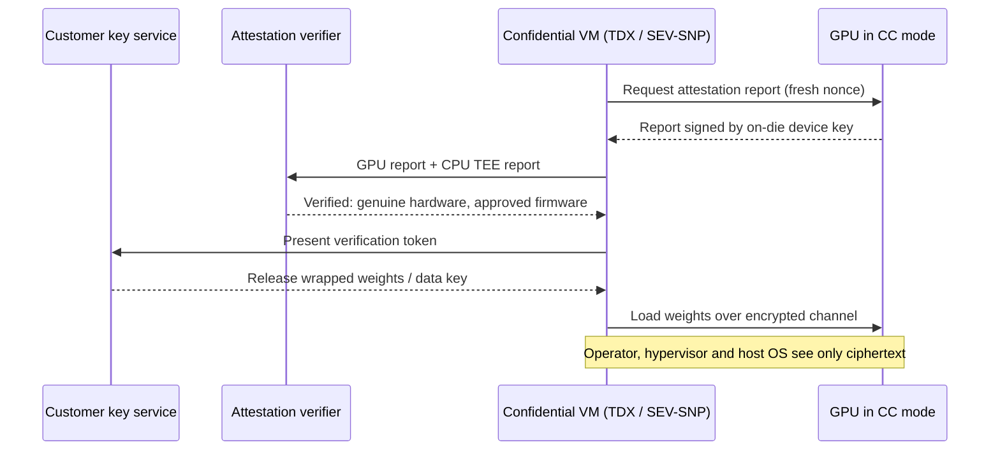

# Confidential computing on GPUs

Layer 07 · DPU, SuperNIC, storage, security · ~8 min read · Last verified: 2026-11-05

## ⚡ The Executive Take

- **[Confidential computing](../../glossary.md#confidential-computing) protects data while it is used.** Weights, prompts and KV caches stay inside a [trusted execution environment](../../glossary.md#trusted-execution-environment) that the cloud operator, hypervisor and host OS cannot read, and the customer checks this by [attestation](../../glossary.md#attestation) before sending secrets.
- **NVIDIA moved first on GPUs:** H100 was the first GPU with confidential computing, anchored in an on-die [hardware root of trust](../../glossary.md#root-of-trust); Blackwell added TEE-I/O and inline NVLink protection; Vera Rubin NVL72 extends it across a rack [[S7012]](../../sources/bibliography.md#s7012)[[S301]](../../sources/bibliography.md#s301)[[S7028]](../../sources/bibliography.md#s7028).
- **Measured cost is small for big models:** on H100, confidential mode cut throughput 6.85% on Llama-3.1-8B, 4.58% on Phi-3-14B and ~0% on Llama-3.1-70B, but raised the 8B model's time to first token 19% [[S7011]](../../sources/bibliography.md#s7011).
- **Blackwell's "nearly identical" throughput is a vendor claim**; this repo found no independent benchmark of Blackwell or Rubin confidential mode 🔴 [[S7012]](../../sources/bibliography.md#s7012).
- **Public clouds offer it:** Azure's confidential H100 VMs reached GA in September 2024 [[S7013]](../../sources/bibliography.md#s7013); Google's A3 H100 confidential VMs pair the GPU with Intel TDX [[S7016]](../../sources/bibliography.md#s7016).
- **Weakness:** a GPU TEE depends on a CPU TEE (Intel [TDX](../../glossary.md#intel-tdx), AMD [SEV-SNP](../../glossary.md#sev-snp)), and the PCIe-standard [TDISP](../../glossary.md#tdisp) device model arriving in AMD and Intel CPUs could commoditise NVIDIA's head start [[S7014]](../../sources/bibliography.md#s7014)[[S7015]](../../sources/bibliography.md#s7015).

## 1. How a GPU trusted execution environment works

Think of a bank vault in a rented building: the landlord cannot open it, and an auditor's seal proves it is genuine. A confidential GPU deployment has four parts:

1. **A confidential VM on the CPU.** Intel TDX or AMD SEV-SNP encrypts the VM's memory and blocks the hypervisor [[S7014]](../../sources/bibliography.md#s7014)[[S7016]](../../sources/bibliography.md#s7016).
2. **The GPU in confidential mode.** Firmware locks the GPU so the host cannot read its memory; identity keys sit in the on-die root of trust [[S7012]](../../sources/bibliography.md#s7012).
3. **A protected link.** On H100, data crossing PCIe is encrypted by the driver and decrypted by the GPU, the main source of overhead [[S7011]](../../sources/bibliography.md#s7011). Blackwell's TEE-I/O protects the link and NVLink inline in hardware [[S7012]](../../sources/bibliography.md#s7012).
4. **Attestation.** The GPU signs a report of its firmware and mode; the customer's verifier checks it before the key service releases weights or data.

> [!TIP]
> **Worked example — what the overhead costs a 1,000-GPU service.** 1,000 H100s at $2.99 an hour cost ~**$26.2M a year** [[S395]](../../sources/bibliography.md#s395). For an 8B-class model, a 6.85% throughput loss [[S7011]](../../sources/bibliography.md#s7011) means ~7.4% more capacity, about **$1.9M a year**; for a 70B model the measured loss is ~0%. The 8B model's time to first token rises from 24.2 ms to 28.8 ms [[S7011]](../../sources/bibliography.md#s7011). **Conclusion:** for large models the overhead is within normal price negotiation; it bites on small, latency-sensitive models where transfers are a bigger share of the work.

🔧 Under the hood: why the overhead shrinks with model size

- **Where the cost sits:** on H100 it is the encryption of CPU–GPU transfers; compute inside the GPU runs at full speed [[S7011]](../../sources/bibliography.md#s7011).
- **Compute per byte:** a 70B model does ~9× more math per token than an 8B model for similar-sized transfers, so the fixed cost shrinks.
- **TEE-I/O (Blackwell):** encrypting inside the link hardware removes the software bounce-buffer step, which is why NVIDIA claims near-native throughput [[S7012]](../../sources/bibliography.md#s7012); independent confirmation is pending.

## 2. Why it matters: sovereign AI, regulated data and weights in someone else's cloud

- **Sovereign AI programmes** want proof that a foreign operator, or a chip vendor's firmware, cannot see national data; attestation turns "trust us" into a check the customer runs.
- **Regulated industries** (health, finance, public sector) can use shared GPU clouds if data in use is protected.
- **Model owners** increasingly deploy frontier weights in data centres they do not control: neoclouds, sovereign sites, enterprise premises. Encrypted weights decrypt only inside an attested GPU.

> [!TIP]
> **Worked example — what is being protected.** Meta reports 30.84M H100 GPU-hours to train Llama 3.1 405B [[S31002]](../../sources/bibliography.md#s31002). At $2–3 per GPU-hour that is **~$62–92M of compute** embodied in one set of weights (Est.), before data, people and post-training. Protecting it costs 0–7% of serving throughput on H100 [[S7011]](../../sources/bibliography.md#s7011). **Conclusion:** for a lab licensing weights into third-party sites, confidential computing is cheap insurance, which is why NVIDIA markets Vera Rubin NVL72 as a rack-scale confidential platform [[S7012]](../../sources/bibliography.md#s7012)[[S7028]](../../sources/bibliography.md#s7028).

## 3. How AMD, Intel and Arm compare at the platform level

Confidential AI needs a CPU TEE, an accelerator TEE and protected links between them and between accelerators. NVIDIA leads on the accelerator side; the CPU vendors own the CPU side and are standardising the device link through PCI-SIG's TDISP.

| Capability | NVIDIA | AMD | Intel | Arm ecosystem |
|---|---|---|---|---|
| CPU confidential VM | 🟨 Vera Rubin NVL72 claims CPU-to-NVLink coverage [[S301]](../../sources/bibliography.md#s301)[[S7028]](../../sources/bibliography.md#s7028) | 🟩 SEV-SNP on EPYC [[S7014]](../../sources/bibliography.md#s7014) | 🟩 TDX; used in Google's H100 confidential VMs [[S7016]](../../sources/bibliography.md#s7016) | 🟦 [Arm CCA](../../glossary.md#arm-cca) Realms; no GPU-attached cloud offering found 🔴 |
| Accelerator TEE | 🟩 Since H100 (2022) [[S7012]](../../sources/bibliography.md#s7012) | 🟥 No public Instinct GPU TEE found 🔴 | 🟥 None found for Gaudi 🔴 | 🟦 Depends on the accelerator vendor |
| Device link (TDISP / TEE-I/O) | 🟩 Blackwell TEE-I/O [[S7012]](../../sources/bibliography.md#s7012) | 🟨 SEV-TIO listed for EPYC 9005; Linux patches for Venice with PCIe 6.0 [[S7014]](../../sources/bibliography.md#s7014)[[S7015]](../../sources/bibliography.md#s7015) | 🟨 TDX Connect is Intel's counterpart; status not confirmed 🔴 | 🟦 Not found |
| Scale-up link encryption | 🟩 Inline NVLink protection, rack-scale on Rubin [[S7012]](../../sources/bibliography.md#s7012)[[S301]](../../sources/bibliography.md#s301) | 🟥 Not found for Infinity Fabric or UALink 🔴 | n/a | n/a |

> [!TIP]
> **Worked example — why NVLink encryption is the real unlock.** Llama 3.1 405B in FP8 needs ~405 GB for weights alone [[S32008]](../../sources/bibliography.md#s32008): at least **6 H100s** (80 GB each) or **2 Rubin GPUs** (288 GB each) [[S100]](../../sources/bibliography.md#s100), before any KV cache; a 1-trillion-parameter FP8 model needs at least **4 Rubin GPUs**. Frontier-scale confidential inference is always multi-GPU, and those GPUs talk over NVLink, which NVIDIA protects inline from Blackwell onward [[S7012]](../../sources/bibliography.md#s7012). **Conclusion:** protected scale-up links, not single-GPU TEEs, make confidential serving of frontier models practical, and no rival has publicly matched them yet.

> [!NOTE]
> **🐂 Bull view.** NVIDIA has the only shipping GPU TEE with protected scale-up links [[S7012]](../../sources/bibliography.md#s7012); sovereign and regulated buyers who demand attestation land on NVIDIA racks, and the feature costs little for large models [[S7011]](../../sources/bibliography.md#s7011).

> [!WARNING]
> **🐻 Bear view.** The trust anchor customers care most about is the CPU TEE and the attestation service, controlled by Intel, AMD or the cloud. As TDISP device trust lands in EPYC and Xeon platforms [[S7014]](../../sources/bibliography.md#s7014)[[S7015]](../../sources/bibliography.md#s7015), accelerator vendors can plug into a standard confidential VM, and NVIDIA's lead shrinks to an engineering head start.

## 🎯 Corp Dev Lens

1. **Attestation services are a control point.** Whoever verifies the hardware report (NVIDIA, the CPU vendor, the cloud or a third party) sits in the path of every confidential deployment. Is there an independent-verifier business to build or buy?
2. **Confidential computing may decide sovereign deals** more than benchmarks do; see [value chain](value-chain-and-corp-dev.md) for vendors positioned there.
3. **Standards could level the field.** TDISP-based device trust [[S7015]](../../sources/bibliography.md#s7015) lets any accelerator join a CPU's confidential VM; who builds the next accelerator TEE with protected scale-up links (see [competition](competition.md))?
4. **Qualcomm question (public information only):** AI200/AI250 target sovereign and enterprise inference, including HUMAIN's planned 200 MW deployment [[S173]](../../sources/bibliography.md#s173)[[S90030]](../../sources/bibliography.md#s90030). What attestation story would such buyers expect: the host CPU's TEE, an accelerator-side TEE, or both?

## 📚 Sources

<!-- Auto-generated from the [S…] citations on this page by `make build`. Edit sources/registry/*.csv, not this list. -->

- [**S100**](../../sources/bibliography.md#s100) NVIDIA Technical Blog, *Inside the NVIDIA Vera Rubin Platform: Six New Chips, One AI Supercomputer*, 2026-01-05. [Link](https://developer.nvidia.com/blog/inside-the-nvidia-rubin-platform-six-new-chips-one-ai-supercomputer/)
- [**S173**](../../sources/bibliography.md#s173) Qualcomm, *Qualcomm Unveils AI200 and AI250 - Redefining Rack-Scale Data Center Inference*, 2025-10-27. [Link](https://www.qualcomm.com/news/releases/2025/10/qualcomm-unveils-ai200-and-ai250-redefining-rack-scale-data-cent)
- [**S301**](../../sources/bibliography.md#s301) StorageReview, *NVIDIA launches Vera Rubin architecture at CES 2026: the VR NVL72 rack*, 2026-01. [Link](https://www.storagereview.com/news/nvidia-launches-vera-rubin-architecture-at-ces-2026-the-vr-nvl72-rack)
- [**S395**](../../sources/bibliography.md#s395) Lambda, *Lambda GPU cloud pricing*, 2025. [Link](https://lambda.ai/pricing)
- [**S7011**](../../sources/bibliography.md#s7011) arXiv:2409.03992 (Jianwei Zhu et al. (Phala Network)), *Confidential Computing on NVIDIA Hopper GPUs: A Performance Benchmark Study*, 2024-09. [Link](https://arxiv.org/abs/2409.03992)
- [**S7012**](../../sources/bibliography.md#s7012) NVIDIA, *NVIDIA Confidential Computing (solutions page)*, 2026. [Link](https://www.nvidia.com/en-us/data-center/solutions/confidential-computing/)
- [**S7013**](../../sources/bibliography.md#s7013) Microsoft Tech Community, *General availability: Azure confidential VMs with NVIDIA H100 Tensor Core GPUs*, 2024-09-24. [Link](https://techcommunity.microsoft.com/t5/azure-confidential-computing/general-availability-azure-confidential-vms-with-nvidia-h100/ba-p/4242644)
- [**S7014**](../../sources/bibliography.md#s7014) AMD, *AMD Secure Encrypted Virtualization (SEV) developer page*, 2026. [Link](https://www.amd.com/en/developer/sev.html)
- [**S7015**](../../sources/bibliography.md#s7015) Phoronix (Michael Larabel), *AMD sends out Linux patches for enabling SEV-TIO TDISP with PCIe 6.0*, 2026-09. [Link](https://phoronix.com/news/AMD-SEV-TIO-TDISP-Linux-Patches)
- [**S7016**](../../sources/bibliography.md#s7016) GPU Smith, *Confidential GPU attestation deployment matrix*, 2026-09-24. [Link](https://gpusmith.com/articles/en/pdfs/confidential-gpu-attestation-deployment-matrix.pdf)
- [**S7028**](../../sources/bibliography.md#s7028) VentureBeat, *Nvidia Rubin brings rack-scale encryption to enterprise AI security*, 2026-01. [Link](https://venturebeat.com/security/nvidia-rubin-rack-scale-encryption-enterprise-ai-security)
- [**S31002**](../../sources/bibliography.md#s31002) Meta (GitHub meta-llama/llama-models), *Llama 3.1 model card (MODEL_CARD.md)*, 2024-07-23. [Link](https://github.com/meta-llama/llama-models/blob/main/models/llama3_1/MODEL_CARD.md)
- [**S32008**](../../sources/bibliography.md#s32008) Meta via Hugging Face, *Llama 3.1 405B configuration (config.json)*, 2024-07-23. [Link](https://huggingface.co/meta-llama/Llama-3.1-405B/blob/main/config.json)
- [**S90030**](../../sources/bibliography.md#s90030) Morningstar, *Qualcomm: Humain deal provides some AI upside*, 2025-10. [Link](https://www.morningstar.com/stocks/qualcomm-humain-deal-provides-some-ai-upside)
