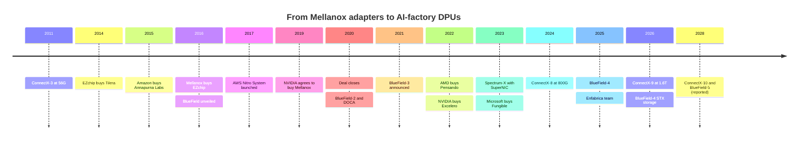
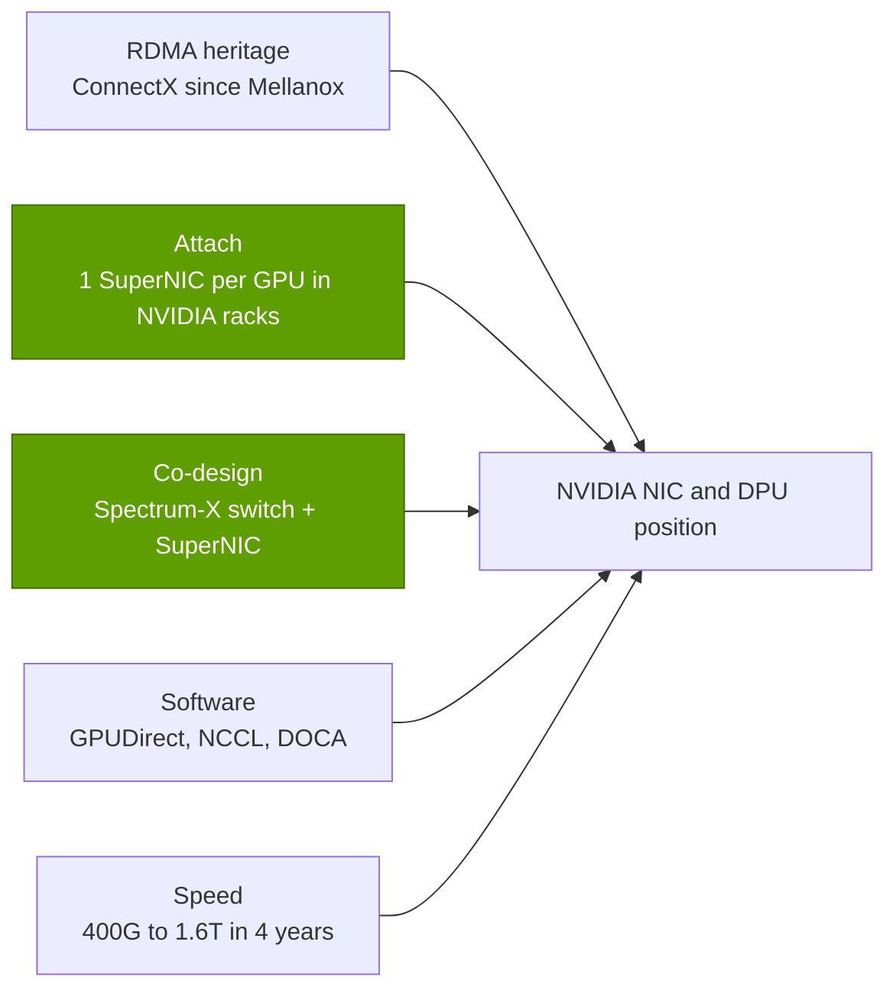

# DPU, SuperNIC, storage, security: History and how NVIDIA built it

Layer 07 · DPU, SuperNIC, storage, security · ~9 min read · Last verified: 2026-11-05

## ⚡ The Executive Take

- **NVIDIA bought this layer, then sped it up.** ConnectX came with Mellanox ($6.9B, announced 2019-03-11, closed 2020-04-27); per-port speed rose from 56 Gb/s (ConnectX-3, 2011) to 1.6 Tb/s (ConnectX-9, 2026) [[S464]](../../sources/bibliography.md#s464)[[S273]](../../sources/bibliography.md#s273)[[S33004]](../../sources/bibliography.md#s33004).
- **The [DPU](../../glossary.md#dpu) was bought too:** EZchip bought Tilera (2014, up to $130M), Mellanox bought EZchip ($811M, 2016) and unveiled BlueField months later [[S7510]](../../sources/bibliography.md#s7510)[[S7507]](../../sources/bibliography.md#s7507)[[S7509]](../../sources/bibliography.md#s7509).
- **Within six months of closing, NVIDIA launched BlueField-2 and the [DOCA](../../glossary.md#doca) software kit** (2020-10-05) [[S270]](../../sources/bibliography.md#s270).
- **2023 recast the NIC as a GPU part:** Spectrum-X paired the Spectrum-4 switch with a BlueField-3 [SuperNIC](../../glossary.md#supernic) [[S271]](../../sources/bibliography.md#s271); BlueField-4 (October 2025) fuses a 64-core Grace with ConnectX-9 and points the DPU at storage [[S272]](../../sources/bibliography.md#s272)[[S512]](../../sources/bibliography.md#s512)[[S7511]](../../sources/bibliography.md#s7511).
- **The payoff:** networking hit a record ~$17.5B in Q2 FY2027, ~2.5× the Mellanox price in one quarter [[S90012]](../../sources/bibliography.md#s90012)[[S464]](../../sources/bibliography.md#s464).
- **[Q4]** The edge is attach and co-design (one NIC per GPU in NVIDIA's racks, tuned with its switches and libraries) more than NIC silicon, which rivals now copy within a year.
- **[Q6]** Est. 🔴: ~3–4 years and ~$0.5–1B for a merchant 800G AI NIC; 5–7 years and ~$1.5–3B for a DPU franchise; a Mellanox-style franchise cannot be bought again.

## From RDMA adapters to the AI factory's front desk

Mellanox sold [RDMA](../../glossary.md#rdma) adapters: servers write straight into each other's memory, and by ConnectX-4 (2014, 100G) into GPU memory (GPUDirect RDMA) [[S273]](../../sources/bibliography.md#s273). To add general-purpose cores, Mellanox bought EZchip, owner of Tilera; the first BlueField joined ConnectX to an array of Arm A72 cores [[S7510]](../../sources/bibliography.md#s7510)[[S7507]](../../sources/bibliography.md#s7507)[[S7509]](../../sources/bibliography.md#s7509).

| Date | Decision | Why it mattered | Source |
|---|---|---|---|
| 2016-02-23 | Mellanox closes EZchip ($811M) | Bought the cores behind BlueField | [[S7507]](../../sources/bibliography.md#s7507) |
| 2019-03-11 | NVIDIA agrees to buy Mellanox ($6.9B) | ConnectX, BlueField and InfiniBand in-house | [[S464]](../../sources/bibliography.md#s464) |
| 2020-10-05 | BlueField-2 and DOCA | A DPU with an SDK, the DPU's "CUDA" | [[S270]](../../sources/bibliography.md#s270) |
| 2023-05-29 | Spectrum-X with BlueField-3 SuperNIC | NIC sold as part of an AI Ethernet fabric | [[S271]](../../sources/bibliography.md#s271) |
| 2025-10-28 | BlueField-4: Grace + ConnectX-9, 800G | DPU becomes a storage and KV-cache engine | [[S512]](../../sources/bibliography.md#s512)[[S7530]](../../sources/bibliography.md#s7530) |
| 2026-03-16 | BlueField-4 STX reference architecture | Twelve storage vendors co-design on it | [[S7511]](../../sources/bibliography.md#s7511) |

> [!TIP]
> **Worked example — the speed-up after the purchase.** Under Mellanox, ConnectX went from 56G (2011) to 200G (ConnectX-6, 2017): ~3.6× in six years [[S273]](../../sources/bibliography.md#s273). Under NVIDIA it went from 400G (ConnectX-7, 2022) to 1.6T (ConnectX-9, 2026): 4× in four years [[S266]](../../sources/bibliography.md#s266)[[S33004]](../../sources/bibliography.md#s33004). Doubling time fell from ~3.3 to ~2 years once the NIC rode the GPU's annual roadmap.

Networking includes NVLink, InfiniBand and Spectrum-X switches as well as ConnectX and BlueField; NVIDIA does not report NIC or DPU revenue. See [layer 06 history](../06-scale-out-scale-across-networking/history-and-how-built.md).

## [Q4 · Source of advantage] Silicon, attach or software?

**Answer:** attach and co-design first, then speed. NIC silicon alone is not the moat: Broadcom sampled an 800G NIC the year ConnectX-8 shipped and AMD shipped one a year later [[S7529]](../../sources/bibliography.md#s7529)[[S7500]](../../sources/bibliography.md#s7500). What rivals cannot copy is the rack: NVIDIA specifies one ConnectX per GPU in HGX and NVL72, tunes its libraries and switches against it, and makes Spectrum-X adaptive routing depend on the SuperNIC reordering packets [[S266]](../../sources/bibliography.md#s266)[[S264]](../../sources/bibliography.md#s264)[[S271]](../../sources/bibliography.md#s271). Where it does not design the server, the NIC goes to in-house silicon ([competition](competition.md)).

> [!TIP]
> **Worked example — attach turns GPUs into NIC volume.** A Vera Rubin NVL72 carries 72 GPUs and so 72 ConnectX-9 SuperNICs [[S33004]](../../sources/bibliography.md#s33004). Every 1,000 racks is 72,000 NICs; at an assumed $2,500–4,500 each (Est., repo 🔴) that is $180–324M of NIC silicon no merchant vendor got to bid for.

## [Q6 · Replication cost] Time, dollars and talent

Amazon's Annapurna deal (January 2015) led to the Nitro System ~3 years later and to 400G Nitro cards ~10 years later [[S4540]](../../sources/bibliography.md#s4540)[[S7533]](../../sources/bibliography.md#s7533)[[S7503]](../../sources/bibliography.md#s7503). Microsoft's Fungible deal (January 2023) became the Azure Boost DPU ~22 months later [[S7506]](../../sources/bibliography.md#s7506)[[S7504]](../../sources/bibliography.md#s7504). AMD's Pensando deal (May 2022) produced an 800G AI NIC in 2026, still a step behind ConnectX-9 [[S7527]](../../sources/bibliography.md#s7527)[[S7500]](../../sources/bibliography.md#s7500).

| Path | Time to competitive part | Dollars (Est., repo 🔴) | Talent (Est., repo 🔴) |
|---|---|---|---|
| Captive cloud offload card (Nitro, Azure Boost) | ~2–3 years after buying a team [[S7533]](../../sources/bibliography.md#s7533)[[S7504]](../../sources/bibliography.md#s7504) | ~$0.2–0.4B + running R&D | 150–300; needs your own fleet |
| Merchant 800G AI NIC with UEC transport | ~3–4 years (Pensando 2022 → Vulcano 2026) [[S7527]](../../sources/bibliography.md#s7527)[[S7500]](../../sources/bibliography.md#s7500) | ~$0.5–1B | 200–400: SerDes, transport, drivers |
| Programmable DPU + SDK + storage partners | ~5–7 years (EZchip 2016 → DOCA 2020 → STX 2026) [[S7507]](../../sources/bibliography.md#s7507)[[S270]](../../sources/bibliography.md#s270)[[S7511]](../../sources/bibliography.md#s7511) | ~$1.5–3B | 500–1,000, half software |
| NIC + DPU + switch co-design at 1:1 GPU attach | 10+ years, plus a GPU platform | Mellanox $6.9B plus a decade of R&D [[S464]](../../sources/bibliography.md#s464) | Thousands of RDMA veterans |

> [!TIP]
> **Worked example — build cost of an 800G AI NIC team.** 300 engineers at ~$0.35M loaded cost for 4 years is ~$0.42B before tape-outs (Est., repo 🔴); two 3–5 nm tape-outs and IP licences take it to ~$0.5–1B. Pensando cost $1.9B because it came with products and customers [[S7527]](../../sources/bibliography.md#s7527); Enfabrica's team and licence cost NVIDIA >$900M without a volume product [[S475]](../../sources/bibliography.md#s475). The scarce input is transport and SerDes talent, not cash.

🔧 Under the hood: why a DPU needed a CPU acquisition

A DPU, unlike a NIC, runs software: a virtual switch, storage protocols, encryption, firewall rules and, in clouds, the [hypervisor](../../glossary.md#hypervisor) control plane. That needs general-purpose cores beside the wire, which Mellanox lacked until EZchip and Tilera [[S7509]](../../sources/bibliography.md#s7509). Core counts followed the job: 16 Arm A72 (BlueField-1), 8 A72 (BlueField-2), 16 A78 (BlueField-3), then a 64-core Grace on BlueField-4, ~6× BlueField-3's compute as announced, because storage and [KV-cache](../../glossary.md#kv-cache) handling are compute-heavy [[S273]](../../sources/bibliography.md#s273)[[S270]](../../sources/bibliography.md#s270)[[S269]](../../sources/bibliography.md#s269)[[S272]](../../sources/bibliography.md#s272).

## Counterfactuals — what if NVIDIA hadn't…

- 🔴 **…bought Mellanox?** NVIDIA would attach third-party NICs, as AMD did before Pensando: no Spectrum-X, no 1:1 SuperNIC attach, no BlueField storage play, and the ~$17.5B-a-quarter networking line split among Mellanox's eventual owner, Broadcom and others [[S90012]](../../sources/bibliography.md#s90012).
- 🔴 **…lost the hyperscalers to in-house DPUs?** It did: AWS (Annapurna), Microsoft (Fungible) and Google (Titanium, with Intel) chose their own cards [[S4540]](../../sources/bibliography.md#s4540)[[S7504]](../../sources/bibliography.md#s7504)[[S7520]](../../sources/bibliography.md#s7520). Standardising on BlueField would have put their cloud security in NVIDIA's firmware, which is why they did not.
- 🔴 **…moved into Ethernet?** Ethernet went from ~20% of AI back-end switch sales to about two-thirds by 1Q 2026 (Dell'Oro); an InfiniBand-only NVIDIA would have watched most back-end NIC sockets go to Broadcom and AMD [[S90053]](../../sources/bibliography.md#s90053)[[S90054]](../../sources/bibliography.md#s90054).

> [!TIP]
> **Worked example — the cost of an InfiniBand-only strategy.** With InfiniBand down from ~80% to ~33% of AI back-end switch sales, an InfiniBand-only NVIDIA would reach at most a third of back-end ports and their NICs [[S90053]](../../sources/bibliography.md#s90053)[[S90054]](../../sources/bibliography.md#s90054). Spectrum-X (up 2.6× y/y in Q2 FY2027) kept the rest in reach [[S90012]](../../sources/bibliography.md#s90012).

## 🎯 Corp Dev Lens

1. Every DPU franchise was bought (Annapurna, EZchip, Pensando, Fungible): which teams are left, and does scarce RDMA talent make the next one dearer than Pensando's $1.9B?
2. Mellanox paid off because NVIDIA attached the NIC to the GPU; can a NIC or DPU business succeed without an accelerator or cloud fleet to attach to?
3. BlueField's pivot to storage creates an attach point in storage servers: defensible pool, or a feature storage vendors rebuild on merchant silicon?
4. For an accelerator entrant, is it cheaper to buy a NIC team, license IP (as NVIDIA did with Enfabrica) or partner with a UEC merchant?

## 📚 Sources

<!-- Auto-generated from the [S…] citations on this page by `make build`. Edit sources/registry/*.csv, not this list. -->

- [**S264**](../../sources/bibliography.md#s264) NVIDIA Newsroom, *NVIDIA Announces New Switches Optimized for Trillion-Parameter GPU Computing and AI Infrastructure (Quantum-X800, Spectrum-X800, ConnectX-8)*, 2024-03-18. [Link](https://nvidianews.nvidia.com/news/networking-switches-gpu-computing-ai)
- [**S266**](../../sources/bibliography.md#s266) NVIDIA Newsroom, *NVIDIA Quantum-2 Takes Supercomputing to New Heights, Into the Cloud*, 2021-11-09. [Link](https://nvidianews.nvidia.com/news/nvidia-quantum-2-takes-supercomputing-to-new-heights-into-the-cloud)
- [**S269**](../../sources/bibliography.md#s269) NVIDIA Newsroom, *NVIDIA Extends Data Center Infrastructure Processing Roadmap with BlueField-3*, 2021-04-12. [Link](https://nvidianews.nvidia.com/news/nvidia-extends-data-center-infrastructure-processing-roadmap-with-bluefield-3)
- [**S270**](../../sources/bibliography.md#s270) NVIDIA Newsroom, *NVIDIA Introduces New Family of BlueField DPUs to Bring Breakthrough Networking, Storage and Security Performance to Every Data Center*, 2020-10-05. [Link](https://nvidianews.nvidia.com/news/nvidia-introduces-new-family-of-bluefield-dpus-to-bring-breakthrough-networking-storage-and-security-performance-to-every-data-center)
- [**S271**](../../sources/bibliography.md#s271) NVIDIA Newsroom, *NVIDIA Launches Accelerated Ethernet Platform for Hyperscale Generative AI (Spectrum-X)*, 2023-05-29. [Link](https://nvidianews.nvidia.com/news/nvidia-launches-accelerated-ethernet-platform-for-hyperscale-generative-ai)
- [**S272**](../../sources/bibliography.md#s272) NVIDIA, *NVIDIA BlueField Networking Platform / DPU product page (BlueField-4)*, 2025-10. [Link](https://www.nvidia.com/en-us/networking/products/data-processing-unit/)
- [**S273**](../../sources/bibliography.md#s273) NVIDIA Docs, *NVIDIA Networking documentation hub (ConnectX adapter, Quantum and Spectrum switch product briefs and user manuals)*, 2025. [Link](https://docs.nvidia.com/networking/)
- [**S464**](../../sources/bibliography.md#s464) NVIDIA Newsroom, *NVIDIA to Acquire Mellanox for $6.9 Billion*, 2019-03-11. [Link](https://nvidianews.nvidia.com/news/nvidia-to-acquire-mellanox-for-6-9-billion)
- [**S475**](../../sources/bibliography.md#s475) CNBC, *Nvidia spends over $900 million on Enfabrica CEO, AI startup technology*, 2025-09-18. [Link](https://www.cnbc.com/technology/)
- [**S512**](../../sources/bibliography.md#s512) NVIDIA Blog, *NVIDIA Launches BlueField-4: The Processor Powering the Operating System of AI Factories*, 2025-10-28. [Link](https://blogs.nvidia.com/blog/bluefield-4-ai-factory/)
- [**S4540**](../../sources/bibliography.md#s4540) Global Venturing, *Arm exits Annapurna Labs in $370m acquisition*, 2015-01-23. [Link](https://globalventuring.com/blog/2015/01/23/arm-exits-annapurna-labs-in-370m-acquisition/)
- [**S7500**](../../sources/bibliography.md#s7500) AMD, *AMD Pensando Vulcano 800 AI NIC: Built to Scale-Out and Across*, 2026. [Link](https://www.amd.com/en/blogs/2026/amd-pensando-vulcano-800-ai-nic-scale-out-and-across.html)
- [**S7503**](../../sources/bibliography.md#s7503) Amazon Web Services, *Instances built on the AWS Nitro System (Amazon EC2 documentation)*, 2026. [Link](https://docs.aws.amazon.com/ec2/latest/instancetypes/ec2-nitro-instances.html)
- [**S7504**](../../sources/bibliography.md#s7504) Blocks & Files, *Microsoft boosts Azure infrastructure with Fungible-derived DPU*, 2024-11-20. [Link](https://blocksandfiles.com/2024/11/20/microsoft-boosts-azure-infrastructure-with-fungible-derived-dpu/)
- [**S7506**](../../sources/bibliography.md#s7506) TechRadar, *Microsoft snaps up Fungible for Azure cloud and data center boost*, 2023-01. [Link](https://www.techradar.com/news/microsoft-snaps-up-fungible-for-azure-cloud-and-data-center-boost)
- [**S7507**](../../sources/bibliography.md#s7507) Mellanox Technologies via SEC EDGAR, *Mellanox Technologies Form 8-K exhibit 99.1: Mellanox completes acquisition of EZchip*, 2016-02-23. [Link](https://www.sec.gov/Archives/edgar/data/0001356104/000110465916099040/a16-5002_1ex99d1.htm)
- [**S7509**](../../sources/bibliography.md#s7509) HPCwire, *Mellanox spins EZchip acquisition into BlueField silicon*, 2016-06-01. [Link](https://www.hpcwire.com/2016/06/01/mellanox-spins-ezchip-acquisition-bluefield-silicon/)
- [**S7510**](../../sources/bibliography.md#s7510) Converge Digest, *EZchip to acquire Tilera for its multicore processors*, 2014-07. [Link](https://convergedigest.com/ezchip-to-acquire-tilera-for-its-multi/)
- [**S7511**](../../sources/bibliography.md#s7511) NVIDIA Newsroom, *NVIDIA Launches BlueField-4 STX Storage Architecture With Broad Industry Adoption*, 2026-03-16. [Link](https://nvidianews.nvidia.com/news/nvidia-launches-bluefield-4-stx-storage-architecture-with-broad-industry-adoption)
- [**S7520**](../../sources/bibliography.md#s7520) Google Cloud, *Titanium (Google Cloud product page)*, 2024. [Link](https://cloud.google.com/titanium)
- [**S7527**](../../sources/bibliography.md#s7527) AMD Investor Relations, *AMD expands data center solutions capabilities with acquisition of Pensando*, 2022-05-26. [Link](https://ir.amd.com/news-events/press-releases/detail/1071/amd-expands-data-center-solutions-capabilities-with)
- [**S7529**](../../sources/bibliography.md#s7529) StreetInsider (Broadcom press release), *Broadcom introduces industry's first 800G AI Ethernet NIC (Thor Ultra)*, 2025-10-14. [Link](https://www.streetinsider.com/Press+Releases/Broadcom+Introduces+Industry%E2%80%99s+First+800G+AI+Ethernet+NIC/25451603.html)
- [**S7530**](../../sources/bibliography.md#s7530) StorageNewsletter (NVIDIA release), *NVIDIA launches BlueField-4, the processor powering the operating system of AI factories*, 2025-11-04. [Link](https://www.storagenewsletter.com/2025/11/04/nvidia-launches-bluefield-4-the-processor-powering-the-operating-system-of-ai-factories/)
- [**S7533**](../../sources/bibliography.md#s7533) hidekazu-konishi.com (Hidekazu Konishi), *AWS custom silicon history and timeline: Nitro System, Graviton, Inferentia, Trainium*, 2025. [Link](https://hidekazu-konishi.com/entry/aws_history_and_timeline_aws_silicon.html)
- [**S33004**](../../sources/bibliography.md#s33004) NVIDIA Newsroom, *NVIDIA Kicks Off the Next Generation of AI With Rubin — Six New Chips; One Incredible AI Supercomputer*, 2026-01-05. [Link](https://nvidianews.nvidia.com/news/rubin-platform-ai-supercomputer)
- [**S90012**](../../sources/bibliography.md#s90012) Tomasz Tunguz (Tomasz Tunguz), *Nvidia Q2 FY27 earnings*, 2026-08. [Link](https://www.tomtunguz.com/nvidia-q2-fy27-earnings/index.md)
- [**S90053**](../../sources/bibliography.md#s90053) Dell'Oro Group, *Ethernet more than doubles size of InfiniBand as the leading fabric for AI scale-out networks in 2025*, 2026. [Link](https://www.delloro.com/news/ethernet-more-than-doubles-size-of-infiniband-as-the-leading-fabric-for-ai-scale-out-networks-in-2025/)
- [**S90054**](../../sources/bibliography.md#s90054) Dell'Oro Group, *Ethernet extends lead in AI scale-out networks despite strong InfiniBand rebound*, 2026. [Link](https://www.delloro.com/news/ethernet-extends-lead-in-ai-scale-out-networks-despite-strong-infiniband-rebound/)
