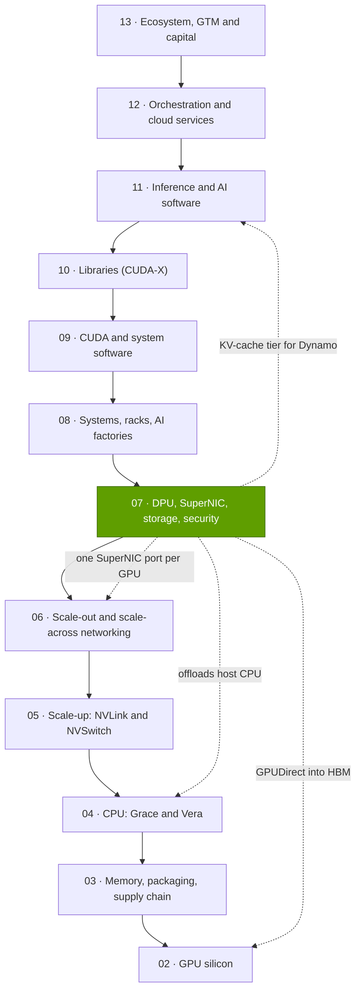
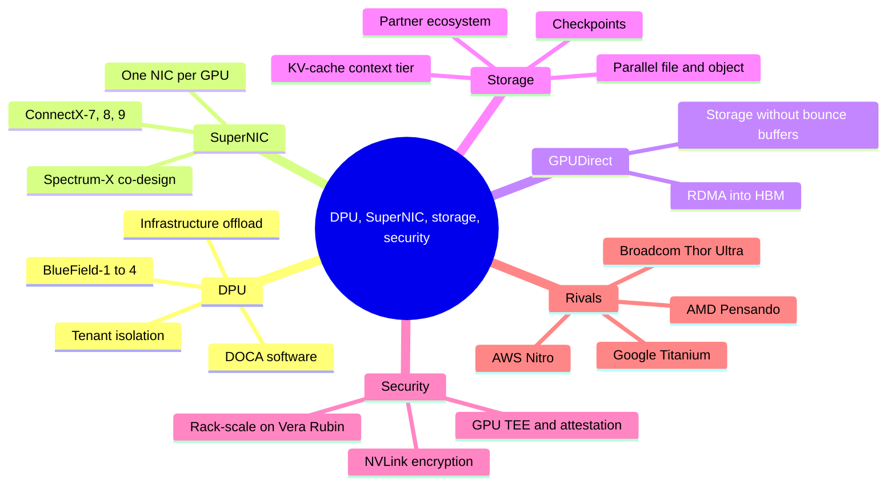

# Layer 07 — DPU, SuperNIC, storage, security

Layer 07 of 12 · the I/O, storage and trust plumbing around every GPU · ~6 min read · Last verified: 2026-11-05

## ⚡ The Executive Take

- **This layer is the plumbing around every GPU:** the network card that feeds it, the [DPU](../../glossary.md#dpu) that runs the operator's infrastructure, the storage path and the security boundary. Each GPU now gets its own [SuperNIC](../../glossary.md#supernic): 400 Gb/s on GB200, 800 on GB300, 1.6 Tb/s on Vera Rubin [[S266]](../../sources/bibliography.md#s266)[[S264]](../../sources/bibliography.md#s264)[[S33004]](../../sources/bibliography.md#s33004).
- **Offload is the core idea.** Without a DPU, infrastructure software takes an estimated ~19–33% of host CPU cores, mostly per NVIDIA's own estimates [[S7005]](../../sources/bibliography.md#s7005)[[S7007]](../../sources/bibliography.md#s7007). BlueField-4 brings 64 Arm Neoverse V2 cores and 800 Gb/s; NVIDIA claims 6× BlueField-3's compute [[S7001]](../../sources/bibliography.md#s7001)[[S512]](../../sources/bibliography.md#s512).
- **Data must bypass the CPU.** Staging network data in host memory would consume 39–150% of host memory bandwidth (Est.) [[S7000]](../../sources/bibliography.md#s7000); [GPUDirect RDMA](../../glossary.md#gpudirect-rdma) and [GPUDirect Storage](../../glossary.md#gpudirect-storage) send it straight into GPU memory [[S7009]](../../sources/bibliography.md#s7009).
- **Storage is becoming inference memory:** BlueField-4 runs a new "G3.5" KV-cache tier, with 12 storage partners building STX systems for H2 2026 🟢 [[S7511]](../../sources/bibliography.md#s7511)[[S7027]](../../sources/bibliography.md#s7027); a 128K-token context reloads in ~0.2 s versus ~4.7 s to recompute (Est.) [[S7000]](../../sources/bibliography.md#s7000).
- **Checkpoints make storage a goodput lever:** on a 16,384-GPU run, 1 TB/s instead of 100 GB/s storage is worth ~$30M a year of GPU time (Est.) [[S34006]](../../sources/bibliography.md#s34006)[[S7000]](../../sources/bibliography.md#s7000).
- **Confidential computing went from one GPU (H100) to a rack (Vera Rubin [NVL72](../../glossary.md#nvl72))** [[S7012]](../../sources/bibliography.md#s7012)[[S7028]](../../sources/bibliography.md#s7028); measured H100 overhead is 0–7% of throughput [[S7011]](../../sources/bibliography.md#s7011).
- **Weakness and challengers:** AWS (Nitro) and Google (Titanium) build their own offload [[S292]](../../sources/bibliography.md#s292)[[S7520]](../../sources/bibliography.md#s7520); AMD's Helios gives each GPU 2.4 Tb/s of Pensando NICs, 1.5× Vera Rubin [[S228]](../../sources/bibliography.md#s228)[[S7500]](../../sources/bibliography.md#s7500); storage software margin goes to partners (VAST Data, DDN, WEKA); standard device trust (TDISP) could level confidential computing [[S7015]](../../sources/bibliography.md#s7015).

![Three-panel bar chart of NVIDIA BlueField DPUs. Arm cores: BlueField-1 16 (Cortex-A72, 2018), BlueField-2 8 (A72, 2020), BlueField-3 16 (A78, 2022), BlueField-4 64 (Neoverse V2, Grace-class, 2026). Network bandwidth: 100, 200, 400 and 800 Gb/s. Cores per 100 Gb/s: 16, 4, 4 and 8, so BlueField-4 doubles compute per bit, signalling that it runs services such as storage and KV-cache management, not just packet offload. NVIDIA claims BlueField-2 replaced ~30 CPU cores, BlueField-3 up to 300 and BlueField-4 has 6x BlueField-3's compute.](../../assets/charts/07-bluefield-generations.svg)

> [!TIP]
> **Worked example — how big this layer is in a rack.** SemiAnalysis puts a GB200 NVL72 at ~$3.1M for the rack and ~$3.9M with its share of [scale-out](../../glossary.md#scale-out) networking and storage [[S324]](../../sources/bibliography.md#s324): **~$0.8M, ~21% of all-in cost**, sits in this layer and layer 06. On Vera Rubin, 72 GPUs × 1.6 Tb/s = **115.2 Tb/s** of SuperNIC bandwidth per rack, one full 144-port 800G Quantum-X800 switch [[S33004]](../../sources/bibliography.md#s33004)[[S264]](../../sources/bibliography.md#s264). NVIDIA's networking line, which includes NICs and DPUs, hit a record $14.8B in Q1 FY2027 [[S90014]](../../sources/bibliography.md#s90014). **Conclusion:** a fifth of cluster spend flows through this plumbing, but NVIDIA captures only the [NIC](../../glossary.md#nic), DPU and switch slices; storage systems go to partners.

## Where this layer sits in the stack

## Layer map

## The eight questions at a glance

| # | Question | Short answer | Where answered |
|---|---|---|---|
| Q1 | Job, and what breaks if weak? | Move every byte in and out of each GPU at line rate, securely; if weak, GPUs stall and ~19–33% of host cores go to plumbing [[S7005]](../../sources/bibliography.md#s7005) | [What a DPU does](what-a-dpu-does.md), [Storage for AI](storage-for-ai.md) |
| Q2 | Metrics that matter? | Gb/s per GPU; host cycles per Gb/s; tail latency; storage GB/s per GPU; confidential-mode overhead | [SuperNICs and GPUDirect](supernics-and-gpudirect.md) |
| Q3 | Generational progress? | ConnectX 56 Gb/s → 1.6 Tb/s; BlueField 100 → 800 Gb/s, 16 → 64 cores; confidential computing from one GPU to a rack [[S7001]](../../sources/bibliography.md#s7001)[[S7012]](../../sources/bibliography.md#s7012) | [What a DPU does](what-a-dpu-does.md) |
| Q4 | Source of advantage? | Integration: Mellanox NIC heritage ($6.9B deal) [[S464]](../../sources/bibliography.md#s464) co-designed with switches, NCCL and DOCA | [History and how built](history-and-how-built.md) |
| Q5 | Strongest challenger? | Hyperscalers' own offload (Nitro, Titanium); AMD and Broadcom 800G Ultra Ethernet NICs [[S292]](../../sources/bibliography.md#s292)[[S280]](../../sources/bibliography.md#s280)[[S290]](../../sources/bibliography.md#s290) | [Competition](competition.md) |
| Q6 | Replication cost? | 800G NIC silicon is replicable; the co-designed NIC, switch and software stack takes years | [History and how built](history-and-how-built.md) |
| Q7 | Roadmap? | ConnectX-9 and BlueField-4 with Vera Rubin (2026); STX systems H2 2026 🟢; BlueField-5 and ConnectX-10 in 2028 🟡 [[S7511]](../../sources/bibliography.md#s7511)[[S90004]](../../sources/bibliography.md#s90004) | [Roadmap](roadmap.md) |
| Q8 | Value pools and M&A? | NIC and DPU dollars ride GPU volumes; storage software value sits with partners | [Value chain and corp dev](value-chain-and-corp-dev.md) |

## Pages in this layer

| Page | What you will learn |
|---|---|
| [What a DPU does](what-a-dpu-does.md) | Offload families, the infrastructure tax and its value per tray, BlueField-1 → 4, DOCA |
| [SuperNICs and GPUDirect](supernics-and-gpudirect.md) | SuperNIC vs DPU, ConnectX-7 → 9, GPUDirect RDMA and Storage, metrics that matter |
| [Storage for AI](storage-for-ai.md) | Checkpoint economics, parallel file vs object, partners, KV-cache tiers and STX |
| [Confidential computing](confidential-computing.md) | GPU TEEs and attestation, overhead, sovereign demand, AMD/Intel/Arm comparison |
| [Competition](competition.md) | Head-to-head comparison and capability heatmap |
| [History and how NVIDIA built it](history-and-how-built.md) | Timeline, key decisions and deals, replication cost, counterfactuals |
| [Roadmap](roadmap.md) | NIC, DPU and storage roadmaps with confidence tags |
| [Value chain and corp dev angles](value-chain-and-corp-dev.md) | Who captures the dollars, private companies, M&A |

🔧 Under the hood: how to read NIC and DPU spec sheets

- **Per port vs per GPU:** ConnectX-9 ports run at up to 800 Gb/s while NVIDIA quotes 1.6 Tb/s per GPU [[S7535]](../../sources/bibliography.md#s7535)[[S33004]](../../sources/bibliography.md#s33004).
- **Host link limits:** a [PCIe](../../glossary.md#pcie) Gen6 x16 link carries ~128 GB/s (~1.0 Tb/s) each way [[S222]](../../sources/bibliography.md#s222).
- **"Core-equivalent" claims** (BlueField-2 ~30, BlueField-3 up to 300) are vendor framings, not benchmarks [[S7008]](../../sources/bibliography.md#s7008).

## 🎯 Corp Dev Lens

1. **Volume business on NVIDIA's coat-tails.** NIC and DPU attach scales with GPU shipments; can merchant NICs (Broadcom, AMD) win sockets in non-NVIDIA racks, or in NVIDIA racks sold to [hyperscalers](../../glossary.md#hyperscaler)?
2. **The DPU's best market may be storage.** BlueField-4 as controller of KV-cache flash enclosures [[S7511]](../../sources/bibliography.md#s7511) is a new socket; watch which partners make it standard.
3. **Software is the moat, not silicon.** DOCA, [NCCL](../../glossary.md#nccl), GPUDirect and [Dynamo](../../glossary.md#dynamo)'s KV placement tie the NIC to the stack; Ultra Ethernet and TDISP push the other way [[S7015]](../../sources/bibliography.md#s7015).
4. **Qualcomm question (public information only):** for AI200/AI250 racks [[S173]](../../sources/bibliography.md#s173), which pieces of this layer (NIC, offload, context storage, attestation) should be built, bought or left to partners?

## 📚 Sources

<!-- Auto-generated from the [S…] citations on this page by `make build`. Edit sources/registry/*.csv, not this list. -->

- [**S173**](../../sources/bibliography.md#s173) Qualcomm, *Qualcomm Unveils AI200 and AI250 - Redefining Rack-Scale Data Center Inference*, 2025-10-27. [Link](https://www.qualcomm.com/news/releases/2025/10/qualcomm-unveils-ai200-and-ai250-redefining-rack-scale-data-cent)
- [**S222**](../../sources/bibliography.md#s222) Tom's Hardware, *PCI Express roadmap: the path to 1TB/s with PCIe 8.0, the challenges of integration, and beyond*, 2025. [Link](https://www.tomshardware.com/pc-components/motherboards/pci-express-roadmap-the-path-to-1tb-s-with-pci-8-0-the-challenges-of-integration-and-beyond)
- [**S228**](../../sources/bibliography.md#s228) Spheron, *AMD Helios rack-scale AI on GPU cloud: deploy MI455X inference with UALink and Ultra Ethernet (2026 guide)*, 2026. [Link](https://www.spheron.network/blog/amd-helios-rack-scale-mi455x-gpu-cloud/)
- [**S264**](../../sources/bibliography.md#s264) NVIDIA Newsroom, *NVIDIA Announces New Switches Optimized for Trillion-Parameter GPU Computing and AI Infrastructure (Quantum-X800, Spectrum-X800, ConnectX-8)*, 2024-03-18. [Link](https://nvidianews.nvidia.com/news/networking-switches-gpu-computing-ai)
- [**S266**](../../sources/bibliography.md#s266) NVIDIA Newsroom, *NVIDIA Quantum-2 Takes Supercomputing to New Heights, Into the Cloud*, 2021-11-09. [Link](https://nvidianews.nvidia.com/news/nvidia-quantum-2-takes-supercomputing-to-new-heights-into-the-cloud)
- [**S280**](../../sources/bibliography.md#s280) Broadcom, *Broadcom introduces Thor Ultra, the industry's first 800G AI Ethernet NIC*, 2025-10-14. [Link](https://investors.broadcom.com/news-releases/news-release-details/broadcom-introduces-industrys-first-800g-ai-ethernet-nic)
- [**S290**](../../sources/bibliography.md#s290) AMD, *AMD Advancing AI 2025: Helios rack, MI400 preview and Pensando Vulcano 800G NIC*, 2025-06-12. [Link](https://www.amd.com/en/newsroom.html)
- [**S292**](../../sources/bibliography.md#s292) Amazon Web Services, *Elastic Fabric Adapter (EFA) and AWS Nitro System documentation*, 2025. [Link](https://aws.amazon.com/hpc/efa/)
- [**S324**](../../sources/bibliography.md#s324) fal.ai, *NVIDIA GB200 price in 2026: what a GPU, a tray and an NVL72 rack cost*, 2026. [Link](https://fal.ai/learn/serverless/nvidia-gb200-price)
- [**S464**](../../sources/bibliography.md#s464) NVIDIA Newsroom, *NVIDIA to Acquire Mellanox for $6.9 Billion*, 2019-03-11. [Link](https://nvidianews.nvidia.com/news/nvidia-to-acquire-mellanox-for-6-9-billion)
- [**S512**](../../sources/bibliography.md#s512) NVIDIA Blog, *NVIDIA Launches BlueField-4: The Processor Powering the Operating System of AI Factories*, 2025-10-28. [Link](https://blogs.nvidia.com/blog/bluefield-4-ai-factory/)
- [**S7000**](../../sources/bibliography.md#s7000) nvidia_deep_dive_claude repository, *Repo analysis: layer 07 models (DPU offload value per compute tray, checkpoint write time, KV-cache reload time by tier)*, 2026-11-05. [Link](https://github.com/FrankHuang94/nvidia_deep_dive_claude/blob/main/layers/07-dpu-supernic-storage-security/index.md)
- [**S7001**](../../sources/bibliography.md#s7001) NVIDIA, *NVIDIA BlueField-4 DPU datasheet*, 2026-05. [Link](https://dam-cdn.nvd.orangelogic.com/AssetLink/m8w7t64m2k40j51sx8xb4ok712b743ux.pdf)
- [**S7005**](../../sources/bibliography.md#s7005) NVIDIA, *NVIDIA DPU Power Efficiency (white paper)*, 2022-11. [Link](https://dcmag.fr/wp-content/uploads/2022/11/nvidia-dpu-power-efficiency-white-paper-2508650.pdf)
- [**S7007**](../../sources/bibliography.md#s7007) arXiv:2511.06558, *Offloading Data Center Tax*, 2025-11. [Link](https://arxiv.org/html/2511.06558v1)
- [**S7008**](../../sources/bibliography.md#s7008) SDxCentral, *Nvidia unveils next-gen BlueField DPU*, 2021-04. [Link](https://www.sdxcentral.com/articles/news/nvidia-unveils-next-gen-bluefield-dpu/2021/04)
- [**S7009**](../../sources/bibliography.md#s7009) NVIDIA Technical Blog, *GPUDirect Storage: A Direct Path Between Storage and GPU Memory*, 2019-08. [Link](https://developer.nvidia.com/blog/gpudirect-storage/)
- [**S7011**](../../sources/bibliography.md#s7011) arXiv:2409.03992 (Jianwei Zhu et al. (Phala Network)), *Confidential Computing on NVIDIA Hopper GPUs: A Performance Benchmark Study*, 2024-09. [Link](https://arxiv.org/abs/2409.03992)
- [**S7012**](../../sources/bibliography.md#s7012) NVIDIA, *NVIDIA Confidential Computing (solutions page)*, 2026. [Link](https://www.nvidia.com/en-us/data-center/solutions/confidential-computing/)
- [**S7015**](../../sources/bibliography.md#s7015) Phoronix (Michael Larabel), *AMD sends out Linux patches for enabling SEV-TIO TDISP with PCIe 6.0*, 2026-09. [Link](https://phoronix.com/news/AMD-SEV-TIO-TDISP-Linux-Patches)
- [**S7027**](../../sources/bibliography.md#s7027) NAND Research, *Research note: Improving inference with NVIDIA's Inference Context Memory Storage platform*, 2026-01. [Link](https://nand-research.com/research-note-improving-inference-nvidias-inference-context-memory-storage-platform/)
- [**S7028**](../../sources/bibliography.md#s7028) VentureBeat, *Nvidia Rubin brings rack-scale encryption to enterprise AI security*, 2026-01. [Link](https://venturebeat.com/security/nvidia-rubin-rack-scale-encryption-enterprise-ai-security)
- [**S7500**](../../sources/bibliography.md#s7500) AMD, *AMD Pensando Vulcano 800 AI NIC: Built to Scale-Out and Across*, 2026. [Link](https://www.amd.com/en/blogs/2026/amd-pensando-vulcano-800-ai-nic-scale-out-and-across.html)
- [**S7511**](../../sources/bibliography.md#s7511) NVIDIA Newsroom, *NVIDIA Launches BlueField-4 STX Storage Architecture With Broad Industry Adoption*, 2026-03-16. [Link](https://nvidianews.nvidia.com/news/nvidia-launches-bluefield-4-stx-storage-architecture-with-broad-industry-adoption)
- [**S7520**](../../sources/bibliography.md#s7520) Google Cloud, *Titanium (Google Cloud product page)*, 2024. [Link](https://cloud.google.com/titanium)
- [**S7535**](../../sources/bibliography.md#s7535) NVIDIA Docs, *NVIDIA ConnectX-9 SuperNIC firmware release notes v82.48.1000 (February 2026 GA release)*, 2026-02. [Link](https://docs.nvidia.com/networking/display/connectx9firmwarev82481000)
- [**S33004**](../../sources/bibliography.md#s33004) NVIDIA Newsroom, *NVIDIA Kicks Off the Next Generation of AI With Rubin — Six New Chips; One Incredible AI Supercomputer*, 2026-01-05. [Link](https://nvidianews.nvidia.com/news/rubin-platform-ai-supercomputer)
- [**S34006**](../../sources/bibliography.md#s34006) arXiv:2407.21783 (Llama Team (AI @ Meta)), *The Llama 3 Herd of Models*, 2024-07-31. [Link](https://arxiv.org/abs/2407.21783)
- [**S90004**](../../sources/bibliography.md#s90004) TrendForce, *Key GTC takeaways: how Samsung, Micron, Intel and more power NVIDIA's Vera Rubin and Feynman*, 2026-03-17. [Link](https://www.trendforce.com/news/2026/03/17/news-key-gtc-takeaways-how-samsung-micron-intel-more-power-nvidias-vera-rubin-and-feynman/)
- [**S90014**](../../sources/bibliography.md#s90014) Global Data Center Hub, *NVIDIA posts $81.6 billion quarter and splits into two reporting platforms*, 2026-05. [Link](https://www.globaldatacenterhub.com/p/nvidia-posts-816-billion-quarter)
