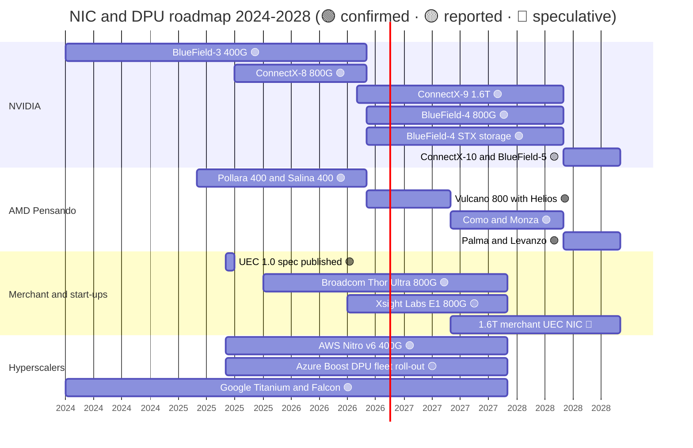

# DPU, SuperNIC, storage, security: Roadmap

Layer 07 · DPU, SuperNIC, storage, security · ~10 min read · Last verified: 2026-11-05

## ⚡ The Executive Take

- **2026 is a double launch:** the ConnectX-9 [SuperNIC](../../glossary.md#supernic) (1.6 Tb/s per GPU) and the BlueField-4 [DPU](../../glossary.md#dpu) (800 Gb/s with a 64-core Grace CPU) ship with Vera Rubin in H2 2026; ConnectX-9 firmware went GA in February 2026 🟢 [[S33004]](../../sources/bibliography.md#s33004)[[S7535]](../../sources/bibliography.md#s7535)[[S512]](../../sources/bibliography.md#s512).
- **The DPU is being repurposed for storage:** BlueField-4 STX, a reference design for [context-memory storage](../../glossary.md#context-memory-storage) (KV caches on flash), reaches partners' platforms in H2 2026; NVIDIA claims up to 5× token throughput against an unspecified baseline 🟢 [[S7511]](../../sources/bibliography.md#s7511)[[S3012]](../../sources/bibliography.md#s3012).
- **2028 is named but blank:** Feynman pairs ConnectX-10 and BlueField-5, with no published specs 🟡 [[S109]](../../sources/bibliography.md#s109)[[S502]](../../sources/bibliography.md#s502)[[S90004]](../../sources/bibliography.md#s90004); secondary sources conflict on speed 🔴 [[S213]](../../sources/bibliography.md#s213).
- **Only AMD matches NVIDIA's naming horizon:** Vulcano (2026), Como/Monza (2027) and Palma/Levanzo (2028) are named, without specs 🟢 [[S538]](../../sources/bibliography.md#s538)[[S7500]](../../sources/bibliography.md#s7500).
- **No rival has announced a 1.6T NIC:** Broadcom's Thor Ultra (800G) was sampling from October 2025 and AWS's Nitro v6 runs up to 400 Gb/s per card [[S7529]](../../sources/bibliography.md#s7529)[[S7503]](../../sources/bibliography.md#s7503).
- **[Q7 · Roadmap & what changes the picture]** The roadmap is safe on speed; what could change the picture is commercial: [Ultra Ethernet](../../glossary.md#ultra-ethernet) NICs proven at scale, NICs absorbed into accelerators or optics, and hyperscalers extending [captive silicon](../../glossary.md#captive-silicon) to the [back-end network](../../glossary.md#back-end-network).

## The 2024–2028 roadmap

Bars run from first availability to the expected successor; the 2027 "1.6T merchant UEC NIC" bar is repo speculation. Sources: table below, plus UEC, Azure Boost and Titanium [[S7528]](../../sources/bibliography.md#s7528)[[S7504]](../../sources/bibliography.md#s7504)[[S7520]](../../sources/bibliography.md#s7520).

![Timeline chart of NIC and DPU products 2024-2028 by vendor lane. NVIDIA: BlueField-3 (400G), ConnectX-8 (800G, 2025), ConnectX-9 (1.6T, 2026), BlueField-4 (800G, 2026), ConnectX-10 and BlueField-5 (2028, no specs). AMD: Pollara and Salina (400G, 2025), Vulcano (800G, 2026), Como/Monza (2027) and Palma/Levanzo (2028), names only. Broadcom Thor Ultra (800G, sampling 2025), AWS Nitro v6 (400G per card), Microsoft Azure Boost DPU (2025), Intel IPU E2100 (200G) and Xsight Labs E1 (800G) have no disclosed successors.](../../assets/charts/07-nic-dpu-roadmap-by-vendor.svg)

| Item | Window | Status | Confidence | Source |
|---|---|---|---|---|
| ConnectX-8 SuperNIC, 800G | 2025, with GB300 NVL72 | shipping | 🟢 | [[S264]](../../sources/bibliography.md#s264)[[S34015]](../../sources/bibliography.md#s34015) |
| ConnectX-9 SuperNIC, 1.6T per GPU | H2 2026, with Vera Rubin | in full production | 🟢 | [[S33004]](../../sources/bibliography.md#s33004)[[S501]](../../sources/bibliography.md#s501)[[S7535]](../../sources/bibliography.md#s7535) |
| BlueField-4 DPU, 800G, 64-core Grace | H2 2026, early availability | announced | 🟢 | [[S512]](../../sources/bibliography.md#s512)[[S7530]](../../sources/bibliography.md#s7530) |
| BlueField-4 STX storage reference design | H2 2026, partner platforms | announced | 🟢 | [[S7511]](../../sources/bibliography.md#s7511) |
| ConnectX-10 and BlueField-5 | 2028, with Feynman | named, no specs | 🟡 | [[S109]](../../sources/bibliography.md#s109)[[S502]](../../sources/bibliography.md#s502)[[S90004]](../../sources/bibliography.md#s90004) |
| AMD Vulcano 800 (3 per MI455X) | from end-Q3 2026 | shipping with Helios | 🟢 | [[S7500]](../../sources/bibliography.md#s7500)[[S228]](../../sources/bibliography.md#s228)[[S90020]](../../sources/bibliography.md#s90020) |
| AMD Como / Monza; Palma / Levanzo | 2027; 2028 | names only | 🟢 names / 🔴 specs | [[S538]](../../sources/bibliography.md#s538) |
| Broadcom Thor Ultra, 800G UEC | sampling since 2025-10 | sampling | 🟢 | [[S7529]](../../sources/bibliography.md#s7529) |
| AWS Nitro v6, up to 400G per card | 2025 | shipping (captive) | 🟢 | [[S7503]](../../sources/bibliography.md#s7503) |
| Xsight Labs E1, 800G DPU | 2026 | early operator wins | 🟡 | [[S7517]](../../sources/bibliography.md#s7517) |

> [!TIP]
> **Worked example — why the NIC lags NVLink by design.** On Vera Rubin, NVLink 6 gives each GPU 3.0 TB/s and ConnectX-9 gives it 1.6 Tb/s = 0.2 TB/s, a 15:1 ratio [[S90006]](../../sources/bibliography.md#s90006)[[S33004]](../../sources/bibliography.md#s33004). Even if ConnectX-10 doubled to 3.2 Tb/s (🔴, unconfirmed [[S213]](../../sources/bibliography.md#s213)), the ratio would still be 7.5:1 unless NVLink also grows. So the chattiest traffic (tensor and expert parallelism) stays inside the NVLink domain ([layer 05](../05-scale-up-nvlink-nvswitch/roadmap.md)), and the NIC only has to keep pace with data and pipeline parallelism.

## Spec progression

NVIDIA's own cadence has sped up (400G to 1.6T in four years, against six years for the previous 3.6× under Mellanox, see [history](history-and-how-built.md)), while rivals' lag shrank from ~3 years at 400G to under a year at 800G, because 200G-per-lane SerDes and the UEC transport are now industry property rather than Mellanox know-how [[S7528]](../../sources/bibliography.md#s7528)[[S7529]](../../sources/bibliography.md#s7529).

> [!TIP]
> **Worked example — the cost of matching Rubin with 800G NICs.** A custom-accelerator rack that wants Rubin's 1.6 Tb/s per chip from 800G merchant NICs needs two per chip: 144 NICs for 72 accelerators instead of 72. At an assumed $1,500–3,000 per 800G NIC (Est., repo 🔴) that is $216–432K per rack, against $180–324K for 72 ConnectX-9 at $2,500–4,500 (same assumption set, see [value chain](value-chain-and-corp-dev.md)). Being a step behind costs NIC count, power and optics.

🔧 Under the hood: why 1.6 Tb/s turns the NIC into a PCIe switch

1.6 Tb/s is 200 GB/s in each direction. A PCIe Gen6 x16 link carries ~128 GB/s each way before overhead, so a 1.6T NIC cannot run at line rate through one standard x16 host link; it needs more lanes or a different attach (the sources used here do not detail ConnectX-9's host interface). NVIDIA already built a PCIe Gen6 switch into ConnectX-8, so the NIC sits between the GPUs and the host rather than hanging off the CPU [[S264]](../../sources/bibliography.md#s264). The logical next step for ConnectX-10 is a direct die-to-die or NVLink-class attach, or optics on the NIC package (🔴 repo inference); either would make the NIC even harder to swap for a third-party part.

## [Q7 · Roadmap & what changes the picture]

NVIDIA's NIC and DPU roadmap is the most fully named through 2028, and its speed lead is real but one step deep. What could change the picture lies mostly outside its silicon:

- **Ultra Ethernet proven at scale.** A 100k-accelerator cluster on Thor Ultra or Vulcano NICs matching Spectrum-X results would make the AI NIC a standard part [[S7528]](../../sources/bibliography.md#s7528)[[S7529]](../../sources/bibliography.md#s7529)[[S7500]](../../sources/bibliography.md#s7500).
- **Hyperscalers extend captive NICs to the back end.** AWS already runs EFA for GPU instances; if Microsoft and Google follow, 1:1 SuperNIC attach shrinks to neoclouds, sovereign and enterprise buyers [[S292]](../../sources/bibliography.md#s292)[[S7504]](../../sources/bibliography.md#s7504)[[S7520]](../../sources/bibliography.md#s7520).
- **The NIC disappears into something else.** Intel's Gaudi 3 put 24 × 200 GbE on the die; co-packaged optics or die-to-die NIC attach could do the same at higher speed [[S296]](../../sources/bibliography.md#s296).
- **Context memory becomes a standard storage tier.** BlueField-4 then gains attach in storage servers, unless storage vendors get the same result on merchant silicon [[S7511]](../../sources/bibliography.md#s7511)[[S3012]](../../sources/bibliography.md#s3012).
- 🔴 **ConnectX-10's speed.** 3.2 Tb/s would reopen the gap; 1.6 Tb/s would let rivals catch up.

> [!TIP]
> **Worked example — how much NIC dollar volume rides on the attach question.** At ~230 kW per Vera Rubin NVL72 rack (Max-P, reported), 1 GW of IT power holds ~4,350 racks or ~313,000 GPUs [[S302]](../../sources/bibliography.md#s302)[[S303]](../../sources/bibliography.md#s303). One ConnectX-9 each at $2,500–4,500 (Est., repo 🔴) is $0.8–1.4B of NIC silicon per gigawatt. Every gigawatt deployed by a buyer with a captive NIC moves that sum off NVIDIA's table.

## 🎯 Corp Dev Lens

1. With no rival 1.6T NIC announced, is the 2027–2028 merchant gap a window for a new entrant or proof that 200G-lane SerDes plus RDMA transport is too hard to build quickly?
2. If NICs migrate into accelerator packages or optics, which IP (SerDes, transport engines, PCIe/CXL switches) becomes the scarce asset to own?
3. BlueField-4 STX turns storage servers into an NVIDIA attach point: do storage vendors embrace it as a partner programme or route around it?
4. AMD names NIC successors for 2027 and 2028: does a matched NIC roadmap become table stakes for anyone selling rack-scale AI systems?

## 📚 Sources

<!-- Auto-generated from the [S…] citations on this page by `make build`. Edit sources/registry/*.csv, not this list. -->

- [**S109**](../../sources/bibliography.md#s109) NVIDIA Blog, *NVIDIA GTC 2026: Live Updates on What's Next in AI*, 2026-03-16. [Link](https://blogs.nvidia.com/blog/gtc-2026-news/)
- [**S213**](../../sources/bibliography.md#s213) Inside Deep Tech, *NVIDIA Feynman: Full Guide to the 2028 GPU, Rosa and Kyber*, 2026. [Link](https://www.insidedeeptech.com/nvidia-feynman-rosa-kyber-nvl1152-full-guide/)
- [**S228**](../../sources/bibliography.md#s228) Spheron, *AMD Helios rack-scale AI on GPU cloud: deploy MI455X inference with UALink and Ultra Ethernet (2026 guide)*, 2026. [Link](https://www.spheron.network/blog/amd-helios-rack-scale-mi455x-gpu-cloud/)
- [**S264**](../../sources/bibliography.md#s264) NVIDIA Newsroom, *NVIDIA Announces New Switches Optimized for Trillion-Parameter GPU Computing and AI Infrastructure (Quantum-X800, Spectrum-X800, ConnectX-8)*, 2024-03-18. [Link](https://nvidianews.nvidia.com/news/networking-switches-gpu-computing-ai)
- [**S292**](../../sources/bibliography.md#s292) Amazon Web Services, *Elastic Fabric Adapter (EFA) and AWS Nitro System documentation*, 2025. [Link](https://aws.amazon.com/hpc/efa/)
- [**S296**](../../sources/bibliography.md#s296) Intel, *Intel Gaudi 3 AI Accelerator white paper*, 2024-04. [Link](https://www.intel.com/content/www/us/en/content-details/817486/intel-gaudi-3-ai-accelerator-white-paper.html)
- [**S302**](../../sources/bibliography.md#s302) Hashrate Index, *NVIDIA Vera Rubin NVL72 specs breakdown*, 2026. [Link](https://hashrateindex.com/blog/nvidia-vera-rubin-nvl72-specs-breakdown/)
- [**S303**](../../sources/bibliography.md#s303) Commercial Times (ctee.com.tw), *Vera Rubin NVL72 Max-Q / Max-P rack power (Commercial Times report)*, 2026-01-07. [Link](https://www.ctee.com.tw/news/20260107701081-430704)
- [**S501**](../../sources/bibliography.md#s501) eWeek, *Everything Nvidia Just Announced at GTC 2026: 7 Chips, 5 Racks, 1 Giant Bet on Agentic AI*, 2026-03-17. [Link](https://www.eweek.com/news/nvidia-gtc-2026-ai-inference-vera-rubin-neuron/)
- [**S502**](../../sources/bibliography.md#s502) Tom's Hardware, *Nvidia updates data center roadmap with Rosa CPU and stacked Feynman GPUs; optical NVLink; Groq LPUs with NVFP4 and NVLink also on deck*, 2026-03-17. [Link](https://www.tomshardware.com/pc-components/gpus/nvidia-updates-data-center-roadmap-with-rosa-cpu-and-stacked-feynman-gpus-optical-nvlink-groq-lpus-with-nvfp4-and-nvlink-also-on-deck)
- [**S512**](../../sources/bibliography.md#s512) NVIDIA Blog, *NVIDIA Launches BlueField-4: The Processor Powering the Operating System of AI Factories*, 2025-10-28. [Link](https://blogs.nvidia.com/blog/bluefield-4-ai-factory/)
- [**S538**](../../sources/bibliography.md#s538) AMD Investor Relations, *AAI 2026: AMD Delivers Full-Stack Compute for the Agentic AI Era*, 2026-07-23. [Link](https://ir.amd.com/news-events/press-releases/detail/1294/aai-2026-amd-delivers-full-stack-compute-for-the-agentic-ai-era)
- [**S3012**](../../sources/bibliography.md#s3012) NVIDIA Newsroom, *NVIDIA BlueField-4 Powers New Class of AI-Native Storage Infrastructure for the Next Frontier of AI*, 2026-01-05. [Link](https://nvidianews.nvidia.com/news/nvidia-bluefield-4-powers-new-class-of-ai-native-storage-infrastructure-for-the-next-frontier-of-ai)
- [**S7500**](../../sources/bibliography.md#s7500) AMD, *AMD Pensando Vulcano 800 AI NIC: Built to Scale-Out and Across*, 2026. [Link](https://www.amd.com/en/blogs/2026/amd-pensando-vulcano-800-ai-nic-scale-out-and-across.html)
- [**S7503**](../../sources/bibliography.md#s7503) Amazon Web Services, *Instances built on the AWS Nitro System (Amazon EC2 documentation)*, 2026. [Link](https://docs.aws.amazon.com/ec2/latest/instancetypes/ec2-nitro-instances.html)
- [**S7504**](../../sources/bibliography.md#s7504) Blocks & Files, *Microsoft boosts Azure infrastructure with Fungible-derived DPU*, 2024-11-20. [Link](https://blocksandfiles.com/2024/11/20/microsoft-boosts-azure-infrastructure-with-fungible-derived-dpu/)
- [**S7511**](../../sources/bibliography.md#s7511) NVIDIA Newsroom, *NVIDIA Launches BlueField-4 STX Storage Architecture With Broad Industry Adoption*, 2026-03-16. [Link](https://nvidianews.nvidia.com/news/nvidia-launches-bluefield-4-stx-storage-architecture-with-broad-industry-adoption)
- [**S7517**](../../sources/bibliography.md#s7517) StorageNewsletter, *Xsight Labs raises more than $300 million at $2.8 billion valuation to power next-generation AI and cloud networks*, 2026-08-06. [Link](https://www.storagenewsletter.com/2026/08/06/fms-2026-xsight-labs-raises-more-than-300-million-at-2-8-billion-valuation-to-power-next-generation-ai-and-cloud-networks/)
- [**S7520**](../../sources/bibliography.md#s7520) Google Cloud, *Titanium (Google Cloud product page)*, 2024. [Link](https://cloud.google.com/titanium)
- [**S7528**](../../sources/bibliography.md#s7528) Converge Digest, *Ultra Ethernet Consortium releases Specification 1.0*, 2025-06. [Link](https://convergedigest.com/ultra-ethernet-consortium-releases-specification-1-0/)
- [**S7529**](../../sources/bibliography.md#s7529) StreetInsider (Broadcom press release), *Broadcom introduces industry's first 800G AI Ethernet NIC (Thor Ultra)*, 2025-10-14. [Link](https://www.streetinsider.com/Press+Releases/Broadcom+Introduces+Industry%E2%80%99s+First+800G+AI+Ethernet+NIC/25451603.html)
- [**S7530**](../../sources/bibliography.md#s7530) StorageNewsletter (NVIDIA release), *NVIDIA launches BlueField-4, the processor powering the operating system of AI factories*, 2025-11-04. [Link](https://www.storagenewsletter.com/2025/11/04/nvidia-launches-bluefield-4-the-processor-powering-the-operating-system-of-ai-factories/)
- [**S7535**](../../sources/bibliography.md#s7535) NVIDIA Docs, *NVIDIA ConnectX-9 SuperNIC firmware release notes v82.48.1000 (February 2026 GA release)*, 2026-02. [Link](https://docs.nvidia.com/networking/display/connectx9firmwarev82481000)
- [**S33004**](../../sources/bibliography.md#s33004) NVIDIA Newsroom, *NVIDIA Kicks Off the Next Generation of AI With Rubin — Six New Chips; One Incredible AI Supercomputer*, 2026-01-05. [Link](https://nvidianews.nvidia.com/news/rubin-platform-ai-supercomputer)
- [**S34015**](../../sources/bibliography.md#s34015) NVIDIA, *NVIDIA InfiniBand adapters (ConnectX-7 NDR 400Gb/s; ConnectX-8 XDR 800Gb/s)*, 2025. [Link](https://www.nvidia.com/en-us/networking/infiniband-adapters/)
- [**S90004**](../../sources/bibliography.md#s90004) TrendForce, *Key GTC takeaways: how Samsung, Micron, Intel and more power NVIDIA's Vera Rubin and Feynman*, 2026-03-17. [Link](https://www.trendforce.com/news/2026/03/17/news-key-gtc-takeaways-how-samsung-micron-intel-more-power-nvidias-vera-rubin-and-feynman/)
- [**S90006**](../../sources/bibliography.md#s90006) TweakTown, *Nvidia cuts Vera Rubin's memory bandwidth by up to 26% and AMD's Helios now leads in memory bandwidth*, 2026-10. [Link](https://www.tweaktown.com/news/114304/nvidia-cuts-vera-rubins-memory-bandwidth-by-up-to-26-percent-and-amds-helios-now-leads-in-memory-bandwidth/index.html)
- [**S90020**](../../sources/bibliography.md#s90020) Shacknews, *AMD Helios AI rack system on track for initial shipments in Q3 2026*, 2026. [Link](https://www.shacknews.com/article/150249/amd-helios-ai-system-shipping-q3-2026)
