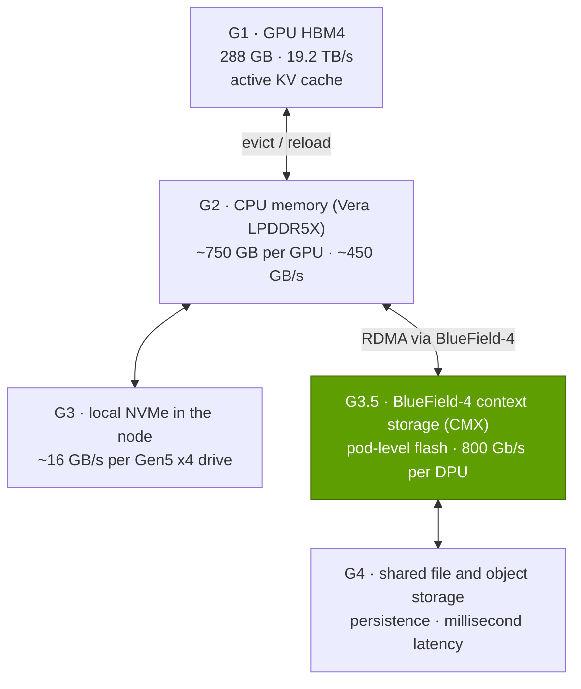

# Storage for AI

Layer 07 · DPU, SuperNIC, storage, security · ~9 min read · Last verified: 2026-11-05

## ⚡ The Executive Take

- **AI storage has three jobs:** stream training data, absorb bursty [checkpoints](../../glossary.md#checkpoint), and, new in 2026, act as inference "context memory" for [KV caches](../../glossary.md#kv-cache) [[S3012]](../../sources/bibliography.md#s3012)[[S7511]](../../sources/bibliography.md#s7511).
- **Checkpoints are big:** weights, FP32 master copy and Adam states are 14 bytes per parameter [[S34004]](../../sources/bibliography.md#s34004), so a Llama 3.1 405B checkpoint is ~5.7 TB: ~57 s at 100 GB/s, under 1 s at the ~7 TB/s peak of Meta's Llama 3 storage (240 PB on 7,500 servers) [[S34006]](../../sources/bibliography.md#s34006)[[S7000]](../../sources/bibliography.md#s7000).
- **Failures make speed pay:** Llama 3 saw 466 job interruptions in 54 days on 16,384 GPUs [[S34006]](../../sources/bibliography.md#s34006). Moving from 100 GB/s to 1 TB/s storage cuts checkpoint-plus-rework losses from ~10% to ~3% of GPU time, ~$30M a year at $2.99/GPU-hour (Est.) [[S395]](../../sources/bibliography.md#s395)[[S7000]](../../sources/bibliography.md#s7000).
- **KV-cache tiers gain a "G3.5"**: pod-level flash managed by BlueField-4 between local SSD and shared storage [[S7026]](../../sources/bibliography.md#s7026)[[S7027]](../../sources/bibliography.md#s7027). Reloading a 128K-token 70B context takes ~0.2 s from it versus ~4.7 s to recompute (Est.) [[S7000]](../../sources/bibliography.md#s7000).
- **NVIDIA does not sell storage; it sets the reference design.** The AI Data Platform (GTC 2025) and BlueField-4 STX (GTC 2026) are blueprints for partners [[S7022]](../../sources/bibliography.md#s7022)[[S7511]](../../sources/bibliography.md#s7511)[[S7004]](../../sources/bibliography.md#s7004); 🟢 12 vendors co-design STX systems due in H2 2026, with vendor-claimed 5× token throughput and 4× energy efficiency [[S7511]](../../sources/bibliography.md#s7511).
- **Weakness:** the storage software margin goes to partners such as VAST Data (~$30B valuation in 2026) [[S7512]](../../sources/bibliography.md#s7512), DDN and WEKA. NVIDIA's share is the DPU, the NIC and the software glue.

## 1. Why AI needs fast storage

- **Dataset streaming (reads):** tokens, images or video flow steadily to the data loaders.
- **Checkpointing (bursty writes):** every few minutes every GPU dumps its share of model and optimizer state at once; Meta describes 1 MB to 4 GB per GPU, in bursts that saturate the storage fabric [[S34006]](../../sources/bibliography.md#s34006).
- **Context memory (low-latency reads and writes):** inference servers park conversation state (the KV cache, see [P2](../../primers/P2-how-ai-inference-works.md)) and reload it when the user returns.

**[Q1 · Job & failure mode]** For storage the failure mode is idle GPUs: training blocks while a checkpoint drains, or loses all work since the last checkpoint when a node fails; inference recomputes contexts it could have reloaded, adding seconds to time to first token.

> [!TIP]
> **Worked example — what storage speed is worth to a 16,384-GPU run.** A 405B checkpoint is 405B × 14 bytes = **5.67 TB** [[S34004]](../../sources/bibliography.md#s34004): 57 s to write at 100 GB/s, 5.7 s at 1 TB/s, 0.8 s at 7 TB/s [[S34006]](../../sources/bibliography.md#s34006). Llama 3's job failed about every 3 hours [[S34006]](../../sources/bibliography.md#s34006)[[S31003]](../../sources/bibliography.md#s31003). The standard rule of thumb (Young's approximation) checkpoints every √(2 × write time × time between failures), ~18 minutes at 100 GB/s and ~6 at 1 TB/s. Blocked writes plus half an interval of rework per failure then cost **~10.2% vs ~3.2% vs ~1.2%** of GPU time. The cluster costs ~$429M a year at $2.99/H100-hour [[S395]](../../sources/bibliography.md#s395), so 100 GB/s → 1 TB/s is worth **~$30M a year** (Est.) [[S7000]](../../sources/bibliography.md#s7000). **Conclusion:** frontier labs buy storage bandwidth for goodput, not capacity.

🔧 Under the hood: how teams shrink the checkpoint stall

- **Sharded checkpoints:** each GPU writes only its shard, so bandwidth scales with storage servers.
- **Asynchronous checkpoints:** GPUs copy state into CPU memory in seconds and resume while CPUs drain it to storage, which needs large host memory (see [layer 04](../04-cpu-grace-vera/index.md)).

## 2. Parallel file systems, object storage and the partner ecosystem

A **[parallel file system](../../glossary.md#parallel-file-system)** stripes each file across many storage servers so thousands of GPUs can read and write one checkpoint at once. **[Object storage](../../glossary.md#object-storage)** (the S3 interface) stores whole objects by key: cheaper per petabyte and nearly unlimited in scale, but slower. A typical AI factory keeps raw datasets on object storage and checkpoints on a parallel or all-flash file tier.

> [!TIP]
> **Worked example — why striping matters.** Meta's Llama 3 storage peaked at ~7 TB/s from 7,500 servers [[S34006]](../../sources/bibliography.md#s34006), about **0.93 GB/s per server**. One such server would need **~1.7 hours** to absorb a 5.67 TB checkpoint; striped across all 7,500 it takes **under a second**. **Conclusion:** AI storage speed is bought as breadth (servers, NICs and flash in parallel), so per-port DPU bandwidth (800 Gb/s on BlueField-4) sets the unit of scaling [[S7001]](../../sources/bibliography.md#s7001).

NVIDIA certifies and publishes reference designs rather than selling arrays: two storage certification tracks, one for cloud-partner and one for enterprise designs [[S7021]](../../sources/bibliography.md#s7021); the AI Data Platform reference design (GTC 2025) [[S7022]](../../sources/bibliography.md#s7022); and BlueField-4 STX (GTC 2026), whose first rack-scale implementation is the CMX context-memory platform [[S7511]](../../sources/bibliography.md#s7511)[[S7004]](../../sources/bibliography.md#s7004).

| Partner | Architecture (public) | NVIDIA tie-in |
|---|---|---|
| DDN | Parallel file system (EXAScaler); Infinia 2.0 data platform | AI Data Platform integration [[S7023]](../../sources/bibliography.md#s7023); STX co-design [[S7511]](../../sources/bibliography.md#s7511) |
| VAST Data | All-flash, disaggregated file and object | STX co-design [[S7511]](../../sources/bibliography.md#s7511); NVIDIA-backed, ~$30B valuation (Apr 2026) [[S7512]](../../sources/bibliography.md#s7512) |
| WEKA | Parallel file system on NVMe flash | STX co-design [[S7511]](../../sources/bibliography.md#s7511) |
| NetApp | AIPod (scale-out NAS) | NVIDIA-Certified Storage [[S7023]](../../sources/bibliography.md#s7023); STX [[S7511]](../../sources/bibliography.md#s7511) |
| Everpure (formerly Pure Storage) | FlashBlade all-flash file and object | Certified high-performance storage [[S7023]](../../sources/bibliography.md#s7023); STX [[S7511]](../../sources/bibliography.md#s7511)[[S7025]](../../sources/bibliography.md#s7025) |
| Dell, HPE, IBM, Hitachi Vantara | System vendors' file and parallel-file lines | AI Data Platform integrations [[S7023]](../../sources/bibliography.md#s7023); STX [[S7511]](../../sources/bibliography.md#s7511) |
| Cloudian, MinIO, Nutanix | S3 object storage; hyperconverged | Cloudian reference architectures [[S7023]](../../sources/bibliography.md#s7023); STX [[S7511]](../../sources/bibliography.md#s7511) |

## 3. KV-cache tiers: storage becomes inference memory

Agents keep long conversations alive, each with a KV cache that grows every token. Recomputing it costs GPU time; keeping it all in [HBM](../../glossary.md#hbm) is impossible. NVIDIA's answer is a ladder of tiers ([storage tiering](../../glossary.md#storage-tiering)), with Dynamo and NIXL moving KV blocks between them [[S3013]](../../sources/bibliography.md#s3013)[[S7026]](../../sources/bibliography.md#s7026):

**G3.5** is flash run by BlueField-4 and shared by a pod of GPUs, holding short-lived but latency-sensitive KV caches while long-term state stays in G4 [[S7026]](../../sources/bibliography.md#s7026)[[S7027]](../../sources/bibliography.md#s7027). NVIDIA first showed it at CES 2026 as the Inference Context Memory Storage platform, claiming up to 5× tokens per second [[S3012]](../../sources/bibliography.md#s3012). Analysts note the "stateless" claim needs qualifying, because Dynamo and NIXL still track where every KV block lives [[S7027]](../../sources/bibliography.md#s7027).

![Log-scale horizontal bar chart of the time to restore a 21.5 GB KV cache (Llama 3.1 70B, 128K tokens, FP8): G1 HBM4 at 19.2 TB/s about 1.1 ms; G2 Vera LPDDR5X over NVLink-C2C at ~450 GB/s about 47.7 ms; G3.5 BlueField-4 context-memory storage over an 800 Gb/s link about 215 ms; G3 one local PCIe Gen5 x4 SSD about 1.4 s; recomputing the prefill on a Rubin GPU at 50% of dense FP8 peak about 4.7 s (estimate); and a per-GPU share of Meta's 7 TB/s Llama 3 storage cluster about 50 s. The G3.5 tier is ~22x faster than recomputing.](../../assets/charts/07-kv-cache-reload-by-tier.svg)

> [!TIP]
> **Worked example — how many long conversations each tier can park.** Llama 3.1 70B stores 163,840 bytes of FP8 KV cache per token [[S32006]](../../sources/bibliography.md#s32006), so a full 131,072-token context is **21.5 GB**. A Rubin GPU's 288 GB of HBM4 minus ~70 GB of FP8 weights parks ~**10** such sessions [[S100]](../../sources/bibliography.md#s100). Vera's ~750 GB of LPDDR5X per GPU (1.5 TB per CPU, two GPUs each) [[S100]](../../sources/bibliography.md#s100) adds ~**35**. One petabyte of G3.5 flash holds ~**46,500**, and the tier is reported at petabytes per pod [[S7027]](../../sources/bibliography.md#s7027). **Conclusion:** the context tier turns a GPU-time problem into a flash-capacity problem, ~20× faster than recomputing (Est.) [[S7000]](../../sources/bibliography.md#s7000).

> [!WARNING]
> **Myth vs. reality.** *Myth:* "NVIDIA is entering the storage business." *Reality:* STX is a reference architecture for partners, not an NVIDIA-sold system [[S7004]](../../sources/bibliography.md#s7004). NVIDIA sells the BlueField-4 inside and the software that places KV blocks; partners sell drives, software and support, and keep most of the storage margin.

## 🎯 Corp Dev Lens

1. **NVIDIA has written itself into the storage bill of materials.** Every STX enclosure needs BlueField-4 [[S7511]](../../sources/bibliography.md#s7511), and NVIDIA's software decides which tier holds context. How much storage value does that capture versus drive and software vendors? See [value chain](value-chain-and-corp-dev.md).
2. **Context memory could drive flash demand.** If agentic inference keeps petabytes of KV cache per pod [[S7027]](../../sources/bibliography.md#s7027), flash and controller vendors gain; the 5× throughput claims still need independent benchmarks [[S7511]](../../sources/bibliography.md#s7511).
3. **Partner valuations price in the shift.** VAST Data's ~$30B mark [[S7512]](../../sources/bibliography.md#s7512) shows how much value sits in storage software, and NVIDIA is a VAST investor [[S482]](../../sources/bibliography.md#s482). Which partners become indispensable to the reference design?
4. **Qualcomm question (public information only):** AI200 cards carry 768 GB of LPDDR each [[S173]](../../sources/bibliography.md#s173). Does that on-card capacity reduce the need for a G3.5-style tier, or does long-context agentic serving still require one?

## 📚 Sources

<!-- Auto-generated from the [S…] citations on this page by `make build`. Edit sources/registry/*.csv, not this list. -->

- [**S100**](../../sources/bibliography.md#s100) NVIDIA Technical Blog, *Inside the NVIDIA Vera Rubin Platform: Six New Chips, One AI Supercomputer*, 2026-01-05. [Link](https://developer.nvidia.com/blog/inside-the-nvidia-rubin-platform-six-new-chips-one-ai-supercomputer/)
- [**S173**](../../sources/bibliography.md#s173) Qualcomm, *Qualcomm Unveils AI200 and AI250 - Redefining Rack-Scale Data Center Inference*, 2025-10-27. [Link](https://www.qualcomm.com/news/releases/2025/10/qualcomm-unveils-ai200-and-ai250-redefining-rack-scale-data-cent)
- [**S395**](../../sources/bibliography.md#s395) Lambda, *Lambda GPU cloud pricing*, 2025. [Link](https://lambda.ai/pricing)
- [**S482**](../../sources/bibliography.md#s482) Various (company announcements; Reuters, Bloomberg), *Reporting on NVIDIA participation in robotics, autonomy, photonics, storage and energy rounds (Figure AI, Wayve, Scale AI, Ayar Labs, Enfabrica, VAST Data, Sakana AI, TerraPower, Commonwealth Fusion Systems, Applied Digital, Recursion)*, 2025-09. [Link](https://www.reuters.com/technology/)
- [**S3012**](../../sources/bibliography.md#s3012) NVIDIA Newsroom, *NVIDIA BlueField-4 Powers New Class of AI-Native Storage Infrastructure for the Next Frontier of AI*, 2026-01-05. [Link](https://nvidianews.nvidia.com/news/nvidia-bluefield-4-powers-new-class-of-ai-native-storage-infrastructure-for-the-next-frontier-of-ai)
- [**S3013**](../../sources/bibliography.md#s3013) Blocks and Files, *Nvidia standardizes GPU cluster KV cache offload to NVMe SSDs*, 2026-01-06. [Link](https://blocksandfiles.com/2026/01/06/nvidia-standardizes-gpu-cluster-kv-cache-offload-to-nvme-ssds/)
- [**S7000**](../../sources/bibliography.md#s7000) nvidia_deep_dive_claude repository, *Repo analysis: layer 07 models (DPU offload value per compute tray, checkpoint write time, KV-cache reload time by tier)*, 2026-11-05. [Link](https://github.com/FrankHuang94/nvidia_deep_dive_claude/blob/main/layers/07-dpu-supernic-storage-security/index.md)
- [**S7001**](../../sources/bibliography.md#s7001) NVIDIA, *NVIDIA BlueField-4 DPU datasheet*, 2026-05. [Link](https://dam-cdn.nvd.orangelogic.com/AssetLink/m8w7t64m2k40j51sx8xb4ok712b743ux.pdf)
- [**S7004**](../../sources/bibliography.md#s7004) NAND Research, *NVIDIA STX and CMX: infrastructure for agentic AI context storage (research note)*, 2026-03. [Link](https://nand-research.com/nvidia-stx-cmx-infrastructure-for-agentic-ai-context-storage/)
- [**S7021**](../../sources/bibliography.md#s7021) NVIDIA Blog, *Full Steam Ahead: NVIDIA-Certified Program Expands to Enterprise Storage for Faster AI Factory Deployment*, 2025-03. [Link](https://blogs.nvidia.com/blog/nvidia-certified-enterprise-storage)
- [**S7022**](../../sources/bibliography.md#s7022) TechPowerUp (NVIDIA press release), *NVIDIA, Storage Industry Leaders Unveil New Class of Enterprise Infrastructure for the AI Era (AI Data Platform)*, 2025-03-18. [Link](https://techpowerup.com/334386/nvidia-storage-industry-leaders-unveil-new-class-of-enterprise-infrastructure-for-the-ai-era)
- [**S7023**](../../sources/bibliography.md#s7023) Blocks and Files, *Nvidia storage announcements (GTC 2025)*, 2025-03-18. [Link](https://blocksandfiles.com/2025/03/18/nvidia-storage-announcements/)
- [**S7025**](../../sources/bibliography.md#s7025) SDxCentral, *Nvidia unveils BlueField-4 STX architecture to power next-gen AI storage*, 2026-03. [Link](https://www.sdxcentral.com/news/nvidia-unveils-bluefield-4-stx-architecture-to-power-next-gen-ai-storage/)
- [**S7026**](../../sources/bibliography.md#s7026) Solidigm, *Inference Context Memory Storage (ICMS): why AI inference is becoming a problem only flash can solve*, 2026. [Link](https://www.solidigm.com/products/technology/icmsp-ai-inference-is-flash-storage-problem.html)
- [**S7027**](../../sources/bibliography.md#s7027) NAND Research, *Research note: Improving inference with NVIDIA's Inference Context Memory Storage platform*, 2026-01. [Link](https://nand-research.com/research-note-improving-inference-nvidias-inference-context-memory-storage-platform/)
- [**S7511**](../../sources/bibliography.md#s7511) NVIDIA Newsroom, *NVIDIA Launches BlueField-4 STX Storage Architecture With Broad Industry Adoption*, 2026-03-16. [Link](https://nvidianews.nvidia.com/news/nvidia-launches-bluefield-4-stx-storage-architecture-with-broad-industry-adoption)
- [**S7512**](../../sources/bibliography.md#s7512) Bloomberg Law, *Nvidia-backed Vast Data triples value to $30 billion, mulls IPO*, 2026-04. [Link](https://news.bloomberglaw.com/private-equity/nvidia-backed-vast-data-triples-value-to-30-billion-mulls-ipo)
- [**S31003**](../../sources/bibliography.md#s31003) Tom's Hardware, *Faulty Nvidia H100 GPUs and HBM3 memory caused half of the failures during Llama 3 training — one failure every three hours for Meta's 16,384 GPU training cluster*, 2024-07. [Link](https://www.tomshardware.com/tech-industry/artificial-intelligence/faulty-nvidia-h100-gpus-and-hbm3-memory-caused-half-of-the-failures-during-llama-3-training-one-failure-every-three-hours-for-metas-16384-gpu-training-cluster)
- [**S32006**](../../sources/bibliography.md#s32006) Meta via Hugging Face, *Llama 3.1 70B configuration (config.json)*, 2024-07-23. [Link](https://huggingface.co/meta-llama/Llama-3.1-70B/blob/main/config.json)
- [**S34004**](../../sources/bibliography.md#s34004) arXiv:1910.02054 (SC20) (Samyam Rajbhandari, Jeff Rasley, Olatunji Ruwase, Yuxiong He (Microsoft)), *ZeRO: Memory Optimizations Toward Training Trillion Parameter Models*, 2019-10-04. [Link](https://arxiv.org/abs/1910.02054)
- [**S34006**](../../sources/bibliography.md#s34006) arXiv:2407.21783 (Llama Team (AI @ Meta)), *The Llama 3 Herd of Models*, 2024-07-31. [Link](https://arxiv.org/abs/2407.21783)
