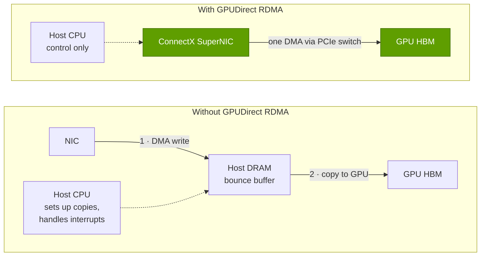

# SuperNICs and GPUDirect

Layer 07 · DPU, SuperNIC, storage, security · ~8 min read · Last verified: 2026-11-05

## ⚡ The Executive Take

- **Every GPU gets its own network card.** Per-GPU [scale-out](../../glossary.md#scale-out) bandwidth went 200 Gb/s (DGX A100) → 400 (DGX H100, GB200) → 800 (GB300, ConnectX-8) → 1,600 Gb/s (Vera Rubin, ConnectX-9) [[S315]](../../sources/bibliography.md#s315)[[S318]](../../sources/bibliography.md#s318)[[S264]](../../sources/bibliography.md#s264)[[S33004]](../../sources/bibliography.md#s33004).
- **[ConnectX](../../glossary.md#connectx) bandwidth rose 29× in 15 years**, from 56 Gb/s (2011) to 1.6 Tb/s (2026), doubling about every three years [[S273]](../../sources/bibliography.md#s273)[[S33004]](../../sources/bibliography.md#s33004).
- **A [SuperNIC](../../glossary.md#supernic) is a [NIC](../../glossary.md#nic) tuned for GPU-to-GPU ([east-west](../../glossary.md#east-west-traffic)) traffic**, co-designed with [Spectrum-X](../../glossary.md#spectrum-x) switches [[S271]](../../sources/bibliography.md#s271); a [DPU](../../glossary.md#dpu) adds general-purpose cores for infrastructure work.
- **ConnectX-8 builds in a 48-lane [PCIe](../../glossary.md#pcie) Gen6 switch**, replacing discrete [PCIe switches](../../glossary.md#pcie-switch) in some servers [[S7017]](../../sources/bibliography.md#s7017), though not every vendor uses it [[S7018]](../../sources/bibliography.md#s7018).
- **[GPUDirect RDMA](../../glossary.md#gpudirect-rdma) lets the NIC write straight into GPU memory.** Without it, staging inbound data in CPU memory would consume 39–150% of host memory bandwidth (Est.) [[S7000]](../../sources/bibliography.md#s7000).
- **[GPUDirect Storage](../../glossary.md#gpudirect-storage)** lifted a DGX-2's storage-to-GPU ceiling from ~50 GB/s to 100–215 GB/s and cut CPU load ~3× (NVIDIA figures) [[S7009]](../../sources/bibliography.md#s7009)[[S7010]](../../sources/bibliography.md#s7010).
- **Strongest challenge:** merchant 800G Ultra Ethernet NICs from Broadcom and AMD [[S280]](../../sources/bibliography.md#s280)[[S289]](../../sources/bibliography.md#s289)[[S290]](../../sources/bibliography.md#s290); AMD's Helios gives each GPU three 800G NICs, 2.4 Tb/s versus Vera Rubin's 1.6 Tb/s [[S228]](../../sources/bibliography.md#s228)[[S7500]](../../sources/bibliography.md#s7500).

## 1. SuperNIC vs DPU: two jobs for one chip family

**East-west** traffic runs between GPUs: bursty, synchronised [collective operations](../../glossary.md#collective-operation) where the slowest packet sets the pace (see [layer 06](../06-scale-out-scale-across-networking/index.md)). **[North-south](../../glossary.md#north-south-traffic)** traffic connects the cluster to users, storage and management. NVIDIA builds a different endpoint for each.

| | SuperNIC (east-west) | DPU (north-south, infrastructure) |
|---|---|---|
| Job | Feed one GPU's collectives at line rate | Run the operator's networking, storage and security stack |
| On-board compute | Minimal; packet engines | Arm cores (16 on BlueField-3, 64 on BlueField-4) [[S269]](../../sources/bibliography.md#s269)[[S7001]](../../sources/bibliography.md#s7001) |
| Products | ConnectX-8, ConnectX-9, BlueField-3 SuperNIC [[S264]](../../sources/bibliography.md#s264)[[S33004]](../../sources/bibliography.md#s33004)[[S271]](../../sources/bibliography.md#s271) | BlueField-3, BlueField-4 [[S269]](../../sources/bibliography.md#s269)[[S7001]](../../sources/bibliography.md#s7001) |
| Count | One per GPU (or more) | One per server, tray or storage enclosure |
| Key features | [RoCE](../../glossary.md#roce) adaptive routing with NIC-side reordering, congestion control [[S271]](../../sources/bibliography.md#s271) | Virtual switching, NVMe-oF, inline crypto, tenant isolation [[S7024]](../../sources/bibliography.md#s7024) |

The SuperNIC's value comes from co-design: Spectrum-X switches spray a flow's packets across all paths, and the SuperNIC reorders them and paces senders using the switch's congestion signals [[S271]](../../sources/bibliography.md#s271). ConnectX-8 also integrates a 48-lane PCIe Gen6 switch, so GPUs and NIC need no separate switch chip [[S7017]](../../sources/bibliography.md#s7017); ConnectX-9 lists up to 48 Gen6 lanes and 800 Gb/s ports [[S7535]](../../sources/bibliography.md#s7535).

**[Q2 · Metrics that matter]** Five numbers explain this layer:

- **Scale-out Gb/s per GPU** and NICs per GPU: 400 → 800 → 1,600 Gb/s over the last three generations [[S266]](../../sources/bibliography.md#s266)[[S264]](../../sources/bibliography.md#s264)[[S33004]](../../sources/bibliography.md#s33004).
- **Host cycles per Gb/s of infrastructure traffic** (~19–33% of cores without offload) and DPU cores per 100 Gb/s (4 on BlueField-3, 8 on BlueField-4) [[S7005]](../../sources/bibliography.md#s7005)[[S7001]](../../sources/bibliography.md#s7001).
- **Effective bandwidth and tail latency under load**, which set GPU wait time in collectives (layer 06).
- **Storage GB/s per GPU**: checkpoint seconds and KV-cache reload milliseconds (see [storage for AI](storage-for-ai.md)).
- **Confidential-mode overhead**, % of throughput and time to first token (see [confidential computing](confidential-computing.md)).

> [!TIP]
> **Worked example — why 1.6 Tb/s per GPU needs more than one PCIe link.** 1.6 Tb/s is 200 GB/s each way, but a PCIe Gen6 x16 link carries ~128 GB/s each way [[S222]](../../sources/bibliography.md#s222), capping a GPU at ~1.0 Tb/s. Feeding 1.6 Tb/s takes at least two x16 links' worth of lanes, consistent with ConnectX-9's 48 lanes [[S7535]](../../sources/bibliography.md#s7535) and 🟡 reports of two ConnectX-9s per Rubin GPU [[S7020]](../../sources/bibliography.md#s7020). Per rack, 72 GPUs × 1.6 Tb/s = **115.2 Tb/s**, the capacity of one 144-port 800G Quantum-X800 switch [[S264]](../../sources/bibliography.md#s264). **Conclusion:** every Vera Rubin rack consumes a flagship switch's worth of ports, so NVIDIA's NIC and switch revenue scales with GPUs.

## 2. GPUDirect RDMA: the NIC writes straight into GPU memory

[RDMA](../../glossary.md#rdma) lets one machine's NIC read or write another's memory without either CPU. GPUDirect RDMA makes the target GPU memory: the NIC writes into HBM peer to peer over PCIe, ideally through a switch shared with the GPU. Without it, data detours through a [bounce buffer](../../glossary.md#bounce-buffer) in CPU memory.

The detour costs more than latency: every inbound byte crosses host DRAM twice, on top of the CPU's own work.

![Bar chart (repo arithmetic): if inbound network data had to be staged in CPU memory before reaching the GPUs, each byte would cross host DRAM twice. That would need 100 GB/s of a DGX-1's 154 GB/s (65%), 400 of a DGX A100's 410 GB/s (98%), 800 of a DGX H100's 614 GB/s (130%), 400 of a GB200 tray's 1,024 GB/s (39%), 800 of a GB300 tray's 1,024 (78%), 1,600 of a Vera Rubin tray's 2,400 (67%) and, for a whole AMD Helios rack, 43,200 of its 18 EPYC Venice CPUs' 28,800 GB/s (150%). GPUDirect RDMA removes this traffic by letting the NIC write straight into GPU memory.](../../assets/charts/07-gpudirect-host-memory-load.svg)

> [!TIP]
> **Worked example — a DGX H100 without GPUDirect.** Eight 400 Gb/s ConnectX-7s deliver up to **400 GB/s** inbound [[S318]](../../sources/bibliography.md#s318)[[S266]](../../sources/bibliography.md#s266). Bouncing it means 400 GB/s written plus 400 GB/s read = **800 GB/s** of DRAM traffic, against **614 GB/s** peak for the two Xeon 8480-class hosts [[S33022]](../../sources/bibliography.md#s33022): **130%** before the CPUs do anything else (Est.) [[S7000]](../../sources/bibliography.md#s7000). **Conclusion:** at modern line rates GPUDirect is mandatory, and placing the NIC next to the GPU on PCIe (now built into ConnectX-8) is a design requirement.

🔧 Under the hood: what makes GPUDirect RDMA work

- **Memory registration:** the GPU driver pins GPU memory and exposes its physical addresses to the NIC driver, so the NIC can DMA into it.
- **PCIe topology:** peer-to-peer traffic is fastest when GPU and NIC share a PCIe switch; crossing the CPU's root complex can cut throughput, hence ConnectX-8's integrated switch [[S7017]](../../sources/bibliography.md#s7017).

## 3. GPUDirect Storage: skipping the CPU on the way from disk

GPUDirect Storage (GDS) applies the same idea to files: instead of reading into a CPU page cache and copying to the GPU, the NVMe drive or storage NIC DMAs data straight into GPU memory. NVIDIA's DGX-2 tests remain the cleanest public comparison: ~50 GB/s through CPU memory versus 100–215 GB/s with GDS, ~3× better CPU utilization, and an 8.8× faster cuDF CSV reader than the naive path [[S7009]](../../sources/bibliography.md#s7009)[[S7010]](../../sources/bibliography.md#s7010).

> [!TIP]
> **Worked example — cold-starting a 405B inference replica.** Llama 3.1 405B in [FP8](../../glossary.md#fp8) is ~405 GB of weights [[S32008]](../../sources/bibliography.md#s32008). At the DGX-2's ~50 GB/s bounce-buffer ceiling, loading takes **~8.1 s**; at the ~215 GB/s GDS ceiling, **~1.9 s** [[S7009]](../../sources/bibliography.md#s7009). **Conclusion:** fleets that scale inference replicas with demand pay this on every [scale-up](../../glossary.md#scale-up), so GDS shortens how long new capacity sits idle.

> [!WARNING]
> **Myth vs. reality.** *Myth:* "GPUDirect is NVIDIA lock-in." *Reality:* it rests on standard PCIe peer-to-peer and RDMA, and storage vendors implement GDS in their own clients [[S7023]](../../sources/bibliography.md#s7023). The lock-in is softer: [NCCL](../../glossary.md#nccl), cuFile, drivers and ConnectX firmware are validated together, so NVIDIA's path works first.

## 🎯 Corp Dev Lens

1. **NIC dollars scale with GPUs.** One or two SuperNIC ports per GPU and a flagship switch's worth of ports per rack make this a volume business riding GPU shipments (see [value chain](value-chain-and-corp-dev.md)).
2. **The PCIe switch is being absorbed.** ConnectX-8's integrated Gen6 switch [[S7017]](../../sources/bibliography.md#s7017) takes sockets from merchant PCIe-switch vendors in NVIDIA-designed servers.
3. **Merchant 800G NICs narrow the hardware gap** [[S280]](../../sources/bibliography.md#s280)[[S289]](../../sources/bibliography.md#s289)[[S290]](../../sources/bibliography.md#s290); NVIDIA's defence is switch–NIC co-design and NCCL. Watch independent effective-bandwidth tests (see [competition](competition.md)).
4. **Qualcomm question (public information only):** for Ethernet scale-out racks such as AI200/AI250 [[S173]](../../sources/bibliography.md#s173)[[S90029]](../../sources/bibliography.md#s90029), is a merchant Ultra Ethernet NIC enough, or does inference at scale need a co-designed NIC with direct paths into accelerator memory?

## 📚 Sources

<!-- Auto-generated from the [S…] citations on this page by `make build`. Edit sources/registry/*.csv, not this list. -->

- [**S173**](../../sources/bibliography.md#s173) Qualcomm, *Qualcomm Unveils AI200 and AI250 - Redefining Rack-Scale Data Center Inference*, 2025-10-27. [Link](https://www.qualcomm.com/news/releases/2025/10/qualcomm-unveils-ai200-and-ai250-redefining-rack-scale-data-cent)
- [**S222**](../../sources/bibliography.md#s222) Tom's Hardware, *PCI Express roadmap: the path to 1TB/s with PCIe 8.0, the challenges of integration, and beyond*, 2025. [Link](https://www.tomshardware.com/pc-components/motherboards/pci-express-roadmap-the-path-to-1tb-s-with-pci-8-0-the-challenges-of-integration-and-beyond)
- [**S228**](../../sources/bibliography.md#s228) Spheron, *AMD Helios rack-scale AI on GPU cloud: deploy MI455X inference with UALink and Ultra Ethernet (2026 guide)*, 2026. [Link](https://www.spheron.network/blog/amd-helios-rack-scale-mi455x-gpu-cloud/)
- [**S264**](../../sources/bibliography.md#s264) NVIDIA Newsroom, *NVIDIA Announces New Switches Optimized for Trillion-Parameter GPU Computing and AI Infrastructure (Quantum-X800, Spectrum-X800, ConnectX-8)*, 2024-03-18. [Link](https://nvidianews.nvidia.com/news/networking-switches-gpu-computing-ai)
- [**S266**](../../sources/bibliography.md#s266) NVIDIA Newsroom, *NVIDIA Quantum-2 Takes Supercomputing to New Heights, Into the Cloud*, 2021-11-09. [Link](https://nvidianews.nvidia.com/news/nvidia-quantum-2-takes-supercomputing-to-new-heights-into-the-cloud)
- [**S269**](../../sources/bibliography.md#s269) NVIDIA Newsroom, *NVIDIA Extends Data Center Infrastructure Processing Roadmap with BlueField-3*, 2021-04-12. [Link](https://nvidianews.nvidia.com/news/nvidia-extends-data-center-infrastructure-processing-roadmap-with-bluefield-3)
- [**S271**](../../sources/bibliography.md#s271) NVIDIA Newsroom, *NVIDIA Launches Accelerated Ethernet Platform for Hyperscale Generative AI (Spectrum-X)*, 2023-05-29. [Link](https://nvidianews.nvidia.com/news/nvidia-launches-accelerated-ethernet-platform-for-hyperscale-generative-ai)
- [**S273**](../../sources/bibliography.md#s273) NVIDIA Docs, *NVIDIA Networking documentation hub (ConnectX adapter, Quantum and Spectrum switch product briefs and user manuals)*, 2025. [Link](https://docs.nvidia.com/networking/)
- [**S280**](../../sources/bibliography.md#s280) Broadcom, *Broadcom introduces Thor Ultra, the industry's first 800G AI Ethernet NIC*, 2025-10-14. [Link](https://investors.broadcom.com/news-releases/news-release-details/broadcom-introduces-industrys-first-800g-ai-ethernet-nic)
- [**S289**](../../sources/bibliography.md#s289) AMD, *AMD Advancing AI 2024: Pensando Pollara 400 AI NIC and Salina DPU*, 2024-10-10. [Link](https://www.amd.com/en/newsroom.html)
- [**S290**](../../sources/bibliography.md#s290) AMD, *AMD Advancing AI 2025: Helios rack, MI400 preview and Pensando Vulcano 800G NIC*, 2025-06-12. [Link](https://www.amd.com/en/newsroom.html)
- [**S315**](../../sources/bibliography.md#s315) NVIDIA (mirror), *NVIDIA DGX A100 system (40GB) datasheet*, 2020-05. [Link](https://cdn.shopify.com/s/files/1/0060/8894/9794/files/nvidia-dgx-a100-system-40gb-datasheet-web-us.pdf)
- [**S318**](../../sources/bibliography.md#s318) NVIDIA (mirror hosted by MEGWARE), *NVIDIA DGX H100 datasheet*, 2023. [Link](https://www.MEGWARE.com/fileadmin/user_upload/LandingPage%20NVIDIA/nvidia-dgx-h100-datasheet.pdf)
- [**S7000**](../../sources/bibliography.md#s7000) nvidia_deep_dive_claude repository, *Repo analysis: layer 07 models (DPU offload value per compute tray, checkpoint write time, KV-cache reload time by tier)*, 2026-11-05. [Link](https://github.com/FrankHuang94/nvidia_deep_dive_claude/blob/main/layers/07-dpu-supernic-storage-security/index.md)
- [**S7001**](../../sources/bibliography.md#s7001) NVIDIA, *NVIDIA BlueField-4 DPU datasheet*, 2026-05. [Link](https://dam-cdn.nvd.orangelogic.com/AssetLink/m8w7t64m2k40j51sx8xb4ok712b743ux.pdf)
- [**S7005**](../../sources/bibliography.md#s7005) NVIDIA, *NVIDIA DPU Power Efficiency (white paper)*, 2022-11. [Link](https://dcmag.fr/wp-content/uploads/2022/11/nvidia-dpu-power-efficiency-white-paper-2508650.pdf)
- [**S7009**](../../sources/bibliography.md#s7009) NVIDIA Technical Blog, *GPUDirect Storage: A Direct Path Between Storage and GPU Memory*, 2019-08. [Link](https://developer.nvidia.com/blog/gpudirect-storage/)
- [**S7010**](../../sources/bibliography.md#s7010) Blocks and Files, *Nvidia's GPUDirect Storage software vanquishes AI bounce buffers*, 2020-07-23. [Link](https://blocksandfiles.com/2020/07/23/nvidia-gpudirect-storage-software/)
- [**S7017**](../../sources/bibliography.md#s7017) NVIDIA Technical Blog, *NVIDIA ConnectX-8 SuperNICs advance AI platform architecture with PCIe Gen6 connectivity*, 2025. [Link](https://developer.nvidia.com/blog/nvidia-connectx-8-supernics-advance-ai-platform-architecture-with-pcie-gen6-connectivity)
- [**S7018**](../../sources/bibliography.md#s7018) iThome, *NVIDIA RTX PRO server and ConnectX-8 SuperNIC switch board (review)*, 2025. [Link](https://www.ithome.com.tw/review/173167)
- [**S7020**](../../sources/bibliography.md#s7020) Hashrate Index, *NVIDIA Vera Rubin NVL72 specs breakdown*, 2026. [Link](https://hashrateindex.com/blog/nvidia-vera-rubin-nvl72-specs-breakdown/)
- [**S7023**](../../sources/bibliography.md#s7023) Blocks and Files, *Nvidia storage announcements (GTC 2025)*, 2025-03-18. [Link](https://blocksandfiles.com/2025/03/18/nvidia-storage-announcements/)
- [**S7024**](../../sources/bibliography.md#s7024) NVIDIA NGC Catalog, *DOCA Weave Service (dpf-weave Helm chart v26.8.0)*, 2026-10-12. [Link](https://catalog.ngc.nvidia.com/orgs/nvidia/doca/helm-charts/dpf-weave/v26.8.0)
- [**S7500**](../../sources/bibliography.md#s7500) AMD, *AMD Pensando Vulcano 800 AI NIC: Built to Scale-Out and Across*, 2026. [Link](https://www.amd.com/en/blogs/2026/amd-pensando-vulcano-800-ai-nic-scale-out-and-across.html)
- [**S7535**](../../sources/bibliography.md#s7535) NVIDIA Docs, *NVIDIA ConnectX-9 SuperNIC firmware release notes v82.48.1000 (February 2026 GA release)*, 2026-02. [Link](https://docs.nvidia.com/networking/display/connectx9firmwarev82481000)
- [**S32008**](../../sources/bibliography.md#s32008) Meta via Hugging Face, *Llama 3.1 405B configuration (config.json)*, 2024-07-23. [Link](https://huggingface.co/meta-llama/Llama-3.1-405B/blob/main/config.json)
- [**S33004**](../../sources/bibliography.md#s33004) NVIDIA Newsroom, *NVIDIA Kicks Off the Next Generation of AI With Rubin — Six New Chips; One Incredible AI Supercomputer*, 2026-01-05. [Link](https://nvidianews.nvidia.com/news/rubin-platform-ai-supercomputer)
- [**S33022**](../../sources/bibliography.md#s33022) NVIDIA Docs, *NVIDIA DGX H100 User Guide — Introduction (system specifications)*, 2023. [Link](https://docs.nvidia.com/dgx/dgxh100-user-guide/introduction-to-dgxh100.html)
- [**S90029**](../../sources/bibliography.md#s90029) Verdict, *Qualcomm AI200 and AI250 racks for AI inference*, 2025-10. [Link](https://www.verdict.co.uk/qualcomm-ai200-ai250-racks-ai-inference/)
