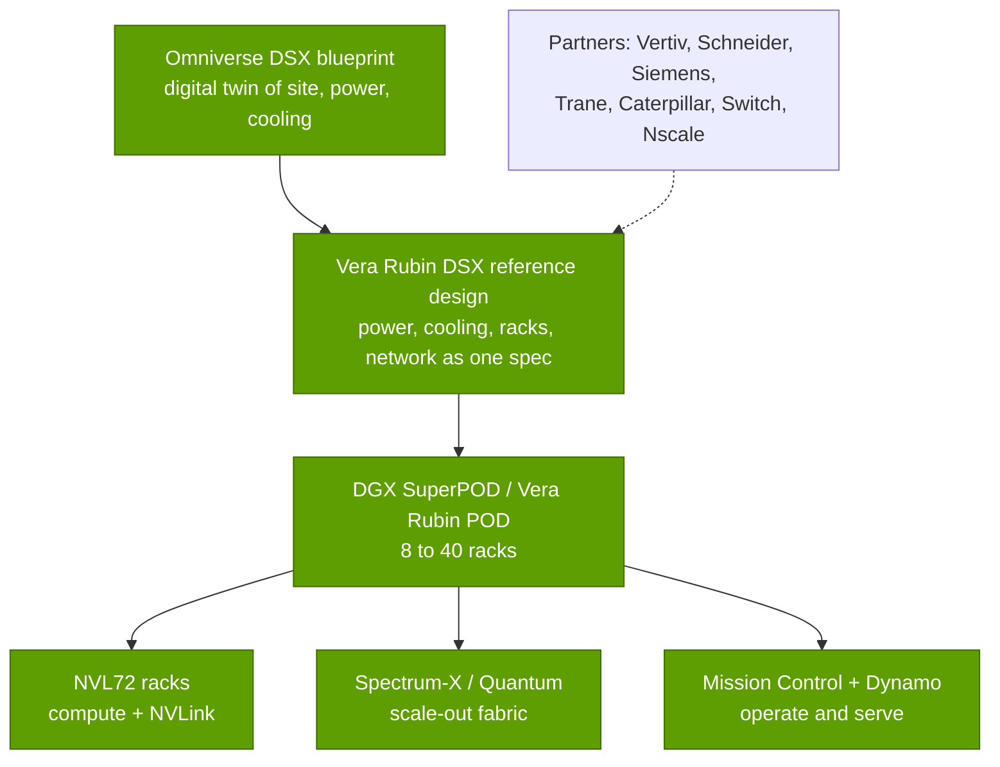
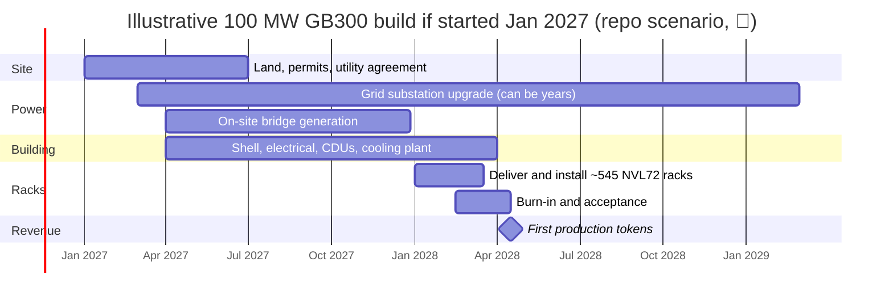

# AI factories: tokens per megawatt, blueprints and build-out speed

Layer 08 · Systems, racks and AI factories · ~11 min read · Last verified: 2026-11-05

## ⚡ The Executive Take

- **An [AI factory](../../glossary.md#ai-factory) is a datacenter judged by output per unit of power.** NVIDIA's headline metric is [tokens per second per megawatt](../../glossary.md#tokens-per-megawatt): it quotes 2.8M for GB300 [NVL72](../../glossary.md#nvl72) vs 54K for [HGX](../../glossary.md#hgx) H200, a 50× claim at its chosen operating point [[S8021]](../../sources/bibliography.md#s8021)[[S32004]](../../sources/bibliography.md#s32004).
- **Independent data shrink but confirm the gap:** on InferenceX DeepSeek-R1 data at 50 tok/s per user, GB300 NVL72 makes ~2.95M tokens/s per MW vs ~225K for H200, ~13× (repo Est.) [[S621]](../../sources/bibliography.md#s621)[[S622]](../../sources/bibliography.md#s622).
- **Vera Rubin extends it:** SemiAnalysis measures ~2× GB300's tokens per MW up to 100 tok/s per user and ~4× near 200, on early engineering samples [[S626]](../../sources/bibliography.md#s626).
- **Blueprints sell the whole site:** DGX SuperPOD (8 GB200 racks), a 40-rack Vera Rubin POD, the Vera Rubin DSX reference design with the Omniverse DSX digital twin, and Mission Control software to run it [[S396]](../../sources/bibliography.md#s396)[[S511]](../../sources/bibliography.md#s511)[[S8017]](../../sources/bibliography.md#s8017)[[S8019]](../../sources/bibliography.md#s8019).
- **Speed is the scarce input:** xAI built Colossus 1 (100k Hopper GPUs) in 122 days; Stargate Abilene's first 200+ MW took ~15 months; new grid power can take 4–7 years [[S6000]](../../sources/bibliography.md#s6000)[[S8012]](../../sources/bibliography.md#s8012)[[S8013]](../../sources/bibliography.md#s8013)[[S8009]](../../sources/bibliography.md#s8009)[[S8010]](../../sources/bibliography.md#s8010).
- **Bear view:** tokens per MW depends on model, context and interactivity; CoreWeave's 10× Vera Rubin claim uses a year-old GB200 software baseline [[S626]](../../sources/bibliography.md#s626).

## 1. The AI-factory framing: power in, tokens out

For an AI datacenter the scarce input is **megawatts** (grid connections take years, see [power and cooling](power-and-cooling.md)) and the output is **tokens**. The yardstick is tokens per second per MW *at a stated speed per user* ([interactivity](../../glossary.md#interactivity)), because batching more users raises throughput but slows each one (the [Pareto frontier](../../glossary.md#pareto-frontier)).

**[Q2 · Metrics that matter]** Five numbers decide this layer's economics: (1) **tokens/s per MW** at a stated interactivity; (2) **kW per rack and [all-in power](../../glossary.md#all-in-power) per GPU** (GB300: ~132 kW, ~2.12 kW) [[S337]](../../sources/bibliography.md#s337)[[S622]](../../sources/bibliography.md#s622); (3) **[PUE](../../glossary.md#pue)** (1.54 industry average in 2025, ~1.1 for the best hyperscale fleets) [[S8007]](../../sources/bibliography.md#s8007)[[S388]](../../sources/bibliography.md#s388); (4) **time to power and to first token**; (5) **cost per [GPU-hour](../../glossary.md#gpu-hour)**, the denominator of $ per million tokens ([chapter 14](../../cross-cutting/14-training-vs-inference-economics.md)).

> [!TIP]
> **Worked example — what 100 MW produces.** At ~2.12 kW all-in per GB300 GPU [[S622]](../../sources/bibliography.md#s622), 100 MW runs **~47,000 GPUs**. At ~2.95M tokens/s per MW (DeepSeek-R1, 50 tok/s per user, Est.) the site produces **~295M tokens per second**, about **9.3 quadrillion tokens a year** at full utilization. The same 100 MW of H200s (~225K per MW) yields ~22M tokens/s, **~13× less** [[S621]](../../sources/bibliography.md#s621)[[S622]](../../sources/bibliography.md#s622). GPU-hours fall the other way: 1 MW holds 472 GB300s (**4.1M GPU-hours a year**) vs 730 H200s (6.4M), but a GB300 GPU-hour yields ~22.5M tokens vs ~1.1M (repo arithmetic). **Conclusion:** in a power-capped site a megawatt of old GPUs earns a fraction of the tokens.

> [!WARNING]
> **Myth vs reality:** "GB300 is 50× Hopper." NVIDIA's 50× multiplies ~10× speed per user by ~5× throughput per MW at one operating point [[S32004]](../../sources/bibliography.md#s32004); on InferenceX data the repo finds ~13× H200 at 50 tok/s per user, and near 100 tok/s per user GB300's lead over 8-GPU B300 servers nearly vanishes (Est.) [[S621]](../../sources/bibliography.md#s621). Any multiple is one point on a curve.

Power is a constraint on *quantity*, not cost: electricity is only ~12–19% of hardware-plus-power cost per GPU-hour (repo Est., 6-year life, 8.1¢/kWh) [[S389]](../../sources/bibliography.md#s389)[[S382]](../../sources/bibliography.md#s382).

🔧 Under the hood: how the tokens-per-MW chart is computed

- **Throughput:** InferenceX's best published frontier points per system (DeepSeek-R1, 1k input / 1k output, no speculative decoding), interpolated log-linearly at 50 tok/s per user [[S621]](../../sources/bibliography.md#s621).
- **Power:** SemiAnalysis's all-in power per GPU from the InferenceX registry (H200 1.37 kW, GB300 2.12, Vera Rubin 3.30) [[S622]](../../sources/bibliography.md#s622).
- **Caveats:** total (input + output) tokens, one model, sparse frontier points; SemiAnalysis's own per-MW charts count output tokens only [[S626]](../../sources/bibliography.md#s626).

## 2. Blueprints and reference architectures

NVIDIA sells the factory as nested reference designs:

- **[DGX SuperPOD](../../glossary.md#superpod):** 8 GB200 NVL72 racks, 576 GPUs, 11.5 EF sparse [FP4](../../glossary.md#fp4) [[S396]](../../sources/bibliography.md#s396); the Vera Rubin POD spans 40 racks, ~60 EF [[S511]](../../sources/bibliography.md#s511).
- **[Omniverse DSX](../../glossary.md#digital-twin):** a digital-twin blueprint for gigawatt sites (October 2025) [[S8018]](../../sources/bibliography.md#s8018), generally available with the Vera Rubin DSX reference design since GTC 2026, aimed at tokens per watt and time to first production. Vertiv (prefabricated OneCore Rubin DSX), Switch and Nscale with Caterpillar build on it [[S8017]](../../sources/bibliography.md#s8017)[[S90063]](../../sources/bibliography.md#s90063).
- **[Mission Control](../../glossary.md#mission-control)** (GTC 2025) automates provisioning, monitoring and failure diagnosis by combining Base Command Manager with Run:ai, which NVIDIA says can raise utilization up to 5× (vendor claim) [[S8019]](../../sources/bibliography.md#s8019)[[S8020]](../../sources/bibliography.md#s8020); [Dynamo](../../glossary.md#dynamo) 1.0 schedules inference [[S90066]](../../sources/bibliography.md#s90066) ([layer 11](../11-inference-and-ai-software/index.md)).

> [!TIP]
> **Worked example — how much of a gigawatt is NVIDIA's.** NVIDIA's CEO put a 1 GW AI factory at ~$50–60B all-in, of which ~$35B is NVIDIA content [[S398]](../../sources/bibliography.md#s398): **~58–70%**. Our 100,000-GPU GB300 site (~255 MW, [power and cooling](power-and-cooling.md)) has ~$5.5B of racks at Morgan Stanley's price, ~$3.5B of it the GPUs alone (Est.) [[S332]](../../sources/bibliography.md#s332). **Conclusion:** reference designs let NVIDIA steer the remaining 30–40% (power, cooling, building, network) toward partners who fit its spec.

### What moves value from OEMs and ODMs to NVIDIA

1. **BOM specification:** NVIDIA fixes tray, switch, spine, power and cooling interfaces; Morgan Stanley sees ODM gross margin falling from ~2.7% (GB300) to ~1.9% (Vera Rubin) [[S332]](../../sources/bibliography.md#s332).
2. **Pre-built trays:** NVIDIA reportedly ships [L10](../../glossary.md#l6-l10-l11) Vera Rubin compute trays, ~90% of a server's cost (🟡) [[S8022]](../../sources/bibliography.md#s8022)[[S329]](../../sources/bibliography.md#s329).
3. **Blueprints and software:** facilities are designed to DSX, and Mission Control and Dynamo sit where OEM management tools used to [[S8017]](../../sources/bibliography.md#s8017)[[S8019]](../../sources/bibliography.md#s8019).

OEMs keep enterprise service and financing, and [hyperscalers](../../glossary.md#hyperscaler) design racks for their own chips; the dollar split is in [value chain and corp dev](value-chain-and-corp-dev.md).

## 3. Time to first token: from site to production

"Time to first token" for a cluster is the months from choosing a site to selling tokens. The chain is **site and permits → power → shell and cooling plant → rack delivery → [burn-in](../../glossary.md#burn-in) → production**, and power is usually the long pole.

![Horizontal bar chart in months. Build milestones: xAI Colossus 1 first rack to training in 19 days (0.6 months) and facility plus 100,000-GPU cluster in 122 days (4 months); Stargate Abilene first two buildings, 200+ MW, about 15 months from construction start; the full 1.2 GW campus about 24 months (mid-2026 target, later estimates Q4 2026). Grid milestones: median interconnection request to operation for new US generation over 48 months (LBNL), and up to 84 months for a large data-center hookup in Dominion's Northern Virginia territory.](../../assets/charts/08-build-vs-grid-timelines.svg)

**xAI Colossus 1** retrofitted an existing Memphis building into a 100,000-GPU Hopper cluster in 122 days, 19 days from first rack to training (company claims) [[S6000]](../../sources/bibliography.md#s6000). **Stargate Abilene** (Crusoe for Oracle and OpenAI) began construction around June 2024, received its first GB200 racks around June 2025 and had two buildings and 200+ MW live in September 2025 [[S8012]](../../sources/bibliography.md#s8012)[[S8013]](../../sources/bibliography.md#s8013); the 1.2 GW campus targets mid-2026 (Epoch AI: Q4 2026) [[S8013]](../../sources/bibliography.md#s8013)[[S8014]](../../sources/bibliography.md#s8014).

> [!TIP]
> **Worked example — a 100 MW GB300 hall, start to tokens.** 100 MW at PUE 1.15 leaves ~87 MW of IT; at ~160 kW per rack including its network share (132 kW × 145/120) that is **~545 racks, ~39,000 GPUs** (repo arithmetic) [[S337]](../../sources/bibliography.md#s337)[[S340]](../../sources/bibliography.md#s340). With power in hand, Abilene's pace (~12 months to first racks, ~15 to production) is a credible target [[S8012]](../../sources/bibliography.md#s8012)[[S8013]](../../sources/bibliography.md#s8013); waiting on new grid supply adds a median queue of **over four years** [[S8009]](../../sources/bibliography.md#s8009). At ~295M tokens/s per 100 MW (Est.), each month of delay forgoes ~0.8 quadrillion tokens. **Conclusion:** buyers pay for anything that removes months: prefabricated power and cooling, on-site generation, digital twins, faster tray assembly.

🔧 Under the hood: why burn-in matters for rack-scale systems

An NVL72 must pass [NVLink](../../glossary.md#nvlink), liquid-loop and power tests as a whole rack before it earns money. SemiAnalysis notes GB200 copper-backplane reliability problems during its ramp and expects a faster Vera Rubin ramp thanks to the cable-free tray; CoreWeave's first Vera Rubin results came from a pre-production rack without a [scale-out](../../glossary.md#scale-out) fabric [[S626]](../../sources/bibliography.md#s626).

## 🎯 Corp Dev Lens

1. **The metric is the market.** If buyers adopt tokens per MW as the procurement yardstick, rivals must publish comparable per-MW curves; AMD, TPU and Trainium claims are rarely stated per all-in MW at a fixed interactivity.
2. **Time to power is a tradable asset.** Powered land, on-site generation and prefabricated plants (Vertiv OneCore, Switch EVO) are where infrastructure capital is flowing [[S8017]](../../sources/bibliography.md#s8017)[[S8015]](../../sources/bibliography.md#s8015).
3. **Reference designs and operations software shift bargaining power** to NVIDIA: which facility vendors become "DSX-qualified", and could a vendor-neutral blueprint or cross-vendor operations layer matter more to challengers than a faster chip?
4. **Qualcomm question (public information only):** HUMAIN plans 200 MW of Qualcomm AI200/AI250 racks from 2026 [[S173]](../../sources/bibliography.md#s173); what per-MW token figures at stated interactivity would make such racks credible in power-capped sites, and could a partner blueprint shorten their time to first token?

## 📚 Sources

<!-- Auto-generated from the [S…] citations on this page by `make build`. Edit sources/registry/*.csv, not this list. -->

- [**S173**](../../sources/bibliography.md#s173) Qualcomm, *Qualcomm Unveils AI200 and AI250 - Redefining Rack-Scale Data Center Inference*, 2025-10-27. [Link](https://www.qualcomm.com/news/releases/2025/10/qualcomm-unveils-ai200-and-ai250-redefining-rack-scale-data-cent)
- [**S329**](../../sources/bibliography.md#s329) Tom's Hardware, *Price of Nvidia's Vera Rubin NVL72 racks skyrockets to as much as $8.8 million apiece, but server makers' margins will be tight*, 2026. [Link](https://www.tomshardware.com/tech-industry/artificial-intelligence/price-of-nvidias-vera-rubin-nvl72-racks-skyrockets-to-as-much-as-usd8-8-million-apiece-but-server-makers-margins-will-be-tight-nvidia-is-moving-closer-to-shipping-entire-full-scale-systems)
- [**S332**](../../sources/bibliography.md#s332) Tiger Brokers (iTiger), *Morgan Stanley's BOM analysis of NVIDIA's Rubin: GPU share declines; PCB, MLCC and ABF substrate values soar*, 2026-05-20. [Link](https://www.itiger.com/news/1188068712)
- [**S337**](../../sources/bibliography.md#s337) Spheron, *NVIDIA GB300 (rental and specifications)*, 2026. [Link](https://spheron.network/gpu-rental/gb300/)
- [**S340**](../../sources/bibliography.md#s340) SemiAnalysis (Dylan Patel et al.), *Huawei AI CloudMatrix 384 - China's answer to Nvidia GB200 NVL72*, 2025-04-16. [Link](https://newsletter.semianalysis.com/p/huawei-ai-cloudmatrix-384-chinas-answer-to-nvidia-gb200-nvl72)
- [**S382**](../../sources/bibliography.md#s382) Microsoft via SEC EDGAR, *Microsoft Corporation Form 10-K filings (FY2021, FY2023) - property and equipment useful lives*, 2023-07-27. [Link](https://www.sec.gov/cgi-bin/browse-edgar?action=getcompany&CIK=0000789019&type=10-K&dateb=&owner=include&count=40)
- [**S388**](../../sources/bibliography.md#s388) Google, *Google data centers: efficiency (fleet-wide PUE)*, 2025. [Link](https://datacenters.google/efficiency/)
- [**S389**](../../sources/bibliography.md#s389) U.S. Energy Information Administration, *EIA Electric Power Monthly, Table 5.6.A: average price of electricity to ultimate customers by end-use sector*, 2025. [Link](https://www.eia.gov/electricity/monthly/epm_table_grapher.php?t=epmt_5_6_a)
- [**S396**](../../sources/bibliography.md#s396) NVIDIA Newsroom, *NVIDIA Blackwell platform arrives to power a new era of computing*, 2024-03-18. [Link](https://nvidianews.nvidia.com/news/nvidia-blackwell-platform-arrives-to-power-a-new-era-of-computing)
- [**S398**](../../sources/bibliography.md#s398) NVIDIA Investor Relations, *NVIDIA Q2 FY2026 earnings call (2025-08-27): AI factory economics commentary*, 2025-08-27. [Link](https://investor.nvidia.com/events-and-presentations/events-and-presentations/default.aspx)
- [**S511**](../../sources/bibliography.md#s511) Tom's Hardware, *Examining Nvidia's 60 exaflop Vera Rubin POD — how seven chips underpin company's 40 rack AI factory supercomputer*, 2026-03. [Link](https://www.tomshardware.com/tech-industry/artificial-intelligence/nvidias-seven-chip-vera-rubin-platforms-turns-the-data-center-into-an-ai-factory)
- [**S621**](../../sources/bibliography.md#s621) SemiAnalysis (InferenceX-app repository), *InferenceX public API snapshot (benchmarks.json and benchmarks-history.json fixtures)*, 2026-10-17. [Link](https://github.com/SemiAnalysisAI/InferenceX-app/tree/main/packages/app/cypress/fixtures/api)
- [**S622**](../../sources/bibliography.md#s622) SemiAnalysis (InferenceX-app repository), *InferenceX hardware registry: TCO per GPU-hour by SKU (SemiAnalysis July 2026 pricing surveys and AI Cloud TCO Model)*, 2026-07. [Link](https://github.com/SemiAnalysisAI/InferenceX-app/blob/main/packages/constants/src/gpu-keys.ts)
- [**S626**](../../sources/bibliography.md#s626) SemiAnalysis, *Vera Rubin NVL72 vs GB200 NVL72? Inference TCO & Architecture Analysis*, 2026-07-23. [Link](https://github.com/SemiAnalysisAI/InferenceX-app/blob/main/packages/app/content/blog/vera-rubin-nvl72-vs-gb200-nvl72-inference.mdx)
- [**S6000**](../../sources/bibliography.md#s6000) TechPowerUp (NVIDIA press release), *NVIDIA Ethernet Networking Accelerates World's Largest AI Supercomputer, Built by xAI*, 2024-10-29. [Link](https://techpowerup.com/328227/nvidia-ethernet-networking-accelerates-worlds-largest-ai-supercomputer-built-by-xai)
- [**S8007**](../../sources/bibliography.md#s8007) Uptime Institute, *Uptime Institute Global Data Center Survey 2025*, 2025-07. [Link](https://intelligence.uptimeinstitute.com/resource/uptime-institute-global-data-center-survey-2025)
- [**S8009**](../../sources/bibliography.md#s8009) Lawrence Berkeley National Laboratory, *Queued Up: 2025 Edition, Characteristics of Power Plants Seeking Transmission Interconnection As of the End of 2024*, 2025-12-15. [Link](https://emp.lbl.gov/sites/default/files/2025-12/Queued%20Up%202025%20Edition%20-%2012.15.2025.pdf)
- [**S8010**](../../sources/bibliography.md#s8010) Bloomberg, *Data Centers Face Seven-Year Wait for Dominion Power Hookups*, 2024-08-29. [Link](https://www.bloomberg.com/news/articles/2024-08-29/data-centers-face-seven-year-wait-for-power-hookups-in-virginia)
- [**S8012**](../../sources/bibliography.md#s8012) Glenn K. Lockwood (Glenn K. Lockwood), *Stargate (system notes)*, 2026. [Link](https://www.glennklockwood.com/garden/stargate)
- [**S8013**](../../sources/bibliography.md#s8013) DatacenterDynamics, *Crusoe's Abilene data center officially live, serving Oracle and OpenAI's Stargate*, 2025-09. [Link](https://datacenterdynamics.com/en/news/crusoes-abilene-data-center-officially-live-serving-oracle-and-openais-stargate)
- [**S8014**](../../sources/bibliography.md#s8014) Epoch AI (Substack), *OpenAI Stargate: where the US sites stand*, 2026. [Link](https://epochai.substack.com/p/openai-stargate-where-the-us-sites)
- [**S8015**](../../sources/bibliography.md#s8015) Cleanview, *Behind-the-meter data centers: Colossus (xAI) report*, 2026-05. [Link](https://cleanview.co/reports/behind-the-meter-data-centers/full-report/colossus)
- [**S8017**](../../sources/bibliography.md#s8017) NVIDIA Newsroom, *NVIDIA Releases Vera Rubin DSX AI Factory Reference Design and Omniverse DSX Digital Twin Blueprint With Broad Industry Support*, 2026-03. [Link](https://investor.nvidia.com/news/press-release-details/2026/NVIDIA-Releases-Vera-Rubin-DSX-AI-Factory-Reference-Design-and-Omniverse-DSX-Digital-Twin-Blueprint-With-Broad-Industry-Support/default.aspx)
- [**S8018**](../../sources/bibliography.md#s8018) The Register, *Nvidia Omniverse DSX: the future of the datacenter*, 2025-10-29. [Link](https://theregister.com/2025/10/29/nvidia_omniverse_dsx)
- [**S8019**](../../sources/bibliography.md#s8019) NVIDIA Blog, *New NVIDIA Software for Blackwell Infrastructure Runs AI Factories at Light Speed (Mission Control)*, 2025-03-18. [Link](https://blogs.nvidia.com/blog/mission-control-software)
- [**S8020**](../../sources/bibliography.md#s8020) NVIDIA Docs, *DGX SuperPOD reference architecture (GB200): DGX SuperPOD software*, 2025. [Link](https://docs.nvidia.com/dgx-superpod/reference-architecture-scalable-infrastructure-gb200/latest/dgx-software.html)
- [**S8021**](../../sources/bibliography.md#s8021) NVIDIA, *NVIDIA AI inference solutions page (AI factory metrics)*, 2026. [Link](https://www.nvidia.com/en-us/solutions/ai/inference/)
- [**S8022**](../../sources/bibliography.md#s8022) Tom's Hardware, *JP Morgan says Nvidia is gearing up to sell entire AI servers instead of just AI GPUs and componentry*, 2025. [Link](https://www.tomshardware.com/tech-industry/artificial-intelligence/jp-morgan-says-nvidia-is-gearing-up-to-sell-entire-ai-servers-instead-of-just-ai-gpus-and-componentry-jensens-master-plan-of-vertical-integration-will-boost-profits-purportedly-starting-with-vera-rubin)
- [**S32004**](../../sources/bibliography.md#s32004) NVIDIA, *NVIDIA GB300 NVL72 / Blackwell Ultra (product page)*, 2025-03. [Link](https://www.nvidia.com/en-us/data-center/gb300-nvl72/)
- [**S90063**](../../sources/bibliography.md#s90063) Converge Digest, *The megawatt shift: NVIDIA's 800 VDC strategy*, 2026. [Link](https://convergedigest.com/the-megawatt-shift-nvidias-800-vdc-strategy/)
- [**S90066**](../../sources/bibliography.md#s90066) HPCwire (NVIDIA press release), *NVIDIA enters production with Dynamo, the broadly adopted inference operating system for AI factories*, 2026-03-17. [Link](https://www.hpcwire.com/aiwire/tag/dynamo-1-0/)
