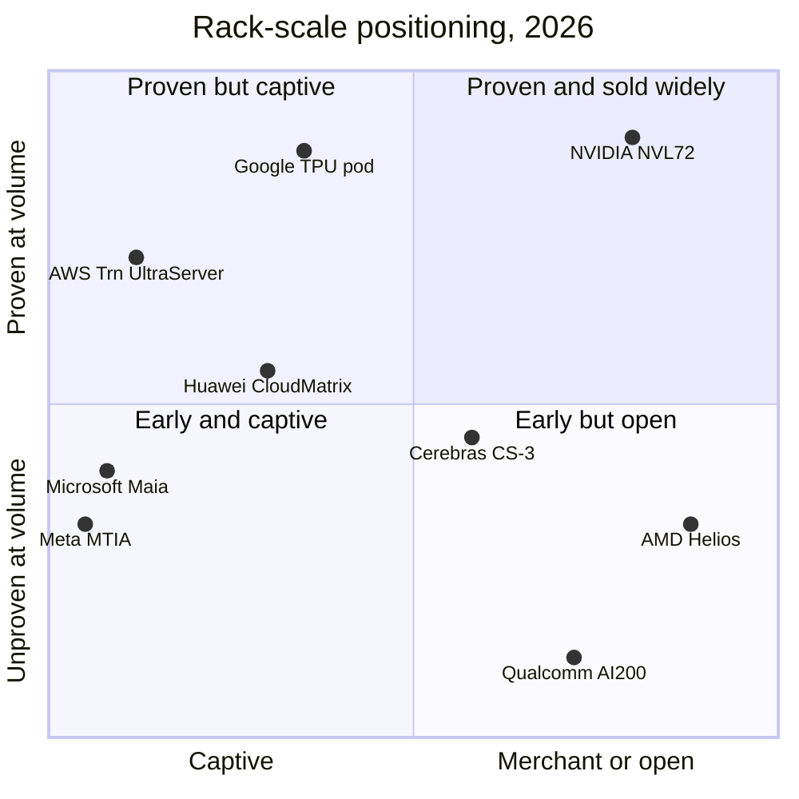

# Systems, racks and AI factories: Competition

Layer 08 · Systems, racks and AI factories · ~12 min read · Last verified: 2026-11-05

## ⚡ The Executive Take

- **The rack is now the unit of competition.** GB200 NVL72 (72 GPUs, ~120 kW, liquid-cooled) set the template in 2024; TrendForce expects NVIDIA's GB/VR [rack-scale system](../../glossary.md#rack-scale-system) shipments to roughly double in 2026 [[S121]](../../sources/bibliography.md#s121)[[S336]](../../sources/bibliography.md#s336)[[S8528]](../../sources/bibliography.md#s8528).
- **[Q5 · Strongest challenger]** AMD's Helios is the strongest *merchant* rival: on paper 1.4 EF dense FP8 and 31.1 TB of HBM4 versus 1.26 EF and 20.7 TB for Vera Rubin NVL72, in an open [OCP](../../glossary.md#ocp) rack [[S344]](../../sources/bibliography.md#s344)[[S102]](../../sources/bibliography.md#s102). First shipments only began around the end of Q3 2026 🟡 [[S90020]](../../sources/bibliography.md#s90020).
- **Google's TPU is the strongest *system-level* rival.** Ironwood puts 9,216 chips in one optically switched domain (NVIDIA: 72), over 80% of Google's AI servers are liquid-cooled, and TPUs are now sold outside Google 🟡 [[S350]](../../sources/bibliography.md#s350)[[S8528]](../../sources/bibliography.md#s8528)[[S552]](../../sources/bibliography.md#s552)[[S90027]](../../sources/bibliography.md#s90027).
- **Domain size is where NVIDIA trails.** AWS reaches 144 chips per UltraServer and Huawei 384 to 8,192 [[S353]](../../sources/bibliography.md#s353)[[S340]](../../sources/bibliography.md#s340)[[S341]](../../sources/bibliography.md#s341). NVIDIA's answer, Kyber NVL144, is officially 2H 2027; a slip to 2028 is reported and denied 🟡 [[S502]](../../sources/bibliography.md#s502)[[S507]](../../sources/bibliography.md#s507)[[S508]](../../sources/bibliography.md#s508).
- **NVIDIA's weakness: its lead is execution, and execution can slip.** Its first liquid rack hit reported overheating and link glitches that led some hyperscalers to trim GB200 orders [[S5500]](../../sources/bibliography.md#s5500)[[S5501]](../../sources/bibliography.md#s5501). The 2026 Rubin spec cut put Helios ahead on HBM bandwidth on paper [[S90006]](../../sources/bibliography.md#s90006).
- **OEMs and ODMs are partners that also compete for value.** Dell guides to $74B of AI-server revenue in FY2027 [[S8500]](../../sources/bibliography.md#s8500). Foxconn claims ~40% of AI servers [[S3014]](../../sources/bibliography.md#s3014). HPE sells AMD's Helios with its own Juniper scale-up switch [[S5523]](../../sources/bibliography.md#s5523).

![Heatmap of 7 rival AI systems against NVIDIA Vera Rubin NVL72 on 7 dimensions. AMD Helios leads on compute (1.4 vs 1.26 EF FP8), memory (31.1 vs 20.7 TB HBM4) and openness (OCP double-wide rack), is at parity on power and domain size, and is behind on liquid-cooling maturity and time to deploy (ships end-Q3 2026). Google, AWS and Huawei lead on scale-up domain size (9,216, 144 and 384-8,192 chips vs 72). Google leads on liquid-cooling maturity. Qualcomm's AI200 rack leads only on power (160 kW) and openness. 5 of 7 rivals lead on at least one metric.](../../assets/charts/08-rack-system-verdict-heatmap.svg)

## How rack-scale competition is scored

Think of an NVL72-class rack as a container ship, not a fleet of trucks. Buyers weigh cargo (compute and memory per rack), berth size (power and cooling), how many containers move as one unit (the [scale-up](../../glossary.md#scale-up) domain) and whether the ship arrives on time.

| Rival (basis) vs Vera Rubin NVL72 | Compute / rack | Memory / rack | Power / rack | Scale-up domain | Liquid cooling | Time to deploy | Openness |
|---|---|---|---|---|---|---|---|
| AMD Helios (72 × MI455X) | 🟩 1.4 vs 1.26 EF FP8 | 🟩 31.1 vs 20.7 TB | 🟨 ~235 kW (Est.) vs 190–230 | 🟨 72 = 72 | 🟥 first AMD liquid rack | 🟥 ships ~end-Q3 2026 | 🟩 OCP double-wide |
| Google Ironwood superpod | 🟦 295 PF per rack | 🟦 12.3 TB per rack | 🟦 not disclosed | 🟩 9,216 chips | 🟩 >80% of fleet | 🟨 GA Nov 2025 | 🟥 Google stack |
| AWS Trn3 UltraServer | 🟥 362 PF | 🟨 20.7 TB | 🟦 not disclosed | 🟩 144 chips | 🟦 not disclosed | 🟨 GA Dec 2025 | 🟥 AWS only |
| Huawei CloudMatrix 384 | 🟥 300 PF BF16 over 16 racks | 🟦 49.2 TB over 16 racks | 🟥 559 kW | 🟩 384 chips | 🟦 not disclosed | 🟥 Atlas 950 unconfirmed | 🟥 proprietary |
| Qualcomm AI200 rack | 🟦 not disclosed | 🟦 768 GB LPDDR per card | 🟩 160 kW | 🟥 PCIe | 🟨 direct liquid | 🟥 no 2026 volume confirmed | 🟩 PCIe + Ethernet |

🟩 rival leads · 🟨 parity · 🟥 rival behind · 🟦 different approach or not disclosed. Sources: [[S344]](../../sources/bibliography.md#s344)[[S346]](../../sources/bibliography.md#s346)[[S102]](../../sources/bibliography.md#s102)[[S302]](../../sources/bibliography.md#s302)[[S350]](../../sources/bibliography.md#s350)[[S8528]](../../sources/bibliography.md#s8528)[[S547]](../../sources/bibliography.md#s547)[[S353]](../../sources/bibliography.md#s353)[[S340]](../../sources/bibliography.md#s340)[[S567]](../../sources/bibliography.md#s567)[[S173]](../../sources/bibliography.md#s173)[[S90028]](../../sources/bibliography.md#s90028)[[S90029]](../../sources/bibliography.md#s90029). All seven rivals are scored in the heatmap above.

> [!TIP]
> **Worked example — what 10 extra TB of HBM per rack buys.** Load a model with ~1 TB of FP4 weights. Vera Rubin NVL72 has 20.7 TB of HBM4, leaving ~19.7 TB for [KV cache](../../glossary.md#kv-cache); Helios has 31.1 TB, leaving ~30.1 TB [[S102]](../../sources/bibliography.md#s102)[[S344]](../../sources/bibliography.md#s344). That is ~1.5× the concurrent long-context sessions per rack at similar power (~190–245 kW) [[S302]](../../sources/bibliography.md#s302)[[S346]](../../sources/bibliography.md#s346). At equal rack prices Helios is ~35% cheaper per session: AMD's sales pitch.

🔧 Under the hood: why "time to deploy" is a real metric

A 120–230 kW liquid-cooled rack weighs well over a tonne (~1.36 t for GB200 NVL72) [[S335]](../../sources/bibliography.md#s335). It carries more than 2 miles of copper NVLink cabling, mated through a blind-mate backplane [[S5516]](../../sources/bibliography.md#s5516). Each rack is leak-tested and burned in as one unit, then commissioned with a [CDU](../../glossary.md#cdu) and facility water loop. GB200's early issues were thermal and link faults, not GPU defects [[S5500]](../../sources/bibliography.md#s5500). A rival with a better chip but no fielded rack still faces 12–18 months of this learning (🔴 repo estimate).

## Challenger by challenger

**AMD Helios: the strongest merchant challenger.** Helios pairs 72 MI455X with 18 EPYC Venice CPUs and UALink-over-Ethernet switch trays [[S538]](../../sources/bibliography.md#s538)[[S5524]](../../sources/bibliography.md#s5524). Buyers include OpenAI (6 GW, first gigawatt from 2H 2026), Oracle (50,000 MI450) and Anthropic (up to 2 GW) 🟡 [[S546]](../../sources/bibliography.md#s546)[[S90022]](../../sources/bibliography.md#s90022)[[S538]](../../sources/bibliography.md#s538). AMD's Data Center revenue rose 97% y/y in Q3 2026 [[S542]](../../sources/bibliography.md#s542). **Best argument:** more memory per rack, an open rack and a credible second source. **Gap closed:** on paper, fully; in fielded racks AMD is ~1.5–2 years behind (🔴 repo estimate) [[S121]](../../sources/bibliography.md#s121)[[S90020]](../../sources/bibliography.md#s90020).

**Google TPU: the system-level challenger.** One Ironwood superpod links 9,216 chips through ICI with [optical circuit switches](../../glossary.md#optical-circuit-switch): 42.5 EF FP8 and 1.77 PB of HBM [[S350]](../../sources/bibliography.md#s350)[[S650]](../../sources/bibliography.md#s650). The TPU 8t pod (9,600 chips, 121 EF FP4) is due later in 2026 [[S550]](../../sources/bibliography.md#s550). Anthropic has access to up to 1M TPUs, and TPUs are coming to Oracle Cloud [[S90026]](../../sources/bibliography.md#s90026)[[S552]](../../sources/bibliography.md#s552). **Weakness:** a Google-only stack, with outside sales just starting.

**Hyperscaler captives.** AWS's 144-chip Trn3 UltraServer went GA in December 2025 [[S353]](../../sources/bibliography.md#s353). Yet Trainium4 will use NVLink Fusion and [MGX](../../glossary.md#mgx) racks, a partial win for NVIDIA [[S518]](../../sources/bibliography.md#s518). Microsoft's Maia 200 scales to 6,144 chips over Ethernet, with Maia 300 due in 2027 [[S158]](../../sources/bibliography.md#s158)[[S90046]](../../sources/bibliography.md#s90046). Meta's MTIA 400 uses a 72-accelerator domain [[S562]](../../sources/bibliography.md#s562).

**Huawei: power as a substitute for process.** CloudMatrix 384 spreads 384 Ascend 910C chips across 16 racks for ~1.7× GB200 NVL72's BF16 compute (300 vs 180 PF). It draws ~559 kW, ~3.9× NVL72's all-in 145 kW [[S340]](../../sources/bibliography.md#s340). Huawei says the 8,192-chip Atlas 950 SuperPoD is in commercial use, unconfirmed independently 🔴 [[S341]](../../sources/bibliography.md#s341)[[S567]](../../sources/bibliography.md#s567).

**Qualcomm and Cerebras (public information).** Qualcomm's AI200 rack: 160 kW, direct liquid cooling, PCIe scale-up, 768 GB of LPDDR per card; HUMAIN plans 200 MW from 2026 [[S173]](../../sources/bibliography.md#s173)[[S90029]](../../sources/bibliography.md#s90029)[[S90030]](../../sources/bibliography.md#s90030). AI300 (2028) adds UALink and ESUN 🟢 [[S90060]](../../sources/bibliography.md#s90060). Cerebras sells wafer-scale CS-3 systems (44 GB on-wafer SRAM) [[S166]](../../sources/bibliography.md#s166), and raised ~$5.5B in a May 2026 IPO [[S2504]](../../sources/bibliography.md#s2504).

> [!TIP]
> **Worked example — why a 10% rack-price gap is worth billions.** A 1 GW campus of Vera Rubin NVL72 at ~230 kW per rack holds ~4,350 racks (IT load only) [[S302]](../../sources/bibliography.md#s302). At ~$7.8M per rack (Est., Morgan Stanley) that is ~$34B [[S330]](../../sources/bibliography.md#s330). A rival 10% cheaper at equal throughput saves ~$3.4B per gigawatt; NVIDIA sizes a whole gigawatt at $50–60B [[S398]](../../sources/bibliography.md#s398).

## Partners that compete: OEMs and ODMs

[OEMs](../../glossary.md#oem) (Dell, HPE, Supermicro, Lenovo) own the enterprise customer; [ODMs](../../glossary.md#odm) and [EMS](../../glossary.md#ems) firms (Foxconn, Quanta, Wiwynn, Celestica, Sanmina) own the factory floor. All depend on NVIDIA's allocation, and all hedge. HPE ships Helios with a Juniper switch [[S5523]](../../sources/bibliography.md#s5523). Celestica led AI back-end switch sales in 1Q26 per Dell'Oro [[S90054]](../../sources/bibliography.md#s90054).

> [!TIP]
> **Worked example — revenue is not profit.** Dell booked $16.4B of AI-server revenue in Q2 FY2027 [[S8500]](../../sources/bibliography.md#s8500). Management targets mid-single-digit operating margins on AI servers [[S8502]](../../sources/bibliography.md#s8502)[[S8503]](../../sources/bibliography.md#s8503): at ~5% that is ~$0.8B of profit (Est.). In the same quarter NVIDIA earned ~$72B of gross profit on $96.2B of revenue [[S405]](../../sources/bibliography.md#s405). The OEM wins scale; the silicon owner keeps the margin (see [value chain](value-chain-and-corp-dev.md)).

> [!NOTE]
> **🐂 Bull view.** NVIDIA has shipped NVL72 racks in volume since 2025 and is moving to Vera Rubin with production shipments from August 2026 [[S500]](../../sources/bibliography.md#s500). Even AWS's Trainium4 will use MGX racks [[S518]](../../sources/bibliography.md#s518).

> [!WARNING]
> **🐻 Bear view.** Helios already beats Vera Rubin NVL72 on paper memory and FP8 in an open rack [[S344]](../../sources/bibliography.md#s344). Google proves that 9,216-chip domains work at fleet scale [[S350]](../../sources/bibliography.md#s350). If Kyber slips to 2028 🟡 [[S507]](../../sources/bibliography.md#s507), NVIDIA's domain-size gap persists for another generation.

## 🎯 Corp Dev Lens

1. If Helios ships on time, does a second merchant rack compress NVIDIA's pricing, or do HBM and CoWoS shortages keep both sold out?
2. Google now offers TPUs outside its own cloud [[S552]](../../sources/bibliography.md#s552)[[S90027]](../../sources/bibliography.md#s90027): which buyers (neoclouds, sovereigns, enterprises) can absorb a Google-only stack?
3. Which ODMs or EMS firms have free rack-level [NPI](../../glossary.md#npi) capacity for a third merchant rack?
4. For a 160 kW inference rack such as Qualcomm's AI200 (public information), is "fits existing halls" a durable advantage once 800 V DC sites arrive?

## 📚 Sources

<!-- Auto-generated from the [S…] citations on this page by `make build`. Edit sources/registry/*.csv, not this list. -->

- [**S102**](../../sources/bibliography.md#s102) NVIDIA, *NVIDIA DGX Vera Rubin NVL72*, 2026. [Link](https://www.nvidia.com/en-us/data-center/dgx-vera-rubin-nvl72/)
- [**S121**](../../sources/bibliography.md#s121) NVIDIA, *NVIDIA GB200 NVL72*, 2024-03. [Link](https://www.nvidia.com/en-us/data-center/gb200-nvl72/)
- [**S158**](../../sources/bibliography.md#s158) Microsoft, *Maia 200: Microsoft's AI accelerator built for inference*, 2026-01. [Link](https://blogs.microsoft.com/blog/2026/01/26/maia-200-the-ai-accelerator-built-for-inference/)
- [**S166**](../../sources/bibliography.md#s166) Cerebras, *Cerebras Systems Unveils World's Fastest AI Chip with 4 Trillion Transistors (WSE-3)*, 2024-03-13. [Link](https://www.cerebras.ai/press-release/cerebras-announces-third-generation-wafer-scale-engine)
- [**S173**](../../sources/bibliography.md#s173) Qualcomm, *Qualcomm Unveils AI200 and AI250 - Redefining Rack-Scale Data Center Inference*, 2025-10-27. [Link](https://www.qualcomm.com/news/releases/2025/10/qualcomm-unveils-ai200-and-ai250-redefining-rack-scale-data-cent)
- [**S302**](../../sources/bibliography.md#s302) Hashrate Index, *NVIDIA Vera Rubin NVL72 specs breakdown*, 2026. [Link](https://hashrateindex.com/blog/nvidia-vera-rubin-nvl72-specs-breakdown/)
- [**S330**](../../sources/bibliography.md#s330) PC Gamer, *A single Nvidia Vera Rubin rack is estimated to cost $7,803,148 with over $2 million of that figure spent on memory alone*, 2026-05. [Link](https://pcgamer.com/hardware/a-single-nvidia-vera-rubin-rack-is-estimated-to-cost-usd7-803-148-with-over-usd2-million-of-that-figure-spent-on-memory-alone)
- [**S335**](../../sources/bibliography.md#s335) Spheron, *NVIDIA GB200 NVL72 guide*, 2026. [Link](https://www.spheron.network/blog/nvidia-gb200-nvl72-guide/)
- [**S336**](../../sources/bibliography.md#s336) eeNews Europe, *Nvidia offers 120kW liquid-cooled Blackwell rack as industry standard*, 2024-10. [Link](https://www.eenewseurope.com/en/nvidia-offers-120kw-liquid-cooled-blackwell-rack-as-industry-standard)
- [**S340**](../../sources/bibliography.md#s340) SemiAnalysis (Dylan Patel et al.), *Huawei AI CloudMatrix 384 - China's answer to Nvidia GB200 NVL72*, 2025-04-16. [Link](https://newsletter.semianalysis.com/p/huawei-ai-cloudmatrix-384-chinas-answer-to-nvidia-gb200-nvl72)
- [**S341**](../../sources/bibliography.md#s341) Converge Digest, *Huawei unveils next-gen Ascend chips, SuperPoDs and UnifiedBus interconnect*, 2025-09-18. [Link](https://convergedigest.com/huawei-unveils-next-gen-ascend-chips-superpods-and-unifiedbus-interconnect/)
- [**S344**](../../sources/bibliography.md#s344) AMD, *AMD Helios rack-scale AI infrastructure (product page)*, 2026. [Link](https://www.amd.com/ja/products/rackscale-solutions/helios.html)
- [**S346**](../../sources/bibliography.md#s346) Kad8, *AMD Helios AI rack: MI455X, Zen 6 EPYC and Pensando*, 2026. [Link](https://www.kad8.com/server/amd-helios-ai-rack-mi455x-zen-6-epyc-and-pensando/)
- [**S350**](../../sources/bibliography.md#s350) Google Cloud, *TPU7x (Ironwood) documentation*, 2025-11. [Link](https://docs.cloud.google.com/tpu/docs/tpu7x)
- [**S353**](../../sources/bibliography.md#s353) AWS, *Announcing Amazon EC2 Trn3 UltraServers for faster, lower-cost generative AI training*, 2025-12-02. [Link](https://aws.amazon.com/about-aws/whats-new/2025/12/amazon-ec2-trn3-ultraservers/)
- [**S398**](../../sources/bibliography.md#s398) NVIDIA Investor Relations, *NVIDIA Q2 FY2026 earnings call (2025-08-27): AI factory economics commentary*, 2025-08-27. [Link](https://investor.nvidia.com/events-and-presentations/events-and-presentations/default.aspx)
- [**S405**](../../sources/bibliography.md#s405) NVIDIA Corporation via SEC EDGAR, *NVIDIA Announces Financial Results for Second Quarter Fiscal 2027 (Form 8-K exhibit 99.1)*, 2026-08-26. [Link](https://www.sec.gov/Archives/edgar/data/0001045810/000104581026000073/q2fy27pr.htm)
- [**S500**](../../sources/bibliography.md#s500) NVIDIA Corporation, *NVIDIA Q2 Fiscal 2027 Quarterly Presentation (CFO commentary deck)*, 2026-08-26. [Link](https://s201.q4cdn.com/141608511/files/doc_financials/2027/Q227/NVDA-F2Q27-Quarterly-Presentation-final-1.pdf)
- [**S502**](../../sources/bibliography.md#s502) Tom's Hardware, *Nvidia updates data center roadmap with Rosa CPU and stacked Feynman GPUs; optical NVLink; Groq LPUs with NVFP4 and NVLink also on deck*, 2026-03-17. [Link](https://www.tomshardware.com/pc-components/gpus/nvidia-updates-data-center-roadmap-with-rosa-cpu-and-stacked-feynman-gpus-optical-nvlink-groq-lpus-with-nvfp4-and-nvlink-also-on-deck)
- [**S507**](../../sources/bibliography.md#s507) Tom's Hardware, *Nvidia's Kyber rack for Rubin Ultra slips to 2028*, 2026-07-06. [Link](https://www.tomshardware.com/pc-components/gpus/nvidias-kyber-rack-for-rubin-ultra-slips-to-2028)
- [**S508**](../../sources/bibliography.md#s508) Wccftech, *NVIDIA Quashes Rubin & Kyber Rack Delay Rumors, Says 'Chip Roadmap Is Intact'*, 2026-07. [Link](https://wccftech.com/nvidia-quashes-rubin-kyber-rack-delay-rumors-says-chip-roadmap-is-intact/)
- [**S518**](../../sources/bibliography.md#s518) ServeTheHome, *NVIDIA NVLink Fusion tapped for future AWS Trainium4 deployments*, 2025-12-02. [Link](https://www.servethehome.com/nvidia-nvlink-fusion-tapped-for-future-aws-trainium4-deployments/)
- [**S538**](../../sources/bibliography.md#s538) AMD Investor Relations, *AAI 2026: AMD Delivers Full-Stack Compute for the Agentic AI Era*, 2026-07-23. [Link](https://ir.amd.com/news-events/press-releases/detail/1294/aai-2026-amd-delivers-full-stack-compute-for-the-agentic-ai-era)
- [**S542**](../../sources/bibliography.md#s542) AMD via SEC EDGAR, *AMD Reports Third Quarter 2026 Financial Results (Form 8-K Exhibit 99.1)*, 2026-11-03. [Link](https://www.sec.gov/Archives/edgar/data/0000002488/000000248826000188/q32026991.htm)
- [**S546**](../../sources/bibliography.md#s546) TechWire Asia, *AMD Advancing AI 2026: Helios, OpenAI, Meta, Anthropic*, 2026-07. [Link](https://techwireasia.com/2026/07/amd-advancing-ai-2026-helios-openai-meta-anthropic/)
- [**S547**](../../sources/bibliography.md#s547) Google Cloud Blog, *Ironwood TPUs and new Axion-based VMs for your AI workloads*, 2025-11-06. [Link](https://cloud.google.com/blog/products/compute/ironwood-tpus-and-new-axion-based-vms-for-your-ai-workloads)
- [**S550**](../../sources/bibliography.md#s550) SiliconANGLE, *Google Cloud unveils eighth-generation TPUs (TPU 8t and TPU 8i)*, 2026-04-22. [Link](https://siliconangle.com/?p=740999)
- [**S552**](../../sources/bibliography.md#s552) Google Cloud Blog (Karan Batta), *Bringing Google TPUs to Oracle Cloud Infrastructure*, 2026-10-27. [Link](https://cloud.google.com/blog/products/infrastructure/bringing-google-tpus-to-oracle-cloud-infrastructure)
- [**S562**](../../sources/bibliography.md#s562) ServeTheHome, *Meta MTIA 400 at Hot Chips 2026*, 2026-08. [Link](https://www.servethehome.com/?p=104026)
- [**S567**](../../sources/bibliography.md#s567) Huawei, *Huawei Connect 2026: Ascend 960 SuperNode*, 2026-09. [Link](https://www.huawei.com/br/news/2026/9/hc-ascend960-supernode)
- [**S650**](../../sources/bibliography.md#s650) Google Cloud Blog, *Inside the Ironwood TPU codesigned AI stack*, 2025-11-06. [Link](https://cloud.google.com/blog/products/compute/inside-the-ironwood-tpu-codesigned-ai-stack)
- [**S2504**](../../sources/bibliography.md#s2504) TechCrunch, *Cerebras raises $5.5B kicking off 2026's IPO season with a bang*, 2026-05-14. [Link](https://techcrunch.com/2026/05/14/cerebras-raises-5-5b-kicking-off-2026s-ipo-season-with-a-bang)
- [**S3014**](../../sources/bibliography.md#s3014) Focus Taiwan (CNA), *Foxconn expects AI server rack shipments to double in 2026*, 2026-03-16. [Link](https://focustaiwan.tw/business/202603160022)
- [**S5500**](../../sources/bibliography.md#s5500) TrendForce, *NVIDIA GB200 racks reportedly overheat, major clients cut orders*, 2025-01-14. [Link](https://www.trendforce.com/news/2025/01/14/news-nvidia-gb200-racks-reportedly-overheat-major-clients-cut-orders/)
- [**S5501**](../../sources/bibliography.md#s5501) TechPowerUp, *NVIDIA's GB200 'Blackwell' racks face overheating issues*, 2025-01-14. [Link](https://techpowerup.com/331105/nvidias-gb200-blackwell-racks-face-overheating-issues)
- [**S5516**](../../sources/bibliography.md#s5516) The Register, *Nvidia's DGX GB200 NVL72 rack (GTC 2024 coverage)*, 2024-03-21. [Link](https://www.theregister.com/2024/03/21/nvidia_dgx_gb200_nvk72)
- [**S5523**](../../sources/bibliography.md#s5523) The Register, *HPE backs AMD's Helios AI rack with Juniper's scale-up switch*, 2025-12-02. [Link](https://www.theregister.com/2025/12/02/hpe_amd_helios_racks/)
- [**S5524**](../../sources/bibliography.md#s5524) Fierce Network, *AMD's Helios bets AI networking on open Ethernet*, 2026. [Link](https://www.fierce-network.com/cloud/amds-helios-bets-ai-networking-open-ethernet)
- [**S8500**](../../sources/bibliography.md#s8500) Pulse 2.0, *Dell Technologies Q2 revenue hits record $47 billion as AI server backlog reaches $95 billion and FY27 outlook rises to $192 billion*, 2026-09. [Link](https://pulse2.com/dell-technologies-q2-revenue-hits-record-47-billion-as-ai-server-backlog-reaches-95-billion-and-fy27-outlook-rises-to-192-billion/)
- [**S8502**](../../sources/bibliography.md#s8502) Futurum Group, *Dell Q4 FY 2026 earnings highlight AI-optimized server ramp*, 2026-02-27. [Link](https://futurumgroup.com/insights/dell-q4-fy-2026-earnings-highlight-ai-optimized-server-ramp/)
- [**S8503**](../../sources/bibliography.md#s8503) MarketBeat, *Dell Technologies Q4 earnings call highlights*, 2026-02-27. [Link](https://www.marketbeat.com/instant-alerts/dell-technologies-q4-earnings-call-highlights-2026-02-27/)
- [**S8528**](../../sources/bibliography.md#s8528) TrendForce, *Liquid cooling to reach 53% of high-end AI infrastructure in 2026 (TrendForce press release)*, 2026-08-17. [Link](https://www.trendforce.com/presscenter/news/20260817-13183.html)
- [**S90006**](../../sources/bibliography.md#s90006) TweakTown, *Nvidia cuts Vera Rubin's memory bandwidth by up to 26% and AMD's Helios now leads in memory bandwidth*, 2026-10. [Link](https://www.tweaktown.com/news/114304/nvidia-cuts-vera-rubins-memory-bandwidth-by-up-to-26-percent-and-amds-helios-now-leads-in-memory-bandwidth/index.html)
- [**S90020**](../../sources/bibliography.md#s90020) Shacknews, *AMD Helios AI rack system on track for initial shipments in Q3 2026*, 2026. [Link](https://www.shacknews.com/article/150249/amd-helios-ai-system-shipping-q3-2026)
- [**S90022**](../../sources/bibliography.md#s90022) Tom's Hardware, *AMD and Oracle partner to deploy 50,000 MI450 Instinct GPUs*, 2025-10. [Link](https://www.tomshardware.com/tech-industry/artificial-intelligence/amd-and-oracle-partner-to-deploy-50-000-mi450-instinct-gpus-in-new-ai-superclusters-deployment-of-expansion-set-for-2026-powered-by-amds-helios-rack)
- [**S90026**](../../sources/bibliography.md#s90026) Maginative, *Anthropic secures 1M Google TPUs while keeping Amazon as primary training partner*, 2025-10. [Link](https://www.maginative.com/anthropic-secures-1m-google-tpus-while-keeping-amazon-as-primary-training-partner)
- [**S90027**](../../sources/bibliography.md#s90027) The Next Web, *Google is building a four-partner chip supply chain to challenge Nvidia in AI inference*, 2026. [Link](https://thenextweb.com/news/google-inference-chips-nvidia-challenge-supply-chain)
- [**S90028**](../../sources/bibliography.md#s90028) TechRepublic, *Qualcomm unveils AI chips to rival Nvidia, AMD*, 2025-10-27. [Link](https://techrepublic.com/article/news-qualcomm-unveils-ai-chips-to-rival-nvidia-amd)
- [**S90029**](../../sources/bibliography.md#s90029) Verdict, *Qualcomm AI200 and AI250 racks for AI inference*, 2025-10. [Link](https://www.verdict.co.uk/qualcomm-ai200-ai250-racks-ai-inference/)
- [**S90030**](../../sources/bibliography.md#s90030) Morningstar, *Qualcomm: Humain deal provides some AI upside*, 2025-10. [Link](https://www.morningstar.com/stocks/qualcomm-humain-deal-provides-some-ai-upside)
- [**S90046**](../../sources/bibliography.md#s90046) IT Brief UK, *Microsoft unveils Maia 300 for 2027 AI deployments*, 2026-10. [Link](https://itbrief.co.uk/story/microsoft-unveils-maia-300-for-2027-ai-deployments)
- [**S90054**](../../sources/bibliography.md#s90054) Dell'Oro Group, *Ethernet extends lead in AI scale-out networks despite strong InfiniBand rebound*, 2026. [Link](https://www.delloro.com/news/ethernet-extends-lead-in-ai-scale-out-networks-despite-strong-infiniband-rebound/)
- [**S90060**](../../sources/bibliography.md#s90060) Qualcomm, *Qualcomm Dragonfly AI300 (product page)*, 2026-06. [Link](https://www.qualcomm.com/data-center/products/qualcomm-dragonfly-ai300)
