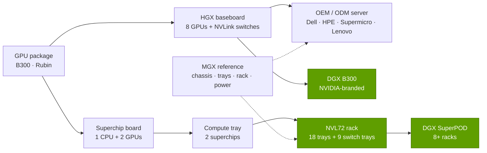

# HGX, DGX, MGX and NVL racks: from chips to rack-scale systems

Layer 08 · Systems, racks and AI factories · ~10 min read · Last verified: 2026-11-05

## ⚡ The Executive Take

- **Four product words, four business models.** [HGX](../../glossary.md#hgx) is a GPU baseboard that server makers build around; [DGX](../../glossary.md#dgx) is NVIDIA's own branded system; [MGX](../../glossary.md#mgx) is a modular reference architecture for partners; NVL racks ([NVL72](../../glossary.md#nvl72)) are whole rack-scale computers built by ODMs to NVIDIA's specification [[S101]](../../sources/bibliography.md#s101)[[S8524]](../../sources/bibliography.md#s8524)[[S396]](../../sources/bibliography.md#s396).
- **The unit of sale grew ~60× in a decade:** a DGX-1 listed at $129K in 2016 [[S310]](../../sources/bibliography.md#s310); a GB300 NVL72 rack is ~$4.0M (Est., Morgan Stanley) and a Vera Rubin NVL72 ~$7.8M (Est.) [[S332]](../../sources/bibliography.md#s332)[[S330]](../../sources/bibliography.md#s330).
- **NVIDIA now specifies almost everything in the rack:** compute tray, NVLink switch tray, copper spine, power shelves, busbar and liquid-cooling interfaces; it contributed the GB200 NVL72 rack design to the Open Compute Project in 2024 [[S5001]](../../sources/bibliography.md#s5001)[[S8000]](../../sources/bibliography.md#s8000).
- **MGX scaled fast as the partner channel:** 14 systems from six partners in 2023 became 90+ systems from 25+ partners by mid-2024 [[S8024]](../../sources/bibliography.md#s8024); AWS will put Trainium4 in MGX racks with NVLink [[S518]](../../sources/bibliography.md#s518).
- **The ODMs build, NVIDIA designs and takes the margin:** in Morgan Stanley's teardown, 72 GPUs are ~63% of a GB300 rack's price while the ODM keeps a ~2.7% gross margin, falling to ~1.9% on Vera Rubin (Est.) [[S332]](../../sources/bibliography.md#s332).
- **Weakness:** rack-scale lock-in invites resistance: buyers keep 8-GPU HGX for vendor choice, and AMD bought ZT Systems' rack designers for its 72-GPU Helios (H2 2026) [[S8527]](../../sources/bibliography.md#s8527)[[S90020]](../../sources/bibliography.md#s90020).

## 1. Four product lines and how they nest

Think of the product lines as Lego standards of rising size. **HGX** (since HGX-1 with Microsoft in 2017 [[S8525]](../../sources/bibliography.md#s8525)) is a baseboard of 8 GPUs and their NVLink switches that Dell, HPE, Lenovo, Supermicro and the ODMs put in their own chassis with their own CPUs and NICs [[S101]](../../sources/bibliography.md#s101). **DGX** is NVIDIA's branded version, sold with its software and support and doubling as everyone's reference design [[S310]](../../sources/bibliography.md#s310)[[S319]](../../sources/bibliography.md#s319). **MGX** standardizes the chassis, trays, rack and power around the board, in more than 100 combinations up to a full rack [[S8524]](../../sources/bibliography.md#s8524)[[S8025]](../../sources/bibliography.md#s8025). **NVL racks** join 72 GPU packages and 36 CPUs into one [scale-up](../../glossary.md#scale-up) domain built as one machine [[S396]](../../sources/bibliography.md#s396)[[S102]](../../sources/bibliography.md#s102).

| | HGX | DGX | MGX | NVL rack (NVL72) |
|---|---|---|---|---|
| What it is | GPU baseboard for partners | NVIDIA-branded system | Modular reference architecture | Whole rack as one computer |
| Who builds it | OEMs and ODMs | Contract manufacturers for NVIDIA | 25+ partners [[S8024]](../../sources/bibliography.md#s8024) | ODMs/OEMs to NVIDIA's design; DGX version too |
| GPUs per [NVLink](../../glossary.md#nvlink) domain | 8 | 8 (or 72 in DGX GB300) | Varies | 72; 144 with Kyber (2027) [[S305]](../../sources/bibliography.md#s305) |
| Power and cooling | ~10–14 kW, air or liquid [[S318]](../../sources/bibliography.md#s318)[[S321]](../../sources/bibliography.md#s321) | Same | 1U to rack | ~120–230 kW, liquid only [[S336]](../../sources/bibliography.md#s336)[[S303]](../../sources/bibliography.md#s303) |
| Price point | ~$0.32–0.40M for 8× H200 [[S322]](../../sources/bibliography.md#s322) | ~$0.37–0.47M [[S320]](../../sources/bibliography.md#s320)[[S322]](../../sources/bibliography.md#s322) | n/a | ~$3.0–7.8M (Est.) [[S326]](../../sources/bibliography.md#s326)[[S330]](../../sources/bibliography.md#s330) |
| Buyer keeps | Most choice (CPU, NIC, chassis) | Little | Choice within NVIDIA's frame | Least: NVIDIA's BOM |

> [!TIP]
> **Worked example — why the unit of sale jumped.** A DGX H200 holds 8 GPUs for ~$467K, about $58K per GPU [[S322]](../../sources/bibliography.md#s322). A GB300 NVL72 holds 72 GPUs for ~$3.99M, about $55K per GPU (Est.) [[S332]](../../sources/bibliography.md#s332). Per GPU the price barely moved; the smallest thing worth buying became a 72-GPU, ~132 kW rack [[S337]](../../sources/bibliography.md#s337). **Conclusion:** NVIDIA raised the *size of the purchase decision*, and with it how much of the bill it designs.

**[Q3 · Generational progress]** Per rack, HBM rose from 13.8 TB (GB200) to 20.7 TB (GB300, Vera Rubin) and dense FP8 from 360 PF to ~1,260 PF (Vera Rubin) [[S121]](../../sources/bibliography.md#s121)[[S337]](../../sources/bibliography.md#s337)[[S102]](../../sources/bibliography.md#s102).

🔧 Under the hood: naming traps when reading spec sheets

- **NVL numbers changed meaning.** At GTC 2025 NVIDIA counted GPU dies ("Vera Rubin NVL144"); at CES 2026 it went back to counting packages, so the same rack is now Vera Rubin NVL72 [[S102]](../../sources/bibliography.md#s102)[[S33006]](../../sources/bibliography.md#s33006). HGX B300 is still marketed as "NVL16" (16 dies, 8 packages) [[S101]](../../sources/bibliography.md#s101).
- **"Oberon" and "Kyber"** are rack architectures, not products: Oberon is the horizontal-tray NVL72 rack used by GB200, GB300 and Vera Rubin; Kyber is the vertical-blade rack for Rubin Ultra NVL144 at ~600 kW [[S305]](../../sources/bibliography.md#s305)[[S108]](../../sources/bibliography.md#s108).

## 2. Why NVIDIA moved from selling chips to specifying racks

Scale-up bandwidth is the reason. Mixture-of-experts models spread experts across many GPUs and every token sends traffic between them, which is cheap only inside one NVLink domain ([why domain size matters](../05-scale-up-nvlink-nvswitch/why-domain-size-matters.md)). Making 72 GPUs behave as one required controlling spine, switch trays, signal integrity, power and cooling as one design [[S5000]](../../sources/bibliography.md#s5000)[[S5001]](../../sources/bibliography.md#s5001). NVIDIA now hands partners a near-complete bill of materials: the compute tray with two [superchip](../../glossary.md#superchip) boards, NIC and DPU slots [[S8000]](../../sources/bibliography.md#s8000)[[S8001]](../../sources/bibliography.md#s8001); switch trays (18 NVLink switch chips per GB300 rack, 36 per Vera Rubin) [[S332]](../../sources/bibliography.md#s332); the ~5,000-cable spine [[S5000]](../../sources/bibliography.md#s5000); power shelves, busbar and the coming 800 V DC interface [[S90063]](../../sources/bibliography.md#s90063); and cold plates, manifolds and coolant temperatures [[S8002]](../../sources/bibliography.md#s8002).

For Vera Rubin, JPMorgan reported that NVIDIA would ship fully assembled [L10](../../glossary.md#l6-l10-l11) compute trays, roughly 90% of a server's cost, leaving ODMs mainly rack integration (🟡 reported) [[S8022]](../../sources/bibliography.md#s8022)[[S329]](../../sources/bibliography.md#s329).

> [!WARNING]
> **Myth vs reality:** "Rack-scale means NVIDIA builds the racks." It does not. Foxconn says it holds ~40% of the global AI-server market [[S3014]](../../sources/bibliography.md#s3014), and Quanta, Wistron and others build the rest. NVIDIA designs the rack and sells the silicon; the ODM runs tray and rack lines, leak tests and burn-in for a ~2–3% margin, though its dollar value-add rises as rack prices double [[S332]](../../sources/bibliography.md#s332).

> [!TIP]
> **Worked example — designer vs builder economics, per GB300 rack.** Morgan Stanley's ~$3.99M rack holds ~$2.52M of GPUs, ~$0.37M of HBM3E and LPDDR5X and ~$50K of liquid cooling; the ODM's 2.7% gross margin is **~$108K** [[S332]](../../sources/bibliography.md#s332)[[S334]](../../sources/bibliography.md#s334). The GPUs alone carry ~23× the ODM's gross profit as revenue to NVIDIA (repo arithmetic). **Conclusion:** writing the spec, not bending the metal, is where rack-scale profit sits.

## 3. Worked example: what a hyperscaler buys for 1,000 GB300 GPUs

The money flows in a chain: the hyperscaler orders tested [L11](../../glossary.md#l6-l10-l11) racks from an ODM; NVIDIA sells the ODM the superchips, NVLink switch chips and NICs (which is why NVIDIA's filings list ODMs as direct customers and cloud providers as indirect ones [[S90069]](../../sources/bibliography.md#s90069)); memory makers sell HBM to NVIDIA for its GPU packages; NVIDIA may also sell scale-out switches directly.

> [!TIP]
> **Worked example — 1,000 GB300 GPUs, who gets paid.** 1,000 ÷ 72 = 13.9, so the order is **14 racks (1,008 GPUs)**. At ~$3.99M per rack (Morgan Stanley's ODM-to-CSP price; Wolfe Research ~$4.3M) the racks cost **~$56M** (Est.) [[S332]](../../sources/bibliography.md#s332)[[S325]](../../sources/bibliography.md#s325). The GPUs alone (~$2.52M per rack) send **~$35M to NVIDIA**, before Grace CPUs, NVLink switches and NICs; the ODM's ~2.7% margin is **~$1.5M**; cooling parts (~$50K per rack) **~$0.7M** [[S332]](../../sources/bibliography.md#s332)[[S334]](../../sources/bibliography.md#s334). Network and storage add roughly a quarter (SemiAnalysis: GB200 $3.1M rack, ~$3.9M all-in) [[S324]](../../sources/bibliography.md#s324): **~$70M (Est.)**. Power: 14 × ~132 kW ≈ **1.85 MW** of rack IT load [[S337]](../../sources/bibliography.md#s337). **Conclusion:** the hyperscaler signs with the ODM, but well over half of the money ends up at NVIDIA.

🔧 Under the hood: why some buyers still choose 8-GPU HGX

HGX lets the buyer pick CPU, NIC and chassis and runs in air-cooled halls at ~14 kW [[S321]](../../sources/bibliography.md#s321); the cost is an 8-GPU scale-up domain, which hurts most on large mixture-of-experts inference ([scale-up vs scale-out](../05-scale-up-nvlink-nvswitch/scale-up-vs-scale-out.md)).

## 🎯 Corp Dev Lens

1. **Who owns the rack standard?** NVIDIA's OCP contribution and MGX made its rack the industry default; AMD answered by buying ZT Systems' design team and using the OCP double-wide rack for Helios [[S8527]](../../sources/bibliography.md#s8527)[[S344]](../../sources/bibliography.md#s344). Is there room for a third, open rack-scale reference design?
2. **HGX is the hedge market.** Buyers who want CPU and NIC choice stay on 8-GPU boards; that is where alternative CPUs and NICs can still win sockets.
3. **Qualcomm question (public information only):** Qualcomm's AI200/AI250 are pitched as rack-scale, direct-liquid-cooled systems at ~160 kW per rack [[S173]](../../sources/bibliography.md#s173). Build with an ODM, partner through an MGX-style ecosystem, or acquire rack-design capability as AMD did?

## 📚 Sources

<!-- Auto-generated from the [S…] citations on this page by `make build`. Edit sources/registry/*.csv, not this list. -->

- [**S101**](../../sources/bibliography.md#s101) NVIDIA, *NVIDIA HGX Platform (HGX Rubin NVL8, HGX B300, HGX B200 specifications)*, 2026. [Link](https://www.nvidia.com/en-us/data-center/hgx/)
- [**S102**](../../sources/bibliography.md#s102) NVIDIA, *NVIDIA DGX Vera Rubin NVL72*, 2026. [Link](https://www.nvidia.com/en-us/data-center/dgx-vera-rubin-nvl72/)
- [**S108**](../../sources/bibliography.md#s108) HPCwire / AIwire, *Huang Shares Nvidia Roadmap Showing More Chips, NVL1152, Scale-Up CPO*, 2026-03-18. [Link](https://www.hpcwire.com/aiwire/2026/03/18/huang-shares-nvidia-roadmap-showing-more-chips-nvl1152-scale-up-cpo/)
- [**S121**](../../sources/bibliography.md#s121) NVIDIA, *NVIDIA GB200 NVL72*, 2024-03. [Link](https://www.nvidia.com/en-us/data-center/gb200-nvl72/)
- [**S173**](../../sources/bibliography.md#s173) Qualcomm, *Qualcomm Unveils AI200 and AI250 - Redefining Rack-Scale Data Center Inference*, 2025-10-27. [Link](https://www.qualcomm.com/news/releases/2025/10/qualcomm-unveils-ai200-and-ai250-redefining-rack-scale-data-cent)
- [**S303**](../../sources/bibliography.md#s303) Commercial Times (ctee.com.tw), *Vera Rubin NVL72 Max-Q / Max-P rack power (Commercial Times report)*, 2026-01-07. [Link](https://www.ctee.com.tw/news/20260107701081-430704)
- [**S305**](../../sources/bibliography.md#s305) DatacenterDynamics, *Nvidia's Rubin Ultra NVL576 rack expected to be 600kW, coming second half of 2027*, 2025-03-19. [Link](https://datacenterdynamics.com/en/news/nvidias-rubin-ultra-nvl576-rack-expected-to-be-600kw-coming-second-half-of-2027)
- [**S310**](../../sources/bibliography.md#s310) AnandTech (Ryan Smith), *NVIDIA unveils the DGX-1 HPC server: 8 Teslas, 3U, Q2 2016*, 2016-04-05. [Link](https://www.anandtech.com/show/10229)
- [**S318**](../../sources/bibliography.md#s318) NVIDIA (mirror hosted by MEGWARE), *NVIDIA DGX H100 datasheet*, 2023. [Link](https://www.MEGWARE.com/fileadmin/user_upload/LandingPage%20NVIDIA/nvidia-dgx-h100-datasheet.pdf)
- [**S319**](../../sources/bibliography.md#s319) NVIDIA (mirror hosted by OpenZeka), *NVIDIA DGX B200 datasheet*, 2024. [Link](https://openzeka.com/wp-content/uploads/2024/11/dgx-scale-ai-infrastructure-dgx-b200-datasheet-nvidia-web-1-1.pdf)
- [**S320**](../../sources/bibliography.md#s320) Hydra Host, *NVIDIA DGX B200 (configuration and pricing page)*, 2026. [Link](https://hydrahost.com/nvidia/dgx-b200)
- [**S321**](../../sources/bibliography.md#s321) Colfax International, *NVIDIA DGX B300 (specification page)*, 2025. [Link](https://www.colfax-intl.com/nvidia/nvidia-dgx-b300)
- [**S322**](../../sources/bibliography.md#s322) GPUPerHour, *NVIDIA GPU prices (H100/H200 and DGX/HGX system listings)*, 2026-09. [Link](https://gpuperhour.com/blog/nvidia-gpu-prices)
- [**S324**](../../sources/bibliography.md#s324) fal.ai, *NVIDIA GB200 price in 2026: what a GPU, a tray and an NVL72 rack cost*, 2026. [Link](https://fal.ai/learn/serverless/nvidia-gb200-price)
- [**S325**](../../sources/bibliography.md#s325) Spheron, *GB300 NVL72 vs GB200 NVL72: pricing and availability 2026*, 2026. [Link](https://www.spheron.network/blog/gb300-nvl72-vs-gb200-nvl72-pricing-availability-2026/)
- [**S326**](../../sources/bibliography.md#s326) TweakTown, *NVIDIA's new GB200 Superchip costs up to $70,000: full B200 NVL72 AI server costs $3 million*, 2024-05. [Link](https://www.tweaktown.com/news/98292/nvidias-new-gb200-superchip-costs-up-to-70-000-full-b200-nvl72-ai-server-3-million/index.html)
- [**S329**](../../sources/bibliography.md#s329) Tom's Hardware, *Price of Nvidia's Vera Rubin NVL72 racks skyrockets to as much as $8.8 million apiece, but server makers' margins will be tight*, 2026. [Link](https://www.tomshardware.com/tech-industry/artificial-intelligence/price-of-nvidias-vera-rubin-nvl72-racks-skyrockets-to-as-much-as-usd8-8-million-apiece-but-server-makers-margins-will-be-tight-nvidia-is-moving-closer-to-shipping-entire-full-scale-systems)
- [**S330**](../../sources/bibliography.md#s330) PC Gamer, *A single Nvidia Vera Rubin rack is estimated to cost $7,803,148 with over $2 million of that figure spent on memory alone*, 2026-05. [Link](https://pcgamer.com/hardware/a-single-nvidia-vera-rubin-rack-is-estimated-to-cost-usd7-803-148-with-over-usd2-million-of-that-figure-spent-on-memory-alone)
- [**S332**](../../sources/bibliography.md#s332) Tiger Brokers (iTiger), *Morgan Stanley's BOM analysis of NVIDIA's Rubin: GPU share declines; PCB, MLCC and ABF substrate values soar*, 2026-05-20. [Link](https://www.itiger.com/news/1188068712)
- [**S334**](../../sources/bibliography.md#s334) Tom's Hardware, *Cooling system for a single Nvidia Blackwell Ultra NVL72 rack costs $50,000 - set to increase to $56,000 with next-generation NVL144 racks*, 2025-09. [Link](https://www.tomshardware.com/pc-components/cooling/cooling-system-for-a-single-nvidia-blackwell-ultra-nvl72-rack-costs-a-staggering-usd50-000-set-to-increase-to-usd56-000-with-next-generation-nvl144-racks)
- [**S336**](../../sources/bibliography.md#s336) eeNews Europe, *Nvidia offers 120kW liquid-cooled Blackwell rack as industry standard*, 2024-10. [Link](https://www.eenewseurope.com/en/nvidia-offers-120kw-liquid-cooled-blackwell-rack-as-industry-standard)
- [**S337**](../../sources/bibliography.md#s337) Spheron, *NVIDIA GB300 (rental and specifications)*, 2026. [Link](https://spheron.network/gpu-rental/gb300/)
- [**S344**](../../sources/bibliography.md#s344) AMD, *AMD Helios rack-scale AI infrastructure (product page)*, 2026. [Link](https://www.amd.com/ja/products/rackscale-solutions/helios.html)
- [**S396**](../../sources/bibliography.md#s396) NVIDIA Newsroom, *NVIDIA Blackwell platform arrives to power a new era of computing*, 2024-03-18. [Link](https://nvidianews.nvidia.com/news/nvidia-blackwell-platform-arrives-to-power-a-new-era-of-computing)
- [**S518**](../../sources/bibliography.md#s518) ServeTheHome, *NVIDIA NVLink Fusion tapped for future AWS Trainium4 deployments*, 2025-12-02. [Link](https://www.servethehome.com/nvidia-nvlink-fusion-tapped-for-future-aws-trainium4-deployments/)
- [**S3014**](../../sources/bibliography.md#s3014) Focus Taiwan (CNA), *Foxconn expects AI server rack shipments to double in 2026*, 2026-03-16. [Link](https://focustaiwan.tw/business/202603160022)
- [**S5000**](../../sources/bibliography.md#s5000) SemiAnalysis, *Nvidia's Optical Boogeyman - NVL72, InfiniBand Scale Out, 800G & 1.6T Ramp*, 2024-03. [Link](https://newsletter.semianalysis.com/p/nvidias-optical-boogeyman-nvl72-infiniband)
- [**S5001**](../../sources/bibliography.md#s5001) SiliconANGLE, *Nvidia aims to boost Blackwell by donating platform design to the Open Compute Project*, 2024-10-15. [Link](https://siliconangle.com/2024/10/15/nvidia-aims-boost-blackwell-donating-platform-design-open-compute-project)
- [**S8000**](../../sources/bibliography.md#s8000) NVIDIA Docs, *NVIDIA DGX GB200 User Guide: hardware overview*, 2025. [Link](https://docs.nvidia.com/dgx/dgxgb200-user-guide/hardware.html)
- [**S8001**](../../sources/bibliography.md#s8001) NVIDIA Docs, *NVIDIA Enterprise Reference Architecture: NVL72 AI factory - system hardware and components*, 2025. [Link](https://docs.nvidia.com/enterprise-reference-architectures/nvl72-ai-factory/latest/components.html)
- [**S8002**](../../sources/bibliography.md#s8002) COMPUTEX Taipei (TAITRA), *NVIDIA Vera Rubin NVL72 (COMPUTEX 2026 Best Choice Award entry)*, 2026-05. [Link](https://bcaward.computex.biz/download/2026/winnerPdf/10905.pdf)
- [**S8022**](../../sources/bibliography.md#s8022) Tom's Hardware, *JP Morgan says Nvidia is gearing up to sell entire AI servers instead of just AI GPUs and componentry*, 2025. [Link](https://www.tomshardware.com/tech-industry/artificial-intelligence/jp-morgan-says-nvidia-is-gearing-up-to-sell-entire-ai-servers-instead-of-just-ai-gpus-and-componentry-jensens-master-plan-of-vertical-integration-will-boost-profits-purportedly-starting-with-vera-rubin)
- [**S8024**](../../sources/bibliography.md#s8024) DataCentreNews UK, *NVIDIA to build AI factories and data centres for the next industrial revolution (Computex 2024)*, 2024-06-02. [Link](https://datacentrenews.uk/story/nvidia-to-build-ai-factories-and-data-centres-for-the-next-industrial-revolution)
- [**S8025**](../../sources/bibliography.md#s8025) NVIDIA, *NVIDIA MGX (product page)*, 2026. [Link](https://www.nvidia.com/en-us/data-center/products/mgx/)
- [**S8524**](../../sources/bibliography.md#s8524) NVIDIA Newsroom, *NVIDIA MGX gives system makers modular architecture to meet diverse accelerated computing needs of world's data centers*, 2023-05-28. [Link](https://nvidianews.nvidia.com/news/nvidia-mgx-server-specification)
- [**S8525**](../../sources/bibliography.md#s8525) DatacenterDynamics, *OCP Summit: Nvidia, Microsoft announce HGX-1 hyperscale GPU accelerator*, 2017-03. [Link](https://www.datacenterdynamics.com/en/news/ocp-summit-nvidia-microsoft-announce-hgx-1-hyperscale-gpu-accelerator/)
- [**S8527**](../../sources/bibliography.md#s8527) AMD Investor Relations, *AMD completes acquisition of ZT Systems*, 2025-03-31. [Link](https://ir.amd.com/news-events/press-releases/detail/1240/amd-completes-acquisition-of-zt-systems)
- [**S33006**](../../sources/bibliography.md#s33006) Tom's Hardware, *Nvidia launches Vera Rubin NVL72 AI supercomputer at CES*, 2026-01-05. [Link](https://www.tomshardware.com/pc-components/gpus/nvidia-launches-vera-rubin-nvl72-ai-supercomputer-at-ces-promises-up-to-5x-greater-inference-performance-and-10x-lower-cost-per-token-than-blackwell-coming-2h-2026)
- [**S90020**](../../sources/bibliography.md#s90020) Shacknews, *AMD Helios AI rack system on track for initial shipments in Q3 2026*, 2026. [Link](https://www.shacknews.com/article/150249/amd-helios-ai-system-shipping-q3-2026)
- [**S90063**](../../sources/bibliography.md#s90063) Converge Digest, *The megawatt shift: NVIDIA's 800 VDC strategy*, 2026. [Link](https://convergedigest.com/the-megawatt-shift-nvidias-800-vdc-strategy/)
- [**S90069**](../../sources/bibliography.md#s90069) NVIDIA Corporation via SEC EDGAR, *NVIDIA Form 10-Q for the quarter ended July 26, 2026 (Q2 FY2027)*, 2026-08. [Link](https://www.sec.gov/Archives/edgar/data/0001045810/000104581026000075/nvda-20260726.htm)
