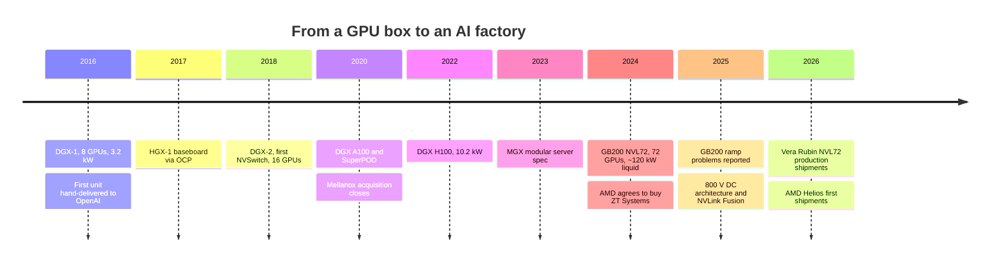

# Systems, racks and AI factories: History and how NVIDIA built it

Layer 08 · Systems, racks and AI factories · ~11 min read · Last verified: 2026-11-05

## ⚡ The Executive Take

- **NVIDIA has sold systems for a decade.** The first [DGX](../../glossary.md#dgx)-1 (8 GPUs, 3.2 kW, $129,000) shipped in 2016, and Jensen Huang hand-delivered one to OpenAI that August [[S310]](../../sources/bibliography.md#s310)[[S8522]](../../sources/bibliography.md#s8522)[[S8523]](../../sources/bibliography.md#s8523).
- **The OEM standard came in 2017.** [HGX](../../glossary.md#hgx)-1, built with Microsoft and Foxconn's Ingrasys and published via OCP, gave every server maker the same GPU baseboard [[S8525]](../../sources/bibliography.md#s8525)[[S8526]](../../sources/bibliography.md#s8526).
- **Each step widened what NVIDIA designs.** DGX-2 (2018) added [NVSwitch](../../glossary.md#nvswitch) [[S313]](../../sources/bibliography.md#s313). [MGX](../../glossary.md#mgx) (2023) modularised the server [[S8524]](../../sources/bibliography.md#s8524). GB200 [NVL72](../../glossary.md#nvl72) (2024) made the 120 kW liquid-cooled rack the product [[S396]](../../sources/bibliography.md#s396)[[S336]](../../sources/bibliography.md#s336).
- **Rack scale was hard even for NVIDIA.** Early GB200 racks reportedly overheated and showed link glitches, and some [hyperscalers](../../glossary.md#hyperscaler) trimmed orders [[S5500]](../../sources/bibliography.md#s5500)[[S5501]](../../sources/bibliography.md#s5501).
- **[Q4 · Source of advantage]** The edge is integration and orchestration, not any single chip: NVIDIA designs the rack and its network and lines up the partners. ~20 power partners showed 800 V DC parts in 2025 [[S90061]](../../sources/bibliography.md#s90061).
- **[Q6 · Replication cost]** AMD's answer was to buy ZT Systems for $4.9B and resell the factories to Sanmina, a net ~$1.9–2.35B for a rack-design team [[S5527]](../../sources/bibliography.md#s5527)[[S8527]](../../sources/bibliography.md#s8527). First Helios racks shipped ~2 years after the deal was announced 🟡 [[S90020]](../../sources/bibliography.md#s90020).

## From a box to a rack: key decisions

| Date | Decision | Why it mattered | Source |
|---|---|---|---|
| 2016-04 | DGX-1: NVIDIA sells a complete 8-GPU server | NVIDIA ships whole systems | [[S310]](../../sources/bibliography.md#s310) |
| 2017-03 | HGX-1 baseboard released via OCP | One board for every OEM; Huang likened it to the PC's ATX standard | [[S8525]](../../sources/bibliography.md#s8525) |
| 2018-03 | DGX-2 with NVSwitch | 16-GPU all-to-all domain, 10 kW, $399,000 | [[S313]](../../sources/bibliography.md#s313)[[S314]](../../sources/bibliography.md#s314) |
| 2019-03 | Buy Mellanox ($6.9B, closed 2020) | Owns the scale-out network | [[S464]](../../sources/bibliography.md#s464) |
| 2023-05 | MGX modular spec | 100+ server variants from shared parts | [[S8524]](../../sources/bibliography.md#s8524) |
| 2024-03 | GB200 NVL72 rack | The rack becomes the product | [[S396]](../../sources/bibliography.md#s396)[[S121]](../../sources/bibliography.md#s121) |
| 2024-10 | Contribute the NVL72 design to OCP | Seeds a compatible supply chain | [[S5001]](../../sources/bibliography.md#s5001)[[S336]](../../sources/bibliography.md#s336) |
| 2025-05 | 800 V DC power architecture | Prepares sites for ~600 kW–1 MW racks | [[S33019]](../../sources/bibliography.md#s33019)[[S90061]](../../sources/bibliography.md#s90061) |
| 2026-03 | Vera Rubin POD, Kyber, Groq 3 LPX rack | Sells a 40-rack "AI factory" unit | [[S511]](../../sources/bibliography.md#s511)[[S90003]](../../sources/bibliography.md#s90003) |

> [!TIP]
> **Worked example — what changed between a DGX-1 and an NVL72.** A DGX-1 drew 3.2 kW for 8 GPUs (0.4 kW per GPU) at $129,000, or ~$16,000 per GPU [[S310]](../../sources/bibliography.md#s310). A GB200 NVL72 draws ~120 kW for 72 GPUs (~1.7 kW per GPU) at ~$3.0M (Est., HSBC), ~$42,000 per GPU [[S336]](../../sources/bibliography.md#s336)[[S326]](../../sources/bibliography.md#s326). Power per GPU rose ~4× and price per GPU ~2.6×. The unit of purchase grew ~23× in dollars, and at that size cooling, power and cabling became NVIDIA's design problem, not the OEM's.

🔧 Under the hood: what went wrong on the GB200 ramp

January 2025 reports said the first GB200 NVL72 racks overheated and had chip-to-chip link glitches; NVIDIA changed the rack design. Hyperscalers reportedly cut some orders and OpenAI reportedly asked for Hopper instead [[S5500]](../../sources/bibliography.md#s5500)[[S5501]](../../sources/bibliography.md#s5501). NVIDIA had denied earlier overheating reports, and a Google source said its orders were on plan [[S5501]](../../sources/bibliography.md#s5501).

## [Q4 · Source of advantage] Integration, orchestration and the network

**[Q4 · Source of advantage]** NVIDIA's lead in this layer rests on three things that reinforce each other:

1. **System integration.** NVIDIA specifies trays, copper spine, power shelves and cooling loops; ODMs build to that design. A Vera Rubin NVL72 holds 72 Rubin GPUs, 36 Vera CPUs and 36 [NVLink](../../glossary.md#nvlink) switch chips, all NVIDIA silicon [[S102]](../../sources/bibliography.md#s102)[[S332]](../../sources/bibliography.md#s332).
2. **Supply-chain orchestration.** NVIDIA held $279B of supply and capacity commitments in mid-2026 [[S407]](../../sources/bibliography.md#s407). It allocates scarce [CoWoS](../../glossary.md#cowos)-built GPUs across ODMs such as Foxconn (~40% of AI servers) [[S3014]](../../sources/bibliography.md#s3014). ~20 partners built 800 V DC parts to its roadmap [[S90061]](../../sources/bibliography.md#s90061).
3. **Co-designed networking.** Owning NVLink, NICs and switches lets NVIDIA tune rack and cluster together. Networking revenue reached a record $14.8B in Q1 FY2027 [[S90014]](../../sources/bibliography.md#s90014)[[S464]](../../sources/bibliography.md#s464).

Raw technology is *not* the moat: Helios matches or beats Vera Rubin NVL72 on paper [[S344]](../../sources/bibliography.md#s344). Speed of execution is: NVIDIA ships a new rack generation roughly every year [[S500]](../../sources/bibliography.md#s500).

> [!TIP]
> **Worked example — one throat to choke.** A 40-rack Vera Rubin POD of ~60 EF is built from seven NVIDIA chip types [[S511]](../../sources/bibliography.md#s511). The alternative is five vendors and five firmware stacks to debug. When a 1 GW site costs $50–60B [[S398]](../../sources/bibliography.md#s398), a month of delay is worth ~$4–5B of idle capital (🔴 repo arithmetic). Buyers pay for one accountable integrator.

## [Q6 · Replication cost] What it takes to field a 100+ kW rack

**[Q6 · Replication cost]** The cleanest market price is AMD's ZT deal. AMD paid $4.9B (announced August 2024, closed March 2025) and kept the design and customer-enablement teams [[S8527]](../../sources/bibliography.md#s8527)[[S5527]](../../sources/bibliography.md#s5527). It then sold ZT's factories to Sanmina for $2.25B cash, a $0.30B premium and up to $0.45B of earn-out [[S5527]](../../sources/bibliography.md#s5527)[[S5528]](../../sources/bibliography.md#s5528). Helios first shipped around the end of Q3 2026, ~2 years after announcement [[S90020]](../../sources/bibliography.md#s90020).

| Starting point | Time | Dollars | Talent | Reasoning |
|---|---|---|---|---|
| Has competitive accelerators, CPUs and NICs (AMD-like) | 2–3 years | $2–4B | Hundreds to low thousands of system, thermal, power and signal engineers, plus an ODM | ZT net ~$2B; Helios ~2 years after the deal [[S5527]](../../sources/bibliography.md#s5527)[[S90020]](../../sources/bibliography.md#s90020) |
| Has an accelerator but no scale-up fabric or rack team | 4–5 years | $5–10B | As above, plus switch silicon | Needs a scale-up switch first [[S5524]](../../sources/bibliography.md#s5524) |
| Wants NVIDIA's annual cadence and supply reach | Not near term | $100B+ of commitments | Hundreds of suppliers | NVIDIA holds $279B [[S407]](../../sources/bibliography.md#s407) |

All estimates are 🔴 repo analysis built on the cited facts.

> [!TIP]
> **Worked example — was ZT worth it?** OpenAI's first Helios gigawatt is ~4,250 racks at ~235 kW each (Est.) [[S346]](../../sources/bibliography.md#s346)[[S546]](../../sources/bibliography.md#s546). AMD publishes no rack price; at an assumed $5M per rack (🔴), that gigawatt is ~$21B of system revenue. AMD's net ~$2B for the ZT team is ~10% of one gigawatt. If the team makes Helios ship on time, the payback is fast.

## Counterfactuals — what if NVIDIA hadn't…

1. 🔴 **…moved beyond chips (no DGX, HGX or NVL72).** OEMs would have built 8-GPU boxes, with no 72-GPU domain. NVIDIA claims [MoE](../../glossary.md#mixture-of-experts) models run ~10× faster on GB200 NVL72 than on HGX H200 (vendor claim) [[S5002]](../../sources/bibliography.md#s5002). TPU pods would have faced no rival for frontier MoE work, and OEMs would have kept more of each system dollar.
2. 🔴 **…become a full OEM with its own factories.** It would capture the ODM's ~2–3% rack margin [[S332]](../../sources/bibliography.md#s332). But it would carry inventory and field service and turn Dell, HPE and Supermicro into rivals. Design-led, ODM-built (the "Apple model") protects a ~75% gross margin [[S405]](../../sources/bibliography.md#s405).
3. 🔴 **…fixed the GB200 rack problems more slowly.** Had customers reverted to Hopper at scale, as OpenAI reportedly asked to [[S5501]](../../sources/bibliography.md#s5501), AMD and Google would have won a 12-month window in 2025.

> [!TIP]
> **Worked example — sizing counterfactual 1.** NVIDIA's content rose ~10–20 points of system price from HGX servers to NVL72 racks ([value chain](value-chain-and-corp-dev.md)). On one gigawatt of Vera Rubin racks (~$34B, Est.) [[S330]](../../sources/bibliography.md#s330)[[S302]](../../sources/bibliography.md#s302), 10 points is ~$3.4B that would otherwise sit with integrators (🔴).

## 🎯 Corp Dev Lens

1. ZT priced a rack-design team at ~$2B net [[S5527]](../../sources/bibliography.md#s5527). Which independent system-design houses remain, and who would pay a similar price for them?
2. Sanmina paid up to $3.0B for AMD's rack factories [[S5528]](../../sources/bibliography.md#s5528): is rack-level NPI and test capacity a scarce asset in its own right?
3. NVIDIA's moat here is orchestration. Which suppliers (cooling, power, connectors) could a challenger lock up first to slow NVIDIA's next ramp?
4. If GB200's ramp problems recur at Kyber's ~600 kW 🟡 [[S90061]](../../sources/bibliography.md#s90061), who is best placed to win share during the gap?

## 📚 Sources

<!-- Auto-generated from the [S…] citations on this page by `make build`. Edit sources/registry/*.csv, not this list. -->

- [**S102**](../../sources/bibliography.md#s102) NVIDIA, *NVIDIA DGX Vera Rubin NVL72*, 2026. [Link](https://www.nvidia.com/en-us/data-center/dgx-vera-rubin-nvl72/)
- [**S121**](../../sources/bibliography.md#s121) NVIDIA, *NVIDIA GB200 NVL72*, 2024-03. [Link](https://www.nvidia.com/en-us/data-center/gb200-nvl72/)
- [**S302**](../../sources/bibliography.md#s302) Hashrate Index, *NVIDIA Vera Rubin NVL72 specs breakdown*, 2026. [Link](https://hashrateindex.com/blog/nvidia-vera-rubin-nvl72-specs-breakdown/)
- [**S310**](../../sources/bibliography.md#s310) AnandTech (Ryan Smith), *NVIDIA unveils the DGX-1 HPC server: 8 Teslas, 3U, Q2 2016*, 2016-04-05. [Link](https://www.anandtech.com/show/10229)
- [**S313**](../../sources/bibliography.md#s313) NVIDIA (mirror hosted by M Computers), *NVIDIA DGX-2 datasheet*, 2018. [Link](https://mcomputers.cz/wp-content/uploads/2018/12/nvidia-dgx-2-datasheet-uk.pdf)
- [**S314**](../../sources/bibliography.md#s314) TweakTown, *NVIDIA's DGX-2: 16 x Tesla V100s, total of 512GB HBM2, $399K*, 2018-03-27. [Link](https://www.tweaktown.com/news/61345/nvidias-dgx-2-16-tesla-v100s-total-512gb-hbm2-399k/index.html)
- [**S326**](../../sources/bibliography.md#s326) TweakTown, *NVIDIA's new GB200 Superchip costs up to $70,000: full B200 NVL72 AI server costs $3 million*, 2024-05. [Link](https://www.tweaktown.com/news/98292/nvidias-new-gb200-superchip-costs-up-to-70-000-full-b200-nvl72-ai-server-3-million/index.html)
- [**S330**](../../sources/bibliography.md#s330) PC Gamer, *A single Nvidia Vera Rubin rack is estimated to cost $7,803,148 with over $2 million of that figure spent on memory alone*, 2026-05. [Link](https://pcgamer.com/hardware/a-single-nvidia-vera-rubin-rack-is-estimated-to-cost-usd7-803-148-with-over-usd2-million-of-that-figure-spent-on-memory-alone)
- [**S332**](../../sources/bibliography.md#s332) Tiger Brokers (iTiger), *Morgan Stanley's BOM analysis of NVIDIA's Rubin: GPU share declines; PCB, MLCC and ABF substrate values soar*, 2026-05-20. [Link](https://www.itiger.com/news/1188068712)
- [**S336**](../../sources/bibliography.md#s336) eeNews Europe, *Nvidia offers 120kW liquid-cooled Blackwell rack as industry standard*, 2024-10. [Link](https://www.eenewseurope.com/en/nvidia-offers-120kw-liquid-cooled-blackwell-rack-as-industry-standard)
- [**S344**](../../sources/bibliography.md#s344) AMD, *AMD Helios rack-scale AI infrastructure (product page)*, 2026. [Link](https://www.amd.com/ja/products/rackscale-solutions/helios.html)
- [**S346**](../../sources/bibliography.md#s346) Kad8, *AMD Helios AI rack: MI455X, Zen 6 EPYC and Pensando*, 2026. [Link](https://www.kad8.com/server/amd-helios-ai-rack-mi455x-zen-6-epyc-and-pensando/)
- [**S396**](../../sources/bibliography.md#s396) NVIDIA Newsroom, *NVIDIA Blackwell platform arrives to power a new era of computing*, 2024-03-18. [Link](https://nvidianews.nvidia.com/news/nvidia-blackwell-platform-arrives-to-power-a-new-era-of-computing)
- [**S398**](../../sources/bibliography.md#s398) NVIDIA Investor Relations, *NVIDIA Q2 FY2026 earnings call (2025-08-27): AI factory economics commentary*, 2025-08-27. [Link](https://investor.nvidia.com/events-and-presentations/events-and-presentations/default.aspx)
- [**S405**](../../sources/bibliography.md#s405) NVIDIA Corporation via SEC EDGAR, *NVIDIA Announces Financial Results for Second Quarter Fiscal 2027 (Form 8-K exhibit 99.1)*, 2026-08-26. [Link](https://www.sec.gov/Archives/edgar/data/0001045810/000104581026000073/q2fy27pr.htm)
- [**S407**](../../sources/bibliography.md#s407) NVIDIA Corporation via SEC EDGAR, *NVIDIA Corporation Form 10-Q for quarter ended July 26, 2026*, 2026-08-28. [Link](https://www.sec.gov/Archives/edgar/data/1045810/000104581026000075/nvda-20260726.htm)
- [**S464**](../../sources/bibliography.md#s464) NVIDIA Newsroom, *NVIDIA to Acquire Mellanox for $6.9 Billion*, 2019-03-11. [Link](https://nvidianews.nvidia.com/news/nvidia-to-acquire-mellanox-for-6-9-billion)
- [**S500**](../../sources/bibliography.md#s500) NVIDIA Corporation, *NVIDIA Q2 Fiscal 2027 Quarterly Presentation (CFO commentary deck)*, 2026-08-26. [Link](https://s201.q4cdn.com/141608511/files/doc_financials/2027/Q227/NVDA-F2Q27-Quarterly-Presentation-final-1.pdf)
- [**S511**](../../sources/bibliography.md#s511) Tom's Hardware, *Examining Nvidia's 60 exaflop Vera Rubin POD — how seven chips underpin company's 40 rack AI factory supercomputer*, 2026-03. [Link](https://www.tomshardware.com/tech-industry/artificial-intelligence/nvidias-seven-chip-vera-rubin-platforms-turns-the-data-center-into-an-ai-factory)
- [**S546**](../../sources/bibliography.md#s546) TechWire Asia, *AMD Advancing AI 2026: Helios, OpenAI, Meta, Anthropic*, 2026-07. [Link](https://techwireasia.com/2026/07/amd-advancing-ai-2026-helios-openai-meta-anthropic/)
- [**S3014**](../../sources/bibliography.md#s3014) Focus Taiwan (CNA), *Foxconn expects AI server rack shipments to double in 2026*, 2026-03-16. [Link](https://focustaiwan.tw/business/202603160022)
- [**S5001**](../../sources/bibliography.md#s5001) SiliconANGLE, *Nvidia aims to boost Blackwell by donating platform design to the Open Compute Project*, 2024-10-15. [Link](https://siliconangle.com/2024/10/15/nvidia-aims-boost-blackwell-donating-platform-design-open-compute-project)
- [**S5002**](../../sources/bibliography.md#s5002) NVIDIA Blog, *Mixture of Experts Powers the Most Intelligent Frontier AI Models, Runs 10x Faster on NVIDIA Blackwell NVL72*, 2025-12-03. [Link](https://blogs.nvidia.com/blog/mixture-of-experts-frontier-models/)
- [**S5500**](../../sources/bibliography.md#s5500) TrendForce, *NVIDIA GB200 racks reportedly overheat, major clients cut orders*, 2025-01-14. [Link](https://www.trendforce.com/news/2025/01/14/news-nvidia-gb200-racks-reportedly-overheat-major-clients-cut-orders/)
- [**S5501**](../../sources/bibliography.md#s5501) TechPowerUp, *NVIDIA's GB200 'Blackwell' racks face overheating issues*, 2025-01-14. [Link](https://techpowerup.com/331105/nvidias-gb200-blackwell-racks-face-overheating-issues)
- [**S5524**](../../sources/bibliography.md#s5524) Fierce Network, *AMD's Helios bets AI networking on open Ethernet*, 2026. [Link](https://www.fierce-network.com/cloud/amds-helios-bets-ai-networking-open-ethernet)
- [**S5527**](../../sources/bibliography.md#s5527) Evertiq, *AMD completes sale of ZT Systems manufacturing unit to Sanmina*, 2025-10-27. [Link](https://evertiq.com/design/2025-10-27-amd-completes-sale-of-zt-systems-manufacturing-unit-to-sanmina)
- [**S5528**](../../sources/bibliography.md#s5528) Sanmina, *Sanmina completes acquisition of ZT Systems data center infrastructure manufacturing business from AMD*, 2025-10-27. [Link](https://s201.q4cdn.com/209924174/files/doc_news/SANMINA-COMPLETES-ACQUISITION-OF-ZT-SYSTEMS-DATA-CENTER-INFRASTRUCTURE-MANUFACTURING-BUSINESS-FROM-AMD-2025.pdf)
- [**S8522**](../../sources/bibliography.md#s8522) TOP500, *NVIDIA delivers DGX-1 'supercomputer in a box' to OpenAI*, 2016-08-15. [Link](https://top500.org/news/nvidia-delivers-dgx-1-supercomputer-in-a-box-to-openai/)
- [**S8523**](../../sources/bibliography.md#s8523) insideHPC, *Nvidia donates DGX-1 machine learning supercomputer to OpenAI non-profit*, 2016-08. [Link](https://insidehpc.com/2016/08/dgx-1-donation-openai)
- [**S8524**](../../sources/bibliography.md#s8524) NVIDIA Newsroom, *NVIDIA MGX gives system makers modular architecture to meet diverse accelerated computing needs of world's data centers*, 2023-05-28. [Link](https://nvidianews.nvidia.com/news/nvidia-mgx-server-specification)
- [**S8525**](../../sources/bibliography.md#s8525) DatacenterDynamics, *OCP Summit: Nvidia, Microsoft announce HGX-1 hyperscale GPU accelerator*, 2017-03. [Link](https://www.datacenterdynamics.com/en/news/ocp-summit-nvidia-microsoft-announce-hgx-1-hyperscale-gpu-accelerator/)
- [**S8526**](../../sources/bibliography.md#s8526) Tom's Hardware, *Nvidia joins Open Compute Project with HGX-1 hyperscale GPU accelerator*, 2017-03. [Link](https://tomshardware.com/news/nvidia-hgx1-open-compute-project)
- [**S8527**](../../sources/bibliography.md#s8527) AMD Investor Relations, *AMD completes acquisition of ZT Systems*, 2025-03-31. [Link](https://ir.amd.com/news-events/press-releases/detail/1240/amd-completes-acquisition-of-zt-systems)
- [**S33019**](../../sources/bibliography.md#s33019) NVIDIA Technical Blog, *NVIDIA 800 V HVDC Architecture Will Power the Next Generation of AI Factories*, 2025-05-20. [Link](https://developer.nvidia.com/blog/nvidia-800-v-hvdc-architecture-will-power-the-next-generation-of-ai-factories/)
- [**S90003**](../../sources/bibliography.md#s90003) eWeek, *Everything Nvidia Just Announced at GTC 2026: 7 Chips, 5 Racks, 1 Giant Bet on Agentic AI*, 2026-03-17. [Link](https://www.eweek.com/news/nvidia-gtc-2026-ai-inference-vera-rubin-neuron/)
- [**S90014**](../../sources/bibliography.md#s90014) Global Data Center Hub, *NVIDIA posts $81.6 billion quarter and splits into two reporting platforms*, 2026-05. [Link](https://www.globaldatacenterhub.com/p/nvidia-posts-816-billion-quarter)
- [**S90020**](../../sources/bibliography.md#s90020) Shacknews, *AMD Helios AI rack system on track for initial shipments in Q3 2026*, 2026. [Link](https://www.shacknews.com/article/150249/amd-helios-ai-system-shipping-q3-2026)
- [**S90061**](../../sources/bibliography.md#s90061) DatacenterDynamics, *NVIDIA prepares data center industry for 1MW racks and 800 volt DC power architectures*, 2025-10. [Link](https://www.datacenterdynamics.com/en/news/nvidia-prepares-data-center-industry-for-1mw-racks-and-800-volt-dc-power-architectures/)
