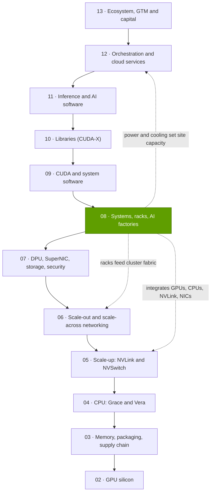
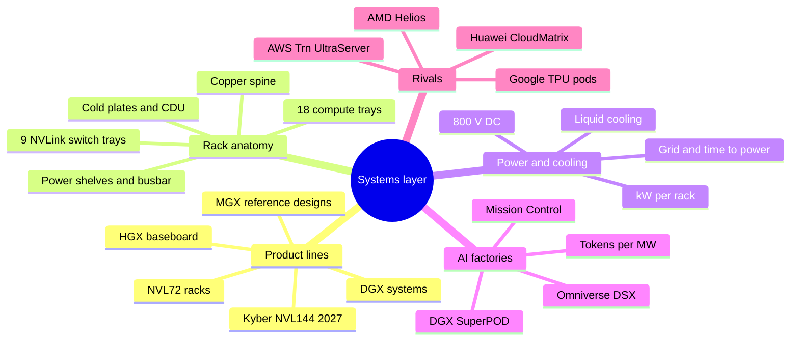

# Layer 08 — Systems, racks and AI factories

Layer 08 of 12 · how chips become racks, racks become AI factories, and why power now sets the pace · ~8 min read · Last verified: 2026-11-05

## ⚡ The Executive Take

- **The product is now the rack.** NVIDIA's unit of sale grew from a $129K DGX-1 server (2016) to a ~$4.0M GB300 NVL72 rack and a ~$7.8M Vera Rubin NVL72 (Est., Morgan Stanley) with 72 GPUs in one [NVLink](../../glossary.md#nvlink) domain ([NVL72](../../glossary.md#nvl72)) [[S310]](../../sources/bibliography.md#s310)[[S332]](../../sources/bibliography.md#s332)[[S330]](../../sources/bibliography.md#s330).
- **NVIDIA designs almost all of it; ODMs build it.** NVIDIA specifies compute trays, switch trays, the ~5,000-cable copper spine, power shelves and liquid cooling; [ODMs](../../glossary.md#odm) such as Foxconn (~40% of AI servers) assemble at ~2–3% gross margin [[S5000]](../../sources/bibliography.md#s5000)[[S3014]](../../sources/bibliography.md#s3014)[[S332]](../../sources/bibliography.md#s332).
- **Power per system rose ~190× in a decade:** 3.2 kW (DGX-1) to ~132 kW (GB300 NVL72), ~190–230 kW (Vera Rubin, 🟡 reported) and ~600 kW planned for Kyber in 2027 (🟢 announced); hence mandatory [liquid cooling](../../glossary.md#liquid-cooling) and an [800 V DC](../../glossary.md#hvdc-800v) power standard [[S310]](../../sources/bibliography.md#s310)[[S337]](../../sources/bibliography.md#s337)[[S303]](../../sources/bibliography.md#s303)[[S305]](../../sources/bibliography.md#s305)[[S90063]](../../sources/bibliography.md#s90063).
- **The output metric is [tokens per MW](../../glossary.md#tokens-per-megawatt):** at 50 tokens/s per user, GB300 NVL72 delivers ~13× H200's DeepSeek-R1 tokens per megawatt (repo Est. from InferenceX); Vera Rubin adds ~2× more at moderate speeds [[S621]](../../sources/bibliography.md#s621)[[S622]](../../sources/bibliography.md#s622)[[S626]](../../sources/bibliography.md#s626).
- **Power, not chips, is often the binding constraint:** cited AI factories went up in 4–15 months, but US generation waits over four years in interconnection queues and Northern Virginia hookups up to seven [[S6000]](../../sources/bibliography.md#s6000)[[S8013]](../../sources/bibliography.md#s8013)[[S8009]](../../sources/bibliography.md#s8009)[[S8010]](../../sources/bibliography.md#s8010).
- **NVIDIA now sells the whole [AI factory](../../glossary.md#ai-factory):** DGX SuperPOD, the Vera Rubin DSX reference design, the Omniverse DSX digital twin and Mission Control software [[S396]](../../sources/bibliography.md#s396)[[S8017]](../../sources/bibliography.md#s8017)[[S8019]](../../sources/bibliography.md#s8019).
- **Weakness and strongest challenger:** a 72-GPU rack is one large failure domain with lock-in to NVIDIA's BOM. AMD's Helios rack (72 MI455X, 31 TB [HBM4](../../glossary.md#hbm4), ~1.5× Vera Rubin's [HBM](../../glossary.md#hbm)) ships from around end-Q3 2026; Google's TPU pods scale to 9,216 chips [[S90021]](../../sources/bibliography.md#s90021)[[S90020]](../../sources/bibliography.md#s90020)[[S350]](../../sources/bibliography.md#s350).

> [!TIP]
> **Worked example — one gigawatt in NVIDIA terms.** At [PUE](../../glossary.md#pue) 1.15, 1 GW leaves ~870 MW for IT [[S387]](../../sources/bibliography.md#s387)[[S388]](../../sources/bibliography.md#s388). A GB300 NVL72 rack needs ~132 kW plus ~21% for its share of network and storage, ~160 kW [[S337]](../../sources/bibliography.md#s337)[[S340]](../../sources/bibliography.md#s340), so 1 GW holds **~5,400 racks, ~390,000 GPUs** (repo arithmetic). NVIDIA's CEO priced such a factory at **$50–60B, ~$35B of it NVIDIA content** [[S398]](../../sources/bibliography.md#s398). **Conclusion:** at this layer NVIDIA sells megawatts of finished computing, and about 58–70% of a gigawatt’s budget flows to it.

## Where this layer sits in the stack

## Layer map

## The eight questions at a glance

| # | Question | Short answer | Where answered |
|---|---|---|---|
| Q1 | Job, and what breaks if weak? | **[Q1 · Job & failure mode]** Turn chips into a working, powered, cooled computer; if spine, power or cooling fails, the whole 72-GPU domain stalls [[S626]](../../sources/bibliography.md#s626) | [Anatomy of an NVL72 rack](anatomy-of-an-nvl72-rack.md) |
| Q2 | Metrics that matter? | **[Q2 · Metrics that matter]** Tokens/s per MW at a stated speed per user, kW per rack and per GPU, PUE, time to power, cost per GPU-hour | [AI factories](ai-factories.md) |
| Q3 | Generational progress? | **[Q3 · Generational progress]** 3.2 kW → ~600 kW per system; HBM per rack 13.8 → 20.7 TB; tokens/MW ~13× H200 on GB300 (Est.) [[S310]](../../sources/bibliography.md#s310)[[S305]](../../sources/bibliography.md#s305)[[S337]](../../sources/bibliography.md#s337)[[S621]](../../sources/bibliography.md#s621) | [Power and cooling](power-and-cooling.md), [HGX to NVL](hgx-dgx-mgx-nvl.md) |
| Q4 | Source of advantage? | Integration of silicon, NVLink, power and cooling into one annual rack design, plus an ODM ecosystem building to it [[S3014]](../../sources/bibliography.md#s3014) | [History and how built](history-and-how-built.md) |
| Q5 | Strongest challenger? | AMD Helios rack (72 MI455X, 31 TB HBM4) from H2 2026; Google TPU pods at 9,216 chips [[S90021]](../../sources/bibliography.md#s90021)[[S350]](../../sources/bibliography.md#s350) | [Competition](competition.md) |
| Q6 | Replication cost? | Years and billions: AMD paid $4.9B for ZT Systems' rack-design team [[S8527]](../../sources/bibliography.md#s8527) | [History and how built](history-and-how-built.md) |
| Q7 | Roadmap? | Vera Rubin ramp Q4 2026; Kyber NVL144 ~600 kW in H2 2027 (slip reported); 800 V DC rows in 2027 [[S90009]](../../sources/bibliography.md#s90009)[[S305]](../../sources/bibliography.md#s305)[[S309]](../../sources/bibliography.md#s309)[[S90063]](../../sources/bibliography.md#s90063) | [Roadmap](roadmap.md) |
| Q8 | Value pools and M&A? | NVIDIA ~$35B of a $50–60B gigawatt; ODMs ~2–3% margins; power, cooling and facility vendors take the rest [[S398]](../../sources/bibliography.md#s398)[[S332]](../../sources/bibliography.md#s332) | [Value chain and corp dev](value-chain-and-corp-dev.md) |

## Pages in this layer

| Page | What you will learn |
|---|---|
| [HGX, DGX, MGX and NVL racks](hgx-dgx-mgx-nvl.md) | The four product lines, why NVIDIA moved to racks, who gets paid for 1,000 GB300 GPUs |
| [Anatomy of an NVL72 rack](anatomy-of-an-nvl72-rack.md) | Trays, spine, busbar, cooling; compute-tray diagram; weight, power and parts |
| [Power and cooling](power-and-cooling.md) | kW-per-rack trajectory, why liquid is mandatory, 800 V DC, grid limits, 100k-GPU facility example |
| [AI factories](ai-factories.md) | Tokens per MW, blueprints (SuperPOD, DSX), value shift from OEMs, time to first token |
| [Competition](competition.md) | Rival rack-scale systems compared, with a capability heatmap |
| [History and how NVIDIA built it](history-and-how-built.md) | From DGX-1 to Kyber: timeline, key decisions, replication cost |
| [Roadmap](roadmap.md) | Vera Rubin, Kyber, 800 V DC and rival racks with confidence tags |
| [Value chain and corp dev angles](value-chain-and-corp-dev.md) | Who captures rack dollars, private companies, M&A |

🔧 Under the hood: how this layer connects to its neighbours

The rack packages [layer 05](../05-scale-up-nvlink-nvswitch/index.md)'s NVLink switches, [layer 04](../04-cpu-grace-vera/index.md)'s CPUs and [layer 07](../07-dpu-supernic-storage-security/index.md)'s SuperNICs; it plugs into [layer 06](../06-scale-out-scale-across-networking/index.md)'s fabric; power and racks cap what [layer 12](../12-orchestration-and-cloud-services/index.md)'s clouds can rent ([chapter 14](../../cross-cutting/14-training-vs-inference-economics.md) models cost per token).

## 🎯 Corp Dev Lens

1. **Value has moved into the BOM spec.** Whoever writes the rack's bill of materials captures the margin; ODMs keep ~2–3% (Est.) [[S332]](../../sources/bibliography.md#s332). Which rack components (power, cooling, connectors) remain open to independent suppliers?
2. **Power is the new allocation currency.** Powered sites, on-site generation and 800 V DC equipment are scarcer than GPUs in many regions [[S8009]](../../sources/bibliography.md#s8009)[[S90061]](../../sources/bibliography.md#s90061); infrastructure partnerships may matter as much as chip design.
3. **Rack-scale entry needs manufacturing and integration capability:** AMD bought it (ZT Systems) rather than built it [[S8527]](../../sources/bibliography.md#s8527).
4. **Qualcomm question (public information only):** with AI200/AI250 racks at ~160 kW and direct liquid cooling [[S173]](../../sources/bibliography.md#s173), is the better path an NVIDIA-compatible rack ecosystem (MGX, [NVLink Fusion](../../glossary.md#nvlink-fusion)) or an independent inference rack judged on tokens per MW?

## 📚 Sources

<!-- Auto-generated from the [S…] citations on this page by `make build`. Edit sources/registry/*.csv, not this list. -->

- [**S173**](../../sources/bibliography.md#s173) Qualcomm, *Qualcomm Unveils AI200 and AI250 - Redefining Rack-Scale Data Center Inference*, 2025-10-27. [Link](https://www.qualcomm.com/news/releases/2025/10/qualcomm-unveils-ai200-and-ai250-redefining-rack-scale-data-cent)
- [**S303**](../../sources/bibliography.md#s303) Commercial Times (ctee.com.tw), *Vera Rubin NVL72 Max-Q / Max-P rack power (Commercial Times report)*, 2026-01-07. [Link](https://www.ctee.com.tw/news/20260107701081-430704)
- [**S305**](../../sources/bibliography.md#s305) DatacenterDynamics, *Nvidia's Rubin Ultra NVL576 rack expected to be 600kW, coming second half of 2027*, 2025-03-19. [Link](https://datacenterdynamics.com/en/news/nvidias-rubin-ultra-nvl576-rack-expected-to-be-600kw-coming-second-half-of-2027)
- [**S309**](../../sources/bibliography.md#s309) Spheron, *NVIDIA Kyber rack delayed to 2028: what it means for Rubin Ultra*, 2026. [Link](https://www.spheron.network/blog/nvidia-kyber-rack-delayed-to-2028-what-it-means-for-rubin-ul/)
- [**S310**](../../sources/bibliography.md#s310) AnandTech (Ryan Smith), *NVIDIA unveils the DGX-1 HPC server: 8 Teslas, 3U, Q2 2016*, 2016-04-05. [Link](https://www.anandtech.com/show/10229)
- [**S330**](../../sources/bibliography.md#s330) PC Gamer, *A single Nvidia Vera Rubin rack is estimated to cost $7,803,148 with over $2 million of that figure spent on memory alone*, 2026-05. [Link](https://pcgamer.com/hardware/a-single-nvidia-vera-rubin-rack-is-estimated-to-cost-usd7-803-148-with-over-usd2-million-of-that-figure-spent-on-memory-alone)
- [**S332**](../../sources/bibliography.md#s332) Tiger Brokers (iTiger), *Morgan Stanley's BOM analysis of NVIDIA's Rubin: GPU share declines; PCB, MLCC and ABF substrate values soar*, 2026-05-20. [Link](https://www.itiger.com/news/1188068712)
- [**S337**](../../sources/bibliography.md#s337) Spheron, *NVIDIA GB300 (rental and specifications)*, 2026. [Link](https://spheron.network/gpu-rental/gb300/)
- [**S340**](../../sources/bibliography.md#s340) SemiAnalysis (Dylan Patel et al.), *Huawei AI CloudMatrix 384 - China's answer to Nvidia GB200 NVL72*, 2025-04-16. [Link](https://newsletter.semianalysis.com/p/huawei-ai-cloudmatrix-384-chinas-answer-to-nvidia-gb200-nvl72)
- [**S350**](../../sources/bibliography.md#s350) Google Cloud, *TPU7x (Ironwood) documentation*, 2025-11. [Link](https://docs.cloud.google.com/tpu/docs/tpu7x)
- [**S387**](../../sources/bibliography.md#s387) Uptime Institute, *Uptime Institute Global Data Center Survey 2024*, 2024-07. [Link](https://uptimeinstitute.com/resources/research-and-reports/uptime-institute-global-data-center-survey-results-2024)
- [**S388**](../../sources/bibliography.md#s388) Google, *Google data centers: efficiency (fleet-wide PUE)*, 2025. [Link](https://datacenters.google/efficiency/)
- [**S396**](../../sources/bibliography.md#s396) NVIDIA Newsroom, *NVIDIA Blackwell platform arrives to power a new era of computing*, 2024-03-18. [Link](https://nvidianews.nvidia.com/news/nvidia-blackwell-platform-arrives-to-power-a-new-era-of-computing)
- [**S398**](../../sources/bibliography.md#s398) NVIDIA Investor Relations, *NVIDIA Q2 FY2026 earnings call (2025-08-27): AI factory economics commentary*, 2025-08-27. [Link](https://investor.nvidia.com/events-and-presentations/events-and-presentations/default.aspx)
- [**S621**](../../sources/bibliography.md#s621) SemiAnalysis (InferenceX-app repository), *InferenceX public API snapshot (benchmarks.json and benchmarks-history.json fixtures)*, 2026-10-17. [Link](https://github.com/SemiAnalysisAI/InferenceX-app/tree/main/packages/app/cypress/fixtures/api)
- [**S622**](../../sources/bibliography.md#s622) SemiAnalysis (InferenceX-app repository), *InferenceX hardware registry: TCO per GPU-hour by SKU (SemiAnalysis July 2026 pricing surveys and AI Cloud TCO Model)*, 2026-07. [Link](https://github.com/SemiAnalysisAI/InferenceX-app/blob/main/packages/constants/src/gpu-keys.ts)
- [**S626**](../../sources/bibliography.md#s626) SemiAnalysis, *Vera Rubin NVL72 vs GB200 NVL72? Inference TCO & Architecture Analysis*, 2026-07-23. [Link](https://github.com/SemiAnalysisAI/InferenceX-app/blob/main/packages/app/content/blog/vera-rubin-nvl72-vs-gb200-nvl72-inference.mdx)
- [**S3014**](../../sources/bibliography.md#s3014) Focus Taiwan (CNA), *Foxconn expects AI server rack shipments to double in 2026*, 2026-03-16. [Link](https://focustaiwan.tw/business/202603160022)
- [**S5000**](../../sources/bibliography.md#s5000) SemiAnalysis, *Nvidia's Optical Boogeyman - NVL72, InfiniBand Scale Out, 800G & 1.6T Ramp*, 2024-03. [Link](https://newsletter.semianalysis.com/p/nvidias-optical-boogeyman-nvl72-infiniband)
- [**S6000**](../../sources/bibliography.md#s6000) TechPowerUp (NVIDIA press release), *NVIDIA Ethernet Networking Accelerates World's Largest AI Supercomputer, Built by xAI*, 2024-10-29. [Link](https://techpowerup.com/328227/nvidia-ethernet-networking-accelerates-worlds-largest-ai-supercomputer-built-by-xai)
- [**S8009**](../../sources/bibliography.md#s8009) Lawrence Berkeley National Laboratory, *Queued Up: 2025 Edition, Characteristics of Power Plants Seeking Transmission Interconnection As of the End of 2024*, 2025-12-15. [Link](https://emp.lbl.gov/sites/default/files/2025-12/Queued%20Up%202025%20Edition%20-%2012.15.2025.pdf)
- [**S8010**](../../sources/bibliography.md#s8010) Bloomberg, *Data Centers Face Seven-Year Wait for Dominion Power Hookups*, 2024-08-29. [Link](https://www.bloomberg.com/news/articles/2024-08-29/data-centers-face-seven-year-wait-for-power-hookups-in-virginia)
- [**S8013**](../../sources/bibliography.md#s8013) DatacenterDynamics, *Crusoe's Abilene data center officially live, serving Oracle and OpenAI's Stargate*, 2025-09. [Link](https://datacenterdynamics.com/en/news/crusoes-abilene-data-center-officially-live-serving-oracle-and-openais-stargate)
- [**S8017**](../../sources/bibliography.md#s8017) NVIDIA Newsroom, *NVIDIA Releases Vera Rubin DSX AI Factory Reference Design and Omniverse DSX Digital Twin Blueprint With Broad Industry Support*, 2026-03. [Link](https://investor.nvidia.com/news/press-release-details/2026/NVIDIA-Releases-Vera-Rubin-DSX-AI-Factory-Reference-Design-and-Omniverse-DSX-Digital-Twin-Blueprint-With-Broad-Industry-Support/default.aspx)
- [**S8019**](../../sources/bibliography.md#s8019) NVIDIA Blog, *New NVIDIA Software for Blackwell Infrastructure Runs AI Factories at Light Speed (Mission Control)*, 2025-03-18. [Link](https://blogs.nvidia.com/blog/mission-control-software)
- [**S8527**](../../sources/bibliography.md#s8527) AMD Investor Relations, *AMD completes acquisition of ZT Systems*, 2025-03-31. [Link](https://ir.amd.com/news-events/press-releases/detail/1240/amd-completes-acquisition-of-zt-systems)
- [**S90009**](../../sources/bibliography.md#s90009) GamesBeat, *Nvidia Vera Rubin ramps into full production for fall launch*, 2026. [Link](https://gamesbeat.com/nvidia-vera-rubin-ramps-into-full-production-for-fall-launch-again/)
- [**S90020**](../../sources/bibliography.md#s90020) Shacknews, *AMD Helios AI rack system on track for initial shipments in Q3 2026*, 2026. [Link](https://www.shacknews.com/article/150249/amd-helios-ai-system-shipping-q3-2026)
- [**S90021**](../../sources/bibliography.md#s90021) Igor's Lab, *AMD Helios in production: MI455X, EPYC Venice and OpenAI challenge Nvidia AI racks*, 2026. [Link](https://www.igorslab.de/en/amd-helios-in-production-mi455x-epyc-venice-openai-challenge-nvidia-ai-racks/)
- [**S90061**](../../sources/bibliography.md#s90061) DatacenterDynamics, *NVIDIA prepares data center industry for 1MW racks and 800 volt DC power architectures*, 2025-10. [Link](https://www.datacenterdynamics.com/en/news/nvidia-prepares-data-center-industry-for-1mw-racks-and-800-volt-dc-power-architectures/)
- [**S90063**](../../sources/bibliography.md#s90063) Converge Digest, *The megawatt shift: NVIDIA's 800 VDC strategy*, 2026. [Link](https://convergedigest.com/the-megawatt-shift-nvidias-800-vdc-strategy/)
