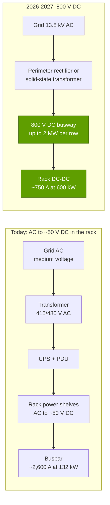

# Power and cooling: the physics that now sets the pace

Layer 08 · Systems, racks and AI factories · ~11 min read · Last verified: 2026-11-05

## ⚡ The Executive Take

- **Rack power rose ~190× in a decade:** 3.2 kW for a DGX-1 (2016) to ~120–132 kW for GB200/GB300 NVL72, ~190–230 kW for Vera Rubin NVL72 (reported) and ~600 kW planned for Kyber (2027) [[S310]](../../sources/bibliography.md#s310)[[S336]](../../sources/bibliography.md#s336)[[S337]](../../sources/bibliography.md#s337)[[S303]](../../sources/bibliography.md#s303)[[S305]](../../sources/bibliography.md#s305).
- **Air ran out of room.** More than 80% of operators' densest racks are below 30 kW [[S8008]](../../sources/bibliography.md#s8008); a GPU package now draws up to ~2.3 kW (Rubin Max-P, reported) [[S106]](../../sources/bibliography.md#s106), so every NVL72 is [direct-to-chip liquid-cooled](../../glossary.md#direct-to-chip-cooling).
- **Liquid cooling is going mainstream:** TrendForce raised its estimate for high-end AI chips to ~53% in 2026 and ~60% in 2027, from 14% in 2024 [[S8528]](../../sources/bibliography.md#s8528)[[S8004]](../../sources/bibliography.md#s8004).
- **[800 V DC](../../glossary.md#hvdc-800v) is NVIDIA's next standard:** ~20 power partners, an MGX 800 VDC power rack in H2 2026 and a 2 MW-per-row power center in 2027; at 54 V a megawatt rack would need up to 64U of power shelves [[S90061]](../../sources/bibliography.md#s90061)[[S90063]](../../sources/bibliography.md#s90063)[[S8016]](../../sources/bibliography.md#s8016).
- **Power, not chips, is the binding constraint for many builds:** new US generation waits over four years in interconnection queues, and Dominion quoted up to seven years for large data-center hookups [[S8009]](../../sources/bibliography.md#s8009)[[S8010]](../../sources/bibliography.md#s8010).
- **Bear point:** Dell'Oro calls 800 V DC a reference architecture, not yet a universal standard [[S90062]](../../sources/bibliography.md#s90062); facilities built for 130 kW racks may need rework for 600 kW.

## 1. The kW-per-rack trajectory

**[Q3 · Generational progress]** Power per system crept from 3.2 to 14.3 kW while NVIDIA sold 8-GPU servers (2016–2024), then jumped tenfold when the product became the rack [[S310]](../../sources/bibliography.md#s310)[[S319]](../../sources/bibliography.md#s319)[[S336]](../../sources/bibliography.md#s336). GPU package power rose ~8× and [heat flux](../../glossary.md#heat-flux) per cm² of logic ~3× (Est.) [[S125]](../../sources/bibliography.md#s125)[[S106]](../../sources/bibliography.md#s106).

> [!TIP]
> **Worked example — what 1 MW of IT power holds.** In 2016, 1 MW powered 1,000 ÷ 3.2 ≈ **312 DGX-1s, ~2,500 GPUs** [[S310]](../../sources/bibliography.md#s310). In 2025 it powers 1,000 ÷ 132 ≈ **7.6 GB300 racks, ~545 GPUs** [[S337]](../../sources/bibliography.md#s337). Yet those 545 GPUs deliver far more: dense FP8 per MW rose ~3.5× from DGX H100 to Vera Rubin NVL72 (Est.) [[S318]](../../sources/bibliography.md#s318)[[S102]](../../sources/bibliography.md#s102). **Conclusion:** the datacenter's unit of capacity is now the megawatt, and NVIDIA sells more compute per megawatt each year.

## 2. Why liquid cooling became mandatory

Cooling is a transport problem: heat carried = flow × heat capacity × temperature rise, and water holds about **3,500× more heat per litre** than air (4.19 MJ vs 1.2 kJ per m³ per °C; physics). At 100+ kW per rack, air becomes a hurricane.

> [!TIP]
> **Worked example — cooling one 132 kW GB300 rack.** With air warming 15 °C: 132,000 W ÷ (1.2 kg/m³ × 1,005 J/kg·°C × 15 °C) = **7.3 m³/s, ~15,500 CFM** through one rack (repo arithmetic) [[S337]](../../sources/bibliography.md#s337). With water warming 10 °C: 132,000 ÷ (4,186 × 10) = **3.2 litres per second (~50 US gallons per minute)** through a pipe a few centimetres wide. **Conclusion:** at NVL72 densities, air would need several times the airflow that today's halls deliver to a ~30 kW rack [[S8008]](../../sources/bibliography.md#s8008); liquid is not a premium option, it is the only one.

| Approach | Where heat goes | Fits | Used by | Catch |
|---|---|---|---|---|
| Air (with aisle containment) | Fans → room air → chillers | Most existing racks (<30 kW for >80% of operators' densest) [[S8008]](../../sources/bibliography.md#s8008) | HGX servers up to ~14 kW [[S321]](../../sources/bibliography.md#s321) | Fan power, airflow limits |
| [Direct-to-chip](../../glossary.md#direct-to-chip-cooling) cold plates | Coolant loop → [CDU](../../glossary.md#cdu) → facility water | ~120–230 kW today, ~600 kW planned [[S336]](../../sources/bibliography.md#s336)[[S303]](../../sources/bibliography.md#s303)[[S305]](../../sources/bibliography.md#s305) | NVL72 racks, MI355X DLC, Google TPUs [[S347]](../../sources/bibliography.md#s347)[[S8528]](../../sources/bibliography.md#s8528) | Needs facility water or [L2A](../../glossary.md#liquid-to-air-cooling) sidecars |
| [Immersion](../../glossary.md#immersion-cooling) | Tank fluid → heat exchanger | Very high density | Niche (HPC, crypto) | Servicing, fluid cost, vendor qualification |

The CDU pumps a clean coolant loop through the rack's cold plates and hands the heat to facility water; halls without facility water use liquid-to-air sidecars until liquid-to-liquid spreads from 2027 [[S8528]](../../sources/bibliography.md#s8528). Fanless Vera Rubin trays run on 45 °C water, warm enough for dry coolers instead of chillers in many climates (NVIDIA claim) [[S8002]](../../sources/bibliography.md#s8002).

🔧 Under the hood: what PUE does and does not capture

[PUE](../../glossary.md#pue) is facility power ÷ IT power. The industry average was 1.54 in 2025, flat for six years [[S8007]](../../sources/bibliography.md#s8007); Google's fleet runs ~1.09 [[S388]](../../sources/bibliography.md#s388). Liquid cooling lowers PUE because pumps move heat more cheaply than fans and chillers, but it also moves fan power *into* the IT number, so PUE can flatter liquid halls slightly. The repo uses 1.15 for a new liquid-cooled AI hall and 1.4 for air (assumptions, not measurements) [[S387]](../../sources/bibliography.md#s387)[[S388]](../../sources/bibliography.md#s388).

## 3. The 800 V DC power architecture

Today power is converted several times, ending in the rack's [power shelves](../../glossary.md#power-shelf), which put ~50 V DC on the [busbar](../../glossary.md#busbar) [[S8000]](../../sources/bibliography.md#s8000). Low voltage means huge currents, and current means copper. NVIDIA's plan converts 13.8 kV AC to 800 V DC at the facility edge and runs DC busways to the rows [[S8016]](../../sources/bibliography.md#s8016)[[S90063]](../../sources/bibliography.md#s90063).

> [!TIP]
> **Worked example — why voltage matters for Kyber.** A ~600 kW Kyber rack [[S305]](../../sources/bibliography.md#s305) at 54 V draws 600,000 ÷ 54 ≈ **11,100 A**; at 800 V, **750 A**, about 15× less. Copper cross-section scales with current and resistive loss with current squared, so the same busbar losses at 54 V would need ~15× the copper (repo arithmetic). NVIDIA says 54 V power shelves for such a rack could fill **64U**, i.e. the whole rack [[S8016]](../../sources/bibliography.md#s8016). **Conclusion:** 800 V DC is what makes megawatt racks physically possible, not an efficiency nicety.

Status (🟢 announced): ~20 partners including Delta, Schneider, Vertiv, ABB, Eaton and Siemens showed 800 V DC parts at GTC DC 2025, and CoreWeave, Lambda, Nebius, OCI and Together AI are designing for it [[S90061]](../../sources/bibliography.md#s90061)[[S90063]](../../sources/bibliography.md#s90063).

🔧 Under the hood: the open questions on 800 V DC

- **Standards:** Dell'Oro treats it as a reference architecture for high-density AI halls, not yet a universal standard [[S90062]](../../sources/bibliography.md#s90062).
- **Safety:** DC arcs do not self-extinguish at zero crossings like AC, so breakers and training change.
- **Retrofit:** halls built for ~130 kW racks need new distribution for Kyber-class racks.

## 4. Grid constraints and time to power

A datacenter can be built in months; its electricity can take years ([AI factories](ai-factories.md)). In the US, the median new power plant took **over four years** from interconnection request to operation for projects built 2018–2024, up from under two years in 2000–2007 [[S8009]](../../sources/bibliography.md#s8009). Dominion told large (>100 MW) data-center customers in Northern Virginia to expect **up to seven years** [[S8010]](../../sources/bibliography.md#s8010); ERCOT was tracking **~410 GW** of large-load requests, ~87% of them data centers, in April 2026 [[S8011]](../../sources/bibliography.md#s8011); PJM forecast ~32 GW of summer-peak growth over 2024–2030, mainly from data centers [[S33018]](../../sources/bibliography.md#s33018).

Builders respond with [behind-the-meter](../../glossary.md#behind-the-meter) generation, trading [time to power](../../glossary.md#time-to-power) for fuel cost, permits and local opposition: xAI's Colossus 2 runs on on-site gas turbines while sources disagree on its utility supply (🟡) [[S8015]](../../sources/bibliography.md#s8015).

> [!TIP]
> **Worked example — facility power for 100,000 GB300 GPUs.** GPUs at ~1.4 kW: **140 MW** [[S32004]](../../sources/bibliography.md#s32004); 1,389 racks at ~132 kW: **183 MW** [[S337]](../../sources/bibliography.md#s337); network and storage (+21%, SemiAnalysis's GB200 all-in ratio): **~38 MW** [[S340]](../../sources/bibliography.md#s340); cooling and conversion at PUE 1.15: **~33 MW**, so **~255 MW** at the meter, or **~340–346 MW** at the industry-average PUE [[S8007]](../../sources/bibliography.md#s8007)[[S387]](../../sources/bibliography.md#s387). Electricity at full load: 255 MW × 8,760 h = **2.2 TWh/yr**, **~$181M** at the US industrial average of 8.1¢/kWh, $112M at a 5¢ power purchase agreement, $223M at 10¢ [[S389]](../../sources/bibliography.md#s389)[[S390]](../../sources/bibliography.md#s390). **Conclusion:** a 100k-GPU GB300 site is a quarter-gigawatt load; its annual power bill is ~3% of a ~$5.5B rack bill (Est.) [[S332]](../../sources/bibliography.md#s332).

## 🎯 Corp Dev Lens

1. **Power equipment is the AI build-out's second supply chain.** Vertiv, Schneider, Eaton and Delta sit on NVIDIA's 800 V DC partner list [[S90061]](../../sources/bibliography.md#s90061); solid-state transformers, DC breakers and CDUs are where start-ups and acquirers are active ([value chain](value-chain-and-corp-dev.md)).
2. **Time to power is a competitive weapon.** Whoever can energize a site first wins the next GPU allocation; on-site generation and pre-permitted campuses command premiums [[S8015]](../../sources/bibliography.md#s8015)[[S8013]](../../sources/bibliography.md#s8013).
3. **Qualcomm question (public information only):** Qualcomm's AI200 rack is ~160 kW with direct liquid cooling [[S173]](../../sources/bibliography.md#s173); does a lower-power inference rack that fits existing liquid-ready halls, without waiting for 800 V DC, open a niche that NVIDIA's megawatt roadmap leaves behind?

## 📚 Sources

<!-- Auto-generated from the [S…] citations on this page by `make build`. Edit sources/registry/*.csv, not this list. -->

- [**S102**](../../sources/bibliography.md#s102) NVIDIA, *NVIDIA DGX Vera Rubin NVL72*, 2026. [Link](https://www.nvidia.com/en-us/data-center/dgx-vera-rubin-nvl72/)
- [**S106**](../../sources/bibliography.md#s106) SemiAnalysis, *Vera Rubin - Extreme Co-Design: An Evolution*, 2026. [Link](https://newsletter.semianalysis.com/p/vera-rubin-extreme-co-design-an-evolution)
- [**S125**](../../sources/bibliography.md#s125) NVIDIA, *NVIDIA Tesla P100 (Pascal GP100) Architecture Whitepaper*, 2016-04. [Link](https://images.nvidia.com/content/pdf/tesla/whitepaper/pascal-architecture-whitepaper.pdf)
- [**S173**](../../sources/bibliography.md#s173) Qualcomm, *Qualcomm Unveils AI200 and AI250 - Redefining Rack-Scale Data Center Inference*, 2025-10-27. [Link](https://www.qualcomm.com/news/releases/2025/10/qualcomm-unveils-ai200-and-ai250-redefining-rack-scale-data-cent)
- [**S303**](../../sources/bibliography.md#s303) Commercial Times (ctee.com.tw), *Vera Rubin NVL72 Max-Q / Max-P rack power (Commercial Times report)*, 2026-01-07. [Link](https://www.ctee.com.tw/news/20260107701081-430704)
- [**S305**](../../sources/bibliography.md#s305) DatacenterDynamics, *Nvidia's Rubin Ultra NVL576 rack expected to be 600kW, coming second half of 2027*, 2025-03-19. [Link](https://datacenterdynamics.com/en/news/nvidias-rubin-ultra-nvl576-rack-expected-to-be-600kw-coming-second-half-of-2027)
- [**S310**](../../sources/bibliography.md#s310) AnandTech (Ryan Smith), *NVIDIA unveils the DGX-1 HPC server: 8 Teslas, 3U, Q2 2016*, 2016-04-05. [Link](https://www.anandtech.com/show/10229)
- [**S318**](../../sources/bibliography.md#s318) NVIDIA (mirror hosted by MEGWARE), *NVIDIA DGX H100 datasheet*, 2023. [Link](https://www.MEGWARE.com/fileadmin/user_upload/LandingPage%20NVIDIA/nvidia-dgx-h100-datasheet.pdf)
- [**S319**](../../sources/bibliography.md#s319) NVIDIA (mirror hosted by OpenZeka), *NVIDIA DGX B200 datasheet*, 2024. [Link](https://openzeka.com/wp-content/uploads/2024/11/dgx-scale-ai-infrastructure-dgx-b200-datasheet-nvidia-web-1-1.pdf)
- [**S321**](../../sources/bibliography.md#s321) Colfax International, *NVIDIA DGX B300 (specification page)*, 2025. [Link](https://www.colfax-intl.com/nvidia/nvidia-dgx-b300)
- [**S332**](../../sources/bibliography.md#s332) Tiger Brokers (iTiger), *Morgan Stanley's BOM analysis of NVIDIA's Rubin: GPU share declines; PCB, MLCC and ABF substrate values soar*, 2026-05-20. [Link](https://www.itiger.com/news/1188068712)
- [**S336**](../../sources/bibliography.md#s336) eeNews Europe, *Nvidia offers 120kW liquid-cooled Blackwell rack as industry standard*, 2024-10. [Link](https://www.eenewseurope.com/en/nvidia-offers-120kw-liquid-cooled-blackwell-rack-as-industry-standard)
- [**S337**](../../sources/bibliography.md#s337) Spheron, *NVIDIA GB300 (rental and specifications)*, 2026. [Link](https://spheron.network/gpu-rental/gb300/)
- [**S340**](../../sources/bibliography.md#s340) SemiAnalysis (Dylan Patel et al.), *Huawei AI CloudMatrix 384 - China's answer to Nvidia GB200 NVL72*, 2025-04-16. [Link](https://newsletter.semianalysis.com/p/huawei-ai-cloudmatrix-384-chinas-answer-to-nvidia-gb200-nvl72)
- [**S347**](../../sources/bibliography.md#s347) AMD, *AMD Instinct MI355X platform brochure*, 2025-06. [Link](https://www.amd.com/content/dam/amd/en/documents/instinct-tech-docs/product-briefs/amd-instinct-miI355x-platform-brochure.pdf)
- [**S387**](../../sources/bibliography.md#s387) Uptime Institute, *Uptime Institute Global Data Center Survey 2024*, 2024-07. [Link](https://uptimeinstitute.com/resources/research-and-reports/uptime-institute-global-data-center-survey-results-2024)
- [**S388**](../../sources/bibliography.md#s388) Google, *Google data centers: efficiency (fleet-wide PUE)*, 2025. [Link](https://datacenters.google/efficiency/)
- [**S389**](../../sources/bibliography.md#s389) U.S. Energy Information Administration, *EIA Electric Power Monthly, Table 5.6.A: average price of electricity to ultimate customers by end-use sector*, 2025. [Link](https://www.eia.gov/electricity/monthly/epm_table_grapher.php?t=epmt_5_6_a)
- [**S390**](../../sources/bibliography.md#s390) LevelTen Energy, *LevelTen Energy PPA Price Index (North America)*, 2025. [Link](https://www.leveltenenergy.com/ppa)
- [**S8000**](../../sources/bibliography.md#s8000) NVIDIA Docs, *NVIDIA DGX GB200 User Guide: hardware overview*, 2025. [Link](https://docs.nvidia.com/dgx/dgxgb200-user-guide/hardware.html)
- [**S8002**](../../sources/bibliography.md#s8002) COMPUTEX Taipei (TAITRA), *NVIDIA Vera Rubin NVL72 (COMPUTEX 2026 Best Choice Award entry)*, 2026-05. [Link](https://bcaward.computex.biz/download/2026/winnerPdf/10905.pdf)
- [**S8004**](../../sources/bibliography.md#s8004) TrendForce, *Liquid Cooling to Scale in AI Data Centers, Penetration to Surpass 30% in 2025*, 2025-08-21. [Link](https://www.trendforce.com/presscenter/news/20250821-12682.html)
- [**S8007**](../../sources/bibliography.md#s8007) Uptime Institute, *Uptime Institute Global Data Center Survey 2025*, 2025-07. [Link](https://intelligence.uptimeinstitute.com/resource/uptime-institute-global-data-center-survey-2025)
- [**S8008**](../../sources/bibliography.md#s8008) The Register, *Capacity planning a rising concern for datacenter operators as AI grows*, 2025-08-03. [Link](https://www.theregister.com/2025/08/03/capacity_planning_concern_datacenter_ops/)
- [**S8009**](../../sources/bibliography.md#s8009) Lawrence Berkeley National Laboratory, *Queued Up: 2025 Edition, Characteristics of Power Plants Seeking Transmission Interconnection As of the End of 2024*, 2025-12-15. [Link](https://emp.lbl.gov/sites/default/files/2025-12/Queued%20Up%202025%20Edition%20-%2012.15.2025.pdf)
- [**S8010**](../../sources/bibliography.md#s8010) Bloomberg, *Data Centers Face Seven-Year Wait for Dominion Power Hookups*, 2024-08-29. [Link](https://www.bloomberg.com/news/articles/2024-08-29/data-centers-face-seven-year-wait-for-power-hookups-in-virginia)
- [**S8011**](../../sources/bibliography.md#s8011) ERCOT, *ERCOT Large Load Update (April 2026 hearing)*, 2026-04-01. [Link](https://www.ercot.com/files/docs/2026/04/01/ERCOT_LargeLoad_Update_April2026_B-C_-Hearing.pdf)
- [**S8013**](../../sources/bibliography.md#s8013) DatacenterDynamics, *Crusoe's Abilene data center officially live, serving Oracle and OpenAI's Stargate*, 2025-09. [Link](https://datacenterdynamics.com/en/news/crusoes-abilene-data-center-officially-live-serving-oracle-and-openais-stargate)
- [**S8015**](../../sources/bibliography.md#s8015) Cleanview, *Behind-the-meter data centers: Colossus (xAI) report*, 2026-05. [Link](https://cleanview.co/reports/behind-the-meter-data-centers/full-report/colossus)
- [**S8016**](../../sources/bibliography.md#s8016) NVIDIA Technical Blog, *NVIDIA 800 V HVDC Architecture Will Power the Next Generation of AI Factories*, 2025-05-20. [Link](https://developer.nvidia.com/blog/nvidia-800-v-hvdc-architecture-will-power-the-next-generation-of-ai-factories/)
- [**S8528**](../../sources/bibliography.md#s8528) TrendForce, *Liquid cooling to reach 53% of high-end AI infrastructure in 2026 (TrendForce press release)*, 2026-08-17. [Link](https://www.trendforce.com/presscenter/news/20260817-13183.html)
- [**S32004**](../../sources/bibliography.md#s32004) NVIDIA, *NVIDIA GB300 NVL72 / Blackwell Ultra (product page)*, 2025-03. [Link](https://www.nvidia.com/en-us/data-center/gb300-nvl72/)
- [**S33018**](../../sources/bibliography.md#s33018) PJM Interconnection, *2025 Long-Term Load Forecast Report*, 2025-01. [Link](https://www.pjm.com/-/media/DotCom/library/reports-notices/load-forecast/2025-load-report.pdf)
- [**S90061**](../../sources/bibliography.md#s90061) DatacenterDynamics, *NVIDIA prepares data center industry for 1MW racks and 800 volt DC power architectures*, 2025-10. [Link](https://www.datacenterdynamics.com/en/news/nvidia-prepares-data-center-industry-for-1mw-racks-and-800-volt-dc-power-architectures/)
- [**S90062**](../../sources/bibliography.md#s90062) Dell'Oro Group, *GTC 2026: moving from chip launches to infrastructure architecture*, 2026-03. [Link](https://www.delloro.com/gtc-2026-moving-from-chip-launches-to-infrastructure-architecture/)
- [**S90063**](../../sources/bibliography.md#s90063) Converge Digest, *The megawatt shift: NVIDIA's 800 VDC strategy*, 2026. [Link](https://convergedigest.com/the-megawatt-shift-nvidias-800-vdc-strategy/)
