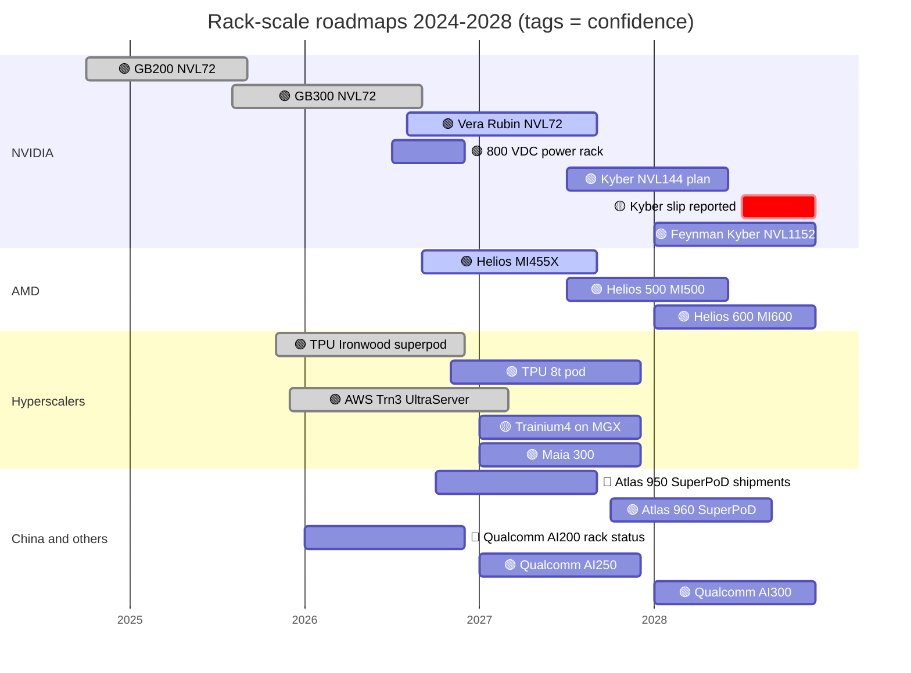

# Systems, racks and AI factories: Roadmap

Layer 08 · Systems, racks and AI factories · ~10 min read · Last verified: 2026-11-05

## ⚡ The Executive Take

- **Vera Rubin [NVL72](../../glossary.md#nvl72) is the 2026 rack.** Production shipments began in August 2026; volume ramps in Q4 🟢 [[S500]](../../sources/bibliography.md#s500)[[S90009]](../../sources/bibliography.md#s90009). Google Cloud expects A5X instances on it to be GA in November 2026 [[S554]](../../sources/bibliography.md#s554).
- **Kyber is the contested date.** The 144-package, ~600 kW Rubin Ultra rack is officially 2H 2027. SemiAnalysis reports a >12-month slip on midplane manufacturability, which NVIDIA denies 🟡 [[S510]](../../sources/bibliography.md#s510)[[S507]](../../sources/bibliography.md#s507)[[S508]](../../sources/bibliography.md#s508).
- **Per rack, GB200 → Kyber means ~5× the power (120 → ~600 kW) for ~14× the dense [FP8](../../glossary.md#fp8) and ~10× the [HBM](../../glossary.md#hbm)** (as announced) [[S121]](../../sources/bibliography.md#s121)[[S336]](../../sources/bibliography.md#s336)[[S305]](../../sources/bibliography.md#s305).
- **[800 V DC](../../glossary.md#hvdc-800v) is the enabling roadmap.** An MGX-compatible 800 V DC power rack is due in H2 2026 and a row power center (up to 2 MW per row) in 2027 [[S90063]](../../sources/bibliography.md#s90063). Dell'Oro calls it a reference architecture, not yet a standard [[S90062]](../../sources/bibliography.md#s90062).
- **Rivals match NVIDIA's annual cadence.** AMD: Helios (2026), Helios 500 (2027), Helios 600 (2028) [[S538]](../../sources/bibliography.md#s538). Google's TPU 8t pod is due late 2026 [[S550]](../../sources/bibliography.md#s550), Maia 300 in 2027 [[S90046]](../../sources/bibliography.md#s90046) and Huawei's Atlas 960 in Q4 2027 [[S567]](../../sources/bibliography.md#s567).
- **[Q7 · Roadmap & what changes the picture]** Three things matter more than the next spec sheet: grid power, the liquid-cooling supply chain (penetration 33% → 53% → ~60% of AI chips, 2025–27) and reliability at 600 kW 🟡 [[S8528]](../../sources/bibliography.md#s8528).

## The 2024–2028 roadmap at a glance

| Item | Window | Status | Confidence | Source |
|---|---|---|---|---|
| GB300 NVL72 | 2H 2025 → 2026 | shipping | 🟢 | [[S32004]](../../sources/bibliography.md#s32004)[[S554]](../../sources/bibliography.md#s554) |
| Vera Rubin NVL72 (72 Rubin + 36 Vera, 20.7 TB HBM4) | production Aug 2026; volume Q4 2026 | shipping | 🟢 | [[S500]](../../sources/bibliography.md#s500)[[S102]](../../sources/bibliography.md#s102) |
| Groq 3 LPX rack beside Vera Rubin | 2H 2026 | announced | 🟢 | [[S113]](../../sources/bibliography.md#s113)[[S114]](../../sources/bibliography.md#s114) |
| 800 V DC MGX power rack / row power center | H2 2026 / 2027 | roadmap | 🟢 | [[S90063]](../../sources/bibliography.md#s90063) |
| Kyber NVL144 (Rubin Ultra, ~600 kW) | 2H 2027 official; 2028 reported | disputed | 🟡 | [[S510]](../../sources/bibliography.md#s510)[[S507]](../../sources/bibliography.md#s507)[[S508]](../../sources/bibliography.md#s508) |
| Feynman, Kyber NVL1152 (copper + optical) | 2028 | roadmap | 🟢 | [[S108]](../../sources/bibliography.md#s108)[[S109]](../../sources/bibliography.md#s109) |
| AMD Helios → Helios 500 → Helios 600 | 2026 / 2027 / 2028 | shipping / roadmap | 🟢 | [[S538]](../../sources/bibliography.md#s538)[[S90020]](../../sources/bibliography.md#s90020) |
| Google TPU 8t pod (9,600 chips, 121 EF FP4) | late 2026 | announced | 🟢 | [[S550]](../../sources/bibliography.md#s550) |
| AWS Trainium4 with NVLink Fusion and MGX | ~2027 (no AWS date) | announced | 🟡 | [[S518]](../../sources/bibliography.md#s518)[[S156]](../../sources/bibliography.md#s156) |
| Microsoft Maia 300 | 2027 | announced | 🟢 | [[S90046]](../../sources/bibliography.md#s90046) |
| Huawei Atlas 950 → Atlas 960 SuperPoD | Q4 2026 / Q4 2027 | shipments unconfirmed | 🔴 / 🟢 | [[S341]](../../sources/bibliography.md#s341)[[S567]](../../sources/bibliography.md#s567) |
| Qualcomm AI200 → AI250 → AI300 (public information) | 2026 / 2027 / 2028 | announced; 2026 volume unconfirmed | 🟢 / 🔴 | [[S173]](../../sources/bibliography.md#s173)[[S90060]](../../sources/bibliography.md#s90060)[[S90028]](../../sources/bibliography.md#s90028) |

> [!TIP]
> **Worked example — reading a slip.** Kyber's official window is 2H 2027 [[S510]](../../sources/bibliography.md#s510). If SemiAnalysis's >12-month slip is right [[S507]](../../sources/bibliography.md#s507), 2027 buyers get Rubin Ultra in the existing Oberon NVL72 rack instead, which GTC 2026 listed as an option [[S108]](../../sources/bibliography.md#s108). The cost of the slip is domain size, not compute: 72 GPUs per [NVLink](../../glossary.md#nvlink) domain for one more year. Meanwhile AWS offers 144 and Google 9,216 [[S353]](../../sources/bibliography.md#s353)[[S350]](../../sources/bibliography.md#s350).

## Why power delivery sets the pace

Each rack generation is bounded by how much power and heat one rack can move. Today's racks distribute ~54 V DC from power shelves to the trays. At 600 kW that needs heavy copper and wastes power as heat. NVIDIA's [800 V DC](../../glossary.md#hvdc-800v) plan moves conversion to the building's edge and feeds racks at high voltage [[S33019]](../../sources/bibliography.md#s33019). [Solid-state transformers](../../glossary.md#solid-state-transformer) from start-ups such as Heron Power convert medium-voltage grid power straight to 800 V [[S8519]](../../sources/bibliography.md#s8519).

> [!TIP]
> **Worked example — why 800 V matters at 600 kW.** Current = power ÷ voltage. A 600 kW Kyber rack at 54 V draws ~11,100 A; at 800 V it draws ~750 A, ~15× less [[S305]](../../sources/bibliography.md#s305)[[S33019]](../../sources/bibliography.md#s33019). Resistive loss scales with current squared, so the same busbar loses ~200× less heat at 800 V (🔴 repo physics, ignoring conversion losses). A 2 MW row power center can feed about three such racks [[S90063]](../../sources/bibliography.md#s90063).

🔧 Under the hood: what the 800 V DC ecosystem must deliver

About 20 partners showed 800 V DC components at GTC DC in October 2025. They span silicon (Infineon, ST, Navitas, TI), power equipment (Delta, Eaton, Schneider, Vertiv, ABB) and grid gear (GE Vernova, Hitachi Energy, Siemens) [[S90061]](../../sources/bibliography.md#s90061). [Neoclouds](../../glossary.md#neocloud) including CoreWeave, Lambda and Nebius are designing for 800 V [[S90061]](../../sources/bibliography.md#s90061). Open questions: safety codes for high-voltage DC in white space, and whether [hyperscalers](../../glossary.md#hyperscaler) adopt NVIDIA's version [[S90062]](../../sources/bibliography.md#s90062).

## [Q7 · Roadmap & what changes the picture]

**[Q7 · Roadmap & what changes the picture]** On paper the roadmaps converge: everyone ships an annual rack with ~20–30 TB of HBM. What would change the picture:

- **Power availability.** Racks rise from ~120 kW to ~600 kW, with 1 MW in view [[S90061]](../../sources/bibliography.md#s90061); grid-connected, 800 V-ready halls set everyone's pace.
- **Liquid-cooling supply.** TrendForce sees liquid cooling on ~53% of AI chips in 2026 and ~60% in 2027 🟡 [[S8528]](../../sources/bibliography.md#s8528). Cold plates and CDUs could bottleneck racks as [CoWoS](../../glossary.md#cowos) once did.
- **Rack reliability.** Kyber's reported issue is a midplane, a manufacturing problem, not silicon [[S507]](../../sources/bibliography.md#s507). A clean Helios ramp would narrow NVIDIA's lead faster than any spec.
- **Memory cost.** Memory rose to ~26% of a Vera Rubin rack's bill of materials (Est., Morgan Stanley), and Bernstein sees racks at ~$9.1M 🟡 [[S332]](../../sources/bibliography.md#s332)[[S333]](../../sources/bibliography.md#s333). 
- **Open [scale-up](../../glossary.md#scale-up).** [UALink](../../glossary.md#ualink) 1.0 products are expected in 2027 🟡 [[S90051]](../../sources/bibliography.md#s90051). Merchant racks would then get a non-NVIDIA scale-up fabric.

> [!TIP]
> **Worked example — cooling cost is small, cooling supply is not.** Morgan Stanley puts liquid cooling at ~$50K per GB300 NVL72 rack and ~$56K per Vera Rubin rack. That is under 1% of a $7.8M rack [[S334]](../../sources/bibliography.md#s334)[[S330]](../../sources/bibliography.md#s330). Yet a missing $56K CDU idles $7.8M of compute. That asymmetry is why Eaton paid $9.5B for Boyd Thermal [[S8508]](../../sources/bibliography.md#s8508).

## 🎯 Corp Dev Lens

1. If Kyber slips to 2028 🟡 [[S507]](../../sources/bibliography.md#s507), does AMD's Helios 500 (2027) or Google's TPU 8t pod pick up frontier buyers who want larger domains?
2. Which 800 V DC components (solid-state transformers, DC breakers, GaN/SiC power stages) lack a scaled supplier today?
3. Will hyperscalers adopt NVIDIA's MGX and 800 V designs, as AWS is doing with Trainium4 [[S518]](../../sources/bibliography.md#s518), or keep their own racks?
4. For a 2027–28 inference rack entrant (e.g. Qualcomm AI250/AI300, public information), should the design target today's 160 kW halls or 800 V sites?

## 📚 Sources

<!-- Auto-generated from the [S…] citations on this page by `make build`. Edit sources/registry/*.csv, not this list. -->

- [**S102**](../../sources/bibliography.md#s102) NVIDIA, *NVIDIA DGX Vera Rubin NVL72*, 2026. [Link](https://www.nvidia.com/en-us/data-center/dgx-vera-rubin-nvl72/)
- [**S108**](../../sources/bibliography.md#s108) HPCwire / AIwire, *Huang Shares Nvidia Roadmap Showing More Chips, NVL1152, Scale-Up CPO*, 2026-03-18. [Link](https://www.hpcwire.com/aiwire/2026/03/18/huang-shares-nvidia-roadmap-showing-more-chips-nvl1152-scale-up-cpo/)
- [**S109**](../../sources/bibliography.md#s109) NVIDIA Blog, *NVIDIA GTC 2026: Live Updates on What's Next in AI*, 2026-03-16. [Link](https://blogs.nvidia.com/blog/gtc-2026-news/)
- [**S113**](../../sources/bibliography.md#s113) Tom's Hardware, *How Nvidia's $20 billion Groq 3 LPU deal reshapes the Nvidia Vera Rubin Platform*, 2026-03. [Link](https://www.tomshardware.com/tech-industry/semiconductors/nvidias-20-billion-groq-deal-produces-its-first-chip)
- [**S114**](../../sources/bibliography.md#s114) StorageReview, *NVIDIA Groq 3 LPX: Everything we know*, 2026-03. [Link](https://www.storagereview.com/news/nvidia-groq-3-lpx-everything-we-know)
- [**S121**](../../sources/bibliography.md#s121) NVIDIA, *NVIDIA GB200 NVL72*, 2024-03. [Link](https://www.nvidia.com/en-us/data-center/gb200-nvl72/)
- [**S156**](../../sources/bibliography.md#s156) About Amazon, *AWS re:Invent 2025: top announcements (Trainium3 GA, Trainium4 preview, Graviton5)*, 2025-12-02. [Link](https://www.aboutamazon.com/news/aws/aws-re-invent-2025-ai-news-updates)
- [**S173**](../../sources/bibliography.md#s173) Qualcomm, *Qualcomm Unveils AI200 and AI250 - Redefining Rack-Scale Data Center Inference*, 2025-10-27. [Link](https://www.qualcomm.com/news/releases/2025/10/qualcomm-unveils-ai200-and-ai250-redefining-rack-scale-data-cent)
- [**S305**](../../sources/bibliography.md#s305) DatacenterDynamics, *Nvidia's Rubin Ultra NVL576 rack expected to be 600kW, coming second half of 2027*, 2025-03-19. [Link](https://datacenterdynamics.com/en/news/nvidias-rubin-ultra-nvl576-rack-expected-to-be-600kw-coming-second-half-of-2027)
- [**S330**](../../sources/bibliography.md#s330) PC Gamer, *A single Nvidia Vera Rubin rack is estimated to cost $7,803,148 with over $2 million of that figure spent on memory alone*, 2026-05. [Link](https://pcgamer.com/hardware/a-single-nvidia-vera-rubin-rack-is-estimated-to-cost-usd7-803-148-with-over-usd2-million-of-that-figure-spent-on-memory-alone)
- [**S332**](../../sources/bibliography.md#s332) Tiger Brokers (iTiger), *Morgan Stanley's BOM analysis of NVIDIA's Rubin: GPU share declines; PCB, MLCC and ABF substrate values soar*, 2026-05-20. [Link](https://www.itiger.com/news/1188068712)
- [**S333**](../../sources/bibliography.md#s333) Wccftech, *Bernstein warns NVIDIA's Vera Rubin racks will hit $9.1 million as HBM4 prices triple to $53 per gigabyte*, 2026-07. [Link](https://wccftech.com/bernstein-warns-nvidias-vera-rubin-racks-will-hit-9-1-million-as-hbm4-prices-triple-to-53-per-gigabyte/)
- [**S334**](../../sources/bibliography.md#s334) Tom's Hardware, *Cooling system for a single Nvidia Blackwell Ultra NVL72 rack costs $50,000 - set to increase to $56,000 with next-generation NVL144 racks*, 2025-09. [Link](https://www.tomshardware.com/pc-components/cooling/cooling-system-for-a-single-nvidia-blackwell-ultra-nvl72-rack-costs-a-staggering-usd50-000-set-to-increase-to-usd56-000-with-next-generation-nvl144-racks)
- [**S336**](../../sources/bibliography.md#s336) eeNews Europe, *Nvidia offers 120kW liquid-cooled Blackwell rack as industry standard*, 2024-10. [Link](https://www.eenewseurope.com/en/nvidia-offers-120kw-liquid-cooled-blackwell-rack-as-industry-standard)
- [**S341**](../../sources/bibliography.md#s341) Converge Digest, *Huawei unveils next-gen Ascend chips, SuperPoDs and UnifiedBus interconnect*, 2025-09-18. [Link](https://convergedigest.com/huawei-unveils-next-gen-ascend-chips-superpods-and-unifiedbus-interconnect/)
- [**S350**](../../sources/bibliography.md#s350) Google Cloud, *TPU7x (Ironwood) documentation*, 2025-11. [Link](https://docs.cloud.google.com/tpu/docs/tpu7x)
- [**S353**](../../sources/bibliography.md#s353) AWS, *Announcing Amazon EC2 Trn3 UltraServers for faster, lower-cost generative AI training*, 2025-12-02. [Link](https://aws.amazon.com/about-aws/whats-new/2025/12/amazon-ec2-trn3-ultraservers/)
- [**S500**](../../sources/bibliography.md#s500) NVIDIA Corporation, *NVIDIA Q2 Fiscal 2027 Quarterly Presentation (CFO commentary deck)*, 2026-08-26. [Link](https://s201.q4cdn.com/141608511/files/doc_financials/2027/Q227/NVDA-F2Q27-Quarterly-Presentation-final-1.pdf)
- [**S507**](../../sources/bibliography.md#s507) Tom's Hardware, *Nvidia's Kyber rack for Rubin Ultra slips to 2028*, 2026-07-06. [Link](https://www.tomshardware.com/pc-components/gpus/nvidias-kyber-rack-for-rubin-ultra-slips-to-2028)
- [**S508**](../../sources/bibliography.md#s508) Wccftech, *NVIDIA Quashes Rubin & Kyber Rack Delay Rumors, Says 'Chip Roadmap Is Intact'*, 2026-07. [Link](https://wccftech.com/nvidia-quashes-rubin-kyber-rack-delay-rumors-says-chip-roadmap-is-intact/)
- [**S510**](../../sources/bibliography.md#s510) KGI Securities, *NVIDIA GTC 2026 (research note)*, 2026-03-19. [Link](https://www.kgi.com.hk/zh-hk/-/media/files/kgishk/research-reports/tw-reports/nvidia-gtc-2026_19032026e.pdf)
- [**S518**](../../sources/bibliography.md#s518) ServeTheHome, *NVIDIA NVLink Fusion tapped for future AWS Trainium4 deployments*, 2025-12-02. [Link](https://www.servethehome.com/nvidia-nvlink-fusion-tapped-for-future-aws-trainium4-deployments/)
- [**S538**](../../sources/bibliography.md#s538) AMD Investor Relations, *AAI 2026: AMD Delivers Full-Stack Compute for the Agentic AI Era*, 2026-07-23. [Link](https://ir.amd.com/news-events/press-releases/detail/1294/aai-2026-amd-delivers-full-stack-compute-for-the-agentic-ai-era)
- [**S550**](../../sources/bibliography.md#s550) SiliconANGLE, *Google Cloud unveils eighth-generation TPUs (TPU 8t and TPU 8i)*, 2026-04-22. [Link](https://siliconangle.com/?p=740999)
- [**S554**](../../sources/bibliography.md#s554) Google Cloud Blog (Mark Lohmeyer), *Google Cloud and NVIDIA expand co-engineering collaboration to scale infrastructure for the agentic era (NVIDIA GTC Berlin 2026)*, 2026-10-21. [Link](https://cloud.google.com/blog/topics/ai-infrastructure/google-cloud-infrastructure-at-nvidia-gtc-berlin-2026)
- [**S567**](../../sources/bibliography.md#s567) Huawei, *Huawei Connect 2026: Ascend 960 SuperNode*, 2026-09. [Link](https://www.huawei.com/br/news/2026/9/hc-ascend960-supernode)
- [**S8508**](../../sources/bibliography.md#s8508) Business Wire (Eaton), *Eaton completes acquisition of leading liquid-cooling solutions provider Boyd Thermal*, 2026-03-12. [Link](https://www.businesswire.com/news/home/20260312582488/en)
- [**S8519**](../../sources/bibliography.md#s8519) TechCrunch, *Heron Power raises $140M to ramp production of grid-altering tech*, 2026-02-18. [Link](https://techcrunch.com/2026/02/18/heron-power-raises-140m-to-ramp-production-of-grid-altering-tech/)
- [**S8528**](../../sources/bibliography.md#s8528) TrendForce, *Liquid cooling to reach 53% of high-end AI infrastructure in 2026 (TrendForce press release)*, 2026-08-17. [Link](https://www.trendforce.com/presscenter/news/20260817-13183.html)
- [**S32004**](../../sources/bibliography.md#s32004) NVIDIA, *NVIDIA GB300 NVL72 / Blackwell Ultra (product page)*, 2025-03. [Link](https://www.nvidia.com/en-us/data-center/gb300-nvl72/)
- [**S33019**](../../sources/bibliography.md#s33019) NVIDIA Technical Blog, *NVIDIA 800 V HVDC Architecture Will Power the Next Generation of AI Factories*, 2025-05-20. [Link](https://developer.nvidia.com/blog/nvidia-800-v-hvdc-architecture-will-power-the-next-generation-of-ai-factories/)
- [**S90009**](../../sources/bibliography.md#s90009) GamesBeat, *Nvidia Vera Rubin ramps into full production for fall launch*, 2026. [Link](https://gamesbeat.com/nvidia-vera-rubin-ramps-into-full-production-for-fall-launch-again/)
- [**S90020**](../../sources/bibliography.md#s90020) Shacknews, *AMD Helios AI rack system on track for initial shipments in Q3 2026*, 2026. [Link](https://www.shacknews.com/article/150249/amd-helios-ai-system-shipping-q3-2026)
- [**S90028**](../../sources/bibliography.md#s90028) TechRepublic, *Qualcomm unveils AI chips to rival Nvidia, AMD*, 2025-10-27. [Link](https://techrepublic.com/article/news-qualcomm-unveils-ai-chips-to-rival-nvidia-amd)
- [**S90046**](../../sources/bibliography.md#s90046) IT Brief UK, *Microsoft unveils Maia 300 for 2027 AI deployments*, 2026-10. [Link](https://itbrief.co.uk/story/microsoft-unveils-maia-300-for-2027-ai-deployments)
- [**S90051**](../../sources/bibliography.md#s90051) SDxCentral, *UALink Consortium takes another swing at Nvidia's NVLink supremacy with specification 2.0*, 2026-04. [Link](https://www.sdxcentral.com/news/ualink-consortium-takes-another-swing-at-nvidias-nvlink-supremacy-with-specification-20/)
- [**S90060**](../../sources/bibliography.md#s90060) Qualcomm, *Qualcomm Dragonfly AI300 (product page)*, 2026-06. [Link](https://www.qualcomm.com/data-center/products/qualcomm-dragonfly-ai300)
- [**S90061**](../../sources/bibliography.md#s90061) DatacenterDynamics, *NVIDIA prepares data center industry for 1MW racks and 800 volt DC power architectures*, 2025-10. [Link](https://www.datacenterdynamics.com/en/news/nvidia-prepares-data-center-industry-for-1mw-racks-and-800-volt-dc-power-architectures/)
- [**S90062**](../../sources/bibliography.md#s90062) Dell'Oro Group, *GTC 2026: moving from chip launches to infrastructure architecture*, 2026-03. [Link](https://www.delloro.com/gtc-2026-moving-from-chip-launches-to-infrastructure-architecture/)
- [**S90063**](../../sources/bibliography.md#s90063) Converge Digest, *The megawatt shift: NVIDIA's 800 VDC strategy*, 2026. [Link](https://convergedigest.com/the-megawatt-shift-nvidias-800-vdc-strategy/)
