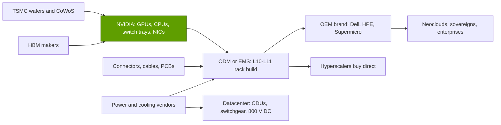

# Systems, racks and AI factories: Value chain and corp dev angles

Layer 08 · Systems, racks and AI factories · ~12 min read · Last verified: 2026-11-05

## ⚡ The Executive Take

- **NVIDIA keeps most of a rack.** Of an estimated $3.99M GB300 [NVL72](../../glossary.md#nvl72), ~$2.27M (~57%) is NVIDIA's gross profit on the GPUs. The [ODM](../../glossary.md#odm) keeps ~$108K (2.7%) and liquid cooling costs ~$50K (Est., Morgan Stanley) [[S332]](../../sources/bibliography.md#s332)[[S334]](../../sources/bibliography.md#s334).
- **Integrators run on thin margins.** ODM gross margin falls to ~1.9% on a Vera Rubin rack (Est.) [[S332]](../../sources/bibliography.md#s332). Quanta's GB rack servers earn ~5% gross (KGI) [[S8529]](../../sources/bibliography.md#s8529)[[S8530]](../../sources/bibliography.md#s8530); Dell targets mid-single-digit operating margins on AI servers [[S8502]](../../sources/bibliography.md#s8502)[[S8503]](../../sources/bibliography.md#s8503).
- **Value moved from OEMs to NVIDIA.** NVIDIA content rose from ~50–75% of an HGX server to ~71–84% of an NVL72 rack (🔴 repo estimate from analyst [bills of materials](../../glossary.md#bill-of-materials)).
- **Memory is the new claimant.** Memory rises from ~9% (GB300) to ~26% (Vera Rubin) of the rack bill (Est., Morgan Stanley) [[S332]](../../sources/bibliography.md#s332)[[S331]](../../sources/bibliography.md#s331).
- **Power and cooling are the high-margin infrastructure pool.** Vertiv grew sales 61% with a 25.2% adjusted operating margin in Q3 2026 [[S8507]](../../sources/bibliography.md#s8507). Eaton (Boyd Thermal, $9.5B), Schneider (Motivair) and Vertiv (PurgeRite) are consolidating [[S8508]](../../sources/bibliography.md#s8508)[[S8513]](../../sources/bibliography.md#s8513)[[S8510]](../../sources/bibliography.md#s8510).
- **[Q8 · Value pools & M&A angles]** Three assets trade at a premium: rack-design teams (ZT, ~$2B net to AMD), thermal and power franchises, and datacenter shells (Aligned, $40B) [[S5527]](../../sources/bibliography.md#s5527)[[S8521]](../../sources/bibliography.md#s8521).

## Who captures the dollars in a rack

NVIDIA buys wafers, packaging and [HBM](../../glossary.md#hbm) and sells GPU modules, CPUs, switch trays and NICs. ODMs build and test the rack at L10–L11 ([integration levels](../../glossary.md#l6-l10-l11)); OEMs add service and financing.

| Value pool (GB300 NVL72, Est.) | Who | $ per rack | Share | Margin of the leader |
|---|---|---|---|---|
| GPU gross profit | NVIDIA | ~$2.27M | ~57% | 75.0% gross [[S405]](../../sources/bibliography.md#s405) |
| GPU dies, CoWoS-L, test | TSMC, OSATs | ~$0.25M | ~6% | TSMC 66.4% gross [[S3538]](../../sources/bibliography.md#s3538) |
| HBM3E + LPDDR5X | SK hynix, Samsung, Micron | ~$0.37M | ~9% (→ ~26% on Vera Rubin) | Micron 86.8% gross [[S3533]](../../sources/bibliography.md#s3533) |
| Other content (Grace, switch trays, NICs, PCB, power shelves, cables) | NVIDIA, Amphenol, Delta and others | ~$0.94M | ~24% | Amphenol sales +65% y/y [[S5503]](../../sources/bibliography.md#s5503) |
| Liquid cooling | Cold-plate and [CDU](../../glossary.md#cdu) makers | ~$50K | ~1% | Vertiv 25.2% adj. operating [[S8507]](../../sources/bibliography.md#s8507) |
| Assembly and test | Foxconn, Quanta, Wistron/Wiwynn | ~$108K | ~2.7% | Foxconn 6.3% gross [[S3522]](../../sources/bibliography.md#s3522) |

Rack split from Morgan Stanley's May 2026 BOM as charted in [[S332]](../../sources/bibliography.md#s332)[[S331]](../../sources/bibliography.md#s331)[[S334]](../../sources/bibliography.md#s334); scale-out networking and storage add ~$0.8M per rack outside this table (Est.) [[S324]](../../sources/bibliography.md#s324).

![Horizontal bar chart of margins across the AI system value chain: NVIDIA gross margin 75.0% (Q2 FY2027) and operating margin 60.4% (FY2026); Vertiv adjusted operating margin 25.2% (Q3 2026); Supermicro gross margin 17.5% in Q4 FY2026 but 10.8% for FY2026; HPE Cloud and AI operating margin 17.0%; Dell ISG operating margin 15.0%; Quanta and Foxconn gross margins 6.3%; Dell's AI-server operating margin target in the mid single digits (~5%); Quanta GB rack servers ~5% gross (KGI); ODM gross margin on a GB300 NVL72 rack 2.7% and on a Vera Rubin rack 1.9% (Morgan Stanley).](../../assets/charts/08-system-layer-margin-ladder.svg)

> [!TIP]
> **Worked example — cooling is 1% of the bill but a growth market.** Liquid cooling is ~$50K of a $3.99M GB300 rack (~1.3%) and ~$56K of a $7.8M Vera Rubin rack (~0.7%) [[S334]](../../sources/bibliography.md#s334)[[S330]](../../sources/bibliography.md#s330). Building-side CDUs, pipes and chillers sit outside that bill. Rack count drives the market, not price per rack. TrendForce expects NVIDIA GB/VR rack shipments to roughly double in 2026 and liquid cooling to reach ~53% of AI chips [[S8528]](../../sources/bibliography.md#s8528).

## How much value moved from OEMs to NVIDIA

In the [HGX](../../glossary.md#hgx) era an OEM bought a GPU baseboard and designed the server around it. In the NVL72 era NVIDIA specifies the whole rack and sells most of its silicon; the OEM's role shrinks to branding, service and financing.

The next step is under way: JPMorgan reports that NVIDIA will ship fully assembled L10 Vera Rubin compute trays, ~90% of a server's cost, leaving ODMs the rack-level work 🟡 [[S8022]](../../sources/bibliography.md#s8022). The rack anatomy is on [Anatomy of an NVL72 rack](anatomy-of-an-nvl72-rack.md).

**Estimate (🔴 repo analysis):** ~10–20 points of system value moved to NVIDIA between HGX servers and NVL72 racks. Integrator gross margin fell from ~11% (Supermicro, FY2025) to ~2–5% on racks [[S8504]](../../sources/bibliography.md#s8504)[[S8529]](../../sources/bibliography.md#s8529)[[S332]](../../sources/bibliography.md#s332). On Vera Rubin, memory makers take back ~10 points of NVIDIA's content share, as memory rose ~435% per rack (Est.) [[S331]](../../sources/bibliography.md#s331).

> [!TIP]
> **Worked example — one quarter's profit pool.** In the quarter to July 2026 NVIDIA earned ~$72B of gross profit on $96.2B of revenue [[S405]](../../sources/bibliography.md#s405). Dell's ISG made $4.8B of operating profit on $31.8B [[S8500]](../../sources/bibliography.md#s8500). Supermicro ~$1.9B gross on $11.1B [[S8504]](../../sources/bibliography.md#s8504), HPE Cloud & AI $1.5B on $9.0B [[S8505]](../../sources/bibliography.md#s8505) and Vertiv $1.1B on $4.3B [[S8507]](../../sources/bibliography.md#s8507). Together: ~$9.3B, 6–8× less than NVIDIA. OEM segment margins rose in 2026, but HPE credits higher selling prices [[S8506]](../../sources/bibliography.md#s8506); AI-server margins stay in single digits.

🔧 Under the hood: how the content-share estimate is built

HGX: 8 GPUs at $25–30K each (2023 street price) [[S356]](../../sources/bibliography.md#s356), divided by OEM 8× H200 server listings of $319–398K [[S322]](../../sources/bibliography.md#s322). GB200: 36 superchips at $60–70K over a ~$3.0M rack [[S326]](../../sources/bibliography.md#s326). GB300: GPUs ($2.52M) plus HBM (~$0.31M), and up to half of the other content, over $3.99M [[S332]](../../sources/bibliography.md#s332). Vera Rubin: GPUs ($3.96M), Vera ($0.18M), [HBM4](../../glossary.md#hbm4) (~$0.7–1.1M, inferred) and switches over $7.8M [[S332]](../../sources/bibliography.md#s332)[[S331]](../../sources/bibliography.md#s331).

## M&A history and private companies worth knowing

The pattern: chip vendors buy design teams and sell factories (AMD, ZT, Sanmina) [[S5527]](../../sources/bibliography.md#s5527). Electrical majors buy liquid cooling (Eaton–Boyd closed 2026-03-12; Schneider–Motivair 75% for $850M) [[S8508]](../../sources/bibliography.md#s8508)[[S8513]](../../sources/bibliography.md#s8513). Infrastructure capital buys shells: AIP, co-founded by NVIDIA, closed Aligned (51 campuses, >6.4 GW) at $40B [[S8521]](../../sources/bibliography.md#s8521). NVIDIA's own system-relevant deal remains Mellanox ($6.9B) [[S464]](../../sources/bibliography.md#s464).

> [!TIP]
> **Worked example — what cooling services cost to buy.** Vertiv paid ~$1.0B for PurgeRite, which flushes and filters coolant loops, at ~10× expected 2026 EBITDA. Implied EBITDA is ~$100M. Up to $250M more is due if 2026 targets are met [[S8510]](../../sources/bibliography.md#s8510)[[S8511]](../../sources/bibliography.md#s8511). A services business with no hardware fetched an infrastructure multiple because every liquid-cooled hall needs it.

| Company (private) | What it does | Last public funding | Why it matters |
|---|---|---|---|
| ZutaCore | Waterless two-phase direct-to-chip cooling | $100M (Jun 2026) [[S8515]](../../sources/bibliography.md#s8515) | Alternative to water [cold plates](../../glossary.md#cold-plate) |
| Accelsius | Two-phase direct-to-chip cooling | $65M Series B, Johnson Controls lead (reported) [[S8518]](../../sources/bibliography.md#s8518) | Building-systems major as investor |
| Frore Systems | Chip and rack liquid-cooling trays | $143M Series D at $1.64B (Mar 2026) [[S8517]](../../sources/bibliography.md#s8517) | Unicorn valuation for cooling hardware |
| Iceotope | Precision immersion cooling | $26M Series B (May 2026) [[S8516]](../../sources/bibliography.md#s8516) | Immersion option for dense racks |
| Heron Power | [Solid-state transformers](../../glossary.md#solid-state-transformer) to 800 V DC | $140M (Feb 2026) [[S8519]](../../sources/bibliography.md#s8519) | Built for NVIDIA-style 800 V racks |
| DG Matrix, Amperesand | Solid-state power conversion | Share of ~$280M raised with Heron (reported) [[S8520]](../../sources/bibliography.md#s8520) | Second sources in the 800 V chain |
| Upscale AI | Scale-up switch silicon for UALink | $200M Series A at >$1B (Jan 2026) [[S5506]](../../sources/bibliography.md#s5506) | Non-NVIDIA scale-up domains |

**[Q8 · Value pools & M&A angles]** The largest pool stays NVIDIA's: ~57% of a GB300 rack (Est.). The fastest-growing pools are memory (~26% of a Vera Rubin rack) and facility power and cooling, where Vertiv's organic orders doubled [[S332]](../../sources/bibliography.md#s332)[[S8507]](../../sources/bibliography.md#s8507). Assembly is a volume pool, not a margin pool. M&A angles: (1) rack-design teams (ZT: ~$2B net); (2) thermal and 800 V power franchises (~10× EBITDA for services, $9.5B for scale) [[S8510]](../../sources/bibliography.md#s8510)[[S8508]](../../sources/bibliography.md#s8508); (3) datacenter capacity, where $40B buyouts set the bar [[S8521]](../../sources/bibliography.md#s8521).

## 🎯 Corp Dev Lens

1. For a new rack-scale inference entrant (public example: Qualcomm's AI200/AI250 racks for HUMAIN [[S173]](../../sources/bibliography.md#s173)[[S90030]](../../sources/bibliography.md#s90030)), what is faster: a ZT-style design team (~$2B net) [[S5527]](../../sources/bibliography.md#s5527), an ODM or EMS partnership (Sanmina-style) [[S5528]](../../sources/bibliography.md#s5528), or licensing a reference rack such as MGX?
2. Where is margin left outside the accelerator: 800 V power conversion, coolant services or connectors (Amphenol's AI-led growth [[S5503]](../../sources/bibliography.md#s5503))?
3. Memory is heading to ~26% of a Vera Rubin rack (Est.) [[S332]](../../sources/bibliography.md#s332). Are [LPDDR](../../glossary.md#lpddr) capacity designs (768 GB per AI200 card) cheaper per GB, or exposed to the same DRAM cycle?
4. With OEM AI-server margins in single digits [[S8502]](../../sources/bibliography.md#s8502), would Dell, HPE or Supermicro back a second-source accelerator that leaves them more of the system value?
5. Do datacenter owners such as Aligned (bought by a consortium including the NVIDIA co-founded AIP) [[S8521]](../../sources/bibliography.md#s8521) become gatekeepers that favour one rack architecture?

## 📚 Sources

<!-- Auto-generated from the [S…] citations on this page by `make build`. Edit sources/registry/*.csv, not this list. -->

- [**S173**](../../sources/bibliography.md#s173) Qualcomm, *Qualcomm Unveils AI200 and AI250 - Redefining Rack-Scale Data Center Inference*, 2025-10-27. [Link](https://www.qualcomm.com/news/releases/2025/10/qualcomm-unveils-ai200-and-ai250-redefining-rack-scale-data-cent)
- [**S322**](../../sources/bibliography.md#s322) GPUPerHour, *NVIDIA GPU prices (H100/H200 and DGX/HGX system listings)*, 2026-09. [Link](https://gpuperhour.com/blog/nvidia-gpu-prices)
- [**S324**](../../sources/bibliography.md#s324) fal.ai, *NVIDIA GB200 price in 2026: what a GPU, a tray and an NVL72 rack cost*, 2026. [Link](https://fal.ai/learn/serverless/nvidia-gb200-price)
- [**S326**](../../sources/bibliography.md#s326) TweakTown, *NVIDIA's new GB200 Superchip costs up to $70,000: full B200 NVL72 AI server costs $3 million*, 2024-05. [Link](https://www.tweaktown.com/news/98292/nvidias-new-gb200-superchip-costs-up-to-70-000-full-b200-nvl72-ai-server-3-million/index.html)
- [**S330**](../../sources/bibliography.md#s330) PC Gamer, *A single Nvidia Vera Rubin rack is estimated to cost $7,803,148 with over $2 million of that figure spent on memory alone*, 2026-05. [Link](https://pcgamer.com/hardware/a-single-nvidia-vera-rubin-rack-is-estimated-to-cost-usd7-803-148-with-over-usd2-million-of-that-figure-spent-on-memory-alone)
- [**S331**](../../sources/bibliography.md#s331) Wccftech, *NVIDIA's Vera Rubin rack hit with 435% memory price surge, pushing HBM4 & LPDDR5X bill to $2M of $7.8M total*, 2026-05. [Link](https://wccftech.com/nvidia-vera-rubin-rack-hit-with-memory-price-surge-pushing-hbm4-lpddr5x-bill-to-2m-of-7-8m-total/)
- [**S332**](../../sources/bibliography.md#s332) Tiger Brokers (iTiger), *Morgan Stanley's BOM analysis of NVIDIA's Rubin: GPU share declines; PCB, MLCC and ABF substrate values soar*, 2026-05-20. [Link](https://www.itiger.com/news/1188068712)
- [**S334**](../../sources/bibliography.md#s334) Tom's Hardware, *Cooling system for a single Nvidia Blackwell Ultra NVL72 rack costs $50,000 - set to increase to $56,000 with next-generation NVL144 racks*, 2025-09. [Link](https://www.tomshardware.com/pc-components/cooling/cooling-system-for-a-single-nvidia-blackwell-ultra-nvl72-rack-costs-a-staggering-usd50-000-set-to-increase-to-usd56-000-with-next-generation-nvl144-racks)
- [**S356**](../../sources/bibliography.md#s356) Tom's Hardware, *Nvidia makes nearly 1,000% profit on H100 GPUs: report*, 2023-08. [Link](https://www.tomshardware.com/news/nvidia-makes-1000-profit-on-h100-gpus-report)
- [**S405**](../../sources/bibliography.md#s405) NVIDIA Corporation via SEC EDGAR, *NVIDIA Announces Financial Results for Second Quarter Fiscal 2027 (Form 8-K exhibit 99.1)*, 2026-08-26. [Link](https://www.sec.gov/Archives/edgar/data/0001045810/000104581026000073/q2fy27pr.htm)
- [**S464**](../../sources/bibliography.md#s464) NVIDIA Newsroom, *NVIDIA to Acquire Mellanox for $6.9 Billion*, 2019-03-11. [Link](https://nvidianews.nvidia.com/news/nvidia-to-acquire-mellanox-for-6-9-billion)
- [**S3522**](../../sources/bibliography.md#s3522) AI CERTS News, *Foxconn results and AI server margin pressure*, 2026. [Link](https://www.aicerts.ai/news/?p=29781)
- [**S3533**](../../sources/bibliography.md#s3533) Micron Technology via SEC EDGAR, *Micron Technology fiscal Q4 2026 results (Form 8-K exhibit 99.1)*, 2026-09. [Link](https://www.sec.gov/Archives/edgar/data/0000723125/000072312526000018/a2026q4ex991-pressrelease.htm)
- [**S3538**](../../sources/bibliography.md#s3538) TSMC, *TSMC reports third quarter 2026 results*, 2026-10. [Link](https://pr.tsmc.com/english/news/3346)
- [**S5503**](../../sources/bibliography.md#s5503) MarketBeat, *Transcript: Amphenol Q3 2026 earnings call highlights*, 2026-10-28. [Link](https://www.marketbeat.com/instant-alerts/transcript-amphenol-q3-earnings-call-highlights-2026-10-28/)
- [**S5506**](../../sources/bibliography.md#s5506) The Register, *AI networking startup Upscale AI scores $200M to challenge Nvidia's NVSwitch*, 2026-01-22. [Link](https://www.theregister.com/2026/01/22/upscale_skyhammer_nvidia/)
- [**S5527**](../../sources/bibliography.md#s5527) Evertiq, *AMD completes sale of ZT Systems manufacturing unit to Sanmina*, 2025-10-27. [Link](https://evertiq.com/design/2025-10-27-amd-completes-sale-of-zt-systems-manufacturing-unit-to-sanmina)
- [**S5528**](../../sources/bibliography.md#s5528) Sanmina, *Sanmina completes acquisition of ZT Systems data center infrastructure manufacturing business from AMD*, 2025-10-27. [Link](https://s201.q4cdn.com/209924174/files/doc_news/SANMINA-COMPLETES-ACQUISITION-OF-ZT-SYSTEMS-DATA-CENTER-INFRASTRUCTURE-MANUFACTURING-BUSINESS-FROM-AMD-2025.pdf)
- [**S8022**](../../sources/bibliography.md#s8022) Tom's Hardware, *JP Morgan says Nvidia is gearing up to sell entire AI servers instead of just AI GPUs and componentry*, 2025. [Link](https://www.tomshardware.com/tech-industry/artificial-intelligence/jp-morgan-says-nvidia-is-gearing-up-to-sell-entire-ai-servers-instead-of-just-ai-gpus-and-componentry-jensens-master-plan-of-vertical-integration-will-boost-profits-purportedly-starting-with-vera-rubin)
- [**S8500**](../../sources/bibliography.md#s8500) Pulse 2.0, *Dell Technologies Q2 revenue hits record $47 billion as AI server backlog reaches $95 billion and FY27 outlook rises to $192 billion*, 2026-09. [Link](https://pulse2.com/dell-technologies-q2-revenue-hits-record-47-billion-as-ai-server-backlog-reaches-95-billion-and-fy27-outlook-rises-to-192-billion/)
- [**S8502**](../../sources/bibliography.md#s8502) Futurum Group, *Dell Q4 FY 2026 earnings highlight AI-optimized server ramp*, 2026-02-27. [Link](https://futurumgroup.com/insights/dell-q4-fy-2026-earnings-highlight-ai-optimized-server-ramp/)
- [**S8503**](../../sources/bibliography.md#s8503) MarketBeat, *Dell Technologies Q4 earnings call highlights*, 2026-02-27. [Link](https://www.marketbeat.com/instant-alerts/dell-technologies-q4-earnings-call-highlights-2026-02-27/)
- [**S8504**](../../sources/bibliography.md#s8504) Super Micro Computer via SEC EDGAR, *Supermicro announces fourth quarter and full fiscal year 2026 financial results (Form 8-K Exhibit 99.1)*, 2026-08. [Link](https://www.sec.gov/Archives/edgar/data/0001375365/000137536526000021/exhibit991_20260630.htm)
- [**S8505**](../../sources/bibliography.md#s8505) Hewlett Packard Enterprise via SEC EDGAR, *Hewlett Packard Enterprise Q3 fiscal 2026 results (Form 8-K Exhibit 99.1)*, 2026-09-02. [Link](https://www.sec.gov/Archives/edgar/data/0001645590/000164559026000078/ex-991x922026x8k.htm)
- [**S8506**](../../sources/bibliography.md#s8506) Constellation Research, *HPE delivers strong Q3, ups fiscal 2026 outlook due to AI demand*, 2026-09. [Link](https://www.constellationr.com/insights/news/hpe-delivers-strong-q3-ups-fiscal-2026-outlook-due-ai-demand)
- [**S8507**](../../sources/bibliography.md#s8507) Vertiv Holdings via investors.vertiv.com, *Vertiv reports strong third quarter 2026 with net sales growth of 61%, organic orders growth over 100%*, 2026-10-28. [Link](https://investors.vertiv.com/news/news-details/2026/Vertiv-Reports-Strong-Third-Quarter-2026-with-Net-Sales-Growth-of-61-Organic-Orders-Growth-over-100-and-Diluted-EPS-Growth-of-91-Adjusted-Diluted-EPS-Growth-of-78-Raises-Full-Year-2026-Guidance-Across-All-Key-Metrics/)
- [**S8508**](../../sources/bibliography.md#s8508) Business Wire (Eaton), *Eaton completes acquisition of leading liquid-cooling solutions provider Boyd Thermal*, 2026-03-12. [Link](https://www.businesswire.com/news/home/20260312582488/en)
- [**S8510**](../../sources/bibliography.md#s8510) Vertiv Holdings via investors.vertiv.com, *Vertiv announces intent to acquire PurgeRite (specialized fluid management services for liquid cooling)*, 2025-11-03. [Link](https://investors.vertiv.com/news/news-details/2025/Vertiv-Announces-Intent-to-Acquire-PurgeRite-a-Leading-Provider-of-Specialized-Fluid-Management-Services-to-Expand-Liquid-Cooling-Services-Portfolio/default.aspx)
- [**S8511**](../../sources/bibliography.md#s8511) Vertiv Holdings via investors.vertiv.com, *Vertiv completes acquisition of PurgeRite, expanding leadership in liquid cooling services*, 2025-12-04. [Link](https://investors.vertiv.com/news/news-details/2025/Vertiv-Completes-Acquisition-of-PurgeRite-Expanding-Leadership-in-Liquid-Cooling-Services/default.aspx)
- [**S8513**](../../sources/bibliography.md#s8513) The Star (Reuters), *Schneider Electric to buy data centre cooling firm Motivair for $850 million*, 2024-10-17. [Link](https://www.thestar.com.my/tech/tech-news/2024/10/17/schneider-electric-to-buy-data-centre-cooling-firm-motivair-for-850-million)
- [**S8515**](../../sources/bibliography.md#s8515) SiliconANGLE, *ZutaCore raises $100M to scale waterless cooling for AI data centers*, 2026-06-02. [Link](https://siliconangle.com/2026/06/02/zutacore-raises-100m-scale-waterless-cooling-ai-data-centers/)
- [**S8516**](../../sources/bibliography.md#s8516) SiliconANGLE, *Data center cooling tech startup Iceotope aims to scale after raising $26M*, 2026-05-14. [Link](https://siliconangle.com/2026/05/14/data-center-cooling-tech-startup-icetope-aims-scale-raising-26m/)
- [**S8517**](../../sources/bibliography.md#s8517) Pulse.bot (aggregator), *Frore Systems raises $143M Series D, valued at $1.64B to cool AI chips*, 2026-03. [Link](https://www.pulse.bot/venture-capital/news/frore-systems-raises-143m-series-d-valued-at-164b-to-cool-ai-chips-78a500b9-8fdc-41e2-bce5-cd5154633c1c/)
- [**S8518**](../../sources/bibliography.md#s8518) Pulse.bot (aggregator), *Accelsius raises $65M in Series B funding*, 2026. [Link](https://www.pulse.bot/venture-capital/news/accelsius-raises-65m-in-series-b-funding-4383f39e-5cce-412f-b0a3-ea95e4944865)
- [**S8519**](../../sources/bibliography.md#s8519) TechCrunch, *Heron Power raises $140M to ramp production of grid-altering tech*, 2026-02-18. [Link](https://techcrunch.com/2026/02/18/heron-power-raises-140m-to-ramp-production-of-grid-altering-tech/)
- [**S8520**](../../sources/bibliography.md#s8520) Data Center Richness (Substack), *Solid-state transformers could reshape data center power (VC firms pour $280 million into Heron Power, DG Matrix and Amperesand)*, 2026-06-16. [Link](https://datacenterrichness.substack.com/p/solid-state-transformers-could-reshape)
- [**S8521**](../../sources/bibliography.md#s8521) DatacenterDynamics, *MGX, AIP and BlackRock's GIP complete $40bn acquisition of Aligned Data Centers*, 2026-07. [Link](https://www.datacenterdynamics.com/en/news/mgx-aip-and-blackrocks-gip-complete-40bn-acquisition-of-aligned-data-centers/)
- [**S8528**](../../sources/bibliography.md#s8528) TrendForce, *Liquid cooling to reach 53% of high-end AI infrastructure in 2026 (TrendForce press release)*, 2026-08-17. [Link](https://www.trendforce.com/presscenter/news/20260817-13183.html)
- [**S8529**](../../sources/bibliography.md#s8529) KGI Securities, *Quanta Computer (2382 TT) company update*, 2026-02-26. [Link](https://www.kgi.com.hk/en/-/media/files/kgishk/research-reports/tw-reports/quanta-computer_2382-tt_26022026.pdf)
- [**S8530**](../../sources/bibliography.md#s8530) DIGITIMES Asia, *Quanta posts record Q1 2026 results as AI server shift squeezes gross margin*, 2026-05-14. [Link](https://apps.digitimes.com/news/a20260514PD244.html)
- [**S90030**](../../sources/bibliography.md#s90030) Morningstar, *Qualcomm: Humain deal provides some AI upside*, 2025-10. [Link](https://www.morningstar.com/stocks/qualcomm-humain-deal-provides-some-ai-upside)
