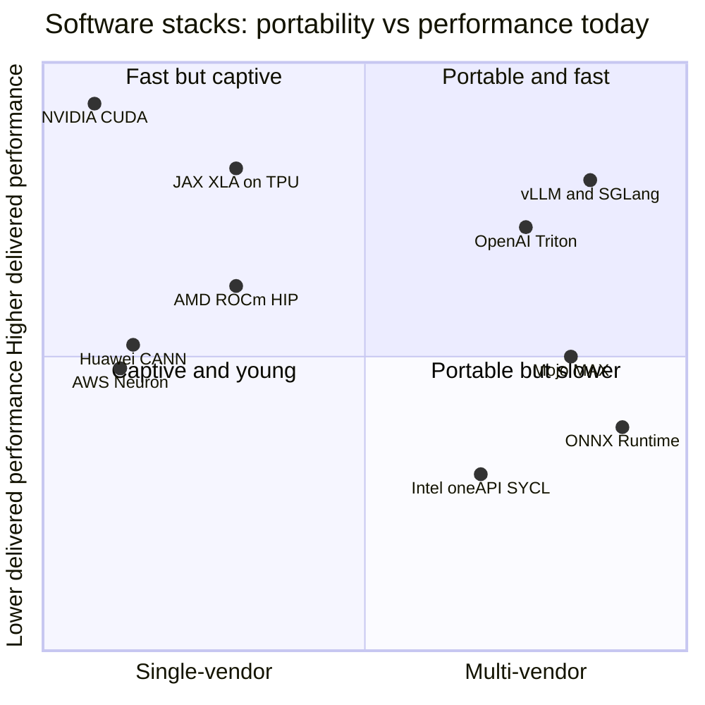

# CUDA and system software: Competition

Layer 09 · CUDA and system software · ~13 min read · Last verified: 2026-11-05

## ⚡ The Executive Take

- **Breadth is still NVIDIA's.** [CUDA](../../glossary.md#cuda) is native in all 12 major AI frameworks tracked here (36/36 points); [ROCm](../../glossary.md#rocm) scores 26, Intel 18, Huawei [CANN](../../glossary.md#cann) 17, Google TPU 14, AWS Neuron 7 and Qualcomm Cloud AI 4 [[S587]](../../sources/bibliography.md#s587)[[S580]](../../sources/bibliography.md#s580)[[S586]](../../sources/bibliography.md#s586)[[S596]](../../sources/bibliography.md#s596).
- **The gap has moved from "does it run?" to "how fast on day 0?"** When DeepSeek-V4 shipped (2026-04-24), CUDA recipes in [vLLM](../../glossary.md#vllm) and [SGLang](../../glossary.md#sglang) worked at launch. MI355X ran only FP8, at under 1 token/s per user, and needed 26 days and 31 kernel PRs to reach 2,256 tokens/s per GPU [[S633]](../../sources/bibliography.md#s633)[[S631]](../../sources/bibliography.md#s631).
- **The gap is software, not silicon.** MI355X has 1.60× B200's HBM and 1.12× its dense FP4/FP8 [[S631]](../../sources/bibliography.md#s631). Results swing both ways: MI355X was up to 29.6% cheaper per token than B200 on GLM-5 FP8; NVIDIA was up to 5× cheaper on GLM 5.3 at 150 tokens/s per user [[S637]](../../sources/bibliography.md#s637)[[S636]](../../sources/bibliography.md#s636).
- **The strongest challenger is a layer, not a company.** PyTorch, [Triton](../../glossary.md#triton), vLLM and SGLang now run in-tree on AMD GPUs, and Triton also has Intel and Huawei backends [[S578]](../../sources/bibliography.md#s578)[[S580]](../../sources/bibliography.md#s580)[[S582]](../../sources/bibliography.md#s582)[[S597]](../../sources/bibliography.md#s597)[[S592]](../../sources/bibliography.md#s592). For teams that never write a [kernel](../../glossary.md#gpu-kernel), CUDA becomes an implementation detail.
- **Hyperscalers are open-sourcing their own stacks.** TorchTPU (with Meta, October 2026) replaces PyTorch/XLA; AWS open-sourced TorchNeuron and the [NKI](../../glossary.md#nki) compiler; Huawei open-sourced CANN in 2025 [[S553]](../../sources/bibliography.md#s553)[[S595]](../../sources/bibliography.md#s595)[[S9525]](../../sources/bibliography.md#s9525)[[S9524]](../../sources/bibliography.md#s9524).
- **Qualcomm bought the neutral option.** It closed its ~$3.9B purchase of Modular on 2026-07-29 and open-sourced the [Mojo](../../glossary.md#mojo) compiler (Apache 2.0) in August 2026 [[S9511]](../../sources/bibliography.md#s9511)[[S9512]](../../sources/bibliography.md#s9512)[[S9513]](../../sources/bibliography.md#s9513).
- **[Q5 · Strongest challenger]** The PyTorch/Triton/vLLM layer, with ROCm as the second backend that proves portability works. The abstraction layer, not any vendor stack, erodes [switching cost](../../glossary.md#switching-cost).

The framework-by-vendor heatmap is on [The long-tail moat](the-long-tail-moat.md).

## How the software contest is scored

Think of CUDA as a road network. A rival can build a **copy of the roads** (AMD's [HIP](../../glossary.md#hip) mirrors CUDA call-for-call). It can build a **ring road around the city** (abstraction layers such as Triton, [torch.compile](../../glossary.md#torch-compile), [XLA](../../glossary.md#xla) or Mojo, which generate kernels for any chip). Or it can build **a new city** with its own roads (Google's JAX/TPU, AWS Neuron, Huawei CANN). Copies trail by a release; the ring road carries most traffic; a new city serves mainly its owner.

| Stack (owner) | Framework breadth | Kernel performance | Tooling | Backward compatibility | Community | Openness |
|---|---|---|---|---|---|---|
| ROCm / HIP (AMD) | 🟨 26/36, in-tree in PyTorch and vLLM | 🟥 day-0 gaps | 🟥 profilers maturing | 🟥 fewer GPU generations | 🟥 small vs ~6M CUDA devs | 🟩 open source |
| JAX/XLA + TorchTPU (Google) | 🟥 14/36 outside Google | 🟦 frontier-class inside Google | 🟦 Google-internal first | 🟨 compiler hides chip changes | 🟦 labs, not hobbyists | 🟩 open source |
| Neuron + NKI (AWS) | 🟥 7/36 | 🟦 tuned for anchor customers | 🟥 young | 🟨 Trn2/Trn3 only | 🟥 small | 🟨 open compiler, closed chip |
| CANN / MindSpore (Huawei) | 🟥 17/36 | 🟨 day-0 DeepSeek-V4 support | 🟥 fragmented | 🟥 shifts per generation | 🟦 China-captive | 🟩 open-sourced 2025 |
| oneAPI / SYCL (Intel, UXL) | 🟥 18/36 | 🟥 limited LLM adoption | 🟨 mature HPC tools | 🟨 standards-based | 🟥 small | 🟩 open standard |
| Triton (OpenAI, multi-vendor) | 🟦 a layer under PyTorch | 🟨 near hand-tuned on many ops | 🟥 thin debugging | 🟨 recompiles per chip | 🟩 default for torch.compile | 🟩 open source |
| Mojo / MAX (Qualcomm) | 🟥 own framework, few users | 🟦 vendor-claimed parity | 🟥 young | 🟨 compiler-based | 🟥 small | 🟩 Apache 2.0 since 2026 |

Verdicts are this repo's judgement 🔴, rival vs NVIDIA CUDA as of 2026-11-05. Evidence: framework scores [[S587]](../../sources/bibliography.md#s587)[[S586]](../../sources/bibliography.md#s586); day-0 and kernels [[S633]](../../sources/bibliography.md#s633)[[S627]](../../sources/bibliography.md#s627); openness [[S9524]](../../sources/bibliography.md#s9524)[[S9525]](../../sources/bibliography.md#s9525)[[S9512]](../../sources/bibliography.md#s9512)[[S9526]](../../sources/bibliography.md#s9526); developers [[S528]](../../sources/bibliography.md#s528).

> [!TIP]
> **Worked example — what 31 pull requests are worth.** InferenceX puts an MI355X's owner cost at ~$1.50 per GPU-hour [[S622]](../../sources/bibliography.md#s622). On day 0 of DeepSeek-V4 its peak was 67.4 tokens/s per GPU, so $1.50 ÷ (67.4 × 3,600) × 10⁶ ≈ **$6.18 per million tokens**. After 26 days of kernel work the peak was 2,256 tokens/s, or **≈ $0.18 per million**: 33× cheaper on the same silicon [[S631]](../../sources/bibliography.md#s631). At a usable 15 tokens/s per user it fell from ~$4.01 to ~$0.33. On CUDA, B200 recipes ran on day 0, and software gains there were ~1.7× (≈ 300k to ≈ 500k tokens/s per MW by day 42) [[S633]](../../sources/bibliography.md#s633). For a buyer, the switching cost is that lost month, repeated with every new model.

![Two panels. Left, log scale: converting SemiAnalysis throughput into cost at an estimated $1.50 per GPU-hour, MI355X's DeepSeek-V4-Pro cost at peak throughput fell from about $6.18 per million tokens on day 0 (FP8 only) to $0.18 after 26 days and 31 kernel PRs, about 33 times cheaper; at a usable 15 tokens/s per user it fell from $4.01 (day 7) to $0.33, about 12 times, while CUDA recipes worked on day 0. Right: on paper MI355X has 1.60x B200's HBM capacity, equal 8 TB/s bandwidth, 1.12x dense FP4 and FP8 and 0.64x scale-up bandwidth, so the day-0 gap was software, not silicon.](../../assets/charts/09-mi355x-deepseek-v4-catchup.svg)

🔧 Under the hood: why a "drop-in" CUDA clone is never quite drop-in

[HIPIFY](../../glossary.md#hipify) rewrites `cudaMalloc` as `hipMalloc` and most code compiles. The residue is what costs time: inline [PTX](../../glossary.md#ptx) assembly; kernels tuned to NVIDIA's warp size, which differs on AMD's data-center GPUs; calls into NVIDIA-only libraries ([cuDNN](../../glossary.md#cudnn), CUTLASS, TensorRT-LLM); and missing APIs. vLLM's batched CPU-offload path, for example, lacked `hipMemcpyBatchAsync` until ROCm 7.14 (July 2026) [[S627]](../../sources/bibliography.md#s627). [Translation layers](../../glossary.md#translation-layer) such as ZLUDA run unmodified CUDA binaries instead [[S9502]](../../sources/bibliography.md#s9502). NVIDIA's licence has barred translating CUDA output to run on other hardware since at least 2024 [[S9500]](../../sources/bibliography.md#s9500).

## Challenger by challenger

### AMD ROCm: closest on breadth, behind on day 0

ROCm started nine years after CUDA but now ships 3–4 feature releases a year, like CUDA [[S586]](../../sources/bibliography.md#s586)[[S525]](../../sources/bibliography.md#s525). ROCm 7.0 (September 2025) added AITER tuned operators, FP4/FP6 and Windows [[S90064]](../../sources/bibliography.md#s90064). ROCm 10.0 (August 2026) is validated with PyTorch 2.13, vLLM 0.27 and SGLang 0.5.15 [[S586]](../../sources/bibliography.md#s586). AMD launched a ROCm.ai assistant at Advancing AI 2026, which drew 2,000+ developers [[S9518]](../../sources/bibliography.md#s9518)[[S9519]](../../sources/bibliography.md#s9519). It has also agreed with Anthropic to use Claude to speed up ROCm development 🟡 [[S9538]](../../sources/bibliography.md#s9538). **Best argument:** open source and in-tree in every framework that matters. **Gap:** AMD's own engine (ATOM) beat GB300 NVL72 vLLM on cost per token on part of one agentic curve, but few labs run ATOM in production, and upstream vLLM was unusable on MI355X for long-context work in its first week [[S627]](../../sources/bibliography.md#s627).

> [!TIP]
> **Worked example — what a 5× per-token gap means.** SemiAnalysis found NVIDIA up to 5× cheaper per token than MI355X on GLM 5.3 at 150 tokens/s per user [[S636]](../../sources/bibliography.md#s636). MI355X's owner cost is ~$1.50 per GPU-hour [[S622]](../../sources/bibliography.md#s622). At equal throughput, closing a 5× gap would require that hourly cost to fall to ~$0.30. That is why SemiAnalysis concluded even free hardware would not have closed the gap [[S627]](../../sources/bibliography.md#s627). Elsewhere the ranking flips [[S637]](../../sources/bibliography.md#s637).

### Google JAX/XLA and TorchTPU: a full second ecosystem, mostly for Google's customers

[JAX](../../glossary.md#jax) is first-class on TPU; TorchTPU (open-sourced with Meta, October 2026) replaces PyTorch/XLA [[S577]](../../sources/bibliography.md#s577)[[S553]](../../sources/bibliography.md#s553)[[S595]](../../sources/bibliography.md#s595). Anthropic's up-to-1M-TPU commitment shows a frontier lab can run outside CUDA [[S90026]](../../sources/bibliography.md#s90026). **Gap:** the stack serves TPU, not merchant silicon.

### AWS Neuron, Huawei CANN, Intel oneAPI

- **AWS:** TorchNeuron is an open-source native PyTorch backend (public beta in Neuron 2.33). NKI's compiler is Apache 2.0 and built on [MLIR](../../glossary.md#mlir) [[S9525]](../../sources/bibliography.md#s9525).
- **Huawei:** CANN was open-sourced in August 2025, with torch_npu, MindSpeed, triton-ascend and vllm-ascend adapters. Ascend had documented day-0 DeepSeek-V4 support [[S9524]](../../sources/bibliography.md#s9524)[[S592]](../../sources/bibliography.md#s592)[[S581]](../../sources/bibliography.md#s581)[[S633]](../../sources/bibliography.md#s633). Export controls make it China's default.
- **Intel:** [oneAPI](../../glossary.md#oneapi)/[SYCL](../../glossary.md#sycl) sits under the UXL Foundation, whose founding members include Arm, Google Cloud and Qualcomm. Its 2026 plan shifts from demos to practical guidance [[S9526]](../../sources/bibliography.md#s9526)[[S9527]](../../sources/bibliography.md#s9527).

### The abstraction layer: Triton, PyTorch, vLLM and SGLang

Triton runs in-tree on NVIDIA (compute capability 8.0+) and AMD (ROCm 6.2+) [[S578]](../../sources/bibliography.md#s578). Meta's Helion, now a PyTorch Foundation project, compiles PyTorch-like kernels to Triton *and* to NVIDIA's TileIR [[S9522]](../../sources/bibliography.md#s9522)[[S9523]](../../sources/bibliography.md#s9523). NVIDIA's counter is to be the best target of every layer: CUDA Tile and cuTile Python (CUDA 13.1) give Python developers a tile model on NVIDIA's own terms [[S9521]](../../sources/bibliography.md#s9521).

### Modular/Mojo (Qualcomm) and other open stacks — public information only

Modular raised $380M by 2025 (last valued at $1.6B) and was bought by Qualcomm for ~$3.9B [[S9510]](../../sources/bibliography.md#s9510)[[S90057]](../../sources/bibliography.md#s90057). Mojo 1.0 and its open-sourcing followed in August 2026 [[S9512]](../../sources/bibliography.md#s9512)[[S9513]](../../sources/bibliography.md#s9513). Qualcomm's existing Cloud AI SDK serves through a vLLM container and ONNX ingestion [[S596]](../../sources/bibliography.md#s596). Tenstorrent publishes TT-Metalium under Apache 2.0 [[S9535]](../../sources/bibliography.md#s9535).

Positions are this repo's judgement 🔴, informed by the framework matrix and InferenceX results above.

> [!NOTE]
> **🐂 Bull view.** New architectures land on CUDA first, so each model release resets rivals' clocks. Even when NVIDIA's own TensorRT-LLM failed on DeepSeek-V4 at launch, open CUDA engines worked [[S633]](../../sources/bibliography.md#s633). With ~6M developers, the moat now compounds through *speed of support*, not breadth alone [[S528]](../../sources/bibliography.md#s528).

> [!WARNING]
> **🐻 Bear view.** Customers buy tokens, not CUDA. Frontier labs write their own kernels, AMD reached usable DeepSeek-V4 throughput within a month, hyperscalers are open-sourcing their stacks and the serving layer is neutral [[S631]](../../sources/bibliography.md#s631)[[S553]](../../sources/bibliography.md#s553)[[S9525]](../../sources/bibliography.md#s9525)[[S580]](../../sources/bibliography.md#s580). If LLMs write most new kernels, the long tail of hand-tuned CUDA stops being scarce.

## 🎯 Corp Dev Lens

1. For a challenger's first five customers, which matters more: day-0 support for top open models or breadth across 12 frameworks?
2. Could funding upstream maintainers (Inferact for vLLM, RadixArk for SGLang [[S633]](../../sources/bibliography.md#s633)) buy more portability per dollar than a proprietary engine such as ATOM?
3. With Mojo now Apache 2.0, how does Qualcomm keep neutrality credible to AMD and NVIDIA users while tuning first for its own inference chips?
4. AMD's agreement to use Claude on ROCm hints at AI-written kernels. Is a kernel-generation capability something to build, license or partner for?

## 📚 Sources

<!-- Auto-generated from the [S…] citations on this page by `make build`. Edit sources/registry/*.csv, not this list. -->

- [**S525**](../../sources/bibliography.md#s525) NVIDIA Developer, *CUDA Toolkit Archive*, 2026. [Link](https://developer.nvidia.com/cuda-toolkit-archive)
- [**S528**](../../sources/bibliography.md#s528) NVIDIA Developer Forums, *20 Years of CUDA: Honoring the Architects of the Accelerated Age*, 2026-03. [Link](https://forums.developer.nvidia.com/t/20-years-of-cuda-honoring-the-architects-of-the-accelerated-age/364654)
- [**S553**](../../sources/bibliography.md#s553) Google Cloud Blog (Alex Barrett), *What's new in AI infrastructure and orchestration in October*, 2026-11. [Link](https://cloud.google.com/blog/topics/ai-infrastructure/whats-new-in-ai-infrastructure-this-month)
- [**S577**](../../sources/bibliography.md#s577) JAX (GitHub: jax-ml/jax docs/installation.md), *JAX installation guide — supported platforms*, 2026-11. [Link](https://github.com/jax-ml/jax/blob/main/docs/installation.md)
- [**S578**](../../sources/bibliography.md#s578) OpenAI Triton (GitHub), *Triton (triton-lang/triton) README — supported hardware*, 2026-11. [Link](https://github.com/triton-lang/triton/blob/main/README.md)
- [**S580**](../../sources/bibliography.md#s580) vLLM project (GitHub), *vLLM README and installation docs — supported hardware*, 2026-11. [Link](https://github.com/vllm-project/vllm/blob/main/docs/getting_started/installation/README.md)
- [**S581**](../../sources/bibliography.md#s581) vLLM project (GitHub), *vLLM hardware plugin repositories (tpu-inference/vLLM JAX, vllm-gaudi, vllm-ascend, vllm-neuron)*, 2026-11. [Link](https://github.com/vllm-project)
- [**S582**](../../sources/bibliography.md#s582) SGLang project (GitHub: sgl-project/sglang), *SGLang README — supported hardware*, 2026-11. [Link](https://github.com/sgl-project/sglang/blob/main/README.md)
- [**S586**](../../sources/bibliography.md#s586) AMD (GitHub: ROCm/ROCm docs), *ROCm documentation sources: release history, AI-ecosystem compatibility matrix, consolidated changelog*, 2026-08-26. [Link](https://github.com/ROCm/ROCm/blob/develop/docs/release/versions.rst)
- [**S587**](../../sources/bibliography.md#s587) PyTorch (GitHub: pytorch/pytorch), *PyTorch README — building with CUDA, ROCm and Intel GPU support*, 2026-11. [Link](https://github.com/pytorch/pytorch/blob/main/README.md)
- [**S592**](../../sources/bibliography.md#s592) Huawei Ascend (GitHub: Ascend org), *Huawei Ascend open-source adapters: torch_npu, MindSpeed, triton-ascend*, 2026-11. [Link](https://github.com/Ascend/pytorch)
- [**S595**](../../sources/bibliography.md#s595) PyTorch (GitHub: pytorch/xla), *PyTorch/XLA README (deprecation notice)*, 2026-11. [Link](https://github.com/pytorch/xla/blob/master/README.md)
- [**S596**](../../sources/bibliography.md#s596) Qualcomm (GitHub: quic), *Qualcomm Cloud AI SDK and Efficient Transformers repositories*, 2026-11. [Link](https://github.com/quic/cloud-ai-sdk)
- [**S597**](../../sources/bibliography.md#s597) Intel (GitHub: intel/intel-xpu-backend-for-triton), *Intel XPU backend for Triton*, 2026-11. [Link](https://github.com/intel/intel-xpu-backend-for-triton)
- [**S622**](../../sources/bibliography.md#s622) SemiAnalysis (InferenceX-app repository), *InferenceX hardware registry: TCO per GPU-hour by SKU (SemiAnalysis July 2026 pricing surveys and AI Cloud TCO Model)*, 2026-07. [Link](https://github.com/SemiAnalysisAI/InferenceX-app/blob/main/packages/constants/src/gpu-keys.ts)
- [**S627**](../../sources/bibliography.md#s627) SemiAnalysis, *AgentX - InferenceXv3: Does the CUDA Moat Hold Up in Agentic Inferencing?*, 2026-08-24. [Link](https://github.com/SemiAnalysisAI/InferenceX-app/blob/main/packages/app/content/blog/agentx-inferencexv3-does-cuda-moat.mdx)
- [**S631**](../../sources/bibliography.md#s631) SemiAnalysis, *MI355X DeepSeek-V4-Pro on SGLang: 110.5x Throughput per GPU in 26 Days*, 2026-05-26. [Link](https://github.com/SemiAnalysisAI/InferenceX-app/blob/main/packages/app/content/blog/mi355x-deepseek-v4-pro-sglang-110x-in-26-days.mdx)
- [**S633**](../../sources/bibliography.md#s633) SemiAnalysis, *DeepSeekV4 1.6T Day 0 to Day 43 Performance Over Time — Huawei, GB300 NVL72, MI355X, B200*, 2026-06-09. [Link](https://github.com/SemiAnalysisAI/InferenceX-app/blob/main/packages/app/content/blog/deepseekv4-16t-day-0-to-day-43-performance.mdx)
- [**S636**](../../sources/bibliography.md#s636) SemiAnalysis, *GLM 5.3 on AgentX: NVIDIA Is Up to 5x Cheaper per Token at 150 tok/s/user*, 2026-08-25. [Link](https://github.com/SemiAnalysisAI/InferenceX-app/blob/main/packages/app/content/blog/glm-5-3-agentx-nvidia-vs-amd-sglang-150-toks.mdx)
- [**S637**](../../sources/bibliography.md#s637) SemiAnalysis, *AMD MI355X GLM-5 Inference: Up to 29.6% Lower Cost per Million Tokens than B200 on SGLang FP8*, 2026-05-25. [Link](https://github.com/SemiAnalysisAI/InferenceX-app/blob/main/packages/app/content/blog/mi355x-glm5-fp8-sglang-40-cheaper-than-b200.mdx)
- [**S9500**](../../sources/bibliography.md#s9500) Tom's Hardware, *Nvidia bans using translation layers for CUDA software to run on other chips; new restriction apparently targets ZLUDA and some Chinese GPU makers*, 2024-03-05. [Link](https://www.tomshardware.com/pc-components/gpus/nvidia-bans-using-translation-layers-for-cuda-software-to-run-on-other-chips-new-restriction-apparently-targets-zluda-and-some-chinese-gpu-makers)
- [**S9502**](../../sources/bibliography.md#s9502) vosen/ZLUDA (GitHub) (Andrzej Janik), *ZLUDA README (drop-in CUDA replacement for non-NVIDIA GPUs)*, 2026-11. [Link](https://github.com/vosen/ZLUDA)
- [**S9510**](../../sources/bibliography.md#s9510) SDxCentral, *Modular raises $250M for AI's unified compute layer at $1.6B valuation*, 2025-09-24. [Link](https://www.sdxcentral.com/news/modular-raises-250m-for-ais-unified-compute-layer-at-16b-valuation/)
- [**S9511**](../../sources/bibliography.md#s9511) Nasdaq (Qualcomm press release), *Qualcomm Completes Acquisition of Modular*, 2026-07-29. [Link](https://www.nasdaq.com/press-release/qualcomm-completes-acquisition-modular-2026-07-29)
- [**S9512**](../../sources/bibliography.md#s9512) Phoronix (Michael Larabel), *Modular's Mojo Language Now Open-Source Following Qualcomm Acquisition*, 2026-08-18. [Link](https://www.phoronix.com/news/Modular-Mojo-Open-Source)
- [**S9513**](../../sources/bibliography.md#s9513) modular/modular (GitHub), *Modular Platform repository README (MAX framework and Mojo language)*, 2026-11. [Link](https://github.com/modular/modular)
- [**S9518**](../../sources/bibliography.md#s9518) StorageNewsletter, *AMD AAI 2026: AMD ROCm.ai accelerates AI development across AMD platforms*, 2026-07-27. [Link](https://storagenewsletter.com/2026/07/27/amd-aai-2026-amd-rocm-ai-accelerates-ai-development-across-amd-platforms)
- [**S9519**](../../sources/bibliography.md#s9519) Blockchain.news, *AMD's Advancing AI 2026 draws 2,000+ developers; launches ROCm.ai*, 2026-07. [Link](https://blockchain.news/news/amd-advancing-ai-2026-rocm-ai-launch)
- [**S9521**](../../sources/bibliography.md#s9521) Hackster.io, *NVIDIA makes GPU acceleration easier and more portable with CUDA Tiles and cuTile Python*, 2025-12. [Link](https://www.hackster.io/news/nvidia-makes-gpu-acceleration-easier-more-portable-with-cuda-tiles-cutile-python-b808c1ad7e4d)
- [**S9522**](../../sources/bibliography.md#s9522) PyTorch Blog, *Helion: a high-level DSL for performant and portable ML kernels*, 2025-10. [Link](https://pytorch.org/blog/helion/)
- [**S9523**](../../sources/bibliography.md#s9523) PyTorch Foundation, *Helion (PyTorch Foundation project page)*, 2026. [Link](https://pytorch.org/projects/helion/)
- [**S9524**](../../sources/bibliography.md#s9524) TrendForce, *Huawei open-sources CANN toolkit for Ascend AI GPUs; taking aim at Nvidia's CUDA*, 2025-08-07. [Link](https://www.trendforce.com/news/2025/08/07/news-huawei-open-sources-cann-toolkit-for-ascend-ai-gpus-taking-aim-at-nvidias-cuda/)
- [**S9525**](../../sources/bibliography.md#s9525) AWS Neuron SDK docs, *AWS Neuron documentation: PyTorch on Neuron (TorchNeuron) and NKI*, 2026. [Link](https://awsdocs-neuron.readthedocs-hosted.com/en/latest/_sources/torch/index.rst)
- [**S9526**](../../sources/bibliography.md#s9526) Intel Developer, *Open Source, Open Standard, Open Governance: happy birthday UXL Foundation*, 2024-09. [Link](https://www.intel.com/content/www/us/en/developer/articles/technical/birthday-uxl-foundation.html)
- [**S9527**](../../sources/bibliography.md#s9527) UXL Foundation, *UXL Foundation: advancing portable acceleration across architectures in 2025 and what's next for 2026*, 2026-03-10. [Link](https://uxlfoundation.org/blog/uxl-foundation-advancing-portable-acceleration-across-architectures-in-2025-and-whats-next-for-2026/)
- [**S9535**](../../sources/bibliography.md#s9535) Tenstorrent (GitHub), *tt-metal README and Apache-2.0 licence (TT-NN / TT-Metalium)*, 2026-11. [Link](https://github.com/tenstorrent/tt-metal)
- [**S9538**](../../sources/bibliography.md#s9538) The Next Web, *AMD is investing $5 billion in Anthropic and deploying 2 gigawatts of Helios GPUs to run Claude*, 2026. [Link](https://thenextweb.com/news/amd-anthropic-5-billion-investment-2gw-helios-mi450)
- [**S90026**](../../sources/bibliography.md#s90026) Maginative, *Anthropic secures 1M Google TPUs while keeping Amazon as primary training partner*, 2025-10. [Link](https://www.maginative.com/anthropic-secures-1m-google-tpus-while-keeping-amazon-as-primary-training-partner)
- [**S90057**](../../sources/bibliography.md#s90057) StorageReview, *Qualcomm unveils Dragonfly data center roadmap: C1000 CPU, AI300 accelerator and Modular acquisition*, 2026-06-24. [Link](https://www.storagereview.com/es/news/qualcomm-unveils-dragonfly-data-center-roadmap-c1000-cpu-ai300-accelerator-and-modular-acquisition)
- [**S90064**](../../sources/bibliography.md#s90064) The Register, *ROCm 7: AMD tries to catch CUDA with performance-boosting software*, 2025-09-17. [Link](https://www.theregister.com/2025/09/17/amd_rocm_7_chases_nvidia_cuda/)
