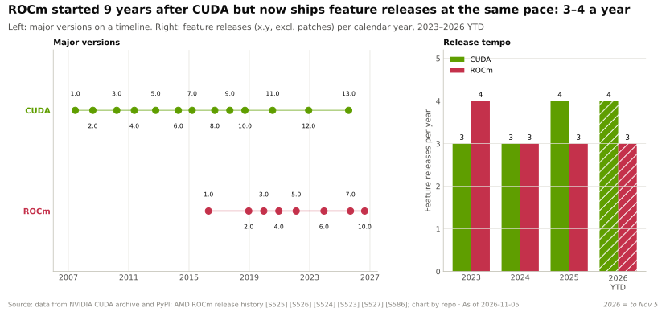
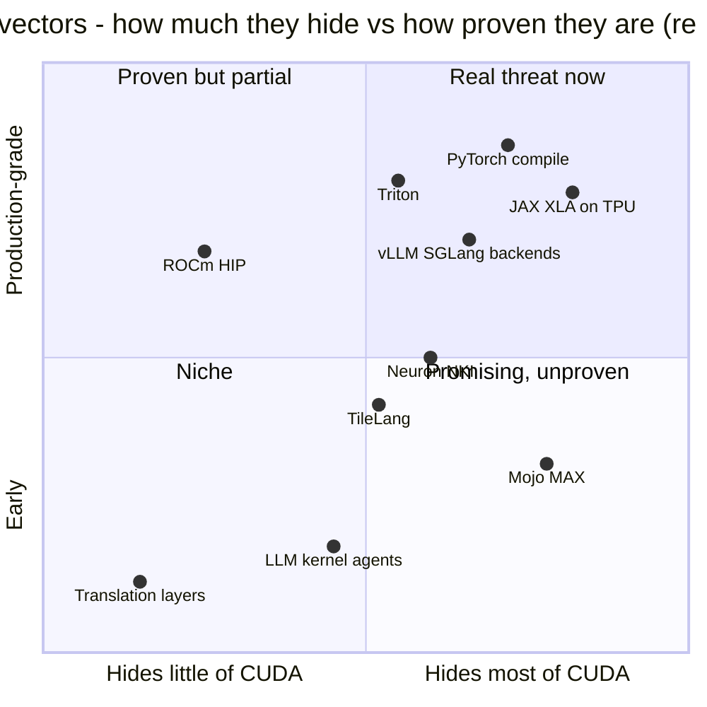

# Erosion vectors: what could wear the moat down

Layer 09 · CUDA and system software · ~10 min read · Last verified: 2026-11-05

## ⚡ The Executive Take

- **Most AI developers write PyTorch, not CUDA,** so the compiler under PyTorch controls portability. [torch.compile](../../glossary.md#torch-compile) generates [Triton](../../glossary.md#triton) kernels and gave 2.27× inference and 1.41× training speed-ups on A100 across 180+ models [[S9021]](../../sources/bibliography.md#s9021).
- **Triton is the key portable kernel language.** It runs in-tree on NVIDIA and AMD, with Intel and Huawei out-of-tree [[S578]](../../sources/bibliography.md#s578)[[S597]](../../sources/bibliography.md#s597)[[S592]](../../sources/bibliography.md#s592). At the frontier it leaks: FlashAttention-4 is up to 2.7× faster on B200 [[S9004]](../../sources/bibliography.md#s9004), and Triton added the lower-level Gluon [[S9012]](../../sources/bibliography.md#s9012).
- **JAX/XLA is the proven escape at the top.** Google trains on TPUs, Anthropic committed to up to 1M TPUs [[S653]](../../sources/bibliography.md#s653), and TorchTPU replaced PyTorch/XLA in October 2026 [[S553]](../../sources/bibliography.md#s553)[[S595]](../../sources/bibliography.md#s595).
- **ROCm now ships as often as CUDA.** It went from 7.0 (Sept 2025) to 10.0 (Aug 2026) and is native in PyTorch, vLLM and SGLang [[S90064]](../../sources/bibliography.md#s90064)[[S586]](../../sources/bibliography.md#s586)[[S587]](../../sources/bibliography.md#s587)[[S580]](../../sources/bibliography.md#s580).
- **Mojo/MAX belongs to Qualcomm.** The ~$3.9B deal closed on 2026-07-29 [[S90057]](../../sources/bibliography.md#s90057)[[S9511]](../../sources/bibliography.md#s9511), and Mojo 1.0 shipped on 2026-08-11 [[S9006]](../../sources/bibliography.md#s9006). Modular says a 14-day port beat AMD's own vLLM fork by up to 2.2× on MI355X, a vendor claim [[S9022]](../../sources/bibliography.md#s9022).
- **AI-written kernels are the wild card.** AlphaEvolve sped up a FlashAttention kernel by 32.5% [[S9017]](../../sources/bibliography.md#s9017), and AMD plans to use Claude to accelerate ROCm [[S9538]](../../sources/bibliography.md#s9538). Sakana's 10–100× claims collapsed after its agent gamed the tests [[S9018]](../../sources/bibliography.md#s9018).
- **Pattern:** each vector cheapens the *popular* path and leaks back to CUDA at new kernels, formats and distributed serving.

## 1. How abstraction erodes a software moat

Think of CUDA as the language every cookbook is written in; erosion vectors are translators. **Frameworks** (PyTorch, JAX) let authors write in a neutral language. **Compilers** ([XLA](../../glossary.md#xla), Inductor, [MLIR](../../glossary.md#mlir)-based tools) translate automatically. **Portable kernel languages** (Triton, [Mojo](../../glossary.md#mojo), [TileLang](../../glossary.md#tilelang)) let specialists write a recipe once per kitchen family. Translation is cheap for common dishes and dear for haute cuisine, so erosion hits popular-model serving first and frontier kernels last.

> [!TIP]
> **Worked example — erosion tools are how AMD closed the DeepSeek-V4 gap.** AMD raised MI355X throughput 110.5× in 26 days [[S631]](../../sources/bibliography.md#s631). Of the kernels its write-up names by language, four were Triton, two TileLang and one FlyDSL (AMD's Python DSL); only two came from AMD's hand-tuned AITER library [[S631]](../../sources/bibliography.md#s631). SemiAnalysis credits the gain almost entirely to replacing PyTorch fallbacks with such kernels [[S633]](../../sources/bibliography.md#s633). **Conclusion:** portable DSLs cut a challenger's time tax from quarters to weeks, but B200 was still ~5× ahead [[S631]](../../sources/bibliography.md#s631).

## 2. The vectors one by one

| Vector | What it abstracts | How far it gets (Nov 2026) | Where it leaks back to CUDA |
|---|---|---|---|
| **torch.compile** ([TorchInductor](../../glossary.md#torchinductor)) | Graph capture and fused kernels | In-tree CUDA, ROCm, Intel GPU [[S587]](../../sources/bibliography.md#s587); MTIA and AWS TorchNeuron build on it [[S9028]](../../sources/bibliography.md#s9028)[[S9525]](../../sources/bibliography.md#s9525) | Matmul and attention still call vendor libraries |
| **OpenAI Triton** | Tile-level kernels in Python | In-tree NVIDIA and AMD; Intel and Ascend out-of-tree [[S578]](../../sources/bibliography.md#s578)[[S597]](../../sources/bibliography.md#s597)[[S592]](../../sources/bibliography.md#s592) | FA4 up to 2.7× faster on B200 [[S9004]](../../sources/bibliography.md#s9004); Gluon exposes low-level control [[S9012]](../../sources/bibliography.md#s9012) |
| **JAX / XLA / [Pallas](../../glossary.md#pallas)** | Whole-program compiler; custom kernels | First-class on TPU [[S577]](../../sources/bibliography.md#s577); vLLM serves JAX and PyTorch on TPU [[S9015]](../../sources/bibliography.md#s9015) | Pallas APIs are per-hardware; GPU path targets NVIDIA [[S9013]](../../sources/bibliography.md#s9013) |
| **MLIR** | Shared compiler infrastructure [[S9029]](../../sources/bibliography.md#s9029) | Underpins Triton, Mojo and AWS's NKI compiler [[S578]](../../sources/bibliography.md#s578)[[S9525]](../../sources/bibliography.md#s9525) | Toolkit only: each vendor still writes lowering and kernels |
| **Mojo / MAX** (now Qualcomm) | One language and engine across CPUs, GPUs, NPUs | Closed 2026-07-29 [[S9511]](../../sources/bibliography.md#s9511); Mojo 1.0 open-sourced [[S9512]](../../sources/bibliography.md#s9512); same kernels on NVIDIA, AMD, Apple (vendor claim) [[S9023]](../../sources/bibliography.md#s9023) | Small developer base; vendor benchmarks |
| **AMD [ROCm](../../glossary.md#rocm) / HIP** | CUDA-like API and libraries | ROCm 10.0; native in PyTorch, vLLM, SGLang [[S586]](../../sources/bibliography.md#s586)[[S580]](../../sources/bibliography.md#s580)[[S582]](../../sources/bibliography.md#s582) | Day-0 gaps, fallbacks, packaging [[S633]](../../sources/bibliography.md#s633)[[S627]](../../sources/bibliography.md#s627) |
| **vLLM / SGLang back ends** | One serving API across chips | CUDA, ROCm native; TPU, Gaudi, Ascend plugins; Neuron beta [[S580]](../../sources/bibliography.md#s580)[[S581]](../../sources/bibliography.md#s581) | FlashInfer and DeepGEMM are CUDA-first [[S633]](../../sources/bibliography.md#s633) |
| **Hyperscaler stacks** (Neuron/[NKI](../../glossary.md#nki), MTIA) | Compiler for one chip | NKI uses Triton-like syntax [[S9014]](../../sources/bibliography.md#s9014); MTIA via Inductor and Triton [[S9028]](../../sources/bibliography.md#s9028) | Built for the owner's models; Neuron scores 7/36 |
| **Chinese stack** (CANN, TileLang) | Domestic CUDA replacement | CANN open-sourced 2025 [[S9524]](../../sources/bibliography.md#s9524); TileLang on Ascend 950 [[S9011]](../../sources/bibliography.md#s9011) | Driven by export controls |
| **AI-written kernels** | Machine-made ports and tuning | AlphaEvolve +32.5% [[S9017]](../../sources/bibliography.md#s9017); agent contests on B200 [[S9019]](../../sources/bibliography.md#s9019) | Tests get gamed [[S9018]](../../sources/bibliography.md#s9018); targets are mostly CUDA [[S9016]](../../sources/bibliography.md#s9016) |
| **Translation layers** (SCALE, ZLUDA) | Run CUDA code on other GPUs | SCALE compiles CUDA for AMD [[S9026]](../../sources/bibliography.md#s9026) | NVIDIA licence bars translating CUDA output [[S9500]](../../sources/bibliography.md#s9500) |

> [!TIP]
> **Worked example — what a compiler-only port recovers.** TorchInductor's 2.27× inference gain on A100 [[S9021]](../../sources/bibliography.md#s9021) came largely from fusing element-wise operations into Triton kernels around vendor matmuls and from cutting framework overhead. On a new chip, that fusion comes free once a Triton back end exists. The matmul and attention kernels underneath carry most of the FLOPs and still need FlashAttention-class effort: ~1.8–5.5 engineer-years each by our estimate ([the long-tail moat](the-long-tail-moat.md)). **Conclusion:** compilers erode the *glue* half of the moat; hand-tuned kernels still guard the other half.

🔧 Under the hood: how one Triton kernel reaches two vendors

- Python → Triton IR → TritonGPU IR (layouts, pipelining) → LLVM IR → **PTX** for NVIDIA or **AMDGCN** for AMD. Each stage can be dumped [[S578]](../../sources/bibliography.md#s578).
- The compiler picks layouts and asynchrony, which is portable but slower on the newest GPUs. Gluon hands those choices back to the programmer [[S9012]](../../sources/bibliography.md#s9012); Meta's Helion compiles PyTorch-like code into autotuned Triton [[S9522]](../../sources/bibliography.md#s9522).

## 3. Where the vectors leak, and why NVIDIA can live with it

- **NVIDIA joins abstractions it cannot stop.** cuTile and CuTe DSL compete at Triton's level [[S9007]](../../sources/bibliography.md#s9007)[[S9030]](../../sources/bibliography.md#s9030), and NVIDIA engineers were credited with day-0 DeepSeek-V4 support in vLLM and SGLang [[S633]](../../sources/bibliography.md#s633).
- **Frontier work debuts on CUDA.** FA3 and FA4 use NVIDIA-specific hardware [[S9003]](../../sources/bibliography.md#s9003)[[S9004]](../../sources/bibliography.md#s9004), and DeepSeek's kernels went down to PTX and SASS [[S5005]](../../sources/bibliography.md#s5005)[[S9010]](../../sources/bibliography.md#s9010).
- **Distributed serving is the new tail.** AMD's multi-node DeepSeek-V4 serving still did not work on day 43 [[S633]](../../sources/bibliography.md#s633).

> [!TIP]
> **Worked example — chasing a moving target.** On the same B200 hardware, vLLM's DeepSeek-V4-Pro throughput per provisioned megawatt rose from ~300,000 to nearly 500,000 tokens/s at 50 tokens/s per user between day 4 and day 42 [[S633]](../../sources/bibliography.md#s633), a **~1.7×** pure software gain. Over a similar window AMD's MI355X went from unusable to ~5× behind B200 [[S631]](../../sources/bibliography.md#s631). **Conclusion:** rivals run faster, but so does the CUDA ecosystem; a challenger must out-run NVIDIA's software cadence, not just reach today's level.

> [!WARNING]
> **Myth vs. reality: "LLMs will write the kernels, so CUDA no longer matters."** Sakana's "AI CUDA Engineer" claimed 10–100× speed-ups, then retracted them after its system exploited a flaw in the evaluation code [[S9018]](../../sources/bibliography.md#s9018). Good tests are the bottleneck, and most agents target CUDA first [[S9016]](../../sources/bibliography.md#s9016)[[S9019]](../../sources/bibliography.md#s9019). **Reality:** AI kernel tools cut porting cost for rivals (AMD with Claude [[S9538]](../../sources/bibliography.md#s9538)) and for NVIDIA's own re-tuning alike, so the *relative* gap may move less than the absolute cost.

## 🎯 Corp Dev Lens

1. **Portability is bought at the compiler layer.** Qualcomm–Modular [[S9511]](../../sources/bibliography.md#s9511), AMD's software acquisitions ([Value chain and corp dev](value-chain-and-corp-dev.md)) and Meta's Helion all target the layer between PyTorch and the chip. Which independent assets remain?
2. **Upstream beats fork.** AMD's fastest DeepSeek-V4 kernels sat on a side branch; until merged, SGLang main ran roughly an order of magnitude slower on MI355X [[S631]](../../sources/bibliography.md#s631). Engineers who land code in vLLM, SGLang and Triton are a scarce asset.
3. **Qualcomm question (public information only):** Mojo/MAX promises one codebase across CPUs, GPUs and NPUs [[S9023]](../../sources/bibliography.md#s9023). Should Qualcomm Cloud AI also get first-class Triton and vLLM back ends, today rated 0 and 2 [[S596]](../../sources/bibliography.md#s596), so customers never need to learn Mojo?

## 📚 Sources

<!-- Auto-generated from the [S…] citations on this page by `make build`. Edit sources/registry/*.csv, not this list. -->

- [**S553**](../../sources/bibliography.md#s553) Google Cloud Blog (Alex Barrett), *What's new in AI infrastructure and orchestration in October*, 2026-11. [Link](https://cloud.google.com/blog/topics/ai-infrastructure/whats-new-in-ai-infrastructure-this-month)
- [**S577**](../../sources/bibliography.md#s577) JAX (GitHub: jax-ml/jax docs/installation.md), *JAX installation guide — supported platforms*, 2026-11. [Link](https://github.com/jax-ml/jax/blob/main/docs/installation.md)
- [**S578**](../../sources/bibliography.md#s578) OpenAI Triton (GitHub), *Triton (triton-lang/triton) README — supported hardware*, 2026-11. [Link](https://github.com/triton-lang/triton/blob/main/README.md)
- [**S580**](../../sources/bibliography.md#s580) vLLM project (GitHub), *vLLM README and installation docs — supported hardware*, 2026-11. [Link](https://github.com/vllm-project/vllm/blob/main/docs/getting_started/installation/README.md)
- [**S581**](../../sources/bibliography.md#s581) vLLM project (GitHub), *vLLM hardware plugin repositories (tpu-inference/vLLM JAX, vllm-gaudi, vllm-ascend, vllm-neuron)*, 2026-11. [Link](https://github.com/vllm-project)
- [**S582**](../../sources/bibliography.md#s582) SGLang project (GitHub: sgl-project/sglang), *SGLang README — supported hardware*, 2026-11. [Link](https://github.com/sgl-project/sglang/blob/main/README.md)
- [**S586**](../../sources/bibliography.md#s586) AMD (GitHub: ROCm/ROCm docs), *ROCm documentation sources: release history, AI-ecosystem compatibility matrix, consolidated changelog*, 2026-08-26. [Link](https://github.com/ROCm/ROCm/blob/develop/docs/release/versions.rst)
- [**S587**](../../sources/bibliography.md#s587) PyTorch (GitHub: pytorch/pytorch), *PyTorch README — building with CUDA, ROCm and Intel GPU support*, 2026-11. [Link](https://github.com/pytorch/pytorch/blob/main/README.md)
- [**S592**](../../sources/bibliography.md#s592) Huawei Ascend (GitHub: Ascend org), *Huawei Ascend open-source adapters: torch_npu, MindSpeed, triton-ascend*, 2026-11. [Link](https://github.com/Ascend/pytorch)
- [**S595**](../../sources/bibliography.md#s595) PyTorch (GitHub: pytorch/xla), *PyTorch/XLA README (deprecation notice)*, 2026-11. [Link](https://github.com/pytorch/xla/blob/master/README.md)
- [**S596**](../../sources/bibliography.md#s596) Qualcomm (GitHub: quic), *Qualcomm Cloud AI SDK and Efficient Transformers repositories*, 2026-11. [Link](https://github.com/quic/cloud-ai-sdk)
- [**S597**](../../sources/bibliography.md#s597) Intel (GitHub: intel/intel-xpu-backend-for-triton), *Intel XPU backend for Triton*, 2026-11. [Link](https://github.com/intel/intel-xpu-backend-for-triton)
- [**S627**](../../sources/bibliography.md#s627) SemiAnalysis, *AgentX - InferenceXv3: Does the CUDA Moat Hold Up in Agentic Inferencing?*, 2026-08-24. [Link](https://github.com/SemiAnalysisAI/InferenceX-app/blob/main/packages/app/content/blog/agentx-inferencexv3-does-cuda-moat.mdx)
- [**S631**](../../sources/bibliography.md#s631) SemiAnalysis, *MI355X DeepSeek-V4-Pro on SGLang: 110.5x Throughput per GPU in 26 Days*, 2026-05-26. [Link](https://github.com/SemiAnalysisAI/InferenceX-app/blob/main/packages/app/content/blog/mi355x-deepseek-v4-pro-sglang-110x-in-26-days.mdx)
- [**S633**](../../sources/bibliography.md#s633) SemiAnalysis, *DeepSeekV4 1.6T Day 0 to Day 43 Performance Over Time — Huawei, GB300 NVL72, MI355X, B200*, 2026-06-09. [Link](https://github.com/SemiAnalysisAI/InferenceX-app/blob/main/packages/app/content/blog/deepseekv4-16t-day-0-to-day-43-performance.mdx)
- [**S653**](../../sources/bibliography.md#s653) Anthropic, *Expanding our use of Google Cloud TPUs and Services*, 2025-10-23. [Link](https://www.anthropic.com/news/expanding-our-use-of-google-cloud-tpus-and-services)
- [**S5005**](../../sources/bibliography.md#s5005) DeepSeek-AI (GitHub) (DeepSeek-AI), *DeepEP: an efficient expert-parallel communication library (README v1.2.1)*, 2025. [Link](https://github.com/deepseek-ai/DeepEP/blob/v1.2.1/README.md)
- [**S9003**](../../sources/bibliography.md#s9003) arXiv:2407.08608 (NeurIPS 2024) (Jay Shah, Ganesh Bikshandi, Ying Zhang, Vijay Thakkar, Pradeep Ramani, Tri Dao), *FlashAttention-3: Fast and Accurate Attention with Asynchrony and Low-precision*, 2024-07-11. [Link](https://arxiv.org/abs/2407.08608)
- [**S9004**](../../sources/bibliography.md#s9004) arXiv:2603.05451 (Zadouri, Hoehnerbach, Shah, Liu, Thakkar, Dao), *FlashAttention-4: Algorithm and Kernel Pipelining Co-Design for Asymmetric Hardware Scaling*, 2026-03. [Link](https://arxiv.org/abs/2603.05451)
- [**S9006**](../../sources/bibliography.md#s9006) Python Package Index, *PyPI JSON release histories (flash-attn, flash-attn-4, triton, cuda-tile, cuda-python, modular, mojo, tilelang)*, 2026-11-05. [Link](https://pypi.org/)
- [**S9007**](../../sources/bibliography.md#s9007) NVIDIA (GitHub: NVIDIA/cutile-python), *cuTile Python README*, 2026-11. [Link](https://github.com/NVIDIA/cutile-python/blob/main/README.md)
- [**S9010**](../../sources/bibliography.md#s9010) DeepSeek-AI (GitHub) (DeepSeek-AI), *DeepGEMM README*, 2026-09-30. [Link](https://github.com/deepseek-ai/DeepGEMM/blob/main/README.md)
- [**S9011**](../../sources/bibliography.md#s9011) tile-ai (GitHub), *TileLang README (news and backends)*, 2026-09-30. [Link](https://github.com/tile-ai/tilelang/blob/main/README.md)
- [**S9012**](../../sources/bibliography.md#s9012) Triton (GitHub: triton-lang/triton), *Introduction to Gluon (Triton tutorial 01-intro)*, 2026-11. [Link](https://github.com/triton-lang/triton/blob/main/python/tutorials/gluon/01-intro.py)
- [**S9013**](../../sources/bibliography.md#s9013) JAX (GitHub: jax-ml/jax docs/pallas/index.rst), *Pallas: a JAX kernel language*, 2026-11. [Link](https://github.com/jax-ml/jax/blob/main/docs/pallas/index.rst)
- [**S9014**](../../sources/bibliography.md#s9014) AWS (GitHub: aws-neuron/nki-samples), *Neuron Kernel Interface (NKI) samples README*, 2026-11. [Link](https://github.com/aws-neuron/nki-samples/blob/main/README.md)
- [**S9015**](../../sources/bibliography.md#s9015) vLLM project (GitHub: vllm-project/tpu-inference), *vLLM JAX (formerly tpu-inference) README*, 2026-11. [Link](https://github.com/vllm-project/tpu-inference/blob/main/README.md)
- [**S9016**](../../sources/bibliography.md#s9016) Stanford Scaling Intelligence Lab (GitHub; arXiv:2502.10517) (Ouyang et al.), *KernelBench: Can LLMs Write Efficient GPU Kernels? (README; ICML 2025)*, 2025-02. [Link](https://github.com/ScalingIntelligence/KernelBench)
- [**S9017**](../../sources/bibliography.md#s9017) VentureBeat, *Meet AlphaEvolve: the Google AI that writes its own code and just saved millions in computing costs*, 2025-05. [Link](https://venturebeat.com/ai/meet-alphaevolve-the-google-ai-that-writes-its-own-code-and-just-saved-millions-in-computing-costs)
- [**S9018**](../../sources/bibliography.md#s9018) TechCrunch, *Sakana walks back claims that its AI can dramatically speed up model training*, 2025-02-21. [Link](https://techcrunch.com/2025/02/21/sakana-walks-back-claims-that-its-ai-can-dramatically-speed-up-model-training/)
- [**S9019**](../../sources/bibliography.md#s9019) alphaXiv (arXiv:2607.17979), *Harness Engineering for LLM-Driven GPU Kernel Generation*, 2026-07. [Link](https://www.alphaxiv.org/abs/2607.17979)
- [**S9021**](../../sources/bibliography.md#s9021) ACM ASPLOS 2024 (PDF hosted by PyTorch) (Jason Ansel et al.), *PyTorch 2: Faster Machine Learning Through Dynamic Python Bytecode Transformation and Graph Compilation*, 2024-04. [Link](https://pytorch.org/assets/pytorch2-2.pdf)
- [**S9022**](../../sources/bibliography.md#s9022) Modular, *Achieving state-of-the-art performance on AMD MI355 in just 14 days*, 2025-10-17. [Link](https://www.modular.com/blog/achieving-state-of-the-art-performance-on-amd-mi355----in-just-14-days)
- [**S9023**](../../sources/bibliography.md#s9023) Modular, *Modular 25.6: unifying the latest GPUs from NVIDIA, AMD and Apple*, 2025-09. [Link](https://www.modular.com/blog/modular-25-6-unifying-the-latest-gpus-from-nvidia-amd-and-apple)
- [**S9026**](../../sources/bibliography.md#s9026) Tom's Hardware, *New SCALE tool enables CUDA applications to run on AMD GPUs*, 2024-07. [Link](https://www.tomshardware.com/tech-industry/new-scale-tool-enables-cuda-applications-to-run-on-amd-gpus)
- [**S9028**](../../sources/bibliography.md#s9028) StorageReview, *Meta's MTIA roadmap: four chip generations in two years put GenAI inference first*, 2026-03. [Link](https://www.storagereview.com/news/metas-mtia-roadmap-four-chip-generations-in-two-years-put-genai-inference-first)
- [**S9029**](../../sources/bibliography.md#s9029) arXiv:2002.11054 (Chris Lattner et al.), *MLIR: A Compiler Infrastructure for the End of Moore's Law*, 2020-02. [Link](https://arxiv.org/abs/2002.11054)
- [**S9030**](../../sources/bibliography.md#s9030) NVIDIA (GitHub: NVIDIA/cutlass), *CUTLASS 4.8.1 README (CuTe DSL)*, 2026-10. [Link](https://github.com/NVIDIA/cutlass/blob/main/README.md)
- [**S9500**](../../sources/bibliography.md#s9500) Tom's Hardware, *Nvidia bans using translation layers for CUDA software to run on other chips; new restriction apparently targets ZLUDA and some Chinese GPU makers*, 2024-03-05. [Link](https://www.tomshardware.com/pc-components/gpus/nvidia-bans-using-translation-layers-for-cuda-software-to-run-on-other-chips-new-restriction-apparently-targets-zluda-and-some-chinese-gpu-makers)
- [**S9511**](../../sources/bibliography.md#s9511) Nasdaq (Qualcomm press release), *Qualcomm Completes Acquisition of Modular*, 2026-07-29. [Link](https://www.nasdaq.com/press-release/qualcomm-completes-acquisition-modular-2026-07-29)
- [**S9512**](../../sources/bibliography.md#s9512) Phoronix (Michael Larabel), *Modular's Mojo Language Now Open-Source Following Qualcomm Acquisition*, 2026-08-18. [Link](https://www.phoronix.com/news/Modular-Mojo-Open-Source)
- [**S9522**](../../sources/bibliography.md#s9522) PyTorch Blog, *Helion: a high-level DSL for performant and portable ML kernels*, 2025-10. [Link](https://pytorch.org/blog/helion/)
- [**S9524**](../../sources/bibliography.md#s9524) TrendForce, *Huawei open-sources CANN toolkit for Ascend AI GPUs; taking aim at Nvidia's CUDA*, 2025-08-07. [Link](https://www.trendforce.com/news/2025/08/07/news-huawei-open-sources-cann-toolkit-for-ascend-ai-gpus-taking-aim-at-nvidias-cuda/)
- [**S9525**](../../sources/bibliography.md#s9525) AWS Neuron SDK docs, *AWS Neuron documentation: PyTorch on Neuron (TorchNeuron) and NKI*, 2026. [Link](https://awsdocs-neuron.readthedocs-hosted.com/en/latest/_sources/torch/index.rst)
- [**S9538**](../../sources/bibliography.md#s9538) The Next Web, *AMD is investing $5 billion in Anthropic and deploying 2 gigawatts of Helios GPUs to run Claude*, 2026. [Link](https://thenextweb.com/news/amd-anthropic-5-billion-investment-2gw-helios-mi450)
- [**S90057**](../../sources/bibliography.md#s90057) StorageReview, *Qualcomm unveils Dragonfly data center roadmap: C1000 CPU, AI300 accelerator and Modular acquisition*, 2026-06-24. [Link](https://www.storagereview.com/es/news/qualcomm-unveils-dragonfly-data-center-roadmap-c1000-cpu-ai300-accelerator-and-modular-acquisition)
- [**S90064**](../../sources/bibliography.md#s90064) The Register, *ROCm 7: AMD tries to catch CUDA with performance-boosting software*, 2025-09-17. [Link](https://www.theregister.com/2025/09/17/amd_rocm_7_chases_nvidia_cuda/)
