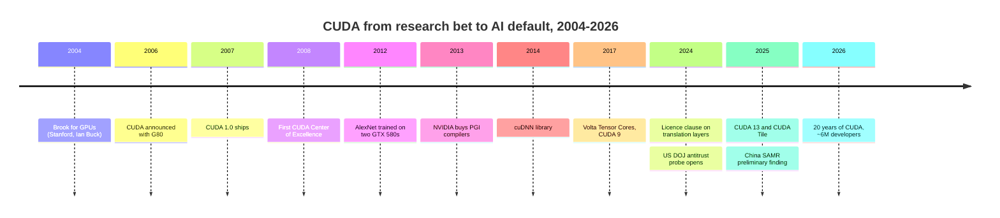

# CUDA and system software: History and how NVIDIA built it

Layer 09 · CUDA and system software · ~12 min read · Last verified: 2026-11-05

## ⚡ The Executive Take

- **CUDA began as a research project.** Ian Buck's [Brook](../../glossary.md#brook) language (Stanford, 2004) showed C-like code could run on graphics chips [[S9532]](../../sources/bibliography.md#s9532). NVIDIA announced CUDA with the G80 GPU on 2006-11-08 and shipped CUDA 1.0 in June 2007 [[S9528]](../../sources/bibliography.md#s9528)[[S525]](../../sources/bibliography.md#s525).
- **NVIDIA paid to create its own market.** Its first CUDA Center of Excellence (Illinois, 2008) got $500,000 plus a ~$800,000 cluster; 41 universities taught CUDA by mid-2008 [[S9529]](../../sources/bibliography.md#s9529).
- **The payoff took a decade.** AlexNet trained on two GTX 580 gaming GPUs in 2012 [[S9530]](../../sources/bibliography.md#s9530), and [cuDNN](../../glossary.md#cudnn) packaged deep-learning kernels in 2014 [[S9531]](../../sources/bibliography.md#s9531). Data Center revenue first topped NVIDIA's total R&D only in FY2018 [[S400]](../../sources/bibliography.md#s400).
- **[Q4 · Source of advantage]** Time compounding on an installed base: 13 CUDA major versions in 18 years, kept compatible through [PTX](../../glossary.md#ptx) and shipped on every NVIDIA GPU, so research landed on CUDA first [[S525]](../../sources/bibliography.md#s525)[[S529]](../../sources/bibliography.md#s529).
- **The moat is now defended as well as built.** A 2024 licence clause bars [translation layers](../../glossary.md#translation-layer) aimed at running CUDA software on rival chips [[S9500]](../../sources/bibliography.md#s9500). The US DOJ opened an antitrust probe in 2024, and China's regulator issued a preliminary violation finding over Mellanox conditions in September 2025 🟡 [[S9504]](../../sources/bibliography.md#s9504)[[S9503]](../../sources/bibliography.md#s9503)[[S9505]](../../sources/bibliography.md#s9505).
- **[Q6 · Replication cost]** Est. 🔴: 5–8 years and $5–10B of cumulative software spend for inference-grade parity on the top frameworks; 10+ years for CUDA's full breadth. Markers: ten-year-old ROCm scores 26/36 on framework support; Qualcomm paid ~$3.9B for Modular, ~10× its capital raised [[S586]](../../sources/bibliography.md#s586)[[S90057]](../../sources/bibliography.md#s90057)[[S9510]](../../sources/bibliography.md#s9510).

## From graphics hack to platform

Before CUDA, [GPGPU](../../glossary.md#gpgpu) researchers disguised maths as pixel shading (a matrix became a texture). Brook hid that trick behind a C-like language [[S9532]](../../sources/bibliography.md#s9532). CUDA went further, putting a C compiler, a hardware thread scheduler and shared memory on every GeForce from the G80 onwards [[S9528]](../../sources/bibliography.md#s9528)[[S2503]](../../sources/bibliography.md#s2503). That reached students and researchers directly: by 2020 there were more than 1 billion CUDA-capable GPUs, mostly gaming cards [[S529]](../../sources/bibliography.md#s529).

> [!TIP]
> **Worked example — how cheap the seeding was.** Illinois received ~$1.3M in cash and hardware ($500,000 + ~$800,000) [[S9529]](../../sources/bibliography.md#s9529). Even if all 41 universities teaching CUDA in 2008 had received that much, the bill would be ~$53M. That is about 4% of NVIDIA's FY2016 R&D of $1.33B and under 0.3% of FY2026's $18.5B [[S400]](../../sources/bibliography.md#s400)[[S401]](../../sources/bibliography.md#s401). 

### Key decisions and deals

| Date | Decision | Why it mattered | Source |
|---|---|---|---|
| 2006-11 | Make every G80-class GPU programmable in C | Installed base of >1B CUDA GPUs by 2020 | [[S9528]](../../sources/bibliography.md#s9528)[[S529]](../../sources/bibliography.md#s529) |
| 2008 | Fund CUDA teaching and research centres | 41 universities teaching CUDA by mid-2008 | [[S9529]](../../sources/bibliography.md#s9529) |
| 2013-07 | Buy PGI (OpenACC, CUDA Fortran) | Brought HPC's Fortran code base onto NVIDIA | [[S484]](../../sources/bibliography.md#s484) |
| 2014 | Release cuDNN | Frameworks call NVIDIA kernels instead of writing their own | [[S9531]](../../sources/bibliography.md#s9531) |
| 2017-09 | CUDA 9 exposes Volta Tensor Cores | Hardware and software co-designed from then on | [[S525]](../../sources/bibliography.md#s525) |
| 2024-03 | Licence clause against translation layers | Raises legal risk for ZLUDA-style clones | [[S9500]](../../sources/bibliography.md#s9500)[[S9502]](../../sources/bibliography.md#s9502) |
| 2025-12 | CUDA 13.1 adds CUDA Tile and cuTile Python | NVIDIA's answer to Triton-style tile programming | [[S523]](../../sources/bibliography.md#s523)[[S9521]](../../sources/bibliography.md#s9521) |
| 2026-03 | Dynamo 1.0, Apache 2.0 | Open-sources the serving layer to keep it NVIDIA-first | [[S90066]](../../sources/bibliography.md#s90066) |

## [Q4] Where the advantage comes from

**[Q4 · Source of advantage]** Five mechanisms reinforce each other:

1. **Time and installed base.** Eighteen years of releases, each tied to a new GPU feature [[S525]](../../sources/bibliography.md#s525).
2. **Backward compatibility.** Code ships as PTX, which the driver retranslates for each new GPU, so old kernels keep running.
3. **Co-design.** New number formats ship with kernels on day one; rivals port them later.
4. **Research gravity.** New techniques are written and benchmarked on CUDA first, so the [day-0](../../glossary.md#day-zero-support) advantage renews with every model release ([competition](competition.md)).
5. **Defence.** Licence terms and bundling, which drew regulators: the DOJ probe asks whether NVIDIA makes switching harder [[S9503]](../../sources/bibliography.md#s9503).

> [!TIP]
> **Worked example — the decade before payoff.** From FY2016 to FY2020 NVIDIA spent $9.8B on R&D in total ($1.33B + $1.46B + $1.80B + $2.38B + $2.83B). Data Center revenue over the same five years was $9.0B [[S400]](../../sources/bibliography.md#s400)[[S2]](../../sources/bibliography.md#s2). Only from FY2018 did a single year of Data Center revenue cover the company's R&D, a decade after CUDA 1.0.

🔧 Under the hood: what the 2024 licence clause does and does not do

The clause bars reverse-engineering or translating CUDA output to run on non-NVIDIA platforms. Reports say it appeared in the EULA installed with CUDA 11.6 and later; one outlet says the online licence carried it from 2021 [[S9500]](../../sources/bibliography.md#s9500)[[S9501]](../../sources/bibliography.md#s9501). On most readings it does not stop source-level ports (HIPIFY rewrites source, not binaries) or clean-room reimplementations 🔴. ZLUDA's earlier AMD-funded code was taken down at AMD's request and rebuilt [[S9502]](../../sources/bibliography.md#s9502). The effect is legal risk for anyone selling binary compatibility.

## [Q6] What it would cost to replicate

**[Q6 · Replication cost]** Est. 🔴: a well-funded challenger starting now needs **5–8 years, $5–10B cumulative and 1,000–3,000 software engineers** for inference-grade parity on the top frameworks. That is faster than AMD's decade because the abstraction layer and AI-assisted kernel writing now exist. Matching CUDA's full breadth (HPC, graphics, robotics libraries) takes 10+ years.

| Path | Time | Dollars (Est. 🔴) | Talent (Est. 🔴) | Evidence |
|---|---|---|---|---|
| Clone the API (HIP-style) | 10+ years and counting | ~$0.5–1B per year | 1,000–3,000 software engineers | ROCm 2016→2026 reaches 26/36 [[S586]](../../sources/bibliography.md#s586) |
| Buy a team and language | 3–4 years of start-up work, then integration | $0.7–3.9B purchase price | 100s | Run:ai ~$700M; Silo AI $665M; Modular ~$3.9B [[S479]](../../sources/bibliography.md#s479)[[S9506]](../../sources/bibliography.md#s9506)[[S90057]](../../sources/bibliography.md#s90057) |
| Ride the abstraction layer | 2–3 years for inference | $0.2–0.5B per year | 200–500 upstream contributors | Triton, vLLM and SGLang backends [[S578]](../../sources/bibliography.md#s578)[[S580]](../../sources/bibliography.md#s580)[[S582]](../../sources/bibliography.md#s582) |
| Match CUDA's full breadth | 10+ years | NVIDIA-scale: $18.5B total R&D in FY2026 | thousands | NVIDIA FY2026 R&D [[S401]](../../sources/bibliography.md#s401) |

> [!TIP]
> **Worked example — reading Qualcomm's price as a market marker.** Modular raised $380M in three rounds and was valued at $1.6B in September 2025 [[S9510]](../../sources/bibliography.md#s9510). Qualcomm agreed to pay ~$3.9B nine months later [[S90057]](../../sources/bibliography.md#s90057). That is ~10× invested capital and ~2.4× the last private mark: buyers now pay for time saved, not for revenue.

🔧 Under the hood: why the estimate is a range, not a number

Filings do not split software from hardware R&D, and AMD has not disclosed ROCm headcount. Analysts say AMD went into "wartime mode" on software in 2025 but pays AI-software engineers less than NVIDIA and the labs [[S9537]](../../sources/bibliography.md#s9537). The ranges above therefore anchor on observable outcomes: years elapsed, framework scores and deal prices. They are not cost build-ups.

## Counterfactuals — what if NVIDIA hadn't…

| What if… | What changes | Likely outcome (🔴 analysis) |
|---|---|---|
| …open-sourced CUDA in 2010? | AMD and Intel ship CUDA-compatible compilers | NVIDIA keeps a library and co-design lead, but margins compress as switching becomes trivial |
| …lost to [OpenCL](../../glossary.md#opencl)? | One portable standard | AI still arrives on GPUs, but hardware competes on price, like CPUs |
| …kept CUDA to Tesla cards only? | No CUDA on the GTX 580s behind AlexNet [[S9530]](../../sources/bibliography.md#s9530) | Deep learning stays on CPUs longer; research habits form elsewhere |

> [!TIP]
> **Worked example — what open compatibility would put at stake.** Each 5% of FY2026 Data Center revenue ($193.7B) won by a CUDA-compatible rival would be ~$9.7B a year [[S1]](../../sources/bibliography.md#s1). With NVIDIA's GAAP gross margin at 75.0% in Q2 FY2027 [[S3]](../../sources/bibliography.md#s3), price, not just share, would be the first casualty 🔴.

For the full case study, see [CS2 · CUDA: the 15-year bet](../../case-studies/CS2-cuda-the-15-year-bet.md). Hardware milestones: [Layer 02 history](../02-gpu-silicon/history-and-how-built.md); cross-stack story: [How NVIDIA built it](../../cross-cutting/16-how-nvidia-built-it-timeline.md).

## 🎯 Corp Dev Lens

1. Seeding academia cost NVIDIA tens of millions and created the default. Which channel today (open models, agent frameworks, AI-coding tools) is still cheap to seed?
2. A challenger can buy years but not habits. After the Modular deal, what else is needed: upstream contributions, developer relations, or bundled cloud credits?
3. The 2024 licence clause and the antitrust probes pull in opposite directions. How would a consent decree requiring CUDA interoperability change the value of portable-stack assets?
4. If AI-written kernels shrink the "decade" to a few years, which assets keep their value: data on hardware behaviour, benchmark harnesses or compiler teams?

## 📚 Sources

<!-- Auto-generated from the [S…] citations on this page by `make build`. Edit sources/registry/*.csv, not this list. -->

- [**S1**](../../sources/bibliography.md#s1) NVIDIA Corporation via SEC EDGAR, *NVIDIA Announces Financial Results for Fourth Quarter and Fiscal 2026 (Form 8-K exhibit 99.1)*, 2026-02-25. [Link](https://www.sec.gov/Archives/edgar/data/1045810/000104581026000019/q4fy26pr.htm)
- [**S2**](../../sources/bibliography.md#s2) U.S. Securities and Exchange Commission (EDGAR), *NVIDIA Corporation Form 10-K annual reports FY2020–FY2025 (filing index)*, 2025-02-26. [Link](https://www.sec.gov/cgi-bin/browse-edgar?action=getcompany&CIK=0001045810&type=10-K&dateb=&owner=include&count=40)
- [**S3**](../../sources/bibliography.md#s3) StorageNewsletter, *NVIDIA Q2 Fiscal 2027 results coverage: revenue $96.2B*, 2026-08-27. [Link](https://www.storagenewsletter.com/2026/08/27/nvidia-fiscal-2q27-financial-results/)
- [**S400**](../../sources/bibliography.md#s400) U.S. Securities and Exchange Commission (EDGAR), *NVIDIA Corporation Form 10-K annual reports FY2001–FY2019 (EDGAR filing index)*, 2019-02-21. [Link](https://www.sec.gov/cgi-bin/browse-edgar?action=getcompany&CIK=0001045810&type=10-K&dateb=&owner=include&count=40)
- [**S401**](../../sources/bibliography.md#s401) NVIDIA Corporation via SEC EDGAR, *NVIDIA Corporation Form 10-K for fiscal year ended January 25, 2026*, 2026-02-25. [Link](https://www.sec.gov/Archives/edgar/data/1045810/000104581026000021/nvda-20260125.htm)
- [**S479**](../../sources/bibliography.md#s479) Various (press), *Reporting on NVIDIA tuck-in acquisition prices (Run:ai, Deci, Shoreline, OctoAI, Gretel, Lepton, CentML) — The Information, Calcalist, Reuters, CNBC*, 2025-06. [Link](https://www.reuters.com/technology/)
- [**S484**](../../sources/bibliography.md#s484) NVIDIA press releases as summarised in NVIDIA 10-K filings and contemporaneous press, *History of NVIDIA acquisitions 2000–2013 (3dfx assets, MediaQ, ULi, Hybrid Graphics, PortalPlayer, mental images, Ageia, Icera, The Portland Group)*, 2013-07. [Link](https://en.wikipedia.org/wiki/Nvidia)
- [**S523**](../../sources/bibliography.md#s523) Python Package Index (NVIDIA), *nvidia-cuda-runtime (CUDA 13.x runtime wheels) release history*, 2026-11-04. [Link](https://pypi.org/project/nvidia-cuda-runtime/#history)
- [**S525**](../../sources/bibliography.md#s525) NVIDIA Developer, *CUDA Toolkit Archive*, 2026. [Link](https://developer.nvidia.com/cuda-toolkit-archive)
- [**S529**](../../sources/bibliography.md#s529) NVIDIA Blog (Will Ramey), *2 Million Registered Developers, Countless Breakthroughs*, 2020. [Link](https://blogs.nvidia.com/blog/2-million-registered-developers-breakthroughs/)
- [**S578**](../../sources/bibliography.md#s578) OpenAI Triton (GitHub), *Triton (triton-lang/triton) README — supported hardware*, 2026-11. [Link](https://github.com/triton-lang/triton/blob/main/README.md)
- [**S580**](../../sources/bibliography.md#s580) vLLM project (GitHub), *vLLM README and installation docs — supported hardware*, 2026-11. [Link](https://github.com/vllm-project/vllm/blob/main/docs/getting_started/installation/README.md)
- [**S582**](../../sources/bibliography.md#s582) SGLang project (GitHub: sgl-project/sglang), *SGLang README — supported hardware*, 2026-11. [Link](https://github.com/sgl-project/sglang/blob/main/README.md)
- [**S586**](../../sources/bibliography.md#s586) AMD (GitHub: ROCm/ROCm docs), *ROCm documentation sources: release history, AI-ecosystem compatibility matrix, consolidated changelog*, 2026-08-26. [Link](https://github.com/ROCm/ROCm/blob/develop/docs/release/versions.rst)
- [**S2503**](../../sources/bibliography.md#s2503) TechSpot, *TechSpot's History of the GPU, Part 4: the coming of general-purpose GPUs*, 2013. [Link](https://www.techspot.com/article/659-history-of-the-gpu-part-4/)
- [**S9500**](../../sources/bibliography.md#s9500) Tom's Hardware, *Nvidia bans using translation layers for CUDA software to run on other chips; new restriction apparently targets ZLUDA and some Chinese GPU makers*, 2024-03-05. [Link](https://www.tomshardware.com/pc-components/gpus/nvidia-bans-using-translation-layers-for-cuda-software-to-run-on-other-chips-new-restriction-apparently-targets-zluda-and-some-chinese-gpu-makers)
- [**S9501**](../../sources/bibliography.md#s9501) Wccftech, *NVIDIA Halts The Use of CUDA On Other Platforms; Lists New Warning in the EULA*, 2024-03. [Link](https://wccftech.com/nvidia-halts-use-of-cuda-on-other-platforms-lists-new-warning-in-the-eula/)
- [**S9502**](../../sources/bibliography.md#s9502) vosen/ZLUDA (GitHub) (Andrzej Janik), *ZLUDA README (drop-in CUDA replacement for non-NVIDIA GPUs)*, 2026-11. [Link](https://github.com/vosen/ZLUDA)
- [**S9503**](../../sources/bibliography.md#s9503) Business Standard (Bloomberg), *Nvidia gets subpoena from US Justice Dept as antitrust probe deepens*, 2024-09-04. [Link](https://www.business-standard.com/world-news/nvidia-gets-subpoena-from-us-justice-dept-as-antitrust-probe-deepens-124090400121_1.html)
- [**S9504**](../../sources/bibliography.md#s9504) Business Standard, *US launches antitrust investigation into Nvidia over sales practices*, 2024-08-02. [Link](https://www.business-standard.com/world-news/us-launches-antitrust-investigation-into-nvidia-over-sales-practices-124080201689_1.html)
- [**S9505**](../../sources/bibliography.md#s9505) JURIST, *China finds Nvidia violated antimonopoly law in preliminary probe*, 2025-09-15. [Link](https://www.jurist.org/news/2025/09/china-finds-nvidia-violated-antimonopoly-law-in-preliminary-probe/)
- [**S9506**](../../sources/bibliography.md#s9506) Converge Digest, *AMD completes $665 million acquisition of Silo AI*, 2024-08. [Link](https://convergedigest.com/amd-completes-665-million-acquisition-of-silo-ai/?amp=1)
- [**S9510**](../../sources/bibliography.md#s9510) SDxCentral, *Modular raises $250M for AI's unified compute layer at $1.6B valuation*, 2025-09-24. [Link](https://www.sdxcentral.com/news/modular-raises-250m-for-ais-unified-compute-layer-at-16b-valuation/)
- [**S9521**](../../sources/bibliography.md#s9521) Hackster.io, *NVIDIA makes GPU acceleration easier and more portable with CUDA Tiles and cuTile Python*, 2025-12. [Link](https://www.hackster.io/news/nvidia-makes-gpu-acceleration-easier-more-portable-with-cuda-tiles-cutile-python-b808c1ad7e4d)
- [**S9528**](../../sources/bibliography.md#s9528) Digital Engineering 24/7 (NVIDIA press release), *NVIDIA Unveils CUDA - The GPU Computing Revolution Begins*, 2006-11-08. [Link](https://www.digitalengineering247.com/article/nvidia-unveils-cuda)
- [**S9529**](../../sources/bibliography.md#s9529) TechPowerUp, *NVIDIA appoints first CUDA Center of Excellence*, 2008-07-01. [Link](https://techpowerup.com/64493/nvidia-appoints-first-cuda-center-of-excellence)
- [**S9530**](../../sources/bibliography.md#s9530) NeurIPS 2012 (Advances in Neural Information Processing Systems 25) (Alex Krizhevsky, Ilya Sutskever, Geoffrey E. Hinton), *ImageNet Classification with Deep Convolutional Neural Networks*, 2012-12. [Link](https://papers.nips.cc/paper/4824-imagenet-classification-with-deep-convolutional-neural-networks)
- [**S9531**](../../sources/bibliography.md#s9531) arXiv:1410.0759 (Sharan Chetlur, Cliff Woolley, Philippe Vandermersch, Jonathan Cohen, John Tran, Bryan Catanzaro, Evan Shelhamer), *cuDNN: Efficient Primitives for Deep Learning*, 2014-10-03. [Link](https://arxiv.org/abs/1410.0759)
- [**S9532**](../../sources/bibliography.md#s9532) Stanford Graphics Lab (SIGGRAPH 2004) (Ian Buck, Tim Foley, Daniel Horn, Jeremy Sugerman, Kayvon Fatahalian, Mike Houston, Pat Hanrahan), *Brook for GPUs: Stream Computing on Graphics Hardware*, 2004-08. [Link](https://graphics.stanford.edu/papers/brookgpu/)
- [**S9537**](../../sources/bibliography.md#s9537) SemiAnalysis, *AMD 2.0: new sense of urgency; MI450X chance to beat Nvidia; Nvidia's new moat*, 2025-04. [Link](https://newsletter.semianalysis.com/p/amd-2-0-new-sense-of-urgency-mi450x-chance-to-beat-nvidia-nvidias-new-moat)
- [**S90057**](../../sources/bibliography.md#s90057) StorageReview, *Qualcomm unveils Dragonfly data center roadmap: C1000 CPU, AI300 accelerator and Modular acquisition*, 2026-06-24. [Link](https://www.storagereview.com/es/news/qualcomm-unveils-dragonfly-data-center-roadmap-c1000-cpu-ai300-accelerator-and-modular-acquisition)
- [**S90066**](../../sources/bibliography.md#s90066) HPCwire (NVIDIA press release), *NVIDIA enters production with Dynamo, the broadly adopted inference operating system for AI factories*, 2026-03-17. [Link](https://www.hpcwire.com/aiwire/tag/dynamo-1-0/)
