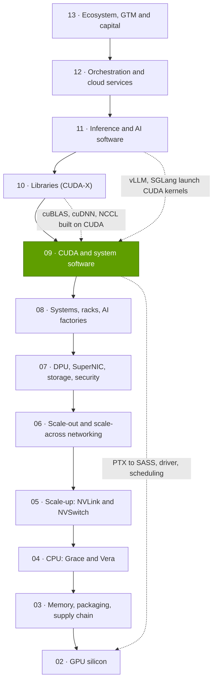
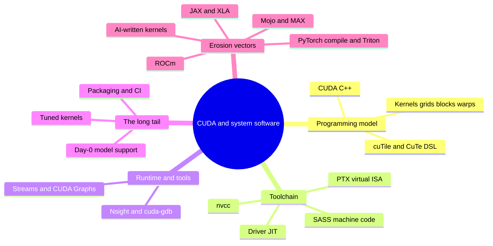

# Layer 09 — CUDA and system software

Layer 09 of 12 · programming model, compiler, runtime, driver and tools between AI frameworks and NVIDIA GPUs · ~6 min read · Last verified: 2026-11-05

## ⚡ The Executive Take

- **[CUDA](../../glossary.md#cuda) translates AI code into work NVIDIA silicon can run.** It bundles a programming model, the nvcc compiler, the [PTX](../../glossary.md#ptx) virtual ISA, runtime, driver and tools. The first toolkit shipped in June 2007 [[S525]](../../sources/bibliography.md#s525); NVIDIA cites ~6 million developers [[S528]](../../sources/bibliography.md#s528).
- **The moat is the long tail.** CUDA is native in all 12 major frameworks and engines tracked here (36/36); ROCm scores 26 and Qualcomm Cloud AI 4 [[S587]](../../sources/bibliography.md#s587)[[S580]](../../sources/bibliography.md#s580)[[S586]](../../sources/bibliography.md#s586)[[S596]](../../sources/bibliography.md#s596).
- **Day 0 shows it.** DeepSeek-V4-Pro ran natively on CUDA at release. AMD MI355X took 8 days for FP4 and 27 to serve at 50 tokens/s per user, and still trailed B200 ~5× [[S633]](../../sources/bibliography.md#s633)[[S631]](../../sources/bibliography.md#s631).
- **Kernels need rewriting for every GPU, even NVIDIA's.** FlashAttention-2 fell from up to 73% of A100 peak to 35% on H100 until FA3 hit 75% [[S9002]](../../sources/bibliography.md#s9002)[[S9003]](../../sources/bibliography.md#s9003). FA4 reaches 71% on B200 [[S9004]](../../sources/bibliography.md#s9004).
- **Erosion is real.** torch.compile and Triton run on NVIDIA and AMD [[S9021]](../../sources/bibliography.md#s9021)[[S578]](../../sources/bibliography.md#s578), ROCm reached 10.0 [[S586]](../../sources/bibliography.md#s586), and Qualcomm closed its ~$3.9B Modular (Mojo/MAX) purchase on 2026-07-29 [[S90057]](../../sources/bibliography.md#s90057)[[S9511]](../../sources/bibliography.md#s9511).
- **Weakness and strongest challenger:** the biggest buyers can afford to leave. Anthropic committed to up to 1M TPUs [[S653]](../../sources/bibliography.md#s653) and OpenAI to 6 GW of AMD GPUs [[S546]](../../sources/bibliography.md#s546). 🔴 We score lock-in at 2.75/5 for frontier labs vs 4.5 for enterprises.
- **NVIDIA's counter is Python:** cuTile and CuTe DSL meet developers where Triton and Mojo compete [[S9007]](../../sources/bibliography.md#s9007)[[S9030]](../../sources/bibliography.md#s9030).

> [!TIP]
> **Worked example — what a 5× software gap costs.** On day 27, B200 delivered ~5× MI355X's tokens per GPU on DeepSeek-V4-Pro [[S631]](../../sources/bibliography.md#s631). Even at half the cost of ownership (🔴 illustrative), MI355X's cost per token would be 5 ÷ 2 = **2.5× higher** until software caught up. **Conclusion:** the moat is paid in weeks of worse token economics after every model launch.

## Where this layer sits in the stack

## Layer map

## The eight questions at a glance

| # | Question | Short answer | Where answered |
|---|---|---|---|
| Q1 | Job, and what breaks if weak? | Turn model math into fast kernels on every GPU from day 0; if weak, peak goes unused and new models stall | [What CUDA is](what-cuda-is.md) |
| Q2 | Metrics that matter? | Day-0 coverage, % of peak on key kernels, framework breadth, gap at equal interactivity, re-tune lag | [The long-tail moat](the-long-tail-moat.md) |
| Q3 | Generational progress? | 13 majors in 18 years, quarterly 13.x minors [[S525]](../../sources/bibliography.md#s525)[[S523]](../../sources/bibliography.md#s523); attention efficiency won back each generation | [What CUDA is](what-cuda-is.md) |
| Q4 | Source of advantage? | Two decades of compounding: >1B CUDA GPUs by 2020 [[S529]](../../sources/bibliography.md#s529), libraries, research, day-0 ecosystem | [History and how built](history-and-how-built.md) |
| Q5 | Strongest challenger? | AMD ROCm in merchant GPUs; Google JAX/XLA on TPU at frontier labs | [Competition](competition.md) |
| Q6 | Replication cost? | 🔴 Est. ~1.8–5.5 engineer-years per frontier kernel, ~90–275 for the critical tail, plus years to win developers | [History and how built](history-and-how-built.md) |
| Q7 | Roadmap? | CUDA tile/Python push; ROCm 10; Mojo 1.0 under Qualcomm; TorchTPU; AI kernel agents | [Roadmap](roadmap.md) |
| Q8 | Value pools and M&A? | CUDA is free; value comes through hardware margin and licences (~$2,000 per GPU per year floated [[S9517]](../../sources/bibliography.md#s9517)); M&A targets compilers | [Value chain and corp dev](value-chain-and-corp-dev.md) |

## Pages in this layer

| Page | What you will learn |
|---|---|
| [What CUDA actually is](what-cuda-is.md) | Kernel analogy, nvcc/PTX/SASS, how `torch.matmul` becomes a launch, CUDA 13.x |
| [Why the moat is the long tail](the-long-tail-moat.md) | Framework breadth, day-0 support, research landing first, porting cost |
| [Erosion vectors](erosion-vectors.md) | torch.compile, Triton, JAX/XLA, MLIR, Mojo, ROCm, vLLM back ends, AI-written kernels |
| [Honest assessment](honest-assessment.md) | Training vs inference, moat strength by segment, evidence both ways |
| [Competition](competition.md) | Head-to-head comparison of software stacks |
| [History and how NVIDIA built it](history-and-how-built.md) | Timeline, key decisions, replication cost |
| [Roadmap](roadmap.md) | CUDA, ROCm and rival software roadmaps |
| [Value chain and corp dev angles](value-chain-and-corp-dev.md) | Software value pools, private companies, M&A |

🔧 Under the hood: CUDA vocabulary in one minute

- **Kernel:** a GPU function launched over a grid of thread blocks, run in warps of 32 threads.
- **PTX vs SASS:** PTX is portable intermediate code; SASS is one GPU family's machine code.
- **Libraries vs DSLs:** cuBLAS and cuDNN are pre-tuned kernels ([Layer 10](../10-libraries-cuda-x/index.md)); Triton, CuTe DSL and cuTile are languages for writing new ones.

## 🎯 Corp Dev Lens

1. **The moat is a time tax.** Rivals close most of a new model's gap in weeks [[S631]](../../sources/bibliography.md#s631), but every new model and GPU restarts the clock.
2. **Lock-in falls as spend rises.** The largest customers can fund their own stacks; the enterprise long tail cannot ([Honest assessment](honest-assessment.md)).
3. **Qualcomm question (public information only):** with Modular in-house [[S9511]](../../sources/bibliography.md#s9511) and AI200/AI250 racks announced [[S90028]](../../sources/bibliography.md#s90028), which segment is least locked in, and what does "day-0 ready" take there?

## 📚 Sources

<!-- Auto-generated from the [S…] citations on this page by `make build`. Edit sources/registry/*.csv, not this list. -->

- [**S523**](../../sources/bibliography.md#s523) Python Package Index (NVIDIA), *nvidia-cuda-runtime (CUDA 13.x runtime wheels) release history*, 2026-11-04. [Link](https://pypi.org/project/nvidia-cuda-runtime/#history)
- [**S525**](../../sources/bibliography.md#s525) NVIDIA Developer, *CUDA Toolkit Archive*, 2026. [Link](https://developer.nvidia.com/cuda-toolkit-archive)
- [**S528**](../../sources/bibliography.md#s528) NVIDIA Developer Forums, *20 Years of CUDA: Honoring the Architects of the Accelerated Age*, 2026-03. [Link](https://forums.developer.nvidia.com/t/20-years-of-cuda-honoring-the-architects-of-the-accelerated-age/364654)
- [**S529**](../../sources/bibliography.md#s529) NVIDIA Blog (Will Ramey), *2 Million Registered Developers, Countless Breakthroughs*, 2020. [Link](https://blogs.nvidia.com/blog/2-million-registered-developers-breakthroughs/)
- [**S546**](../../sources/bibliography.md#s546) TechWire Asia, *AMD Advancing AI 2026: Helios, OpenAI, Meta, Anthropic*, 2026-07. [Link](https://techwireasia.com/2026/07/amd-advancing-ai-2026-helios-openai-meta-anthropic/)
- [**S578**](../../sources/bibliography.md#s578) OpenAI Triton (GitHub), *Triton (triton-lang/triton) README — supported hardware*, 2026-11. [Link](https://github.com/triton-lang/triton/blob/main/README.md)
- [**S580**](../../sources/bibliography.md#s580) vLLM project (GitHub), *vLLM README and installation docs — supported hardware*, 2026-11. [Link](https://github.com/vllm-project/vllm/blob/main/docs/getting_started/installation/README.md)
- [**S586**](../../sources/bibliography.md#s586) AMD (GitHub: ROCm/ROCm docs), *ROCm documentation sources: release history, AI-ecosystem compatibility matrix, consolidated changelog*, 2026-08-26. [Link](https://github.com/ROCm/ROCm/blob/develop/docs/release/versions.rst)
- [**S587**](../../sources/bibliography.md#s587) PyTorch (GitHub: pytorch/pytorch), *PyTorch README — building with CUDA, ROCm and Intel GPU support*, 2026-11. [Link](https://github.com/pytorch/pytorch/blob/main/README.md)
- [**S596**](../../sources/bibliography.md#s596) Qualcomm (GitHub: quic), *Qualcomm Cloud AI SDK and Efficient Transformers repositories*, 2026-11. [Link](https://github.com/quic/cloud-ai-sdk)
- [**S631**](../../sources/bibliography.md#s631) SemiAnalysis, *MI355X DeepSeek-V4-Pro on SGLang: 110.5x Throughput per GPU in 26 Days*, 2026-05-26. [Link](https://github.com/SemiAnalysisAI/InferenceX-app/blob/main/packages/app/content/blog/mi355x-deepseek-v4-pro-sglang-110x-in-26-days.mdx)
- [**S633**](../../sources/bibliography.md#s633) SemiAnalysis, *DeepSeekV4 1.6T Day 0 to Day 43 Performance Over Time — Huawei, GB300 NVL72, MI355X, B200*, 2026-06-09. [Link](https://github.com/SemiAnalysisAI/InferenceX-app/blob/main/packages/app/content/blog/deepseekv4-16t-day-0-to-day-43-performance.mdx)
- [**S653**](../../sources/bibliography.md#s653) Anthropic, *Expanding our use of Google Cloud TPUs and Services*, 2025-10-23. [Link](https://www.anthropic.com/news/expanding-our-use-of-google-cloud-tpus-and-services)
- [**S9002**](../../sources/bibliography.md#s9002) arXiv:2307.08691 (ICLR 2024) (Tri Dao), *FlashAttention-2: Faster Attention with Better Parallelism and Work Partitioning*, 2023-07-17. [Link](https://arxiv.org/abs/2307.08691)
- [**S9003**](../../sources/bibliography.md#s9003) arXiv:2407.08608 (NeurIPS 2024) (Jay Shah, Ganesh Bikshandi, Ying Zhang, Vijay Thakkar, Pradeep Ramani, Tri Dao), *FlashAttention-3: Fast and Accurate Attention with Asynchrony and Low-precision*, 2024-07-11. [Link](https://arxiv.org/abs/2407.08608)
- [**S9004**](../../sources/bibliography.md#s9004) arXiv:2603.05451 (Zadouri, Hoehnerbach, Shah, Liu, Thakkar, Dao), *FlashAttention-4: Algorithm and Kernel Pipelining Co-Design for Asymmetric Hardware Scaling*, 2026-03. [Link](https://arxiv.org/abs/2603.05451)
- [**S9007**](../../sources/bibliography.md#s9007) NVIDIA (GitHub: NVIDIA/cutile-python), *cuTile Python README*, 2026-11. [Link](https://github.com/NVIDIA/cutile-python/blob/main/README.md)
- [**S9021**](../../sources/bibliography.md#s9021) ACM ASPLOS 2024 (PDF hosted by PyTorch) (Jason Ansel et al.), *PyTorch 2: Faster Machine Learning Through Dynamic Python Bytecode Transformation and Graph Compilation*, 2024-04. [Link](https://pytorch.org/assets/pytorch2-2.pdf)
- [**S9030**](../../sources/bibliography.md#s9030) NVIDIA (GitHub: NVIDIA/cutlass), *CUTLASS 4.8.1 README (CuTe DSL)*, 2026-10. [Link](https://github.com/NVIDIA/cutlass/blob/main/README.md)
- [**S9511**](../../sources/bibliography.md#s9511) Nasdaq (Qualcomm press release), *Qualcomm Completes Acquisition of Modular*, 2026-07-29. [Link](https://www.nasdaq.com/press-release/qualcomm-completes-acquisition-modular-2026-07-29)
- [**S9517**](../../sources/bibliography.md#s9517) TechSpot, *Nvidia's AI chips already make billions; now Jensen Huang wants $2,000 per GPU in annual software fees*, 2026-10. [Link](https://www.techspot.com/news/114333-nvidia-ai-chips-already-make-billions-now-jensen.html)
- [**S90028**](../../sources/bibliography.md#s90028) TechRepublic, *Qualcomm unveils AI chips to rival Nvidia, AMD*, 2025-10-27. [Link](https://techrepublic.com/article/news-qualcomm-unveils-ai-chips-to-rival-nvidia-amd)
- [**S90057**](../../sources/bibliography.md#s90057) StorageReview, *Qualcomm unveils Dragonfly data center roadmap: C1000 CPU, AI300 accelerator and Modular acquisition*, 2026-06-24. [Link](https://www.storagereview.com/es/news/qualcomm-unveils-dragonfly-data-center-roadmap-c1000-cpu-ai300-accelerator-and-modular-acquisition)
