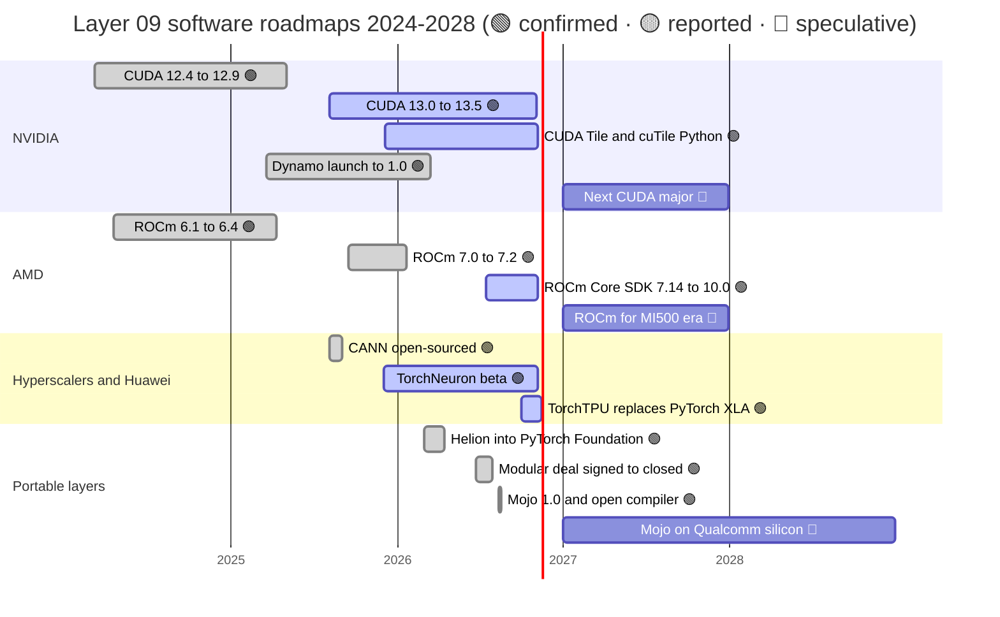

# CUDA and system software: Roadmap

Layer 09 · CUDA and system software · ~10 min read · Last verified: 2026-11-05

## ⚡ The Executive Take

- **CUDA now ships on a quarterly train.** [CUDA](../../glossary.md#cuda) 13.0 arrived on 2025-08-04 and five 13.x minor releases followed, with 13.5 on 2026-11-04 [[S523]](../../sources/bibliography.md#s523). CUDA 13 drops Maxwell, Pascal and Volta 🟡 [[S90065]](../../sources/bibliography.md#s90065).
- **NVIDIA is moving its front door to Python.** CUDA 13.1 introduced CUDA Tile and cuTile Python, and 13.2 extended tile programming to Ampere and Ada [[S9521]](../../sources/bibliography.md#s9521)[[S527]](../../sources/bibliography.md#s527). [Dynamo](../../glossary.md#dynamo), the serving layer, went 1.0 under Apache 2.0 in March 2026 [[S90066]](../../sources/bibliography.md#s90066).
- **AMD has matched the cadence, not the content.** [ROCm](../../glossary.md#rocm) went from 7.0 (September 2025) through the new Core SDK stream to 10.0 on 2026-08-26 [[S586]](../../sources/bibliography.md#s586). The lag behind CUDA on new features has shrunk from about nine years to weeks, but the long tail still trails ([competition](competition.md); cadence chart in [erosion vectors](erosion-vectors.md)).
- **Rivals' 2026 moves are about openness.** Google's TorchTPU replaced [PyTorch](../../glossary.md#pytorch)/XLA, archived 2026-11-15; AWS's TorchNeuron is in public beta; [Mojo](../../glossary.md#mojo)'s compiler went open source in August 2026 [[S553]](../../sources/bibliography.md#s553)[[S595]](../../sources/bibliography.md#s595)[[S9525]](../../sources/bibliography.md#s9525)[[S9512]](../../sources/bibliography.md#s9512).
- **[Q7 · Roadmap & what changes the picture]** Expect NVIDIA to keep CUDA the best-supported target of every portable layer (Triton, Helion, [vLLM](../../glossary.md#vllm)) while adding its own Python layer. The picture changes if AI-written kernels make porting cheap, or if a [hyperscaler](../../glossary.md#hyperscaler) pairs an open stack with merchant hardware 🔴.

## The software roadmaps, 2024–2028

Sources for bars not in the table below: CUDA 12.4–12.9 release dates [[S524]](../../sources/bibliography.md#s524); ROCm 6.1–6.4 [[S586]](../../sources/bibliography.md#s586); MI500 in 2027, which sets the 🔴 ROCm window [[S538]](../../sources/bibliography.md#s538); CANN open-sourced [[S9524]](../../sources/bibliography.md#s9524); Modular deal closed 2026-07-29 [[S9511]](../../sources/bibliography.md#s9511).

| Item | Window | Status | Confidence | Source |
|---|---|---|---|---|
| CUDA 13.x minor releases, roughly one per quarter | 2025-08 → 2026-11 (13.5) | shipping | 🟢 | [[S523]](../../sources/bibliography.md#s523) |
| CUDA Tile / cuTile Python; extended to Ampere and Ada in 13.2 | 2025-12 → 2026-03 | shipping | 🟢 | [[S9521]](../../sources/bibliography.md#s9521)[[S527]](../../sources/bibliography.md#s527) |
| Dynamo 1.0; 1.5.1 is the first release with enterprise support | 2026-03 → 2026-10 | shipping | 🟢 | [[S90066]](../../sources/bibliography.md#s90066)[[S521]](../../sources/bibliography.md#s521) |
| ROCm 10.0, validated with PyTorch 2.13 and vLLM 0.27 | 2026-08-26 | shipping | 🟢 | [[S586]](../../sources/bibliography.md#s586) |
| TorchTPU replaces PyTorch/XLA (archived 2026-11-15) | 2026-10 → 2026-11 | shipping | 🟢 | [[S553]](../../sources/bibliography.md#s553)[[S595]](../../sources/bibliography.md#s595) |
| TorchNeuron general availability | not announced (beta since 2025-12) | beta | 🔴 | [[S9525]](../../sources/bibliography.md#s9525) |
| Helion compiles to Triton and NVIDIA TileIR | 2026 | shipping | 🟢 | [[S9523]](../../sources/bibliography.md#s9523) |
| Mojo/MAX on Qualcomm Dragonfly AI300 (2028 part) | not announced (AI300 due 2028) | — | 🔴 | [[S90056]](../../sources/bibliography.md#s90056)[[S9511]](../../sources/bibliography.md#s9511) |
| NVIDIA software news at GTC DC (keynote 2026-12-01) | 2026-12-01, after this page's date | — | 🔴 | [[S90047]](../../sources/bibliography.md#s90047) |

> [!TIP]
> **Worked example — how fast the lag is shrinking.** ROCm 1.0 came **106 months** after CUDA 1.0 (June 2007 → April 2016) [[S525]](../../sources/bibliography.md#s525)[[S586]](../../sources/bibliography.md#s586). [FP4](../../glossary.md#fp4) support came **~8 months** behind: CUDA 12.8 (January 2025) versus ROCm 7.0 (September 2025) [[S524]](../../sources/bibliography.md#s524)[[S90064]](../../sources/bibliography.md#s90064). Usable DeepSeek-V4 serving came **~26 days** behind CUDA's day-0 recipes [[S631]](../../sources/bibliography.md#s631)[[S633]](../../sources/bibliography.md#s633). Each step is roughly ten times shorter, but buyers pay for the *last* gap, and it recurs with every major model release.

The long tail still trails: batched host-to-device copies, which vLLM uses for KV-cache offload, reached ROCm only in 7.14 (July 2026), and framework support is 26 of 36 points against CUDA's 36 [[S627]](../../sources/bibliography.md#s627)[[S586]](../../sources/bibliography.md#s586)[[S587]](../../sources/bibliography.md#s587).

Software alone moves delivered performance on fixed silicon, for both vendors:

🔧 Under the hood: why tile programming is NVIDIA's roadmap answer to Triton

[Triton](../../glossary.md#triton) lets a programmer describe work on *tiles* (blocks of a matrix) and leaves the compiler to map tiles onto threads, which is why it ports across vendors [[S578]](../../sources/bibliography.md#s578). CUDA Tile does the same inside NVIDIA's stack. cuTile Python compiles to Tile IR, a virtual instruction set the driver JIT-compiles for each GPU, much as [PTX](../../glossary.md#ptx) does for classic CUDA [[S9521]](../../sources/bibliography.md#s9521). If Helion and other front-ends emit TileIR on NVIDIA hardware, NVIDIA keeps the performance edge even when the source code is portable [[S9523]](../../sources/bibliography.md#s9523).

## What would change the picture

**[Q7 · Roadmap & what changes the picture]**

- **AI that writes portable, fast kernels.** MI355X's DeepSeek-V4 recovery was mostly new TileLang, Triton and FlyDSL kernels [[S631]](../../sources/bibliography.md#s631). AMD and Anthropic plan to use Claude to speed up ROCm development 🟡 [[S9538]](../../sources/bibliography.md#s9538), and SemiAnalysis estimates ~4% of public GitHub commits are already written by Claude Code [[S627]](../../sources/bibliography.md#s627). If a month of kernel work becomes a day, CUDA's day-0 edge shrinks with it 🔴.
- **PyTorch defaulting to Triton or Helion everywhere** (via [torch.compile](../../glossary.md#torch-compile)). Kernels written once would compile for any backend; NVIDIA's counter is that Helion also targets TileIR [[S9523]](../../sources/bibliography.md#s9523).
- **A hyperscaler opening both stack and silicon.** TorchTPU and NKI are open source [[S553]](../../sources/bibliography.md#s553)[[S9525]](../../sources/bibliography.md#s9525), and Google is reported to be selling TPUs into customer data centres 🟡 [[S90027]](../../sources/bibliography.md#s90027). Open software on merchant hardware would be the first rival with both scale and openness.
- **A regulatory remedy.** An interoperability requirement from the DOJ or China's SAMR would cut switching costs by decree 🔴 [[S9503]](../../sources/bibliography.md#s9503)[[S9505]](../../sources/bibliography.md#s9505).

> [!TIP]
> **Worked example — what "AI writes the kernels" would do to replication cost.** AMD's DeepSeek-V4 sprint took 31 PRs from four primary contributors over 26 days [[S631]](../../sources/bibliography.md#s631). If coding agents cut that to a week, the same team could support ~4× as many model launches, and the [history page's](history-and-how-built.md) 5–8-year parity estimate 🔴 would be bound by hardware access and benchmark data rather than engineer-years.

## 🎯 Corp Dev Lens

1. NVIDIA is open-sourcing serving (Dynamo) while keeping the compiler stack (CUDA, Tile IR) closed. Which layer should a challenger open first to gain the most developer goodwill?
2. Does Qualcomm's Mojo roadmap need AI300-era silicon (2028) to prove itself, or can it win users first on NVIDIA and AMD GPUs [[S90056]](../../sources/bibliography.md#s90056)[[S9513]](../../sources/bibliography.md#s9513)?
3. Since GTC DC (2026-12-01) falls after this page's as-of date, which announcements would change these verdicts: a new CUDA major, Tile IR on more GPUs, or Dynamo pricing?
4. If coding agents compress porting time, is the scarce asset kernel-writing talent, benchmark infrastructure (InferenceX-style) or early access to models?

## 📚 Sources

<!-- Auto-generated from the [S…] citations on this page by `make build`. Edit sources/registry/*.csv, not this list. -->

- [**S521**](../../sources/bibliography.md#s521) NVIDIA Docs, *NVIDIA Dynamo release notes*, 2026-10. [Link](https://docs.nvidia.com/dynamo/zh-CN/latest/reference/releases)
- [**S523**](../../sources/bibliography.md#s523) Python Package Index (NVIDIA), *nvidia-cuda-runtime (CUDA 13.x runtime wheels) release history*, 2026-11-04. [Link](https://pypi.org/project/nvidia-cuda-runtime/#history)
- [**S524**](../../sources/bibliography.md#s524) Python Package Index (NVIDIA), *nvidia-cuda-runtime-cu12 (CUDA 12.x runtime wheels) release history*, 2025-06-05. [Link](https://pypi.org/project/nvidia-cuda-runtime-cu12/#history)
- [**S525**](../../sources/bibliography.md#s525) NVIDIA Developer, *CUDA Toolkit Archive*, 2026. [Link](https://developer.nvidia.com/cuda-toolkit-archive)
- [**S527**](../../sources/bibliography.md#s527) NVIDIA Docs, *CUDA Toolkit 13.2 Release Notes*, 2026-03-05. [Link](https://docs.nvidia.com/cuda/archive/13.2.0/cuda-toolkit-release-notes/index.html)
- [**S538**](../../sources/bibliography.md#s538) AMD Investor Relations, *AAI 2026: AMD Delivers Full-Stack Compute for the Agentic AI Era*, 2026-07-23. [Link](https://ir.amd.com/news-events/press-releases/detail/1294/aai-2026-amd-delivers-full-stack-compute-for-the-agentic-ai-era)
- [**S553**](../../sources/bibliography.md#s553) Google Cloud Blog (Alex Barrett), *What's new in AI infrastructure and orchestration in October*, 2026-11. [Link](https://cloud.google.com/blog/topics/ai-infrastructure/whats-new-in-ai-infrastructure-this-month)
- [**S578**](../../sources/bibliography.md#s578) OpenAI Triton (GitHub), *Triton (triton-lang/triton) README — supported hardware*, 2026-11. [Link](https://github.com/triton-lang/triton/blob/main/README.md)
- [**S586**](../../sources/bibliography.md#s586) AMD (GitHub: ROCm/ROCm docs), *ROCm documentation sources: release history, AI-ecosystem compatibility matrix, consolidated changelog*, 2026-08-26. [Link](https://github.com/ROCm/ROCm/blob/develop/docs/release/versions.rst)
- [**S587**](../../sources/bibliography.md#s587) PyTorch (GitHub: pytorch/pytorch), *PyTorch README — building with CUDA, ROCm and Intel GPU support*, 2026-11. [Link](https://github.com/pytorch/pytorch/blob/main/README.md)
- [**S595**](../../sources/bibliography.md#s595) PyTorch (GitHub: pytorch/xla), *PyTorch/XLA README (deprecation notice)*, 2026-11. [Link](https://github.com/pytorch/xla/blob/master/README.md)
- [**S627**](../../sources/bibliography.md#s627) SemiAnalysis, *AgentX - InferenceXv3: Does the CUDA Moat Hold Up in Agentic Inferencing?*, 2026-08-24. [Link](https://github.com/SemiAnalysisAI/InferenceX-app/blob/main/packages/app/content/blog/agentx-inferencexv3-does-cuda-moat.mdx)
- [**S631**](../../sources/bibliography.md#s631) SemiAnalysis, *MI355X DeepSeek-V4-Pro on SGLang: 110.5x Throughput per GPU in 26 Days*, 2026-05-26. [Link](https://github.com/SemiAnalysisAI/InferenceX-app/blob/main/packages/app/content/blog/mi355x-deepseek-v4-pro-sglang-110x-in-26-days.mdx)
- [**S633**](../../sources/bibliography.md#s633) SemiAnalysis, *DeepSeekV4 1.6T Day 0 to Day 43 Performance Over Time — Huawei, GB300 NVL72, MI355X, B200*, 2026-06-09. [Link](https://github.com/SemiAnalysisAI/InferenceX-app/blob/main/packages/app/content/blog/deepseekv4-16t-day-0-to-day-43-performance.mdx)
- [**S9503**](../../sources/bibliography.md#s9503) Business Standard (Bloomberg), *Nvidia gets subpoena from US Justice Dept as antitrust probe deepens*, 2024-09-04. [Link](https://www.business-standard.com/world-news/nvidia-gets-subpoena-from-us-justice-dept-as-antitrust-probe-deepens-124090400121_1.html)
- [**S9505**](../../sources/bibliography.md#s9505) JURIST, *China finds Nvidia violated antimonopoly law in preliminary probe*, 2025-09-15. [Link](https://www.jurist.org/news/2025/09/china-finds-nvidia-violated-antimonopoly-law-in-preliminary-probe/)
- [**S9511**](../../sources/bibliography.md#s9511) Nasdaq (Qualcomm press release), *Qualcomm Completes Acquisition of Modular*, 2026-07-29. [Link](https://www.nasdaq.com/press-release/qualcomm-completes-acquisition-modular-2026-07-29)
- [**S9512**](../../sources/bibliography.md#s9512) Phoronix (Michael Larabel), *Modular's Mojo Language Now Open-Source Following Qualcomm Acquisition*, 2026-08-18. [Link](https://www.phoronix.com/news/Modular-Mojo-Open-Source)
- [**S9513**](../../sources/bibliography.md#s9513) modular/modular (GitHub), *Modular Platform repository README (MAX framework and Mojo language)*, 2026-11. [Link](https://github.com/modular/modular)
- [**S9521**](../../sources/bibliography.md#s9521) Hackster.io, *NVIDIA makes GPU acceleration easier and more portable with CUDA Tiles and cuTile Python*, 2025-12. [Link](https://www.hackster.io/news/nvidia-makes-gpu-acceleration-easier-more-portable-with-cuda-tiles-cutile-python-b808c1ad7e4d)
- [**S9523**](../../sources/bibliography.md#s9523) PyTorch Foundation, *Helion (PyTorch Foundation project page)*, 2026. [Link](https://pytorch.org/projects/helion/)
- [**S9524**](../../sources/bibliography.md#s9524) TrendForce, *Huawei open-sources CANN toolkit for Ascend AI GPUs; taking aim at Nvidia's CUDA*, 2025-08-07. [Link](https://www.trendforce.com/news/2025/08/07/news-huawei-open-sources-cann-toolkit-for-ascend-ai-gpus-taking-aim-at-nvidias-cuda/)
- [**S9525**](../../sources/bibliography.md#s9525) AWS Neuron SDK docs, *AWS Neuron documentation: PyTorch on Neuron (TorchNeuron) and NKI*, 2026. [Link](https://awsdocs-neuron.readthedocs-hosted.com/en/latest/_sources/torch/index.rst)
- [**S9538**](../../sources/bibliography.md#s9538) The Next Web, *AMD is investing $5 billion in Anthropic and deploying 2 gigawatts of Helios GPUs to run Claude*, 2026. [Link](https://thenextweb.com/news/amd-anthropic-5-billion-investment-2gw-helios-mi450)
- [**S90027**](../../sources/bibliography.md#s90027) The Next Web, *Google is building a four-partner chip supply chain to challenge Nvidia in AI inference*, 2026. [Link](https://thenextweb.com/news/google-inference-chips-nvidia-challenge-supply-chain)
- [**S90047**](../../sources/bibliography.md#s90047) NVIDIA, *NVIDIA GTC DC 2026 (November 30 – December 3, 2026)*, 2026. [Link](https://www.nvidia.com/en-us/gtc-dc/topics/ai-policy/)
- [**S90056**](../../sources/bibliography.md#s90056) HPCwire (Qualcomm press release), *Qualcomm unveils data center roadmap for the agentic AI era with new Dragonfly portfolio*, 2026-06-24. [Link](https://www.hpcwire.com/off-the-wire/qualcomm-unveils-data-center-roadmap-for-the-agentic-ai-era-with-new-dragonfly-portfolio/)
- [**S90064**](../../sources/bibliography.md#s90064) The Register, *ROCm 7: AMD tries to catch CUDA with performance-boosting software*, 2025-09-17. [Link](https://www.theregister.com/2025/09/17/amd_rocm_7_chases_nvidia_cuda/)
- [**S90065**](../../sources/bibliography.md#s90065) Spheron, *CUDA news today: NVIDIA toolkit, AMD ROCm and AI frameworks 2026*, 2026. [Link](https://www.spheron.network/blog/cuda-news-today-nvidia-toolkit-amd-rocm-ai-frameworks-2026/)
- [**S90066**](../../sources/bibliography.md#s90066) HPCwire (NVIDIA press release), *NVIDIA enters production with Dynamo, the broadly adopted inference operating system for AI factories*, 2026-03-17. [Link](https://www.hpcwire.com/aiwire/tag/dynamo-1-0/)
