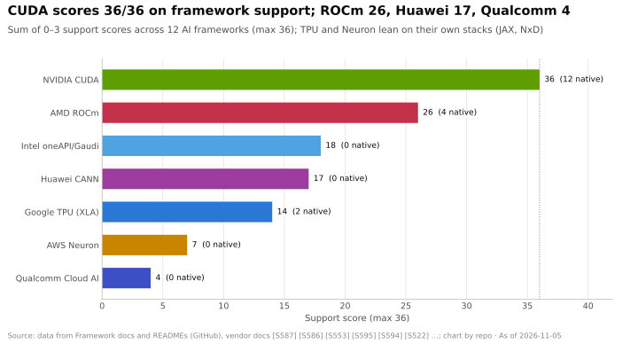
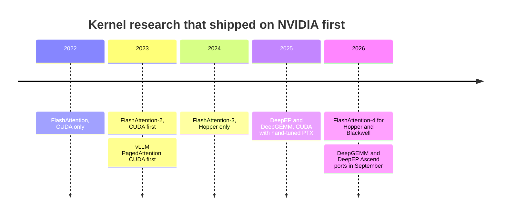
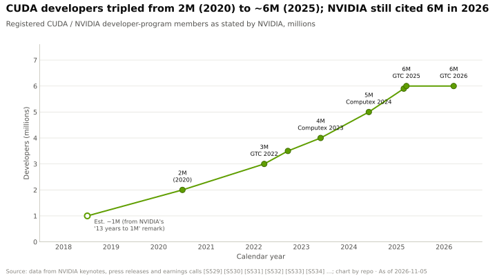

# Why the moat is the long tail

Layer 09 · CUDA and system software · ~10 min read · Last verified: 2026-11-05

## ⚡ The Executive Take

- **The moat is breadth.** CUDA is native in all 12 major AI frameworks and engines tracked here (36/36); ROCm scores 26, Huawei CANN 17, Google TPU 14 and Qualcomm Cloud AI 4 [[S587]](../../sources/bibliography.md#s587)[[S580]](../../sources/bibliography.md#s580)[[S582]](../../sources/bibliography.md#s582)[[S586]](../../sources/bibliography.md#s586)[[S596]](../../sources/bibliography.md#s596).
- **New models run on CUDA on day 0.** DeepSeek-V4-Pro (released 2026-04-24) ran natively on CUDA in vLLM and SGLang. On AMD MI355X, FP4 took 8 days and serving at 50 tokens/s per user took 27 [[S633]](../../sources/bibliography.md#s633)[[S631]](../../sources/bibliography.md#s631).
- **Rivals now catch up in weeks, not quarters.** AMD lifted MI355X throughput 110× in 26 days with 31 pull requests, yet B200 stayed ~5× ahead at equal interactivity [[S631]](../../sources/bibliography.md#s631).
- **Research lands on NVIDIA first.** FlashAttention 1–4 all launched on NVIDIA GPUs. FA4 targets Hopper and Blackwell and runs up to 2.7× faster than Triton on B200; AMD has FA2-class kernels and no FA4 [[S9000]](../../sources/bibliography.md#s9000)[[S9004]](../../sources/bibliography.md#s9004).
- **Porting is mostly tuning.** 🔴 Est.: one FlashAttention-class kernel needs ~1.8–5.5 engineer-years per new chip, plus yearly re-tuning.
- **Weakness:** NVIDIA's developer count has been flat at ~6M since GTC 2025 [[S536]](../../sources/bibliography.md#s536)[[S528]](../../sources/bibliography.md#s528), and the tail thins where budgets are large. AMD's MiniMax-M3 disaggregated serving landed on day 0; DeepSeek-R1 parity had taken months [[S627]](../../sources/bibliography.md#s627).

## 1. Thousands of kernels, and every model adds more

A model is a graph of hundreds of operators, and each operator × data type × shape × GPU generation is its own tuning problem. Every vendor covers the head (dense matmul, standard attention). The **long tail** is where rivals fall back to slow generic code: new attention variants, MoE routing, FP4 formats, KV-cache transfer and the packaging that makes it all installable. On DeepSeek-V4-Pro's day 0, AMD's ATOM engine ran nearly every hot path on fallbacks [[S633]](../../sources/bibliography.md#s633).

> [!TIP]
> **Worked example — why a small tail decides the race.** A challenger matches NVIDIA on matmuls that take 90% of runtime, but the other 10% falls back to kernels 10× slower. Runtime becomes 0.9 + 10 × 0.1 = **1.9×** NVIDIA's. **Conclusion:** buyers judge platforms on the slowest important kernel, and the tail decides which one that is.

Caveats: NVIDIA's own TensorRT-LLM silently corrupted V4-Pro outputs for over a week, so open engines carried CUDA's lead; Huawei had day-0 support because the model was partly co-designed for Ascend [[S633]](../../sources/bibliography.md#s633).

> [!TIP]
> **Worked example — what one model costs on a second platform.** AMD's sprint took **31 pull requests** from four primary contributors over **26 days**, lifting first light from 20.4 to 2,256 tokens/s per GPU (**110.5×**) [[S631]](../../sources/bibliography.md#s631). That is ~4 × 26 ÷ 365 ≈ **0.3 engineer-years** for one model on one chip, before merging upstream, and still ~5× behind B200. **Conclusion:** AMD can close most of the gap in weeks, but frontier models arrive every few weeks. The moat works as a *time tax* on every model, not a wall.

🔧 Under the hood: why the tail is so long

- **Fusion multiplies kernels.** Each fused combination (RoPE with Hadamard, norm with quantisation) is a new kernel; AMD's fork added half a dozen [[S631]](../../sources/bibliography.md#s631).
- **Systems code counts.** LMCache's CacheBlend relied on the CUDA-only FlashInfer, Mooncake had no ROCm wheel, and a batched-copy API that vLLM offload needs reached ROCm only in 7.14 [[S627]](../../sources/bibliography.md#s627).
- **Correctness bites.** AMD's FP8 encoding (e4m3fnuz) differs from NVIDIA's (e4m3fn) and corrupted MiniMax-M3's KV cache on day 0 until fixed [[S627]](../../sources/bibliography.md#s627).

## 2. New research lands on CUDA first

| Innovation | First platform | Elsewhere, Nov 2026 |
|---|---|---|
| [FlashAttention](../../glossary.md#flashattention)-2 (2023) | NVIDIA Ampere–Hopper [[S9000]](../../sources/bibliography.md#s9000) | AMD via Composable Kernel and Triton [[S9000]](../../sources/bibliography.md#s9000) |
| FlashAttention-3 (2024) | NVIDIA Hopper only [[S9003]](../../sources/bibliography.md#s9003) | FP8 interface only, via Triton on AMD [[S9000]](../../sources/bibliography.md#s9000) |
| FlashAttention-4 (2026) | NVIDIA Hopper and Blackwell; beta 4.0.0b38 in Nov 2026 [[S9006]](../../sources/bibliography.md#s9006) | None |
| PagedAttention / [vLLM](../../glossary.md#vllm) (2023) | CUDA [[S32011]](../../sources/bibliography.md#s32011) | ROCm native; TPU, Gaudi, Ascend plugins [[S580]](../../sources/bibliography.md#s580)[[S581]](../../sources/bibliography.md#s581) |
| DeepEP / DeepGEMM (2025) | CUDA with PTX tuning [[S5005]](../../sources/bibliography.md#s5005)[[S9010]](../../sources/bibliography.md#s9010) | Ascend versions, Sept 2026 [[S9009]](../../sources/bibliography.md#s9009)[[S9010]](../../sources/bibliography.md#s9010) |

> [!TIP]
> **Worked example — even NVIDIA waits for its tail.** B200 began volume shipments in Q4 2024 [[S33003]](../../sources/bibliography.md#s33003); FlashAttention-4's first beta appeared on 2026-03-05 [[S9006]](../../sources/bibliography.md#s9006). FA3 trailed H100 (shipping from Q4 2022) by ~20 months [[S33002]](../../sources/bibliography.md#s33002)[[S9003]](../../sources/bibliography.md#s9003). **Conclusion:** frontier kernels take ~15–20 months even on the home platform. A rival's version starts later, and FA3/FA4 have no AMD port at all.

## 3. Tooling, compatibility and habits

- **Tools:** Nsight Systems (whole-system timeline), Nsight Compute (one kernel against its limits), cuda-gdb and compute-sanitizer, now also from Python [[S9008]](../../sources/bibliography.md#s9008). AMD's rocprof and ROCgdb exist [[S586]](../../sources/bibliography.md#s586) but are less embedded in tutorials and CI.
- **Compatibility:** PTX keeps old code running on new GPUs ([What CUDA is](what-cuda-is.md)), and feature releases arrive roughly quarterly [[S523]](../../sources/bibliography.md#s523).
- **Habits:** NVIDIA spent a decade seeding universities; its Deep Learning Institute had trained >10,000 developers by 2017 [[S9027]](../../sources/bibliography.md#s9027). Benchmarks for AI-written kernels start on CUDA [[S9016]](../../sources/bibliography.md#s9016). 🔴 AI coding assistants trained on public code may *reinforce* CUDA first.

**[Q2 · Metrics that matter]**

1. **Day-0 coverage:** days from a major model's release to production serving. CUDA 0; ROCm 8–27 for DeepSeek-V4-Pro [[S633]](../../sources/bibliography.md#s633)[[S631]](../../sources/bibliography.md#s631).
2. **Kernel efficiency:** share of peak on critical kernels. FA3 75% on H100, FA4 71% on B200 [[S9003]](../../sources/bibliography.md#s9003)[[S9004]](../../sources/bibliography.md#s9004).
3. **Framework breadth:** CUDA 36/36 vs ROCm 26/36 (chart above).
4. **Gap at equal interactivity:** MI355X ~5× behind B200 on day 27 [[S631]](../../sources/bibliography.md#s631).
5. **Re-tune lag:** ~15–20 months from GPU volume shipments to a tuned frontier kernel.
6. **Developers and cadence:** ~6M developers [[S528]](../../sources/bibliography.md#s528); 3–4 feature releases a year for CUDA and ROCm alike [[S523]](../../sources/bibliography.md#s523)[[S586]](../../sources/bibliography.md#s586).

> [!TIP]
> **Worked example — reading the developer chart.** NVIDIA took 13 years to reach 1M developers and had 2M by 2020 [[S529]](../../sources/bibliography.md#s529), then tripled to ~6M by 2025 [[S536]](../../sources/bibliography.md#s536). It has quoted ~6M since [[S528]](../../sources/bibliography.md#s528). **Conclusion:** the headline funnel has stopped growing, possibly because new AI developers write PyTorch and never register for CUDA. 🔴

## 4. Worked example: porting one new attention kernel

> [!TIP]
> **Worked example — engineer-years and dollars to port the tail (Est., 🔴).** One FlashAttention-class kernel takes ~21–66 engineer-months, **~1.8–5.5 engineer-years**. NVIDIA's FY2026 R&D of $18.5B across ~31,000 R&D staff [[S401]](../../sources/bibliography.md#s401) implies **~$0.6M per R&D head-year**, an upper bound, so one kernel costs **~$1.1–3.3M** per platform. Across ~50 performance-critical kernel families (🔴) that is **~90–275 engineer-years, or ~$50–165M**, plus yearly re-tuning. AMD spent $6.5B on R&D in CY2024 [[S450]](../../sources/bibliography.md#s450). **Conclusion:** money is not the constraint. Time (15+ months per frontier kernel) and scarce kernel engineers are.

🔧 Under the hood: why tuning is most of the estimate

- A fast attention kernel balances tile sizes, register pressure, shared-memory staging and overlap of data movement with Tensor Core math, such as FA3's warp specialisation on Hopper [[S9003]](../../sources/bibliography.md#s9003).
- New hardware moves the optimum (Hopper's TMA, Blackwell's tensor memory), which is why FA2 dropped to 35% on H100 [[S9003]](../../sources/bibliography.md#s9003). Variants (grouped-query, latent and sparse attention, paged KV caches) each need fast paths [[S9000]](../../sources/bibliography.md#s9000)[[S631]](../../sources/bibliography.md#s631).

## 🎯 Corp Dev Lens

1. **Buy time, not code.** The moat is a time tax on every model and chip. Kernel autotuners, compiler teams and AI kernel agents are worth more to a challenger than any single library.
2. **Target the head.** A challenger focused on a few high-volume inference models can match CUDA where it matters and skip the tail. Which customers are concentrated enough for that?
3. **Watch the open engines.** vLLM and SGLang, not TensorRT-LLM, carried CUDA's day-0 lead on DeepSeek-V4, and their maintainers now run funded companies (Inferact, RadixArk) [[S633]](../../sources/bibliography.md#s633). They are natural partners for any hardware vendor.

## 📚 Sources

<!-- Auto-generated from the [S…] citations on this page by `make build`. Edit sources/registry/*.csv, not this list. -->

- [**S401**](../../sources/bibliography.md#s401) NVIDIA Corporation via SEC EDGAR, *NVIDIA Corporation Form 10-K for fiscal year ended January 25, 2026*, 2026-02-25. [Link](https://www.sec.gov/Archives/edgar/data/1045810/000104581026000021/nvda-20260125.htm)
- [**S450**](../../sources/bibliography.md#s450) U.S. Securities and Exchange Commission (EDGAR), *Advanced Micro Devices Form 10-K / 10-Q filings (EDGAR index)*, 2025-02-05. [Link](https://www.sec.gov/cgi-bin/browse-edgar?action=getcompany&CIK=0000002488&type=10-&dateb=&owner=include&count=40)
- [**S523**](../../sources/bibliography.md#s523) Python Package Index (NVIDIA), *nvidia-cuda-runtime (CUDA 13.x runtime wheels) release history*, 2026-11-04. [Link](https://pypi.org/project/nvidia-cuda-runtime/#history)
- [**S528**](../../sources/bibliography.md#s528) NVIDIA Developer Forums, *20 Years of CUDA: Honoring the Architects of the Accelerated Age*, 2026-03. [Link](https://forums.developer.nvidia.com/t/20-years-of-cuda-honoring-the-architects-of-the-accelerated-age/364654)
- [**S529**](../../sources/bibliography.md#s529) NVIDIA Blog (Will Ramey), *2 Million Registered Developers, Countless Breakthroughs*, 2020. [Link](https://blogs.nvidia.com/blog/2-million-registered-developers-breakthroughs/)
- [**S536**](../../sources/bibliography.md#s536) TechRadar, *Nvidia GTC 2025 — all the news and updates from Jensen Huang's keynote (live blog)*, 2025-03-18. [Link](https://www.techradar.com/pro/live/nvidia-gtc-2025-all-the-news-and-updates-from-jensen-huang-keynote-as-it-happens)
- [**S580**](../../sources/bibliography.md#s580) vLLM project (GitHub), *vLLM README and installation docs — supported hardware*, 2026-11. [Link](https://github.com/vllm-project/vllm/blob/main/docs/getting_started/installation/README.md)
- [**S581**](../../sources/bibliography.md#s581) vLLM project (GitHub), *vLLM hardware plugin repositories (tpu-inference/vLLM JAX, vllm-gaudi, vllm-ascend, vllm-neuron)*, 2026-11. [Link](https://github.com/vllm-project)
- [**S582**](../../sources/bibliography.md#s582) SGLang project (GitHub: sgl-project/sglang), *SGLang README — supported hardware*, 2026-11. [Link](https://github.com/sgl-project/sglang/blob/main/README.md)
- [**S586**](../../sources/bibliography.md#s586) AMD (GitHub: ROCm/ROCm docs), *ROCm documentation sources: release history, AI-ecosystem compatibility matrix, consolidated changelog*, 2026-08-26. [Link](https://github.com/ROCm/ROCm/blob/develop/docs/release/versions.rst)
- [**S587**](../../sources/bibliography.md#s587) PyTorch (GitHub: pytorch/pytorch), *PyTorch README — building with CUDA, ROCm and Intel GPU support*, 2026-11. [Link](https://github.com/pytorch/pytorch/blob/main/README.md)
- [**S596**](../../sources/bibliography.md#s596) Qualcomm (GitHub: quic), *Qualcomm Cloud AI SDK and Efficient Transformers repositories*, 2026-11. [Link](https://github.com/quic/cloud-ai-sdk)
- [**S627**](../../sources/bibliography.md#s627) SemiAnalysis, *AgentX - InferenceXv3: Does the CUDA Moat Hold Up in Agentic Inferencing?*, 2026-08-24. [Link](https://github.com/SemiAnalysisAI/InferenceX-app/blob/main/packages/app/content/blog/agentx-inferencexv3-does-cuda-moat.mdx)
- [**S631**](../../sources/bibliography.md#s631) SemiAnalysis, *MI355X DeepSeek-V4-Pro on SGLang: 110.5x Throughput per GPU in 26 Days*, 2026-05-26. [Link](https://github.com/SemiAnalysisAI/InferenceX-app/blob/main/packages/app/content/blog/mi355x-deepseek-v4-pro-sglang-110x-in-26-days.mdx)
- [**S633**](../../sources/bibliography.md#s633) SemiAnalysis, *DeepSeekV4 1.6T Day 0 to Day 43 Performance Over Time — Huawei, GB300 NVL72, MI355X, B200*, 2026-06-09. [Link](https://github.com/SemiAnalysisAI/InferenceX-app/blob/main/packages/app/content/blog/deepseekv4-16t-day-0-to-day-43-performance.mdx)
- [**S5005**](../../sources/bibliography.md#s5005) DeepSeek-AI (GitHub) (DeepSeek-AI), *DeepEP: an efficient expert-parallel communication library (README v1.2.1)*, 2025. [Link](https://github.com/deepseek-ai/DeepEP/blob/v1.2.1/README.md)
- [**S9000**](../../sources/bibliography.md#s9000) Dao-AILab (GitHub) (Tri Dao et al.), *FlashAttention repository README (FlashAttention-2, -3 and -4; NVIDIA CUDA and AMD ROCm support)*, 2026-11. [Link](https://github.com/Dao-AILab/flash-attention/blob/main/README.md)
- [**S9003**](../../sources/bibliography.md#s9003) arXiv:2407.08608 (NeurIPS 2024) (Jay Shah, Ganesh Bikshandi, Ying Zhang, Vijay Thakkar, Pradeep Ramani, Tri Dao), *FlashAttention-3: Fast and Accurate Attention with Asynchrony and Low-precision*, 2024-07-11. [Link](https://arxiv.org/abs/2407.08608)
- [**S9004**](../../sources/bibliography.md#s9004) arXiv:2603.05451 (Zadouri, Hoehnerbach, Shah, Liu, Thakkar, Dao), *FlashAttention-4: Algorithm and Kernel Pipelining Co-Design for Asymmetric Hardware Scaling*, 2026-03. [Link](https://arxiv.org/abs/2603.05451)
- [**S9006**](../../sources/bibliography.md#s9006) Python Package Index, *PyPI JSON release histories (flash-attn, flash-attn-4, triton, cuda-tile, cuda-python, modular, mojo, tilelang)*, 2026-11-05. [Link](https://pypi.org/)
- [**S9008**](../../sources/bibliography.md#s9008) NVIDIA (GitHub: NVIDIA/cuda-python), *CUDA Python README (cuda-python metapackage)*, 2026-11. [Link](https://github.com/NVIDIA/cuda-python/blob/main/README.md)
- [**S9009**](../../sources/bibliography.md#s9009) DeepSeek-AI (GitHub) (DeepSeek-AI), *DeepEP README (main branch: V2.5 and Ascend version)*, 2026-11. [Link](https://github.com/deepseek-ai/DeepEP/blob/main/README.md)
- [**S9010**](../../sources/bibliography.md#s9010) DeepSeek-AI (GitHub) (DeepSeek-AI), *DeepGEMM README*, 2026-09-30. [Link](https://github.com/deepseek-ai/DeepGEMM/blob/main/README.md)
- [**S9016**](../../sources/bibliography.md#s9016) Stanford Scaling Intelligence Lab (GitHub; arXiv:2502.10517) (Ouyang et al.), *KernelBench: Can LLMs Write Efficient GPU Kernels? (README; ICML 2025)*, 2025-02. [Link](https://github.com/ScalingIntelligence/KernelBench)
- [**S9027**](../../sources/bibliography.md#s9027) NVIDIA Newsroom, *NVIDIA to Train 100,000 Developers on Deep Learning in 2017*, 2017-05. [Link](https://nvidianews.nvidia.com/news/nvidia-to-train-100-000-developers-on-deep-learning-in-2017)
- [**S32011**](../../sources/bibliography.md#s32011) SOSP 2023 (arXiv 2309.06180) (Kwon et al.), *Efficient Memory Management for Large Language Model Serving with PagedAttention (vLLM)*, 2023-09. [Link](https://arxiv.org/abs/2309.06180)
- [**S33002**](../../sources/bibliography.md#s33002) NVIDIA, *NVIDIA H100 Tensor Core GPU (product page and datasheet)*, 2022-03-22. [Link](https://www.nvidia.com/en-us/data-center/h100/)
- [**S33003**](../../sources/bibliography.md#s33003) Lenovo Press, *ThinkSystem NVIDIA B200 180GB 1000W GPU product guide*, 2025. [Link](https://lenovopress.lenovo.com/lp2226-thinksystem-nvidia-b200-180gb-1000w-gpu)
