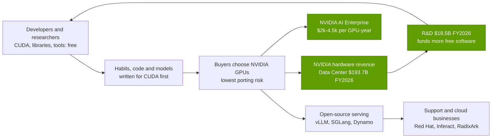

# CUDA and system software: Value chain and corp dev angles

Layer 09 · CUDA and system software · ~11 min read · Last verified: 2026-11-05

## ⚡ The Executive Take

- **[CUDA](../../glossary.md#cuda) is free, which is the point.** NVIDIA earns from it indirectly, through [hardware pull-through](../../glossary.md#pull-through): Data Center revenue was $193.7B in FY2026 [[S1]](../../sources/bibliography.md#s1)[[S402]](../../sources/bibliography.md#s402).
- **Direct software revenue is small.** Software and services reached a ~$1B annualised run-rate in Q4 FY2024 [[S9516]](../../sources/bibliography.md#s9516). NVIDIA AI Enterprise lists at $4,500 per GPU-year (or $1 per GPU-hour in the cloud), and Huang put software licensing at ~$2,000 per GPU-year in October 2026 [[S9515]](../../sources/bibliography.md#s9515)[[S9517]](../../sources/bibliography.md#s9517).
- **The software layer has become an M&A market.** Chip vendors made 15 AI-software deals from 2023 to 2026, against 3 tracked in 2008–2022. AMD alone bought Nod.ai, Silo AI ($665M), Brium, MK1 and the Untether AI team [[S9508]](../../sources/bibliography.md#s9508)[[S9506]](../../sources/bibliography.md#s9506)[[S9507]](../../sources/bibliography.md#s9507)[[S9509]](../../sources/bibliography.md#s9509).
- **Prices are rising fast.** Qualcomm's ~$3.9B for Modular is ~5.6× NVIDIA's largest software tuck-in (Run:ai, ~$700M reported) and ~2.4× Modular's September 2025 valuation [[S90057]](../../sources/bibliography.md#s90057)[[S479]](../../sources/bibliography.md#s479)[[S9510]](../../sources/bibliography.md#s9510).
- **The independent bench is thin.** NVIDIA bought OctoAI, Deci and CentML; Red Hat bought Neural Magic. What remains is mostly open-source maintainers ([vLLM](../../glossary.md#vllm)'s Inferact, [SGLang](../../glossary.md#sglang)'s RadixArk) and early compiler start-ups [[S478]](../../sources/bibliography.md#s478)[[S9533]](../../sources/bibliography.md#s9533)[[S633]](../../sources/bibliography.md#s633).
- **[Q8 · Value pools & M&A angles]** Value collects around NVIDIA hardware, not the software. For a challenger, software is a *cost of entry*: the assets worth owning shorten the [day-0](../../glossary.md#day-zero-support) gap (compiler teams, kernel libraries, upstream maintainer influence) rather than generate licence revenue 🔴.

## Who captures the dollars

Figures: [[S1]](../../sources/bibliography.md#s1)[[S401]](../../sources/bibliography.md#s401)[[S9515]](../../sources/bibliography.md#s9515)[[S9517]](../../sources/bibliography.md#s9517); open-source companies [[S9533]](../../sources/bibliography.md#s9533)[[S633]](../../sources/bibliography.md#s633).

| Value pool | Who captures it | Size marker | Trend |
|---|---|---|---|
| Hardware pull-through | NVIDIA | Data Center $193.7B, FY2026 [[S1]](../../sources/bibliography.md#s1) | 🟢 growing; at risk where portable layers make GPUs swappable |
| Enterprise software licences | NVIDIA (AI Enterprise) | ~$1B run-rate in Q4 FY2024 [[S9516]](../../sources/bibliography.md#s9516); $2,000–4,500 per GPU-year [[S9517]](../../sources/bibliography.md#s9517)[[S9515]](../../sources/bibliography.md#s9515) | 🟡 small, attached to enterprise and sovereign buyers |
| Open-source serving support | Red Hat (Neural Magic), Inferact, RadixArk | maintainers raising "hundreds of millions" [[S633]](../../sources/bibliography.md#s633) | 🟡 new pool created by vendor-neutral engines |
| Compiler and language platforms | Modular → Qualcomm; Triton (non-commercial) | ~$3.9B purchase price [[S90057]](../../sources/bibliography.md#s90057) | 🔴 valued as strategic assets, not revenue |
| Hyperscaler internal stacks | Google, AWS, Huawei | no direct revenue; lower chip TCO | 🟢 open-sourced in 2025–2026 [[S553]](../../sources/bibliography.md#s553)[[S9525]](../../sources/bibliography.md#s9525)[[S9524]](../../sources/bibliography.md#s9524) |
| GPU cloud marketplaces | NVIDIA DGX Cloud Lepton, neoclouds | marketplace launched May 2025 [[S598]](../../sources/bibliography.md#s598) | 🟡 keeps developers on NVIDIA-first clouds |

> [!TIP]
> **Worked example — why NVIDIA does not need to charge for CUDA.** At Huang's ~$2,000 per GPU-year, 1 million licensed GPUs would bring ~$2B a year [[S9517]](../../sources/bibliography.md#s9517). That is ~1% of FY2026 Data Center revenue ($193.7B) [[S1]](../../sources/bibliography.md#s1). Per GPU, list-price AI Enterprise ($4,500) equals ~30% of a B200's ~$15,155 yearly owner cost [[S9515]](../../sources/bibliography.md#s9515)[[S622]](../../sources/bibliography.md#s622). Charging that broadly would invite customers to compare stacks, while hardware already earns ~100× what such a licence would.

🔧 Under the hood: what AI Enterprise actually sells

The licence bundles supported, security-patched builds of NVIDIA's AI software with enterprise support, priced per GPU [[S9515]](../../sources/bibliography.md#s9515). CUDA, cuDNN and the open-source projects (Dynamo, TensorRT-LLM, Megatron) stay free to download. Enterprises pay for the *support and certification*, as they do with Red Hat Linux, not for the code. So the buyers are likely enterprises and sovereign projects rather than hyperscalers, who support themselves 🔴.

## M&A history in the software layer

![Dot timeline of AI-software acquisitions, one row per deal. NVIDIA: Ageia (2008), PGI (2013), Bright Computing (2022), then OmniML, Run:ai (~$700M), Deci (~$300M), Brev.dev, OctoAI (~$250M), Gretel, Lepton AI, CentML (~$400M) and SchedMD from 2023 to 2025. AMD: Nod.ai (2023), Silo AI ($665M, 2024), Brium, the Untether AI team and MK1 (2025). Qualcomm: Modular (~$3.9B, announced June 2026, closed July 2026). Red Hat: Neural Magic (2024). 15 chip-vendor software deals since 2023 versus 3 in the prior 15 years tracked here.](../../assets/charts/09-software-deals-timeline.svg)

The three acquirers follow different playbooks:

- **NVIDIA buys friction-removers:** tools that make its GPUs easier to schedule (Run:ai, SchedMD), optimise for (Deci, OctoAI, CentML) or rent (Brev.dev, Lepton); Run:ai was open-sourced after EU review [[S476]](../../sources/bibliography.md#s476)[[S478]](../../sources/bibliography.md#s478).
- **AMD buys catch-up:** compiler and inference teams (Nod.ai, Brium, MK1) and Silo AI ($665M), a lab that built open models on AMD [[S9508]](../../sources/bibliography.md#s9508)[[S9507]](../../sources/bibliography.md#s9507)[[S9509]](../../sources/bibliography.md#s9509)[[S9506]](../../sources/bibliography.md#s9506).
- **Qualcomm made one large bet:** a language ([Mojo](../../glossary.md#mojo)), an inference framework (MAX) and founder Chris Lattner, now a Qualcomm EVP [[S9511]](../../sources/bibliography.md#s9511).

> [!TIP]
> **Worked example — the price of a software team.** Silo AI cost AMD $665M [[S9506]](../../sources/bibliography.md#s9506); Modular cost Qualcomm ~$3.9B, or ~10× the $380M it had raised [[S90057]](../../sources/bibliography.md#s90057)[[S9510]](../../sources/bibliography.md#s9510). NVIDIA's comparable tuck-ins were reported at $250–700M each [[S479]](../../sources/bibliography.md#s479). The Modular premium buys a language and runtime, not just engineers; whether that is worth ~5.6× Run:ai depends on adoption, still small ([competition](competition.md)).

### Private companies worth knowing (public information only)

| Company | What it does | Stage / last public funding | Why it matters |
|---|---|---|---|
| Tenstorrent | RISC-V AI chips with an open-source stack (TT-Metalium, TT-NN) | $693M Series D (Dec 2024) [[S2509]](../../sources/bibliography.md#s2509); ~$1.5B Series E at ~$6.2B reported 🟡 [[S4535]](../../sources/bibliography.md#s4535) | Tests whether open-source kernels can recruit outside developers [[S9535]](../../sources/bibliography.md#s9535) |
| Inferact (vLLM) | Company formed by vLLM maintainers | raised "hundreds of millions" 🟡 [[S633]](../../sources/bibliography.md#s633) | Controls the most-used neutral serving engine [[S580]](../../sources/bibliography.md#s580) |
| RadixArk (SGLang) | Company formed by SGLang maintainers | raised "hundreds of millions" 🟡 [[S633]](../../sources/bibliography.md#s633) | Second neutral engine; strong on large MoE models [[S582]](../../sources/bibliography.md#s582) |
| Luminal | ML compiler for faster PyTorch inference | $5.3M seed (Nov 2025) 🟡 [[S9534]](../../sources/bibliography.md#s9534) | Seed-stage compiler team targeting PyTorch users |
| tiny corp (tinygrad) | Minimal end-to-end deep-learning stack and compiler | funding not verified | Shows a full stack written by a very small team [[S9536]](../../sources/bibliography.md#s9536) |
| Groq (post-licence) | Inference chips and compiler; core team joined NVIDIA | ~$6.9B valuation (Sep 2025) before NVIDIA's ~$20B licence 🟡 [[S90019]](../../sources/bibliography.md#s90019) | A compiler-first design NVIDIA chose to license [[S90018]](../../sources/bibliography.md#s90018) |

**[Q8 · Value pools & M&A angles]** In this layer, money flows to whoever owns the *default*: NVIDIA, through hardware pull-through. For everyone else, software is a capability to acquire (often as an [acquihire](../../glossary.md#acquihire)), not a profit pool. Its value is measured in days of day-0 lag removed and frameworks supported. The supply of independent teams is shrinking: since 2023, at least nine inference-optimisation and compiler teams have gone to NVIDIA, AMD, Red Hat or Qualcomm [[S478]](../../sources/bibliography.md#s478)[[S9508]](../../sources/bibliography.md#s9508)[[S9507]](../../sources/bibliography.md#s9507)[[S9509]](../../sources/bibliography.md#s9509)[[S9533]](../../sources/bibliography.md#s9533)[[S9511]](../../sources/bibliography.md#s9511). The remaining independent assets are maintainer companies and small compiler start-ups. Collaboration with them (upstream funding, joint CI, co-maintenance) may matter more than control 🔴.

## 🎯 Corp Dev Lens

1. **Build, buy or partner?** After Modular, what gap remains: day-0 model support, framework breadth, or developer reach? Which of the three can still be bought rather than built?
2. **Neutral engines.** Would a stake or sponsorship in Inferact or RadixArk buy early support for new silicon more cheaply than an in-house fork such as AMD's ATOM? And would it alarm the other hardware vendors those projects serve?
3. **Monetisation.** Should a challenger give its stack away entirely (CUDA's model) or charge per accelerator, as NVIDIA AI Enterprise does at $2,000–4,500 per GPU-year?
4. **Talent retention.** AMD's catch-up deals were mostly compiler teams; what retention structures keep them after integration?
5. **Regulatory option value.** If antitrust remedies forced CUDA interoperability, which assets (translation layers, compilers, benchmarks) would gain most value?

## 📚 Sources

<!-- Auto-generated from the [S…] citations on this page by `make build`. Edit sources/registry/*.csv, not this list. -->

- [**S1**](../../sources/bibliography.md#s1) NVIDIA Corporation via SEC EDGAR, *NVIDIA Announces Financial Results for Fourth Quarter and Fiscal 2026 (Form 8-K exhibit 99.1)*, 2026-02-25. [Link](https://www.sec.gov/Archives/edgar/data/1045810/000104581026000019/q4fy26pr.htm)
- [**S401**](../../sources/bibliography.md#s401) NVIDIA Corporation via SEC EDGAR, *NVIDIA Corporation Form 10-K for fiscal year ended January 25, 2026*, 2026-02-25. [Link](https://www.sec.gov/Archives/edgar/data/1045810/000104581026000021/nvda-20260125.htm)
- [**S402**](../../sources/bibliography.md#s402) NVIDIA Corporation via SEC EDGAR (Colette Kress), *CFO Commentary on Fourth Quarter and Fiscal 2026 Results (Form 8-K exhibit 99.2)*, 2026-02-25. [Link](https://www.sec.gov/Archives/edgar/data/1045810/000104581026000019/q4fy26cfocommentary.htm)
- [**S476**](../../sources/bibliography.md#s476) NVIDIA Blog, *NVIDIA to Acquire GPU Orchestration Software Provider Run:ai*, 2024-04-24. [Link](https://blogs.nvidia.com/blog/runai/)
- [**S478**](../../sources/bibliography.md#s478) NVIDIA, *NVIDIA Blog and Newsroom acquisition announcements (Cumulus, SwiftStack, DeepMap, Bright Computing, Excelero, Shoreline, Brev.dev, OctoAI, VinBrain, Gretel, Lepton AI, CentML, SchedMD)*, 2025-12. [Link](https://blogs.nvidia.com/)
- [**S479**](../../sources/bibliography.md#s479) Various (press), *Reporting on NVIDIA tuck-in acquisition prices (Run:ai, Deci, Shoreline, OctoAI, Gretel, Lepton, CentML) — The Information, Calcalist, Reuters, CNBC*, 2025-06. [Link](https://www.reuters.com/technology/)
- [**S553**](../../sources/bibliography.md#s553) Google Cloud Blog (Alex Barrett), *What's new in AI infrastructure and orchestration in October*, 2026-11. [Link](https://cloud.google.com/blog/topics/ai-infrastructure/whats-new-in-ai-infrastructure-this-month)
- [**S580**](../../sources/bibliography.md#s580) vLLM project (GitHub), *vLLM README and installation docs — supported hardware*, 2026-11. [Link](https://github.com/vllm-project/vllm/blob/main/docs/getting_started/installation/README.md)
- [**S582**](../../sources/bibliography.md#s582) SGLang project (GitHub: sgl-project/sglang), *SGLang README — supported hardware*, 2026-11. [Link](https://github.com/sgl-project/sglang/blob/main/README.md)
- [**S598**](../../sources/bibliography.md#s598) NVIDIA Newsroom, *NVIDIA Announces DGX Cloud Lepton to Connect Developers to NVIDIA's Global Compute Ecosystem*, 2025-05-18. [Link](https://nvidianews.nvidia.com/news/nvidia-announces-dgx-cloud-lepton-to-connect-developers-to-nvidias-global-compute-ecosystem)
- [**S622**](../../sources/bibliography.md#s622) SemiAnalysis (InferenceX-app repository), *InferenceX hardware registry: TCO per GPU-hour by SKU (SemiAnalysis July 2026 pricing surveys and AI Cloud TCO Model)*, 2026-07. [Link](https://github.com/SemiAnalysisAI/InferenceX-app/blob/main/packages/constants/src/gpu-keys.ts)
- [**S633**](../../sources/bibliography.md#s633) SemiAnalysis, *DeepSeekV4 1.6T Day 0 to Day 43 Performance Over Time — Huawei, GB300 NVL72, MI355X, B200*, 2026-06-09. [Link](https://github.com/SemiAnalysisAI/InferenceX-app/blob/main/packages/app/content/blog/deepseekv4-16t-day-0-to-day-43-performance.mdx)
- [**S2509**](../../sources/bibliography.md#s2509) TechPowerUp, *Tenstorrent closes $693M+ of Series D funding led by Samsung Securities and AFW Partners*, 2024-12-02. [Link](https://techpowerup.com/329396/tenstorrent-closes-usd-693m-of-series-d-funding-led-by-samsung-securities-and-afw-partners)
- [**S4535**](../../sources/bibliography.md#s4535) GCN, *Tenstorrent raises $1.5 billion to challenge Nvidia on AI chips*, 2026. [Link](https://gcn.com/?p=22745)
- [**S9506**](../../sources/bibliography.md#s9506) Converge Digest, *AMD completes $665 million acquisition of Silo AI*, 2024-08. [Link](https://convergedigest.com/amd-completes-665-million-acquisition-of-silo-ai/?amp=1)
- [**S9507**](../../sources/bibliography.md#s9507) DatacenterDynamics, *AMD extends acquisition run: brings software optimization firm Brium and staff from recently shuttered Untether AI into the fold*, 2025-06. [Link](https://www.datacenterdynamics.com/en/news/amd-extends-acquisition-run-brings-software-optimization-firm-brium-and-staff-from-recently-shuttered-untether-ai-into-the-fold/)
- [**S9508**](../../sources/bibliography.md#s9508) PrivSource (deal record of AMD press release), *AMD to Acquire Nod.ai to Expand Open-Source AI Software Capabilities*, 2023-10. [Link](https://www.privsource.com/acquisitions/deal/amd-to-acquire-nod-ai-to-expand-open-source-ai-software-capabilities-bWSr8y)
- [**S9509**](../../sources/bibliography.md#s9509) PrivSource (deal record), *AMD Acquires MK1*, 2025-11. [Link](https://www.privsource.com/acquisitions/deal/y3S4jb)
- [**S9510**](../../sources/bibliography.md#s9510) SDxCentral, *Modular raises $250M for AI's unified compute layer at $1.6B valuation*, 2025-09-24. [Link](https://www.sdxcentral.com/news/modular-raises-250m-for-ais-unified-compute-layer-at-16b-valuation/)
- [**S9511**](../../sources/bibliography.md#s9511) Nasdaq (Qualcomm press release), *Qualcomm Completes Acquisition of Modular*, 2026-07-29. [Link](https://www.nasdaq.com/press-release/qualcomm-completes-acquisition-modular-2026-07-29)
- [**S9515**](../../sources/bibliography.md#s9515) The Register (Tobias Mann), *Nvidia's software empire (NVIDIA AI Enterprise licensing)*, 2024-08-06. [Link](https://www.theregister.com/2024/08/06/nvidia_software_empire/)
- [**S9516**](../../sources/bibliography.md#s9516) MarketBeat, *NVIDIA Q4 FY2024 earnings call transcript*, 2024-02-21. [Link](https://www.marketbeat.com/earnings/reports/2024-2-21-nvidia-co-stock)
- [**S9517**](../../sources/bibliography.md#s9517) TechSpot, *Nvidia's AI chips already make billions; now Jensen Huang wants $2,000 per GPU in annual software fees*, 2026-10. [Link](https://www.techspot.com/news/114333-nvidia-ai-chips-already-make-billions-now-jensen.html)
- [**S9524**](../../sources/bibliography.md#s9524) TrendForce, *Huawei open-sources CANN toolkit for Ascend AI GPUs; taking aim at Nvidia's CUDA*, 2025-08-07. [Link](https://www.trendforce.com/news/2025/08/07/news-huawei-open-sources-cann-toolkit-for-ascend-ai-gpus-taking-aim-at-nvidias-cuda/)
- [**S9525**](../../sources/bibliography.md#s9525) AWS Neuron SDK docs, *AWS Neuron documentation: PyTorch on Neuron (TorchNeuron) and NKI*, 2026. [Link](https://awsdocs-neuron.readthedocs-hosted.com/en/latest/_sources/torch/index.rst)
- [**S9533**](../../sources/bibliography.md#s9533) Red Hat Blog, *FAQ: Red Hat to acquire Neural Magic*, 2024-11-12. [Link](https://www.redhat.com/en/blog/red-hat-acquire-neural-magic-FAQ)
- [**S9534**](../../sources/bibliography.md#s9534) Pulse (venture deals), *Luminal secures $5.3M seed round led by Felicis*, 2025-11-20. [Link](https://www.pulse.bot/venture-capital/deals/luminal-secures-53m-seed-round-led-by-felicis-78d26e9e-5e3c-454a-b29c-ee001f227446)
- [**S9535**](../../sources/bibliography.md#s9535) Tenstorrent (GitHub), *tt-metal README and Apache-2.0 licence (TT-NN / TT-Metalium)*, 2026-11. [Link](https://github.com/tenstorrent/tt-metal)
- [**S9536**](../../sources/bibliography.md#s9536) tiny corp (GitHub: tinygrad/tinygrad), *tinygrad README*, 2026-11. [Link](https://github.com/tinygrad/tinygrad)
- [**S90018**](../../sources/bibliography.md#s90018) Constellation Research, *Nvidia's Groq deal: acquisition, acquihire or creative licensing deal?*, 2025-12. [Link](https://www.constellationr.com/insights/news/nvidias-groq-deal-acquisition-acquihire-or-creative-licensing-deal)
- [**S90019**](../../sources/bibliography.md#s90019) TechSpot, *Nvidia's $20 billion Groq deal looks a lot like an acquisition*, 2025-12. [Link](https://www.techspot.com/news/110723-nvidia-20-billion-groq-deal-looks-lot-like.html)
- [**S90057**](../../sources/bibliography.md#s90057) StorageReview, *Qualcomm unveils Dragonfly data center roadmap: C1000 CPU, AI300 accelerator and Modular acquisition*, 2026-06-24. [Link](https://www.storagereview.com/es/news/qualcomm-unveils-dragonfly-data-center-roadmap-c1000-cpu-ai300-accelerator-and-modular-acquisition)
