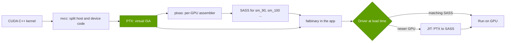
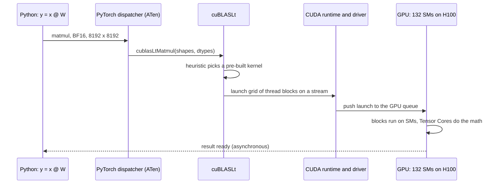

# What CUDA actually is

Layer 09 · CUDA and system software · ~9 min read · Last verified: 2026-11-05

## ⚡ The Executive Take

- **[CUDA](../../glossary.md#cuda) is a stack, not a language:** programming model, C++ extensions, the [nvcc](../../glossary.md#nvcc) compiler, the [PTX](../../glossary.md#ptx) virtual instruction set, runtime, driver, tools and libraries. The first toolkit shipped in June 2007 [[S525]](../../sources/bibliography.md#s525).
- **The core idea:** a [kernel](../../glossary.md#gpu-kernel) is one recipe that thousands of cooks run at once, each on its own ingredient. An H100 keeps ~270,000 such threads resident across 132 [SMs](../../glossary.md#streaming-multiprocessor) [[S33024]](../../sources/bibliography.md#s33024)[[S2022]](../../sources/bibliography.md#s2022).
- **PTX is the compatibility engine.** Apps ship PTX next to machine code ([SASS](../../glossary.md#sass)) so a newer driver can compile it for GPUs that did not yet exist. Code built for `sm_90a`/`sm_100a` Tensor Core features is the exception [[S9025]](../../sources/bibliography.md#s9025).
- **Compatibility is not performance.** FlashAttention-2 used up to 73% of an A100's peak but 35% of an H100's until FA3 reached 75% [[S9002]](../../sources/bibliography.md#s9002)[[S9003]](../../sources/bibliography.md#s9003).
- **CUDA 13.x:** 13.0 shipped in August 2025 and 13.5 on 2026-11-04 [[S523]](../../sources/bibliography.md#s523). It drops Maxwell, Pascal and Volta [[S90065]](../../sources/bibliography.md#s90065), and 13.1 added the tile-based cuTile language [[S9007]](../../sources/bibliography.md#s9007).
- **NVIDIA is moving CUDA into Python** (CUDA Python, cuTile, CuTe DSL) [[S9008]](../../sources/bibliography.md#s9008)[[S9030]](../../sources/bibliography.md#s9030), the layer where Triton and Mojo compete ([Erosion vectors](erosion-vectors.md)).

![Layered diagram of the CUDA software stack from top to bottom: frameworks and serving engines (PyTorch, JAX, vLLM, SGLang, TensorRT-LLM, Dynamo); kernel languages (CUDA C++, CUTLASS/CuTe DSL, cuTile, Triton, plus third-party kernels such as FlashAttention and DeepGEMM); CUDA-X libraries (cuBLAS, cuDNN, NCCL, TensorRT); the CUDA runtime and driver APIs; the compiler toolchain (nvcc to PTX to SASS in a fatbinary); the kernel-mode driver and firmware; and GPU hardware. Side panels list developer tools (Nsight, cuda-gdb), the PTX forward-compatibility promise and its sm_90a/sm_100a exception, and where rivals plug in (ROCm HIP, JAX/XLA on TPU, AWS Neuron, Triton/Mojo/TileLang).](../../assets/diagrams/09-cuda-software-stack.svg)

## 1. The kernel analogy: one recipe, a huge kitchen

A CPU is one chef cooking a million omelettes in turn. A GPU hands the same recipe, the **kernel**, to tens of thousands of cooks with one egg each. The cooks are organised in four levels:

- **Thread:** one cook, one data element.
- **[Warp](../../glossary.md#warp):** 32 cooks doing the same step in lockstep. If some take a different branch, the rest wait.
- **[Thread block](../../glossary.md#thread-block):** up to 1,024 cooks sharing a counter ([shared memory](../../glossary.md#shared-memory)) and able to synchronise [[S2022]](../../sources/bibliography.md#s2022).
- **[Grid](../../glossary.md#cuda-grid):** all the blocks of one launch. The hardware deals them to SMs as they free up, so the same code scales from a laptop GPU to a B200.

The syntax is small (`__global__` functions launched with `<<<blocks, threads>>>`); the hard part is everything around it.

> [!TIP]
> **Worked example — adding two billion-element vectors on an H100.** One thread per element in blocks of 256 gives ~3.9 million blocks. At up to 2,048 resident threads on each of 132 SMs [[S33024]](../../sources/bibliography.md#s33024)[[S2022]](../../sources/bibliography.md#s2022), they flow through in ~3,700 waves. The data is 12 bytes per element, 12 GB in all, which takes **~3.6 ms** at 3.35 TB/s of HBM bandwidth [[S33002]](../../sources/bibliography.md#s33002). **Conclusion:** even trivial kernels are limited by memory, not math, so tuning beats syntax.

**[Q1 · Job & failure mode]** This layer turns model math into instructions that keep Tensor Cores and HBM busy, on every GPU generation, from the day a model or chip appears. When it is weak, peak goes unused: FlashAttention-2 left 65% of H100's attention peak on the table [[S9003]](../../sources/bibliography.md#s9003). New models also stall: DeepSeek-V4-Pro ran at 1–2 tokens/s per user on AMD's day-0 stack [[S633]](../../sources/bibliography.md#s633).

## 2. Compiler, PTX, SASS, runtime and driver

**nvcc** compiles GPU code to **PTX**, a recipe in a universal kitchen language. **ptxas** translates it into **SASS** for one GPU family, and apps ship a [fatbinary](../../glossary.md#fatbinary) holding both. The **runtime** handles memory, [streams](../../glossary.md#cuda-stream), [CUDA Graphs](../../glossary.md#cuda-graphs) and launches. The **driver** loads code, [JIT-compiles](../../glossary.md#jit-compilation) PTX for new GPUs and schedules work.

| Layer | NVIDIA | AMD ROCm equivalent |
|---|---|---|
| Language | CUDA C++, CuTe DSL, cuTile [[S9030]](../../sources/bibliography.md#s9030)[[S9007]](../../sources/bibliography.md#s9007) | [HIP](../../glossary.md#hip), near-identical syntax [[S586]](../../sources/bibliography.md#s586) |
| Compiler | nvcc → PTX → ptxas → SASS | hipcc / LLVM → per-target code (gfx942, gfx950) [[S586]](../../sources/bibliography.md#s586) |
| Stable virtual ISA | PTX, except `a` targets [[S9025]](../../sources/bibliography.md#s9025) | No direct equivalent; code is built per GPU target |
| Tuned kernels | cuBLAS, cuDNN, CUTLASS, NCCL | hipBLASLt, Composable Kernel, AITER, RCCL [[S9000]](../../sources/bibliography.md#s9000)[[S586]](../../sources/bibliography.md#s586) |
| Tools | Nsight Systems/Compute, cuda-gdb | rocprof, ROCgdb [[S586]](../../sources/bibliography.md#s586) |

> [!TIP]
> **Worked example — what PTX buys a customer.** A model server compiled in 2023 for H100 (SASS for `sm_90` plus PTX) still loads on a B200: the driver JIT-compiles the PTX [[S2022]](../../sources/bibliography.md#s2022). It runs correctly but cannot use Blackwell's new Tensor Core instructions, which need `sm_100a` code [[S9025]](../../sources/bibliography.md#s9025). **Conclusion:** PTX protects the installed base of *code* and lowers the risk of moving to the next NVIDIA GPU. Peak speed still needs re-tuned kernels.

🔧 Under the hood: going below CUDA

- Since Hopper, a few Tensor Core features exist only on one architecture (`sm_90a`, `sm_100a`). CUDA 12.9 added family targets (`sm_100f`) that carry forward within a family [[S9025]](../../sources/bibliography.md#s9025).
- DeepSeek's DeepEP reads volatile data with an undocumented-behaviour PTX load, tested on Hopper, with a switch to disable it elsewhere [[S5005]](../../sources/bibliography.md#s5005). DeepGEMM interleaved FFMA instructions in SASS until nvcc 12.9 did it automatically [[S9010]](../../sources/bibliography.md#s9010).
- The deeper the optimisation, the tighter the tie to one NVIDIA generation.

## 3. Worked example: how `torch.matmul` becomes a kernel launch

In eager mode, PyTorch calls [cuBLAS](../../glossary.md#cublas)/cuBLASLt, whose heuristic picks one of many pre-compiled kernels that differ in tile shape and pipeline depth. Under [torch.compile](../../glossary.md#torch-compile), [TorchInductor](../../glossary.md#torchinductor) may still call cuBLAS for the matmul but generates fused [Triton](../../glossary.md#triton) kernels around it [[S9021]](../../sources/bibliography.md#s9021). Those kernels compile through LLVM to PTX and SASS.

> [!TIP]
> **Worked example — one 8,192³ BF16 matmul on an H100.** The work is 2 × 8,192³ ≈ **1.1 × 10¹² FLOPs**: 1.1 ms at 989 dense BF16 TFLOPS [[S33002]](../../sources/bibliography.md#s33002), ~1.5 ms at a realistic 75%. With 128 × 256 output tiles the grid has **2,048 blocks**, or 15.5 waves over 132 SMs [[S33024]](../../sources/bibliography.md#s33024). The last wave runs half-empty and costs ~3%; 128 × 128 tiles give 31.0 waves and no tail. **Conclusion:** the best kernel depends on shape × data type × GPU, which is why [CUTLASS](../../glossary.md#cutlass) and cuBLAS carry so many variants, and why a rival must match the whole catalogue.

🔧 Under the hood: who picks the kernel

- cuBLASLt ranks candidates per call; apps can benchmark once and cache the winner ([autotuning](../../glossary.md#autotuning)).
- TorchInductor emits Triton on GPUs and C++ on CPUs [[S9021]](../../sources/bibliography.md#s9021). CUTLASS 4.8.1 exposes NVIDIA's building blocks in Python as CuTe DSL, and FlashAttention-4 is written in it [[S9030]](../../sources/bibliography.md#s9030)[[S9000]](../../sources/bibliography.md#s9000).

## 4. CUDA 13.x and the turn to Python

**[Q3 · Generational progress]** Progress comes in two forms. Releases add hardware support and programming models: 13 majors in 18 years, with 13.x minors roughly quarterly [[S525]](../../sources/bibliography.md#s525)[[S523]](../../sources/bibliography.md#s523). Kernel rewrites then win back peak performance on each new GPU.

- **13.0 → 13.5:** wheels appeared on 2025-08-04 (13.0), 2025-12-05 (13.1), 2026-05-26 (13.3), 2026-09-09 (13.4) and 2026-11-04 (13.5) [[S523]](../../sources/bibliography.md#s523). NVIDIA dates 13.2 to 2026-03-05 [[S527]](../../sources/bibliography.md#s527); a secondary source's "stable in May 2026" conflicts [[S90065]](../../sources/bibliography.md#s90065).
- **Pruning:** CUDA 13 drops Maxwell, Pascal and Volta as build targets [[S90065]](../../sources/bibliography.md#s90065), so backward compatibility has roughly a decade's horizon.
- **CUDA Tile / cuTile:** developers program blocks of data and the compiler maps them to threads and Tensor Cores, Triton's level of abstraction. cuTile 1.0 shipped 2025-12-04 and 1.8 on 2026-11-04 [[S9006]](../../sources/bibliography.md#s9006); Hopper support is still to come [[S9007]](../../sources/bibliography.md#s9007).
- **CUDA Python** bundles `cuda.core`, `cuda.bindings`, `cuda.tile`, `numba-cuda` and Nsight Python [[S9008]](../../sources/bibliography.md#s9008).

> [!TIP]
> **Worked example — splitting a 4.7× speed-up into hardware and software.** FlashAttention-2 on H100 ran at ~35% of 989 TFLOPS, ≈ **346 TFLOPS** [[S9003]](../../sources/bibliography.md#s9003)[[S33002]](../../sources/bibliography.md#s33002); FlashAttention-4 on B200 reaches **1,613 TFLOPS** [[S9004]](../../sources/bibliography.md#s9004), **4.7×** more. Peak hardware rose 2,250 ÷ 989 = **2.3×** [[S33003]](../../sources/bibliography.md#s33003); the other **~2.0×** (71% ÷ 35%) came from rewritten kernels. **Conclusion:** about half of a generational gain depends on software, which arrives on NVIDIA first.

## 🎯 Corp Dev Lens

1. **Where is the control point?** Not the syntax, which [HIP](../../glossary.md#hip) copies, but PTX compatibility, the tuned-kernel catalogue and the driver. Which can a challenger license, rebuild or make irrelevant?
2. **Python is the new front door.** If cuTile and CuTe DSL win mindshare [[S9007]](../../sources/bibliography.md#s9007)[[S9030]](../../sources/bibliography.md#s9030), portable DSLs lose their reason to exist on NVIDIA hardware.
3. **Qualcomm question (public information only):** with Modular's compiler stack in-house [[S9511]](../../sources/bibliography.md#s9511), which layers of the diagram must be owned and which can be borrowed from open source (Triton, vLLM, PyTorch)?

## 📚 Sources

<!-- Auto-generated from the [S…] citations on this page by `make build`. Edit sources/registry/*.csv, not this list. -->

- [**S523**](../../sources/bibliography.md#s523) Python Package Index (NVIDIA), *nvidia-cuda-runtime (CUDA 13.x runtime wheels) release history*, 2026-11-04. [Link](https://pypi.org/project/nvidia-cuda-runtime/#history)
- [**S525**](../../sources/bibliography.md#s525) NVIDIA Developer, *CUDA Toolkit Archive*, 2026. [Link](https://developer.nvidia.com/cuda-toolkit-archive)
- [**S527**](../../sources/bibliography.md#s527) NVIDIA Docs, *CUDA Toolkit 13.2 Release Notes*, 2026-03-05. [Link](https://docs.nvidia.com/cuda/archive/13.2.0/cuda-toolkit-release-notes/index.html)
- [**S586**](../../sources/bibliography.md#s586) AMD (GitHub: ROCm/ROCm docs), *ROCm documentation sources: release history, AI-ecosystem compatibility matrix, consolidated changelog*, 2026-08-26. [Link](https://github.com/ROCm/ROCm/blob/develop/docs/release/versions.rst)
- [**S633**](../../sources/bibliography.md#s633) SemiAnalysis, *DeepSeekV4 1.6T Day 0 to Day 43 Performance Over Time — Huawei, GB300 NVL72, MI355X, B200*, 2026-06-09. [Link](https://github.com/SemiAnalysisAI/InferenceX-app/blob/main/packages/app/content/blog/deepseekv4-16t-day-0-to-day-43-performance.mdx)
- [**S2022**](../../sources/bibliography.md#s2022) NVIDIA Docs, *CUDA C++ Programming Guide (compute capabilities; shared memory)*, 2025. [Link](https://docs.nvidia.com/cuda/cuda-c-programming-guide/)
- [**S5005**](../../sources/bibliography.md#s5005) DeepSeek-AI (GitHub) (DeepSeek-AI), *DeepEP: an efficient expert-parallel communication library (README v1.2.1)*, 2025. [Link](https://github.com/deepseek-ai/DeepEP/blob/v1.2.1/README.md)
- [**S9000**](../../sources/bibliography.md#s9000) Dao-AILab (GitHub) (Tri Dao et al.), *FlashAttention repository README (FlashAttention-2, -3 and -4; NVIDIA CUDA and AMD ROCm support)*, 2026-11. [Link](https://github.com/Dao-AILab/flash-attention/blob/main/README.md)
- [**S9002**](../../sources/bibliography.md#s9002) arXiv:2307.08691 (ICLR 2024) (Tri Dao), *FlashAttention-2: Faster Attention with Better Parallelism and Work Partitioning*, 2023-07-17. [Link](https://arxiv.org/abs/2307.08691)
- [**S9003**](../../sources/bibliography.md#s9003) arXiv:2407.08608 (NeurIPS 2024) (Jay Shah, Ganesh Bikshandi, Ying Zhang, Vijay Thakkar, Pradeep Ramani, Tri Dao), *FlashAttention-3: Fast and Accurate Attention with Asynchrony and Low-precision*, 2024-07-11. [Link](https://arxiv.org/abs/2407.08608)
- [**S9004**](../../sources/bibliography.md#s9004) arXiv:2603.05451 (Zadouri, Hoehnerbach, Shah, Liu, Thakkar, Dao), *FlashAttention-4: Algorithm and Kernel Pipelining Co-Design for Asymmetric Hardware Scaling*, 2026-03. [Link](https://arxiv.org/abs/2603.05451)
- [**S9006**](../../sources/bibliography.md#s9006) Python Package Index, *PyPI JSON release histories (flash-attn, flash-attn-4, triton, cuda-tile, cuda-python, modular, mojo, tilelang)*, 2026-11-05. [Link](https://pypi.org/)
- [**S9007**](../../sources/bibliography.md#s9007) NVIDIA (GitHub: NVIDIA/cutile-python), *cuTile Python README*, 2026-11. [Link](https://github.com/NVIDIA/cutile-python/blob/main/README.md)
- [**S9008**](../../sources/bibliography.md#s9008) NVIDIA (GitHub: NVIDIA/cuda-python), *CUDA Python README (cuda-python metapackage)*, 2026-11. [Link](https://github.com/NVIDIA/cuda-python/blob/main/README.md)
- [**S9010**](../../sources/bibliography.md#s9010) DeepSeek-AI (GitHub) (DeepSeek-AI), *DeepGEMM README*, 2026-09-30. [Link](https://github.com/deepseek-ai/DeepGEMM/blob/main/README.md)
- [**S9021**](../../sources/bibliography.md#s9021) ACM ASPLOS 2024 (PDF hosted by PyTorch) (Jason Ansel et al.), *PyTorch 2: Faster Machine Learning Through Dynamic Python Bytecode Transformation and Graph Compilation*, 2024-04. [Link](https://pytorch.org/assets/pytorch2-2.pdf)
- [**S9025**](../../sources/bibliography.md#s9025) NVIDIA Technical Blog, *NVIDIA Blackwell and NVIDIA CUDA 12.9 introduce family-specific architecture features*, 2025-05. [Link](https://developer.nvidia.com/blog/?p=98753)
- [**S9030**](../../sources/bibliography.md#s9030) NVIDIA (GitHub: NVIDIA/cutlass), *CUTLASS 4.8.1 README (CuTe DSL)*, 2026-10. [Link](https://github.com/NVIDIA/cutlass/blob/main/README.md)
- [**S9511**](../../sources/bibliography.md#s9511) Nasdaq (Qualcomm press release), *Qualcomm Completes Acquisition of Modular*, 2026-07-29. [Link](https://www.nasdaq.com/press-release/qualcomm-completes-acquisition-modular-2026-07-29)
- [**S33002**](../../sources/bibliography.md#s33002) NVIDIA, *NVIDIA H100 Tensor Core GPU (product page and datasheet)*, 2022-03-22. [Link](https://www.nvidia.com/en-us/data-center/h100/)
- [**S33003**](../../sources/bibliography.md#s33003) Lenovo Press, *ThinkSystem NVIDIA B200 180GB 1000W GPU product guide*, 2025. [Link](https://lenovopress.lenovo.com/lp2226-thinksystem-nvidia-b200-180gb-1000w-gpu)
- [**S33024**](../../sources/bibliography.md#s33024) NVIDIA, *NVIDIA H100 Tensor Core GPU Architecture (whitepaper)*, 2022. [Link](https://resources.nvidia.com/en-us-tensor-core)
- [**S90065**](../../sources/bibliography.md#s90065) Spheron, *CUDA news today: NVIDIA toolkit, AMD ROCm and AI frameworks 2026*, 2026. [Link](https://www.spheron.network/blog/cuda-news-today-nvidia-toolkit-amd-rocm-ai-frameworks-2026/)
