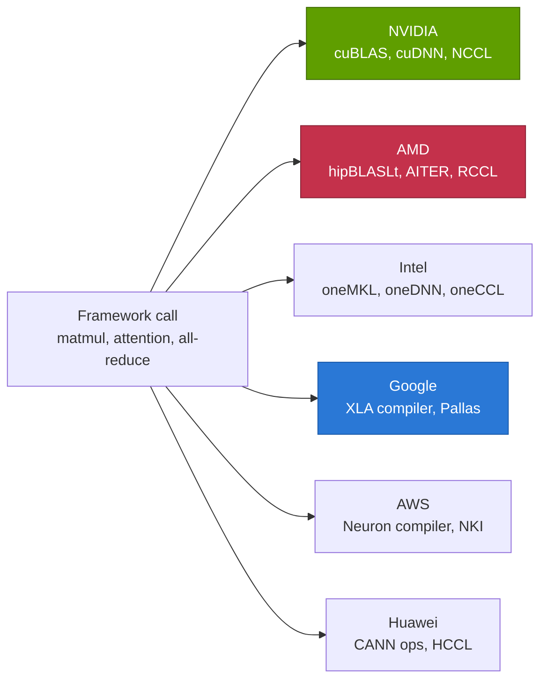
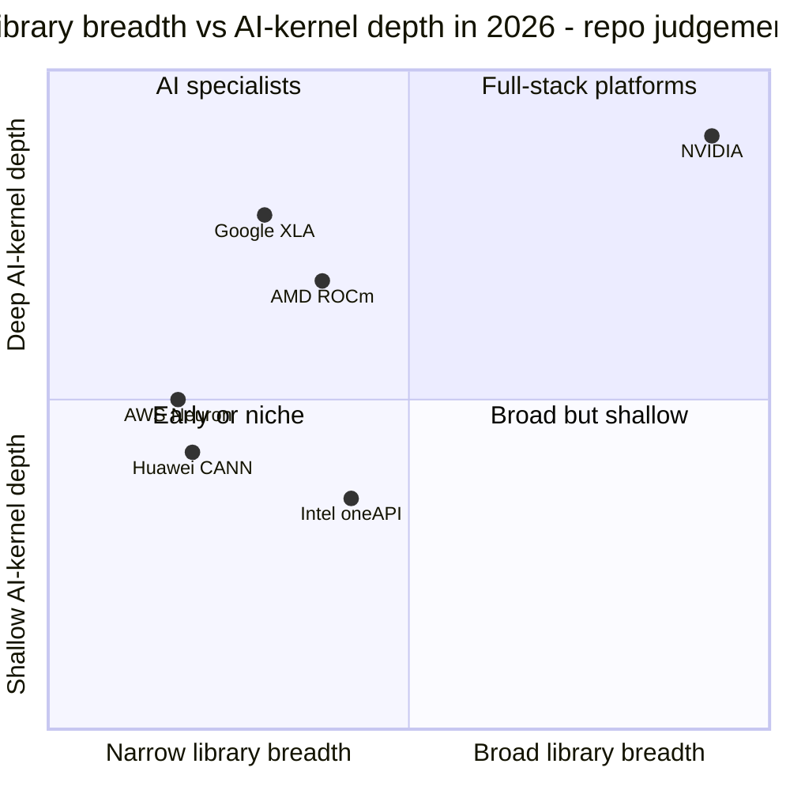

# Libraries (CUDA-X): Competition

Layer 10 · Libraries (CUDA-X) · ~12 min read · Last verified: 2026-11-05

## ⚡ The Executive Take

- **No rival leads NVIDIA in any of 15 library domains** in this repo's matrix; AMD and Intel each reach parity in 3, all in math, DNN primitives or collectives [[S586]](../../sources/bibliography.md#s586)[[S10509]](../../sources/bibliography.md#s10509)[[S10557]](../../sources/bibliography.md#s10557)[[S10554]](../../sources/bibliography.md#s10554).
- **[Q5 · Strongest challenger] AMD's [ROCm](../../glossary.md#rocm).** Its strategy is to copy NVIDIA's interfaces with [software ports](../../glossary.md#software-port), and it has cut the copy delay: [RCCL](../../glossary.md#rccl) trailed [NCCL](../../glossary.md#nccl) by 296 days in ROCm 6.4 (April 2025) and by 98 days in ROCm 7.1 (October 2025) [[S10509]](../../sources/bibliography.md#s10509)[[S10506]](../../sources/bibliography.md#s10506)[[S586]](../../sources/bibliography.md#s586).
- **Google's challenge is different, not smaller:** [XLA](../../glossary.md#xla) compiles whole models instead of calling libraries and [Pallas](../../glossary.md#pallas) replaces CUTLASS-style kernels; Google takes a different route in 12 of 15 domains [[S10543]](../../sources/bibliography.md#s10543)[[S578]](../../sources/bibliography.md#s578).
- **The breadth gap sits outside AI training.** Only NVIDIA ships first-party GPU libraries for optimization ([cuOpt](../../glossary.md#cuopt)), lithography ([cuLitho](../../glossary.md#culitho)), genomics (Parabricks) and graph analytics (cuGraph) [[S10026]](../../sources/bibliography.md#s10026)[[S10031]](../../sources/bibliography.md#s10031)[[S10047]](../../sources/bibliography.md#s10047).
- **NVIDIA's weakness: openness lowers switching costs.** NCCL (since February 2026) and cuOpt are Apache 2.0, so ports can track every release, and [vLLM](../../glossary.md#vllm) on ROCm defaults to AMD's own [AITER](../../glossary.md#aiter) kernels [[S10507]](../../sources/bibliography.md#s10507)[[S10026]](../../sources/bibliography.md#s10026)[[S10514]](../../sources/bibliography.md#s10514).
- **The field is opening up:** Huawei is open-sourcing [CANN](../../glossary.md#cann) (announced August 2025), and AMD reportedly joined the [oneAPI](../../glossary.md#oneapi) standards body (UXL) as a steering member in October 2026 🟡 [[S10537]](../../sources/bibliography.md#s10537)[[S10542]](../../sources/bibliography.md#s10542).

![Heatmap of 15 library domains (rows) against NVIDIA, AMD, Intel, Google, AWS and Huawei (columns). No rival leads NVIDIA in any domain. AMD reaches parity in 3 (dense math with rocBLAS/hipBLASLt, collectives with RCCL, FFT/sparse) and Intel in 3 (oneMKL, oneDNN, FFT/sparse); Google takes a different, compiler- or service-based route in 12 domains and AWS in 8; Huawei trails in 15. Only NVIDIA has first-party GPU libraries for optimization (cuOpt), computational lithography (cuLitho), genomics (Parabricks) and graph analytics (cuGraph).](../../assets/charts/10-library-coverage-heatmap.svg)

## Three ways to compete with a library catalogue

A library is a box of pre-tuned GPU routines. A framework such as PyTorch decides *what* to compute; the library decides *how* to do it fast on one specific chip (see [the CUDA-X catalog](the-cuda-x-catalog.md)). Rivals have chosen one of three strategies:

1. **Port it (AMD, partly Huawei).** Re-implement NVIDIA's libraries behind compatible interfaces, like a cover band playing the same set list: [HIP](../../glossary.md#hip) mirrors CUDA, RCCL mirrors NCCL (its licence says it contains NVIDIA contributions), and hipDF is a fork of cuDF [[S10002]](../../sources/bibliography.md#s10002)[[S10511]](../../sources/bibliography.md#s10511).
2. **Compile it (Google, AWS).** Skip most libraries: a compiler (XLA, the Neuron compiler) writes the kernels for each model, and experts hand-tune the rest in Pallas or AWS's [NKI](../../glossary.md#nki) [[S10543]](../../sources/bibliography.md#s10543)[[S10539]](../../sources/bibliography.md#s10539).
3. **Standardise it (Intel).** Publish an open specification (oneAPI, now under the [UXL Foundation](../../glossary.md#uxl-foundation)) and hope others adopt it [[S10540]](../../sources/bibliography.md#s10540)[[S10541]](../../sources/bibliography.md#s10541).

Porting keeps customers' code working but makes the porter a permanent follower. Compiling avoids following, but only works where the vendor controls the whole stack (TPU, Trainium).

> [!TIP]
> **Worked example — what a port lag costs.** RCCL 2.22.3 shipped in ROCm 6.4.0 on 2025-04-11, 296 days after NVIDIA tagged NCCL 2.22.3 (2024-06-19); by then NCCL was already at 2.26 [[S10509]](../../sources/bibliography.md#s10509)[[S10506]](../../sources/bibliography.md#s10506)[[S586]](../../sources/bibliography.md#s586). With both vendors on an annual GPU cadence, a ~10-month lag meant an AMD customer received a collectives feature roughly one GPU generation late. By ROCm 7.1.0 (2025-10-30) the lag on NCCL 2.27.7 was 98 days, about a quarter.

🔧 Under the hood: why ports lag and compilers do not

A port must match NCCL's or cuDF's interface, then re-tune every routine for different hardware (xGMI links instead of NVLink, 64-wide wavefronts instead of 32-thread warps, other matrix-unit shapes). RCCL keeps NCCL's `nccl*` function names, so frameworks call it unchanged, but each NCCL release must be merged, re-tuned and re-validated before the next ROCm drop [[S10002]](../../sources/bibliography.md#s10002)[[S10509]](../../sources/bibliography.md#s10509). A compiler-first stack has no upstream to copy; instead, new model types may run slowly until the compiler learns them, hence Pallas for hand-written kernels [[S578]](../../sources/bibliography.md#s578).

## The coverage matrix

Verdicts are from each rival's point of view against NVIDIA's library (🟩 leads · 🟨 parity · 🟥 behind · 🟦 different approach). "None found" means absent from the vendor's library index as of 2026-11-05.

| Domain | NVIDIA (reference) | AMD | Intel | Google | AWS | Huawei |
|---|---|---|---|---|---|---|
| Dense math ([GEMM](../../glossary.md#gemm)) | cuBLAS, cuBLASLt | 🟨 rocBLAS, hipBLASLt | 🟨 oneMKL | 🟦 XLA compiler | 🟦 Neuron + NKI | 🟥 CANN ops |
| DNN primitives | cuDNN | 🟥 MIOpen (+AITER) | 🟨 oneDNN (x86) | 🟦 XLA fusion | 🟦 Neuron compiler | 🟥 CANN ops |
| Kernel templates | [CUTLASS](../../glossary.md#cutlass), CuTe DSL | 🟥 [Composable Kernel](../../glossary.md#composable-kernel) | 🟥 [SYCL](../../glossary.md#sycl), Triton XPU | 🟦 Pallas | 🟦 NKI Library | 🟥 Ascend C |
| Collectives | NCCL | 🟨 RCCL (port) | 🟥 oneCCL | 🟦 XLA over ICI | 🟦 Neuron CC | 🟥 HCCL |
| Inference engine | TensorRT-LLM, Dynamo | 🟥 vLLM/SGLang + AITER | 🟥 OpenVINO | 🟦 vLLM-TPU, llm-d | 🟥 vLLM Neuron (beta) | 🟥 vllm-ascend |
| Dataframes / ETL | [cuDF](../../glossary.md#cudf), Spark plugin | 🟥 hipDF (fork) | 🟥 none on GPU | 🟦 BigQuery | 🟥 none | 🟥 none found |
| Classical ML | cuML | 🟥 no port | 🟦 oneDAL (CPU) | 🟦 BigQuery ML | 🟥 none | 🟥 none found |
| Graph analytics | cuGraph | 🟥 hipGRAPH (early) | 🟥 none | 🟥 none | 🟦 Neptune | 🟥 none found |
| Optimization | cuOpt | 🟥 none | 🟥 none | 🟦 OR-Tools (CPU) | 🟥 none | 🟥 none found |
| FFT / sparse / solvers | cuFFT, cuSPARSE | 🟨 rocFFT, rocSPARSE | 🟨 oneMKL | 🟥 XLA FFT only | 🟥 none | 🟥 limited |
| Quantum simulation | cuQuantum, CUDA-Q | 🟥 none | 🟥 none | 🟦 qsim + own QPUs | 🟦 Braket | 🟥 none found |
| Lithography | cuLitho | 🟥 none | 🟥 none | 🟥 none | 🟥 none | 🟥 none found |
| Genomics | Parabricks | 🟥 none | 🟥 none | 🟦 DeepVariant | 🟦 HealthOmics | 🟥 none found |
| Simulation, physics-ML | Warp, PhysicsNeMo | 🟥 no first-party lib | 🟥 no first-party lib | 🟦 Brax (JAX) | 🟥 none | 🟥 none found |
| Vector search | [cuVS](../../glossary.md#cuvs) | 🟥 hipVS (port) | 🟥 none on GPU | 🟦 ScaNN (CPU) | 🟦 OpenSearch | 🟥 none found |

Sources per cell in `data/l10_library_coverage.csv`: [[S10047]](../../sources/bibliography.md#s10047)[[S586]](../../sources/bibliography.md#s586)[[S10511]](../../sources/bibliography.md#s10511)[[S10512]](../../sources/bibliography.md#s10512)[[S10514]](../../sources/bibliography.md#s10514)[[S10540]](../../sources/bibliography.md#s10540)[[S10557]](../../sources/bibliography.md#s10557)[[S10543]](../../sources/bibliography.md#s10543)[[S10539]](../../sources/bibliography.md#s10539)[[S10538]](../../sources/bibliography.md#s10538)[[S10570]](../../sources/bibliography.md#s10570). All rival verdicts are repo judgement (🔴).

> [!TIP]
> **Worked example — reading a 🟦.** NVIDIA's NVLink domain is 72 GPUs in a Vera Rubin NVL72; a [TPU](../../glossary.md#tpu) Ironwood superpod links 9,216 chips over [ICI](../../glossary.md#ici) [[S90009]](../../sources/bibliography.md#s90009)[[S547]](../../sources/bibliography.md#s547). On TPUs, XLA inserts the all-reduces when it compiles the model, so there is no NCCL to port: a team moving from GPUs rewrites its sharding configuration, not its library calls. Scale-up is 128× larger (9,216 ÷ 72), but the team gives up the NVIDIA library ecosystem, which is why "different" is not "behind".

## Challenger by challenger

### AMD ROCm: the strongest challenger

ROCm 7.0 (September 2025) added AITER operators and FP4/FP6 formats; ROCm 10.0 followed in August 2026 [[S90064]](../../sources/bibliography.md#s90064)[[S586]](../../sources/bibliography.md#s586). ROCm-DS, AMD's fork of [RAPIDS](../../glossary.md#rapids), reached general availability in October 2025 with hipDF aligned to cuDF 25.02 APIs; hipGRAPH was still early access in March 2026 [[S10511]](../../sources/bibliography.md#s10511)[[S10512]](../../sources/bibliography.md#s10512). AMD bought software teams to speed this up: Mipsology and Nod.ai (2023), Silo AI ($665M, 2024) and Brium (2025) [[S10529]](../../sources/bibliography.md#s10529)[[S10530]](../../sources/bibliography.md#s10530)[[S10531]](../../sources/bibliography.md#s10531)[[S10532]](../../sources/bibliography.md#s10532). SemiAnalysis, harshly critical in December 2024, saw new urgency by April 2025 but said AMD still underpaid AI software engineers [[S10536]](../../sources/bibliography.md#s10536)[[S10535]](../../sources/bibliography.md#s10535).

**Best argument:** AI spend is concentrated in a handful of operations (GEMM, attention, collectives), and frontier labs write their own kernels anyway; parity in 3 domains plus first-class vLLM and SGLang support covers most accelerator dollars [[S580]](../../sources/bibliography.md#s580)[[S582]](../../sources/bibliography.md#s582). **Gap closed:** collectives to ~3 months; dataframes ~8 months; [disaggregated serving](../../glossary.md#disaggregated-serving) and KV tiering lagged in 2025 (analyst view) [[S10570]](../../sources/bibliography.md#s10570); 12 of 15 domains still behind. See [layer 09 competition](../09-cuda-and-system-software/competition.md) for the CUDA-versus-ROCm platform view.

> [!TIP]
> **Worked example — AMD's catch-up budget.** AMD's R&D rose from $5.0B (2022) to $6.5B (2024), +$1.45B a year, and Silo AI alone cost $665M [[S450]](../../sources/bibliography.md#s450)[[S10531]](../../sources/bibliography.md#s10531). If a third of that R&D increase went to software (repo assumption 🔴), it funds ~$0.5B a year, about 1,200 engineers at $0.4M each: close to the ~1,500 engineers this repo estimates for an AI-core library stack ([history](history-and-how-built.md)). The money exists; the open question is whether it buys breadth or only the AI core.

### Google: compile, don't call

TPUs never needed CUDA-X equivalents. XLA fuses operators and schedules collectives; Pallas covers custom kernels; PyTorch/XLA is being replaced by a native TorchTPU stack open-sourced with Meta in October 2026 [[S10543]](../../sources/bibliography.md#s10543)[[S578]](../../sources/bibliography.md#s578)[[S553]](../../sources/bibliography.md#s553)[[S595]](../../sources/bibliography.md#s595). **Best argument:** a compiler adapts to new models without a library team per domain. **Gap:** outside AI, Google sells services (BigQuery) rather than libraries, so it cannot pull non-AI workloads onto merchant hardware [[S10552]](../../sources/bibliography.md#s10552). See [CS3](../../case-studies/CS3-google-tpu-the-credible-alternative.md).

### Intel: an open standard looking for a GPU

oneMKL and oneDNN are mature; oneDNN is used by PyTorch, TensorFlow, ONNX Runtime and OpenVINO, and the 2026 oneAPI release still lists oneMKL, oneDAL, oneDNN, MPI and oneCCL [[S10542]](../../sources/bibliography.md#s10542)[[S10540]](../../sources/bibliography.md#s10540)[[S10554]](../../sources/bibliography.md#s10554). oneMKL 2026.0 also removed most legacy sparse BLAS APIs [[S10557]](../../sources/bibliography.md#s10557). **Best argument:** a vendor-neutral standard; AMD reportedly joined UXL as a steering member and backed oneDNN as PyTorch's x86 default (single secondary source) 🟡 [[S10542]](../../sources/bibliography.md#s10542). **Gap:** Intel's data-center accelerators are thin, so oneAPI's GPU libraries have few large deployments.

### AWS and Huawei: vertical stacks

AWS pairs its Neuron compiler with the NKI Library of pre-built kernels and NeuronX Distributed for collectives; its vLLM plugin is still labelled beta [[S10539]](../../sources/bibliography.md#s10539)[[S594]](../../sources/bibliography.md#s594)[[S581]](../../sources/bibliography.md#s581). Huawei's CANN carries the operator library and HCCL; torch_npu, MindSpeed and triton-ascend connect Ascend to open frameworks, and CANN is being open-sourced [[S10538]](../../sources/bibliography.md#s10538)[[S592]](../../sources/bibliography.md#s592)[[S10537]](../../sources/bibliography.md#s10537).

> [!NOTE]
> **🐂 Bull view.** Breadth compounds: every non-AI domain (Spark, lithography, genomics, optimization) pulls GPUs into budgets AMD and Google do not reach, and NVIDIA ships Rubin libraries within weeks of the silicon (see [history](history-and-how-built.md)).

> [!WARNING]
> **🐻 Bear view.** The dollars sit in 3–4 AI domains where AMD is at or near parity, and open engines (vLLM, SGLang, Triton) now choose the kernel, not the user. Every NCCL or cuOpt release is Apache 2.0 and can be ported within a quarter, so the library moat narrows to the long tail.

**[Q5 · Strongest challenger]** AMD ROCm, because it attacks the domains where the money is (math, collectives, inference) and has cut its follow-on delay to about a quarter; Google's compiler route is the stronger long-run threat to the *need* for libraries, but only on Google's own chips.

## 🎯 Corp Dev Lens

1. Parity in 3 of 15 domains looks weak, yet those 3 hold most AI accelerator spend. For an inference entrant (e.g. Qualcomm's AI200/AI250, public information), which domains must be at parity on day one, and which can ride open engines such as vLLM [[S90028]](../../sources/bibliography.md#s90028)[[S596]](../../sources/bibliography.md#s596)?
2. AMD's port lag fell from ~10 to ~3 months. What would a near-zero lag (a shared upstream) do to NVIDIA's library premium?
3. Qualcomm's announced Modular deal is a compile-style bet like Google's [[S90057]](../../sources/bibliography.md#s90057). Does a portable compiler remove the need to match CUDA-X domain by domain, or only for AI kernels?
4. Lithography, optimization and genomics have no second source. Are they ISV partnership targets rather than build targets?
5. If AMD's reported UXL role is confirmed, is oneAPI a neutral standard a newcomer could join instead of building its own?

## 📚 Sources

<!-- Auto-generated from the [S…] citations on this page by `make build`. Edit sources/registry/*.csv, not this list. -->

- [**S450**](../../sources/bibliography.md#s450) U.S. Securities and Exchange Commission (EDGAR), *Advanced Micro Devices Form 10-K / 10-Q filings (EDGAR index)*, 2025-02-05. [Link](https://www.sec.gov/cgi-bin/browse-edgar?action=getcompany&CIK=0000002488&type=10-&dateb=&owner=include&count=40)
- [**S547**](../../sources/bibliography.md#s547) Google Cloud Blog, *Ironwood TPUs and new Axion-based VMs for your AI workloads*, 2025-11-06. [Link](https://cloud.google.com/blog/products/compute/ironwood-tpus-and-new-axion-based-vms-for-your-ai-workloads)
- [**S553**](../../sources/bibliography.md#s553) Google Cloud Blog (Alex Barrett), *What's new in AI infrastructure and orchestration in October*, 2026-11. [Link](https://cloud.google.com/blog/topics/ai-infrastructure/whats-new-in-ai-infrastructure-this-month)
- [**S578**](../../sources/bibliography.md#s578) OpenAI Triton (GitHub), *Triton (triton-lang/triton) README — supported hardware*, 2026-11. [Link](https://github.com/triton-lang/triton/blob/main/README.md)
- [**S580**](../../sources/bibliography.md#s580) vLLM project (GitHub), *vLLM README and installation docs — supported hardware*, 2026-11. [Link](https://github.com/vllm-project/vllm/blob/main/docs/getting_started/installation/README.md)
- [**S581**](../../sources/bibliography.md#s581) vLLM project (GitHub), *vLLM hardware plugin repositories (tpu-inference/vLLM JAX, vllm-gaudi, vllm-ascend, vllm-neuron)*, 2026-11. [Link](https://github.com/vllm-project)
- [**S582**](../../sources/bibliography.md#s582) SGLang project (GitHub: sgl-project/sglang), *SGLang README — supported hardware*, 2026-11. [Link](https://github.com/sgl-project/sglang/blob/main/README.md)
- [**S586**](../../sources/bibliography.md#s586) AMD (GitHub: ROCm/ROCm docs), *ROCm documentation sources: release history, AI-ecosystem compatibility matrix, consolidated changelog*, 2026-08-26. [Link](https://github.com/ROCm/ROCm/blob/develop/docs/release/versions.rst)
- [**S592**](../../sources/bibliography.md#s592) Huawei Ascend (GitHub: Ascend org), *Huawei Ascend open-source adapters: torch_npu, MindSpeed, triton-ascend*, 2026-11. [Link](https://github.com/Ascend/pytorch)
- [**S594**](../../sources/bibliography.md#s594) AWS (GitHub: aws-neuron/neuronx-distributed), *NeuronX Distributed (NxD) README*, 2026-11. [Link](https://github.com/aws-neuron/neuronx-distributed)
- [**S595**](../../sources/bibliography.md#s595) PyTorch (GitHub: pytorch/xla), *PyTorch/XLA README (deprecation notice)*, 2026-11. [Link](https://github.com/pytorch/xla/blob/master/README.md)
- [**S596**](../../sources/bibliography.md#s596) Qualcomm (GitHub: quic), *Qualcomm Cloud AI SDK and Efficient Transformers repositories*, 2026-11. [Link](https://github.com/quic/cloud-ai-sdk)
- [**S10002**](../../sources/bibliography.md#s10002) AMD (GitHub: ROCm/rccl), *RCCL README and LICENSE (develop branch)*, 2026-11. [Link](https://github.com/ROCm/rccl/blob/develop/README.md)
- [**S10026**](../../sources/bibliography.md#s10026) NVIDIA (GitHub: NVIDIA/cuopt), *cuOpt README and LICENSE*, 2026-11. [Link](https://github.com/NVIDIA/cuopt/blob/main/README.md)
- [**S10031**](../../sources/bibliography.md#s10031) NVIDIA Newsroom, *TSMC and Synopsys Bring Breakthrough NVIDIA Computational Lithography Platform to Production*, 2024-03-18. [Link](https://nvidianews.nvidia.com/news/tsmc-synopsys-nvidia-culitho)
- [**S10047**](../../sources/bibliography.md#s10047) NVIDIA Developer, *NVIDIA CUDA-X Libraries (developer page)*, 2026. [Link](https://developer.nvidia.com/cuda/cuda-x-libraries)
- [**S10506**](../../sources/bibliography.md#s10506) GitHub (NVIDIA), *NVIDIA/nccl tags*, 2026-09-17. [Link](https://github.com/NVIDIA/nccl/tags)
- [**S10507**](../../sources/bibliography.md#s10507) GitHub (NVIDIA), *NVIDIA/nccl releases (release notes v2.28.3 to v2.32.3)*, 2026-09-17. [Link](https://github.com/NVIDIA/nccl/releases)
- [**S10509**](../../sources/bibliography.md#s10509) GitHub (ROCm/rccl), *RCCL CHANGELOG*, 2026. [Link](https://github.com/ROCm/rccl/blob/develop/CHANGELOG.md)
- [**S10511**](../../sources/bibliography.md#s10511) AMD ROCm Documentation, *ROCm-DS 25.10 release notes*, 2025-10. [Link](https://rocm.docs.amd.com/projects/rocm-ds/en/latest/about/release-notes.html)
- [**S10512**](../../sources/bibliography.md#s10512) AMD ROCm Documentation, *ROCm-DS 26.03 release notes*, 2026-03. [Link](https://rocm.docs.amd.com/projects/rocm-ds/en/docs-26.03/about/release-notes.html)
- [**S10514**](../../sources/bibliography.md#s10514) GitHub (ROCm/aiter), *AITER README*, 2026-04. [Link](https://github.com/ROCm/aiter)
- [**S10529**](../../sources/bibliography.md#s10529) CB Insights, *Mipsology company profile*, 2023-08. [Link](https://www.cbinsights.com/company/mipsology)
- [**S10530**](../../sources/bibliography.md#s10530) PrivSource, *AMD Acquires Nod.ai*, 2023-10-10. [Link](https://www.privsource.com/acquisitions/deal/bWSr8y)
- [**S10531**](../../sources/bibliography.md#s10531) Converge Digest, *AMD completes $665 million acquisition of Silo AI*, 2024-08-12. [Link](https://convergedigest.com/amd-completes-665-million-acquisition-of-silo-ai/?amp=1)
- [**S10532**](../../sources/bibliography.md#s10532) I-Connect007, *AMD Acquires Brium to Strengthen Open AI Software Ecosystem*, 2025-06-05. [Link](https://iconnect007.com/article/145627/amd-acquires-brium-to-strengthen-open-ai-software-ecosystem/145624)
- [**S10535**](../../sources/bibliography.md#s10535) SemiAnalysis, *AMD 2.0 – New Sense of Urgency / MI450X Chance to Beat Nvidia / Nvidia's New Moat*, 2025-04. [Link](https://newsletter.semianalysis.com/p/amd-2-0-new-sense-of-urgency-mi450x-chance-to-beat-nvidia-nvidias-new-moat)
- [**S10536**](../../sources/bibliography.md#s10536) TechPowerUp, *AMD's Pain Point is ROCm Software, NVIDIA's CUDA Software is Still Superior for AI Development: Report*, 2024-12-23. [Link](https://techpowerup.com/330155/amds-pain-point-is-rocm-software-nvidias-cuda-software-is-still-superior-for-ai-development-report)
- [**S10537**](../../sources/bibliography.md#s10537) TrendForce, *Huawei Open-Sources CANN Toolkit for Ascend AI GPUs, Taking Aim at NVIDIA's CUDA*, 2025-08-07. [Link](https://www.trendforce.com/news/2025/08/07/news-huawei-open-sources-cann-toolkit-for-ascend-ai-gpus-taking-aim-at-nvidias-cuda/)
- [**S10538**](../../sources/bibliography.md#s10538) Huawei Ascend (hiascend.com), *CANN Ascend operator library (AOL) API reference*, 2026. [Link](https://www.hiascend.com/document/detail/en/CANNCommunityEdition/latest/API/aolapi)
- [**S10539**](../../sources/bibliography.md#s10539) AWS Neuron Documentation, *About the NKI Library*, 2026. [Link](https://awsdocs-neuron.readthedocs-hosted.com/en/latest/nki/library/about/index.html)
- [**S10540**](../../sources/bibliography.md#s10540) Intel, *Intel oneAPI Toolkit Release Notes (2026)*, 2026. [Link](https://www.intel.com/content/www/us/en/developer/articles/release-notes/oneapi-toolkit/2026.html)
- [**S10541**](../../sources/bibliography.md#s10541) UXL Foundation, *UXL Foundation: advancing portable acceleration across architectures in 2025 and what's next for 2026*, 2025-12. [Link](https://uxlfoundation.org/blog/uxl-foundation-advancing-portable-acceleration-across-architectures-in-2025-and-whats-next-for-2026/)
- [**S10542**](../../sources/bibliography.md#s10542) Crypto Briefing, *AMD joins UXL Foundation as steering member, backs oneDNN for PyTorch*, 2026-10-20. [Link](https://cryptobriefing.com/amd-joins-uxl-foundation-onednn-pytorch/)
- [**S10543**](../../sources/bibliography.md#s10543) OpenXLA (GitHub), *OpenXLA XLA compiler*, 2026. [Link](https://github.com/openxla/xla)
- [**S10552**](../../sources/bibliography.md#s10552) Google Cloud, *BigQuery (incl. BigQuery ML)*, 2026. [Link](https://cloud.google.com/bigquery)
- [**S10554**](../../sources/bibliography.md#s10554) UXL Foundation (GitHub), *oneDNN*, 2026. [Link](https://github.com/uxlfoundation/oneDNN)
- [**S10557**](../../sources/bibliography.md#s10557) Intel, *Intel oneAPI Math Kernel Library (oneMKL) Release Notes and System Requirements*, 2026. [Link](https://www.intel.com/content/www/us/en/developer/articles/release-notes/onemkl.html)
- [**S10570**](../../sources/bibliography.md#s10570) SemiAnalysis, *AMD's lack of disaggregated prefill inferencing and NVMe KV cache tiering (article section)*, 2025. [Link](https://newsletter.semianalysis.com/i/174558631/amds-lack-of-disaggregated-prefill-inferencing-and-nvme-kv-cache-tiering)
- [**S90009**](../../sources/bibliography.md#s90009) GamesBeat, *Nvidia Vera Rubin ramps into full production for fall launch*, 2026. [Link](https://gamesbeat.com/nvidia-vera-rubin-ramps-into-full-production-for-fall-launch-again/)
- [**S90028**](../../sources/bibliography.md#s90028) TechRepublic, *Qualcomm unveils AI chips to rival Nvidia, AMD*, 2025-10-27. [Link](https://techrepublic.com/article/news-qualcomm-unveils-ai-chips-to-rival-nvidia-amd)
- [**S90057**](../../sources/bibliography.md#s90057) StorageReview, *Qualcomm unveils Dragonfly data center roadmap: C1000 CPU, AI300 accelerator and Modular acquisition*, 2026-06-24. [Link](https://www.storagereview.com/es/news/qualcomm-unveils-dragonfly-data-center-roadmap-c1000-cpu-ai300-accelerator-and-modular-acquisition)
- [**S90064**](../../sources/bibliography.md#s90064) The Register, *ROCm 7: AMD tries to catch CUDA with performance-boosting software*, 2025-09-17. [Link](https://www.theregister.com/2025/09/17/amd_rocm_7_chases_nvidia_cuda/)
