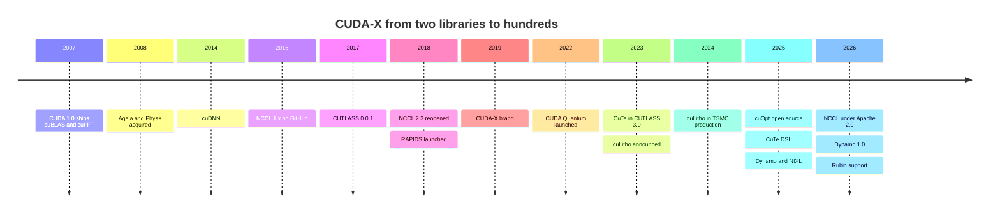

# Libraries (CUDA-X): History and how NVIDIA built it

Layer 10 · Libraries (CUDA-X) · ~11 min read · Last verified: 2026-11-05

## ⚡ The Executive Take

- **Libraries shipped with [CUDA](../../glossary.md#cuda) from day one:** CUDA 1.0 (June 2007) included cuBLAS and cuFFT [[S525]](../../sources/bibliography.md#s525). NVIDIA then added a library whenever a new workload appeared: cuDNN (2014), [NCCL](../../glossary.md#nccl) (on GitHub from April 2016), CUTLASS (December 2017) and RAPIDS (October 2018) [[S10039]](../../sources/bibliography.md#s10039)[[S10506]](../../sources/bibliography.md#s10506)[[S10010]](../../sources/bibliography.md#s10010)[[S10517]](../../sources/bibliography.md#s10517).
- **"[CUDA-X](../../glossary.md#cuda-x)" is a 2019 brand**, and NVIDIA's counts change definition: "550 SDKs and AI models" in 2022, ~350 libraries in October 2025 [[S10502]](../../sources/bibliography.md#s10502)[[S532]](../../sources/bibliography.md#s532)[[S10501]](../../sources/bibliography.md#s10501).
- **Openness has swung back and forth.** NCCL 2 was binary-only from 2017 until v2.3.5 (September 2018) and moved to Apache 2.0 in February 2026; cuOpt went Apache 2.0 in 2025 [[S10506]](../../sources/bibliography.md#s10506)[[S10507]](../../sources/bibliography.md#s10507)[[S10027]](../../sources/bibliography.md#s10027).
- **[Q4 · Source of advantage]** Hardware–software co-design executed for two decades: CUTLASS supported each new data-center GPU within 24–71 days of first volume shipments, and Rubin got CUTLASS and NCCL support on the same day [[S10010]](../../sources/bibliography.md#s10010)[[S10507]](../../sources/bibliography.md#s10507).
- **[Q6 · Replication cost]** Est. ~$3B, ~1,500 engineers and ~5 years for an AI-core library stack; ~$16B over ~10 years for NVIDIA's full breadth 🔴. Time and specialist talent, not cash, are the binding constraints [[S401]](../../sources/bibliography.md#s401)[[S10535]](../../sources/bibliography.md#s10535).
- **Counterfactual:** had NVIDIA left libraries to third parties, frameworks would have built their own compilers, as Google did with [XLA](../../glossary.md#xla), and CUDA would be a thinner moat 🔴.

## How the catalogue was built

Three habits recur. **Ship a library with the chip:** cuBLAS arrived with the first CUDA GPUs and CUTLASS now lands within weeks of each architecture. **Follow the workload:** deep learning (cuDNN), multi-GPU training (NCCL), data science (RAPIDS), chipmaking (cuLitho) and quantum (CUDA-Q) each got a library once demand was visible [[S10039]](../../sources/bibliography.md#s10039)[[S10506]](../../sources/bibliography.md#s10506)[[S10517]](../../sources/bibliography.md#s10517)[[S10032]](../../sources/bibliography.md#s10032)[[S10520]](../../sources/bibliography.md#s10520). **Open what is strategic, keep what is differentiating:** NCCL, CUTLASS, cuOpt and Warp are open source, while cuBLAS and cuDNN ship as proprietary binaries [[S10507]](../../sources/bibliography.md#s10507)[[S10038]](../../sources/bibliography.md#s10038)[[S10028]](../../sources/bibliography.md#s10028). [Why breadth compounds](why-library-breadth-compounds.md) covers the mechanism.

| Date | Decision | Why it mattered | Source |
|---|---|---|---|
| 2007-06 | Bundle cuBLAS and cuFFT in CUDA 1.0 | Tuned math available on day one | [[S525]](../../sources/bibliography.md#s525) |
| 2008-02 | Buy Ageia (PhysX) | First domain library bought, not built | [[S484]](../../sources/bibliography.md#s484) |
| 2014-10 | Publish cuDNN | Deep-learning frameworks standardised on it | [[S10039]](../../sources/bibliography.md#s10039) |
| 2016-04 | Put NCCL 1.x on GitHub | Free multi-GPU collectives | [[S10506]](../../sources/bibliography.md#s10506) |
| 2017-12-04 | Release CUTLASS templates | Customers write tensor-core kernels, on NVIDIA | [[S10010]](../../sources/bibliography.md#s10010) |
| 2018-09-25 | Reopen NCCL 2 (v2.3.5) | Multi-node training settled on NCCL | [[S10506]](../../sources/bibliography.md#s10506) |
| 2018-10-10 | Launch RAPIDS with Databricks, IBM, Oracle | CUDA enters data science | [[S10517]](../../sources/bibliography.md#s10517) |
| 2024-03-18 | cuLitho in production at TSMC | GPUs enter chip manufacturing | [[S10031]](../../sources/bibliography.md#s10031) |
| 2025-03 | Open-source cuOpt (Apache 2.0) | Optimization joins open CUDA-X | [[S10027]](../../sources/bibliography.md#s10027) |
| 2026-02-27 | Relicense NCCL to Apache 2.0 | Lower friction for users and for ports | [[S10507]](../../sources/bibliography.md#s10507) |

| Date | NVIDIA claim | Source |
|---|---|---|
| 2021-04 | CUDA and CUDA-X accelerate >2,000 applications | [[S537]](../../sources/bibliography.md#s537) |
| 2022-03 | 60 updates to CUDA-X libraries | [[S530]](../../sources/bibliography.md#s530) |
| 2022-09 | 550 SDKs and AI models | [[S532]](../../sources/bibliography.md#s532) |
| 2023-05 | >3,000 applications | [[S533]](../../sources/bibliography.md#s533) |
| 2025-10 | ~350 CUDA-X libraries | [[S10501]](../../sources/bibliography.md#s10501) |
| 2026-03 | "Hundreds" of libraries; cuDF and cuVS billed as foundations | [[S10047]](../../sources/bibliography.md#s10047)[[S10504]](../../sources/bibliography.md#s10504) |

> [!TIP]
> **Worked example — why the library count is not a KPI.** NVIDIA's headline fell from 550 "SDKs and AI models" (September 2022) to ~350 "libraries" (October 2025), a 36% drop, while accelerated applications rose 50% from 2,000 (2021) to 3,000 (2023) [[S532]](../../sources/bibliography.md#s532)[[S10501]](../../sources/bibliography.md#s10501)[[S537]](../../sources/bibliography.md#s537)[[S533]](../../sources/bibliography.md#s533). The first series changed definition (models were dropped); the second measures adoption. For diligence, count third-party integrations (Snowflake, Spark, Faiss) rather than NVIDIA's own tally.

## [Q4 · Source of advantage] Co-design, executed for twenty years

A new hardware feature is worthless until a library exposes it. Volta's [tensor cores](../../glossary.md#tensor-core), Hopper's Tensor Memory Accelerator ([TMA](../../glossary.md#tma)) and Blackwell's [NVFP4](../../glossary.md#nvfp4) block-scaled formats each needed new kernels. Because NVIDIA defines the instructions, its library teams can build kernels before launch (an inference from the release dates 🔴): CUTLASS 3.0 (January 2023) arrived with TMA kernels built on the new CuTe abstraction, CUTLASS 3.8.0 (January 2025) with Blackwell's tensor-memory instructions and NVFP4, and CUTLASS 4.8.0 (September 2026) with Rubin and a new UE5M3 scale format [[S10010]](../../sources/bibliography.md#s10010). Rivals see the same features only after launch.

![Horizontal bar chart of how quickly NVIDIA's open-source CUTLASS kernel library supported each new data-center GPU after first volume shipments: Ampere 24 days (CUTLASS 2.2.0, 2020-06-08); Hopper 35 days (CUTLASS 2.11.0, 2022-11-19); Blackwell 71 days (CUTLASS 3.8.0, 2025-01-25); Blackwell Ultra 31 days (CUTLASS 4.2.0, 2025-09-15); Rubin 33 days (CUTLASS 4.8.0, 2026-09-17). Hopper's native TMA and WGMMA kernels built on CuTe followed in CUTLASS 3.0 after 100 days. Libraries arrive with the silicon because NVIDIA co-designs both.](../../assets/charts/10-cutlass-architecture-lead-time.svg)

**Answer:** the advantage is integration plus speed of execution, sustained long enough to become ecosystem. Technology alone is copyable: RCCL copies NCCL's interface and hipDF forks cuDF [[S10002]](../../sources/bibliography.md#s10002)[[S10511]](../../sources/bibliography.md#s10511). What is hard to copy is an organisation that ships the library, the compiler and the GPU together, every year, across 15 domains.

> [!TIP]
> **Worked example — Rubin day-one readiness.** Rubin production shipments began in early August 2026 [[S500]](../../sources/bibliography.md#s500). CUTLASS 4.8.0 and NCCL 2.32.3, both adding initial Rubin support, were tagged on 2026-09-17, about 33 days after a mid-August reference date [[S10010]](../../sources/bibliography.md#s10010)[[S10507]](../../sources/bibliography.md#s10507). AMD's [FP4](../../glossary.md#fp4) path took longer: CUDA 12.8 supported FP4 in January 2025, [ROCm](../../glossary.md#rocm) 7.0 in September 2025, 236 days later [[S524]](../../sources/bibliography.md#s524)[[S586]](../../sources/bibliography.md#s586).

## [Q6 · Replication cost] Time, dollars and talent

![Horizontal bar chart of software-replication cost reference points: AMD's Silo AI purchase $0.67B (2024), NVIDIA's Run:ai about $0.7B (2024), AMD's R&D increase from 2022 to 2024 of about $1.45B a year, a repo estimate of $3B for an AI-core library stack (1,500 engineers for five years at $0.4M each), Qualcomm's announced $3.9B Modular deal, AMD's $6.5B total 2024 R&D, a repo estimate of $16B for full 15-domain breadth over ten years, and NVIDIA's $18.5B FY2026 R&D. Money is not the binding constraint; time and specialist talent are.](../../assets/charts/10-replication-cost-ladder.svg)

| Scope | Time | Dollars (Est., repo 🔴) | Talent |
|---|---|---|---|
| AI core: GEMM, DNN, kernel templates, collectives, inference engine | ~5 years | ~$3B (1,500 × $0.4M × 5) | ~1,500 engineers, incl. kernel and compiler specialists |
| Full CUDA-X breadth (15 domains) | ~10 years | ~$16B (4,000 × $0.4M × 10) | ~4,000 plus domain scientists and ISV partnerships |
| Evidence: AMD ROCm | 2016 → near-parity in AI core by 2025–26 | R&D +$1.45B a year (2022 → 2024) | Underpaid AI engineers (SemiAnalysis, 2025) |

Inputs: NVIDIA spent $18.5B on R&D in FY2026 with ~31,000 of ~42,000 staff in R&D (~$0.6M per head) [[S401]](../../sources/bibliography.md#s401); AMD R&D [[S450]](../../sources/bibliography.md#s450); ROCm 1.0 in 2016 [[S586]](../../sources/bibliography.md#s586); [[S10535]](../../sources/bibliography.md#s10535).

> [!TIP]
> **Worked example — the arithmetic.** 1,500 engineers × $0.4M loaded cost × 5 years = $3.0B, about 2 months of NVIDIA's FY2026 R&D ($18.5B ÷ 12 × 2 ≈ $3.1B) [[S401]](../../sources/bibliography.md#s401). The cost per head is a repo assumption below NVIDIA's ~$0.6M all-in R&D per employee, because libraries need no photomasks. The binding input is time: AMD needed ~9 years from ROCm 1.0 (2016) to a ~3-month collectives lag (2025) [[S586]](../../sources/bibliography.md#s586)[[S10509]](../../sources/bibliography.md#s10509), and buying a team (Silo AI, $665M) buys people, not years of tuning [[S10531]](../../sources/bibliography.md#s10531).

## Counterfactuals — what if NVIDIA hadn't…

- 🔴 **…built its own libraries, relying on MKL-style third parties?** Framework teams would have written their own kernels and compilers, as Google did with XLA. Code would target an abstraction, not CUDA, and AMD would not need ports at all.
- 🔴 **…kept NCCL closed after 2017?** Multi-node training might have standardised on MPI or Gloo. RCCL, whose licence says it contains NVIDIA contributions, could not have started from NCCL's code [[S10002]](../../sources/bibliography.md#s10002).
- 🔴 **…skipped RAPIDS and the non-AI domains?** GPUs would be an AI-only purchase. There would be no Snowflake or Spark integration to pull data-analytics budgets onto GPUs [[S10521]](../../sources/bibliography.md#s10521)[[S10517]](../../sources/bibliography.md#s10517).

> [!TIP]
> **Worked example — the price of outsourced libraries.** Suppose a third party had charged NVIDIA AI Enterprise's list price of $4,500 per GPU per year for the libraries [[S10526]](../../sources/bibliography.md#s10526). A 72-GPU rack would carry 72 × $4,500 = $324,000 a year, ~4% a year of a ~$7.8M Vera Rubin [NVL72](../../glossary.md#nvl72) rack (Est., Morgan Stanley) [[S331]](../../sources/bibliography.md#s331). Bundling the libraries free removes that friction and keeps the margin in the GPU.

🔧 Under the hood: how a library release reaches users

Libraries ship three ways: inside the CUDA Toolkit (cuBLAS, cuFFT; versioned with CUDA since 1.0), as separate downloads and Python wheels (cuDNN, NCCL, cuDF; PyPI records give first-upload dates) and as source on GitHub (CUTLASS, NCCL, cuOpt) [[S525]](../../sources/bibliography.md#s525)[[S10038]](../../sources/bibliography.md#s10038)[[S10010]](../../sources/bibliography.md#s10010). Licences differ: PyPI lists cuBLAS and cuDNN as NVIDIA proprietary, CUTLASS as BSD-3-Clause and Warp as Apache 2.0 [[S10038]](../../sources/bibliography.md#s10038)[[S10028]](../../sources/bibliography.md#s10028). Open source helps adoption and lets ports copy; proprietary binaries keep the most tuned kernels on NVIDIA hardware.

## 🎯 Corp Dev Lens

1. NVIDIA opened NCCL, CUTLASS and cuOpt but kept cuBLAS and cuDNN binary. Which libraries would a challenger have to open to build trust, and which can stay closed?
2. If the scarce input is engineer-years rather than dollars, is buying a library team (Silo AI, Modular) mainly a way to buy time, and how much time?
3. CUTLASS lands within ~1–2 months of each NVIDIA GPU. How long does day-one library support take on a newcomer's chip, and who builds it?
4. RAPIDS shows NVIDIA entering a market (data science) through a free library plus partners. Which adjacent market could a newcomer enter the same way?

## 📚 Sources

<!-- Auto-generated from the [S…] citations on this page by `make build`. Edit sources/registry/*.csv, not this list. -->

- [**S331**](../../sources/bibliography.md#s331) Wccftech, *NVIDIA's Vera Rubin rack hit with 435% memory price surge, pushing HBM4 & LPDDR5X bill to $2M of $7.8M total*, 2026-05. [Link](https://wccftech.com/nvidia-vera-rubin-rack-hit-with-memory-price-surge-pushing-hbm4-lpddr5x-bill-to-2m-of-7-8m-total/)
- [**S401**](../../sources/bibliography.md#s401) NVIDIA Corporation via SEC EDGAR, *NVIDIA Corporation Form 10-K for fiscal year ended January 25, 2026*, 2026-02-25. [Link](https://www.sec.gov/Archives/edgar/data/1045810/000104581026000021/nvda-20260125.htm)
- [**S450**](../../sources/bibliography.md#s450) U.S. Securities and Exchange Commission (EDGAR), *Advanced Micro Devices Form 10-K / 10-Q filings (EDGAR index)*, 2025-02-05. [Link](https://www.sec.gov/cgi-bin/browse-edgar?action=getcompany&CIK=0000002488&type=10-&dateb=&owner=include&count=40)
- [**S484**](../../sources/bibliography.md#s484) NVIDIA press releases as summarised in NVIDIA 10-K filings and contemporaneous press, *History of NVIDIA acquisitions 2000–2013 (3dfx assets, MediaQ, ULi, Hybrid Graphics, PortalPlayer, mental images, Ageia, Icera, The Portland Group)*, 2013-07. [Link](https://en.wikipedia.org/wiki/Nvidia)
- [**S500**](../../sources/bibliography.md#s500) NVIDIA Corporation, *NVIDIA Q2 Fiscal 2027 Quarterly Presentation (CFO commentary deck)*, 2026-08-26. [Link](https://s201.q4cdn.com/141608511/files/doc_financials/2027/Q227/NVDA-F2Q27-Quarterly-Presentation-final-1.pdf)
- [**S524**](../../sources/bibliography.md#s524) Python Package Index (NVIDIA), *nvidia-cuda-runtime-cu12 (CUDA 12.x runtime wheels) release history*, 2025-06-05. [Link](https://pypi.org/project/nvidia-cuda-runtime-cu12/#history)
- [**S525**](../../sources/bibliography.md#s525) NVIDIA Developer, *CUDA Toolkit Archive*, 2026. [Link](https://developer.nvidia.com/cuda-toolkit-archive)
- [**S530**](../../sources/bibliography.md#s530) NVIDIA press release via Stockhouse, *NVIDIA Introduces 60 Updates to CUDA-X Libraries, Opening New Science and Industries to Accelerated Computing*, 2022-03-22. [Link](https://stockhouse.com/news/press-releases/2022/03/22/nvidia-introduces-60-updates-to-cuda-x-libraries-opening-new-science-and)
- [**S532**](../../sources/bibliography.md#s532) NVIDIA, *NVIDIA GTC 2022 Fall Highlights*, 2022-09-20. [Link](https://images.nvidia.com/nvimages/gtc/pdf/NVIDIA_GTC2022_Fall_Highlights.pdf)
- [**S533**](../../sources/bibliography.md#s533) TechCrunch, *Jensen Huang at Nvidia's Computex 2023 keynote*, 2023-05-29. [Link](https://techcrunch.com/?p=2549988)
- [**S537**](../../sources/bibliography.md#s537) NVIDIA press release via Yahoo Finance, *NVIDIA Announces CPU for Giant AI and High Performance Computing Workloads*, 2021-04-12. [Link](https://sg.finance.yahoo.com/news/nvidia-announces-cpu-giant-ai-161900753.html)
- [**S586**](../../sources/bibliography.md#s586) AMD (GitHub: ROCm/ROCm docs), *ROCm documentation sources: release history, AI-ecosystem compatibility matrix, consolidated changelog*, 2026-08-26. [Link](https://github.com/ROCm/ROCm/blob/develop/docs/release/versions.rst)
- [**S10002**](../../sources/bibliography.md#s10002) AMD (GitHub: ROCm/rccl), *RCCL README and LICENSE (develop branch)*, 2026-11. [Link](https://github.com/ROCm/rccl/blob/develop/README.md)
- [**S10010**](../../sources/bibliography.md#s10010) NVIDIA (GitHub: NVIDIA/cutlass), *CUTLASS CHANGELOG*, 2026-10-15. [Link](https://github.com/NVIDIA/cutlass/blob/main/CHANGELOG.md)
- [**S10027**](../../sources/bibliography.md#s10027) It's FOSS News, *NVIDIA cuOpt goes open source (with COIN-OR)*, 2025-03-19. [Link](https://news.itsfoss.com/nvidia-cuopt-open-source/)
- [**S10028**](../../sources/bibliography.md#s10028) NVIDIA (GitHub: NVIDIA/warp), *NVIDIA Warp README and CHANGELOG*, 2026-11-02. [Link](https://github.com/NVIDIA/warp/blob/main/CHANGELOG.md)
- [**S10031**](../../sources/bibliography.md#s10031) NVIDIA Newsroom, *TSMC and Synopsys Bring Breakthrough NVIDIA Computational Lithography Platform to Production*, 2024-03-18. [Link](https://nvidianews.nvidia.com/news/tsmc-synopsys-nvidia-culitho)
- [**S10032**](../../sources/bibliography.md#s10032) AnandTech, *NVIDIA's 'cuLitho' Computational Lithography Adopted By TSMC and Synopsys For Production Use*, 2024-03-18. [Link](https://www.anandtech.com/show/21309/nvidias-culitho-gains-support-from-tsmc-and-synopsys)
- [**S10038**](../../sources/bibliography.md#s10038) Python Package Index, *PyPI JSON release histories for NVIDIA library packages (nvidia-nccl-cu11/cu12/cu13, cudf-cu12, cudf-polars-cu12, cuml-cu12, cugraph-cu12, cuvs-cu12, warp-lang, cuquantum-python, cuda-quantum, cudaq, cuopt-cu12, nvidia-cutlass-dsl, earth2studio, nvmath-python, cuequivariance, nvidia-cudss-cu12, nvidia-modulus, nvidia-physicsnemo)*, 2026-11-05. [Link](https://pypi.org/)
- [**S10039**](../../sources/bibliography.md#s10039) arXiv:1410.0759 (Sharan Chetlur, Cliff Woolley, Philippe Vandermersch et al. (NVIDIA)), *cuDNN: Efficient Primitives for Deep Learning*, 2014-10. [Link](https://arxiv.org/abs/1410.0759)
- [**S10047**](../../sources/bibliography.md#s10047) NVIDIA Developer, *NVIDIA CUDA-X Libraries (developer page)*, 2026. [Link](https://developer.nvidia.com/cuda/cuda-x-libraries)
- [**S10501**](../../sources/bibliography.md#s10501) Investing.com, *NVIDIA at GTC October: Accelerating AI and Computing Innovation (keynote transcript)*, 2025-10-28. [Link](https://www.investing.com/news/transcripts/nvidia-at-gtc-october-accelerating-ai-and-computing-innovation-93CH-4314585)
- [**S10502**](../../sources/bibliography.md#s10502) NVIDIA Developer, *NVIDIA Announces CUDA-X AI SDK*, 2019-03-18. [Link](https://www.developer.nvidia.com/nvidia-announces-cuda-x-ai-sdk)
- [**S10504**](../../sources/bibliography.md#s10504) Quartr, *NVIDIA (NVDA) GTC 2026 Keynote summary*, 2026-03-16. [Link](https://quartr.com/events/nvidia-corporation-nvda-gtc-2026-keynote_33dRogl4)
- [**S10506**](../../sources/bibliography.md#s10506) GitHub (NVIDIA), *NVIDIA/nccl tags*, 2026-09-17. [Link](https://github.com/NVIDIA/nccl/tags)
- [**S10507**](../../sources/bibliography.md#s10507) GitHub (NVIDIA), *NVIDIA/nccl releases (release notes v2.28.3 to v2.32.3)*, 2026-09-17. [Link](https://github.com/NVIDIA/nccl/releases)
- [**S10509**](../../sources/bibliography.md#s10509) GitHub (ROCm/rccl), *RCCL CHANGELOG*, 2026. [Link](https://github.com/ROCm/rccl/blob/develop/CHANGELOG.md)
- [**S10511**](../../sources/bibliography.md#s10511) AMD ROCm Documentation, *ROCm-DS 25.10 release notes*, 2025-10. [Link](https://rocm.docs.amd.com/projects/rocm-ds/en/latest/about/release-notes.html)
- [**S10517**](../../sources/bibliography.md#s10517) Phoronix, *NVIDIA Announces "RAPIDS" Open-Source Data Analytics / Machine Learning Platform*, 2018-10-10. [Link](https://www.phoronix.com/news/NVIDIA-Open-Source-RAPIDS)
- [**S10520**](../../sources/bibliography.md#s10520) Quantum Computing Report, *NVIDIA's NVQLink unites quantum ecosystem for real-time error correction*, 2025-10. [Link](https://quantumcomputingreport.com/nvidias-nvqlink-unites-quantum-ecosystem-for-real-time-error-correction/)
- [**S10521**](../../sources/bibliography.md#s10521) Snowflake via Business Wire, *Snowflake Supercharges Machine Learning for Enterprises with Native Integration of NVIDIA CUDA-X Libraries*, 2025-11-18. [Link](https://www.businesswire.com/news/home/20251118211131/en/Snowflake-Supercharges-Machine-Learning-for-Enterprises-with-Native-Integration-of-NVIDIA-CUDA-X-Libraries)
- [**S10526**](../../sources/bibliography.md#s10526) Benzinga, *Jensen Huang Predicts Every Enterprise On The Planet Will Eventually Run On Nvidia's 'Operating System For AI'*, 2024-02. [Link](https://in.benzinga.com/markets/equities/24/02/37255204/jensen-huang-predicts-every-enterprise-on-the-planet-will-eventually-run-on-nvidias-operating-sy)
- [**S10531**](../../sources/bibliography.md#s10531) Converge Digest, *AMD completes $665 million acquisition of Silo AI*, 2024-08-12. [Link](https://convergedigest.com/amd-completes-665-million-acquisition-of-silo-ai/?amp=1)
- [**S10535**](../../sources/bibliography.md#s10535) SemiAnalysis, *AMD 2.0 – New Sense of Urgency / MI450X Chance to Beat Nvidia / Nvidia's New Moat*, 2025-04. [Link](https://newsletter.semianalysis.com/p/amd-2-0-new-sense-of-urgency-mi450x-chance-to-beat-nvidia-nvidias-new-moat)
