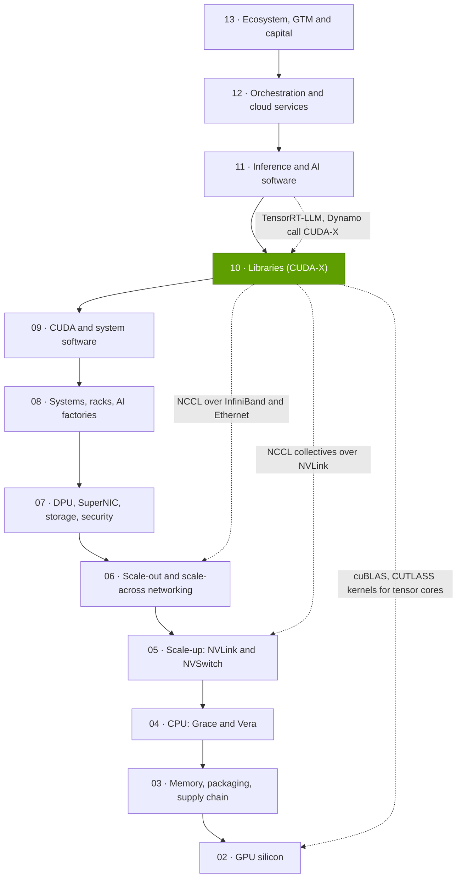
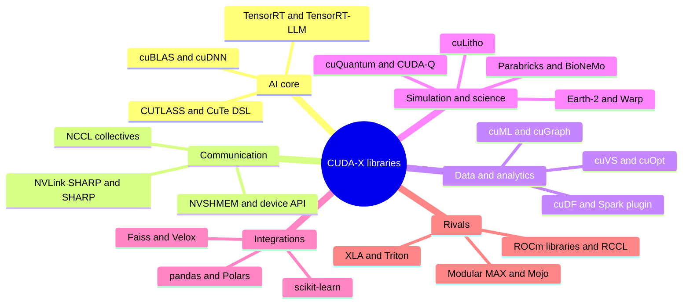

# Layer 10 — Libraries (CUDA-X)

Layer 10 of 12 · the domain libraries that turn NVIDIA GPUs into ready-made engines for math, AI, data, simulation and science · ~8 min read · Last verified: 2026-11-05

## ⚡ The Executive Take

- **[CUDA](../../glossary.md#cuda) is the language; [CUDA-X](../../glossary.md#cuda-x) is the shelf of pre-built, tuned libraries most customers actually call:** [cuBLAS](../../glossary.md#cublas) for matrix math, [cuDNN](../../glossary.md#cudnn) for neural-network layers, [NCCL](../../glossary.md#nccl) for multi-GPU communication, [TensorRT](../../glossary.md#tensorrt) for inference, [RAPIDS](../../glossary.md#rapids) for data science. NVIDIA cites "hundreds of libraries" [[S10047]](../../sources/bibliography.md#s10047); this repo dates a sample of 29 major ones, 18 of them launched since 2018.
- **[Q1 · Job & failure mode]** The job is to turn each new GPU's data-sheet FLOPS into delivered speed for a given workload. Rubin's dense [FP4](../../glossary.md#fp4) is 8.75× its [BF16](../../glossary.md#bf16) rate [[S100]](../../sources/bibliography.md#s100), but that gain is zero until a library ships FP4 matrix kernels; [CUTLASS](../../glossary.md#cutlass) already supports [NVFP4](../../glossary.md#nvfp4) and MXFP4 [[S10009]](../../sources/bibliography.md#s10009).
- **NCCL is the hidden glue of multi-GPU AI.** In-switch reduction halves an ideal 70B-gradient [all-reduce](../../glossary.md#all-reduce) on a GB200 [NVL72](../../glossary.md#nvl72) from 0.31 s to 0.16 s [[S34011]](../../sources/bibliography.md#s34011)[[S200]](../../sources/bibliography.md#s200). NCCL shipped 19 minor versions in 50 months [[S10038]](../../sources/bibliography.md#s10038).
- **Libraries keep improving fixed hardware:** software alone lifted B200 DeepSeek-R1 throughput from ~2,000 to 4,600 tokens/s per GPU in four months of 2025 [[S646]](../../sources/bibliography.md#s646).
- **Breadth creates demand beyond AI.** 12 of the 18 sample libraries launched since 2018 serve data, optimization, search, simulation, lithography, climate or quantum. TSMC runs [cuLitho](../../glossary.md#culitho) in production, with NVIDIA and partners claiming ~45× on curvilinear flows [[S10031]](../../sources/bibliography.md#s10031).
- **Integration, not new APIs:** unchanged pandas, Polars, scikit-learn, Spark and Faiss code now runs on GPUs [[S10013]](../../sources/bibliography.md#s10013)[[S10017]](../../sources/bibliography.md#s10017)[[S10015]](../../sources/bibliography.md#s10015)[[S10019]](../../sources/bibliography.md#s10019)[[S10025]](../../sources/bibliography.md#s10025).
- **Weakness and bear case:** speed-ups are uneven. In an AWS-run 1 TB Spark test GPUs were only 1.06× faster than plain Spark and slower than a vectorized CPU engine, though ~80% cheaper [[S10020]](../../sources/bibliography.md#s10020). The AI core is the easiest part to copy: AMD's [RCCL](../../glossary.md#rccl) is built from NCCL's own code [[S10002]](../../sources/bibliography.md#s10002), and Qualcomm's ~$3.9B purchase of Modular, closed on 2026-07-29, targets exactly this layer [[S90057]](../../sources/bibliography.md#s90057)[[S9511]](../../sources/bibliography.md#s9511).

![Stacked step chart of a sample of 29 major CUDA-X libraries by first public release year. 11 appeared from 2007 to 2017 (cuBLAS, cuFFT, cuSPARSE, cuRAND, cuDNN, NCCL, TensorRT, CUTLASS and others) and 18 from 2018 to 2025, of which 12 target data analytics, optimization, vector search, simulation, lithography, climate or quantum rather than AI models. 5 zero-code-change integrations (Spark, pandas, Polars, scikit-learn, Faiss) arrived from 2020 to 2025. NVIDIA itself cites hundreds of libraries; this is a dated sample.](../../assets/charts/10-cuda-x-library-timeline.svg)

> [!TIP]
> **Worked example — what a library release is worth in dollars.** NVIDIA's [TensorRT-LLM](../../glossary.md#tensorrt-llm) team raised B200 DeepSeek-R1 maximum throughput from ~2,000 to ~4,600 tokens/s per GPU between February and May 2025, with no new hardware [[S646]](../../sources/bibliography.md#s646). At an illustrative $4.99 per B200-hour (a reported 2025 list price, flagged for re-check) [[S395]](../../sources/bibliography.md#s395), one [GPU-hour](../../glossary.md#gpu-hour) produces 2,000 × 3,600 = 7.2M tokens before the update, costing ~$0.69 per million tokens. After the update it produces 16.6M tokens, costing ~$0.30 per million. **Conclusion:** the library update cut serving cost per token ~57%, the kind of gain that usually takes a new chip generation.

## Where this layer sits in the stack

## Layer map

## The eight questions at a glance

| # | Question | Short answer | Where answered |
|---|---|---|---|
| Q1 | What job does this layer do, and what breaks if it is weak? | Turns raw FLOPS and bandwidth into delivered speed; without tuned kernels a new GPU or format sits idle | [The CUDA-X catalog](the-cuda-x-catalog.md) |
| Q2 | Which metrics matter? | Share of peak achieved, collective bus bandwidth and latency, time to support new hardware, end-to-end cost vs CPU, breadth of integrations | This page (below) and [NCCL](nccl-the-hidden-glue.md) |
| Q3 | Generational progress? | Sample grows from 11 libraries (2017) to 29 (2025); NCCL 2.13 to 2.32 in 50 months; same-GPU software gains of 2.3× | [Why breadth compounds](why-library-breadth-compounds.md), [NCCL](nccl-the-hidden-glue.md) |
| Q4 | Source of advantage? | Accumulated tuning across every GPU generation, plus breadth and framework integration | [History and how built](history-and-how-built.md) |
| Q5 | Strongest challenger? | AMD's ROCm libraries (with RCCL) for AI; compiler stacks such as XLA and Triton chip away at the kernel layer | [Competition](competition.md) |
| Q6 | Replication cost? | The AI core can be rebuilt in years; the long tail of domain libraries is the expensive part | [History and how built](history-and-how-built.md) |
| Q7 | Roadmap? | 🟡 CuTe DSL leaving beta (target slipped), 🟢 NCCL GPU-initiated networking shipping, more zero-code-change integrations | [Roadmap](roadmap.md) |
| Q8 | Value pools and M&A? | Libraries are mostly free and monetized through GPUs and software licences; portability layers are the M&A target | [Value chain and corp dev](value-chain-and-corp-dev.md) |

## The metrics that matter

**[Q2 · Metrics that matter]** A library is judged by how much of the hardware it turns into finished work, at what cost:

| Metric | What it measures | Why it matters | Example |
|---|---|---|---|
| Share of peak achieved | Delivered FLOPS ÷ data-sheet FLOPS ([MFU](../../glossary.md#mfu) for whole jobs) | Effective price per FLOP | Llama 3 405B ran at 38–41% MFU on 16,384 H100s [[S34006]](../../sources/bibliography.md#s34006) |
| Collective [bus bandwidth](../../glossary.md#bus-bandwidth) and latency | GB/s per GPU sustained during all-reduce; µs per small message | Scaling past one server | H100 clusters are accepted at ~400–450 GB/s all-reduce bus bandwidth [[S10022]](../../sources/bibliography.md#s10022) |
| Time to support new silicon | Weeks from a new GPU or number format to tuned kernels | Delays idle the FLOPS | CUTLASS already covers NVFP4 and MXFP4 [[S10009]](../../sources/bibliography.md#s10009) |
| End-to-end speed and cost vs CPU | Job runtime and job cost on real pipelines | Non-AI buyers pay per job | Spark: 1.06× faster, ~5× cheaper [[S10020]](../../sources/bibliography.md#s10020) |
| Breadth | Domains and frameworks that run GPU-native | Each adds GPU demand | 5 zero-code-change integrations since 2020 |

**[Q3 · Generational progress]** Progress in this layer shows up as software gains on fixed hardware, as well as new libraries:

## Pages in this layer

| Page | What you will learn |
|---|---|
| [The CUDA-X catalog](the-cuda-x-catalog.md) | What each major library does and who pays for its workload |
| [NCCL, the hidden glue](nccl-the-hidden-glue.md) | Collectives, ring vs tree vs in-switch reduction, a 70B example, alternatives |
| [Why library breadth compounds](why-library-breadth-compounds.md) | New GPU workloads, Spark and pandas examples, integrations, library count |
| [Competition](competition.md) | ROCm, oneAPI, XLA and other library stacks compared with CUDA-X |
| [History and how NVIDIA built it](history-and-how-built.md) | Timeline, key decisions, replication cost, counterfactuals |
| [Roadmap](roadmap.md) | What is coming in libraries and what would change the picture |
| [Value chain and corp dev angles](value-chain-and-corp-dev.md) | Who captures the value of free libraries, private companies, M&A |

🔧 Under the hood: open core, closed core

Two licence tiers: PyPI lists cuBLAS and cuDNN as NVIDIA-proprietary [[S10038]](../../sources/bibliography.md#s10038). The periphery is open: CUTLASS (BSD-3) [[S10038]](../../sources/bibliography.md#s10038), cuDF (Apache 2.0) [[S10011]](../../sources/bibliography.md#s10011), cuOpt (Apache 2.0) [[S10026]](../../sources/bibliography.md#s10026) and Warp (Apache 2.0 since March 2025) [[S10028]](../../sources/bibliography.md#s10028). NCCL's current source files carry an Apache-2.0 licence tag [[S10000]](../../sources/bibliography.md#s10000). Layer 09 covers the layer underneath: [CUDA and system software](../09-cuda-and-system-software/index.md).

## 🎯 Corp Dev Lens

1. **A free product that sells hardware.** Most CUDA-X libraries are free; their value shows up in GPU pricing and AI Enterprise licences. How much of NVIDIA's premium comes from library breadth rather than silicon?
2. **Open periphery, closed core.** Open-sourcing cuDF, cuOpt and Warp invites contributors while cuBLAS and cuDNN stay closed. For a challenger, is it cheaper to match the closed AI core, or to target domains where NVIDIA's libraries are open and therefore portable?
3. **Qualcomm question (public information only):** with Modular (Mojo and MAX) being acquired for $3.9B [[S90057]](../../sources/bibliography.md#s90057) and AI200/AI250 inference racks announced [[S90028]](../../sources/bibliography.md#s90028), which CUDA-X families must an inference-first platform match on day one (GEMM, attention, collectives, serving), and which can it skip (lithography, genomics, data science)?
4. **The NCCL API as a de facto standard.** RCCL keeps NCCL's API [[S10002]](../../sources/bibliography.md#s10002), so frameworks switch vendors with little code change. Does a new [scale-up](../../glossary.md#scale-up) fabric ([UALink](../../glossary.md#ualink), [ESUN](../../glossary.md#esun)) need an NCCL-compatible library to be credible, and who supplies it?

## 📚 Sources

<!-- Auto-generated from the [S…] citations on this page by `make build`. Edit sources/registry/*.csv, not this list. -->

- [**S100**](../../sources/bibliography.md#s100) NVIDIA Technical Blog, *Inside the NVIDIA Vera Rubin Platform: Six New Chips, One AI Supercomputer*, 2026-01-05. [Link](https://developer.nvidia.com/blog/inside-the-nvidia-rubin-platform-six-new-chips-one-ai-supercomputer/)
- [**S200**](../../sources/bibliography.md#s200) NVIDIA, *NVIDIA NVLink and NVLink Switch (product page with NVLink and NVLink Switch specification tables)*, 2026-09. [Link](https://www.nvidia.com/en-us/data-center/nvlink/)
- [**S395**](../../sources/bibliography.md#s395) Lambda, *Lambda GPU cloud pricing*, 2025. [Link](https://lambda.ai/pricing)
- [**S646**](../../sources/bibliography.md#s646) NVIDIA TensorRT-LLM team, *Optimizing DeepSeek R1 Throughput on NVIDIA Blackwell GPUs: A Deep Dive for Developers (TensorRT-LLM tech blog 3)*, 2025-05-30. [Link](https://github.com/NVIDIA/TensorRT-LLM/blob/main/docs/source/blogs/tech_blog/blog03_Optimizing_DeepSeek_R1_Throughput_on_NVIDIA_Blackwell_GPUs.md)
- [**S9511**](../../sources/bibliography.md#s9511) Nasdaq (Qualcomm press release), *Qualcomm Completes Acquisition of Modular*, 2026-07-29. [Link](https://www.nasdaq.com/press-release/qualcomm-completes-acquisition-modular-2026-07-29)
- [**S10000**](../../sources/bibliography.md#s10000) NVIDIA (GitHub: NVIDIA/nccl), *NCCL README and makefiles/version.mk (master)*, 2026-11. [Link](https://github.com/NVIDIA/nccl/blob/master/README.md)
- [**S10002**](../../sources/bibliography.md#s10002) AMD (GitHub: ROCm/rccl), *RCCL README and LICENSE (develop branch)*, 2026-11. [Link](https://github.com/ROCm/rccl/blob/develop/README.md)
- [**S10009**](../../sources/bibliography.md#s10009) NVIDIA (GitHub: NVIDIA/cutlass), *CUTLASS README (4.8.1)*, 2026-10. [Link](https://github.com/NVIDIA/cutlass/blob/main/README.md)
- [**S10011**](../../sources/bibliography.md#s10011) NVIDIA RAPIDS (GitHub: rapidsai/cudf), *cuDF README*, 2026-11. [Link](https://github.com/rapidsai/cudf/blob/main/README.md)
- [**S10013**](../../sources/bibliography.md#s10013) NVIDIA RAPIDS (GitHub: rapidsai/cudf docs), *cudf.pandas documentation (index and benchmarks)*, 2026-11. [Link](https://github.com/rapidsai/cudf/blob/main/docs/cudf/source/cudf_pandas/index.rst)
- [**S10015**](../../sources/bibliography.md#s10015) NVIDIA RAPIDS (GitHub: rapidsai/cuml docs), *cuml.accel overview and benchmarks*, 2026. [Link](https://github.com/rapidsai/cuml/blob/main/docs/source/cuml-accel/benchmarks.rst)
- [**S10017**](../../sources/bibliography.md#s10017) Polars (GitHub: pola-rs/polars docs), *Polars user guide: GPU Support [Open Beta]*, 2026-11. [Link](https://github.com/pola-rs/polars/blob/main/docs/source/user-guide/gpu-support.md)
- [**S10019**](../../sources/bibliography.md#s10019) NVIDIA (GitHub: NVIDIA/cudf-spark), *NVIDIA cuDF plugin for Apache Spark README and docs index*, 2026-11. [Link](https://github.com/NVIDIA/cudf-spark/blob/main/README.md)
- [**S10020**](../../sources/bibliography.md#s10020) AWS Labs (GitHub: awslabs/data-on-eks), *Apache Spark with NVIDIA RAPIDS GPU Acceleration Benchmarks (data-on-eks)*, 2026-01-12. [Link](https://github.com/awslabs/data-on-eks/blob/main/website/docs/benchmarks/spark-rapids-gpu-benchmark.md)
- [**S10022**](../../sources/bibliography.md#s10022) Saturn Cloud, *Crusoe NCCL cluster validation (guide)*, 2025. [Link](https://saturncloud.io/blog/crusoe-nccl-cluster-validation/)
- [**S10025**](../../sources/bibliography.md#s10025) Engineering at Meta, *Accelerating GPU indexes in Faiss with NVIDIA cuVS*, 2025-05-08. [Link](https://engineering.fb.com/2025/05/08/data-infrastructure/accelerating-gpu-indexes-in-faiss-with-nvidia-cuvs/)
- [**S10026**](../../sources/bibliography.md#s10026) NVIDIA (GitHub: NVIDIA/cuopt), *cuOpt README and LICENSE*, 2026-11. [Link](https://github.com/NVIDIA/cuopt/blob/main/README.md)
- [**S10028**](../../sources/bibliography.md#s10028) NVIDIA (GitHub: NVIDIA/warp), *NVIDIA Warp README and CHANGELOG*, 2026-11-02. [Link](https://github.com/NVIDIA/warp/blob/main/CHANGELOG.md)
- [**S10031**](../../sources/bibliography.md#s10031) NVIDIA Newsroom, *TSMC and Synopsys Bring Breakthrough NVIDIA Computational Lithography Platform to Production*, 2024-03-18. [Link](https://nvidianews.nvidia.com/news/tsmc-synopsys-nvidia-culitho)
- [**S10038**](../../sources/bibliography.md#s10038) Python Package Index, *PyPI JSON release histories for NVIDIA library packages (nvidia-nccl-cu11/cu12/cu13, cudf-cu12, cudf-polars-cu12, cuml-cu12, cugraph-cu12, cuvs-cu12, warp-lang, cuquantum-python, cuda-quantum, cudaq, cuopt-cu12, nvidia-cutlass-dsl, earth2studio, nvmath-python, cuequivariance, nvidia-cudss-cu12, nvidia-modulus, nvidia-physicsnemo)*, 2026-11-05. [Link](https://pypi.org/)
- [**S10047**](../../sources/bibliography.md#s10047) NVIDIA Developer, *NVIDIA CUDA-X Libraries (developer page)*, 2026. [Link](https://developer.nvidia.com/cuda/cuda-x-libraries)
- [**S34006**](../../sources/bibliography.md#s34006) arXiv:2407.21783 (Llama Team (AI @ Meta)), *The Llama 3 Herd of Models*, 2024-07-31. [Link](https://arxiv.org/abs/2407.21783)
- [**S34011**](../../sources/bibliography.md#s34011) Journal of Parallel and Distributed Computing (Pitch Patarasuk, Xin Yuan), *Bandwidth optimal all-reduce algorithms for clusters of workstations*, 2009-02. [Link](https://doi.org/10.1016/j.jpdc.2008.09.002)
- [**S90028**](../../sources/bibliography.md#s90028) TechRepublic, *Qualcomm unveils AI chips to rival Nvidia, AMD*, 2025-10-27. [Link](https://techrepublic.com/article/news-qualcomm-unveils-ai-chips-to-rival-nvidia-amd)
- [**S90057**](../../sources/bibliography.md#s90057) StorageReview, *Qualcomm unveils Dragonfly data center roadmap: C1000 CPU, AI300 accelerator and Modular acquisition*, 2026-06-24. [Link](https://www.storagereview.com/es/news/qualcomm-unveils-dragonfly-data-center-roadmap-c1000-cpu-ai300-accelerator-and-modular-acquisition)
